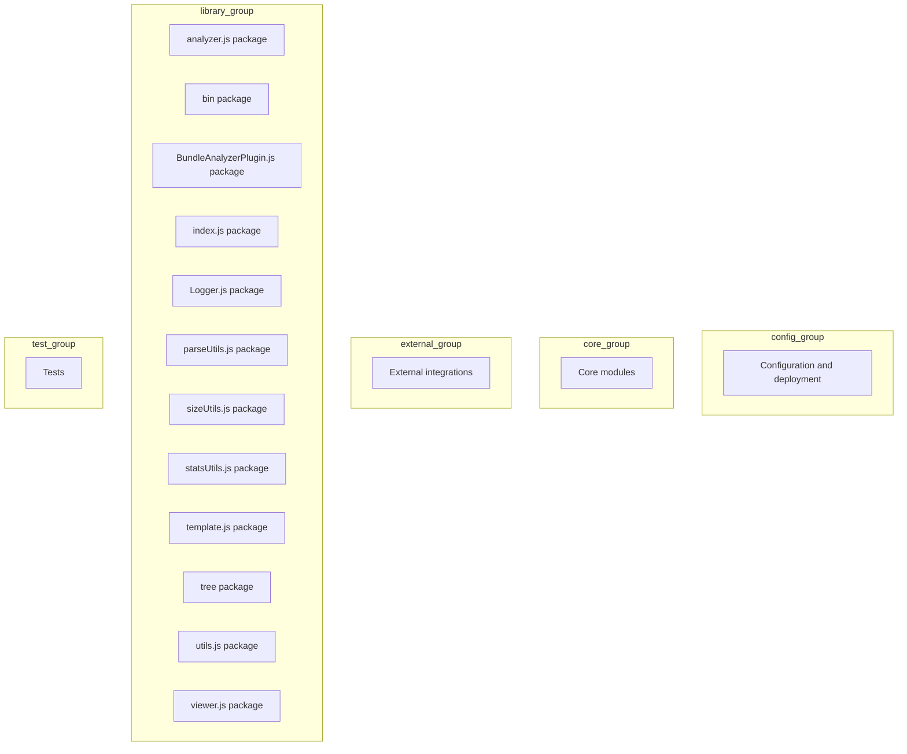

# Architecture report: webpack/webpack-bundle-analyzer

> Automated static analysis. **Observed** = directly seen in files/imports/AST; **Inferred** = interpretation from that evidence. Repository code was not executed.

## 1. Repository at a glance

| Item | Value |
| --- | --- |
| Repository | webpack/webpack-bundle-analyzer |
| Description | Webpack plugin and CLI utility that represents bundle content as convenient interactive zoomable treemap |
| Language | JavaScript |
| Stars | 12655 |
| Licence | MIT |
| Analysed commit / branch | f65668c9ab4ffe4b1989e5badbba3e0e871e1a24 / main |
| Framework(s) | None detected |
| Files analysed | 224 |
| Components | 16 |

## 2. Architecture in one minute

webpack/webpack-bundle-analyzer - Webpack plugin and CLI utility that represents bundle content as convenient interactive zoomable treemap. This repository was analysed statically from 224 file(s) (0 Python). Detected technologies (observed from imports/manifests): GitHub Actions, Jest, TypeScript, webpack. Files are grouped into 16 component(s): analyzer.js package, bin package, BundleAnalyzerPlugin.js package, Configuration and deployment, Core modules, External integrations, index.js package, Logger.js package. Findings below distinguish observed facts from inferred interpretation.

## 3. High-level block diagram

## 4. Main components

### analyzer.js package (`analyzer_js`)

- **Kind:** library
- **Status:** Observed
- **Confidence:** 0.85
- **Responsibility:** Groups 1 file(s) under analyzer.js package (observed from repository paths and static analysis).
- **Paths:** `src/analyzer.js`
- **Evidence:** [src/analyzer.js](https://github.com/webpack/webpack-bundle-analyzer/blob/f65668c9ab4ffe4b1989e5badbba3e0e871e1a24/src/analyzer.js)

### bin package (`bin`)

- **Kind:** library
- **Status:** Observed
- **Confidence:** 0.85
- **Responsibility:** Groups 2 file(s) under bin package (observed from repository paths and static analysis).
- **Paths:** `bin/install-test-webpack-versions.sh`, `src/bin/analyzer.js`
- **Evidence:** [bin/install-test-webpack-versions.sh](https://github.com/webpack/webpack-bundle-analyzer/blob/f65668c9ab4ffe4b1989e5badbba3e0e871e1a24/bin/install-test-webpack-versions.sh); [src/bin/analyzer.js](https://github.com/webpack/webpack-bundle-analyzer/blob/f65668c9ab4ffe4b1989e5badbba3e0e871e1a24/src/bin/analyzer.js)

### BundleAnalyzerPlugin.js package (`bundleanalyzerplugin_js`)

- **Kind:** library
- **Status:** Observed
- **Confidence:** 0.85
- **Responsibility:** Groups 1 file(s) under bundleanalyzerplugin.js package (observed from repository paths and static analysis).
- **Paths:** `src/BundleAnalyzerPlugin.js`
- **Evidence:** [src/BundleAnalyzerPlugin.js](https://github.com/webpack/webpack-bundle-analyzer/blob/f65668c9ab4ffe4b1989e5badbba3e0e871e1a24/src/BundleAnalyzerPlugin.js)

### Configuration and deployment (`config`)

- **Kind:** config
- **Status:** Observed
- **Confidence:** 0.85
- **Responsibility:** Groups 3 file(s) under configuration and deployment (observed from repository paths and static analysis).
- **Paths:** `client/.eslintrc.json`, `package.json`, `tsconfig.json`
- **Evidence:** [client/.eslintrc.json](https://github.com/webpack/webpack-bundle-analyzer/blob/f65668c9ab4ffe4b1989e5badbba3e0e871e1a24/client/.eslintrc.json); [package.json](https://github.com/webpack/webpack-bundle-analyzer/blob/f65668c9ab4ffe4b1989e5badbba3e0e871e1a24/package.json); [tsconfig.json](https://github.com/webpack/webpack-bundle-analyzer/blob/f65668c9ab4ffe4b1989e5badbba3e0e871e1a24/tsconfig.json)

### Core modules (`core`)

- **Kind:** core
- **Status:** Observed
- **Confidence:** 0.85
- **Responsibility:** Groups 4 file(s) under core modules (observed from repository paths and static analysis).
- **Paths:** `eslint.config.mjs`, `jest.config.js`, `prettier.config.mjs`, `webpack.config.js`
- **Evidence:** [eslint.config.mjs](https://github.com/webpack/webpack-bundle-analyzer/blob/f65668c9ab4ffe4b1989e5badbba3e0e871e1a24/eslint.config.mjs); [jest.config.js](https://github.com/webpack/webpack-bundle-analyzer/blob/f65668c9ab4ffe4b1989e5badbba3e0e871e1a24/jest.config.js); [prettier.config.mjs](https://github.com/webpack/webpack-bundle-analyzer/blob/f65668c9ab4ffe4b1989e5badbba3e0e871e1a24/prettier.config.mjs); [webpack.config.js](https://github.com/webpack/webpack-bundle-analyzer/blob/f65668c9ab4ffe4b1989e5badbba3e0e871e1a24/webpack.config.js)

### External integrations (`external_integrations`)

- **Kind:** external
- **Status:** Observed
- **Confidence:** 0.85
- **Responsibility:** Groups 24 file(s) under external integrations (observed from repository paths and static analysis).
- **Paths:** `client/components/Button.jsx`, `client/components/Checkbox.jsx`, `client/components/CheckboxList.jsx`, `client/components/CheckboxListItem.jsx`, `client/components/ContextMenu.jsx`, `client/components/ContextMenuItem.jsx`, `client/components/Dropdown.jsx`, `client/components/Icon.jsx`, `client/components/ModuleItem.jsx`, `client/components/ModulesList.jsx`, `client/components/ModulesTreemap.jsx`, `client/components/Search.jsx`, `client/components/Sidebar.jsx`, `client/components/Switcher.jsx`, `client/components/SwitcherItem.jsx`, `client/components/ThemeToggle.jsx`, `client/components/Tooltip.jsx`, `client/components/Treemap.jsx`, `client/components/types.js`, `client/lib/PureComponent.jsx`, `client/localStorage.js`, `client/store.js`, `client/utils.js`, `client/viewer.jsx`
- **Evidence:** [client/components/Button.jsx](https://github.com/webpack/webpack-bundle-analyzer/blob/f65668c9ab4ffe4b1989e5badbba3e0e871e1a24/client/components/Button.jsx); [client/components/Checkbox.jsx](https://github.com/webpack/webpack-bundle-analyzer/blob/f65668c9ab4ffe4b1989e5badbba3e0e871e1a24/client/components/Checkbox.jsx); [client/components/CheckboxList.jsx](https://github.com/webpack/webpack-bundle-analyzer/blob/f65668c9ab4ffe4b1989e5badbba3e0e871e1a24/client/components/CheckboxList.jsx); [client/components/CheckboxListItem.jsx](https://github.com/webpack/webpack-bundle-analyzer/blob/f65668c9ab4ffe4b1989e5badbba3e0e871e1a24/client/components/CheckboxListItem.jsx); [client/components/ContextMenu.jsx](https://github.com/webpack/webpack-bundle-analyzer/blob/f65668c9ab4ffe4b1989e5badbba3e0e871e1a24/client/components/ContextMenu.jsx); [client/components/ContextMenuItem.jsx](https://github.com/webpack/webpack-bundle-analyzer/blob/f65668c9ab4ffe4b1989e5badbba3e0e871e1a24/client/components/ContextMenuItem.jsx); [client/components/Dropdown.jsx](https://github.com/webpack/webpack-bundle-analyzer/blob/f65668c9ab4ffe4b1989e5badbba3e0e871e1a24/client/components/Dropdown.jsx); [client/components/Icon.jsx](https://github.com/webpack/webpack-bundle-analyzer/blob/f65668c9ab4ffe4b1989e5badbba3e0e871e1a24/client/components/Icon.jsx)

### index.js package (`index_js`)

- **Kind:** library
- **Status:** Observed
- **Confidence:** 0.85
- **Responsibility:** Groups 1 file(s) under index.js package (observed from repository paths and static analysis).
- **Paths:** `src/index.js`
- **Evidence:** [src/index.js](https://github.com/webpack/webpack-bundle-analyzer/blob/f65668c9ab4ffe4b1989e5badbba3e0e871e1a24/src/index.js)

### Logger.js package (`logger_js`)

- **Kind:** library
- **Status:** Observed
- **Confidence:** 0.85
- **Responsibility:** Groups 1 file(s) under logger.js package (observed from repository paths and static analysis).
- **Paths:** `src/Logger.js`
- **Evidence:** [src/Logger.js](https://github.com/webpack/webpack-bundle-analyzer/blob/f65668c9ab4ffe4b1989e5badbba3e0e871e1a24/src/Logger.js)

### parseUtils.js package (`parseutils_js`)

- **Kind:** library
- **Status:** Observed
- **Confidence:** 0.85
- **Responsibility:** Groups 1 file(s) under parseutils.js package (observed from repository paths and static analysis).
- **Paths:** `src/parseUtils.js`
- **Evidence:** [src/parseUtils.js](https://github.com/webpack/webpack-bundle-analyzer/blob/f65668c9ab4ffe4b1989e5badbba3e0e871e1a24/src/parseUtils.js)

### sizeUtils.js package (`sizeutils_js`)

- **Kind:** library
- **Status:** Observed
- **Confidence:** 0.85
- **Responsibility:** Groups 1 file(s) under sizeutils.js package (observed from repository paths and static analysis).
- **Paths:** `src/sizeUtils.js`
- **Evidence:** [src/sizeUtils.js](https://github.com/webpack/webpack-bundle-analyzer/blob/f65668c9ab4ffe4b1989e5badbba3e0e871e1a24/src/sizeUtils.js)

### statsUtils.js package (`statsutils_js`)

- **Kind:** library
- **Status:** Observed
- **Confidence:** 0.85
- **Responsibility:** Groups 1 file(s) under statsutils.js package (observed from repository paths and static analysis).
- **Paths:** `src/statsUtils.js`
- **Evidence:** [src/statsUtils.js](https://github.com/webpack/webpack-bundle-analyzer/blob/f65668c9ab4ffe4b1989e5badbba3e0e871e1a24/src/statsUtils.js)

### template.js package (`template_js`)

- **Kind:** library
- **Status:** Observed
- **Confidence:** 0.85
- **Responsibility:** Groups 1 file(s) under template.js package (observed from repository paths and static analysis).
- **Paths:** `src/template.js`
- **Evidence:** [src/template.js](https://github.com/webpack/webpack-bundle-analyzer/blob/f65668c9ab4ffe4b1989e5badbba3e0e871e1a24/src/template.js)

### Tests (`tests`)

- **Kind:** test
- **Status:** Observed
- **Confidence:** 0.85
- **Responsibility:** Groups 130 file(s) under tests (observed from repository paths and static analysis).
- **Paths:** `test/.eslintrc.json`, `test/.gitignore`, `test/Logger.js`, `test/analyzer.js`, `test/analyzerUtils.js`, `test/bundles/invalidBundle.js`, `test/bundles/validBundleWithArrowFunction.js`, `test/bundles/validBundleWithArrowFunction.modules.json`, `test/bundles/validBundleWithEsNextFeatures.js`, `test/bundles/validBundleWithEsNextFeatures.modules.json`, `test/bundles/validBundleWithIIFE.js`, `test/bundles/validBundleWithIIFE.modules.json`, `test/bundles/validCommonBundleWithDedupePlugin.js`, `test/bundles/validCommonBundleWithDedupePlugin.modules.json`, `test/bundles/validCommonBundleWithModulesAsArray.js`, `test/bundles/validCommonBundleWithModulesAsArray.modules.json`, `test/bundles/validCommonBundleWithModulesAsObject.js`, `test/bundles/validCommonBundleWithModulesAsObject.modules.json`, `test/bundles/validExtraBundleWithModulesAsArray.js`, `test/bundles/validExtraBundleWithModulesAsArray.modules.json`, `test/bundles/validExtraBundleWithModulesInsideArrayConcat.js`, `test/bundles/validExtraBundleWithModulesInsideArrayConcat.modules.json`, `test/bundles/validExtraBundleWithNamedChunk.js`, `test/bundles/validExtraBundleWithNamedChunk.modules.json`, `test/bundles/validJsonpWithArrayConcatAndEntryPoint.js`, `test/bundles/validJsonpWithArrayConcatAndEntryPoint.modules.json`, `test/bundles/validNodeBundle.js`, `test/bundles/validNodeBundle.modules.json`, `test/bundles/validUmdLibraryBundleWithModulesAsArray.js`, `test/bundles/validUmdLibraryBundleWithModulesAsArray.modules.json`, `test/bundles/validWebpack4AsyncChunk.js`, `test/bundles/validWebpack4AsyncChunk.modules.json`, `test/bundles/validWebpack4AsyncChunkAndEntryPoint.js`, `test/bundles/validWebpack4AsyncChunkAndEntryPoint.modules.json`, `test/bundles/validWebpack4AsyncChunkUsingCustomGlobalObject.js`, `test/bundles/validWebpack4AsyncChunkUsingCustomGlobalObject.modules.json`, `test/bundles/validWebpack4AsyncChunkUsingSelfInsteadOfWindow.js`, `test/bundles/validWebpack4AsyncChunkUsingSelfInsteadOfWindow.modules.json`, `test/bundles/validWebpack4AsyncChunkUsingThisInsteadOfWindow.js`, `test/bundles/validWebpack4AsyncChunkUsingThisInsteadOfWindow.modules.json`, `test/bundles/validWebpack4AsyncChunkWithOptimizedModulesArray.js`, `test/bundles/validWebpack4AsyncChunkWithOptimizedModulesArray.modules.json`, `test/bundles/validWebpack4AsyncChunkWithWebWorkerChunkTemplatePlugin.js`, `test/bundles/validWebpack4AsyncChunkWithWebWorkerChunkTemplatePlugin.modules.json`, `test/bundles/validWebpack5LegacyBundle.js`, `test/bundles/validWebpack5LegacyBundle.modules.json`, `test/bundles/validWebpack5ModernBundle.js`, `test/bundles/validWebpack5ModernBundle.modules.json`, `test/bundles/validWebpack5NestedModuleAccessor.js`, `test/bundles/validWebpack5NestedModuleAccessor.modules.json`, `test/bundles/validWebpack5UmdBundle.js`, `test/bundles/validWebpack5UmdBundle.modules.json`, `test/bundles/webpack5NestedModulesWithoutRuntime.js`, `test/bundles/webpack5TopLevelModulesWithoutRuntime.js`, `test/bundles/webpack5TopLevelModulesWithoutRuntime.modules.json`, `test/bundles/webpack5UmdBundleWithDecoyIIFE.js`, `test/bundles/webpack5UmdBundleWithDecoyIIFE.modules.json`, `test/dev-server.js`, `test/dev-server/.gitignore`, `test/dev-server/src.js`, `test/dev-server/webpack.config.js`, `test/helpers.js`, `test/parseUtils.js`, `test/plugin.js`, `test/src/a-clone.js`, `test/src/a.js`, `test/src/b.js`, `test/src/index.js`, `test/stats/extremely-optimized-webpack-5-bundle/bundle.js`, `test/stats/extremely-optimized-webpack-5-bundle/expected-chart-data.js`, `test/stats/extremely-optimized-webpack-5-bundle/stats.json`, `test/stats/minimal-stats/stats.json`, `test/stats/webpack-5-bundle-with-concatenated-entry-module/app.js`, `test/stats/webpack-5-bundle-with-concatenated-entry-module/expected-chart-data.json`, `test/stats/webpack-5-bundle-with-concatenated-entry-module/stats.json`, `test/stats/webpack-5-bundle-with-multiple-entries/bundle.js`, `test/stats/webpack-5-bundle-with-multiple-entries/expected-chart-data.js`, `test/stats/webpack-5-bundle-with-multiple-entries/stats.json`, `test/stats/webpack-5-bundle-with-single-entry/bundle.js`, `test/stats/webpack-5-bundle-with-single-entry/expected-chart-data.js`, `test/stats/webpack-5-bundle-with-single-entry/stats.json`, `test/stats/with-array-config/config-1-main.js`, `test/stats/with-array-config/config-2-main.js`, `test/stats/with-array-config/stats.json`, `test/stats/with-children-array.json`, `test/stats/with-cjs-chunk.json`, `test/stats/with-invalid-chunk/invalid-chunk.js`, `test/stats/with-invalid-chunk/stats.json`, `test/stats/with-invalid-chunk/valid-chunk.js`, `test/stats/with-invalid-dynamic-require.json`, `test/stats/with-missing-chunk/stats.json`, `test/stats/with-missing-chunk/valid-chunk.js`, `test/stats/with-missing-module-chunks/stats.json`, `test/stats/with-missing-module-chunks/valid-chunk.js`, `test/stats/with-missing-parsed-module/bundle.js`, `test/stats/with-missing-parsed-module/stats.json`, `test/stats/with-module-concatenation-info/bundle.js`, `test/stats/with-module-concatenation-info/expected-chart-data.js`, `test/stats/with-module-concatenation-info/stats.json`, `test/stats/with-module-in-multiple-assets/README.md`, `test/stats/with-module-in-multiple-assets/long-message.js`, `test/stats/with-module-in-multiple-assets/short-message.js`, `test/stats/with-module-in-multiple-assets/src/long-message-entry.js`, `test/stats/with-module-in-multiple-assets/src/messages.js`, `test/stats/with-module-in-multiple-assets/src/short-message-entry.js`, `test/stats/with-module-in-multiple-assets/stats.json`, `test/stats/with-module-in-multiple-assets/webpack.config.js`, `test/stats/with-modules-chunk.json`, `test/stats/with-modules-in-chunks/expected-chart-data.js`, `test/stats/with-modules-in-chunks/stats.json`, `test/stats/with-multiple-entrypoints/expected-chart-data.js`, `test/stats/with-multiple-entrypoints/stats.json`, `test/stats/with-no-entrypoints/stats.json`, `test/stats/with-non-asset-asset/bundle.js`, `test/stats/with-non-asset-asset/stats.json`, `test/stats/with-special-chars/bundle.js`, `test/stats/with-special-chars/expected-chart-data.js`, `test/stats/with-special-chars/stats.json`, `test/stats/with-worker-loader-dynamic-import/1.bundle.js`, `test/stats/with-worker-loader-dynamic-import/1.bundle.worker.js`, `test/stats/with-worker-loader-dynamic-import/bundle.js`, `test/stats/with-worker-loader-dynamic-import/bundle.worker.js`, `test/stats/with-worker-loader-dynamic-import/stats.json`, `test/stats/with-worker-loader/bundle.js`, `test/stats/with-worker-loader/bundle.worker.js`, `test/statsUtils.js`, `test/store.js`, `test/tree.js`, `test/utils.js`, `test/viewer.js`
- **Evidence:** [test/.eslintrc.json](https://github.com/webpack/webpack-bundle-analyzer/blob/f65668c9ab4ffe4b1989e5badbba3e0e871e1a24/test/.eslintrc.json); [test/.gitignore](https://github.com/webpack/webpack-bundle-analyzer/blob/f65668c9ab4ffe4b1989e5badbba3e0e871e1a24/test/.gitignore); [test/Logger.js](https://github.com/webpack/webpack-bundle-analyzer/blob/f65668c9ab4ffe4b1989e5badbba3e0e871e1a24/test/Logger.js); [test/analyzer.js](https://github.com/webpack/webpack-bundle-analyzer/blob/f65668c9ab4ffe4b1989e5badbba3e0e871e1a24/test/analyzer.js); [test/analyzerUtils.js](https://github.com/webpack/webpack-bundle-analyzer/blob/f65668c9ab4ffe4b1989e5badbba3e0e871e1a24/test/analyzerUtils.js); [test/bundles/invalidBundle.js](https://github.com/webpack/webpack-bundle-analyzer/blob/f65668c9ab4ffe4b1989e5badbba3e0e871e1a24/test/bundles/invalidBundle.js); [test/bundles/validBundleWithArrowFunction.js](https://github.com/webpack/webpack-bundle-analyzer/blob/f65668c9ab4ffe4b1989e5badbba3e0e871e1a24/test/bundles/validBundleWithArrowFunction.js); [test/bundles/validBundleWithArrowFunction.modules.json](https://github.com/webpack/webpack-bundle-analyzer/blob/f65668c9ab4ffe4b1989e5badbba3e0e871e1a24/test/bundles/validBundleWithArrowFunction.modules.json)

### tree package (`tree`)

- **Kind:** library
- **Status:** Observed
- **Confidence:** 0.85
- **Responsibility:** Groups 8 file(s) under tree package (observed from repository paths and static analysis).
- **Paths:** `src/tree/BaseFolder.js`, `src/tree/ConcatenatedModule.js`, `src/tree/ContentFolder.js`, `src/tree/ContentModule.js`, `src/tree/Folder.js`, `src/tree/Module.js`, `src/tree/Node.js`, `src/tree/utils.js`
- **Evidence:** [src/tree/BaseFolder.js](https://github.com/webpack/webpack-bundle-analyzer/blob/f65668c9ab4ffe4b1989e5badbba3e0e871e1a24/src/tree/BaseFolder.js); [src/tree/ConcatenatedModule.js](https://github.com/webpack/webpack-bundle-analyzer/blob/f65668c9ab4ffe4b1989e5badbba3e0e871e1a24/src/tree/ConcatenatedModule.js); [src/tree/ContentFolder.js](https://github.com/webpack/webpack-bundle-analyzer/blob/f65668c9ab4ffe4b1989e5badbba3e0e871e1a24/src/tree/ContentFolder.js); [src/tree/ContentModule.js](https://github.com/webpack/webpack-bundle-analyzer/blob/f65668c9ab4ffe4b1989e5badbba3e0e871e1a24/src/tree/ContentModule.js); [src/tree/Folder.js](https://github.com/webpack/webpack-bundle-analyzer/blob/f65668c9ab4ffe4b1989e5badbba3e0e871e1a24/src/tree/Folder.js); [src/tree/Module.js](https://github.com/webpack/webpack-bundle-analyzer/blob/f65668c9ab4ffe4b1989e5badbba3e0e871e1a24/src/tree/Module.js); [src/tree/Node.js](https://github.com/webpack/webpack-bundle-analyzer/blob/f65668c9ab4ffe4b1989e5badbba3e0e871e1a24/src/tree/Node.js); [src/tree/utils.js](https://github.com/webpack/webpack-bundle-analyzer/blob/f65668c9ab4ffe4b1989e5badbba3e0e871e1a24/src/tree/utils.js)

### utils.js package (`utils_js`)

- **Kind:** library
- **Status:** Observed
- **Confidence:** 0.85
- **Responsibility:** Groups 1 file(s) under utils.js package (observed from repository paths and static analysis).
- **Paths:** `src/utils.js`
- **Evidence:** [src/utils.js](https://github.com/webpack/webpack-bundle-analyzer/blob/f65668c9ab4ffe4b1989e5badbba3e0e871e1a24/src/utils.js)

### viewer.js package (`viewer_js`)

- **Kind:** library
- **Status:** Observed
- **Confidence:** 0.85
- **Responsibility:** Groups 1 file(s) under viewer.js package (observed from repository paths and static analysis).
- **Paths:** `src/viewer.js`
- **Evidence:** [src/viewer.js](https://github.com/webpack/webpack-bundle-analyzer/blob/f65668c9ab4ffe4b1989e5badbba3e0e871e1a24/src/viewer.js)

## 5. Execution flow

**Observed** entry point(s):

- [src/index.js](https://github.com/webpack/webpack-bundle-analyzer/blob/f65668c9ab4ffe4b1989e5badbba3e0e871e1a24/src/index.js)

Representative flow (derived from observed entry points and the import graph; steps beyond the entry point are **Inferred**):

1. Execution starts at an observed entry point listed above, if present.
2. No internal import relationships between components were observed.

## 6. Project structure

### `(root)`

- `.babelrc` - other (184 bytes)
- `.browserslistrc` - other (109 bytes)
- `.editorconfig` - config (190 bytes)
- `.gitignore` - other (62 bytes)
- `.npm-upgrade.json` - config (325 bytes)
- `.nvmrc` - other (9 bytes)
- `.prettierignore` - other (69 bytes)
- `CHANGELOG.md` - docs (29473 bytes)
- `CONTRIBUTING.md` - docs (3066 bytes)
- `LICENSE` - docs (1071 bytes)
- `README.md` - docs (20155 bytes)
- `eslint.config.mjs` - source, JavaScript (1075 bytes)
- `jest.config.js` - source, JavaScript (533 bytes)
- `package.json` - manifest (3846 bytes)
- `prettier.config.mjs` - source, JavaScript (102 bytes)
- `tsconfig.json` - config (273 bytes)
- `webpack.config.js` - source, JavaScript (3369 bytes)

### `.changeset`

- `.changeset/README.md` - docs (512 bytes)
- `.changeset/changelog-generator.mjs` - source, JavaScript (3932 bytes)
- `.changeset/cli-default-sizes-compressed.md` - docs (211 bytes)
- `.changeset/config.json` - config (313 bytes)
- `.changeset/flatten-large-module-lists.md` - docs (172 bytes)
- `.changeset/module-parsed-size-utf8.md` - docs (188 bytes)

### `.github`

- `.github/workflows/main.yml` - ci, YAML (1517 bytes)
- `.github/workflows/release.yml` - ci, YAML (1201 bytes)

### `bin`

- `bin/install-test-webpack-versions.sh` - source, Shell (108 bytes)

### `client`

- `client/.eslintrc.json` - config (320 bytes)
- `client/assets/icon-arrow-right.svg` - other (226 bytes)
- `client/assets/icon-chunk.svg` - other (611 bytes)
- `client/assets/icon-folder.svg` - other (354 bytes)
- `client/assets/icon-invisible.svg` - other (462 bytes)
- `client/assets/icon-module.svg` - other (425 bytes)
- `client/assets/icon-moon.svg` - other (150 bytes)
- `client/assets/icon-pin.svg` - other (662 bytes)
- `client/assets/icon-sun.svg` - other (249 bytes)
- `client/components/Button.css` - other (522 bytes)
- `client/components/Button.jsx` - source, JavaScript (1124 bytes)
- `client/components/Checkbox.css` - other (185 bytes)
- `client/components/Checkbox.jsx` - source, JavaScript (836 bytes)
- `client/components/CheckboxList.css` - other (176 bytes)
- `client/components/CheckboxList.jsx` - source, JavaScript (3168 bytes)
- `client/components/CheckboxListItem.jsx` - source, JavaScript (966 bytes)
- `client/components/ContextMenu.css` - other (365 bytes)
- `client/components/ContextMenu.jsx` - source, JavaScript (4015 bytes)
- `client/components/ContextMenuItem.css` - other (259 bytes)
- `client/components/ContextMenuItem.jsx` - source, JavaScript (974 bytes)
- `client/components/Dropdown.css` - other (472 bytes)
- `client/components/Dropdown.jsx` - source, JavaScript (2635 bytes)
- `client/components/Icon.css` - other (148 bytes)
- `client/components/Icon.jsx` - source, JavaScript (1493 bytes)
- `client/components/ModuleItem.css` - other (623 bytes)
- `client/components/ModuleItem.jsx` - source, JavaScript (2788 bytes)
- `client/components/ModulesList.css` - other (41 bytes)
- `client/components/ModulesList.jsx` - source, JavaScript (1162 bytes)
- `client/components/ModulesTreemap.css` - other (740 bytes)
- `client/components/ModulesTreemap.jsx` - source, JavaScript (11545 bytes)
- `client/components/Search.css` - other (590 bytes)
- `client/components/Search.jsx` - source, JavaScript (2242 bytes)
- `client/components/Sidebar.css` - other (1390 bytes)
- `client/components/Sidebar.jsx` - source, JavaScript (5076 bytes)
- `client/components/Switcher.css` - other (177 bytes)
- `client/components/Switcher.jsx` - source, JavaScript (995 bytes)
- `client/components/SwitcherItem.jsx` - source, JavaScript (598 bytes)
- `client/components/ThemeToggle.css` - other (368 bytes)
- `client/components/ThemeToggle.jsx` - source, JavaScript (703 bytes)
- `client/components/Tooltip.css` - other (479 bytes)
- `client/components/Tooltip.jsx` - source, JavaScript (1979 bytes)
- `client/components/Treemap.jsx` - source, JavaScript (7602 bytes)
- `client/components/types.js` - source, JavaScript (1533 bytes)
- `client/lib/PureComponent.jsx` - source, JavaScript (646 bytes)
- `client/localStorage.js` - source, JavaScript (550 bytes)
- `client/store.js` - source, JavaScript (6830 bytes)
- `client/utils.js` - source, JavaScript (809 bytes)
- `client/viewer.css` - other (959 bytes)
- `client/viewer.jsx` - source, JavaScript (1033 bytes)

### `src`

- `src/BundleAnalyzerPlugin.js` - source, JavaScript (10080 bytes)
- `src/Logger.js` - source, JavaScript (4805 bytes)
- `src/analyzer.js` - source, JavaScript (18507 bytes)
- `src/bin/analyzer.js` - source, JavaScript (6136 bytes)
- `src/index.js` - source, JavaScript (130 bytes)
- `src/parseUtils.js` - source, JavaScript (18072 bytes)
- `src/sizeUtils.js` - source, JavaScript (756 bytes)
- `src/statsUtils.js` - source, JavaScript (2391 bytes)
- `src/template.js` - source, JavaScript (5935 bytes)
- `src/tree/BaseFolder.js` - source, JavaScript (4804 bytes)
- `src/tree/ConcatenatedModule.js` - source, JavaScript (4699 bytes)
- `src/tree/ContentFolder.js` - source, JavaScript (1903 bytes)
- `src/tree/ContentModule.js` - source, JavaScript (1756 bytes)
- `src/tree/Folder.js` - source, JavaScript (3737 bytes)
- `src/tree/Module.js` - source, JavaScript (3694 bytes)
- `src/tree/Node.js` - source, JavaScript (542 bytes)
- `src/tree/utils.js` - source, JavaScript (1836 bytes)
- `src/utils.js` - source, JavaScript (2765 bytes)
- `src/viewer.js` - source, JavaScript (9972 bytes)

### `test`

- `test/.eslintrc.json` - test (204 bytes)
- `test/.gitignore` - test (77 bytes)
- `test/Logger.js` - test, JavaScript (9277 bytes)
- `test/analyzer.js` - test, JavaScript (20027 bytes)
- `test/analyzerUtils.js` - test, JavaScript (20430 bytes)
- `test/bundles/invalidBundle.js` - test, JavaScript (35 bytes)
- `test/bundles/validBundleWithArrowFunction.js` - test, JavaScript (65 bytes)
- `test/bundles/validBundleWithArrowFunction.modules.json` - test (82 bytes)
- `test/bundles/validBundleWithEsNextFeatures.js` - test, JavaScript (428 bytes)
- `test/bundles/validBundleWithEsNextFeatures.modules.json` - test (468 bytes)
- `test/bundles/validBundleWithIIFE.js` - test, JavaScript (39 bytes)
- `test/bundles/validBundleWithIIFE.modules.json` - test (20 bytes)
- `test/bundles/validCommonBundleWithDedupePlugin.js` - test, JavaScript (573 bytes)
- `test/bundles/validCommonBundleWithDedupePlugin.modules.json` - test (179 bytes)
- `test/bundles/validCommonBundleWithModulesAsArray.js` - test, JavaScript (906 bytes)
- `test/bundles/validCommonBundleWithModulesAsArray.modules.json` - test (219 bytes)
- `test/bundles/validCommonBundleWithModulesAsObject.js` - test, JavaScript (1117 bytes)
- `test/bundles/validCommonBundleWithModulesAsObject.modules.json` - test (407 bytes)
- `test/bundles/validExtraBundleWithModulesAsArray.js` - test, JavaScript (74 bytes)
- `test/bundles/validExtraBundleWithModulesAsArray.modules.json` - test (92 bytes)
- `test/bundles/validExtraBundleWithModulesInsideArrayConcat.js` - test, JavaScript (516 bytes)
- `test/bundles/validExtraBundleWithModulesInsideArrayConcat.modules.json` - test (515 bytes)
- `test/bundles/validExtraBundleWithNamedChunk.js` - test, JavaScript (77 bytes)
- `test/bundles/validExtraBundleWithNamedChunk.modules.json` - test (80 bytes)
- `test/bundles/validJsonpWithArrayConcatAndEntryPoint.js` - test, JavaScript (95 bytes)
- `test/bundles/validJsonpWithArrayConcatAndEntryPoint.modules.json` - test (96 bytes)
- `test/bundles/validNodeBundle.js` - test, JavaScript (225 bytes)
- `test/bundles/validNodeBundle.modules.json` - test (219 bytes)
- `test/bundles/validUmdLibraryBundleWithModulesAsArray.js` - test, JavaScript (555 bytes)
- `test/bundles/validUmdLibraryBundleWithModulesAsArray.modules.json` - test (216 bytes)
- `test/bundles/validWebpack4AsyncChunk.js` - test, JavaScript (113 bytes)
- `test/bundles/validWebpack4AsyncChunk.modules.json` - test (83 bytes)
- `test/bundles/validWebpack4AsyncChunkAndEntryPoint.js` - test, JavaScript (133 bytes)
- `test/bundles/validWebpack4AsyncChunkAndEntryPoint.modules.json` - test (83 bytes)
- `test/bundles/validWebpack4AsyncChunkUsingCustomGlobalObject.js` - test, JavaScript (215 bytes)
- `test/bundles/validWebpack4AsyncChunkUsingCustomGlobalObject.modules.json` - test (82 bytes)
- `test/bundles/validWebpack4AsyncChunkUsingSelfInsteadOfWindow.js` - test, JavaScript (105 bytes)
- `test/bundles/validWebpack4AsyncChunkUsingSelfInsteadOfWindow.modules.json` - test (81 bytes)
- `test/bundles/validWebpack4AsyncChunkUsingThisInsteadOfWindow.js` - test, JavaScript (105 bytes)
- `test/bundles/validWebpack4AsyncChunkUsingThisInsteadOfWindow.modules.json` - test (81 bytes)
- `test/bundles/validWebpack4AsyncChunkWithOptimizedModulesArray.js` - test, JavaScript (145 bytes)
- `test/bundles/validWebpack4AsyncChunkWithOptimizedModulesArray.modules.json` - test (82 bytes)
- `test/bundles/validWebpack4AsyncChunkWithWebWorkerChunkTemplatePlugin.js` - test, JavaScript (79 bytes)
- `test/bundles/validWebpack4AsyncChunkWithWebWorkerChunkTemplatePlugin.modules.json` - test (81 bytes)
- `test/bundles/validWebpack5LegacyBundle.js` - test, JavaScript (265 bytes)
- `test/bundles/validWebpack5LegacyBundle.modules.json` - test (171 bytes)
- `test/bundles/validWebpack5ModernBundle.js` - test, JavaScript (236 bytes)
- `test/bundles/validWebpack5ModernBundle.modules.json` - test (147 bytes)
- `test/bundles/validWebpack5NestedModuleAccessor.js` - test, JavaScript (106 bytes)
- `test/bundles/validWebpack5NestedModuleAccessor.modules.json` - test (69 bytes)
- `test/bundles/validWebpack5UmdBundle.js` - test, JavaScript (2006 bytes)
- `test/bundles/validWebpack5UmdBundle.modules.json` - test (273 bytes)
- `test/bundles/webpack5NestedModulesWithoutRuntime.js` - test, JavaScript (235 bytes)
- `test/bundles/webpack5TopLevelModulesWithoutRuntime.js` - test, JavaScript (127 bytes)
- `test/bundles/webpack5TopLevelModulesWithoutRuntime.modules.json` - test (65 bytes)
- `test/bundles/webpack5UmdBundleWithDecoyIIFE.js` - test, JavaScript (2174 bytes)
- `test/bundles/webpack5UmdBundleWithDecoyIIFE.modules.json` - test (273 bytes)
- `test/dev-server.js` - test, JavaScript (1480 bytes)
- `test/dev-server/.gitignore` - test (7 bytes)
- `test/dev-server/src.js` - test, JavaScript (31 bytes)
- `test/dev-server/webpack.config.js` - test, JavaScript (456 bytes)
- `test/helpers.js` - test, JavaScript (4051 bytes)
- `test/parseUtils.js` - test, JavaScript (2709 bytes)
- `test/plugin.js` - test, JavaScript (16404 bytes)
- `test/src/a-clone.js` - test, JavaScript (29 bytes)
- `test/src/a.js` - test, JavaScript (29 bytes)
- `test/src/b.js` - test, JavaScript (29 bytes)
- `test/src/index.js` - test, JavaScript (54 bytes)
- `test/stats/extremely-optimized-webpack-5-bundle/bundle.js` - test, JavaScript (58 bytes)
- `test/stats/extremely-optimized-webpack-5-bundle/expected-chart-data.js` - test, JavaScript (2031 bytes)
- `test/stats/extremely-optimized-webpack-5-bundle/stats.json` - test (24032 bytes)
- `test/stats/minimal-stats/stats.json` - test (5733 bytes)
- `test/stats/webpack-5-bundle-with-concatenated-entry-module/app.js` - test, JavaScript (90 bytes)
- `test/stats/webpack-5-bundle-with-concatenated-entry-module/expected-chart-data.json` - test (1669 bytes)
- `test/stats/webpack-5-bundle-with-concatenated-entry-module/stats.json` - test (33180 bytes)
- `test/stats/webpack-5-bundle-with-multiple-entries/bundle.js` - test, JavaScript (488 bytes)
- `test/stats/webpack-5-bundle-with-multiple-entries/expected-chart-data.js` - test, JavaScript (1836 bytes)
- `test/stats/webpack-5-bundle-with-multiple-entries/stats.json` - test (28030 bytes)
- `test/stats/webpack-5-bundle-with-single-entry/bundle.js` - test, JavaScript (253 bytes)
- `test/stats/webpack-5-bundle-with-single-entry/expected-chart-data.js` - test, JavaScript (912 bytes)
- `test/stats/webpack-5-bundle-with-single-entry/stats.json` - test (15725 bytes)
- `test/stats/with-array-config/config-1-main.js` - test, JavaScript (948 bytes)
- `test/stats/with-array-config/config-2-main.js` - test, JavaScript (948 bytes)
- `test/stats/with-array-config/stats.json` - test (9133 bytes)
- `test/stats/with-children-array.json` - test (9957 bytes)
- `test/stats/with-cjs-chunk.json` - test (9640 bytes)
- `test/stats/with-invalid-chunk/invalid-chunk.js` - test, JavaScript (30 bytes)
- `test/stats/with-invalid-chunk/stats.json` - test (13431 bytes)
- `test/stats/with-invalid-chunk/valid-chunk.js` - test, JavaScript (590 bytes)
- `test/stats/with-invalid-dynamic-require.json` - test (5253 bytes)
- `test/stats/with-missing-chunk/stats.json` - test (13431 bytes)
- `test/stats/with-missing-chunk/valid-chunk.js` - test, JavaScript (590 bytes)
- `test/stats/with-missing-module-chunks/stats.json` - test (13382 bytes)
- `test/stats/with-missing-module-chunks/valid-chunk.js` - test, JavaScript (590 bytes)
- `test/stats/with-missing-parsed-module/bundle.js` - test, JavaScript (7315 bytes)
- `test/stats/with-missing-parsed-module/stats.json` - test (13748 bytes)
- `test/stats/with-module-concatenation-info/bundle.js` - test, JavaScript (600 bytes)
- `test/stats/with-module-concatenation-info/expected-chart-data.js` - test, JavaScript (1953 bytes)
- `test/stats/with-module-concatenation-info/stats.json` - test (24574 bytes)
- `test/stats/with-module-in-multiple-assets/README.md` - test (1381 bytes)
- `test/stats/with-module-in-multiple-assets/long-message.js` - test, JavaScript (400 bytes)
- `test/stats/with-module-in-multiple-assets/short-message.js` - test, JavaScript (378 bytes)
- `test/stats/with-module-in-multiple-assets/src/long-message-entry.js` - test, JavaScript (72 bytes)
- `test/stats/with-module-in-multiple-assets/src/messages.js` - test, JavaScript (87 bytes)
- `test/stats/with-module-in-multiple-assets/src/short-message-entry.js` - test, JavaScript (74 bytes)
- `test/stats/with-module-in-multiple-assets/stats.json` - test (1821 bytes)
- `test/stats/with-module-in-multiple-assets/webpack.config.js` - test, JavaScript (495 bytes)
- `test/stats/with-modules-chunk.json` - test (9640 bytes)
- `test/stats/with-modules-in-chunks/expected-chart-data.js` - test, JavaScript (1001 bytes)
- `test/stats/with-modules-in-chunks/stats.json` - test (19061 bytes)
- `test/stats/with-multiple-entrypoints/expected-chart-data.js` - test, JavaScript (7201 bytes)
- `test/stats/with-multiple-entrypoints/stats.json` - test (188195 bytes)
- `test/stats/with-no-entrypoints/stats.json` - test (2125 bytes)
- `test/stats/with-non-asset-asset/bundle.js` - test, JavaScript (237 bytes)
- `test/stats/with-non-asset-asset/stats.json` - test (14264 bytes)
- `test/stats/with-special-chars/bundle.js` - test, JavaScript (2884 bytes)
- `test/stats/with-special-chars/expected-chart-data.js` - test, JavaScript (217 bytes)
- `test/stats/with-special-chars/stats.json` - test (7495 bytes)
- `test/stats/with-worker-loader-dynamic-import/1.bundle.js` - test, JavaScript (162 bytes)
- `test/stats/with-worker-loader-dynamic-import/1.bundle.worker.js` - test, JavaScript (110 bytes)
- `test/stats/with-worker-loader-dynamic-import/bundle.js` - test, JavaScript (951 bytes)
- `test/stats/with-worker-loader-dynamic-import/bundle.worker.js` - test, JavaScript (1230 bytes)
- `test/stats/with-worker-loader-dynamic-import/stats.json` - test (19499 bytes)
- `test/stats/with-worker-loader/bundle.js` - test, JavaScript (1141 bytes)
- `test/stats/with-worker-loader/bundle.worker.js` - test, JavaScript (72470 bytes)
- `test/statsUtils.js` - test, JavaScript (2546 bytes)
- `test/store.js` - test, JavaScript (1153 bytes)
- `test/tree.js` - test, JavaScript (1290 bytes)
- `test/utils.js` - test, JavaScript (1855 bytes)
- `test/viewer.js` - test, JavaScript (3687 bytes)

## 7. Key dependencies and integrations

| Name | Category | Status | Confidence | Evidence |
| --- | --- | --- | --- | --- |
| GitHub Actions | ci | Observed | 0.90 | [.github/workflows/main.yml](https://github.com/webpack/webpack-bundle-analyzer/blob/f65668c9ab4ffe4b1989e5badbba3e0e871e1a24/.github/workflows/main.yml); [.github/workflows/release.yml](https://github.com/webpack/webpack-bundle-analyzer/blob/f65668c9ab4ffe4b1989e5badbba3e0e871e1a24/.github/workflows/release.yml) |
| Jest | tooling | Observed | 0.85 | [package.json:50](https://github.com/webpack/webpack-bundle-analyzer/blob/f65668c9ab4ffe4b1989e5badbba3e0e871e1a24/package.json#L50) |
| TypeScript | tooling | Observed | 0.85 | [package.json:105](https://github.com/webpack/webpack-bundle-analyzer/blob/f65668c9ab4ffe4b1989e5badbba3e0e871e1a24/package.json#L105) |
| webpack | tooling | Observed | 0.85 | [package.json:2](https://github.com/webpack/webpack-bundle-analyzer/blob/f65668c9ab4ffe4b1989e5badbba3e0e871e1a24/package.json#L2) |

## 8. Data and state

No database, cache, queue, or persistent-state usage was observed in the analysed files. State handling, if any, may be in-memory or in files that were not analysed.

## 9. Configuration and deployment clues

- `.changeset/config.json` (config)
- `.editorconfig` (config)
- `.github/workflows/main.yml` (ci)
- `.github/workflows/release.yml` (ci)
- `.npm-upgrade.json` (config)
- `client/.eslintrc.json` (config)
- `package.json` (manifest)
- `tsconfig.json` (config)

## 10. Design observations

- Tests are present alongside source code (Observed from test file paths).
- External integrations appear isolated behind a boundary component (Inferred from imports/paths).

These observations are interpretations (**Inferred**) of the observed structure, not guarantees about runtime design.

## 11. Limitations and unknowns

- Static analysis only: repository code was not executed, installed, or imported at runtime.
- Components and relationships are inferred from file paths, imports, and AST structure; runtime behaviour, dynamic imports, and reflection may not be visible.
- No clear application entry point was observed in the analysed files.
- Repository text was treated as untrusted data; no instructions found in repository files were followed, and likely secret values were redacted/excluded.
- JavaScript and TypeScript files were inventoried from paths and package manifests. They were not parsed with a full language AST, and repository code was not executed.

## 12. Source references

- [.github/workflows/main.yml](https://github.com/webpack/webpack-bundle-analyzer/blob/f65668c9ab4ffe4b1989e5badbba3e0e871e1a24/.github/workflows/main.yml)
- [.github/workflows/release.yml](https://github.com/webpack/webpack-bundle-analyzer/blob/f65668c9ab4ffe4b1989e5badbba3e0e871e1a24/.github/workflows/release.yml)
- [bin/install-test-webpack-versions.sh](https://github.com/webpack/webpack-bundle-analyzer/blob/f65668c9ab4ffe4b1989e5badbba3e0e871e1a24/bin/install-test-webpack-versions.sh)
- [client/.eslintrc.json](https://github.com/webpack/webpack-bundle-analyzer/blob/f65668c9ab4ffe4b1989e5badbba3e0e871e1a24/client/.eslintrc.json)
- [client/components/Button.jsx](https://github.com/webpack/webpack-bundle-analyzer/blob/f65668c9ab4ffe4b1989e5badbba3e0e871e1a24/client/components/Button.jsx)
- [client/components/Checkbox.jsx](https://github.com/webpack/webpack-bundle-analyzer/blob/f65668c9ab4ffe4b1989e5badbba3e0e871e1a24/client/components/Checkbox.jsx)
- [client/components/CheckboxList.jsx](https://github.com/webpack/webpack-bundle-analyzer/blob/f65668c9ab4ffe4b1989e5badbba3e0e871e1a24/client/components/CheckboxList.jsx)
- [client/components/CheckboxListItem.jsx](https://github.com/webpack/webpack-bundle-analyzer/blob/f65668c9ab4ffe4b1989e5badbba3e0e871e1a24/client/components/CheckboxListItem.jsx)
- [client/components/ContextMenu.jsx](https://github.com/webpack/webpack-bundle-analyzer/blob/f65668c9ab4ffe4b1989e5badbba3e0e871e1a24/client/components/ContextMenu.jsx)
- [client/components/ContextMenuItem.jsx](https://github.com/webpack/webpack-bundle-analyzer/blob/f65668c9ab4ffe4b1989e5badbba3e0e871e1a24/client/components/ContextMenuItem.jsx)
- [client/components/Dropdown.jsx](https://github.com/webpack/webpack-bundle-analyzer/blob/f65668c9ab4ffe4b1989e5badbba3e0e871e1a24/client/components/Dropdown.jsx)
- [client/components/Icon.jsx](https://github.com/webpack/webpack-bundle-analyzer/blob/f65668c9ab4ffe4b1989e5badbba3e0e871e1a24/client/components/Icon.jsx)
- [eslint.config.mjs](https://github.com/webpack/webpack-bundle-analyzer/blob/f65668c9ab4ffe4b1989e5badbba3e0e871e1a24/eslint.config.mjs)
- [jest.config.js](https://github.com/webpack/webpack-bundle-analyzer/blob/f65668c9ab4ffe4b1989e5badbba3e0e871e1a24/jest.config.js)
- [package.json](https://github.com/webpack/webpack-bundle-analyzer/blob/f65668c9ab4ffe4b1989e5badbba3e0e871e1a24/package.json)
- [package.json:2](https://github.com/webpack/webpack-bundle-analyzer/blob/f65668c9ab4ffe4b1989e5badbba3e0e871e1a24/package.json#L2)
- [package.json:50](https://github.com/webpack/webpack-bundle-analyzer/blob/f65668c9ab4ffe4b1989e5badbba3e0e871e1a24/package.json#L50)
- [package.json:105](https://github.com/webpack/webpack-bundle-analyzer/blob/f65668c9ab4ffe4b1989e5badbba3e0e871e1a24/package.json#L105)
- [prettier.config.mjs](https://github.com/webpack/webpack-bundle-analyzer/blob/f65668c9ab4ffe4b1989e5badbba3e0e871e1a24/prettier.config.mjs)
- [src/BundleAnalyzerPlugin.js](https://github.com/webpack/webpack-bundle-analyzer/blob/f65668c9ab4ffe4b1989e5badbba3e0e871e1a24/src/BundleAnalyzerPlugin.js)
- [src/Logger.js](https://github.com/webpack/webpack-bundle-analyzer/blob/f65668c9ab4ffe4b1989e5badbba3e0e871e1a24/src/Logger.js)
- [src/analyzer.js](https://github.com/webpack/webpack-bundle-analyzer/blob/f65668c9ab4ffe4b1989e5badbba3e0e871e1a24/src/analyzer.js)
- [src/bin/analyzer.js](https://github.com/webpack/webpack-bundle-analyzer/blob/f65668c9ab4ffe4b1989e5badbba3e0e871e1a24/src/bin/analyzer.js)
- [src/index.js](https://github.com/webpack/webpack-bundle-analyzer/blob/f65668c9ab4ffe4b1989e5badbba3e0e871e1a24/src/index.js)
- [src/parseUtils.js](https://github.com/webpack/webpack-bundle-analyzer/blob/f65668c9ab4ffe4b1989e5badbba3e0e871e1a24/src/parseUtils.js)
- [src/sizeUtils.js](https://github.com/webpack/webpack-bundle-analyzer/blob/f65668c9ab4ffe4b1989e5badbba3e0e871e1a24/src/sizeUtils.js)
- [src/statsUtils.js](https://github.com/webpack/webpack-bundle-analyzer/blob/f65668c9ab4ffe4b1989e5badbba3e0e871e1a24/src/statsUtils.js)
- [src/template.js](https://github.com/webpack/webpack-bundle-analyzer/blob/f65668c9ab4ffe4b1989e5badbba3e0e871e1a24/src/template.js)
- [src/tree/BaseFolder.js](https://github.com/webpack/webpack-bundle-analyzer/blob/f65668c9ab4ffe4b1989e5badbba3e0e871e1a24/src/tree/BaseFolder.js)
- [src/tree/ConcatenatedModule.js](https://github.com/webpack/webpack-bundle-analyzer/blob/f65668c9ab4ffe4b1989e5badbba3e0e871e1a24/src/tree/ConcatenatedModule.js)
- [src/tree/ContentFolder.js](https://github.com/webpack/webpack-bundle-analyzer/blob/f65668c9ab4ffe4b1989e5badbba3e0e871e1a24/src/tree/ContentFolder.js)
- [src/tree/ContentModule.js](https://github.com/webpack/webpack-bundle-analyzer/blob/f65668c9ab4ffe4b1989e5badbba3e0e871e1a24/src/tree/ContentModule.js)
- [src/tree/Folder.js](https://github.com/webpack/webpack-bundle-analyzer/blob/f65668c9ab4ffe4b1989e5badbba3e0e871e1a24/src/tree/Folder.js)
- [src/tree/Module.js](https://github.com/webpack/webpack-bundle-analyzer/blob/f65668c9ab4ffe4b1989e5badbba3e0e871e1a24/src/tree/Module.js)
- [src/tree/Node.js](https://github.com/webpack/webpack-bundle-analyzer/blob/f65668c9ab4ffe4b1989e5badbba3e0e871e1a24/src/tree/Node.js)
- [src/tree/utils.js](https://github.com/webpack/webpack-bundle-analyzer/blob/f65668c9ab4ffe4b1989e5badbba3e0e871e1a24/src/tree/utils.js)
- [src/utils.js](https://github.com/webpack/webpack-bundle-analyzer/blob/f65668c9ab4ffe4b1989e5badbba3e0e871e1a24/src/utils.js)
- [src/viewer.js](https://github.com/webpack/webpack-bundle-analyzer/blob/f65668c9ab4ffe4b1989e5badbba3e0e871e1a24/src/viewer.js)
- [test/.eslintrc.json](https://github.com/webpack/webpack-bundle-analyzer/blob/f65668c9ab4ffe4b1989e5badbba3e0e871e1a24/test/.eslintrc.json)
- [test/.gitignore](https://github.com/webpack/webpack-bundle-analyzer/blob/f65668c9ab4ffe4b1989e5badbba3e0e871e1a24/test/.gitignore)
- [test/Logger.js](https://github.com/webpack/webpack-bundle-analyzer/blob/f65668c9ab4ffe4b1989e5badbba3e0e871e1a24/test/Logger.js)
- [test/analyzer.js](https://github.com/webpack/webpack-bundle-analyzer/blob/f65668c9ab4ffe4b1989e5badbba3e0e871e1a24/test/analyzer.js)
- [test/analyzerUtils.js](https://github.com/webpack/webpack-bundle-analyzer/blob/f65668c9ab4ffe4b1989e5badbba3e0e871e1a24/test/analyzerUtils.js)
- [test/bundles/invalidBundle.js](https://github.com/webpack/webpack-bundle-analyzer/blob/f65668c9ab4ffe4b1989e5badbba3e0e871e1a24/test/bundles/invalidBundle.js)
- [test/bundles/validBundleWithArrowFunction.js](https://github.com/webpack/webpack-bundle-analyzer/blob/f65668c9ab4ffe4b1989e5badbba3e0e871e1a24/test/bundles/validBundleWithArrowFunction.js)
- [test/bundles/validBundleWithArrowFunction.modules.json](https://github.com/webpack/webpack-bundle-analyzer/blob/f65668c9ab4ffe4b1989e5badbba3e0e871e1a24/test/bundles/validBundleWithArrowFunction.modules.json)
- [tsconfig.json](https://github.com/webpack/webpack-bundle-analyzer/blob/f65668c9ab4ffe4b1989e5badbba3e0e871e1a24/tsconfig.json)
- [webpack.config.js](https://github.com/webpack/webpack-bundle-analyzer/blob/f65668c9ab4ffe4b1989e5badbba3e0e871e1a24/webpack.config.js)
