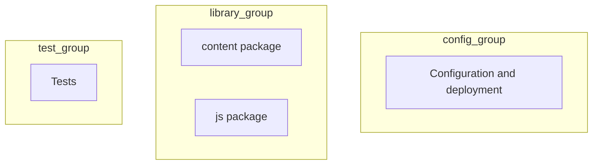

# Architecture report: webrtc/samples

> Automated static analysis. **Observed** = directly seen in files/imports/AST; **Inferred** = interpretation from that evidence. Repository code was not executed.

## 1. Repository at a glance

| Item | Value |
| --- | --- |
| Repository | webrtc/samples |
| Description | WebRTC Web demos and samples |
| Language | JavaScript |
| Stars | 14645 |
| Licence | BSD-3-Clause |
| Analysed commit / branch | 6bd116932df29815b39ebcbba3415366a6202662 / gh-pages |
| Framework(s) | None detected |
| Files analysed | 235 |
| Components | 4 |

## 2. Architecture in one minute

webrtc/samples - WebRTC Web demos and samples. This repository was analysed statically from 235 file(s) (0 Python). Detected technologies (observed from imports/manifests): GitHub Actions, Jest. Files are grouped into 4 component(s): Configuration and deployment, content package, js package, Tests. Findings below distinguish observed facts from inferred interpretation.

## 3. High-level block diagram

## 4. Main components

### Configuration and deployment (`config`)

- **Kind:** config
- **Status:** Observed
- **Confidence:** 0.85
- **Responsibility:** Groups 3 file(s) under configuration and deployment (observed from repository paths and static analysis).
- **Paths:** `package.json`, `src/content/extensions/multipleroutes/src/_locales/en/messages.json`, `src/content/extensions/multipleroutes/src/manifest.json`
- **Evidence:** [package.json](https://github.com/webrtc/samples/blob/6bd116932df29815b39ebcbba3415366a6202662/package.json); [src/content/extensions/multipleroutes/src/_locales/en/messages.json](https://github.com/webrtc/samples/blob/6bd116932df29815b39ebcbba3415366a6202662/src/content/extensions/multipleroutes/src/_locales/en/messages.json); [src/content/extensions/multipleroutes/src/manifest.json](https://github.com/webrtc/samples/blob/6bd116932df29815b39ebcbba3415366a6202662/src/content/extensions/multipleroutes/src/manifest.json)

### content package (`content`)

- **Kind:** library
- **Status:** Observed
- **Confidence:** 0.85
- **Responsibility:** Groups 100 file(s) under content package (observed from repository paths and static analysis).
- **Paths:** `src/content/capture/canvas-filter/js/main.js`, `src/content/capture/canvas-pc/js/main.js`, `src/content/capture/canvas-record/js/main.js`, `src/content/capture/canvas-video/js/main.js`, `src/content/capture/video-contenthint/js/main.js`, `src/content/capture/video-pc/js/main.js`, `src/content/capture/video-video/js/main.js`, `src/content/capture/worker-process/js/main.js`, `src/content/capture/worker-process/js/worker.js`, `src/content/datachannel/basic/js/main.js`, `src/content/datachannel/basic/js/test.js`, `src/content/datachannel/channel/js/main.js`, `src/content/datachannel/channel/js/test.js`, `src/content/datachannel/datatransfer/js/main.js`, `src/content/datachannel/datatransfer/js/test.js`, `src/content/datachannel/filetransfer/js/main.js`, `src/content/datachannel/filetransfer/js/test.js`, `src/content/datachannel/messaging/main.js`, `src/content/devices/input-output/js/main.js`, `src/content/devices/input-output/js/test.js`, `src/content/devices/multi/js/main.js`, `src/content/extensions/multipleroutes/src/options.js`, `src/content/extensions/svc/js/main.js`, `src/content/getusermedia/audio/js/main.js`, `src/content/getusermedia/canvas/js/main.js`, `src/content/getusermedia/exposure/js/main.js`, `src/content/getusermedia/filter/js/main.js`, `src/content/getusermedia/getdisplaymedia/js/main.js`, `src/content/getusermedia/gum/js/main.js`, `src/content/getusermedia/gum/js/test.js`, `src/content/getusermedia/pan-tilt-zoom/js/main.js`, `src/content/getusermedia/record/js/main.js`, `src/content/getusermedia/resolution/js/main.js`, `src/content/getusermedia/resolution/js/test.js`, `src/content/getusermedia/volume/js/main.js`, `src/content/getusermedia/volume/js/soundmeter.js`, `src/content/getusermedia/volume/js/volume-meter-processor.js`, `src/content/insertable-streams/audio-processing/js/main.js`, `src/content/insertable-streams/audio-processing/js/worker.js`, `src/content/insertable-streams/endtoend-encryption/js/main.js`, `src/content/insertable-streams/endtoend-encryption/js/test.js`, `src/content/insertable-streams/endtoend-encryption/js/videopipe.js`, `src/content/insertable-streams/endtoend-encryption/js/worker.js`, `src/content/insertable-streams/video-analyzer/js/main.js`, `src/content/insertable-streams/video-crop/js/main.js`, `src/content/insertable-streams/video-crop/js/worker.js`, `src/content/insertable-streams/video-processing/js/camera-source.js`, `src/content/insertable-streams/video-processing/js/canvas-source.js`, `src/content/insertable-streams/video-processing/js/canvas-transform.js`, `src/content/insertable-streams/video-processing/js/main.js`, `src/content/insertable-streams/video-processing/js/peer-connection-pipe.js`, `src/content/insertable-streams/video-processing/js/peer-connection-sink.js`, `src/content/insertable-streams/video-processing/js/peer-connection-source.js`, `src/content/insertable-streams/video-processing/js/pipeline.js`, `src/content/insertable-streams/video-processing/js/simple-transforms.js`, `src/content/insertable-streams/video-processing/js/video-mirror-helper.js`, `src/content/insertable-streams/video-processing/js/video-sink.js`, `src/content/insertable-streams/video-processing/js/video-source.js`, `src/content/insertable-streams/video-processing/js/webcodec-transform.js`, `src/content/insertable-streams/video-processing/js/webgl-transform.js`, `src/content/insertable-streams/webgpu/js/main.js`, `src/content/insertable-streams/webgpu/js/multi_video_main.js`, `src/content/insertable-streams/webgpu/js/multi_video_worker.js`, `src/content/insertable-streams/webgpu/js/multi_video_worker_manager.js`, `src/content/peerconnection/always-negotiate-datachannels/js/main.js`, `src/content/peerconnection/audio/js/main.js`, `src/content/peerconnection/audio/js/test.js`, `src/content/peerconnection/bandwidth/js/main.js`, `src/content/peerconnection/change-codecs/js/main.js`, `src/content/peerconnection/change-codecs/js/test.js`, `src/content/peerconnection/channel/js/main.js`, `src/content/peerconnection/channel/js/test.js`, `src/content/peerconnection/constraints/js/main.js`, `src/content/peerconnection/create-offer/js/main.js`, `src/content/peerconnection/dtmf/js/main.js`, `src/content/peerconnection/dtmf/js/test.js`, `src/content/peerconnection/multiple-relay/js/main.js`, `src/content/peerconnection/multiple/js/main.js`, `src/content/peerconnection/multiple/js/test.js`, `src/content/peerconnection/munge-sdp/js/main.js`, `src/content/peerconnection/munge-sdp/js/test.js`, `src/content/peerconnection/negotiate-timing/js/main.js`, `src/content/peerconnection/negotiate-timing/js/test.js`, `src/content/peerconnection/pc1/js/main.js`, `src/content/peerconnection/pc1/js/test.js`, `src/content/peerconnection/per-frame-callback/js/main.js`, `src/content/peerconnection/perfect-negotiation/js/main.js`, `src/content/peerconnection/perfect-negotiation/js/peer.js`, `src/content/peerconnection/pr-answer/js/main.js`, `src/content/peerconnection/restart-ice/js/main.js`, `src/content/peerconnection/restart-ice/js/test.js`, `src/content/peerconnection/states/js/main.js`, `src/content/peerconnection/states/js/test.js`, `src/content/peerconnection/trickle-ice/js/main.js`, `src/content/peerconnection/trickle-ice/js/test.js`, `src/content/peerconnection/upgrade/js/main.js`, `src/content/peerconnection/upgrade/js/test.js`, `src/content/peerconnection/webaudio-input/js/main.js`, `src/content/peerconnection/webaudio-input/js/webaudioextended.js`, `src/content/peerconnection/webaudio-output/js/main.js`
- **Evidence:** [src/content/capture/canvas-filter/js/main.js](https://github.com/webrtc/samples/blob/6bd116932df29815b39ebcbba3415366a6202662/src/content/capture/canvas-filter/js/main.js); [src/content/capture/canvas-pc/js/main.js](https://github.com/webrtc/samples/blob/6bd116932df29815b39ebcbba3415366a6202662/src/content/capture/canvas-pc/js/main.js); [src/content/capture/canvas-record/js/main.js](https://github.com/webrtc/samples/blob/6bd116932df29815b39ebcbba3415366a6202662/src/content/capture/canvas-record/js/main.js); [src/content/capture/canvas-video/js/main.js](https://github.com/webrtc/samples/blob/6bd116932df29815b39ebcbba3415366a6202662/src/content/capture/canvas-video/js/main.js); [src/content/capture/video-contenthint/js/main.js](https://github.com/webrtc/samples/blob/6bd116932df29815b39ebcbba3415366a6202662/src/content/capture/video-contenthint/js/main.js); [src/content/capture/video-pc/js/main.js](https://github.com/webrtc/samples/blob/6bd116932df29815b39ebcbba3415366a6202662/src/content/capture/video-pc/js/main.js); [src/content/capture/video-video/js/main.js](https://github.com/webrtc/samples/blob/6bd116932df29815b39ebcbba3415366a6202662/src/content/capture/video-video/js/main.js); [src/content/capture/worker-process/js/main.js](https://github.com/webrtc/samples/blob/6bd116932df29815b39ebcbba3415366a6202662/src/content/capture/worker-process/js/main.js)

### js package (`js`)

- **Kind:** library
- **Status:** Observed
- **Confidence:** 0.85
- **Responsibility:** Groups 9 file(s) under js package (observed from repository paths and static analysis).
- **Paths:** `src/js/lib/ga.js`, `src/js/third_party/graph.js`, `src/js/third_party/streamvisualizer.js`, `src/js/third_party/webgl_teapot/cameracontroller.js`, `src/js/third_party/webgl_teapot/demo.js`, `src/js/third_party/webgl_teapot/matrix4x4.js`, `src/js/third_party/webgl_teapot/webgl-debug.js`, `src/js/third_party/webgl_teapot/webgl-utils.js`, `src/js/videopipe.js`
- **Evidence:** [src/js/lib/ga.js](https://github.com/webrtc/samples/blob/6bd116932df29815b39ebcbba3415366a6202662/src/js/lib/ga.js); [src/js/third_party/graph.js](https://github.com/webrtc/samples/blob/6bd116932df29815b39ebcbba3415366a6202662/src/js/third_party/graph.js); [src/js/third_party/streamvisualizer.js](https://github.com/webrtc/samples/blob/6bd116932df29815b39ebcbba3415366a6202662/src/js/third_party/streamvisualizer.js); [src/js/third_party/webgl_teapot/cameracontroller.js](https://github.com/webrtc/samples/blob/6bd116932df29815b39ebcbba3415366a6202662/src/js/third_party/webgl_teapot/cameracontroller.js); [src/js/third_party/webgl_teapot/demo.js](https://github.com/webrtc/samples/blob/6bd116932df29815b39ebcbba3415366a6202662/src/js/third_party/webgl_teapot/demo.js); [src/js/third_party/webgl_teapot/matrix4x4.js](https://github.com/webrtc/samples/blob/6bd116932df29815b39ebcbba3415366a6202662/src/js/third_party/webgl_teapot/matrix4x4.js); [src/js/third_party/webgl_teapot/webgl-debug.js](https://github.com/webrtc/samples/blob/6bd116932df29815b39ebcbba3415366a6202662/src/js/third_party/webgl_teapot/webgl-debug.js); [src/js/third_party/webgl_teapot/webgl-utils.js](https://github.com/webrtc/samples/blob/6bd116932df29815b39ebcbba3415366a6202662/src/js/third_party/webgl_teapot/webgl-utils.js)

### Tests (`tests`)

- **Kind:** test
- **Status:** Observed
- **Confidence:** 0.85
- **Responsibility:** Groups 5 file(s) under tests (observed from repository paths and static analysis).
- **Paths:** `test/download-browsers.js`, `test/interop/connection.test.js`, `test/steps.js`, `test/webdriver.js`, `test/webrtcclient.js`
- **Evidence:** [test/download-browsers.js](https://github.com/webrtc/samples/blob/6bd116932df29815b39ebcbba3415366a6202662/test/download-browsers.js); [test/interop/connection.test.js](https://github.com/webrtc/samples/blob/6bd116932df29815b39ebcbba3415366a6202662/test/interop/connection.test.js); [test/steps.js](https://github.com/webrtc/samples/blob/6bd116932df29815b39ebcbba3415366a6202662/test/steps.js); [test/webdriver.js](https://github.com/webrtc/samples/blob/6bd116932df29815b39ebcbba3415366a6202662/test/webdriver.js); [test/webrtcclient.js](https://github.com/webrtc/samples/blob/6bd116932df29815b39ebcbba3415366a6202662/test/webrtcclient.js)

## 5. Execution flow

No entry point was observed; the startup flow below is therefore limited.

Representative flow (derived from observed entry points and the import graph; steps beyond the entry point are **Inferred**):

1. Execution starts at an observed entry point listed above, if present.
2. No internal import relationships between components were observed.

## 6. Project structure

### `(root)`

- `.eslintrc.js` - source, JavaScript (1089 bytes)
- `.gitignore` - other (160 bytes)
- `.stylelintrc` - other (47 bytes)
- `AUTHORS` - other (48 bytes)
- `CONTRIBUTING.md` - docs (1039 bytes)
- `LICENSE.md` - docs (1511 bytes)
- `README.md` - docs (1068 bytes)
- `google1b7eb21c5b594ba0.html` - other (53 bytes)
- `index.html` - other (10183 bytes)
- `package.json` - manifest (1164 bytes)

### `.github`

- `.github/ISSUE_TEMPLATE/bug_report.md` - docs (1151 bytes)
- `.github/ISSUE_TEMPLATE/config.yml` - config (170 bytes)
- `.github/PULL_REQUEST_TEMPLATE.md` - docs (30 bytes)
- `.github/workflows/interop-tests.yml` - ci, YAML (825 bytes)
- `.github/workflows/test.yml` - ci, YAML (712 bytes)

### `src`

- `src/content/capture/canvas-filter/css/main.css` - other (526 bytes)
- `src/content/capture/canvas-filter/index.html` - other (2533 bytes)
- `src/content/capture/canvas-filter/js/main.js` - source, JavaScript (1593 bytes)
- `src/content/capture/canvas-pc/css/main.css` - other (536 bytes)
- `src/content/capture/canvas-pc/index.html` - other (3626 bytes)
- `src/content/capture/canvas-pc/js/main.js` - source, JavaScript (4878 bytes)
- `src/content/capture/canvas-record/css/main.css` - other (742 bytes)
- `src/content/capture/canvas-record/index.html` - other (3636 bytes)
- `src/content/capture/canvas-record/js/main.js` - source, JavaScript (3858 bytes)
- `src/content/capture/canvas-video/css/main.css` - other (526 bytes)
- `src/content/capture/canvas-video/index.html` - other (3011 bytes)
- `src/content/capture/canvas-video/js/main.js` - source, JavaScript (449 bytes)
- `src/content/capture/video-contenthint/css/main.css` - other (491 bytes)
- `src/content/capture/video-contenthint/index.html` - other (3962 bytes)
- `src/content/capture/video-contenthint/js/main.js` - source, JavaScript (3665 bytes)
- `src/content/capture/video-pc/css/main.css` - other (429 bytes)
- `src/content/capture/video-pc/index.html` - other (2988 bytes)
- `src/content/capture/video-pc/js/main.js` - source, JavaScript (5509 bytes)
- `src/content/capture/video-video/css/main.css` - other (429 bytes)
- `src/content/capture/video-video/index.html` - other (2371 bytes)
- `src/content/capture/video-video/js/main.js` - source, JavaScript (714 bytes)
- `src/content/capture/worker-process/css/main.css` - other (526 bytes)
- `src/content/capture/worker-process/index.html` - other (2628 bytes)
- `src/content/capture/worker-process/js/main.js` - source, JavaScript (2196 bytes)
- `src/content/capture/worker-process/js/worker.js` - source, JavaScript (553 bytes)
- `src/content/datachannel/basic/css/main.css` - other (1169 bytes)
- `src/content/datachannel/basic/index.html` - other (4557 bytes)
- `src/content/datachannel/basic/js/main.js` - source, JavaScript (4768 bytes)
- `src/content/datachannel/basic/js/test.js` - source, JavaScript (1764 bytes)
- `src/content/datachannel/channel/css/main.css` - other (773 bytes)
- `src/content/datachannel/channel/index.html` - other (3052 bytes)
- `src/content/datachannel/channel/js/main.js` - source, JavaScript (5033 bytes)
- `src/content/datachannel/channel/js/test.js` - source, JavaScript (3276 bytes)
- `src/content/datachannel/datatransfer/css/main.css` - other (429 bytes)
- `src/content/datachannel/datatransfer/index.html` - other (3747 bytes)
- `src/content/datachannel/datatransfer/js/main.js` - source, JavaScript (7961 bytes)
- `src/content/datachannel/datatransfer/js/test.js` - source, JavaScript (1810 bytes)
- `src/content/datachannel/filetransfer/css/main.css` - other (460 bytes)
- `src/content/datachannel/filetransfer/index.html` - other (3822 bytes)
- `src/content/datachannel/filetransfer/js/main.js` - source, JavaScript (8392 bytes)
- `src/content/datachannel/filetransfer/js/test.js` - source, JavaScript (1409 bytes)
- `src/content/datachannel/messaging/index.html` - other (2507 bytes)
- `src/content/datachannel/messaging/main.css` - other (432 bytes)
- `src/content/datachannel/messaging/main.js` - source, JavaScript (5729 bytes)
- `src/content/devices/input-output/index.html` - other (2956 bytes)
- `src/content/devices/input-output/js/main.js` - source, JavaScript (5012 bytes)
- `src/content/devices/input-output/js/test.js` - source, JavaScript (1414 bytes)
- `src/content/devices/multi/css/main.css` - other (492 bytes)
- `src/content/devices/multi/index.html` - other (3637 bytes)
- `src/content/devices/multi/js/main.js` - source, JavaScript (3519 bytes)
- `src/content/extensions/multipleroutes/src/README.md` - docs (2064 bytes)
- `src/content/extensions/multipleroutes/src/_locales/en/messages.json` - config (1863 bytes)
- `src/content/extensions/multipleroutes/src/manifest.json` - config (385 bytes)
- `src/content/extensions/multipleroutes/src/options.html` - other (1618 bytes)
- `src/content/extensions/multipleroutes/src/options.js` - source, JavaScript (2608 bytes)
- `src/content/extensions/svc/css/main.css` - other (838 bytes)
- `src/content/extensions/svc/index.html` - other (3140 bytes)
- `src/content/extensions/svc/js/main.js` - source, JavaScript (12143 bytes)
- `src/content/getusermedia/audio/index.html` - other (2179 bytes)
- `src/content/getusermedia/audio/js/main.js` - source, JavaScript (1063 bytes)
- `src/content/getusermedia/canvas/index.html` - other (2038 bytes)
- `src/content/getusermedia/canvas/js/main.js` - source, JavaScript (1102 bytes)
- `src/content/getusermedia/exposure/index.html` - other (3093 bytes)
- `src/content/getusermedia/exposure/js/main.js` - source, JavaScript (3468 bytes)
- `src/content/getusermedia/filter/index.html` - other (3041 bytes)
- `src/content/getusermedia/filter/js/main.js` - source, JavaScript (1255 bytes)
- `src/content/getusermedia/getdisplaymedia/index.html` - other (2318 bytes)
- `src/content/getusermedia/getdisplaymedia/js/main.js` - source, JavaScript (2184 bytes)
- `src/content/getusermedia/gum/index.html` - other (2177 bytes)
- `src/content/getusermedia/gum/js/main.js` - source, JavaScript (1786 bytes)
- `src/content/getusermedia/gum/js/test.js` - source, JavaScript (1174 bytes)
- `src/content/getusermedia/pan-tilt-zoom/index.html` - other (2634 bytes)
- `src/content/getusermedia/pan-tilt-zoom/js/main.js` - source, JavaScript (2454 bytes)
- `src/content/getusermedia/record/css/main.css` - other (969 bytes)
- `src/content/getusermedia/record/index.html` - other (2812 bytes)
- `src/content/getusermedia/record/js/main.js` - source, JavaScript (6688 bytes)
- `src/content/getusermedia/resolution/index.html` - other (4118 bytes)
- `src/content/getusermedia/resolution/js/main.js` - source, JavaScript (6738 bytes)
- `src/content/getusermedia/resolution/js/test.js` - source, JavaScript (1669 bytes)
- `src/content/getusermedia/source/index.html` - other (547 bytes)
- `src/content/getusermedia/volume/css/main.css` - other (329 bytes)
- `src/content/getusermedia/volume/index.html` - other (2988 bytes)
- `src/content/getusermedia/volume/js/main.js` - source, JavaScript (2660 bytes)
- `src/content/getusermedia/volume/js/soundmeter.js` - source, JavaScript (1576 bytes)
- `src/content/getusermedia/volume/js/volume-meter-processor.js` - source, JavaScript (1020 bytes)
- `src/content/insertable-streams/audio-processing/index.html` - other (2932 bytes)
- `src/content/insertable-streams/audio-processing/js/main.js` - source, JavaScript (2957 bytes)
- `src/content/insertable-streams/audio-processing/js/worker.js` - source, JavaScript (2411 bytes)
- `src/content/insertable-streams/endtoend-encryption/css/main.css` - other (529 bytes)
- `src/content/insertable-streams/endtoend-encryption/index.html` - other (2671 bytes)
- `src/content/insertable-streams/endtoend-encryption/js/main.js` - source, JavaScript (7368 bytes)
- `src/content/insertable-streams/endtoend-encryption/js/test.js` - source, JavaScript (2955 bytes)
- `src/content/insertable-streams/endtoend-encryption/js/videopipe.js` - source, JavaScript (1402 bytes)
- `src/content/insertable-streams/endtoend-encryption/js/worker.js` - source, JavaScript (5915 bytes)
- `src/content/insertable-streams/video-analyzer/css/main.css` - other (757 bytes)
- `src/content/insertable-streams/video-analyzer/index.html` - other (2851 bytes)
- `src/content/insertable-streams/video-analyzer/js/main.js` - source, JavaScript (9062 bytes)
- `src/content/insertable-streams/video-crop/css/main.css` - other (454 bytes)
- `src/content/insertable-streams/video-crop/index.html` - other (2380 bytes)
- `src/content/insertable-streams/video-crop/js/main.js` - source, JavaScript (1429 bytes)
- `src/content/insertable-streams/video-crop/js/worker.js` - source, JavaScript (856 bytes)
- `src/content/insertable-streams/video-processing/css/main.css` - other (637 bytes)
- `src/content/insertable-streams/video-processing/index.html` - other (4423 bytes)
- `src/content/insertable-streams/video-processing/js/camera-source.js` - source, JavaScript (1746 bytes)
- `src/content/insertable-streams/video-processing/js/canvas-source.js` - source, JavaScript (7252 bytes)
- `src/content/insertable-streams/video-processing/js/canvas-transform.js` - source, JavaScript (2161 bytes)
- `src/content/insertable-streams/video-processing/js/main.js` - source, JavaScript (9884 bytes)
- `src/content/insertable-streams/video-processing/js/peer-connection-pipe.js` - source, JavaScript (3867 bytes)
- `src/content/insertable-streams/video-processing/js/peer-connection-sink.js` - source, JavaScript (1895 bytes)
- `src/content/insertable-streams/video-processing/js/peer-connection-source.js` - source, JavaScript (3129 bytes)
- `src/content/insertable-streams/video-processing/js/pipeline.js` - source, JavaScript (6704 bytes)
- `src/content/insertable-streams/video-processing/js/simple-transforms.js` - source, JavaScript (1293 bytes)
- `src/content/insertable-streams/video-processing/js/video-mirror-helper.js` - source, JavaScript (2392 bytes)
- `src/content/insertable-streams/video-processing/js/video-sink.js` - source, JavaScript (1555 bytes)
- `src/content/insertable-streams/video-processing/js/video-source.js` - source, JavaScript (3520 bytes)
- `src/content/insertable-streams/video-processing/js/webcodec-transform.js` - source, JavaScript (1712 bytes)
- `src/content/insertable-streams/video-processing/js/webgl-transform.js` - source, JavaScript (6950 bytes)
- `src/content/insertable-streams/video/index.html` - other (577 bytes)
- `src/content/insertable-streams/webgpu/css/main.css` - other (384 bytes)
- `src/content/insertable-streams/webgpu/index.html` - other (3154 bytes)
- `src/content/insertable-streams/webgpu/js/main.js` - source, JavaScript (3299 bytes)
- `src/content/insertable-streams/webgpu/js/multi_video_main.js` - source, JavaScript (7332 bytes)
- `src/content/insertable-streams/webgpu/js/multi_video_worker.js` - source, JavaScript (622 bytes)
- `src/content/insertable-streams/webgpu/js/multi_video_worker_manager.js` - source, JavaScript (1449 bytes)
- `src/content/peerconnection/always-negotiate-datachannels/css/main.css` - other (729 bytes)
- `src/content/peerconnection/always-negotiate-datachannels/index.html` - other (3219 bytes)
- `src/content/peerconnection/always-negotiate-datachannels/js/main.js` - source, JavaScript (4610 bytes)
- `src/content/peerconnection/audio/css/main.css` - other (764 bytes)
- `src/content/peerconnection/audio/index.html` - other (3818 bytes)
- `src/content/peerconnection/audio/js/main.js` - source, JavaScript (12718 bytes)
- `src/content/peerconnection/audio/js/test.js` - source, JavaScript (1441 bytes)
- `src/content/peerconnection/bandwidth/css/main.css` - other (597 bytes)
- `src/content/peerconnection/bandwidth/index.html` - other (2957 bytes)
- `src/content/peerconnection/bandwidth/js/main.js` - source, JavaScript (11475 bytes)
- `src/content/peerconnection/change-codecs/css/main.css` - other (757 bytes)
- `src/content/peerconnection/change-codecs/index.html` - other (3094 bytes)
- `src/content/peerconnection/change-codecs/js/main.js` - source, JavaScript (8076 bytes)
- `src/content/peerconnection/change-codecs/js/test.js` - source, JavaScript (2472 bytes)
- `src/content/peerconnection/channel/css/main.css` - other (757 bytes)
- `src/content/peerconnection/channel/index.html` - other (2421 bytes)
- `src/content/peerconnection/channel/js/main.js` - source, JavaScript (3297 bytes)
- `src/content/peerconnection/channel/js/test.js` - source, JavaScript (2339 bytes)
- `src/content/peerconnection/constraints/css/main.css` - other (1825 bytes)
- `src/content/peerconnection/constraints/index.html` - other (4722 bytes)
- `src/content/peerconnection/constraints/js/main.js` - source, JavaScript (10096 bytes)
- `src/content/peerconnection/create-offer/css/main.css` - other (693 bytes)
- `src/content/peerconnection/create-offer/index.html` - other (3026 bytes)
- `src/content/peerconnection/create-offer/js/main.js` - source, JavaScript (2139 bytes)
- `src/content/peerconnection/dtmf/css/main.css` - other (1407 bytes)
- `src/content/peerconnection/dtmf/index.html` - other (3476 bytes)
- `src/content/peerconnection/dtmf/js/main.js` - source, JavaScript (5924 bytes)
- `src/content/peerconnection/dtmf/js/test.js` - source, JavaScript (2769 bytes)
- `src/content/peerconnection/endtoend-encryption/index.html` - other (583 bytes)
- `src/content/peerconnection/multiple-relay/css/main.css` - other (530 bytes)
- `src/content/peerconnection/multiple-relay/index.html` - other (2339 bytes)
- `src/content/peerconnection/multiple-relay/js/main.js` - source, JavaScript (2346 bytes)
- `src/content/peerconnection/multiple/css/main.css` - other (682 bytes)
- `src/content/peerconnection/multiple/index.html` - other (2468 bytes)
- `src/content/peerconnection/multiple/js/main.js` - source, JavaScript (3764 bytes)
- `src/content/peerconnection/multiple/js/test.js` - source, JavaScript (2352 bytes)
- `src/content/peerconnection/munge-sdp/css/main.css` - other (1636 bytes)
- `src/content/peerconnection/munge-sdp/index.html` - other (3492 bytes)
- `src/content/peerconnection/munge-sdp/js/main.js` - source, JavaScript (9117 bytes)
- `src/content/peerconnection/munge-sdp/js/test.js` - source, JavaScript (2378 bytes)
- `src/content/peerconnection/negotiate-timing/css/main.css` - other (729 bytes)
- `src/content/peerconnection/negotiate-timing/index.html` - other (2587 bytes)
- `src/content/peerconnection/negotiate-timing/js/main.js` - source, JavaScript (9173 bytes)
- `src/content/peerconnection/negotiate-timing/js/test.js` - source, JavaScript (2442 bytes)
- `src/content/peerconnection/pc1/css/main.css` - other (757 bytes)
- `src/content/peerconnection/pc1/index.html` - other (2761 bytes)
- `src/content/peerconnection/pc1/js/main.js` - source, JavaScript (6457 bytes)
- `src/content/peerconnection/pc1/js/test.js` - source, JavaScript (1936 bytes)
- `src/content/peerconnection/per-frame-callback/css/main.css` - other (597 bytes)
- `src/content/peerconnection/per-frame-callback/index.html` - other (3386 bytes)
- `src/content/peerconnection/per-frame-callback/js/main.js` - source, JavaScript (6784 bytes)
- `src/content/peerconnection/perfect-negotiation/css/main.css` - other (757 bytes)
- `src/content/peerconnection/perfect-negotiation/index.html` - other (3596 bytes)
- `src/content/peerconnection/perfect-negotiation/js/main.js` - source, JavaScript (4108 bytes)
- `src/content/peerconnection/perfect-negotiation/js/peer.js` - source, JavaScript (5736 bytes)
- `src/content/peerconnection/pr-answer/index.html` - other (2280 bytes)
- `src/content/peerconnection/pr-answer/js/main.js` - source, JavaScript (5033 bytes)
- `src/content/peerconnection/restart-ice/css/main.css` - other (630 bytes)
- `src/content/peerconnection/restart-ice/index.html` - other (2985 bytes)
- `src/content/peerconnection/restart-ice/js/main.js` - source, JavaScript (8509 bytes)
- `src/content/peerconnection/restart-ice/js/test.js` - source, JavaScript (2720 bytes)
- `src/content/peerconnection/states/css/main.css` - other (843 bytes)
- `src/content/peerconnection/states/index.html` - other (3453 bytes)
- `src/content/peerconnection/states/js/main.js` - source, JavaScript (6572 bytes)
- `src/content/peerconnection/states/js/test.js` - source, JavaScript (3033 bytes)
- `src/content/peerconnection/trickle-ice/css/main.css` - other (1083 bytes)
- `src/content/peerconnection/trickle-ice/index.html` - other (5391 bytes)
- `src/content/peerconnection/trickle-ice/js/main.js` - source, JavaScript (9929 bytes)
- `src/content/peerconnection/trickle-ice/js/test.js` - source, JavaScript (2166 bytes)
- `src/content/peerconnection/upgrade/css/main.css` - other (729 bytes)
- `src/content/peerconnection/upgrade/index.html` - other (2628 bytes)
- `src/content/peerconnection/upgrade/js/main.js` - source, JavaScript (7058 bytes)
- `src/content/peerconnection/upgrade/js/test.js` - source, JavaScript (1982 bytes)
- `src/content/peerconnection/video-analyzer/index.html` - other (573 bytes)
- `src/content/peerconnection/webaudio-input/css/main.css` - other (709 bytes)
- `src/content/peerconnection/webaudio-input/index.html` - other (3814 bytes)
- `src/content/peerconnection/webaudio-input/js/main.js` - source, JavaScript (3836 bytes)
- `src/content/peerconnection/webaudio-input/js/webaudioextended.js` - source, JavaScript (2022 bytes)
- `src/content/peerconnection/webaudio-output/css/main.css` - other (694 bytes)
- `src/content/peerconnection/webaudio-output/index.html` - other (2707 bytes)
- `src/content/peerconnection/webaudio-output/js/main.js` - source, JavaScript (6081 bytes)
- `src/css/main.css` - other (3729 bytes)
- `src/js/lib/ga.js` - source, JavaScript (410 bytes)
- `src/js/third_party/graph.js` - source, JavaScript (21463 bytes)
- `src/js/third_party/streamvisualizer.js` - source, JavaScript (3644 bytes)
- `src/js/third_party/webgl_teapot/cameracontroller.js` - source, JavaScript (6846 bytes)
- `src/js/third_party/webgl_teapot/demo.js` - source, JavaScript (15626 bytes)
- `src/js/third_party/webgl_teapot/matrix4x4.js` - source, JavaScript (13980 bytes)
- `src/js/third_party/webgl_teapot/webgl-debug.js` - source, JavaScript (28723 bytes)
- `src/js/third_party/webgl_teapot/webgl-utils.js` - source, JavaScript (5658 bytes)
- `src/js/videopipe.js` - source, JavaScript (2013 bytes)

### `test`

- `test/download-browsers.js` - test, JavaScript (331 bytes)
- `test/interop/connection.test.js` - test, JavaScript (2419 bytes)
- `test/steps.js` - test, JavaScript (1108 bytes)
- `test/webdriver.js` - test, JavaScript (4435 bytes)
- `test/webrtcclient.js` - test, JavaScript (3741 bytes)

## 7. Key dependencies and integrations

| Name | Category | Status | Confidence | Evidence |
| --- | --- | --- | --- | --- |
| GitHub Actions | ci | Observed | 0.90 | [.github/workflows/interop-tests.yml](https://github.com/webrtc/samples/blob/6bd116932df29815b39ebcbba3415366a6202662/.github/workflows/interop-tests.yml); [.github/workflows/test.yml](https://github.com/webrtc/samples/blob/6bd116932df29815b39ebcbba3415366a6202662/.github/workflows/test.yml) |
| Jest | tooling | Observed | 0.85 | [package.json:23](https://github.com/webrtc/samples/blob/6bd116932df29815b39ebcbba3415366a6202662/package.json#L23) |

## 8. Data and state

No database, cache, queue, or persistent-state usage was observed in the analysed files. State handling, if any, may be in-memory or in files that were not analysed.

## 9. Configuration and deployment clues

- `.github/ISSUE_TEMPLATE/config.yml` (config)
- `.github/workflows/interop-tests.yml` (ci)
- `.github/workflows/test.yml` (ci)
- `package.json` (manifest)
- `src/content/extensions/multipleroutes/src/_locales/en/messages.json` (config)
- `src/content/extensions/multipleroutes/src/manifest.json` (config)

## 10. Design observations

- Tests are present alongside source code (Observed from test file paths).

These observations are interpretations (**Inferred**) of the observed structure, not guarantees about runtime design.

## 11. Limitations and unknowns

- Static analysis only: repository code was not executed, installed, or imported at runtime.
- Components and relationships are inferred from file paths, imports, and AST structure; runtime behaviour, dynamic imports, and reflection may not be visible.
- 1 file(s) were skipped during inventory (1 x likely secret file excluded).
- No clear application entry point was observed in the analysed files.
- Repository text was treated as untrusted data; no instructions found in repository files were followed, and likely secret values were redacted/excluded.
- JavaScript and TypeScript files were inventoried from paths and package manifests. They were not parsed with a full language AST, and repository code was not executed.

## 12. Source references

- [.github/workflows/interop-tests.yml](https://github.com/webrtc/samples/blob/6bd116932df29815b39ebcbba3415366a6202662/.github/workflows/interop-tests.yml)
- [.github/workflows/test.yml](https://github.com/webrtc/samples/blob/6bd116932df29815b39ebcbba3415366a6202662/.github/workflows/test.yml)
- [package.json](https://github.com/webrtc/samples/blob/6bd116932df29815b39ebcbba3415366a6202662/package.json)
- [package.json:23](https://github.com/webrtc/samples/blob/6bd116932df29815b39ebcbba3415366a6202662/package.json#L23)
- [src/content/capture/canvas-filter/js/main.js](https://github.com/webrtc/samples/blob/6bd116932df29815b39ebcbba3415366a6202662/src/content/capture/canvas-filter/js/main.js)
- [src/content/capture/canvas-pc/js/main.js](https://github.com/webrtc/samples/blob/6bd116932df29815b39ebcbba3415366a6202662/src/content/capture/canvas-pc/js/main.js)
- [src/content/capture/canvas-record/js/main.js](https://github.com/webrtc/samples/blob/6bd116932df29815b39ebcbba3415366a6202662/src/content/capture/canvas-record/js/main.js)
- [src/content/capture/canvas-video/js/main.js](https://github.com/webrtc/samples/blob/6bd116932df29815b39ebcbba3415366a6202662/src/content/capture/canvas-video/js/main.js)
- [src/content/capture/video-contenthint/js/main.js](https://github.com/webrtc/samples/blob/6bd116932df29815b39ebcbba3415366a6202662/src/content/capture/video-contenthint/js/main.js)
- [src/content/capture/video-pc/js/main.js](https://github.com/webrtc/samples/blob/6bd116932df29815b39ebcbba3415366a6202662/src/content/capture/video-pc/js/main.js)
- [src/content/capture/video-video/js/main.js](https://github.com/webrtc/samples/blob/6bd116932df29815b39ebcbba3415366a6202662/src/content/capture/video-video/js/main.js)
- [src/content/capture/worker-process/js/main.js](https://github.com/webrtc/samples/blob/6bd116932df29815b39ebcbba3415366a6202662/src/content/capture/worker-process/js/main.js)
- [src/content/extensions/multipleroutes/src/_locales/en/messages.json](https://github.com/webrtc/samples/blob/6bd116932df29815b39ebcbba3415366a6202662/src/content/extensions/multipleroutes/src/_locales/en/messages.json)
- [src/content/extensions/multipleroutes/src/manifest.json](https://github.com/webrtc/samples/blob/6bd116932df29815b39ebcbba3415366a6202662/src/content/extensions/multipleroutes/src/manifest.json)
- [src/js/lib/ga.js](https://github.com/webrtc/samples/blob/6bd116932df29815b39ebcbba3415366a6202662/src/js/lib/ga.js)
- [src/js/third_party/graph.js](https://github.com/webrtc/samples/blob/6bd116932df29815b39ebcbba3415366a6202662/src/js/third_party/graph.js)
- [src/js/third_party/streamvisualizer.js](https://github.com/webrtc/samples/blob/6bd116932df29815b39ebcbba3415366a6202662/src/js/third_party/streamvisualizer.js)
- [src/js/third_party/webgl_teapot/cameracontroller.js](https://github.com/webrtc/samples/blob/6bd116932df29815b39ebcbba3415366a6202662/src/js/third_party/webgl_teapot/cameracontroller.js)
- [src/js/third_party/webgl_teapot/demo.js](https://github.com/webrtc/samples/blob/6bd116932df29815b39ebcbba3415366a6202662/src/js/third_party/webgl_teapot/demo.js)
- [src/js/third_party/webgl_teapot/matrix4x4.js](https://github.com/webrtc/samples/blob/6bd116932df29815b39ebcbba3415366a6202662/src/js/third_party/webgl_teapot/matrix4x4.js)
- [src/js/third_party/webgl_teapot/webgl-debug.js](https://github.com/webrtc/samples/blob/6bd116932df29815b39ebcbba3415366a6202662/src/js/third_party/webgl_teapot/webgl-debug.js)
- [src/js/third_party/webgl_teapot/webgl-utils.js](https://github.com/webrtc/samples/blob/6bd116932df29815b39ebcbba3415366a6202662/src/js/third_party/webgl_teapot/webgl-utils.js)
- [test/download-browsers.js](https://github.com/webrtc/samples/blob/6bd116932df29815b39ebcbba3415366a6202662/test/download-browsers.js)
- [test/interop/connection.test.js](https://github.com/webrtc/samples/blob/6bd116932df29815b39ebcbba3415366a6202662/test/interop/connection.test.js)
- [test/steps.js](https://github.com/webrtc/samples/blob/6bd116932df29815b39ebcbba3415366a6202662/test/steps.js)
- [test/webdriver.js](https://github.com/webrtc/samples/blob/6bd116932df29815b39ebcbba3415366a6202662/test/webdriver.js)
- [test/webrtcclient.js](https://github.com/webrtc/samples/blob/6bd116932df29815b39ebcbba3415366a6202662/test/webrtcclient.js)
