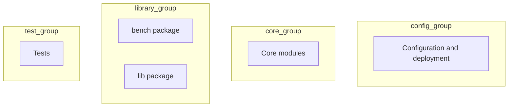

# Architecture report: websockets/ws

> Automated static analysis. **Observed** = directly seen in files/imports/AST; **Inferred** = interpretation from that evidence. Repository code was not executed.

## 1. Repository at a glance

| Item | Value |
| --- | --- |
| Repository | websockets/ws |
| Description | Simple to use, blazing fast and thoroughly tested WebSocket client and server for Node.js |
| Language | JavaScript |
| Stars | 22829 |
| Licence | MIT |
| Analysed commit / branch | fc667e495bd63052ac78fc2a149dbf948d1d3d02 / master |
| Framework(s) | Express |
| Files analysed | 57 |
| Components | 5 |

## 2. Architecture in one minute

websockets/ws - Simple to use, blazing fast and thoroughly tested WebSocket client and server for Node.js. This repository was analysed statically from 57 file(s) (0 Python). Detected technologies (observed from imports/manifests): GitHub Actions, Express. Files are grouped into 5 component(s): bench package, Configuration and deployment, Core modules, lib package, Tests. Findings below distinguish observed facts from inferred interpretation.

## 3. High-level block diagram

## 4. Main components

### bench package (`bench`)

- **Kind:** library
- **Status:** Observed
- **Confidence:** 0.85
- **Responsibility:** Groups 3 file(s) under bench package (observed from repository paths and static analysis).
- **Paths:** `bench/parser.benchmark.js`, `bench/sender.benchmark.js`, `bench/speed.js`
- **Evidence:** [bench/parser.benchmark.js](https://github.com/websockets/ws/blob/fc667e495bd63052ac78fc2a149dbf948d1d3d02/bench/parser.benchmark.js); [bench/sender.benchmark.js](https://github.com/websockets/ws/blob/fc667e495bd63052ac78fc2a149dbf948d1d3d02/bench/sender.benchmark.js); [bench/speed.js](https://github.com/websockets/ws/blob/fc667e495bd63052ac78fc2a149dbf948d1d3d02/bench/speed.js)

### Configuration and deployment (`config`)

- **Kind:** config
- **Status:** Observed
- **Confidence:** 0.85
- **Responsibility:** Groups 2 file(s) under configuration and deployment (observed from repository paths and static analysis).
- **Paths:** `FUNDING.json`, `package.json`
- **Evidence:** [FUNDING.json](https://github.com/websockets/ws/blob/fc667e495bd63052ac78fc2a149dbf948d1d3d02/FUNDING.json); [package.json](https://github.com/websockets/ws/blob/fc667e495bd63052ac78fc2a149dbf948d1d3d02/package.json)

### Core modules (`core`)

- **Kind:** core
- **Status:** Observed
- **Confidence:** 0.85
- **Responsibility:** Groups 4 file(s) under core modules (observed from repository paths and static analysis).
- **Paths:** `browser.js`, `eslint.config.js`, `index.js`, `wrapper.mjs`
- **Evidence:** [browser.js](https://github.com/websockets/ws/blob/fc667e495bd63052ac78fc2a149dbf948d1d3d02/browser.js); [eslint.config.js](https://github.com/websockets/ws/blob/fc667e495bd63052ac78fc2a149dbf948d1d3d02/eslint.config.js); [index.js](https://github.com/websockets/ws/blob/fc667e495bd63052ac78fc2a149dbf948d1d3d02/index.js); [wrapper.mjs](https://github.com/websockets/ws/blob/fc667e495bd63052ac78fc2a149dbf948d1d3d02/wrapper.mjs)

### lib package (`lib`)

- **Kind:** library
- **Status:** Observed
- **Confidence:** 0.85
- **Responsibility:** Groups 13 file(s) under lib package (observed from repository paths and static analysis).
- **Paths:** `lib/buffer-util.js`, `lib/constants.js`, `lib/event-target.js`, `lib/extension.js`, `lib/limiter.js`, `lib/permessage-deflate.js`, `lib/receiver.js`, `lib/sender.js`, `lib/stream.js`, `lib/subprotocol.js`, `lib/validation.js`, `lib/websocket-server.js`, `lib/websocket.js`
- **Evidence:** [lib/buffer-util.js](https://github.com/websockets/ws/blob/fc667e495bd63052ac78fc2a149dbf948d1d3d02/lib/buffer-util.js); [lib/constants.js](https://github.com/websockets/ws/blob/fc667e495bd63052ac78fc2a149dbf948d1d3d02/lib/constants.js); [lib/event-target.js](https://github.com/websockets/ws/blob/fc667e495bd63052ac78fc2a149dbf948d1d3d02/lib/event-target.js); [lib/extension.js](https://github.com/websockets/ws/blob/fc667e495bd63052ac78fc2a149dbf948d1d3d02/lib/extension.js); [lib/limiter.js](https://github.com/websockets/ws/blob/fc667e495bd63052ac78fc2a149dbf948d1d3d02/lib/limiter.js); [lib/permessage-deflate.js](https://github.com/websockets/ws/blob/fc667e495bd63052ac78fc2a149dbf948d1d3d02/lib/permessage-deflate.js); [lib/receiver.js](https://github.com/websockets/ws/blob/fc667e495bd63052ac78fc2a149dbf948d1d3d02/lib/receiver.js); [lib/sender.js](https://github.com/websockets/ws/blob/fc667e495bd63052ac78fc2a149dbf948d1d3d02/lib/sender.js)

### Tests (`tests`)

- **Kind:** test
- **Status:** Observed
- **Confidence:** 0.85
- **Responsibility:** Groups 16 file(s) under tests (observed from repository paths and static analysis).
- **Paths:** `test/autobahn-server.js`, `test/autobahn.js`, `test/buffer-util.test.js`, `test/create-websocket-stream.test.js`, `test/duplex-pair.js`, `test/event-target.test.js`, `test/extension.test.js`, `test/limiter.test.js`, `test/permessage-deflate.test.js`, `test/receiver.test.js`, `test/sender.test.js`, `test/subprotocol.test.js`, `test/validation.test.js`, `test/websocket-server.test.js`, `test/websocket.integration.js`, `test/websocket.test.js`
- **Evidence:** [test/autobahn-server.js](https://github.com/websockets/ws/blob/fc667e495bd63052ac78fc2a149dbf948d1d3d02/test/autobahn-server.js); [test/autobahn.js](https://github.com/websockets/ws/blob/fc667e495bd63052ac78fc2a149dbf948d1d3d02/test/autobahn.js); [test/buffer-util.test.js](https://github.com/websockets/ws/blob/fc667e495bd63052ac78fc2a149dbf948d1d3d02/test/buffer-util.test.js); [test/create-websocket-stream.test.js](https://github.com/websockets/ws/blob/fc667e495bd63052ac78fc2a149dbf948d1d3d02/test/create-websocket-stream.test.js); [test/duplex-pair.js](https://github.com/websockets/ws/blob/fc667e495bd63052ac78fc2a149dbf948d1d3d02/test/duplex-pair.js); [test/event-target.test.js](https://github.com/websockets/ws/blob/fc667e495bd63052ac78fc2a149dbf948d1d3d02/test/event-target.test.js); [test/extension.test.js](https://github.com/websockets/ws/blob/fc667e495bd63052ac78fc2a149dbf948d1d3d02/test/extension.test.js); [test/limiter.test.js](https://github.com/websockets/ws/blob/fc667e495bd63052ac78fc2a149dbf948d1d3d02/test/limiter.test.js)

## 5. Execution flow

**Observed** entry point(s):

- [index.js](https://github.com/websockets/ws/blob/fc667e495bd63052ac78fc2a149dbf948d1d3d02/index.js)

Representative flow (derived from observed entry points and the import graph; steps beyond the entry point are **Inferred**):

1. Execution starts at an observed entry point listed above, if present.
2. No internal import relationships between components were observed.

## 6. Project structure

### `(root)`

- `.gitattributes` - other (19 bytes)
- `.gitignore` - other (46 bytes)
- `.prettierrc.yaml` - config (90 bytes)
- `FUNDING.json` - config (107 bytes)
- `LICENSE` - docs (1183 bytes)
- `README.md` - docs (15322 bytes)
- `SECURITY.md` - docs (1746 bytes)
- `browser.js` - source, JavaScript (176 bytes)
- `eslint.config.js` - source, JavaScript (677 bytes)
- `index.js` - source, JavaScript (796 bytes)
- `package.json` - manifest (1829 bytes)
- `wrapper.mjs` - source, JavaScript (554 bytes)

### `.github`

- `.github/FUNDING.yml` - config (19 bytes)
- `.github/ISSUE_TEMPLATE/bug_report.yml` - config (1554 bytes)
- `.github/ISSUE_TEMPLATE/config.yml` - config (28 bytes)
- `.github/workflows/ci.yml` - ci, YAML (2548 bytes)

### `bench`

- `bench/parser.benchmark.js` - source, JavaScript (2295 bytes)
- `bench/sender.benchmark.js` - source, JavaScript (1450 bytes)
- `bench/speed.js` - source, JavaScript (2967 bytes)

### `doc`

- `doc/ws.md` - docs (29834 bytes)

### `examples`

- `examples/express-session-parse/index.js` - source, JavaScript (2437 bytes)
- `examples/express-session-parse/package.json` - manifest (193 bytes)
- `examples/express-session-parse/public/app.js` - source, JavaScript (1753 bytes)
- `examples/express-session-parse/public/index.html` - other (721 bytes)
- `examples/server-stats/index.js` - source, JavaScript (813 bytes)
- `examples/server-stats/package.json` - manifest (149 bytes)
- `examples/server-stats/public/index.html` - other (1470 bytes)
- `examples/ssl.js` - source, JavaScript (1068 bytes)

### `lib`

- `lib/buffer-util.js` - source, JavaScript (3555 bytes)
- `lib/constants.js` - source, JavaScript (503 bytes)
- `lib/event-target.js` - source, JavaScript (7321 bytes)
- `lib/extension.js` - source, JavaScript (6183 bytes)
- `lib/limiter.js` - source, JavaScript (1034 bytes)
- `lib/permessage-deflate.js` - source, JavaScript (14624 bytes)
- `lib/receiver.js` - source, JavaScript (17778 bytes)
- `lib/sender.js` - source, JavaScript (16962 bytes)
- `lib/stream.js` - source, JavaScript (4204 bytes)
- `lib/subprotocol.js` - source, JavaScript (1498 bytes)
- `lib/validation.js` - source, JavaScript (3903 bytes)
- `lib/websocket-server.js` - source, JavaScript (17162 bytes)
- `lib/websocket.js` - source, JavaScript (39737 bytes)

### `test`

- `test/autobahn-server.js` - test, JavaScript (436 bytes)
- `test/autobahn.js` - test, JavaScript (806 bytes)
- `test/buffer-util.test.js` - test, JavaScript (1179 bytes)
- `test/create-websocket-stream.test.js` - test, JavaScript (17086 bytes)
- `test/duplex-pair.js` - test, JavaScript (2419 bytes)
- `test/event-target.test.js` - test, JavaScript (6889 bytes)
- `test/extension.test.js` - test, JavaScript (5122 bytes)
- `test/limiter.test.js` - test, JavaScript (911 bytes)
- `test/permessage-deflate.test.js` - test, JavaScript (24231 bytes)
- `test/receiver.test.js` - test, JavaScript (36066 bytes)
- `test/sender.test.js` - test, JavaScript (14622 bytes)
- `test/subprotocol.test.js` - test, JavaScript (2310 bytes)
- `test/validation.test.js` - test, JavaScript (1488 bytes)
- `test/websocket-server.test.js` - test, JavaScript (41518 bytes)
- `test/websocket.integration.js` - test, JavaScript (1165 bytes)
- `test/websocket.test.js` - test, JavaScript (159803 bytes)

## 7. Key dependencies and integrations

| Name | Category | Status | Confidence | Evidence |
| --- | --- | --- | --- | --- |
| GitHub Actions | ci | Observed | 0.85 | [.github/workflows/ci.yml](https://github.com/websockets/ws/blob/fc667e495bd63052ac78fc2a149dbf948d1d3d02/.github/workflows/ci.yml) |
| Express | framework | Observed | 0.90 | [examples/express-session-parse/package.json:3](https://github.com/websockets/ws/blob/fc667e495bd63052ac78fc2a149dbf948d1d3d02/examples/express-session-parse/package.json#L3); [examples/server-stats/package.json:7](https://github.com/websockets/ws/blob/fc667e495bd63052ac78fc2a149dbf948d1d3d02/examples/server-stats/package.json#L7) |

## 8. Data and state

No database, cache, queue, or persistent-state usage was observed in the analysed files. State handling, if any, may be in-memory or in files that were not analysed.

## 9. Configuration and deployment clues

- `.github/FUNDING.yml` (config)
- `.github/ISSUE_TEMPLATE/bug_report.yml` (config)
- `.github/ISSUE_TEMPLATE/config.yml` (config)
- `.github/workflows/ci.yml` (ci)
- `.prettierrc.yaml` (config)
- `FUNDING.json` (config)
- `examples/express-session-parse/package.json` (manifest)
- `examples/server-stats/package.json` (manifest)
- `package.json` (manifest)

## 10. Design observations

- Tests are present alongside source code (Observed from test file paths).

These observations are interpretations (**Inferred**) of the observed structure, not guarantees about runtime design.

## 11. Limitations and unknowns

- Static analysis only: repository code was not executed, installed, or imported at runtime.
- Components and relationships are inferred from file paths, imports, and AST structure; runtime behaviour, dynamic imports, and reflection may not be visible.
- 7 file(s) were skipped during inventory (7 x likely secret file excluded).
- No clear application entry point was observed in the analysed files.
- Repository text was treated as untrusted data; no instructions found in repository files were followed, and likely secret values were redacted/excluded.
- JavaScript and TypeScript files were inventoried from paths and package manifests. They were not parsed with a full language AST, and repository code was not executed.

## 12. Source references

- [.github/workflows/ci.yml](https://github.com/websockets/ws/blob/fc667e495bd63052ac78fc2a149dbf948d1d3d02/.github/workflows/ci.yml)
- [FUNDING.json](https://github.com/websockets/ws/blob/fc667e495bd63052ac78fc2a149dbf948d1d3d02/FUNDING.json)
- [bench/parser.benchmark.js](https://github.com/websockets/ws/blob/fc667e495bd63052ac78fc2a149dbf948d1d3d02/bench/parser.benchmark.js)
- [bench/sender.benchmark.js](https://github.com/websockets/ws/blob/fc667e495bd63052ac78fc2a149dbf948d1d3d02/bench/sender.benchmark.js)
- [bench/speed.js](https://github.com/websockets/ws/blob/fc667e495bd63052ac78fc2a149dbf948d1d3d02/bench/speed.js)
- [browser.js](https://github.com/websockets/ws/blob/fc667e495bd63052ac78fc2a149dbf948d1d3d02/browser.js)
- [eslint.config.js](https://github.com/websockets/ws/blob/fc667e495bd63052ac78fc2a149dbf948d1d3d02/eslint.config.js)
- [examples/express-session-parse/package.json:3](https://github.com/websockets/ws/blob/fc667e495bd63052ac78fc2a149dbf948d1d3d02/examples/express-session-parse/package.json#L3)
- [examples/server-stats/package.json:7](https://github.com/websockets/ws/blob/fc667e495bd63052ac78fc2a149dbf948d1d3d02/examples/server-stats/package.json#L7)
- [index.js](https://github.com/websockets/ws/blob/fc667e495bd63052ac78fc2a149dbf948d1d3d02/index.js)
- [lib/buffer-util.js](https://github.com/websockets/ws/blob/fc667e495bd63052ac78fc2a149dbf948d1d3d02/lib/buffer-util.js)
- [lib/constants.js](https://github.com/websockets/ws/blob/fc667e495bd63052ac78fc2a149dbf948d1d3d02/lib/constants.js)
- [lib/event-target.js](https://github.com/websockets/ws/blob/fc667e495bd63052ac78fc2a149dbf948d1d3d02/lib/event-target.js)
- [lib/extension.js](https://github.com/websockets/ws/blob/fc667e495bd63052ac78fc2a149dbf948d1d3d02/lib/extension.js)
- [lib/limiter.js](https://github.com/websockets/ws/blob/fc667e495bd63052ac78fc2a149dbf948d1d3d02/lib/limiter.js)
- [lib/permessage-deflate.js](https://github.com/websockets/ws/blob/fc667e495bd63052ac78fc2a149dbf948d1d3d02/lib/permessage-deflate.js)
- [lib/receiver.js](https://github.com/websockets/ws/blob/fc667e495bd63052ac78fc2a149dbf948d1d3d02/lib/receiver.js)
- [lib/sender.js](https://github.com/websockets/ws/blob/fc667e495bd63052ac78fc2a149dbf948d1d3d02/lib/sender.js)
- [package.json](https://github.com/websockets/ws/blob/fc667e495bd63052ac78fc2a149dbf948d1d3d02/package.json)
- [test/autobahn-server.js](https://github.com/websockets/ws/blob/fc667e495bd63052ac78fc2a149dbf948d1d3d02/test/autobahn-server.js)
- [test/autobahn.js](https://github.com/websockets/ws/blob/fc667e495bd63052ac78fc2a149dbf948d1d3d02/test/autobahn.js)
- [test/buffer-util.test.js](https://github.com/websockets/ws/blob/fc667e495bd63052ac78fc2a149dbf948d1d3d02/test/buffer-util.test.js)
- [test/create-websocket-stream.test.js](https://github.com/websockets/ws/blob/fc667e495bd63052ac78fc2a149dbf948d1d3d02/test/create-websocket-stream.test.js)
- [test/duplex-pair.js](https://github.com/websockets/ws/blob/fc667e495bd63052ac78fc2a149dbf948d1d3d02/test/duplex-pair.js)
- [test/event-target.test.js](https://github.com/websockets/ws/blob/fc667e495bd63052ac78fc2a149dbf948d1d3d02/test/event-target.test.js)
- [test/extension.test.js](https://github.com/websockets/ws/blob/fc667e495bd63052ac78fc2a149dbf948d1d3d02/test/extension.test.js)
- [test/limiter.test.js](https://github.com/websockets/ws/blob/fc667e495bd63052ac78fc2a149dbf948d1d3d02/test/limiter.test.js)
- [wrapper.mjs](https://github.com/websockets/ws/blob/fc667e495bd63052ac78fc2a149dbf948d1d3d02/wrapper.mjs)
