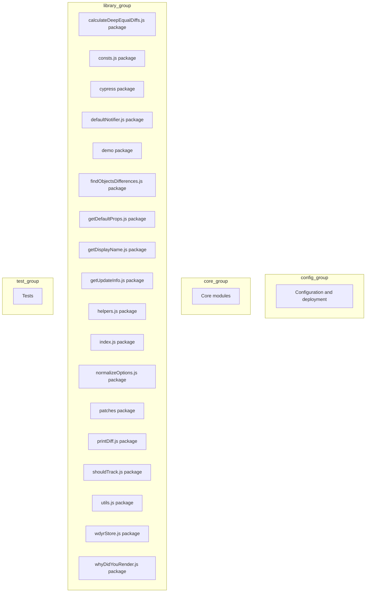

# Architecture report: welldone-software/why-did-you-render

> Automated static analysis. **Observed** = directly seen in files/imports/AST; **Inferred** = interpretation from that evidence. Repository code was not executed.

## 1. Repository at a glance

| Item | Value |
| --- | --- |
| Repository | welldone-software/why-did-you-render |
| Description | why-did-you-render by Welldone Software monkey patches React to notify you about potentially avoidable re-renders. (Works with React Native as well.) |
| Language | JavaScript |
| Stars | 12534 |
| Licence | MIT |
| Analysed commit / branch | 3ec3512d750c49448fe2241e26d05db9e42f0c21 / master |
| Framework(s) | Express, React |
| Files analysed | 128 |
| Components | 21 |

## 2. Architecture in one minute

welldone-software/why-did-you-render - why-did-you-render by Welldone Software monkey patches React to notify you about potentially avoidable re-renders. (Works with React Native as well.). This repository was analysed statically from 128 file(s) (0 Python). Detected technologies (observed from imports/manifests): GitHub Actions, Express, React, React Router, Redux, Jest. Files are grouped into 21 component(s): calculateDeepEqualDiffs.js package, Configuration and deployment, consts.js package, Core modules, cypress package, defaultNotifier.js package, demo package, findObjectsDifferences.js package. Findings below distinguish observed facts from inferred interpretation.

## 3. High-level block diagram

## 4. Main components

### calculateDeepEqualDiffs.js package (`calculatedeepequaldiffs_js`)

- **Kind:** library
- **Status:** Observed
- **Confidence:** 0.85
- **Responsibility:** Groups 1 file(s) under calculatedeepequaldiffs.js package (observed from repository paths and static analysis).
- **Paths:** `src/calculateDeepEqualDiffs.js`
- **Evidence:** [src/calculateDeepEqualDiffs.js](https://github.com/welldone-software/why-did-you-render/blob/3ec3512d750c49448fe2241e26d05db9e42f0c21/src/calculateDeepEqualDiffs.js)

### Configuration and deployment (`config`)

- **Kind:** config
- **Status:** Observed
- **Confidence:** 0.85
- **Responsibility:** Groups 3 file(s) under configuration and deployment (observed from repository paths and static analysis).
- **Paths:** `cypress/fixtures/example.json`, `package.json`, `tsconfig.json`
- **Evidence:** [cypress/fixtures/example.json](https://github.com/welldone-software/why-did-you-render/blob/3ec3512d750c49448fe2241e26d05db9e42f0c21/cypress/fixtures/example.json); [package.json](https://github.com/welldone-software/why-did-you-render/blob/3ec3512d750c49448fe2241e26d05db9e42f0c21/package.json); [tsconfig.json](https://github.com/welldone-software/why-did-you-render/blob/3ec3512d750c49448fe2241e26d05db9e42f0c21/tsconfig.json)

### consts.js package (`consts_js`)

- **Kind:** library
- **Status:** Observed
- **Confidence:** 0.85
- **Responsibility:** Groups 1 file(s) under consts.js package (observed from repository paths and static analysis).
- **Paths:** `src/consts.js`
- **Evidence:** [src/consts.js](https://github.com/welldone-software/why-did-you-render/blob/3ec3512d750c49448fe2241e26d05db9e42f0c21/src/consts.js)

### Core modules (`core`)

- **Kind:** core
- **Status:** Observed
- **Confidence:** 0.85
- **Responsibility:** Groups 13 file(s) under core modules (observed from repository paths and static analysis).
- **Paths:** `babel.config.cjs`, `cypress.config.ts`, `eslint.config.js`, `jest.config.js`, `jest.polyfills.js`, `jestSetup.js`, `jsx-dev-runtime.d.ts`, `jsx-dev-runtime.js`, `jsx-runtime.d.ts`, `jsx-runtime.js`, `rollup.config.js`, `tsx-test.tsx`, `types.d.ts`
- **Evidence:** [babel.config.cjs](https://github.com/welldone-software/why-did-you-render/blob/3ec3512d750c49448fe2241e26d05db9e42f0c21/babel.config.cjs); [cypress.config.ts](https://github.com/welldone-software/why-did-you-render/blob/3ec3512d750c49448fe2241e26d05db9e42f0c21/cypress.config.ts); [eslint.config.js](https://github.com/welldone-software/why-did-you-render/blob/3ec3512d750c49448fe2241e26d05db9e42f0c21/eslint.config.js); [jest.config.js](https://github.com/welldone-software/why-did-you-render/blob/3ec3512d750c49448fe2241e26d05db9e42f0c21/jest.config.js); [jest.polyfills.js](https://github.com/welldone-software/why-did-you-render/blob/3ec3512d750c49448fe2241e26d05db9e42f0c21/jest.polyfills.js); [jestSetup.js](https://github.com/welldone-software/why-did-you-render/blob/3ec3512d750c49448fe2241e26d05db9e42f0c21/jestSetup.js); [jsx-dev-runtime.d.ts](https://github.com/welldone-software/why-did-you-render/blob/3ec3512d750c49448fe2241e26d05db9e42f0c21/jsx-dev-runtime.d.ts); [jsx-dev-runtime.js](https://github.com/welldone-software/why-did-you-render/blob/3ec3512d750c49448fe2241e26d05db9e42f0c21/jsx-dev-runtime.js)

### cypress package (`cypress`)

- **Kind:** library
- **Status:** Observed
- **Confidence:** 0.85
- **Responsibility:** Groups 24 file(s) under cypress package (observed from repository paths and static analysis).
- **Paths:** `cypress/babel.config.js`, `cypress/e2e/big_list.js`, `cypress/e2e/child-of-pure-component.js`, `cypress/e2e/clone-element.js`, `cypress/e2e/create-factory.js`, `cypress/e2e/hooks-use-context.js`, `cypress/e2e/hooks-use-memo-and-callback-child.js`, `cypress/e2e/hooks-use-reducer.js`, `cypress/e2e/hooks-use-state.js`, `cypress/e2e/hot-reload.js`, `cypress/e2e/no-change.js`, `cypress/e2e/owner-reasons.js`, `cypress/e2e/props-and-state-change.js`, `cypress/e2e/props-changes.js`, `cypress/e2e/react-redux.js`, `cypress/e2e/special-changes.js`, `cypress/e2e/ssr.js`, `cypress/e2e/state-changes.js`, `cypress/e2e/strict-mode.js`, `cypress/e2e/styled-component.js`, `cypress/plugins/index.js`, `cypress/support/assertions.js`, `cypress/support/commands.js`, `cypress/support/e2e.js`
- **Evidence:** [cypress/babel.config.js](https://github.com/welldone-software/why-did-you-render/blob/3ec3512d750c49448fe2241e26d05db9e42f0c21/cypress/babel.config.js); [cypress/e2e/big_list.js](https://github.com/welldone-software/why-did-you-render/blob/3ec3512d750c49448fe2241e26d05db9e42f0c21/cypress/e2e/big_list.js); [cypress/e2e/child-of-pure-component.js](https://github.com/welldone-software/why-did-you-render/blob/3ec3512d750c49448fe2241e26d05db9e42f0c21/cypress/e2e/child-of-pure-component.js); [cypress/e2e/clone-element.js](https://github.com/welldone-software/why-did-you-render/blob/3ec3512d750c49448fe2241e26d05db9e42f0c21/cypress/e2e/clone-element.js); [cypress/e2e/create-factory.js](https://github.com/welldone-software/why-did-you-render/blob/3ec3512d750c49448fe2241e26d05db9e42f0c21/cypress/e2e/create-factory.js); [cypress/e2e/hooks-use-context.js](https://github.com/welldone-software/why-did-you-render/blob/3ec3512d750c49448fe2241e26d05db9e42f0c21/cypress/e2e/hooks-use-context.js); [cypress/e2e/hooks-use-memo-and-callback-child.js](https://github.com/welldone-software/why-did-you-render/blob/3ec3512d750c49448fe2241e26d05db9e42f0c21/cypress/e2e/hooks-use-memo-and-callback-child.js); [cypress/e2e/hooks-use-reducer.js](https://github.com/welldone-software/why-did-you-render/blob/3ec3512d750c49448fe2241e26d05db9e42f0c21/cypress/e2e/hooks-use-reducer.js)

### defaultNotifier.js package (`defaultnotifier_js`)

- **Kind:** library
- **Status:** Observed
- **Confidence:** 0.85
- **Responsibility:** Groups 1 file(s) under defaultnotifier.js package (observed from repository paths and static analysis).
- **Paths:** `src/defaultNotifier.js`
- **Evidence:** [src/defaultNotifier.js](https://github.com/welldone-software/why-did-you-render/blob/3ec3512d750c49448fe2241e26d05db9e42f0c21/src/defaultNotifier.js)

### demo package (`demo`)

- **Kind:** library
- **Status:** Observed
- **Confidence:** 0.85
- **Responsibility:** Groups 28 file(s) under demo package (observed from repository paths and static analysis).
- **Paths:** `demo/nollup.config.js`, `demo/serve.js`, `demo/src/App.js`, `demo/src/Menu.js`, `demo/src/bigList/index.js`, `demo/src/bothChanges/index.js`, `demo/src/childOfPureComponent/index.js`, `demo/src/cloneElement/index.js`, `demo/src/createFactory/index.js`, `demo/src/createStepLogger.js`, `demo/src/forwardRef/index.js`, `demo/src/hooks/useContext.js`, `demo/src/hooks/useMemoAndCallbackChild.js`, `demo/src/hooks/useReducer.js`, `demo/src/hooks/useState.js`, `demo/src/hotReload/index.js`, `demo/src/index.js`, `demo/src/logOwnerReasons/index.js`, `demo/src/noChanges/index.js`, `demo/src/propsChanges/index.js`, `demo/src/reactRedux/index.js`, `demo/src/reactReduxHOC/index.js`, `demo/src/specialChanges/index.js`, `demo/src/ssr/DemoComponent.js`, `demo/src/ssr/index.js`, `demo/src/stateChanges/index.js`, `demo/src/strict/index.js`, `demo/src/styledComponents/index.js`
- **Evidence:** [demo/nollup.config.js](https://github.com/welldone-software/why-did-you-render/blob/3ec3512d750c49448fe2241e26d05db9e42f0c21/demo/nollup.config.js); [demo/serve.js](https://github.com/welldone-software/why-did-you-render/blob/3ec3512d750c49448fe2241e26d05db9e42f0c21/demo/serve.js); [demo/src/App.js](https://github.com/welldone-software/why-did-you-render/blob/3ec3512d750c49448fe2241e26d05db9e42f0c21/demo/src/App.js); [demo/src/Menu.js](https://github.com/welldone-software/why-did-you-render/blob/3ec3512d750c49448fe2241e26d05db9e42f0c21/demo/src/Menu.js); [demo/src/bigList/index.js](https://github.com/welldone-software/why-did-you-render/blob/3ec3512d750c49448fe2241e26d05db9e42f0c21/demo/src/bigList/index.js); [demo/src/bothChanges/index.js](https://github.com/welldone-software/why-did-you-render/blob/3ec3512d750c49448fe2241e26d05db9e42f0c21/demo/src/bothChanges/index.js); [demo/src/childOfPureComponent/index.js](https://github.com/welldone-software/why-did-you-render/blob/3ec3512d750c49448fe2241e26d05db9e42f0c21/demo/src/childOfPureComponent/index.js); [demo/src/cloneElement/index.js](https://github.com/welldone-software/why-did-you-render/blob/3ec3512d750c49448fe2241e26d05db9e42f0c21/demo/src/cloneElement/index.js)

### findObjectsDifferences.js package (`findobjectsdifferences_js`)

- **Kind:** library
- **Status:** Observed
- **Confidence:** 0.85
- **Responsibility:** Groups 1 file(s) under findobjectsdifferences.js package (observed from repository paths and static analysis).
- **Paths:** `src/findObjectsDifferences.js`
- **Evidence:** [src/findObjectsDifferences.js](https://github.com/welldone-software/why-did-you-render/blob/3ec3512d750c49448fe2241e26d05db9e42f0c21/src/findObjectsDifferences.js)

### getDefaultProps.js package (`getdefaultprops_js`)

- **Kind:** library
- **Status:** Observed
- **Confidence:** 0.85
- **Responsibility:** Groups 1 file(s) under getdefaultprops.js package (observed from repository paths and static analysis).
- **Paths:** `src/getDefaultProps.js`
- **Evidence:** [src/getDefaultProps.js](https://github.com/welldone-software/why-did-you-render/blob/3ec3512d750c49448fe2241e26d05db9e42f0c21/src/getDefaultProps.js)

### getDisplayName.js package (`getdisplayname_js`)

- **Kind:** library
- **Status:** Observed
- **Confidence:** 0.85
- **Responsibility:** Groups 1 file(s) under getdisplayname.js package (observed from repository paths and static analysis).
- **Paths:** `src/getDisplayName.js`
- **Evidence:** [src/getDisplayName.js](https://github.com/welldone-software/why-did-you-render/blob/3ec3512d750c49448fe2241e26d05db9e42f0c21/src/getDisplayName.js)

### getUpdateInfo.js package (`getupdateinfo_js`)

- **Kind:** library
- **Status:** Observed
- **Confidence:** 0.85
- **Responsibility:** Groups 1 file(s) under getupdateinfo.js package (observed from repository paths and static analysis).
- **Paths:** `src/getUpdateInfo.js`
- **Evidence:** [src/getUpdateInfo.js](https://github.com/welldone-software/why-did-you-render/blob/3ec3512d750c49448fe2241e26d05db9e42f0c21/src/getUpdateInfo.js)

### helpers.js package (`helpers_js`)

- **Kind:** library
- **Status:** Observed
- **Confidence:** 0.85
- **Responsibility:** Groups 1 file(s) under helpers.js package (observed from repository paths and static analysis).
- **Paths:** `src/helpers.js`
- **Evidence:** [src/helpers.js](https://github.com/welldone-software/why-did-you-render/blob/3ec3512d750c49448fe2241e26d05db9e42f0c21/src/helpers.js)

### index.js package (`index_js`)

- **Kind:** library
- **Status:** Observed
- **Confidence:** 0.85
- **Responsibility:** Groups 1 file(s) under index.js package (observed from repository paths and static analysis).
- **Paths:** `src/index.js`
- **Evidence:** [src/index.js](https://github.com/welldone-software/why-did-you-render/blob/3ec3512d750c49448fe2241e26d05db9e42f0c21/src/index.js)

### normalizeOptions.js package (`normalizeoptions_js`)

- **Kind:** library
- **Status:** Observed
- **Confidence:** 0.85
- **Responsibility:** Groups 1 file(s) under normalizeoptions.js package (observed from repository paths and static analysis).
- **Paths:** `src/normalizeOptions.js`
- **Evidence:** [src/normalizeOptions.js](https://github.com/welldone-software/why-did-you-render/blob/3ec3512d750c49448fe2241e26d05db9e42f0c21/src/normalizeOptions.js)

### patches package (`patches`)

- **Kind:** library
- **Status:** Observed
- **Confidence:** 0.85
- **Responsibility:** Groups 4 file(s) under patches package (observed from repository paths and static analysis).
- **Paths:** `src/patches/patchClassComponent.js`, `src/patches/patchForwardRefComponent.js`, `src/patches/patchFunctionalOrStrComponent.js`, `src/patches/patchMemoComponent.js`
- **Evidence:** [src/patches/patchClassComponent.js](https://github.com/welldone-software/why-did-you-render/blob/3ec3512d750c49448fe2241e26d05db9e42f0c21/src/patches/patchClassComponent.js); [src/patches/patchForwardRefComponent.js](https://github.com/welldone-software/why-did-you-render/blob/3ec3512d750c49448fe2241e26d05db9e42f0c21/src/patches/patchForwardRefComponent.js); [src/patches/patchFunctionalOrStrComponent.js](https://github.com/welldone-software/why-did-you-render/blob/3ec3512d750c49448fe2241e26d05db9e42f0c21/src/patches/patchFunctionalOrStrComponent.js); [src/patches/patchMemoComponent.js](https://github.com/welldone-software/why-did-you-render/blob/3ec3512d750c49448fe2241e26d05db9e42f0c21/src/patches/patchMemoComponent.js)

### printDiff.js package (`printdiff_js`)

- **Kind:** library
- **Status:** Observed
- **Confidence:** 0.85
- **Responsibility:** Groups 1 file(s) under printdiff.js package (observed from repository paths and static analysis).
- **Paths:** `src/printDiff.js`
- **Evidence:** [src/printDiff.js](https://github.com/welldone-software/why-did-you-render/blob/3ec3512d750c49448fe2241e26d05db9e42f0c21/src/printDiff.js)

### shouldTrack.js package (`shouldtrack_js`)

- **Kind:** library
- **Status:** Observed
- **Confidence:** 0.85
- **Responsibility:** Groups 1 file(s) under shouldtrack.js package (observed from repository paths and static analysis).
- **Paths:** `src/shouldTrack.js`
- **Evidence:** [src/shouldTrack.js](https://github.com/welldone-software/why-did-you-render/blob/3ec3512d750c49448fe2241e26d05db9e42f0c21/src/shouldTrack.js)

### Tests (`tests`)

- **Kind:** test
- **Status:** Observed
- **Confidence:** 0.85
- **Responsibility:** Groups 28 file(s) under tests (observed from repository paths and static analysis).
- **Paths:** `cypress/e2e/test_console_assertions.js`, `tests/.eslintrc`, `tests/babel.config.cjs`, `tests/calculateDeepEqualDiffs.test.js`, `tests/defaultNotifier.test.js`, `tests/findObjectsDifferences.test.js`, `tests/getDisplayName.test.js`, `tests/getUpdateInfo.test.js`, `tests/hooks/childrenUsingHookResults.test.js`, `tests/hooks/hooks.test.js`, `tests/hooks/useContext.test.js`, `tests/hooks/useReducer.test.js`, `tests/hooks/useState.test.js`, `tests/hooks/useSyncExternalStore.test.js`, `tests/index.test.js`, `tests/librariesTests/react-redux.test.js`, `tests/librariesTests/react-router-dom.test.js`, `tests/librariesTests/styled-components.test.js`, `tests/logOnDifferentValues.test.js`, `tests/logOwnerReasons.test.js`, `tests/normalizeOptions.test.js`, `tests/patches/patchClassComponent.test.js`, `tests/patches/patchForwardRefComponent.test.js`, `tests/patches/patchFunctionalOrStrComponent.test.js`, `tests/patches/patchMemoComponent.test.js`, `tests/shouldTrack.test.js`, `tests/strictMode.test.js`, `tests/utils.test.js`
- **Evidence:** [cypress/e2e/test_console_assertions.js](https://github.com/welldone-software/why-did-you-render/blob/3ec3512d750c49448fe2241e26d05db9e42f0c21/cypress/e2e/test_console_assertions.js); [tests/.eslintrc](https://github.com/welldone-software/why-did-you-render/blob/3ec3512d750c49448fe2241e26d05db9e42f0c21/tests/.eslintrc); [tests/babel.config.cjs](https://github.com/welldone-software/why-did-you-render/blob/3ec3512d750c49448fe2241e26d05db9e42f0c21/tests/babel.config.cjs); [tests/calculateDeepEqualDiffs.test.js](https://github.com/welldone-software/why-did-you-render/blob/3ec3512d750c49448fe2241e26d05db9e42f0c21/tests/calculateDeepEqualDiffs.test.js); [tests/defaultNotifier.test.js](https://github.com/welldone-software/why-did-you-render/blob/3ec3512d750c49448fe2241e26d05db9e42f0c21/tests/defaultNotifier.test.js); [tests/findObjectsDifferences.test.js](https://github.com/welldone-software/why-did-you-render/blob/3ec3512d750c49448fe2241e26d05db9e42f0c21/tests/findObjectsDifferences.test.js); [tests/getDisplayName.test.js](https://github.com/welldone-software/why-did-you-render/blob/3ec3512d750c49448fe2241e26d05db9e42f0c21/tests/getDisplayName.test.js); [tests/getUpdateInfo.test.js](https://github.com/welldone-software/why-did-you-render/blob/3ec3512d750c49448fe2241e26d05db9e42f0c21/tests/getUpdateInfo.test.js)

### utils.js package (`utils_js`)

- **Kind:** library
- **Status:** Observed
- **Confidence:** 0.85
- **Responsibility:** Groups 1 file(s) under utils.js package (observed from repository paths and static analysis).
- **Paths:** `src/utils.js`
- **Evidence:** [src/utils.js](https://github.com/welldone-software/why-did-you-render/blob/3ec3512d750c49448fe2241e26d05db9e42f0c21/src/utils.js)

### wdyrStore.js package (`wdyrstore_js`)

- **Kind:** library
- **Status:** Observed
- **Confidence:** 0.85
- **Responsibility:** Groups 1 file(s) under wdyrstore.js package (observed from repository paths and static analysis).
- **Paths:** `src/wdyrStore.js`
- **Evidence:** [src/wdyrStore.js](https://github.com/welldone-software/why-did-you-render/blob/3ec3512d750c49448fe2241e26d05db9e42f0c21/src/wdyrStore.js)

### whyDidYouRender.js package (`whydidyourender_js`)

- **Kind:** library
- **Status:** Observed
- **Confidence:** 0.85
- **Responsibility:** Groups 1 file(s) under whydidyourender.js package (observed from repository paths and static analysis).
- **Paths:** `src/whyDidYouRender.js`
- **Evidence:** [src/whyDidYouRender.js](https://github.com/welldone-software/why-did-you-render/blob/3ec3512d750c49448fe2241e26d05db9e42f0c21/src/whyDidYouRender.js)

## 5. Execution flow

**Observed** entry point(s):

- [cypress/plugins/index.js](https://github.com/welldone-software/why-did-you-render/blob/3ec3512d750c49448fe2241e26d05db9e42f0c21/cypress/plugins/index.js)
- [demo/src/App.js](https://github.com/welldone-software/why-did-you-render/blob/3ec3512d750c49448fe2241e26d05db9e42f0c21/demo/src/App.js)
- [demo/src/bigList/index.js](https://github.com/welldone-software/why-did-you-render/blob/3ec3512d750c49448fe2241e26d05db9e42f0c21/demo/src/bigList/index.js)
- [demo/src/bothChanges/index.js](https://github.com/welldone-software/why-did-you-render/blob/3ec3512d750c49448fe2241e26d05db9e42f0c21/demo/src/bothChanges/index.js)
- [demo/src/childOfPureComponent/index.js](https://github.com/welldone-software/why-did-you-render/blob/3ec3512d750c49448fe2241e26d05db9e42f0c21/demo/src/childOfPureComponent/index.js)
- [demo/src/cloneElement/index.js](https://github.com/welldone-software/why-did-you-render/blob/3ec3512d750c49448fe2241e26d05db9e42f0c21/demo/src/cloneElement/index.js)
- [demo/src/createFactory/index.js](https://github.com/welldone-software/why-did-you-render/blob/3ec3512d750c49448fe2241e26d05db9e42f0c21/demo/src/createFactory/index.js)
- [demo/src/forwardRef/index.js](https://github.com/welldone-software/why-did-you-render/blob/3ec3512d750c49448fe2241e26d05db9e42f0c21/demo/src/forwardRef/index.js)
- [demo/src/hotReload/index.js](https://github.com/welldone-software/why-did-you-render/blob/3ec3512d750c49448fe2241e26d05db9e42f0c21/demo/src/hotReload/index.js)
- [demo/src/index.js](https://github.com/welldone-software/why-did-you-render/blob/3ec3512d750c49448fe2241e26d05db9e42f0c21/demo/src/index.js)
- [demo/src/logOwnerReasons/index.js](https://github.com/welldone-software/why-did-you-render/blob/3ec3512d750c49448fe2241e26d05db9e42f0c21/demo/src/logOwnerReasons/index.js)
- [demo/src/noChanges/index.js](https://github.com/welldone-software/why-did-you-render/blob/3ec3512d750c49448fe2241e26d05db9e42f0c21/demo/src/noChanges/index.js)

Representative flow (derived from observed entry points and the import graph; steps beyond the entry point are **Inferred**):

1. Execution starts at an observed entry point listed above, if present.
2. No internal import relationships between components were observed.

## 6. Project structure

### `(root)`

- `.gitignore` - other (94 bytes)
- `LICENSE` - docs (1101 bytes)
- `README.md` - docs (16483 bytes)
- `babel.config.cjs` - source, JavaScript (556 bytes)
- `cypress.config.ts` - source, TypeScript (421 bytes)
- `eslint.config.js` - source, JavaScript (1993 bytes)
- `jest.config.js` - source, JavaScript (373 bytes)
- `jest.polyfills.js` - source, JavaScript (986 bytes)
- `jestSetup.js` - source, JavaScript (706 bytes)
- `jsx-dev-runtime.d.ts` - source, TypeScript (23 bytes)
- `jsx-dev-runtime.js` - source, JavaScript (1198 bytes)
- `jsx-runtime.d.ts` - source, TypeScript (23 bytes)
- `jsx-runtime.js` - source, JavaScript (47 bytes)
- `package.json` - manifest (4326 bytes)
- `rollup.config.js` - source, JavaScript (1056 bytes)
- `tsconfig.json` - config (355 bytes)
- `tsx-test.tsx` - source, TypeScript (4301 bytes)
- `types.d.ts` - source, TypeScript (2234 bytes)

### `.github`

- `.github/actions/setup/action.yml` - config (548 bytes)
- `.github/workflows/main.yml` - ci, YAML (751 bytes)

### `.husky`

- `.husky/.gitignore` - other (2 bytes)
- `.husky/pre-commit` - other (52 bytes)

### `.run`

- `.run/Main Jest.run.xml` - other (550 bytes)

### `.vscode`

- `.vscode/extensions.json` - config (482 bytes)
- `.vscode/launch.json` - config (1025 bytes)
- `.vscode/settings.json` - config (804 bytes)

### `cypress`

- `cypress/.eslintrc` - other (56 bytes)
- `cypress/babel.config.js` - source, JavaScript (57 bytes)
- `cypress/e2e/big_list.js` - source, JavaScript (422 bytes)
- `cypress/e2e/child-of-pure-component.js` - source, JavaScript (555 bytes)
- `cypress/e2e/clone-element.js` - source, JavaScript (412 bytes)
- `cypress/e2e/create-factory.js` - source, JavaScript (414 bytes)
- `cypress/e2e/hooks-use-context.js` - source, JavaScript (693 bytes)
- `cypress/e2e/hooks-use-memo-and-callback-child.js` - source, JavaScript (394 bytes)
- `cypress/e2e/hooks-use-reducer.js` - source, JavaScript (751 bytes)
- `cypress/e2e/hooks-use-state.js` - source, JavaScript (395 bytes)
- `cypress/e2e/hot-reload.js` - source, JavaScript (410 bytes)
- `cypress/e2e/no-change.js` - source, JavaScript (345 bytes)
- `cypress/e2e/owner-reasons.js` - source, JavaScript (897 bytes)
- `cypress/e2e/props-and-state-change.js` - source, JavaScript (408 bytes)
- `cypress/e2e/props-changes.js` - source, JavaScript (327 bytes)
- `cypress/e2e/react-redux.js` - source, JavaScript (1935 bytes)
- `cypress/e2e/special-changes.js` - source, JavaScript (607 bytes)
- `cypress/e2e/ssr.js` - source, JavaScript (410 bytes)
- `cypress/e2e/state-changes.js` - source, JavaScript (420 bytes)
- `cypress/e2e/strict-mode.js` - source, JavaScript (520 bytes)
- `cypress/e2e/styled-component.js` - source, JavaScript (594 bytes)
- `cypress/e2e/test_console_assertions.js` - test, JavaScript (503 bytes)
- `cypress/fixtures/example.json` - config (155 bytes)
- `cypress/plugins/index.js` - source, JavaScript (757 bytes)
- `cypress/support/assertions.js` - source, JavaScript (856 bytes)
- `cypress/support/commands.js` - source, JavaScript (1159 bytes)
- `cypress/support/e2e.js` - source, JavaScript (694 bytes)

### `demo`

- `demo/nollup.config.js` - source, JavaScript (1031 bytes)
- `demo/public/index.html` - other (286 bytes)
- `demo/serve.js` - source, JavaScript (1047 bytes)
- `demo/src/App.js` - source, JavaScript (2679 bytes)
- `demo/src/Menu.js` - source, JavaScript (313 bytes)
- `demo/src/bigList/index.js` - source, JavaScript (1720 bytes)
- `demo/src/bothChanges/index.js` - source, JavaScript (753 bytes)
- `demo/src/childOfPureComponent/index.js` - source, JavaScript (890 bytes)
- `demo/src/cloneElement/index.js` - source, JavaScript (578 bytes)
- `demo/src/createFactory/index.js` - source, JavaScript (575 bytes)
- `demo/src/createStepLogger.js` - source, JavaScript (546 bytes)
- `demo/src/forwardRef/index.js` - source, JavaScript (573 bytes)
- `demo/src/hooks/useContext.js` - source, JavaScript (2741 bytes)
- `demo/src/hooks/useMemoAndCallbackChild.js` - source, JavaScript (2130 bytes)
- `demo/src/hooks/useReducer.js` - source, JavaScript (1452 bytes)
- `demo/src/hooks/useState.js` - source, JavaScript (2455 bytes)
- `demo/src/hotReload/index.js` - source, JavaScript (673 bytes)
- `demo/src/index.js` - source, JavaScript (211 bytes)
- `demo/src/logOwnerReasons/index.js` - source, JavaScript (1177 bytes)
- `demo/src/noChanges/index.js` - source, JavaScript (592 bytes)
- `demo/src/propsChanges/index.js` - source, JavaScript (1695 bytes)
- `demo/src/reactRedux/index.js` - source, JavaScript (1450 bytes)
- `demo/src/reactReduxHOC/index.js` - source, JavaScript (1476 bytes)
- `demo/src/specialChanges/index.js` - source, JavaScript (915 bytes)
- `demo/src/ssr/DemoComponent.js` - source, JavaScript (316 bytes)
- `demo/src/ssr/index.js` - source, JavaScript (880 bytes)
- `demo/src/stateChanges/index.js` - source, JavaScript (963 bytes)
- `demo/src/strict/index.js` - source, JavaScript (1068 bytes)
- `demo/src/styledComponents/index.js` - source, JavaScript (655 bytes)

### `src`

- `src/calculateDeepEqualDiffs.js` - source, JavaScript (7680 bytes)
- `src/consts.js` - source, JavaScript (1178 bytes)
- `src/defaultNotifier.js` - source, JavaScript (6877 bytes)
- `src/findObjectsDifferences.js` - source, JavaScript (800 bytes)
- `src/getDefaultProps.js` - source, JavaScript (207 bytes)
- `src/getDisplayName.js` - source, JavaScript (280 bytes)
- `src/getUpdateInfo.js` - source, JavaScript (2524 bytes)
- `src/helpers.js` - source, JavaScript (277 bytes)
- `src/index.js` - source, JavaScript (549 bytes)
- `src/normalizeOptions.js` - source, JavaScript (1040 bytes)
- `src/patches/patchClassComponent.js` - source, JavaScript (2199 bytes)
- `src/patches/patchForwardRefComponent.js` - source, JavaScript (1696 bytes)
- `src/patches/patchFunctionalOrStrComponent.js` - source, JavaScript (1875 bytes)
- `src/patches/patchMemoComponent.js` - source, JavaScript (2079 bytes)
- `src/printDiff.js` - source, JavaScript (744 bytes)
- `src/shouldTrack.js` - source, JavaScript (1186 bytes)
- `src/utils.js` - source, JavaScript (1189 bytes)
- `src/wdyrStore.js` - source, JavaScript (817 bytes)
- `src/whyDidYouRender.js` - source, JavaScript (8885 bytes)

### `tests`

- `tests/.eslintrc` - test (154 bytes)
- `tests/babel.config.cjs` - test, JavaScript (45 bytes)
- `tests/calculateDeepEqualDiffs.test.js` - test, JavaScript (13084 bytes)
- `tests/defaultNotifier.test.js` - test, JavaScript (11490 bytes)
- `tests/findObjectsDifferences.test.js` - test, JavaScript (5747 bytes)
- `tests/getDisplayName.test.js` - test, JavaScript (800 bytes)
- `tests/getUpdateInfo.test.js` - test, JavaScript (12795 bytes)
- `tests/hooks/childrenUsingHookResults.test.js` - test, JavaScript (6552 bytes)
- `tests/hooks/hooks.test.js` - test, JavaScript (5466 bytes)
- `tests/hooks/useContext.test.js` - test, JavaScript (4079 bytes)
- `tests/hooks/useReducer.test.js` - test, JavaScript (2779 bytes)
- `tests/hooks/useState.test.js` - test, JavaScript (8963 bytes)
- `tests/hooks/useSyncExternalStore.test.js` - test, JavaScript (2634 bytes)
- `tests/index.test.js` - test, JavaScript (1439 bytes)
- `tests/librariesTests/react-redux.test.js` - test, JavaScript (6992 bytes)
- `tests/librariesTests/react-router-dom.test.js` - test, JavaScript (3990 bytes)
- `tests/librariesTests/styled-components.test.js` - test, JavaScript (3750 bytes)
- `tests/logOnDifferentValues.test.js` - test, JavaScript (2090 bytes)
- `tests/logOwnerReasons.test.js` - test, JavaScript (8053 bytes)
- `tests/normalizeOptions.test.js` - test, JavaScript (488 bytes)
- `tests/patches/patchClassComponent.test.js` - test, JavaScript (9812 bytes)
- `tests/patches/patchForwardRefComponent.test.js` - test, JavaScript (2514 bytes)
- `tests/patches/patchFunctionalOrStrComponent.test.js` - test, JavaScript (2048 bytes)
- `tests/patches/patchMemoComponent.test.js` - test, JavaScript (5196 bytes)
- `tests/shouldTrack.test.js` - test, JavaScript (4348 bytes)
- `tests/strictMode.test.js` - test, JavaScript (8976 bytes)
- `tests/utils.test.js` - test, JavaScript (1467 bytes)

## 7. Key dependencies and integrations

| Name | Category | Status | Confidence | Evidence |
| --- | --- | --- | --- | --- |
| GitHub Actions | ci | Observed | 0.85 | [.github/workflows/main.yml](https://github.com/welldone-software/why-did-you-render/blob/3ec3512d750c49448fe2241e26d05db9e42f0c21/.github/workflows/main.yml) |
| Express | framework | Observed | 0.85 | [package.json:100](https://github.com/welldone-software/why-did-you-render/blob/3ec3512d750c49448fe2241e26d05db9e42f0c21/package.json#L100) |
| React | framework | Observed | 0.90 | [package.json:3](https://github.com/welldone-software/why-did-you-render/blob/3ec3512d750c49448fe2241e26d05db9e42f0c21/package.json#L3); [package.json:85](https://github.com/welldone-software/why-did-you-render/blob/3ec3512d750c49448fe2241e26d05db9e42f0c21/package.json#L85) |
| React Router | library | Observed | 0.85 | [package.json:112](https://github.com/welldone-software/why-did-you-render/blob/3ec3512d750c49448fe2241e26d05db9e42f0c21/package.json#L112) |
| Redux | library | Observed | 0.85 | [package.json:86](https://github.com/welldone-software/why-did-you-render/blob/3ec3512d750c49448fe2241e26d05db9e42f0c21/package.json#L86) |
| Jest | tooling | Observed | 0.85 | [package.json:32](https://github.com/welldone-software/why-did-you-render/blob/3ec3512d750c49448fe2241e26d05db9e42f0c21/package.json#L32) |
| TypeScript | tooling | Observed | 0.85 | [package.json:124](https://github.com/welldone-software/why-did-you-render/blob/3ec3512d750c49448fe2241e26d05db9e42f0c21/package.json#L124) |

## 8. Data and state

No database, cache, queue, or persistent-state usage was observed in the analysed files. State handling, if any, may be in-memory or in files that were not analysed.

## 9. Configuration and deployment clues

- `.github/actions/setup/action.yml` (config)
- `.github/workflows/main.yml` (ci)
- `.vscode/extensions.json` (config)
- `.vscode/launch.json` (config)
- `.vscode/settings.json` (config)
- `cypress/fixtures/example.json` (config)
- `package.json` (manifest)
- `tsconfig.json` (config)

## 10. Design observations

- Tests are present alongside source code (Observed from test file paths).

These observations are interpretations (**Inferred**) of the observed structure, not guarantees about runtime design.

## 11. Limitations and unknowns

- Static analysis only: repository code was not executed, installed, or imported at runtime.
- Components and relationships are inferred from file paths, imports, and AST structure; runtime behaviour, dynamic imports, and reflection may not be visible.
- 1 file(s) were skipped during inventory (1 x likely secret file excluded).
- No clear application entry point was observed in the analysed files.
- Repository text was treated as untrusted data; no instructions found in repository files were followed, and likely secret values were redacted/excluded.
- JavaScript and TypeScript files were inventoried from paths and package manifests. They were not parsed with a full language AST, and repository code was not executed.

## 12. Source references

- [.github/workflows/main.yml](https://github.com/welldone-software/why-did-you-render/blob/3ec3512d750c49448fe2241e26d05db9e42f0c21/.github/workflows/main.yml)
- [babel.config.cjs](https://github.com/welldone-software/why-did-you-render/blob/3ec3512d750c49448fe2241e26d05db9e42f0c21/babel.config.cjs)
- [cypress.config.ts](https://github.com/welldone-software/why-did-you-render/blob/3ec3512d750c49448fe2241e26d05db9e42f0c21/cypress.config.ts)
- [cypress/babel.config.js](https://github.com/welldone-software/why-did-you-render/blob/3ec3512d750c49448fe2241e26d05db9e42f0c21/cypress/babel.config.js)
- [cypress/e2e/big_list.js](https://github.com/welldone-software/why-did-you-render/blob/3ec3512d750c49448fe2241e26d05db9e42f0c21/cypress/e2e/big_list.js)
- [cypress/e2e/child-of-pure-component.js](https://github.com/welldone-software/why-did-you-render/blob/3ec3512d750c49448fe2241e26d05db9e42f0c21/cypress/e2e/child-of-pure-component.js)
- [cypress/e2e/clone-element.js](https://github.com/welldone-software/why-did-you-render/blob/3ec3512d750c49448fe2241e26d05db9e42f0c21/cypress/e2e/clone-element.js)
- [cypress/e2e/create-factory.js](https://github.com/welldone-software/why-did-you-render/blob/3ec3512d750c49448fe2241e26d05db9e42f0c21/cypress/e2e/create-factory.js)
- [cypress/e2e/hooks-use-context.js](https://github.com/welldone-software/why-did-you-render/blob/3ec3512d750c49448fe2241e26d05db9e42f0c21/cypress/e2e/hooks-use-context.js)
- [cypress/e2e/hooks-use-memo-and-callback-child.js](https://github.com/welldone-software/why-did-you-render/blob/3ec3512d750c49448fe2241e26d05db9e42f0c21/cypress/e2e/hooks-use-memo-and-callback-child.js)
- [cypress/e2e/hooks-use-reducer.js](https://github.com/welldone-software/why-did-you-render/blob/3ec3512d750c49448fe2241e26d05db9e42f0c21/cypress/e2e/hooks-use-reducer.js)
- [cypress/e2e/test_console_assertions.js](https://github.com/welldone-software/why-did-you-render/blob/3ec3512d750c49448fe2241e26d05db9e42f0c21/cypress/e2e/test_console_assertions.js)
- [cypress/fixtures/example.json](https://github.com/welldone-software/why-did-you-render/blob/3ec3512d750c49448fe2241e26d05db9e42f0c21/cypress/fixtures/example.json)
- [cypress/plugins/index.js](https://github.com/welldone-software/why-did-you-render/blob/3ec3512d750c49448fe2241e26d05db9e42f0c21/cypress/plugins/index.js)
- [demo/nollup.config.js](https://github.com/welldone-software/why-did-you-render/blob/3ec3512d750c49448fe2241e26d05db9e42f0c21/demo/nollup.config.js)
- [demo/serve.js](https://github.com/welldone-software/why-did-you-render/blob/3ec3512d750c49448fe2241e26d05db9e42f0c21/demo/serve.js)
- [demo/src/App.js](https://github.com/welldone-software/why-did-you-render/blob/3ec3512d750c49448fe2241e26d05db9e42f0c21/demo/src/App.js)
- [demo/src/Menu.js](https://github.com/welldone-software/why-did-you-render/blob/3ec3512d750c49448fe2241e26d05db9e42f0c21/demo/src/Menu.js)
- [demo/src/bigList/index.js](https://github.com/welldone-software/why-did-you-render/blob/3ec3512d750c49448fe2241e26d05db9e42f0c21/demo/src/bigList/index.js)
- [demo/src/bothChanges/index.js](https://github.com/welldone-software/why-did-you-render/blob/3ec3512d750c49448fe2241e26d05db9e42f0c21/demo/src/bothChanges/index.js)
- [demo/src/childOfPureComponent/index.js](https://github.com/welldone-software/why-did-you-render/blob/3ec3512d750c49448fe2241e26d05db9e42f0c21/demo/src/childOfPureComponent/index.js)
- [demo/src/cloneElement/index.js](https://github.com/welldone-software/why-did-you-render/blob/3ec3512d750c49448fe2241e26d05db9e42f0c21/demo/src/cloneElement/index.js)
- [demo/src/createFactory/index.js](https://github.com/welldone-software/why-did-you-render/blob/3ec3512d750c49448fe2241e26d05db9e42f0c21/demo/src/createFactory/index.js)
- [demo/src/forwardRef/index.js](https://github.com/welldone-software/why-did-you-render/blob/3ec3512d750c49448fe2241e26d05db9e42f0c21/demo/src/forwardRef/index.js)
- [demo/src/hotReload/index.js](https://github.com/welldone-software/why-did-you-render/blob/3ec3512d750c49448fe2241e26d05db9e42f0c21/demo/src/hotReload/index.js)
- [demo/src/index.js](https://github.com/welldone-software/why-did-you-render/blob/3ec3512d750c49448fe2241e26d05db9e42f0c21/demo/src/index.js)
- [demo/src/logOwnerReasons/index.js](https://github.com/welldone-software/why-did-you-render/blob/3ec3512d750c49448fe2241e26d05db9e42f0c21/demo/src/logOwnerReasons/index.js)
- [demo/src/noChanges/index.js](https://github.com/welldone-software/why-did-you-render/blob/3ec3512d750c49448fe2241e26d05db9e42f0c21/demo/src/noChanges/index.js)
- [eslint.config.js](https://github.com/welldone-software/why-did-you-render/blob/3ec3512d750c49448fe2241e26d05db9e42f0c21/eslint.config.js)
- [jest.config.js](https://github.com/welldone-software/why-did-you-render/blob/3ec3512d750c49448fe2241e26d05db9e42f0c21/jest.config.js)
- [jest.polyfills.js](https://github.com/welldone-software/why-did-you-render/blob/3ec3512d750c49448fe2241e26d05db9e42f0c21/jest.polyfills.js)
- [jestSetup.js](https://github.com/welldone-software/why-did-you-render/blob/3ec3512d750c49448fe2241e26d05db9e42f0c21/jestSetup.js)
- [jsx-dev-runtime.d.ts](https://github.com/welldone-software/why-did-you-render/blob/3ec3512d750c49448fe2241e26d05db9e42f0c21/jsx-dev-runtime.d.ts)
- [jsx-dev-runtime.js](https://github.com/welldone-software/why-did-you-render/blob/3ec3512d750c49448fe2241e26d05db9e42f0c21/jsx-dev-runtime.js)
- [package.json](https://github.com/welldone-software/why-did-you-render/blob/3ec3512d750c49448fe2241e26d05db9e42f0c21/package.json)
- [package.json:3](https://github.com/welldone-software/why-did-you-render/blob/3ec3512d750c49448fe2241e26d05db9e42f0c21/package.json#L3)
- [package.json:32](https://github.com/welldone-software/why-did-you-render/blob/3ec3512d750c49448fe2241e26d05db9e42f0c21/package.json#L32)
- [package.json:85](https://github.com/welldone-software/why-did-you-render/blob/3ec3512d750c49448fe2241e26d05db9e42f0c21/package.json#L85)
- [package.json:86](https://github.com/welldone-software/why-did-you-render/blob/3ec3512d750c49448fe2241e26d05db9e42f0c21/package.json#L86)
- [package.json:100](https://github.com/welldone-software/why-did-you-render/blob/3ec3512d750c49448fe2241e26d05db9e42f0c21/package.json#L100)
- [package.json:112](https://github.com/welldone-software/why-did-you-render/blob/3ec3512d750c49448fe2241e26d05db9e42f0c21/package.json#L112)
- [package.json:124](https://github.com/welldone-software/why-did-you-render/blob/3ec3512d750c49448fe2241e26d05db9e42f0c21/package.json#L124)
- [src/calculateDeepEqualDiffs.js](https://github.com/welldone-software/why-did-you-render/blob/3ec3512d750c49448fe2241e26d05db9e42f0c21/src/calculateDeepEqualDiffs.js)
- [src/consts.js](https://github.com/welldone-software/why-did-you-render/blob/3ec3512d750c49448fe2241e26d05db9e42f0c21/src/consts.js)
- [src/defaultNotifier.js](https://github.com/welldone-software/why-did-you-render/blob/3ec3512d750c49448fe2241e26d05db9e42f0c21/src/defaultNotifier.js)
- [src/findObjectsDifferences.js](https://github.com/welldone-software/why-did-you-render/blob/3ec3512d750c49448fe2241e26d05db9e42f0c21/src/findObjectsDifferences.js)
- [src/getDefaultProps.js](https://github.com/welldone-software/why-did-you-render/blob/3ec3512d750c49448fe2241e26d05db9e42f0c21/src/getDefaultProps.js)
- [src/getDisplayName.js](https://github.com/welldone-software/why-did-you-render/blob/3ec3512d750c49448fe2241e26d05db9e42f0c21/src/getDisplayName.js)
- [src/getUpdateInfo.js](https://github.com/welldone-software/why-did-you-render/blob/3ec3512d750c49448fe2241e26d05db9e42f0c21/src/getUpdateInfo.js)
- [src/helpers.js](https://github.com/welldone-software/why-did-you-render/blob/3ec3512d750c49448fe2241e26d05db9e42f0c21/src/helpers.js)
- [src/index.js](https://github.com/welldone-software/why-did-you-render/blob/3ec3512d750c49448fe2241e26d05db9e42f0c21/src/index.js)
- [src/normalizeOptions.js](https://github.com/welldone-software/why-did-you-render/blob/3ec3512d750c49448fe2241e26d05db9e42f0c21/src/normalizeOptions.js)
- [src/patches/patchClassComponent.js](https://github.com/welldone-software/why-did-you-render/blob/3ec3512d750c49448fe2241e26d05db9e42f0c21/src/patches/patchClassComponent.js)
- [src/patches/patchForwardRefComponent.js](https://github.com/welldone-software/why-did-you-render/blob/3ec3512d750c49448fe2241e26d05db9e42f0c21/src/patches/patchForwardRefComponent.js)
- [src/patches/patchFunctionalOrStrComponent.js](https://github.com/welldone-software/why-did-you-render/blob/3ec3512d750c49448fe2241e26d05db9e42f0c21/src/patches/patchFunctionalOrStrComponent.js)
- [src/patches/patchMemoComponent.js](https://github.com/welldone-software/why-did-you-render/blob/3ec3512d750c49448fe2241e26d05db9e42f0c21/src/patches/patchMemoComponent.js)
- [src/printDiff.js](https://github.com/welldone-software/why-did-you-render/blob/3ec3512d750c49448fe2241e26d05db9e42f0c21/src/printDiff.js)
- [src/shouldTrack.js](https://github.com/welldone-software/why-did-you-render/blob/3ec3512d750c49448fe2241e26d05db9e42f0c21/src/shouldTrack.js)
- [src/utils.js](https://github.com/welldone-software/why-did-you-render/blob/3ec3512d750c49448fe2241e26d05db9e42f0c21/src/utils.js)
- [src/wdyrStore.js](https://github.com/welldone-software/why-did-you-render/blob/3ec3512d750c49448fe2241e26d05db9e42f0c21/src/wdyrStore.js)
- [src/whyDidYouRender.js](https://github.com/welldone-software/why-did-you-render/blob/3ec3512d750c49448fe2241e26d05db9e42f0c21/src/whyDidYouRender.js)
- [tests/.eslintrc](https://github.com/welldone-software/why-did-you-render/blob/3ec3512d750c49448fe2241e26d05db9e42f0c21/tests/.eslintrc)
- [tests/babel.config.cjs](https://github.com/welldone-software/why-did-you-render/blob/3ec3512d750c49448fe2241e26d05db9e42f0c21/tests/babel.config.cjs)
- [tests/calculateDeepEqualDiffs.test.js](https://github.com/welldone-software/why-did-you-render/blob/3ec3512d750c49448fe2241e26d05db9e42f0c21/tests/calculateDeepEqualDiffs.test.js)
- [tests/defaultNotifier.test.js](https://github.com/welldone-software/why-did-you-render/blob/3ec3512d750c49448fe2241e26d05db9e42f0c21/tests/defaultNotifier.test.js)
- [tests/findObjectsDifferences.test.js](https://github.com/welldone-software/why-did-you-render/blob/3ec3512d750c49448fe2241e26d05db9e42f0c21/tests/findObjectsDifferences.test.js)
- [tests/getDisplayName.test.js](https://github.com/welldone-software/why-did-you-render/blob/3ec3512d750c49448fe2241e26d05db9e42f0c21/tests/getDisplayName.test.js)
- [tests/getUpdateInfo.test.js](https://github.com/welldone-software/why-did-you-render/blob/3ec3512d750c49448fe2241e26d05db9e42f0c21/tests/getUpdateInfo.test.js)
- [tsconfig.json](https://github.com/welldone-software/why-did-you-render/blob/3ec3512d750c49448fe2241e26d05db9e42f0c21/tsconfig.json)
