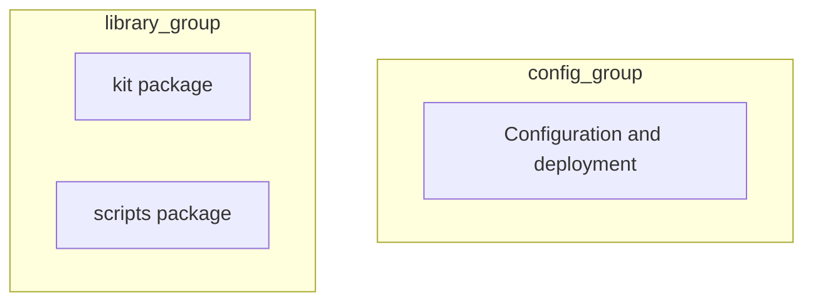

# Architecture report: wheresryan22/anatomy

> Automated static analysis. **Observed** = directly seen in files/imports/AST; **Inferred** = interpretation from that evidence. Repository code was not executed.

## 1. Repository at a glance

| Item | Value |
| --- | --- |
| Repository | wheresryan22/anatomy |
| Description | An agent skill for creating detailed, interactive isometric illustrations of real-world machines and complex systems. Generates polished SVGs with optional WebGL shaders and 3D effects. |
| Language | JavaScript |
| Stars | 27279 |
| Licence | MIT |
| Analysed commit / branch | 1482e8469b0a9e0d8cc18ea2740a01423d29ae80 / main |
| Framework(s) | None detected |
| Files analysed | 143 |
| Components | 3 |

## 2. Architecture in one minute

wheresryan22/anatomy - An agent skill for creating detailed, interactive isometric illustrations of real-world machines and complex systems. Generates polished SVGs with optional WebGL shaders and 3D effects.. This repository was analysed statically from 143 file(s) (0 Python). Detected technologies (observed from imports/manifests): GitHub Actions. Files are grouped into 3 component(s): Configuration and deployment, kit package, scripts package. Findings below distinguish observed facts from inferred interpretation.

## 3. High-level block diagram

## 4. Main components

### Configuration and deployment (`config`)

- **Kind:** config
- **Status:** Observed
- **Confidence:** 0.85
- **Responsibility:** Groups 2 file(s) under configuration and deployment (observed from repository paths and static analysis).
- **Paths:** `agents/openai.yaml`, `evals/evals.json`
- **Evidence:** [agents/openai.yaml](https://github.com/wheresryan22/anatomy/blob/1482e8469b0a9e0d8cc18ea2740a01423d29ae80/agents/openai.yaml); [evals/evals.json](https://github.com/wheresryan22/anatomy/blob/1482e8469b0a9e0d8cc18ea2740a01423d29ae80/evals/evals.json)

### kit package (`kit`)

- **Kind:** library
- **Status:** Observed
- **Confidence:** 0.85
- **Responsibility:** Groups 15 file(s) under kit package (observed from repository paths and static analysis).
- **Paths:** `kit/audit.mjs`, `kit/canvas-painter.mjs`, `kit/gl-shared.mjs`, `kit/gl.mjs`, `kit/iso-kit.mjs`, `kit/iso-kit.ts`, `kit/lathe.mjs`, `kit/pdf-button.mjs`, `kit/react/draw.tsx`, `kit/react/live.tsx`, `kit/tube.mjs`, `kit/turn-audit.mjs`, `kit/turn-build.mjs`, `kit/turn-fixed.mjs`, `kit/turn.mjs`
- **Evidence:** [kit/audit.mjs](https://github.com/wheresryan22/anatomy/blob/1482e8469b0a9e0d8cc18ea2740a01423d29ae80/kit/audit.mjs); [kit/canvas-painter.mjs](https://github.com/wheresryan22/anatomy/blob/1482e8469b0a9e0d8cc18ea2740a01423d29ae80/kit/canvas-painter.mjs); [kit/gl-shared.mjs](https://github.com/wheresryan22/anatomy/blob/1482e8469b0a9e0d8cc18ea2740a01423d29ae80/kit/gl-shared.mjs); [kit/gl.mjs](https://github.com/wheresryan22/anatomy/blob/1482e8469b0a9e0d8cc18ea2740a01423d29ae80/kit/gl.mjs); [kit/iso-kit.mjs](https://github.com/wheresryan22/anatomy/blob/1482e8469b0a9e0d8cc18ea2740a01423d29ae80/kit/iso-kit.mjs); [kit/iso-kit.ts](https://github.com/wheresryan22/anatomy/blob/1482e8469b0a9e0d8cc18ea2740a01423d29ae80/kit/iso-kit.ts); [kit/lathe.mjs](https://github.com/wheresryan22/anatomy/blob/1482e8469b0a9e0d8cc18ea2740a01423d29ae80/kit/lathe.mjs); [kit/pdf-button.mjs](https://github.com/wheresryan22/anatomy/blob/1482e8469b0a9e0d8cc18ea2740a01423d29ae80/kit/pdf-button.mjs)

### scripts package (`scripts`)

- **Kind:** library
- **Status:** Observed
- **Confidence:** 0.85
- **Responsibility:** Groups 59 file(s) under scripts package (observed from repository paths and static analysis).
- **Paths:** `scripts/audit-affine-bounds.test.mjs`, `scripts/audit-cache.test.mjs`, `scripts/audit-clearance-envelope.test.mjs`, `scripts/audit-empty-clipping.test.mjs`, `scripts/audit-order-convergence.test.mjs`, `scripts/audit-path-origin.test.mjs`, `scripts/audit-profile.test.mjs`, `scripts/audit-projection.test.mjs`, `scripts/audit-slide-clearance.test.mjs`, `scripts/audit-svg-attributes.test.mjs`, `scripts/audit-taper.test.mjs`, `scripts/audit-tube-support.test.mjs`, `scripts/capture-current-geometry.test.mjs`, `scripts/capture-selector.test.mjs`, `scripts/capture.mjs`, `scripts/capture.test.mjs`, `scripts/chrome-port.mjs`, `scripts/chrome-startup.test.mjs`, `scripts/curve-density.test.mjs`, `scripts/drive-actions.test.mjs`, `scripts/drive-async-until.test.mjs`, `scripts/drive-page-load.test.mjs`, `scripts/drive-turn-controller.test.mjs`, `scripts/drive.mjs`, `scripts/drive.test.mjs`, `scripts/enter-key.test.mjs`, `scripts/fidelity-cut.test.mjs`, `scripts/fidelity-tube-coverage.test.mjs`, `scripts/fingerprint.mjs`, `scripts/inline-kit.mjs`, `scripts/line-ends.mjs`, `scripts/lines-arcs.test.mjs`, `scripts/lines-bezier.test.mjs`, `scripts/lines-round.test.mjs`, `scripts/lines-rounded-rect.test.mjs`, `scripts/lines.mjs`, `scripts/lines.test.mjs`, `scripts/navigation.test.mjs`, `scripts/orbit-sampling.test.mjs`, `scripts/print-sheet.mjs`, `scripts/print-sheet.test.mjs`, `scripts/print.mjs`, `scripts/publish.mjs`, `scripts/publish.test.mjs`, `scripts/react-dots-opacity.test.mjs`, `scripts/react-readout-first-write.test.mjs`, `scripts/react-readout-target.test.mjs`, `scripts/react-solid-seamless.test.mjs`, `scripts/react-visibility-target.test.mjs`, `scripts/session.mjs`, `scripts/session.test.mjs`, `scripts/turn-audit-samples.test.mjs`, `scripts/turn-bench.mjs`, `scripts/turn-check.mjs`, `scripts/turn-convex-check.test.mjs`, `scripts/turn-fidelity.mjs`, `scripts/turn-group-reference.test.mjs`, `scripts/turn-rounded-polygon.test.mjs`, `scripts/turn-split-owner.test.mjs`
- **Evidence:** [scripts/audit-affine-bounds.test.mjs](https://github.com/wheresryan22/anatomy/blob/1482e8469b0a9e0d8cc18ea2740a01423d29ae80/scripts/audit-affine-bounds.test.mjs); [scripts/audit-cache.test.mjs](https://github.com/wheresryan22/anatomy/blob/1482e8469b0a9e0d8cc18ea2740a01423d29ae80/scripts/audit-cache.test.mjs); [scripts/audit-clearance-envelope.test.mjs](https://github.com/wheresryan22/anatomy/blob/1482e8469b0a9e0d8cc18ea2740a01423d29ae80/scripts/audit-clearance-envelope.test.mjs); [scripts/audit-empty-clipping.test.mjs](https://github.com/wheresryan22/anatomy/blob/1482e8469b0a9e0d8cc18ea2740a01423d29ae80/scripts/audit-empty-clipping.test.mjs); [scripts/audit-order-convergence.test.mjs](https://github.com/wheresryan22/anatomy/blob/1482e8469b0a9e0d8cc18ea2740a01423d29ae80/scripts/audit-order-convergence.test.mjs); [scripts/audit-path-origin.test.mjs](https://github.com/wheresryan22/anatomy/blob/1482e8469b0a9e0d8cc18ea2740a01423d29ae80/scripts/audit-path-origin.test.mjs); [scripts/audit-profile.test.mjs](https://github.com/wheresryan22/anatomy/blob/1482e8469b0a9e0d8cc18ea2740a01423d29ae80/scripts/audit-profile.test.mjs); [scripts/audit-projection.test.mjs](https://github.com/wheresryan22/anatomy/blob/1482e8469b0a9e0d8cc18ea2740a01423d29ae80/scripts/audit-projection.test.mjs)

## 5. Execution flow

No entry point was observed; the startup flow below is therefore limited.

Representative flow (derived from observed entry points and the import graph; steps beyond the entry point are **Inferred**):

1. Execution starts at an observed entry point listed above, if present.
2. No internal import relationships between components were observed.

## 6. Project structure

### `(root)`

- `.gitattributes` - other (89 bytes)
- `.gitignore` - other (216 bytes)
- `CHANGELOG.md` - docs (14983 bytes)
- `CODE_OF_CONDUCT.md` - docs (5673 bytes)
- `CONTRIBUTING.md` - docs (8949 bytes)
- `LICENSE` - docs (1061 bytes)
- `README.md` - docs (26199 bytes)
- `SECURITY.md` - docs (1240 bytes)
- `SKILL.md` - docs (33589 bytes)

### `.github`

- `.github/ISSUE_TEMPLATE/bug_report.yml` - config (2808 bytes)
- `.github/ISSUE_TEMPLATE/config.yml` - config (213 bytes)
- `.github/ISSUE_TEMPLATE/figure_request.yml` - config (1917 bytes)
- `.github/PULL_REQUEST_TEMPLATE.md` - docs (1005 bytes)
- `.github/workflows/ci.yml` - ci, YAML (2070 bytes)

### `agents`

- `agents/openai.yaml` - config (120 bytes)

### `evals`

- `evals/evals.json` - config (8226 bytes)

### `examples`

- `examples/arcade-cabinet/arcade-cabinet.css` - other (3221 bytes)
- `examples/arcade-cabinet/build.mjs` - source, JavaScript (51665 bytes)
- `examples/arcade-cabinet/live.js` - source, JavaScript (21286 bytes)
- `examples/arcade-cabinet/parts.mjs` - source, JavaScript (4296 bytes)
- `examples/arcade-cabinet/screen.mjs` - source, JavaScript (6701 bytes)
- `examples/arcade-cabinet/sheet.mjs` - source, JavaScript (5525 bytes)
- `examples/desk-computer/build.mjs` - source, JavaScript (23023 bytes)
- `examples/dial-indicator/build.mjs` - source, JavaScript (14973 bytes)
- `examples/dial-indicator/dial-indicator-light.html` - other (136489 bytes)
- `examples/dial-indicator/dial-indicator.html` - other (136488 bytes)
- `examples/push-button/build.mjs` - source, JavaScript (16283 bytes)
- `examples/push-button/push-button-light.html` - other (127449 bytes)
- `examples/push-button/push-button.html` - other (127448 bytes)
- `examples/push-button/sheet.mjs` - source, JavaScript (4050 bytes)
- `examples/raptor-engine/build.mjs` - source, JavaScript (70875 bytes)
- `examples/raptor-engine/live.js` - source, JavaScript (30752 bytes)
- `examples/raptor-engine/raptor.css` - other (6792 bytes)
- `examples/raptor-engine/sheet.mjs` - source, JavaScript (6324 bytes)
- `examples/ripple-tank/build.mjs` - source, JavaScript (32062 bytes)
- `examples/ripple-tank/live.js` - source, JavaScript (21741 bytes)
- `examples/ripple-tank/model.mjs` - source, JavaScript (5004 bytes)
- `examples/ripple-tank/ripple.css` - other (1675 bytes)
- `examples/spot-plate/art.tsx` - source, TypeScript (4491 bytes)
- `examples/spot-plate/drops.ts` - source, TypeScript (19131 bytes)
- `examples/spot-plate/fan.ts` - source, TypeScript (2715 bytes)
- `examples/spot-plate/figure.tsx` - source, TypeScript (1078 bytes)
- `examples/spot-plate/geometry.ts` - source, TypeScript (10962 bytes)
- `examples/spot-plate/live.tsx` - source, TypeScript (11718 bytes)
- `examples/spot-plate/rig.ts` - source, TypeScript (8160 bytes)
- `examples/spot-plate/spot-plate.css` - other (1518 bytes)
- `examples/test-rig/art.tsx` - source, TypeScript (7372 bytes)
- `examples/test-rig/figure.tsx` - source, TypeScript (850 bytes)
- `examples/test-rig/geometry.ts` - source, TypeScript (13085 bytes)
- `examples/test-rig/live.tsx` - source, TypeScript (17463 bytes)
- `examples/test-rig/pose.ts` - source, TypeScript (3894 bytes)
- `examples/test-rig/rig.ts` - source, TypeScript (5604 bytes)
- `examples/test-rig/stretch.css` - other (1210 bytes)
- `examples/test-rig/view.ts` - source, TypeScript (3116 bytes)
- `examples/turning-dial/build.mjs` - source, JavaScript (32098 bytes)
- `examples/turning-dial/dial.css` - other (509 bytes)
- `examples/turning-dial/live.js` - source, JavaScript (12523 bytes)
- `examples/turning-dial/stress.mjs` - source, JavaScript (19414 bytes)

### `kit`

- `kit/audit.mjs` - source, JavaScript (92618 bytes)
- `kit/canvas-painter.mjs` - source, JavaScript (27535 bytes)
- `kit/gl-shared.mjs` - source, JavaScript (8863 bytes)
- `kit/gl.mjs` - source, JavaScript (8763 bytes)
- `kit/iso-kit.mjs` - source, JavaScript (35175 bytes)
- `kit/iso-kit.ts` - source, TypeScript (38631 bytes)
- `kit/iso.css` - other (7698 bytes)
- `kit/lathe.mjs` - source, JavaScript (48028 bytes)
- `kit/pdf-button.mjs` - source, JavaScript (1314 bytes)
- `kit/react/draw.tsx` - source, TypeScript (6602 bytes)
- `kit/react/live.tsx` - source, TypeScript (4359 bytes)
- `kit/tube.mjs` - source, JavaScript (14230 bytes)
- `kit/turn-audit.mjs` - source, JavaScript (57356 bytes)
- `kit/turn-build.mjs` - source, JavaScript (65975 bytes)
- `kit/turn-fixed.mjs` - source, JavaScript (147055 bytes)
- `kit/turn.mjs` - source, JavaScript (139815 bytes)

### `references`

- `references/3d.md` - docs (44644 bytes)
- `references/craft.md` - docs (50299 bytes)
- `references/kit.md` - docs (67873 bytes)
- `references/motion.md` - docs (22611 bytes)
- `references/print.md` - docs (7043 bytes)
- `references/publish.md` - docs (4113 bytes)
- `references/react.md` - docs (3614 bytes)
- `references/verify.md` - docs (43574 bytes)
- `references/walkthrough.md` - docs (5276 bytes)
- `references/webgl.md` - docs (61104 bytes)

### `scripts`

- `scripts/audit-affine-bounds.test.mjs` - source, JavaScript (4175 bytes)
- `scripts/audit-cache.test.mjs` - source, JavaScript (1603 bytes)
- `scripts/audit-clearance-envelope.test.mjs` - source, JavaScript (2407 bytes)
- `scripts/audit-empty-clipping.test.mjs` - source, JavaScript (3936 bytes)
- `scripts/audit-order-convergence.test.mjs` - source, JavaScript (2875 bytes)
- `scripts/audit-path-origin.test.mjs` - source, JavaScript (1594 bytes)
- `scripts/audit-profile.test.mjs` - source, JavaScript (2171 bytes)
- `scripts/audit-projection.test.mjs` - source, JavaScript (1934 bytes)
- `scripts/audit-slide-clearance.test.mjs` - source, JavaScript (2875 bytes)
- `scripts/audit-svg-attributes.test.mjs` - source, JavaScript (3484 bytes)
- `scripts/audit-taper.test.mjs` - source, JavaScript (1267 bytes)
- `scripts/audit-tube-support.test.mjs` - source, JavaScript (2636 bytes)
- `scripts/capture-current-geometry.test.mjs` - source, JavaScript (5109 bytes)
- `scripts/capture-selector.test.mjs` - source, JavaScript (7665 bytes)
- `scripts/capture.mjs` - source, JavaScript (15024 bytes)
- `scripts/capture.test.mjs` - source, JavaScript (3224 bytes)
- `scripts/chrome-port.mjs` - source, JavaScript (1083 bytes)
- `scripts/chrome-startup.test.mjs` - source, JavaScript (1838 bytes)
- `scripts/curve-density.test.mjs` - source, JavaScript (4196 bytes)
- `scripts/drive-actions.test.mjs` - source, JavaScript (3061 bytes)
- `scripts/drive-async-until.test.mjs` - source, JavaScript (2743 bytes)
- `scripts/drive-page-load.test.mjs` - source, JavaScript (1318 bytes)
- `scripts/drive-turn-controller.test.mjs` - source, JavaScript (2702 bytes)
- `scripts/drive.mjs` - source, JavaScript (23905 bytes)
- `scripts/drive.test.mjs` - source, JavaScript (3690 bytes)
- `scripts/enter-key.test.mjs` - source, JavaScript (2560 bytes)
- `scripts/fidelity-cut.test.mjs` - source, JavaScript (4852 bytes)
- `scripts/fidelity-tube-coverage.test.mjs` - source, JavaScript (3223 bytes)
- `scripts/fingerprint.mjs` - source, JavaScript (1241 bytes)
- `scripts/inline-kit.mjs` - source, JavaScript (648 bytes)
- `scripts/line-ends.mjs` - source, JavaScript (16206 bytes)
- `scripts/lines-arcs.test.mjs` - source, JavaScript (2059 bytes)
- `scripts/lines-bezier.test.mjs` - source, JavaScript (1769 bytes)
- `scripts/lines-round.test.mjs` - source, JavaScript (2458 bytes)
- `scripts/lines-rounded-rect.test.mjs` - source, JavaScript (2527 bytes)
- `scripts/lines.mjs` - source, JavaScript (1700 bytes)
- `scripts/lines.test.mjs` - source, JavaScript (1537 bytes)
- `scripts/navigation.test.mjs` - source, JavaScript (2255 bytes)
- `scripts/orbit-sampling.test.mjs` - source, JavaScript (2810 bytes)
- `scripts/print-sheet.mjs` - source, JavaScript (29023 bytes)
- `scripts/print-sheet.test.mjs` - source, JavaScript (6734 bytes)
- `scripts/print.mjs` - source, JavaScript (14801 bytes)
- `scripts/publish.mjs` - source, JavaScript (20276 bytes)
- `scripts/publish.test.mjs` - source, JavaScript (7780 bytes)
- `scripts/react-dots-opacity.test.mjs` - source, JavaScript (2817 bytes)
- `scripts/react-readout-first-write.test.mjs` - source, JavaScript (3846 bytes)
- `scripts/react-readout-target.test.mjs` - source, JavaScript (4657 bytes)
- `scripts/react-solid-seamless.test.mjs` - source, JavaScript (2752 bytes)
- `scripts/react-visibility-target.test.mjs` - source, JavaScript (3844 bytes)
- `scripts/session.mjs` - source, JavaScript (4834 bytes)
- `scripts/session.test.mjs` - source, JavaScript (2663 bytes)
- `scripts/turn-audit-samples.test.mjs` - source, JavaScript (1370 bytes)
- `scripts/turn-bench.mjs` - source, JavaScript (3863 bytes)
- `scripts/turn-check.mjs` - source, JavaScript (38355 bytes)
- `scripts/turn-convex-check.test.mjs` - source, JavaScript (1875 bytes)
- `scripts/turn-fidelity.mjs` - source, JavaScript (20340 bytes)
- `scripts/turn-group-reference.test.mjs` - source, JavaScript (2174 bytes)
- `scripts/turn-rounded-polygon.test.mjs` - source, JavaScript (1533 bytes)
- `scripts/turn-split-owner.test.mjs` - source, JavaScript (3411 bytes)

## 7. Key dependencies and integrations

| Name | Category | Status | Confidence | Evidence |
| --- | --- | --- | --- | --- |
| GitHub Actions | ci | Observed | 0.85 | [.github/workflows/ci.yml](https://github.com/wheresryan22/anatomy/blob/1482e8469b0a9e0d8cc18ea2740a01423d29ae80/.github/workflows/ci.yml) |

## 8. Data and state

No database, cache, queue, or persistent-state usage was observed in the analysed files. State handling, if any, may be in-memory or in files that were not analysed.

## 9. Configuration and deployment clues

- `.github/ISSUE_TEMPLATE/bug_report.yml` (config)
- `.github/ISSUE_TEMPLATE/config.yml` (config)
- `.github/ISSUE_TEMPLATE/figure_request.yml` (config)
- `.github/workflows/ci.yml` (ci)
- `agents/openai.yaml` (config)
- `evals/evals.json` (config)

## 10. Design observations

- No strong design patterns could be established from the available evidence.

These observations are interpretations (**Inferred**) of the observed structure, not guarantees about runtime design.

## 11. Limitations and unknowns

- Static analysis only: repository code was not executed, installed, or imported at runtime.
- Components and relationships are inferred from file paths, imports, and AST structure; runtime behaviour, dynamic imports, and reflection may not be visible.
- No clear application entry point was observed in the analysed files.
- Repository text was treated as untrusted data; no instructions found in repository files were followed, and likely secret values were redacted/excluded.
- JavaScript and TypeScript files were inventoried from paths and package manifests. They were not parsed with a full language AST, and repository code was not executed.

## 12. Source references

- [.github/workflows/ci.yml](https://github.com/wheresryan22/anatomy/blob/1482e8469b0a9e0d8cc18ea2740a01423d29ae80/.github/workflows/ci.yml)
- [agents/openai.yaml](https://github.com/wheresryan22/anatomy/blob/1482e8469b0a9e0d8cc18ea2740a01423d29ae80/agents/openai.yaml)
- [evals/evals.json](https://github.com/wheresryan22/anatomy/blob/1482e8469b0a9e0d8cc18ea2740a01423d29ae80/evals/evals.json)
- [kit/audit.mjs](https://github.com/wheresryan22/anatomy/blob/1482e8469b0a9e0d8cc18ea2740a01423d29ae80/kit/audit.mjs)
- [kit/canvas-painter.mjs](https://github.com/wheresryan22/anatomy/blob/1482e8469b0a9e0d8cc18ea2740a01423d29ae80/kit/canvas-painter.mjs)
- [kit/gl-shared.mjs](https://github.com/wheresryan22/anatomy/blob/1482e8469b0a9e0d8cc18ea2740a01423d29ae80/kit/gl-shared.mjs)
- [kit/gl.mjs](https://github.com/wheresryan22/anatomy/blob/1482e8469b0a9e0d8cc18ea2740a01423d29ae80/kit/gl.mjs)
- [kit/iso-kit.mjs](https://github.com/wheresryan22/anatomy/blob/1482e8469b0a9e0d8cc18ea2740a01423d29ae80/kit/iso-kit.mjs)
- [kit/iso-kit.ts](https://github.com/wheresryan22/anatomy/blob/1482e8469b0a9e0d8cc18ea2740a01423d29ae80/kit/iso-kit.ts)
- [kit/lathe.mjs](https://github.com/wheresryan22/anatomy/blob/1482e8469b0a9e0d8cc18ea2740a01423d29ae80/kit/lathe.mjs)
- [kit/pdf-button.mjs](https://github.com/wheresryan22/anatomy/blob/1482e8469b0a9e0d8cc18ea2740a01423d29ae80/kit/pdf-button.mjs)
- [scripts/audit-affine-bounds.test.mjs](https://github.com/wheresryan22/anatomy/blob/1482e8469b0a9e0d8cc18ea2740a01423d29ae80/scripts/audit-affine-bounds.test.mjs)
- [scripts/audit-cache.test.mjs](https://github.com/wheresryan22/anatomy/blob/1482e8469b0a9e0d8cc18ea2740a01423d29ae80/scripts/audit-cache.test.mjs)
- [scripts/audit-clearance-envelope.test.mjs](https://github.com/wheresryan22/anatomy/blob/1482e8469b0a9e0d8cc18ea2740a01423d29ae80/scripts/audit-clearance-envelope.test.mjs)
- [scripts/audit-empty-clipping.test.mjs](https://github.com/wheresryan22/anatomy/blob/1482e8469b0a9e0d8cc18ea2740a01423d29ae80/scripts/audit-empty-clipping.test.mjs)
- [scripts/audit-order-convergence.test.mjs](https://github.com/wheresryan22/anatomy/blob/1482e8469b0a9e0d8cc18ea2740a01423d29ae80/scripts/audit-order-convergence.test.mjs)
- [scripts/audit-path-origin.test.mjs](https://github.com/wheresryan22/anatomy/blob/1482e8469b0a9e0d8cc18ea2740a01423d29ae80/scripts/audit-path-origin.test.mjs)
- [scripts/audit-profile.test.mjs](https://github.com/wheresryan22/anatomy/blob/1482e8469b0a9e0d8cc18ea2740a01423d29ae80/scripts/audit-profile.test.mjs)
- [scripts/audit-projection.test.mjs](https://github.com/wheresryan22/anatomy/blob/1482e8469b0a9e0d8cc18ea2740a01423d29ae80/scripts/audit-projection.test.mjs)
