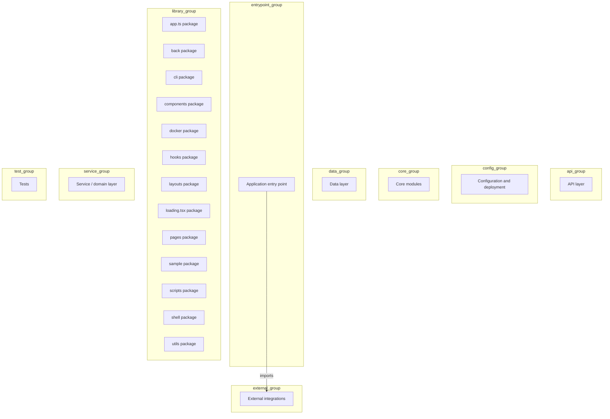

# Architecture report: whyour/qinglong

> Automated static analysis. **Observed** = directly seen in files/imports/AST; **Inferred** = interpretation from that evidence. Repository code was not executed.

## 1. Repository at a glance

| Item | Value |
| --- | --- |
| Repository | whyour/qinglong |
| Description | 支持 Python3、JavaScript、Shell、Typescript 的定时任务管理平台（Timed task management platform supporting Python3, JavaScript, Shell, Typescript） |
| Language | JavaScript |
| Stars | 20100 |
| Licence | Apache-2.0 |
| Analysed commit / branch | 2ddb592800fd0d30734ac3e20cfa35be16a85f39 / develop |
| Framework(s) | Express, React |
| Files analysed | 667 |
| Components | 21 |

## 2. Architecture in one minute

whyour/qinglong - 支持 Python3、JavaScript、Shell、Typescript 的定时任务管理平台（Timed task management platform supporting Python3, JavaScript, Shell, Typescript）. This repository was analysed statically from 667 file(s) (5 Python). Detected technologies (observed from imports/manifests): GitHub Actions, SQLite, Express, React, axios, React Router. Files are grouped into 21 component(s): API layer, app.ts package, back package, cli package, components package, Configuration and deployment, Core modules, Data layer. Observed entry point(s): sample/notify.py. Findings below distinguish observed facts from inferred interpretation.

## 3. High-level block diagram

## 4. Main components

### API layer (`api_layer`)

- **Kind:** api
- **Status:** Observed
- **Confidence:** 0.85
- **Responsibility:** Groups 19 file(s) under api layer (observed from repository paths and static analysis).
- **Paths:** `back/api/clientIp.ts`, `back/api/config.ts`, `back/api/cron.ts`, `back/api/dashboard.ts`, `back/api/dependence.ts`, `back/api/env.ts`, `back/api/health.ts`, `back/api/index.ts`, `back/api/log.ts`, `back/api/open.ts`, `back/api/retention.ts`, `back/api/script.ts`, `back/api/subscription.ts`, `back/api/system.ts`, `back/api/update.ts`, `back/api/user.ts`, `cli/src/remote/api/client.ts`, `cli/src/remote/api/download.ts`, `cli/src/remote/api/openOperations.ts`
- **Evidence:** [back/api/clientIp.ts](https://github.com/whyour/qinglong/blob/2ddb592800fd0d30734ac3e20cfa35be16a85f39/back/api/clientIp.ts); [back/api/config.ts](https://github.com/whyour/qinglong/blob/2ddb592800fd0d30734ac3e20cfa35be16a85f39/back/api/config.ts); [back/api/cron.ts](https://github.com/whyour/qinglong/blob/2ddb592800fd0d30734ac3e20cfa35be16a85f39/back/api/cron.ts); [back/api/dashboard.ts](https://github.com/whyour/qinglong/blob/2ddb592800fd0d30734ac3e20cfa35be16a85f39/back/api/dashboard.ts); [back/api/dependence.ts](https://github.com/whyour/qinglong/blob/2ddb592800fd0d30734ac3e20cfa35be16a85f39/back/api/dependence.ts); [back/api/env.ts](https://github.com/whyour/qinglong/blob/2ddb592800fd0d30734ac3e20cfa35be16a85f39/back/api/env.ts); [back/api/health.ts](https://github.com/whyour/qinglong/blob/2ddb592800fd0d30734ac3e20cfa35be16a85f39/back/api/health.ts); [back/api/index.ts](https://github.com/whyour/qinglong/blob/2ddb592800fd0d30734ac3e20cfa35be16a85f39/back/api/index.ts)

### app.ts package (`app_ts`)

- **Kind:** library
- **Status:** Observed
- **Confidence:** 0.85
- **Responsibility:** Groups 1 file(s) under app.ts package (observed from repository paths and static analysis).
- **Paths:** `src/app.ts`
- **Evidence:** [src/app.ts](https://github.com/whyour/qinglong/blob/2ddb592800fd0d30734ac3e20cfa35be16a85f39/src/app.ts)

### back package (`back`)

- **Kind:** library
- **Status:** Observed
- **Confidence:** 0.85
- **Responsibility:** Groups 70 file(s) under back package (observed from repository paths and static analysis).
- **Paths:** `back/app.ts`, `back/bootstrap/database.ts`, `back/bootstrap/upgradeProbe.ts`, `back/interface/schedule.ts`, `back/loaders/app.ts`, `back/loaders/bootAfter.ts`, `back/loaders/db.ts`, `back/loaders/depInjector.ts`, `back/loaders/deps.ts`, `back/loaders/express.ts`, `back/loaders/httpApplication.ts`, `back/loaders/initData.ts`, `back/loaders/initFile.ts`, `back/loaders/initTask.ts`, `back/loaders/logger.ts`, `back/loaders/server.ts`, `back/loaders/sock.ts`, `back/middlewares/monitoring.ts`, `back/middlewares/protectedPathCase.ts`, `back/middlewares/uniqueConstraintError.ts`, `back/middlewares/validationErrors.ts`, `back/protos/api.ts`, `back/protos/cron.ts`, `back/protos/health.ts`, `back/schedule/addCron.ts`, `back/schedule/api.ts`, `back/schedule/client.ts`, `back/schedule/data.ts`, `back/schedule/delCron.ts`, `back/schedule/health.ts`, `back/schedule/setConcurrency.ts`, `back/shared/auth.ts`, `back/shared/authMutation.ts`, `back/shared/childProcess.ts`, `back/shared/clientIp.ts`, `back/shared/cronCommand.ts`, `back/shared/cronSchedule.ts`, `back/shared/cronScheduler.ts`, `back/shared/errors.ts`, `back/shared/fileAccess.ts`, `back/shared/i18n.ts`, `back/shared/interface.ts`, `back/shared/languageSync.ts`, `back/shared/linuxMirror.ts`, `back/shared/logPath.ts`, `back/shared/logReader.ts`, `back/shared/logStreamManager.ts`, `back/shared/loginThrottle.ts`, `back/shared/notificationAudit.ts`, `back/shared/pLimit.ts`, `back/shared/password.ts`, `back/shared/retention.ts`, `back/shared/runCron.ts`, `back/shared/runtimeBuild.ts`, `back/shared/schedulerMutationLock.ts`, `back/shared/schedulerReadiness.ts`, `back/shared/schemaMigrations.ts`, `back/shared/scriptHistory.ts`, `back/shared/shellQuote.ts`, `back/shared/startupProcess.ts`, `back/shared/store.ts`, `back/shared/subscriptionMutationLock.ts`, `back/shared/subscriptionPath.ts`, `back/shared/subscriptionStorage.ts`, `back/shared/taskEnvName.ts`, `back/shared/trustProxy.ts`, `back/shared/utils.ts`, `back/token.ts`, `back/types/express.d.ts`, `back/validation/schedule.ts`
- **Evidence:** [back/app.ts](https://github.com/whyour/qinglong/blob/2ddb592800fd0d30734ac3e20cfa35be16a85f39/back/app.ts); [back/bootstrap/database.ts](https://github.com/whyour/qinglong/blob/2ddb592800fd0d30734ac3e20cfa35be16a85f39/back/bootstrap/database.ts); [back/bootstrap/upgradeProbe.ts](https://github.com/whyour/qinglong/blob/2ddb592800fd0d30734ac3e20cfa35be16a85f39/back/bootstrap/upgradeProbe.ts); [back/interface/schedule.ts](https://github.com/whyour/qinglong/blob/2ddb592800fd0d30734ac3e20cfa35be16a85f39/back/interface/schedule.ts); [back/loaders/app.ts](https://github.com/whyour/qinglong/blob/2ddb592800fd0d30734ac3e20cfa35be16a85f39/back/loaders/app.ts); [back/loaders/bootAfter.ts](https://github.com/whyour/qinglong/blob/2ddb592800fd0d30734ac3e20cfa35be16a85f39/back/loaders/bootAfter.ts); [back/loaders/db.ts](https://github.com/whyour/qinglong/blob/2ddb592800fd0d30734ac3e20cfa35be16a85f39/back/loaders/db.ts); [back/loaders/depInjector.ts](https://github.com/whyour/qinglong/blob/2ddb592800fd0d30734ac3e20cfa35be16a85f39/back/loaders/depInjector.ts)

### cli package (`cli`)

- **Kind:** library
- **Status:** Observed
- **Confidence:** 0.85
- **Responsibility:** Groups 77 file(s) under cli package (observed from repository paths and static analysis).
- **Paths:** `cli/scripts/build.cjs`, `cli/scripts/entrypoints.cjs`, `cli/scripts/test.cjs`, `cli/scripts/verify-package.cjs`, `cli/src/compatibility/legacy.ts`, `cli/src/compatibility/main.ts`, `cli/src/compatibility/startup.ts`, `cli/src/entrypoints/admin.ts`, `cli/src/entrypoints/container.ts`, `cli/src/entrypoints/index.ts`, `cli/src/entrypoints/ql.ts`, `cli/src/entrypoints/remote.ts`, `cli/src/entrypoints/task.ts`, `cli/src/internal/commands/dispatch.ts`, `cli/src/internal/commands/main.ts`, `cli/src/internal/commands/registry.ts`, `cli/src/internal/execution/concurrent.ts`, `cli/src/internal/execution/definition.ts`, `cli/src/internal/execution/dependencies.ts`, `cli/src/internal/execution/languagePreload.ts`, `cli/src/internal/execution/preloadSource.ts`, `cli/src/internal/execution/runner.ts`, `cli/src/internal/execution/scriptInventory.ts`, `cli/src/internal/execution/shellOptions.ts`, `cli/src/internal/execution/shellSession.ts`, `cli/src/internal/execution/taskDelay.ts`, `cli/src/internal/execution/taskRunner.ts`, `cli/src/internal/help/standalone.ts`, `cli/src/internal/maintenance/bootstrap.ts`, `cli/src/internal/maintenance/bot.ts`, `cli/src/internal/maintenance/check.ts`, `cli/src/internal/maintenance/maintenance.ts`, `cli/src/internal/maintenance/nodeRuntime.cjs`, `cli/src/internal/maintenance/operator.ts`, `cli/src/internal/maintenance/panelUpgrade.cjs`, `cli/src/internal/maintenance/platformBundle.cjs`, `cli/src/internal/maintenance/upgrade.ts`, `cli/src/internal/maintenance/upgradeArtifacts.cjs`, `cli/src/internal/maintenance/upgradePrestart.cjs`, `cli/src/internal/maintenance/upgradeSelection.ts`, `cli/src/internal/runtime/api.ts`, `cli/src/internal/runtime/backendProcesses.ts`, `cli/src/internal/runtime/cancellation.ts`, `cli/src/internal/runtime/commandLog.ts`, `cli/src/internal/runtime/containerEnvironment.ts`, `cli/src/internal/runtime/containerRuntime.ts`, `cli/src/internal/runtime/context.ts`, `cli/src/internal/runtime/files.ts`, `cli/src/internal/runtime/hostServices.ts`, `cli/src/internal/runtime/lifecycle.ts`, `cli/src/internal/runtime/output.ts`, `cli/src/internal/runtime/process.ts`, `cli/src/internal/subscription/subscriptionFilter.ts`, `cli/src/internal/subscription/subscriptionRunner.ts`, `cli/src/internal/subscription/worker.ts`, `cli/src/remote/auth/store.ts`, `cli/src/remote/auth/url.ts`, `cli/src/remote/commands/auth.ts`, `cli/src/remote/commands/dispatch.ts`, `cli/src/remote/commands/open.ts`, `cli/src/remote/commands/openCommands.ts`, `cli/src/remote/commands/registry.ts`, `cli/src/remote/commands/subscription.ts`, `cli/src/remote/commands/task.ts`, `cli/src/remote/types.ts`, `cli/src/shared/cli/arguments.ts`, `cli/src/shared/cli/commander.ts`, `cli/src/shared/cli/invoke.ts`, `cli/src/shared/cli/options.ts`, `cli/src/shared/cli/registry.ts`, `cli/src/shared/cli/router.ts`, `cli/src/shared/errors.ts`, `cli/src/shared/i18n/en.ts`, `cli/src/shared/i18n/help.ts`, `cli/src/shared/i18n/index.ts`, `cli/src/shared/record.ts`, `cli/src/shared/types.ts`
- **Evidence:** [cli/scripts/build.cjs](https://github.com/whyour/qinglong/blob/2ddb592800fd0d30734ac3e20cfa35be16a85f39/cli/scripts/build.cjs); [cli/scripts/entrypoints.cjs](https://github.com/whyour/qinglong/blob/2ddb592800fd0d30734ac3e20cfa35be16a85f39/cli/scripts/entrypoints.cjs); [cli/scripts/test.cjs](https://github.com/whyour/qinglong/blob/2ddb592800fd0d30734ac3e20cfa35be16a85f39/cli/scripts/test.cjs); [cli/scripts/verify-package.cjs](https://github.com/whyour/qinglong/blob/2ddb592800fd0d30734ac3e20cfa35be16a85f39/cli/scripts/verify-package.cjs); [cli/src/compatibility/legacy.ts](https://github.com/whyour/qinglong/blob/2ddb592800fd0d30734ac3e20cfa35be16a85f39/cli/src/compatibility/legacy.ts); [cli/src/compatibility/main.ts](https://github.com/whyour/qinglong/blob/2ddb592800fd0d30734ac3e20cfa35be16a85f39/cli/src/compatibility/main.ts); [cli/src/compatibility/startup.ts](https://github.com/whyour/qinglong/blob/2ddb592800fd0d30734ac3e20cfa35be16a85f39/cli/src/compatibility/startup.ts); [cli/src/entrypoints/admin.ts](https://github.com/whyour/qinglong/blob/2ddb592800fd0d30734ac3e20cfa35be16a85f39/cli/src/entrypoints/admin.ts)

### components package (`components`)

- **Kind:** library
- **Status:** Observed
- **Confidence:** 0.85
- **Responsibility:** Groups 6 file(s) under components package (observed from repository paths and static analysis).
- **Paths:** `src/components/UpgradeNotice.tsx`, `src/components/copy.tsx`, `src/components/iconfont.tsx`, `src/components/name.tsx`, `src/components/tag.tsx`, `src/components/terminal.tsx`
- **Evidence:** [src/components/UpgradeNotice.tsx](https://github.com/whyour/qinglong/blob/2ddb592800fd0d30734ac3e20cfa35be16a85f39/src/components/UpgradeNotice.tsx); [src/components/copy.tsx](https://github.com/whyour/qinglong/blob/2ddb592800fd0d30734ac3e20cfa35be16a85f39/src/components/copy.tsx); [src/components/iconfont.tsx](https://github.com/whyour/qinglong/blob/2ddb592800fd0d30734ac3e20cfa35be16a85f39/src/components/iconfont.tsx); [src/components/name.tsx](https://github.com/whyour/qinglong/blob/2ddb592800fd0d30734ac3e20cfa35be16a85f39/src/components/name.tsx); [src/components/tag.tsx](https://github.com/whyour/qinglong/blob/2ddb592800fd0d30734ac3e20cfa35be16a85f39/src/components/tag.tsx); [src/components/terminal.tsx](https://github.com/whyour/qinglong/blob/2ddb592800fd0d30734ac3e20cfa35be16a85f39/src/components/terminal.tsx)

### Configuration and deployment (`config`)

- **Kind:** config
- **Status:** Observed
- **Confidence:** 0.85
- **Responsibility:** Groups 33 file(s) under configuration and deployment (observed from repository paths and static analysis).
- **Paths:** `back/config/const.ts`, `back/config/container.ts`, `back/config/grpcCerts.ts`, `back/config/http.ts`, `back/config/index.ts`, `back/config/serverEnv.ts`, `back/config/share.ts`, `back/config/subscription.ts`, `back/config/util.ts`, `back/tsconfig.json`, `cli/package.json`, `cli/test/linux/Dockerfile`, `cli/test/linux/Dockerfile.alpine`, `cli/test/linux/Dockerfile.services`, `cli/test/linux/Dockerfile.ssh`, `cli/tsconfig.json`, `deploy/kubernetes/base/kustomization.yaml`, `deploy/kubernetes/base/qinglong.yaml`, `deploy/kubernetes/overlays/example/kustomization.yaml`, `docker/Dockerfile`, `docker/Dockerfile.310`, `docker/Dockerfile.debian`, `docker/Dockerfile.debian310`, `docker/Dockerfile.upgrade-bundle`, `docker/docker-compose.yml`, `nodemon.json`, `package.json`, `sample/auth.sample.json`, `src/locales/en-US.json`, `src/locales/zh-CN.json`, `src/pages/config/index.tsx`, `tsconfig.json`, `version.yaml`
- **Evidence:** [back/config/const.ts](https://github.com/whyour/qinglong/blob/2ddb592800fd0d30734ac3e20cfa35be16a85f39/back/config/const.ts); [back/config/container.ts](https://github.com/whyour/qinglong/blob/2ddb592800fd0d30734ac3e20cfa35be16a85f39/back/config/container.ts); [back/config/grpcCerts.ts](https://github.com/whyour/qinglong/blob/2ddb592800fd0d30734ac3e20cfa35be16a85f39/back/config/grpcCerts.ts); [back/config/http.ts](https://github.com/whyour/qinglong/blob/2ddb592800fd0d30734ac3e20cfa35be16a85f39/back/config/http.ts); [back/config/index.ts](https://github.com/whyour/qinglong/blob/2ddb592800fd0d30734ac3e20cfa35be16a85f39/back/config/index.ts); [back/config/serverEnv.ts](https://github.com/whyour/qinglong/blob/2ddb592800fd0d30734ac3e20cfa35be16a85f39/back/config/serverEnv.ts); [back/config/share.ts](https://github.com/whyour/qinglong/blob/2ddb592800fd0d30734ac3e20cfa35be16a85f39/back/config/share.ts); [back/config/subscription.ts](https://github.com/whyour/qinglong/blob/2ddb592800fd0d30734ac3e20cfa35be16a85f39/back/config/subscription.ts)

### Core modules (`core`)

- **Kind:** core
- **Status:** Observed
- **Confidence:** 0.85
- **Responsibility:** Groups 2 file(s) under core modules (observed from repository paths and static analysis).
- **Paths:** `ecosystem.config.js`, `typings.d.ts`
- **Evidence:** [ecosystem.config.js](https://github.com/whyour/qinglong/blob/2ddb592800fd0d30734ac3e20cfa35be16a85f39/ecosystem.config.js); [typings.d.ts](https://github.com/whyour/qinglong/blob/2ddb592800fd0d30734ac3e20cfa35be16a85f39/typings.d.ts)

### Data layer (`data_layer`)

- **Kind:** data
- **Status:** Observed
- **Confidence:** 0.85
- **Responsibility:** Groups 12 file(s) under data layer (observed from repository paths and static analysis).
- **Paths:** `back/data/cron.ts`, `back/data/cronStats.ts`, `back/data/cronView.ts`, `back/data/dependence.ts`, `back/data/env.ts`, `back/data/index.ts`, `back/data/notify.ts`, `back/data/open.ts`, `back/data/runningInstance.ts`, `back/data/sock.ts`, `back/data/subscription.ts`, `back/data/system.ts`
- **Evidence:** [back/data/cron.ts](https://github.com/whyour/qinglong/blob/2ddb592800fd0d30734ac3e20cfa35be16a85f39/back/data/cron.ts); [back/data/cronStats.ts](https://github.com/whyour/qinglong/blob/2ddb592800fd0d30734ac3e20cfa35be16a85f39/back/data/cronStats.ts); [back/data/cronView.ts](https://github.com/whyour/qinglong/blob/2ddb592800fd0d30734ac3e20cfa35be16a85f39/back/data/cronView.ts); [back/data/dependence.ts](https://github.com/whyour/qinglong/blob/2ddb592800fd0d30734ac3e20cfa35be16a85f39/back/data/dependence.ts); [back/data/env.ts](https://github.com/whyour/qinglong/blob/2ddb592800fd0d30734ac3e20cfa35be16a85f39/back/data/env.ts); [back/data/index.ts](https://github.com/whyour/qinglong/blob/2ddb592800fd0d30734ac3e20cfa35be16a85f39/back/data/index.ts); [back/data/notify.ts](https://github.com/whyour/qinglong/blob/2ddb592800fd0d30734ac3e20cfa35be16a85f39/back/data/notify.ts); [back/data/open.ts](https://github.com/whyour/qinglong/blob/2ddb592800fd0d30734ac3e20cfa35be16a85f39/back/data/open.ts)

### docker package (`docker`)

- **Kind:** library
- **Status:** Observed
- **Confidence:** 0.85
- **Responsibility:** Groups 4 file(s) under docker package (observed from repository paths and static analysis).
- **Paths:** `docker/build-manifest.cjs`, `docker/docker-entrypoint.sh`, `docker/install-node-debian.sh`, `docker/verify-build.cjs`
- **Evidence:** [docker/build-manifest.cjs](https://github.com/whyour/qinglong/blob/2ddb592800fd0d30734ac3e20cfa35be16a85f39/docker/build-manifest.cjs); [docker/docker-entrypoint.sh](https://github.com/whyour/qinglong/blob/2ddb592800fd0d30734ac3e20cfa35be16a85f39/docker/docker-entrypoint.sh); [docker/install-node-debian.sh](https://github.com/whyour/qinglong/blob/2ddb592800fd0d30734ac3e20cfa35be16a85f39/docker/install-node-debian.sh); [docker/verify-build.cjs](https://github.com/whyour/qinglong/blob/2ddb592800fd0d30734ac3e20cfa35be16a85f39/docker/verify-build.cjs)

### Application entry point (`entrypoint`)

- **Kind:** entrypoint
- **Status:** Observed
- **Confidence:** 0.85
- **Responsibility:** Groups 1 file(s) under application entry point (observed from repository paths and static analysis). Observed top-level classes: WeCom. Observed top-level functions: add_notify_function, aibotk, audited_notification, bark, chat, chronocat.
- **Paths:** `sample/notify.py`
- **Evidence:** [sample/notify.py:32](https://github.com/whyour/qinglong/blob/2ddb592800fd0d30734ac3e20cfa35be16a85f39/sample/notify.py#L32)

### External integrations (`external_integrations`)

- **Kind:** external
- **Status:** Observed
- **Confidence:** 0.85
- **Responsibility:** Groups 3 file(s) under external integrations (observed from repository paths and static analysis). Observed top-level classes: Client, CreateCronParams, CreateEnvParams, CronDetailParams, CronItem, CronResponse. Observed top-level functions: error_handler.
- **Paths:** `cli/src/internal/integration/cronEntrypoint.ts`, `cli/src/internal/integration/entrypoints.ts`, `shell/preload/client.py`
- **Evidence:** [cli/src/internal/integration/cronEntrypoint.ts](https://github.com/whyour/qinglong/blob/2ddb592800fd0d30734ac3e20cfa35be16a85f39/cli/src/internal/integration/cronEntrypoint.ts); [cli/src/internal/integration/entrypoints.ts](https://github.com/whyour/qinglong/blob/2ddb592800fd0d30734ac3e20cfa35be16a85f39/cli/src/internal/integration/entrypoints.ts); [shell/preload/client.py:9](https://github.com/whyour/qinglong/blob/2ddb592800fd0d30734ac3e20cfa35be16a85f39/shell/preload/client.py#L9)

### hooks package (`hooks`)

- **Kind:** library
- **Status:** Observed
- **Confidence:** 0.85
- **Responsibility:** Groups 4 file(s) under hooks package (observed from repository paths and static analysis).
- **Paths:** `src/hooks/useFilterTreeData.ts`, `src/hooks/useScrollHeight.ts`, `src/hooks/useTableScrollHeight.ts`, `src/hooks/useUpgrade.ts`
- **Evidence:** [src/hooks/useFilterTreeData.ts](https://github.com/whyour/qinglong/blob/2ddb592800fd0d30734ac3e20cfa35be16a85f39/src/hooks/useFilterTreeData.ts); [src/hooks/useScrollHeight.ts](https://github.com/whyour/qinglong/blob/2ddb592800fd0d30734ac3e20cfa35be16a85f39/src/hooks/useScrollHeight.ts); [src/hooks/useTableScrollHeight.ts](https://github.com/whyour/qinglong/blob/2ddb592800fd0d30734ac3e20cfa35be16a85f39/src/hooks/useTableScrollHeight.ts); [src/hooks/useUpgrade.ts](https://github.com/whyour/qinglong/blob/2ddb592800fd0d30734ac3e20cfa35be16a85f39/src/hooks/useUpgrade.ts)

### layouts package (`layouts`)

- **Kind:** library
- **Status:** Observed
- **Confidence:** 0.85
- **Responsibility:** Groups 2 file(s) under layouts package (observed from repository paths and static analysis).
- **Paths:** `src/layouts/defaultProps.tsx`, `src/layouts/index.tsx`
- **Evidence:** [src/layouts/defaultProps.tsx](https://github.com/whyour/qinglong/blob/2ddb592800fd0d30734ac3e20cfa35be16a85f39/src/layouts/defaultProps.tsx); [src/layouts/index.tsx](https://github.com/whyour/qinglong/blob/2ddb592800fd0d30734ac3e20cfa35be16a85f39/src/layouts/index.tsx)

### loading.tsx package (`loading_tsx`)

- **Kind:** library
- **Status:** Observed
- **Confidence:** 0.85
- **Responsibility:** Groups 1 file(s) under loading.tsx package (observed from repository paths and static analysis).
- **Paths:** `src/loading.tsx`
- **Evidence:** [src/loading.tsx](https://github.com/whyour/qinglong/blob/2ddb592800fd0d30734ac3e20cfa35be16a85f39/src/loading.tsx)

### pages package (`pages`)

- **Kind:** library
- **Status:** Observed
- **Confidence:** 0.85
- **Responsibility:** Groups 48 file(s) under pages package (observed from repository paths and static analysis).
- **Paths:** `src/pages/404.tsx`, `src/pages/crontab/const.ts`, `src/pages/crontab/detail.tsx`, `src/pages/crontab/index.tsx`, `src/pages/crontab/logModal.tsx`, `src/pages/crontab/modal.tsx`, `src/pages/crontab/type.ts`, `src/pages/crontab/viewCreateModal.tsx`, `src/pages/crontab/viewManageModal.tsx`, `src/pages/dashboard/index.tsx`, `src/pages/dashboard/taskResultModal.tsx`, `src/pages/dependence/index.tsx`, `src/pages/dependence/logModal.tsx`, `src/pages/dependence/modal.tsx`, `src/pages/dependence/type.ts`, `src/pages/diff/index.tsx`, `src/pages/env/editNameModal.tsx`, `src/pages/env/index.tsx`, `src/pages/env/modal.tsx`, `src/pages/error/index.tsx`, `src/pages/initialization/index.tsx`, `src/pages/log/index.tsx`, `src/pages/login/index.tsx`, `src/pages/script/components/UnsupportedFilePreview/index.tsx`, `src/pages/script/editModal.tsx`, `src/pages/script/editNameModal.tsx`, `src/pages/script/historyDrawer.tsx`, `src/pages/script/index.tsx`, `src/pages/script/renameModal.tsx`, `src/pages/script/saveModal.tsx`, `src/pages/script/saveWithHistory.ts`, `src/pages/script/setting.tsx`, `src/pages/setting/about.tsx`, `src/pages/setting/appModal.tsx`, `src/pages/setting/checkUpdate.tsx`, `src/pages/setting/clientIp.tsx`, `src/pages/setting/dependence.tsx`, `src/pages/setting/index.tsx`, `src/pages/setting/loginLog.tsx`, `src/pages/setting/notification.tsx`, `src/pages/setting/notifyLog.tsx`, `src/pages/setting/other.tsx`, `src/pages/setting/progress.tsx`, `src/pages/setting/security.tsx`, `src/pages/setting/systemLog.tsx`, `src/pages/subscription/index.tsx`, `src/pages/subscription/logModal.tsx`, `src/pages/subscription/modal.tsx`
- **Evidence:** [src/pages/404.tsx](https://github.com/whyour/qinglong/blob/2ddb592800fd0d30734ac3e20cfa35be16a85f39/src/pages/404.tsx); [src/pages/crontab/const.ts](https://github.com/whyour/qinglong/blob/2ddb592800fd0d30734ac3e20cfa35be16a85f39/src/pages/crontab/const.ts); [src/pages/crontab/detail.tsx](https://github.com/whyour/qinglong/blob/2ddb592800fd0d30734ac3e20cfa35be16a85f39/src/pages/crontab/detail.tsx); [src/pages/crontab/index.tsx](https://github.com/whyour/qinglong/blob/2ddb592800fd0d30734ac3e20cfa35be16a85f39/src/pages/crontab/index.tsx); [src/pages/crontab/logModal.tsx](https://github.com/whyour/qinglong/blob/2ddb592800fd0d30734ac3e20cfa35be16a85f39/src/pages/crontab/logModal.tsx); [src/pages/crontab/modal.tsx](https://github.com/whyour/qinglong/blob/2ddb592800fd0d30734ac3e20cfa35be16a85f39/src/pages/crontab/modal.tsx); [src/pages/crontab/type.ts](https://github.com/whyour/qinglong/blob/2ddb592800fd0d30734ac3e20cfa35be16a85f39/src/pages/crontab/type.ts); [src/pages/crontab/viewCreateModal.tsx](https://github.com/whyour/qinglong/blob/2ddb592800fd0d30734ac3e20cfa35be16a85f39/src/pages/crontab/viewCreateModal.tsx)

### sample package (`sample`)

- **Kind:** library
- **Status:** Observed
- **Confidence:** 0.85
- **Responsibility:** Groups 7 file(s) under sample package (observed from repository paths and static analysis).
- **Paths:** `sample/config.sample.sh`, `sample/extra.sample.sh`, `sample/notify.js`, `sample/ql_sample.js`, `sample/ql_sample.py`, `sample/task.sample.sh`, `sample/tool.ts`
- **Evidence:** [sample/config.sample.sh](https://github.com/whyour/qinglong/blob/2ddb592800fd0d30734ac3e20cfa35be16a85f39/sample/config.sample.sh); [sample/extra.sample.sh](https://github.com/whyour/qinglong/blob/2ddb592800fd0d30734ac3e20cfa35be16a85f39/sample/extra.sample.sh); [sample/notify.js](https://github.com/whyour/qinglong/blob/2ddb592800fd0d30734ac3e20cfa35be16a85f39/sample/notify.js); [sample/ql_sample.js](https://github.com/whyour/qinglong/blob/2ddb592800fd0d30734ac3e20cfa35be16a85f39/sample/ql_sample.js); [sample/ql_sample.py](https://github.com/whyour/qinglong/blob/2ddb592800fd0d30734ac3e20cfa35be16a85f39/sample/ql_sample.py); [sample/task.sample.sh](https://github.com/whyour/qinglong/blob/2ddb592800fd0d30734ac3e20cfa35be16a85f39/sample/task.sample.sh); [sample/tool.ts](https://github.com/whyour/qinglong/blob/2ddb592800fd0d30734ac3e20cfa35be16a85f39/sample/tool.ts)

### scripts package (`scripts`)

- **Kind:** library
- **Status:** Observed
- **Confidence:** 0.85
- **Responsibility:** Groups 13 file(s) under scripts package (observed from repository paths and static analysis).
- **Paths:** `scripts/benchmark-execution.cjs`, `scripts/benchmark-script-history.cjs`, `scripts/build-bundle-installer.cjs`, `scripts/build-upgrade-bundle.cjs`, `scripts/prepare-npm-package.cjs`, `scripts/publish-static.sh`, `scripts/publish-upgrade-bundles.cjs`, `scripts/publish-upgrade-info.cjs`, `scripts/sync-static.sh`, `scripts/verify-image-node-layers.py`, `scripts/verify-panel-package.cjs`, `scripts/wait-for-mirror.sh`, `scripts/write-build-info.cjs`
- **Evidence:** [scripts/benchmark-execution.cjs](https://github.com/whyour/qinglong/blob/2ddb592800fd0d30734ac3e20cfa35be16a85f39/scripts/benchmark-execution.cjs); [scripts/benchmark-script-history.cjs](https://github.com/whyour/qinglong/blob/2ddb592800fd0d30734ac3e20cfa35be16a85f39/scripts/benchmark-script-history.cjs); [scripts/build-bundle-installer.cjs](https://github.com/whyour/qinglong/blob/2ddb592800fd0d30734ac3e20cfa35be16a85f39/scripts/build-bundle-installer.cjs); [scripts/build-upgrade-bundle.cjs](https://github.com/whyour/qinglong/blob/2ddb592800fd0d30734ac3e20cfa35be16a85f39/scripts/build-upgrade-bundle.cjs); [scripts/prepare-npm-package.cjs](https://github.com/whyour/qinglong/blob/2ddb592800fd0d30734ac3e20cfa35be16a85f39/scripts/prepare-npm-package.cjs); [scripts/publish-static.sh](https://github.com/whyour/qinglong/blob/2ddb592800fd0d30734ac3e20cfa35be16a85f39/scripts/publish-static.sh); [scripts/publish-upgrade-bundles.cjs](https://github.com/whyour/qinglong/blob/2ddb592800fd0d30734ac3e20cfa35be16a85f39/scripts/publish-upgrade-bundles.cjs); [scripts/publish-upgrade-info.cjs](https://github.com/whyour/qinglong/blob/2ddb592800fd0d30734ac3e20cfa35be16a85f39/scripts/publish-upgrade-info.cjs)

### Service / domain layer (`service_layer`)

- **Kind:** service
- **Status:** Observed
- **Confidence:** 0.85
- **Responsibility:** Groups 21 file(s) under service / domain layer (observed from repository paths and static analysis).
- **Paths:** `back/services/config.ts`, `back/services/cron.ts`, `back/services/cronView.ts`, `back/services/dependence.ts`, `back/services/env.ts`, `back/services/grpc.ts`, `back/services/health.ts`, `back/services/http.ts`, `back/services/log.ts`, `back/services/metrics.ts`, `back/services/notify.ts`, `back/services/open.ts`, `back/services/retention.ts`, `back/services/schedule.ts`, `back/services/script.ts`, `back/services/scriptHistory.ts`, `back/services/sock.ts`, `back/services/sshKey.ts`, `back/services/subscription.ts`, `back/services/system.ts`, `back/services/user.ts`
- **Evidence:** [back/services/config.ts](https://github.com/whyour/qinglong/blob/2ddb592800fd0d30734ac3e20cfa35be16a85f39/back/services/config.ts); [back/services/cron.ts](https://github.com/whyour/qinglong/blob/2ddb592800fd0d30734ac3e20cfa35be16a85f39/back/services/cron.ts); [back/services/cronView.ts](https://github.com/whyour/qinglong/blob/2ddb592800fd0d30734ac3e20cfa35be16a85f39/back/services/cronView.ts); [back/services/dependence.ts](https://github.com/whyour/qinglong/blob/2ddb592800fd0d30734ac3e20cfa35be16a85f39/back/services/dependence.ts); [back/services/env.ts](https://github.com/whyour/qinglong/blob/2ddb592800fd0d30734ac3e20cfa35be16a85f39/back/services/env.ts); [back/services/grpc.ts](https://github.com/whyour/qinglong/blob/2ddb592800fd0d30734ac3e20cfa35be16a85f39/back/services/grpc.ts); [back/services/health.ts](https://github.com/whyour/qinglong/blob/2ddb592800fd0d30734ac3e20cfa35be16a85f39/back/services/health.ts); [back/services/http.ts](https://github.com/whyour/qinglong/blob/2ddb592800fd0d30734ac3e20cfa35be16a85f39/back/services/http.ts)

### shell package (`shell`)

- **Kind:** library
- **Status:** Observed
- **Confidence:** 0.85
- **Responsibility:** Groups 25 file(s) under shell package (observed from repository paths and static analysis). Observed top-level functions: expand_range, handle_sigterm, run, try_parse_int.
- **Paths:** `shell/api.sh`, `shell/bot.sh`, `shell/check.sh`, `shell/env.sh`, `shell/install-bundle.cjs`, `shell/install-package.cjs`, `shell/lang/en.sh`, `shell/lang/zh.sh`, `shell/node-runtime-probe.cjs`, `shell/node_path_cache.sh`, `shell/otask.sh`, `shell/preload/client.js`, `shell/preload/esm-loader.mjs`, `shell/preload/notificationAudit.js`, `shell/preload/sitecustomize.js`, `shell/preload/sitecustomize.py`, `shell/pub.sh`, `shell/rmlog.sh`, `shell/share.sh`, `shell/start-simplify.sh`, `shell/start.sh`, `shell/task-timeout.sh`, `shell/task.sh`, `shell/update.sh`, `shell/upgrade.cjs`
- **Evidence:** [shell/api.sh](https://github.com/whyour/qinglong/blob/2ddb592800fd0d30734ac3e20cfa35be16a85f39/shell/api.sh); [shell/bot.sh](https://github.com/whyour/qinglong/blob/2ddb592800fd0d30734ac3e20cfa35be16a85f39/shell/bot.sh); [shell/check.sh](https://github.com/whyour/qinglong/blob/2ddb592800fd0d30734ac3e20cfa35be16a85f39/shell/check.sh); [shell/env.sh](https://github.com/whyour/qinglong/blob/2ddb592800fd0d30734ac3e20cfa35be16a85f39/shell/env.sh); [shell/install-bundle.cjs](https://github.com/whyour/qinglong/blob/2ddb592800fd0d30734ac3e20cfa35be16a85f39/shell/install-bundle.cjs); [shell/install-package.cjs](https://github.com/whyour/qinglong/blob/2ddb592800fd0d30734ac3e20cfa35be16a85f39/shell/install-package.cjs); [shell/lang/en.sh](https://github.com/whyour/qinglong/blob/2ddb592800fd0d30734ac3e20cfa35be16a85f39/shell/lang/en.sh); [shell/lang/zh.sh](https://github.com/whyour/qinglong/blob/2ddb592800fd0d30734ac3e20cfa35be16a85f39/shell/lang/zh.sh)

### Tests (`tests`)

- **Kind:** test
- **Status:** Observed
- **Confidence:** 0.85
- **Responsibility:** Groups 234 file(s) under tests (observed from repository paths and static analysis).
- **Paths:** `cli/test/compatibility/compat.test.cjs`, `cli/test/compatibility/startup.test.cjs`, `cli/test/fixtures/log-retention.sh`, `cli/test/helpers/commands.cjs`, `cli/test/integration/architecture.test.cjs`, `cli/test/integration/differential.test.cjs`, `cli/test/integration/entrypointPaths.test.cjs`, `cli/test/integration/executablePaths.test.cjs`, `cli/test/integration/loadingBoundary.test.cjs`, `cli/test/integration/operatorRouting.test.cjs`, `cli/test/integration/stdin.test.cjs`, `cli/test/integration/unified.test.cjs`, `cli/test/internal/armv6-startup.test.cjs`, `cli/test/internal/backendProcesses.test.cjs`, `cli/test/internal/bashArguments.test.cjs`, `cli/test/internal/bootstrap.test.cjs`, `cli/test/internal/bot.test.cjs`, `cli/test/internal/botDiagnostics.test.cjs`, `cli/test/internal/containerEnvironment.test.cjs`, `cli/test/internal/containerRuntime.test.cjs`, `cli/test/internal/contextDiagnostics.test.cjs`, `cli/test/internal/cronEntrypoint.test.cjs`, `cli/test/internal/environmentTransport.test.cjs`, `cli/test/internal/esmDependencies.test.cjs`, `cli/test/internal/helperDiagnostics.test.cjs`, `cli/test/internal/hostServices.test.cjs`, `cli/test/internal/languagePreload.test.cjs`, `cli/test/internal/lifecycle.test.cjs`, `cli/test/internal/local.test.cjs`, `cli/test/internal/localApi.test.cjs`, `cli/test/internal/logRetention.test.cjs`, `cli/test/internal/networkRepository.test.cjs`, `cli/test/internal/operator.test.cjs`, `cli/test/internal/operatorDiagnostics.test.cjs`, `cli/test/internal/pathDiagnostics.test.cjs`, `cli/test/internal/platformBundle.test.cjs`, `cli/test/internal/preload.test.cjs`, `cli/test/internal/preparedUpgrade.test.cjs`, `cli/test/internal/processDiagnostics.test.cjs`, `cli/test/internal/runner.test.cjs`, `cli/test/internal/scriptInventory.test.cjs`, `cli/test/internal/subscriptionFilter.test.cjs`, `cli/test/internal/subscriptionRunner.test.cjs`, `cli/test/internal/taskDelay.test.cjs`, `cli/test/internal/taskDiagnostics.test.cjs`, `cli/test/internal/taskLifecycle.test.cjs`, `cli/test/internal/upgradeSelection.test.cjs`, `cli/test/linux/README.md`, `cli/test/linux/bot-install.cjs`, `cli/test/linux/container-bot.test.cjs`, `cli/test/linux/container-cron.cjs`, `cli/test/linux/entrypoints.test.cjs`, `cli/test/linux/evaluation-entrypoints.cjs`, `cli/test/linux/host-boot.cjs`, `cli/test/linux/image-selection.cjs`, `cli/test/linux/interrupted-reload.cjs`, `cli/test/linux/mounted-data.test.cjs`, `cli/test/linux/openapi.cjs`, `cli/test/linux/panel-account.cjs`, `cli/test/linux/panel-inventory.cjs`, `cli/test/linux/panel-operator.cjs`, `cli/test/linux/panel-preload.cjs`, `cli/test/linux/panel-repository.cjs`, `cli/test/linux/panel-subscription.cjs`, `cli/test/linux/panel-upgrade.cjs`, `cli/test/linux/panel.cjs`, `cli/test/linux/preload-paths.test.cjs`, `cli/test/linux/published-archive.test.cjs`, `cli/test/linux/service-response.cjs`, `cli/test/linux/services.test.cjs`, `cli/test/linux/ssh-repository.test.cjs`, `cli/test/linux/upgrade.test.cjs`, `cli/test/linux/verify-check.cjs`, `cli/test/linux/verify-start.cjs`, `cli/test/remote/apiDiagnostics.test.cjs`, `cli/test/remote/cli.test.cjs`, `cli/test/remote/logTruncation.test.cjs`, `cli/test/remote/openapi.test.cjs`, `cli/test/remote/platformSmoke.test.cjs`, `cli/test/remote/rawCredentials.test.cjs`, `cli/test/remote/requestBodyCoverage.test.cjs`, `cli/test/remote/scope.test.cjs`, `cli/test/remote/subscription.test.cjs`, `cli/test/shared/commander.test.cjs`, `cli/test/shared/diagnostics.test.cjs`, `cli/test/shared/helpCoverage.test.cjs`, `cli/test/shared/i18n.test.cjs`, `test/back/advisory-input-security.test.cjs`, `test/back/api-fallback.test.cjs`, `test/back/app-scope-security.test.cjs`, `test/back/armv6-worker-readiness.test.cjs`, `test/back/auth-security.test.cjs`, `test/back/build-provenance.test.cjs`, `test/back/code-scanning-security.test.cjs`, `test/back/cron-calendar-boundaries.test.cjs`, `test/back/cron-log-name.test.cjs`, `test/back/cron-macros.test.cjs`, `test/back/cron-parser-compatibility.test.cjs`, `test/back/cron-schedule-compatibility.test.cjs`, `test/back/cron-scheduler-routing.test.cjs`, `test/back/cron-validation.test.cjs`, `test/back/dashboard-failures.test.cjs`, `test/back/database-bootstrap.test.cjs`, `test/back/dependence-cache-status.test.cjs`, `test/back/dependence-refresh-api.test.cjs`, `test/back/deprecated-file-routes.test.cjs`, `test/back/dev-e2e-regressions.test.cjs`, `test/back/draft-path-security.test.cjs`, `test/back/dynamic-locales.test.cjs`, `test/back/ecosystem.test.cjs`, `test/back/env-import-security.test.cjs`, `test/back/env-name-parsing.test.cjs`, `test/back/execution-lifecycle.test.cjs`, `test/back/file-access-scope.test.cjs`, `test/back/file-access-security.test.cjs`, `test/back/fileTreeListing.test.cjs`, `test/back/grpc-cron-response.test.cjs`, `test/back/grpc-mtls-security.test.cjs`, `test/back/http-exclusive-listen.test.cjs`, `test/back/http-security.test.cjs`, `test/back/issue-regressions-2230.test.cjs`, `test/back/language-sync.test.cjs`, `test/back/legacy-cron-recovery.test.cjs`, `test/back/linux-mirror-result.test.cjs`, `test/back/listen-security.test.cjs`, `test/back/log-path-security.test.cjs`, `test/back/logReader.test.cjs`, `test/back/manual-execution.test.cjs`, `test/back/manual-stop-claim.test.cjs`, `test/back/manual-upgrade-state.test.cjs`, `test/back/metrics.test.cjs`, `test/back/mirror-status.test.cjs`, `test/back/monitoring.test.cjs`, `test/back/node-cron-migration.test.cjs`, `test/back/node-path-cache.test.cjs`, `test/back/node-path-lock.test.cjs`, `test/back/node-runtime-probe.test.cjs`, `test/back/node-runtime.test.cjs`, `test/back/notification-audit.test.cjs`, `test/back/notify-timeouts.test.cjs`, `test/back/npm-package.test.cjs`, `test/back/npm-publication.test.cjs`, `test/back/offline-upgrade-recovery.test.cjs`, `test/back/panel-upgrade.test.cjs`, `test/back/platform-bundle.test.cjs`, `test/back/preload-lazy-notify.test.cjs`, `test/back/primary-apm.test.cjs`, `test/back/process-exit-state.test.cjs`, `test/back/process-stop-signal.test.cjs`, `test/back/protected-path-case.test.cjs`, `test/back/publish-upgrade-bundles.test.cjs`, `test/back/python-source-dependencies.test.cjs`, `test/back/python-source-venv.test.cjs`, `test/back/python-specifiers.test.cjs`, `test/back/python-venv.test.cjs`, `test/back/qlServiceLogCommand.test.cjs`, `test/back/queued-cron-invalidation.test.cjs`, `test/back/restart-instance-recovery.test.cjs`, `test/back/retention.test.cjs`, `test/back/role-loading.test.cjs`, `test/back/runtime-build.test.cjs`, `test/back/schedule-health.test.cjs`, `test/back/scheduler-bulk-recovery.test.cjs`, `test/back/scheduler-concurrency.test.cjs`, `test/back/scheduler-file-lock.test.cjs`, `test/back/scheduler-mutation.test.cjs`, `test/back/scheduler-readiness.test.cjs`, `test/back/scheduler-reconciliation.test.cjs`, `test/back/scheduler-rpc-timeout.test.cjs`, `test/back/schema-migrations.test.cjs`, `test/back/script-file-access.test.cjs`, `test/back/script-history-api.test.cjs`, `test/back/script-history.test.cjs`, `test/back/script-notification-audit.test.cjs`, `test/back/script-notification-rpc.test.cjs`, `test/back/shell-api-parsing.test.cjs`, `test/back/shell-compatibility.test.cjs`, `test/back/shell-translation-output.test.cjs`, `test/back/shell-upgrade.test.cjs`, `test/back/shellApiToken.test.cjs`, `test/back/single-instance-skip.test.cjs`, `test/back/sock-polling.test.cjs`, `test/back/sock-security.test.cjs`, `test/back/ssh-config-home.test.cjs`, `test/back/start-certificate-preparation.test.cjs`, `test/back/start-env-preservation.test.cjs`, `test/back/static-mirror-trigger.test.cjs`, `test/back/static-mirror.test.cjs`, `test/back/stop-failure-feedback.test.cjs`, `test/back/stop-race.test.cjs`, `test/back/subscription-cleanup.test.cjs`, `test/back/subscription-mutation-lock.test.cjs`, `test/back/subscription-review-regression.test.cjs`, `test/back/subscription-stop-state.test.cjs`, `test/back/subscription-storage-regression.test.cjs`, `test/back/system-dependence-cache.test.cjs`, `test/back/system-export-history.test.cjs`, `test/back/system-log-clear.test.cjs`, `test/back/systemTokenRenewal.test.cjs`, `test/back/task-shell-lifecycle.test.cjs`, `test/back/task-time.test.cjs`, `test/back/task-timeout-cleanup.test.cjs`, `test/back/task-timeout-processes.test.cjs`, `test/back/unique-constraint-error.test.cjs`, `test/back/update-check.test.cjs`, `test/back/upgrade-bundle-workflow.test.cjs`, `test/back/upgrade-download-fallback.test.cjs`, `test/back/upgrade-download-info.test.cjs`, `test/back/upgrade-guards.test.cjs`, `test/back/upgrade-lifecycle.test.cjs`, `test/back/upgrade-prestart.test.cjs`, `test/back/upgrade-readiness.test.cjs`, `test/back/upgrade-transaction.test.cjs`, `test/back/user-api.test.cjs`, `test/back/user-security.test.cjs`, `test/back/worker-apm.test.cjs`, `test/back/wpush-grpc.test.cjs`, `test/fixtures/cron-calendar-boundaries.json`, `test/fixtures/legacy-cron.json`, `test/front/codemirror-language.test.cjs`, `test/front/cron-log-pagination.test.cjs`, `test/front/dependence-refresh.test.cjs`, `test/front/diff-file-routing.test.cjs`, `test/front/editor-locale.test.cjs`, `test/front/http-auth.test.cjs`, `test/front/http-error.test.cjs`, `test/front/navigation-timing.test.cjs`, `test/front/notify-log-locales.test.cjs`, `test/front/responsive-layout.test.cjs`, `test/front/script-history-save.test.cjs`, `test/front/update-progress.test.cjs`, `test/helpers/load-security-module.cjs`, `test/helpers/manual-upgrade-fixture.cjs`, `test/helpers/upgrade-fixture.cjs`
- **Evidence:** [cli/test/compatibility/compat.test.cjs](https://github.com/whyour/qinglong/blob/2ddb592800fd0d30734ac3e20cfa35be16a85f39/cli/test/compatibility/compat.test.cjs); [cli/test/compatibility/startup.test.cjs](https://github.com/whyour/qinglong/blob/2ddb592800fd0d30734ac3e20cfa35be16a85f39/cli/test/compatibility/startup.test.cjs); [cli/test/fixtures/log-retention.sh](https://github.com/whyour/qinglong/blob/2ddb592800fd0d30734ac3e20cfa35be16a85f39/cli/test/fixtures/log-retention.sh); [cli/test/helpers/commands.cjs](https://github.com/whyour/qinglong/blob/2ddb592800fd0d30734ac3e20cfa35be16a85f39/cli/test/helpers/commands.cjs); [cli/test/integration/architecture.test.cjs](https://github.com/whyour/qinglong/blob/2ddb592800fd0d30734ac3e20cfa35be16a85f39/cli/test/integration/architecture.test.cjs); [cli/test/integration/differential.test.cjs](https://github.com/whyour/qinglong/blob/2ddb592800fd0d30734ac3e20cfa35be16a85f39/cli/test/integration/differential.test.cjs); [cli/test/integration/entrypointPaths.test.cjs](https://github.com/whyour/qinglong/blob/2ddb592800fd0d30734ac3e20cfa35be16a85f39/cli/test/integration/entrypointPaths.test.cjs); [cli/test/integration/executablePaths.test.cjs](https://github.com/whyour/qinglong/blob/2ddb592800fd0d30734ac3e20cfa35be16a85f39/cli/test/integration/executablePaths.test.cjs)

### utils package (`utils`)

- **Kind:** library
- **Status:** Observed
- **Confidence:** 0.85
- **Responsibility:** Groups 14 file(s) under utils package (observed from repository paths and static analysis).
- **Paths:** `src/utils/codemirror/language.ts`, `src/utils/codemirror/systemLog.ts`, `src/utils/config.ts`, `src/utils/const.ts`, `src/utils/date.ts`, `src/utils/hooks.ts`, `src/utils/http.tsx`, `src/utils/httpError.ts`, `src/utils/index.ts`, `src/utils/init.ts`, `src/utils/monaco/index.ts`, `src/utils/navigationTiming.ts`, `src/utils/type.ts`, `src/utils/websocket.ts`
- **Evidence:** [src/utils/codemirror/language.ts](https://github.com/whyour/qinglong/blob/2ddb592800fd0d30734ac3e20cfa35be16a85f39/src/utils/codemirror/language.ts); [src/utils/codemirror/systemLog.ts](https://github.com/whyour/qinglong/blob/2ddb592800fd0d30734ac3e20cfa35be16a85f39/src/utils/codemirror/systemLog.ts); [src/utils/config.ts](https://github.com/whyour/qinglong/blob/2ddb592800fd0d30734ac3e20cfa35be16a85f39/src/utils/config.ts); [src/utils/const.ts](https://github.com/whyour/qinglong/blob/2ddb592800fd0d30734ac3e20cfa35be16a85f39/src/utils/const.ts); [src/utils/date.ts](https://github.com/whyour/qinglong/blob/2ddb592800fd0d30734ac3e20cfa35be16a85f39/src/utils/date.ts); [src/utils/hooks.ts](https://github.com/whyour/qinglong/blob/2ddb592800fd0d30734ac3e20cfa35be16a85f39/src/utils/hooks.ts); [src/utils/http.tsx](https://github.com/whyour/qinglong/blob/2ddb592800fd0d30734ac3e20cfa35be16a85f39/src/utils/http.tsx); [src/utils/httpError.ts](https://github.com/whyour/qinglong/blob/2ddb592800fd0d30734ac3e20cfa35be16a85f39/src/utils/httpError.ts)

## 5. Execution flow

**Observed** entry point(s):

- [back/api/index.ts](https://github.com/whyour/qinglong/blob/2ddb592800fd0d30734ac3e20cfa35be16a85f39/back/api/index.ts)
- [back/app.ts](https://github.com/whyour/qinglong/blob/2ddb592800fd0d30734ac3e20cfa35be16a85f39/back/app.ts)
- [back/config/index.ts](https://github.com/whyour/qinglong/blob/2ddb592800fd0d30734ac3e20cfa35be16a85f39/back/config/index.ts)
- [back/data/index.ts](https://github.com/whyour/qinglong/blob/2ddb592800fd0d30734ac3e20cfa35be16a85f39/back/data/index.ts)
- [back/loaders/app.ts](https://github.com/whyour/qinglong/blob/2ddb592800fd0d30734ac3e20cfa35be16a85f39/back/loaders/app.ts)
- [back/loaders/server.ts](https://github.com/whyour/qinglong/blob/2ddb592800fd0d30734ac3e20cfa35be16a85f39/back/loaders/server.ts)
- [cli/src/compatibility/main.ts](https://github.com/whyour/qinglong/blob/2ddb592800fd0d30734ac3e20cfa35be16a85f39/cli/src/compatibility/main.ts)
- [cli/src/entrypoints/index.ts](https://github.com/whyour/qinglong/blob/2ddb592800fd0d30734ac3e20cfa35be16a85f39/cli/src/entrypoints/index.ts)
- [sample/notify.py:1437](https://github.com/whyour/qinglong/blob/2ddb592800fd0d30734ac3e20cfa35be16a85f39/sample/notify.py#L1437)
- [shell/start.sh](https://github.com/whyour/qinglong/blob/2ddb592800fd0d30734ac3e20cfa35be16a85f39/shell/start.sh)
- [shell/task.sh](https://github.com/whyour/qinglong/blob/2ddb592800fd0d30734ac3e20cfa35be16a85f39/shell/task.sh)
- [shell/update.sh](https://github.com/whyour/qinglong/blob/2ddb592800fd0d30734ac3e20cfa35be16a85f39/shell/update.sh)

Representative flow (derived from observed entry points and the import graph; steps beyond the entry point are **Inferred**):

1. Execution starts at an observed entry point listed above, if present.
2. `entrypoint` imports `external_integrations` (Application entry point -> External integrations).

## 6. Project structure

### `(root)`

- `.dockerignore` - container (104 bytes)
- `.editorconfig` - config (245 bytes)
- `.env.example` - config (767 bytes)
- `.gitignore` - other (790 bytes)
- `.nvmrc` - other (3 bytes)
- `.prettierignore` - other (259 bytes)
- `.prettierrc` - other (174 bytes)
- `.umirc.ts` - source, TypeScript (1105 bytes)
- `AGENTS.md` - docs (2775 bytes)
- `LICENSE` - docs (10712 bytes)
- `README-NODE.md` - docs (1201 bytes)
- `README-en.md` - docs (7021 bytes)
- `README.md` - docs (6345 bytes)
- `SECURITY.md` - docs (324 bytes)
- `ecosystem.config.js` - source, JavaScript (1144 bytes)
- `nodemon.json` - config (242 bytes)
- `package.json` - manifest (7727 bytes)
- `tsconfig.json` - config (711 bytes)
- `typings.d.ts` - source, TypeScript (347 bytes)
- `version.yaml` - config (741 bytes)

### `.github`

- `.github/ISSUE_TEMPLATE/bug_report.yml` - config (1372 bytes)
- `.github/ISSUE_TEMPLATE/config.yml` - config (368 bytes)
- `.github/ISSUE_TEMPLATE/feature_request.yml` - config (1558 bytes)
- `.github/PULL_REQUEST_TEMPLATE.md` - docs (695 bytes)
- `.github/agents/ql.agent.md` - docs (90 bytes)
- `.github/config.yml` - config (374 bytes)
- `.github/workflows/build-docker-image.yml` - ci, YAML (23945 bytes)
- `.github/workflows/cli-package.yml` - ci, YAML (6806 bytes)
- `.github/workflows/release-readiness.yml` - ci, YAML (7542 bytes)
- `.github/workflows/validate.yml` - ci, YAML (719 bytes)

### `back`

- `back/api/clientIp.ts` - source, TypeScript (1317 bytes)
- `back/api/config.ts` - source, TypeScript (2752 bytes)
- `back/api/cron.ts` - source, TypeScript (15451 bytes)
- `back/api/dashboard.ts` - source, TypeScript (14137 bytes)
- `back/api/dependence.ts` - source, TypeScript (6084 bytes)
- `back/api/env.ts` - source, TypeScript (8888 bytes)
- `back/api/health.ts` - source, TypeScript (733 bytes)
- `back/api/index.ts` - source, TypeScript (808 bytes)
- `back/api/log.ts` - source, TypeScript (4599 bytes)
- `back/api/open.ts` - source, TypeScript (3474 bytes)
- `back/api/retention.ts` - source, TypeScript (2059 bytes)
- `back/api/script.ts` - source, TypeScript (18550 bytes)
- `back/api/subscription.ts` - source, TypeScript (10079 bytes)
- `back/api/system.ts` - source, TypeScript (14542 bytes)
- `back/api/update.ts` - source, TypeScript (1364 bytes)
- `back/api/user.ts` - source, TypeScript (9065 bytes)
- `back/app.ts` - source, TypeScript (9790 bytes)
- `back/bootstrap/database.ts` - source, TypeScript (826 bytes)
- `back/bootstrap/upgradeProbe.ts` - source, TypeScript (4973 bytes)
- `back/config/const.ts` - source, TypeScript (2017 bytes)
- `back/config/container.ts` - source, TypeScript (191 bytes)
- `back/config/grpcCerts.ts` - source, TypeScript (5499 bytes)
- `back/config/http.ts` - source, TypeScript (1662 bytes)
- `back/config/index.ts` - source, TypeScript (5169 bytes)
- `back/config/serverEnv.ts` - source, TypeScript (765 bytes)
- `back/config/share.ts` - source, TypeScript (1280 bytes)
- `back/config/subscription.ts` - source, TypeScript (1435 bytes)
- `back/config/util.ts` - source, TypeScript (28516 bytes)
- `back/data/cron.ts` - source, TypeScript (2864 bytes)
- `back/data/cronStats.ts` - source, TypeScript (1584 bytes)
- `back/data/cronView.ts` - source, TypeScript (1345 bytes)
- `back/data/dependence.ts` - source, TypeScript (1358 bytes)
- `back/data/env.ts` - source, TypeScript (1392 bytes)
- `back/data/index.ts` - source, TypeScript (551 bytes)
- `back/data/notify.ts` - source, TypeScript (5527 bytes)
- `back/data/open.ts` - source, TypeScript (1159 bytes)
- `back/data/runningInstance.ts` - source, TypeScript (1766 bytes)
- `back/data/sock.ts` - source, TypeScript (547 bytes)
- `back/data/subscription.ts` - source, TypeScript (3448 bytes)
- `back/data/system.ts` - source, TypeScript (2634 bytes)
- `back/interface/schedule.ts` - source, TypeScript (287 bytes)
- `back/loaders/app.ts` - source, TypeScript (829 bytes)
- `back/loaders/bootAfter.ts` - source, TypeScript (192 bytes)
- `back/loaders/db.ts` - source, TypeScript (1084 bytes)
- `back/loaders/depInjector.ts` - source, TypeScript (265 bytes)
- `back/loaders/deps.ts` - source, TypeScript (2539 bytes)
- `back/loaders/express.ts` - source, TypeScript (9002 bytes)
- `back/loaders/httpApplication.ts` - source, TypeScript (837 bytes)
- `back/loaders/initData.ts` - source, TypeScript (7437 bytes)
- `back/loaders/initFile.ts` - source, TypeScript (3693 bytes)
- `back/loaders/initTask.ts` - source, TypeScript (2530 bytes)
- `back/loaders/logger.ts` - source, TypeScript (1651 bytes)
- `back/loaders/server.ts` - source, TypeScript (441 bytes)
- `back/loaders/sock.ts` - source, TypeScript (3019 bytes)
- `back/middlewares/monitoring.ts` - source, TypeScript (1351 bytes)
- `back/middlewares/protectedPathCase.ts` - source, TypeScript (513 bytes)
- `back/middlewares/uniqueConstraintError.ts` - source, TypeScript (595 bytes)
- `back/middlewares/validationErrors.ts` - source, TypeScript (653 bytes)
- `back/protos/api.proto` - other (7572 bytes)
- `back/protos/api.ts` - source, TypeScript (155629 bytes)
- `back/protos/cron.proto` - other (721 bytes)
- `back/protos/cron.ts` - source, TypeScript (19257 bytes)
- `back/protos/health.proto` - other (418 bytes)
- `back/protos/health.ts` - source, TypeScript (9051 bytes)
- `back/schedule/addCron.ts` - source, TypeScript (3469 bytes)
- `back/schedule/api.ts` - source, TypeScript (12093 bytes)
- `back/schedule/client.ts` - source, TypeScript (4198 bytes)
- `back/schedule/data.ts` - source, TypeScript (214 bytes)
- `back/schedule/delCron.ts` - source, TypeScript (1236 bytes)
- `back/schedule/health.ts` - source, TypeScript (3364 bytes)
- `back/schedule/setConcurrency.ts` - source, TypeScript (795 bytes)
- `back/services/config.ts` - source, TypeScript (1109 bytes)
- `back/services/cron.ts` - source, TypeScript (36759 bytes)
- `back/services/cronView.ts` - source, TypeScript (3712 bytes)
- `back/services/dependence.ts` - source, TypeScript (19496 bytes)
- `back/services/env.ts` - source, TypeScript (8724 bytes)
- `back/services/grpc.ts` - source, TypeScript (3035 bytes)
- `back/services/health.ts` - source, TypeScript (1652 bytes)
- `back/services/http.ts` - source, TypeScript (2249 bytes)
- `back/services/log.ts` - source, TypeScript (428 bytes)
- `back/services/metrics.ts` - source, TypeScript (3669 bytes)
- `back/services/notify.ts` - source, TypeScript (28054 bytes)
- `back/services/open.ts` - source, TypeScript (8760 bytes)
- `back/services/retention.ts` - source, TypeScript (4414 bytes)
- `back/services/schedule.ts` - source, TypeScript (7919 bytes)
- `back/services/script.ts` - source, TypeScript (2451 bytes)
- `back/services/scriptHistory.ts` - source, TypeScript (415 bytes)
- `back/services/sock.ts` - source, TypeScript (774 bytes)
- `back/services/sshKey.ts` - source, TypeScript (5866 bytes)
- `back/services/subscription.ts` - source, TypeScript (15855 bytes)
- `back/services/system.ts` - source, TypeScript (21213 bytes)
- `back/services/user.ts` - source, TypeScript (19603 bytes)
- `back/shared/auth.ts` - source, TypeScript (1870 bytes)
- `back/shared/authMutation.ts` - source, TypeScript (642 bytes)
- `back/shared/childProcess.ts` - source, TypeScript (2388 bytes)
- `back/shared/clientIp.ts` - source, TypeScript (625 bytes)
- `back/shared/cronCommand.ts` - source, TypeScript (375 bytes)
- `back/shared/cronSchedule.ts` - source, TypeScript (5885 bytes)
- `back/shared/cronScheduler.ts` - source, TypeScript (2897 bytes)
- `back/shared/errors.ts` - source, TypeScript (209 bytes)
- `back/shared/fileAccess.ts` - source, TypeScript (2064 bytes)
- `back/shared/i18n.ts` - source, TypeScript (16942 bytes)
- `back/shared/interface.ts` - source, TypeScript (697 bytes)
- `back/shared/languageSync.ts` - source, TypeScript (1110 bytes)
- `back/shared/linuxMirror.ts` - source, TypeScript (4207 bytes)
- `back/shared/logPath.ts` - source, TypeScript (383 bytes)
- `back/shared/logReader.ts` - source, TypeScript (2809 bytes)
- `back/shared/logStreamManager.ts` - source, TypeScript (4209 bytes)
- `back/shared/loginThrottle.ts` - source, TypeScript (1323 bytes)
- `back/shared/notificationAudit.ts` - source, TypeScript (1421 bytes)
- `back/shared/pLimit.ts` - source, TypeScript (7824 bytes)
- `back/shared/password.ts` - source, TypeScript (1076 bytes)
- `back/shared/retention.ts` - source, TypeScript (1783 bytes)
- `back/shared/runCron.ts` - source, TypeScript (6040 bytes)
- `back/shared/runtimeBuild.ts` - source, TypeScript (1220 bytes)
- `back/shared/schedulerMutationLock.ts` - source, TypeScript (1299 bytes)
- `back/shared/schedulerReadiness.ts` - source, TypeScript (2081 bytes)
- `back/shared/schemaMigrations.ts` - source, TypeScript (3021 bytes)
- `back/shared/scriptHistory.ts` - source, TypeScript (15671 bytes)
- `back/shared/shellQuote.ts` - source, TypeScript (259 bytes)
- `back/shared/startupProcess.ts` - source, TypeScript (1487 bytes)
- `back/shared/store.ts` - source, TypeScript (1130 bytes)
- `back/shared/subscriptionMutationLock.ts` - source, TypeScript (887 bytes)
- `back/shared/subscriptionPath.ts` - source, TypeScript (1393 bytes)
- `back/shared/subscriptionStorage.ts` - source, TypeScript (3740 bytes)
- `back/shared/taskEnvName.ts` - source, TypeScript (1768 bytes)
- `back/shared/trustProxy.ts` - source, TypeScript (4147 bytes)
- `back/shared/utils.ts` - source, TypeScript (1106 bytes)
- `back/token.ts` - source, TypeScript (518 bytes)
- `back/tsconfig.json` - config (656 bytes)
- `back/types/express.d.ts` - source, TypeScript (160 bytes)
- `back/validation/schedule.ts` - source, TypeScript (3303 bytes)

### `cli`

- `cli/.gitignore` - other (20 bytes)
- `cli/LICENSE` - docs (10712 bytes)
- `cli/LOCAL.en.md` - docs (4597 bytes)
- `cli/LOCAL.md` - docs (4234 bytes)
- `cli/README.en.md` - docs (13912 bytes)
- `cli/README.md` - docs (13045 bytes)
- `cli/package.json` - manifest (898 bytes)
- `cli/scripts/build.cjs` - source, JavaScript (3370 bytes)
- `cli/scripts/entrypoints.cjs` - source, JavaScript (1258 bytes)
- `cli/scripts/test.cjs` - source, JavaScript (608 bytes)
- `cli/scripts/verify-package.cjs` - source, JavaScript (4288 bytes)
- `cli/skills/qinglong-cli/SKILL.md` - docs (2842 bytes)
- `cli/skills/qinglong-cli/references/openapi.md` - docs (20497 bytes)
- `cli/skills/qinglong-cli/references/panel.md` - docs (6757 bytes)
- `cli/skills/qinglong-local/SKILL.md` - docs (2294 bytes)
- `cli/skills/qinglong-local/references/execution.md` - docs (3230 bytes)
- `cli/skills/qinglong-local/references/maintenance.md` - docs (4387 bytes)
- `cli/src/compatibility/legacy.ts` - source, TypeScript (3819 bytes)
- `cli/src/compatibility/main.ts` - source, TypeScript (466 bytes)
- `cli/src/compatibility/startup.ts` - source, TypeScript (1453 bytes)
- `cli/src/entrypoints/admin.ts` - source, TypeScript (532 bytes)
- `cli/src/entrypoints/container.ts` - source, TypeScript (978 bytes)
- `cli/src/entrypoints/index.ts` - source, TypeScript (127 bytes)
- `cli/src/entrypoints/ql.ts` - source, TypeScript (7457 bytes)
- `cli/src/entrypoints/remote.ts` - source, TypeScript (415 bytes)
- `cli/src/entrypoints/task.ts` - source, TypeScript (178 bytes)
- `cli/src/internal/commands/dispatch.ts` - source, TypeScript (1333 bytes)
- `cli/src/internal/commands/main.ts` - source, TypeScript (425 bytes)
- `cli/src/internal/commands/registry.ts` - source, TypeScript (3444 bytes)
- `cli/src/internal/execution/concurrent.ts` - source, TypeScript (1865 bytes)
- `cli/src/internal/execution/definition.ts` - source, TypeScript (2469 bytes)
- `cli/src/internal/execution/dependencies.ts` - source, TypeScript (1097 bytes)
- `cli/src/internal/execution/languagePreload.ts` - source, TypeScript (1253 bytes)
- `cli/src/internal/execution/preloadSource.ts` - source, TypeScript (12060 bytes)
- `cli/src/internal/execution/runner.ts` - source, TypeScript (5076 bytes)
- `cli/src/internal/execution/scriptInventory.ts` - source, TypeScript (1398 bytes)
- `cli/src/internal/execution/shellOptions.ts` - source, TypeScript (621 bytes)
- `cli/src/internal/execution/shellSession.ts` - source, TypeScript (4299 bytes)
- `cli/src/internal/execution/taskDelay.ts` - source, TypeScript (1593 bytes)
- `cli/src/internal/execution/taskRunner.ts` - source, TypeScript (18163 bytes)
- `cli/src/internal/help/standalone.ts` - source, TypeScript (2342 bytes)
- `cli/src/internal/integration/cronEntrypoint.ts` - source, TypeScript (5827 bytes)
- `cli/src/internal/integration/entrypoints.ts` - source, TypeScript (1927 bytes)
- `cli/src/internal/maintenance/bootstrap.ts` - source, TypeScript (7126 bytes)
- `cli/src/internal/maintenance/bot.ts` - source, TypeScript (8784 bytes)
- `cli/src/internal/maintenance/check.ts` - source, TypeScript (5667 bytes)
- `cli/src/internal/maintenance/maintenance.ts` - source, TypeScript (4118 bytes)
- `cli/src/internal/maintenance/nodeRuntime.cjs` - source, JavaScript (621 bytes)
- `cli/src/internal/maintenance/operator.ts` - source, TypeScript (7159 bytes)
- `cli/src/internal/maintenance/panelUpgrade.cjs` - source, JavaScript (18843 bytes)
- `cli/src/internal/maintenance/platformBundle.cjs` - source, JavaScript (19370 bytes)
- `cli/src/internal/maintenance/upgrade.ts` - source, TypeScript (11619 bytes)
- `cli/src/internal/maintenance/upgradeArtifacts.cjs` - source, JavaScript (33231 bytes)
- `cli/src/internal/maintenance/upgradePrestart.cjs` - source, JavaScript (13061 bytes)
- `cli/src/internal/maintenance/upgradeSelection.ts` - source, TypeScript (2440 bytes)
- `cli/src/internal/runtime/api.ts` - source, TypeScript (3620 bytes)
- `cli/src/internal/runtime/backendProcesses.ts` - source, TypeScript (2201 bytes)
- `cli/src/internal/runtime/cancellation.ts` - source, TypeScript (2438 bytes)
- `cli/src/internal/runtime/commandLog.ts` - source, TypeScript (3788 bytes)
- `cli/src/internal/runtime/containerEnvironment.ts` - source, TypeScript (4381 bytes)
- `cli/src/internal/runtime/containerRuntime.ts` - source, TypeScript (5531 bytes)
- `cli/src/internal/runtime/context.ts` - source, TypeScript (6994 bytes)
- `cli/src/internal/runtime/files.ts` - source, TypeScript (1702 bytes)
- `cli/src/internal/runtime/hostServices.ts` - source, TypeScript (1570 bytes)
- `cli/src/internal/runtime/lifecycle.ts` - source, TypeScript (1744 bytes)
- `cli/src/internal/runtime/output.ts` - source, TypeScript (436 bytes)
- `cli/src/internal/runtime/process.ts` - source, TypeScript (8551 bytes)
- `cli/src/internal/subscription/subscriptionFilter.ts` - source, TypeScript (1557 bytes)
- `cli/src/internal/subscription/subscriptionRunner.ts` - source, TypeScript (12306 bytes)
- `cli/src/internal/subscription/worker.ts` - source, TypeScript (3647 bytes)
- `cli/src/remote/api/client.ts` - source, TypeScript (5316 bytes)
- `cli/src/remote/api/download.ts` - source, TypeScript (915 bytes)
- `cli/src/remote/api/openOperations.ts` - source, TypeScript (15119 bytes)
- `cli/src/remote/auth/store.ts` - source, TypeScript (3066 bytes)
- `cli/src/remote/auth/url.ts` - source, TypeScript (850 bytes)
- `cli/src/remote/commands/auth.ts` - source, TypeScript (4029 bytes)
- `cli/src/remote/commands/dispatch.ts` - source, TypeScript (1646 bytes)
- `cli/src/remote/commands/open.ts` - source, TypeScript (9589 bytes)
- `cli/src/remote/commands/openCommands.ts` - source, TypeScript (3000 bytes)
- `cli/src/remote/commands/registry.ts` - source, TypeScript (3466 bytes)
- `cli/src/remote/commands/subscription.ts` - source, TypeScript (2943 bytes)
- `cli/src/remote/commands/task.ts` - source, TypeScript (2499 bytes)
- `cli/src/remote/types.ts` - source, TypeScript (823 bytes)
- `cli/src/shared/cli/arguments.ts` - source, TypeScript (4955 bytes)
- `cli/src/shared/cli/commander.ts` - source, TypeScript (138 bytes)
- `cli/src/shared/cli/invoke.ts` - source, TypeScript (1541 bytes)
- `cli/src/shared/cli/options.ts` - source, TypeScript (3752 bytes)
- `cli/src/shared/cli/registry.ts` - source, TypeScript (2576 bytes)
- `cli/src/shared/cli/router.ts` - source, TypeScript (1030 bytes)
- `cli/src/shared/errors.ts` - source, TypeScript (308 bytes)
- `cli/src/shared/i18n/en.ts` - source, TypeScript (21295 bytes)
- `cli/src/shared/i18n/help.ts` - source, TypeScript (5063 bytes)
- `cli/src/shared/i18n/index.ts` - source, TypeScript (334 bytes)
- `cli/src/shared/record.ts` - source, TypeScript (158 bytes)
- `cli/src/shared/types.ts` - source, TypeScript (166 bytes)
- `cli/test/compatibility/compat.test.cjs` - test, JavaScript (14255 bytes)
- `cli/test/compatibility/startup.test.cjs` - test, JavaScript (2286 bytes)
- `cli/test/fixtures/log-retention.sh` - test, Shell (285 bytes)
- `cli/test/helpers/commands.cjs` - test, JavaScript (495 bytes)
- `cli/test/integration/architecture.test.cjs` - test, JavaScript (2047 bytes)
- `cli/test/integration/differential.test.cjs` - test, JavaScript (19746 bytes)
- `cli/test/integration/entrypointPaths.test.cjs` - test, JavaScript (1644 bytes)
- `cli/test/integration/executablePaths.test.cjs` - test, JavaScript (5224 bytes)
- `cli/test/integration/loadingBoundary.test.cjs` - test, JavaScript (2782 bytes)
- `cli/test/integration/operatorRouting.test.cjs` - test, JavaScript (5261 bytes)
- `cli/test/integration/stdin.test.cjs` - test, JavaScript (2569 bytes)
- `cli/test/integration/unified.test.cjs` - test, JavaScript (4455 bytes)
- `cli/test/internal/armv6-startup.test.cjs` - test, JavaScript (6281 bytes)
- `cli/test/internal/backendProcesses.test.cjs` - test, JavaScript (10988 bytes)
- `cli/test/internal/bashArguments.test.cjs` - test, JavaScript (1859 bytes)
- `cli/test/internal/bootstrap.test.cjs` - test, JavaScript (7893 bytes)
- `cli/test/internal/bot.test.cjs` - test, JavaScript (8798 bytes)
- `cli/test/internal/botDiagnostics.test.cjs` - test, JavaScript (1238 bytes)
- `cli/test/internal/containerEnvironment.test.cjs` - test, JavaScript (6235 bytes)
- `cli/test/internal/containerRuntime.test.cjs` - test, JavaScript (9026 bytes)
- `cli/test/internal/contextDiagnostics.test.cjs` - test, JavaScript (3425 bytes)
- `cli/test/internal/cronEntrypoint.test.cjs` - test, JavaScript (3486 bytes)
- `cli/test/internal/environmentTransport.test.cjs` - test, JavaScript (1943 bytes)
- `cli/test/internal/esmDependencies.test.cjs` - test, JavaScript (5292 bytes)
- `cli/test/internal/helperDiagnostics.test.cjs` - test, JavaScript (2823 bytes)
- `cli/test/internal/hostServices.test.cjs` - test, JavaScript (2753 bytes)
- `cli/test/internal/languagePreload.test.cjs` - test, JavaScript (3458 bytes)
- `cli/test/internal/lifecycle.test.cjs` - test, JavaScript (5390 bytes)
- `cli/test/internal/local.test.cjs` - test, JavaScript (34304 bytes)
- `cli/test/internal/localApi.test.cjs` - test, JavaScript (9857 bytes)
- `cli/test/internal/logRetention.test.cjs` - test, JavaScript (2655 bytes)
- `cli/test/internal/networkRepository.test.cjs` - test, JavaScript (11843 bytes)
- `cli/test/internal/operator.test.cjs` - test, JavaScript (30251 bytes)
- `cli/test/internal/operatorDiagnostics.test.cjs` - test, JavaScript (4782 bytes)
- `cli/test/internal/pathDiagnostics.test.cjs` - test, JavaScript (3143 bytes)
- `cli/test/internal/platformBundle.test.cjs` - test, JavaScript (1532 bytes)
- `cli/test/internal/preload.test.cjs` - test, JavaScript (4269 bytes)
- `cli/test/internal/preparedUpgrade.test.cjs` - test, JavaScript (3880 bytes)
- `cli/test/internal/processDiagnostics.test.cjs` - test, JavaScript (2170 bytes)
- `cli/test/internal/runner.test.cjs` - test, JavaScript (12291 bytes)
- `cli/test/internal/scriptInventory.test.cjs` - test, JavaScript (2718 bytes)
- `cli/test/internal/subscriptionFilter.test.cjs` - test, JavaScript (3195 bytes)
- `cli/test/internal/subscriptionRunner.test.cjs` - test, JavaScript (15524 bytes)
- `cli/test/internal/taskDelay.test.cjs` - test, JavaScript (4210 bytes)
- `cli/test/internal/taskDiagnostics.test.cjs` - test, JavaScript (3016 bytes)
- `cli/test/internal/taskLifecycle.test.cjs` - test, JavaScript (5205 bytes)
- `cli/test/internal/upgradeSelection.test.cjs` - test, JavaScript (5244 bytes)
- `cli/test/linux/Dockerfile` - container (700 bytes)
- `cli/test/linux/Dockerfile.alpine` - container (555 bytes)
- `cli/test/linux/Dockerfile.services` - container (408 bytes)
- `cli/test/linux/Dockerfile.ssh` - container (143 bytes)
- `cli/test/linux/README.md` - test (20704 bytes)
- `cli/test/linux/bot-install.cjs` - test, JavaScript (3839 bytes)
- `cli/test/linux/container-bot.test.cjs` - test, JavaScript (4626 bytes)
- `cli/test/linux/container-cron.cjs` - test, JavaScript (3600 bytes)
- `cli/test/linux/entrypoints.test.cjs` - test, JavaScript (5598 bytes)
- `cli/test/linux/evaluation-entrypoints.cjs` - test, JavaScript (2049 bytes)
- `cli/test/linux/host-boot.cjs` - test, JavaScript (3936 bytes)
- `cli/test/linux/image-selection.cjs` - test, JavaScript (2536 bytes)
- `cli/test/linux/interrupted-reload.cjs` - test, JavaScript (1651 bytes)
- `cli/test/linux/mounted-data.test.cjs` - test, JavaScript (3384 bytes)
- `cli/test/linux/openapi.cjs` - test, JavaScript (4862 bytes)
- `cli/test/linux/panel-account.cjs` - test, JavaScript (1848 bytes)
- `cli/test/linux/panel-inventory.cjs` - test, JavaScript (1277 bytes)
- `cli/test/linux/panel-operator.cjs` - test, JavaScript (2294 bytes)
- `cli/test/linux/panel-preload.cjs` - test, JavaScript (5197 bytes)
- `cli/test/linux/panel-repository.cjs` - test, JavaScript (4597 bytes)
- `cli/test/linux/panel-subscription.cjs` - test, JavaScript (2437 bytes)
- `cli/test/linux/panel-upgrade.cjs` - test, JavaScript (4077 bytes)
- `cli/test/linux/panel.cjs` - test, JavaScript (7357 bytes)
- `cli/test/linux/preload-paths.test.cjs` - test, JavaScript (1721 bytes)
- `cli/test/linux/published-archive.test.cjs` - test, JavaScript (3691 bytes)
- `cli/test/linux/service-response.cjs` - test, JavaScript (512 bytes)
- `cli/test/linux/services.test.cjs` - test, JavaScript (3818 bytes)
- `cli/test/linux/ssh-repository.test.cjs` - test, JavaScript (5935 bytes)
- `cli/test/linux/upgrade.test.cjs` - test, JavaScript (3908 bytes)
- `cli/test/linux/verify-check.cjs` - test, JavaScript (1223 bytes)
- `cli/test/linux/verify-start.cjs` - test, JavaScript (1472 bytes)
- `cli/test/remote/apiDiagnostics.test.cjs` - test, JavaScript (5098 bytes)
- `cli/test/remote/cli.test.cjs` - test, JavaScript (16341 bytes)
- `cli/test/remote/logTruncation.test.cjs` - test, JavaScript (1918 bytes)
- `cli/test/remote/openapi.test.cjs` - test, JavaScript (15998 bytes)
- `cli/test/remote/platformSmoke.test.cjs` - test, JavaScript (2796 bytes)
- `cli/test/remote/rawCredentials.test.cjs` - test, JavaScript (3071 bytes)
- `cli/test/remote/requestBodyCoverage.test.cjs` - test, JavaScript (1738 bytes)
- `cli/test/remote/scope.test.cjs` - test, JavaScript (2893 bytes)
- `cli/test/remote/subscription.test.cjs` - test, JavaScript (5790 bytes)
- `cli/test/shared/commander.test.cjs` - test, JavaScript (2584 bytes)
- `cli/test/shared/diagnostics.test.cjs` - test, JavaScript (8126 bytes)
- `cli/test/shared/helpCoverage.test.cjs` - test, JavaScript (2338 bytes)
- `cli/test/shared/i18n.test.cjs` - test, JavaScript (7060 bytes)
- `cli/tsconfig.json` - config (481 bytes)

### `deploy`

- `deploy/kubernetes/README.md` - docs (2017 bytes)
- `deploy/kubernetes/base/kustomization.yaml` - config (94 bytes)
- `deploy/kubernetes/base/qinglong.yaml` - config (2146 bytes)
- `deploy/kubernetes/overlays/example/kustomization.yaml` - config (195 bytes)

### `docker`

- `docker/Dockerfile` - container (4776 bytes)
- `docker/Dockerfile.310` - container (4680 bytes)
- `docker/Dockerfile.debian` - container (4940 bytes)
- `docker/Dockerfile.debian310` - container (4924 bytes)
- `docker/Dockerfile.upgrade-bundle` - container (464 bytes)
- `docker/build-manifest.cjs` - source, JavaScript (997 bytes)
- `docker/docker-compose.yml` - container (305 bytes)
- `docker/docker-entrypoint.sh` - source, Shell (5420 bytes)
- `docker/install-node-debian.sh` - source, Shell (1191 bytes)
- `docker/verify-build.cjs` - source, JavaScript (1555 bytes)

### `docs`

- `docs/PROJECT_ARCHITECTURE.md` - docs (16429 bytes)
- `docs/development/node-cron-migration.md` - docs (8289 bytes)
- `docs/development/notification-audit.md` - docs (1224 bytes)
- `docs/development/platform-upgrade-bundles.md` - docs (15744 bytes)
- `docs/development/python-dependency-sources.md` - docs (770 bytes)
- `docs/development/task-startup.md` - docs (5036 bytes)
- `docs/releases/2.22.0-validation.md` - docs (5568 bytes)
- `docs/releases/2.22.0.md` - docs (5614 bytes)
- `docs/releases/2.23.0.md` - docs (3741 bytes)
- `docs/releases/2.24.0-dev.0.md` - docs (555 bytes)
- `docs/releases/2.24.0.md` - docs (2083 bytes)
- `docs/releases/2.25.0-rc.0.md` - docs (1361 bytes)
- `docs/script-history.md` - docs (6576 bytes)

### `sample`

- `sample/auth.sample.json` - config (45 bytes)
- `sample/config.sample.sh` - source, Shell (12307 bytes)
- `sample/extra.sample.sh` - source, Shell (181 bytes)
- `sample/notify.js` - source, JavaScript (59360 bytes)
- `sample/notify.py` - source, Python (51649 bytes)
- `sample/ql_sample.js` - source, JavaScript (1082 bytes)
- `sample/ql_sample.py` - source, Python (320 bytes)
- `sample/task.sample.sh` - source, Shell (20 bytes)
- `sample/tool.ts` - source, TypeScript (1023 bytes)

### `scripts`

- `scripts/benchmark-execution.cjs` - source, JavaScript (3479 bytes)
- `scripts/benchmark-script-history.cjs` - source, JavaScript (1224 bytes)
- `scripts/build-bundle-installer.cjs` - source, JavaScript (727 bytes)
- `scripts/build-upgrade-bundle.cjs` - source, JavaScript (4734 bytes)
- `scripts/prepare-npm-package.cjs` - source, JavaScript (1136 bytes)
- `scripts/publish-static.sh` - source, Shell (1286 bytes)
- `scripts/publish-upgrade-bundles.cjs` - source, JavaScript (10554 bytes)
- `scripts/publish-upgrade-info.cjs` - source, JavaScript (4018 bytes)
- `scripts/sync-static.sh` - source, Shell (816 bytes)
- `scripts/verify-image-node-layers.py` - source, Python (2119 bytes)
- `scripts/verify-panel-package.cjs` - source, JavaScript (22790 bytes)
- `scripts/wait-for-mirror.sh` - source, Shell (9058 bytes)
- `scripts/write-build-info.cjs` - source, JavaScript (924 bytes)

### `shell`

- `shell/api.sh` - source, Shell (8032 bytes)
- `shell/bot.sh` - source, Shell (1626 bytes)
- `shell/check.sh` - source, Shell (3259 bytes)
- `shell/env.sh` - source, Shell (247 bytes)
- `shell/install-bundle.cjs` - source, JavaScript (11814 bytes)
- `shell/install-package.cjs` - source, JavaScript (3286 bytes)
- `shell/lang/en.sh` - source, Shell (11314 bytes)
- `shell/lang/zh.sh` - source, Shell (8377 bytes)
- `shell/node-runtime-probe.cjs` - source, JavaScript (2373 bytes)
- `shell/node_path_cache.sh` - source, Shell (4988 bytes)
- `shell/otask.sh` - source, Shell (11834 bytes)
- `shell/preload/client.js` - source, JavaScript (3767 bytes)
- `shell/preload/client.py` - source, Python (7531 bytes)
- `shell/preload/esm-loader.mjs` - source, JavaScript (1223 bytes)
- `shell/preload/notificationAudit.js` - source, JavaScript (1725 bytes)
- `shell/preload/sitecustomize.js` - source, JavaScript (4834 bytes)
- `shell/preload/sitecustomize.py` - source, Python (4629 bytes)
- `shell/pub.sh` - source, Shell (871 bytes)
- `shell/rmlog.sh` - source, Shell (1685 bytes)
- `shell/share.sh` - source, Shell (12312 bytes)
- `shell/start-simplify.sh` - source, Shell (3125 bytes)
- `shell/start.sh` - source, Shell (4254 bytes)
- `shell/task-timeout.sh` - source, Shell (2805 bytes)
- `shell/task.sh` - source, Shell (4188 bytes)
- `shell/update.sh` - source, Shell (19521 bytes)
- `shell/upgrade.cjs` - source, JavaScript (375 bytes)

### `src`

- `src/app.ts` - source, TypeScript (1125 bytes)
- `src/components/UpgradeNotice.tsx` - source, TypeScript (1710 bytes)
- `src/components/copy.tsx` - source, TypeScript (1297 bytes)
- `src/components/iconfont.tsx` - source, TypeScript (195 bytes)
- `src/components/index.less` - other (1471 bytes)
- `src/components/name.tsx` - source, TypeScript (540 bytes)
- `src/components/tag.tsx` - source, TypeScript (2502 bytes)
- `src/components/terminal.tsx` - source, TypeScript (1948 bytes)
- `src/hooks/useFilterTreeData.ts` - source, TypeScript (1214 bytes)
- `src/hooks/useScrollHeight.ts` - source, TypeScript (399 bytes)
- `src/hooks/useTableScrollHeight.ts` - source, TypeScript (614 bytes)
- `src/hooks/useUpgrade.ts` - source, TypeScript (4969 bytes)
- `src/layouts/defaultProps.tsx` - source, TypeScript (2582 bytes)
- `src/layouts/index.less` - other (11013 bytes)
- `src/layouts/index.tsx` - source, TypeScript (12359 bytes)
- `src/loading.tsx` - source, TypeScript (169 bytes)
- `src/locales/en-US.json` - config (51537 bytes)
- `src/locales/zh-CN.json` - config (48532 bytes)
- `src/pages/404.tsx` - source, TypeScript (383 bytes)
- `src/pages/config/index.less` - other (0 bytes)
- `src/pages/config/index.tsx` - source, TypeScript (4752 bytes)
- `src/pages/crontab/const.ts` - source, TypeScript (399 bytes)
- `src/pages/crontab/detail.tsx` - source, TypeScript (21029 bytes)
- `src/pages/crontab/index.less` - other (3092 bytes)
- `src/pages/crontab/index.tsx` - source, TypeScript (31858 bytes)
- `src/pages/crontab/logModal.tsx` - source, TypeScript (5524 bytes)
- `src/pages/crontab/modal.tsx` - source, TypeScript (11717 bytes)
- `src/pages/crontab/type.ts` - source, TypeScript (751 bytes)
- `src/pages/crontab/viewCreateModal.tsx` - source, TypeScript (12204 bytes)
- `src/pages/crontab/viewManageModal.tsx` - source, TypeScript (6813 bytes)
- `src/pages/dashboard/index.tsx` - source, TypeScript (15595 bytes)
- `src/pages/dashboard/taskResultModal.tsx` - source, TypeScript (3602 bytes)
- `src/pages/dependence/index.less` - other (0 bytes)
- `src/pages/dependence/index.tsx` - source, TypeScript (22788 bytes)
- `src/pages/dependence/logModal.tsx` - source, TypeScript (4429 bytes)
- `src/pages/dependence/modal.tsx` - source, TypeScript (4318 bytes)
- `src/pages/dependence/type.ts` - source, TypeScript (304 bytes)
- `src/pages/diff/index.less` - other (373 bytes)
- `src/pages/diff/index.tsx` - source, TypeScript (5147 bytes)
- `src/pages/env/editNameModal.tsx` - source, TypeScript (1673 bytes)
- `src/pages/env/index.less` - other (218 bytes)
- `src/pages/env/index.tsx` - source, TypeScript (21336 bytes)
- `src/pages/env/modal.tsx` - source, TypeScript (5976 bytes)
- `src/pages/error/index.less` - other (1171 bytes)
- `src/pages/error/index.tsx` - source, TypeScript (3165 bytes)
- `src/pages/initialization/index.less` - other (1302 bytes)
- `src/pages/initialization/index.tsx` - source, TypeScript (5181 bytes)
- `src/pages/log/index.module.less` - other (514 bytes)
- `src/pages/log/index.tsx` - source, TypeScript (9483 bytes)
- `src/pages/login/index.less` - other (1675 bytes)
- `src/pages/login/index.tsx` - source, TypeScript (7288 bytes)
- `src/pages/script/components/UnsupportedFilePreview/index.module.less` - other (1056 bytes)
- `src/pages/script/components/UnsupportedFilePreview/index.tsx` - source, TypeScript (1257 bytes)
- `src/pages/script/editModal.tsx` - source, TypeScript (7654 bytes)
- `src/pages/script/editNameModal.tsx` - source, TypeScript (5289 bytes)
- `src/pages/script/historyDrawer.module.less` - other (825 bytes)
- `src/pages/script/historyDrawer.tsx` - source, TypeScript (9921 bytes)
- `src/pages/script/index.module.less` - other (514 bytes)
- `src/pages/script/index.tsx` - source, TypeScript (22812 bytes)
- `src/pages/script/renameModal.tsx` - source, TypeScript (1817 bytes)
- `src/pages/script/saveModal.tsx` - source, TypeScript (2011 bytes)
- `src/pages/script/saveWithHistory.ts` - source, TypeScript (2571 bytes)
- `src/pages/script/setting.tsx` - source, TypeScript (1385 bytes)
- `src/pages/setting/about.tsx` - source, TypeScript (2273 bytes)
- `src/pages/setting/appModal.tsx` - source, TypeScript (2693 bytes)
- `src/pages/setting/checkUpdate.tsx` - source, TypeScript (6978 bytes)
- `src/pages/setting/clientIp.tsx` - source, TypeScript (9069 bytes)
- `src/pages/setting/dependence.tsx` - source, TypeScript (8184 bytes)
- `src/pages/setting/index.less` - other (800 bytes)
- `src/pages/setting/index.tsx` - source, TypeScript (10983 bytes)
- `src/pages/setting/loginLog.tsx` - source, TypeScript (3399 bytes)
- `src/pages/setting/notification.tsx` - source, TypeScript (3200 bytes)
- `src/pages/setting/notifyLog.tsx` - source, TypeScript (2505 bytes)
- `src/pages/setting/other.tsx` - source, TypeScript (19841 bytes)
- `src/pages/setting/progress.tsx` - source, TypeScript (1276 bytes)
- `src/pages/setting/security.tsx` - source, TypeScript (7699 bytes)
- `src/pages/setting/systemLog.tsx` - source, TypeScript (4274 bytes)
- `src/pages/subscription/index.less` - other (133 bytes)
- `src/pages/subscription/index.tsx` - source, TypeScript (16403 bytes)
- `src/pages/subscription/logModal.tsx` - source, TypeScript (3125 bytes)
- `src/pages/subscription/modal.tsx` - source, TypeScript (16834 bytes)
- `src/styles/variable.less` - other (20 bytes)
- `src/utils/codemirror/language.ts` - source, TypeScript (451 bytes)
- `src/utils/codemirror/systemLog.ts` - source, TypeScript (4040 bytes)
- `src/utils/config.ts` - source, TypeScript (17821 bytes)
- `src/utils/const.ts` - source, TypeScript (9648 bytes)
- `src/utils/date.ts` - source, TypeScript (765 bytes)
- `src/utils/hooks.ts` - source, TypeScript (2262 bytes)
- `src/utils/http.tsx` - source, TypeScript (4206 bytes)
- `src/utils/httpError.ts` - source, TypeScript (862 bytes)
- `src/utils/index.ts` - source, TypeScript (11566 bytes)
- `src/utils/init.ts` - source, TypeScript (440 bytes)
- `src/utils/monaco/index.ts` - source, TypeScript (4691 bytes)
- `src/utils/navigationTiming.ts` - source, TypeScript (1786 bytes)
- `src/utils/type.ts` - source, TypeScript (233 bytes)
- `src/utils/websocket.ts` - source, TypeScript (4489 bytes)

### `test`

- `test/back/advisory-input-security.test.cjs` - test, JavaScript (17423 bytes)
- `test/back/api-fallback.test.cjs` - test, JavaScript (2371 bytes)
- `test/back/app-scope-security.test.cjs` - test, JavaScript (2043 bytes)
- `test/back/armv6-worker-readiness.test.cjs` - test, JavaScript (2845 bytes)
- `test/back/auth-security.test.cjs` - test, JavaScript (2649 bytes)
- `test/back/build-provenance.test.cjs` - test, JavaScript (5979 bytes)
- `test/back/code-scanning-security.test.cjs` - test, JavaScript (6476 bytes)
- `test/back/cron-calendar-boundaries.test.cjs` - test, JavaScript (2523 bytes)
- `test/back/cron-log-name.test.cjs` - test, JavaScript (3068 bytes)
- `test/back/cron-macros.test.cjs` - test, JavaScript (2644 bytes)
- `test/back/cron-parser-compatibility.test.cjs` - test, JavaScript (5283 bytes)
- `test/back/cron-schedule-compatibility.test.cjs` - test, JavaScript (2966 bytes)
- `test/back/cron-scheduler-routing.test.cjs` - test, JavaScript (3252 bytes)
- `test/back/cron-validation.test.cjs` - test, JavaScript (4990 bytes)
- `test/back/dashboard-failures.test.cjs` - test, JavaScript (4470 bytes)
- `test/back/database-bootstrap.test.cjs` - test, JavaScript (8551 bytes)
- `test/back/dependence-cache-status.test.cjs` - test, JavaScript (6150 bytes)
- `test/back/dependence-refresh-api.test.cjs` - test, JavaScript (2406 bytes)
- `test/back/deprecated-file-routes.test.cjs` - test, JavaScript (2171 bytes)
- `test/back/dev-e2e-regressions.test.cjs` - test, JavaScript (8879 bytes)
- `test/back/draft-path-security.test.cjs` - test, JavaScript (7242 bytes)
- `test/back/dynamic-locales.test.cjs` - test, JavaScript (8508 bytes)
- `test/back/ecosystem.test.cjs` - test, JavaScript (890 bytes)
- `test/back/env-import-security.test.cjs` - test, JavaScript (2730 bytes)
- `test/back/env-name-parsing.test.cjs` - test, JavaScript (3241 bytes)
- `test/back/execution-lifecycle.test.cjs` - test, JavaScript (6950 bytes)
- `test/back/file-access-scope.test.cjs` - test, JavaScript (6933 bytes)
- `test/back/file-access-security.test.cjs` - test, JavaScript (1751 bytes)
- `test/back/fileTreeListing.test.cjs` - test, JavaScript (1938 bytes)
- `test/back/grpc-cron-response.test.cjs` - test, JavaScript (2085 bytes)
- `test/back/grpc-mtls-security.test.cjs` - test, JavaScript (4558 bytes)
- `test/back/http-exclusive-listen.test.cjs` - test, JavaScript (1833 bytes)
- `test/back/http-security.test.cjs` - test, JavaScript (18869 bytes)
- `test/back/issue-regressions-2230.test.cjs` - test, JavaScript (10368 bytes)
- `test/back/language-sync.test.cjs` - test, JavaScript (3724 bytes)
- `test/back/legacy-cron-recovery.test.cjs` - test, JavaScript (3015 bytes)
- `test/back/linux-mirror-result.test.cjs` - test, JavaScript (6250 bytes)
- `test/back/listen-security.test.cjs` - test, JavaScript (2474 bytes)
- `test/back/log-path-security.test.cjs` - test, JavaScript (5162 bytes)
- `test/back/logReader.test.cjs` - test, JavaScript (2681 bytes)
- `test/back/manual-execution.test.cjs` - test, JavaScript (2843 bytes)
- `test/back/manual-stop-claim.test.cjs` - test, JavaScript (7527 bytes)
- `test/back/manual-upgrade-state.test.cjs` - test, JavaScript (5689 bytes)
- `test/back/metrics.test.cjs` - test, JavaScript (1001 bytes)
- `test/back/mirror-status.test.cjs` - test, JavaScript (11102 bytes)
- `test/back/monitoring.test.cjs` - test, JavaScript (2077 bytes)
- `test/back/node-cron-migration.test.cjs` - test, JavaScript (3442 bytes)
- `test/back/node-path-cache.test.cjs` - test, JavaScript (7311 bytes)
- `test/back/node-path-lock.test.cjs` - test, JavaScript (5853 bytes)
- `test/back/node-runtime-probe.test.cjs` - test, JavaScript (2156 bytes)
- `test/back/node-runtime.test.cjs` - test, JavaScript (2410 bytes)
- `test/back/notification-audit.test.cjs` - test, JavaScript (4043 bytes)
- `test/back/notify-timeouts.test.cjs` - test, JavaScript (2191 bytes)
- `test/back/npm-package.test.cjs` - test, JavaScript (17784 bytes)
- `test/back/npm-publication.test.cjs` - test, JavaScript (3352 bytes)
- `test/back/offline-upgrade-recovery.test.cjs` - test, JavaScript (3245 bytes)
- `test/back/panel-upgrade.test.cjs` - test, JavaScript (19201 bytes)
- `test/back/platform-bundle.test.cjs` - test, JavaScript (28981 bytes)
- `test/back/preload-lazy-notify.test.cjs` - test, JavaScript (6892 bytes)
- `test/back/primary-apm.test.cjs` - test, JavaScript (1891 bytes)
- `test/back/process-exit-state.test.cjs` - test, JavaScript (2498 bytes)
- `test/back/process-stop-signal.test.cjs` - test, JavaScript (2481 bytes)
- `test/back/protected-path-case.test.cjs` - test, JavaScript (1250 bytes)
- `test/back/publish-upgrade-bundles.test.cjs` - test, JavaScript (22196 bytes)
- `test/back/python-source-dependencies.test.cjs` - test, JavaScript (2488 bytes)
- `test/back/python-source-venv.test.cjs` - test, JavaScript (2517 bytes)
- `test/back/python-specifiers.test.cjs` - test, JavaScript (4100 bytes)
- `test/back/python-venv.test.cjs` - test, JavaScript (2309 bytes)
- `test/back/qlServiceLogCommand.test.cjs` - test, JavaScript (3958 bytes)
- `test/back/queued-cron-invalidation.test.cjs` - test, JavaScript (5886 bytes)
- `test/back/restart-instance-recovery.test.cjs` - test, JavaScript (3950 bytes)
- `test/back/retention.test.cjs` - test, JavaScript (4386 bytes)
- `test/back/role-loading.test.cjs` - test, JavaScript (4938 bytes)
- `test/back/runtime-build.test.cjs` - test, JavaScript (2807 bytes)
- `test/back/schedule-health.test.cjs` - test, JavaScript (3032 bytes)
- `test/back/scheduler-bulk-recovery.test.cjs` - test, JavaScript (2193 bytes)
- `test/back/scheduler-concurrency.test.cjs` - test, JavaScript (13772 bytes)
- `test/back/scheduler-file-lock.test.cjs` - test, JavaScript (1877 bytes)
- `test/back/scheduler-mutation.test.cjs` - test, JavaScript (10393 bytes)
- `test/back/scheduler-readiness.test.cjs` - test, JavaScript (6329 bytes)
- `test/back/scheduler-reconciliation.test.cjs` - test, JavaScript (7666 bytes)
- `test/back/scheduler-rpc-timeout.test.cjs` - test, JavaScript (1629 bytes)
- `test/back/schema-migrations.test.cjs` - test, JavaScript (5281 bytes)
- `test/back/script-file-access.test.cjs` - test, JavaScript (5885 bytes)
- `test/back/script-history-api.test.cjs` - test, JavaScript (18855 bytes)
- `test/back/script-history.test.cjs` - test, JavaScript (14252 bytes)
- `test/back/script-notification-audit.test.cjs` - test, JavaScript (4480 bytes)
- `test/back/script-notification-rpc.test.cjs` - test, JavaScript (5695 bytes)
- `test/back/shell-api-parsing.test.cjs` - test, JavaScript (6368 bytes)
- `test/back/shell-compatibility.test.cjs` - test, JavaScript (19004 bytes)
- `test/back/shell-translation-output.test.cjs` - test, JavaScript (694 bytes)
- `test/back/shell-upgrade.test.cjs` - test, JavaScript (11806 bytes)
- `test/back/shellApiToken.test.cjs` - test, JavaScript (6798 bytes)
- `test/back/single-instance-skip.test.cjs` - test, JavaScript (5214 bytes)
- `test/back/sock-polling.test.cjs` - test, JavaScript (8272 bytes)
- `test/back/sock-security.test.cjs` - test, JavaScript (2292 bytes)
- `test/back/ssh-config-home.test.cjs` - test, JavaScript (4110 bytes)
- `test/back/start-certificate-preparation.test.cjs` - test, JavaScript (2052 bytes)
- `test/back/start-env-preservation.test.cjs` - test, JavaScript (1894 bytes)
- `test/back/static-mirror-trigger.test.cjs` - test, JavaScript (17580 bytes)
- `test/back/static-mirror.test.cjs` - test, JavaScript (9137 bytes)
- `test/back/stop-failure-feedback.test.cjs` - test, JavaScript (2841 bytes)
- `test/back/stop-race.test.cjs` - test, JavaScript (6015 bytes)
- `test/back/subscription-cleanup.test.cjs` - test, JavaScript (1667 bytes)
- `test/back/subscription-mutation-lock.test.cjs` - test, JavaScript (2953 bytes)
- `test/back/subscription-review-regression.test.cjs` - test, JavaScript (21139 bytes)
- `test/back/subscription-stop-state.test.cjs` - test, JavaScript (2154 bytes)
- `test/back/subscription-storage-regression.test.cjs` - test, JavaScript (19005 bytes)
- `test/back/system-dependence-cache.test.cjs` - test, JavaScript (3871 bytes)
- `test/back/system-export-history.test.cjs` - test, JavaScript (4406 bytes)
- `test/back/system-log-clear.test.cjs` - test, JavaScript (2702 bytes)
- `test/back/systemTokenRenewal.test.cjs` - test, JavaScript (23667 bytes)
- `test/back/task-shell-lifecycle.test.cjs` - test, JavaScript (9719 bytes)
- `test/back/task-time.test.cjs` - test, JavaScript (3868 bytes)
- `test/back/task-timeout-cleanup.test.cjs` - test, JavaScript (1152 bytes)
- `test/back/task-timeout-processes.test.cjs` - test, JavaScript (4533 bytes)
- `test/back/unique-constraint-error.test.cjs` - test, JavaScript (2439 bytes)
- `test/back/update-check.test.cjs` - test, JavaScript (3074 bytes)
- `test/back/upgrade-bundle-workflow.test.cjs` - test, JavaScript (4351 bytes)
- `test/back/upgrade-download-fallback.test.cjs` - test, JavaScript (4456 bytes)
- `test/back/upgrade-download-info.test.cjs` - test, JavaScript (8559 bytes)
- `test/back/upgrade-guards.test.cjs` - test, JavaScript (10713 bytes)
- `test/back/upgrade-lifecycle.test.cjs` - test, JavaScript (10840 bytes)
- `test/back/upgrade-prestart.test.cjs` - test, JavaScript (13534 bytes)
- `test/back/upgrade-readiness.test.cjs` - test, JavaScript (7107 bytes)
- `test/back/upgrade-transaction.test.cjs` - test, JavaScript (4203 bytes)
- `test/back/user-api.test.cjs` - test, JavaScript (2815 bytes)
- `test/back/user-security.test.cjs` - test, JavaScript (10399 bytes)
- `test/back/worker-apm.test.cjs` - test, JavaScript (2964 bytes)
- `test/back/wpush-grpc.test.cjs` - test, JavaScript (3816 bytes)
- `test/fixtures/cron-calendar-boundaries.json` - test (32592 bytes)
- `test/fixtures/legacy-cron.json` - test (27699 bytes)
- `test/front/codemirror-language.test.cjs` - test, JavaScript (2080 bytes)
- `test/front/cron-log-pagination.test.cjs` - test, JavaScript (5695 bytes)
- `test/front/dependence-refresh.test.cjs` - test, JavaScript (4492 bytes)
- `test/front/diff-file-routing.test.cjs` - test, JavaScript (3603 bytes)
- `test/front/editor-locale.test.cjs` - test, JavaScript (1051 bytes)
- `test/front/http-auth.test.cjs` - test, JavaScript (4584 bytes)
- `test/front/http-error.test.cjs` - test, JavaScript (837 bytes)
- `test/front/navigation-timing.test.cjs` - test, JavaScript (4858 bytes)
- `test/front/notify-log-locales.test.cjs` - test, JavaScript (733 bytes)
- `test/front/responsive-layout.test.cjs` - test, JavaScript (3282 bytes)
- `test/front/script-history-save.test.cjs` - test, JavaScript (3842 bytes)
- `test/front/update-progress.test.cjs` - test, JavaScript (15006 bytes)
- `test/helpers/load-security-module.cjs` - test, JavaScript (1282 bytes)
- `test/helpers/manual-upgrade-fixture.cjs` - test, JavaScript (4328 bytes)
- `test/helpers/upgrade-fixture.cjs` - test, JavaScript (1009 bytes)

## 7. Key dependencies and integrations

| Name | Category | Status | Confidence | Evidence |
| --- | --- | --- | --- | --- |
| GitHub Actions | ci | Observed | 0.90 | [.github/workflows/build-docker-image.yml](https://github.com/whyour/qinglong/blob/2ddb592800fd0d30734ac3e20cfa35be16a85f39/.github/workflows/build-docker-image.yml); [.github/workflows/cli-package.yml](https://github.com/whyour/qinglong/blob/2ddb592800fd0d30734ac3e20cfa35be16a85f39/.github/workflows/cli-package.yml); [.github/workflows/release-readiness.yml](https://github.com/whyour/qinglong/blob/2ddb592800fd0d30734ac3e20cfa35be16a85f39/.github/workflows/release-readiness.yml); [.github/workflows/validate.yml](https://github.com/whyour/qinglong/blob/2ddb592800fd0d30734ac3e20cfa35be16a85f39/.github/workflows/validate.yml) |
| SQLite | database | Observed | 0.85 | [package.json:114](https://github.com/whyour/qinglong/blob/2ddb592800fd0d30734ac3e20cfa35be16a85f39/package.json#L114) |
| Express | framework | Observed | 0.85 | [package.json:139](https://github.com/whyour/qinglong/blob/2ddb592800fd0d30734ac3e20cfa35be16a85f39/package.json#L139) |
| React | framework | Observed | 0.90 | [package.json:91](https://github.com/whyour/qinglong/blob/2ddb592800fd0d30734ac3e20cfa35be16a85f39/package.json#L91); [package.json:92](https://github.com/whyour/qinglong/blob/2ddb592800fd0d30734ac3e20cfa35be16a85f39/package.json#L92) |
| axios | library | Observed | 0.85 | [package.json:211](https://github.com/whyour/qinglong/blob/2ddb592800fd0d30734ac3e20cfa35be16a85f39/package.json#L211) |
| React Router | library | Observed | 0.85 | [package.json:234](https://github.com/whyour/qinglong/blob/2ddb592800fd0d30734ac3e20cfa35be16a85f39/package.json#L234) |
| requests | library | Observed | 0.90 | [sample/notify.py:19](https://github.com/whyour/qinglong/blob/2ddb592800fd0d30734ac3e20cfa35be16a85f39/sample/notify.py#L19) |
| Docker | tooling | Observed | 0.90 | [.github/workflows/build-docker-image.yml:1](https://github.com/whyour/qinglong/blob/2ddb592800fd0d30734ac3e20cfa35be16a85f39/.github/workflows/build-docker-image.yml#L1); [.github/workflows/release-readiness.yml:9](https://github.com/whyour/qinglong/blob/2ddb592800fd0d30734ac3e20cfa35be16a85f39/.github/workflows/release-readiness.yml#L9); [cli/test/linux/Dockerfile](https://github.com/whyour/qinglong/blob/2ddb592800fd0d30734ac3e20cfa35be16a85f39/cli/test/linux/Dockerfile); [cli/test/linux/Dockerfile.alpine](https://github.com/whyour/qinglong/blob/2ddb592800fd0d30734ac3e20cfa35be16a85f39/cli/test/linux/Dockerfile.alpine) |
| Docker Compose | tooling | Observed | 0.85 | [docker/docker-compose.yml](https://github.com/whyour/qinglong/blob/2ddb592800fd0d30734ac3e20cfa35be16a85f39/docker/docker-compose.yml) |
| TypeScript | tooling | Observed | 0.90 | [cli/package.json:28](https://github.com/whyour/qinglong/blob/2ddb592800fd0d30734ac3e20cfa35be16a85f39/cli/package.json#L28); [package.json:5](https://github.com/whyour/qinglong/blob/2ddb592800fd0d30734ac3e20cfa35be16a85f39/package.json#L5) |

## 8. Data and state

- **SQLite** (Observed, confidence 0.85) - evidence: [package.json:114](https://github.com/whyour/qinglong/blob/2ddb592800fd0d30734ac3e20cfa35be16a85f39/package.json#L114)
- Data component `data_layer` (Observed): Groups 12 file(s) under data layer (observed from repository paths and static analysis).

## 9. Configuration and deployment clues

- `.dockerignore` (container)
- `.editorconfig` (config)
- `.env.example` (config)
- `.github/ISSUE_TEMPLATE/bug_report.yml` (config)
- `.github/ISSUE_TEMPLATE/config.yml` (config)
- `.github/ISSUE_TEMPLATE/feature_request.yml` (config)
- `.github/config.yml` (config)
- `.github/workflows/build-docker-image.yml` (ci)
- `.github/workflows/cli-package.yml` (ci)
- `.github/workflows/release-readiness.yml` (ci)
- `.github/workflows/validate.yml` (ci)
- `back/tsconfig.json` (config)
- `cli/package.json` (manifest)
- `cli/test/linux/Dockerfile` (container)
- `cli/test/linux/Dockerfile.alpine` (container)
- `cli/test/linux/Dockerfile.services` (container)
- `cli/test/linux/Dockerfile.ssh` (container)
- `cli/tsconfig.json` (config)
- `deploy/kubernetes/base/kustomization.yaml` (config)
- `deploy/kubernetes/base/qinglong.yaml` (config)
- `deploy/kubernetes/overlays/example/kustomization.yaml` (config)
- `docker/Dockerfile` (container)
- `docker/Dockerfile.310` (container)
- `docker/Dockerfile.debian` (container)
- `docker/Dockerfile.debian310` (container)
- `docker/Dockerfile.upgrade-bundle` (container)
- `docker/docker-compose.yml` (container)
- `nodemon.json` (config)
- `package.json` (manifest)
- `sample/auth.sample.json` (config)
- `src/locales/en-US.json` (config)
- `src/locales/zh-CN.json` (config)
- `tsconfig.json` (config)
- `version.yaml` (config)

Environment variable *names* seen in example env files (values never recorded):

- `.env.example`: `BACK_PORT`, `GRPC_PORT`, `JWT_EXPIRES_IN`, `JWT_SECRET`, `LOG_LEVEL`, `QINIU_AK`, `QINIU_SCOPE`, `QINIU_SK`

## 10. Design observations

- An entry/API layer is separated from other code (Inferred from paths and decorators).
- Data-related code is grouped separately, suggesting a data-layer boundary (Inferred).
- Service/domain code is distinct from entry and data code, suggesting layered separation (Inferred).
- Tests are present alongside source code (Observed from test file paths).
- External integrations appear isolated behind a boundary component (Inferred from imports/paths).

These observations are interpretations (**Inferred**) of the observed structure, not guarantees about runtime design.

## 11. Limitations and unknowns

- Static analysis only: repository code was not executed, installed, or imported at runtime.
- Components and relationships are inferred from file paths, imports, and AST structure; runtime behaviour, dynamic imports, and reflection may not be visible.
- 2 file(s) were skipped during inventory (1 x likely secret file excluded; 1 x lockfile excluded).
- Repository text was treated as untrusted data; no instructions found in repository files were followed, and likely secret values were redacted/excluded.

## 12. Source references

- [.github/workflows/build-docker-image.yml](https://github.com/whyour/qinglong/blob/2ddb592800fd0d30734ac3e20cfa35be16a85f39/.github/workflows/build-docker-image.yml)
- [.github/workflows/build-docker-image.yml:1](https://github.com/whyour/qinglong/blob/2ddb592800fd0d30734ac3e20cfa35be16a85f39/.github/workflows/build-docker-image.yml#L1)
- [.github/workflows/cli-package.yml](https://github.com/whyour/qinglong/blob/2ddb592800fd0d30734ac3e20cfa35be16a85f39/.github/workflows/cli-package.yml)
- [.github/workflows/release-readiness.yml](https://github.com/whyour/qinglong/blob/2ddb592800fd0d30734ac3e20cfa35be16a85f39/.github/workflows/release-readiness.yml)
- [.github/workflows/release-readiness.yml:9](https://github.com/whyour/qinglong/blob/2ddb592800fd0d30734ac3e20cfa35be16a85f39/.github/workflows/release-readiness.yml#L9)
- [.github/workflows/validate.yml](https://github.com/whyour/qinglong/blob/2ddb592800fd0d30734ac3e20cfa35be16a85f39/.github/workflows/validate.yml)
- [back/api/clientIp.ts](https://github.com/whyour/qinglong/blob/2ddb592800fd0d30734ac3e20cfa35be16a85f39/back/api/clientIp.ts)
- [back/api/config.ts](https://github.com/whyour/qinglong/blob/2ddb592800fd0d30734ac3e20cfa35be16a85f39/back/api/config.ts)
- [back/api/cron.ts](https://github.com/whyour/qinglong/blob/2ddb592800fd0d30734ac3e20cfa35be16a85f39/back/api/cron.ts)
- [back/api/dashboard.ts](https://github.com/whyour/qinglong/blob/2ddb592800fd0d30734ac3e20cfa35be16a85f39/back/api/dashboard.ts)
- [back/api/dependence.ts](https://github.com/whyour/qinglong/blob/2ddb592800fd0d30734ac3e20cfa35be16a85f39/back/api/dependence.ts)
- [back/api/env.ts](https://github.com/whyour/qinglong/blob/2ddb592800fd0d30734ac3e20cfa35be16a85f39/back/api/env.ts)
- [back/api/health.ts](https://github.com/whyour/qinglong/blob/2ddb592800fd0d30734ac3e20cfa35be16a85f39/back/api/health.ts)
- [back/api/index.ts](https://github.com/whyour/qinglong/blob/2ddb592800fd0d30734ac3e20cfa35be16a85f39/back/api/index.ts)
- [back/app.ts](https://github.com/whyour/qinglong/blob/2ddb592800fd0d30734ac3e20cfa35be16a85f39/back/app.ts)
- [back/bootstrap/database.ts](https://github.com/whyour/qinglong/blob/2ddb592800fd0d30734ac3e20cfa35be16a85f39/back/bootstrap/database.ts)
- [back/bootstrap/upgradeProbe.ts](https://github.com/whyour/qinglong/blob/2ddb592800fd0d30734ac3e20cfa35be16a85f39/back/bootstrap/upgradeProbe.ts)
- [back/config/const.ts](https://github.com/whyour/qinglong/blob/2ddb592800fd0d30734ac3e20cfa35be16a85f39/back/config/const.ts)
- [back/config/container.ts](https://github.com/whyour/qinglong/blob/2ddb592800fd0d30734ac3e20cfa35be16a85f39/back/config/container.ts)
- [back/config/grpcCerts.ts](https://github.com/whyour/qinglong/blob/2ddb592800fd0d30734ac3e20cfa35be16a85f39/back/config/grpcCerts.ts)
- [back/config/http.ts](https://github.com/whyour/qinglong/blob/2ddb592800fd0d30734ac3e20cfa35be16a85f39/back/config/http.ts)
- [back/config/index.ts](https://github.com/whyour/qinglong/blob/2ddb592800fd0d30734ac3e20cfa35be16a85f39/back/config/index.ts)
- [back/config/serverEnv.ts](https://github.com/whyour/qinglong/blob/2ddb592800fd0d30734ac3e20cfa35be16a85f39/back/config/serverEnv.ts)
- [back/config/share.ts](https://github.com/whyour/qinglong/blob/2ddb592800fd0d30734ac3e20cfa35be16a85f39/back/config/share.ts)
- [back/config/subscription.ts](https://github.com/whyour/qinglong/blob/2ddb592800fd0d30734ac3e20cfa35be16a85f39/back/config/subscription.ts)
- [back/data/cron.ts](https://github.com/whyour/qinglong/blob/2ddb592800fd0d30734ac3e20cfa35be16a85f39/back/data/cron.ts)
- [back/data/cronStats.ts](https://github.com/whyour/qinglong/blob/2ddb592800fd0d30734ac3e20cfa35be16a85f39/back/data/cronStats.ts)
- [back/data/cronView.ts](https://github.com/whyour/qinglong/blob/2ddb592800fd0d30734ac3e20cfa35be16a85f39/back/data/cronView.ts)
- [back/data/dependence.ts](https://github.com/whyour/qinglong/blob/2ddb592800fd0d30734ac3e20cfa35be16a85f39/back/data/dependence.ts)
- [back/data/env.ts](https://github.com/whyour/qinglong/blob/2ddb592800fd0d30734ac3e20cfa35be16a85f39/back/data/env.ts)
- [back/data/index.ts](https://github.com/whyour/qinglong/blob/2ddb592800fd0d30734ac3e20cfa35be16a85f39/back/data/index.ts)
- [back/data/notify.ts](https://github.com/whyour/qinglong/blob/2ddb592800fd0d30734ac3e20cfa35be16a85f39/back/data/notify.ts)
- [back/data/open.ts](https://github.com/whyour/qinglong/blob/2ddb592800fd0d30734ac3e20cfa35be16a85f39/back/data/open.ts)
- [back/interface/schedule.ts](https://github.com/whyour/qinglong/blob/2ddb592800fd0d30734ac3e20cfa35be16a85f39/back/interface/schedule.ts)
- [back/loaders/app.ts](https://github.com/whyour/qinglong/blob/2ddb592800fd0d30734ac3e20cfa35be16a85f39/back/loaders/app.ts)
- [back/loaders/bootAfter.ts](https://github.com/whyour/qinglong/blob/2ddb592800fd0d30734ac3e20cfa35be16a85f39/back/loaders/bootAfter.ts)
- [back/loaders/db.ts](https://github.com/whyour/qinglong/blob/2ddb592800fd0d30734ac3e20cfa35be16a85f39/back/loaders/db.ts)
- [back/loaders/depInjector.ts](https://github.com/whyour/qinglong/blob/2ddb592800fd0d30734ac3e20cfa35be16a85f39/back/loaders/depInjector.ts)
- [back/loaders/server.ts](https://github.com/whyour/qinglong/blob/2ddb592800fd0d30734ac3e20cfa35be16a85f39/back/loaders/server.ts)
- [back/services/config.ts](https://github.com/whyour/qinglong/blob/2ddb592800fd0d30734ac3e20cfa35be16a85f39/back/services/config.ts)
- [back/services/cron.ts](https://github.com/whyour/qinglong/blob/2ddb592800fd0d30734ac3e20cfa35be16a85f39/back/services/cron.ts)
- [back/services/cronView.ts](https://github.com/whyour/qinglong/blob/2ddb592800fd0d30734ac3e20cfa35be16a85f39/back/services/cronView.ts)
- [back/services/dependence.ts](https://github.com/whyour/qinglong/blob/2ddb592800fd0d30734ac3e20cfa35be16a85f39/back/services/dependence.ts)
- [back/services/env.ts](https://github.com/whyour/qinglong/blob/2ddb592800fd0d30734ac3e20cfa35be16a85f39/back/services/env.ts)
- [back/services/grpc.ts](https://github.com/whyour/qinglong/blob/2ddb592800fd0d30734ac3e20cfa35be16a85f39/back/services/grpc.ts)
- [back/services/health.ts](https://github.com/whyour/qinglong/blob/2ddb592800fd0d30734ac3e20cfa35be16a85f39/back/services/health.ts)
- [back/services/http.ts](https://github.com/whyour/qinglong/blob/2ddb592800fd0d30734ac3e20cfa35be16a85f39/back/services/http.ts)
- [cli/package.json:28](https://github.com/whyour/qinglong/blob/2ddb592800fd0d30734ac3e20cfa35be16a85f39/cli/package.json#L28)
- [cli/scripts/build.cjs](https://github.com/whyour/qinglong/blob/2ddb592800fd0d30734ac3e20cfa35be16a85f39/cli/scripts/build.cjs)
- [cli/scripts/entrypoints.cjs](https://github.com/whyour/qinglong/blob/2ddb592800fd0d30734ac3e20cfa35be16a85f39/cli/scripts/entrypoints.cjs)
- [cli/scripts/test.cjs](https://github.com/whyour/qinglong/blob/2ddb592800fd0d30734ac3e20cfa35be16a85f39/cli/scripts/test.cjs)
- [cli/scripts/verify-package.cjs](https://github.com/whyour/qinglong/blob/2ddb592800fd0d30734ac3e20cfa35be16a85f39/cli/scripts/verify-package.cjs)
- [cli/src/compatibility/legacy.ts](https://github.com/whyour/qinglong/blob/2ddb592800fd0d30734ac3e20cfa35be16a85f39/cli/src/compatibility/legacy.ts)
- [cli/src/compatibility/main.ts](https://github.com/whyour/qinglong/blob/2ddb592800fd0d30734ac3e20cfa35be16a85f39/cli/src/compatibility/main.ts)
- [cli/src/compatibility/startup.ts](https://github.com/whyour/qinglong/blob/2ddb592800fd0d30734ac3e20cfa35be16a85f39/cli/src/compatibility/startup.ts)
- [cli/src/entrypoints/admin.ts](https://github.com/whyour/qinglong/blob/2ddb592800fd0d30734ac3e20cfa35be16a85f39/cli/src/entrypoints/admin.ts)
- [cli/src/entrypoints/index.ts](https://github.com/whyour/qinglong/blob/2ddb592800fd0d30734ac3e20cfa35be16a85f39/cli/src/entrypoints/index.ts)
- [cli/src/internal/integration/cronEntrypoint.ts](https://github.com/whyour/qinglong/blob/2ddb592800fd0d30734ac3e20cfa35be16a85f39/cli/src/internal/integration/cronEntrypoint.ts)
- [cli/src/internal/integration/entrypoints.ts](https://github.com/whyour/qinglong/blob/2ddb592800fd0d30734ac3e20cfa35be16a85f39/cli/src/internal/integration/entrypoints.ts)
- [cli/test/compatibility/compat.test.cjs](https://github.com/whyour/qinglong/blob/2ddb592800fd0d30734ac3e20cfa35be16a85f39/cli/test/compatibility/compat.test.cjs)
- [cli/test/compatibility/startup.test.cjs](https://github.com/whyour/qinglong/blob/2ddb592800fd0d30734ac3e20cfa35be16a85f39/cli/test/compatibility/startup.test.cjs)
- [cli/test/fixtures/log-retention.sh](https://github.com/whyour/qinglong/blob/2ddb592800fd0d30734ac3e20cfa35be16a85f39/cli/test/fixtures/log-retention.sh)
- [cli/test/helpers/commands.cjs](https://github.com/whyour/qinglong/blob/2ddb592800fd0d30734ac3e20cfa35be16a85f39/cli/test/helpers/commands.cjs)
- [cli/test/integration/architecture.test.cjs](https://github.com/whyour/qinglong/blob/2ddb592800fd0d30734ac3e20cfa35be16a85f39/cli/test/integration/architecture.test.cjs)
- [cli/test/integration/differential.test.cjs](https://github.com/whyour/qinglong/blob/2ddb592800fd0d30734ac3e20cfa35be16a85f39/cli/test/integration/differential.test.cjs)
- [cli/test/integration/entrypointPaths.test.cjs](https://github.com/whyour/qinglong/blob/2ddb592800fd0d30734ac3e20cfa35be16a85f39/cli/test/integration/entrypointPaths.test.cjs)
- [cli/test/integration/executablePaths.test.cjs](https://github.com/whyour/qinglong/blob/2ddb592800fd0d30734ac3e20cfa35be16a85f39/cli/test/integration/executablePaths.test.cjs)
- [cli/test/linux/Dockerfile](https://github.com/whyour/qinglong/blob/2ddb592800fd0d30734ac3e20cfa35be16a85f39/cli/test/linux/Dockerfile)
- [cli/test/linux/Dockerfile.alpine](https://github.com/whyour/qinglong/blob/2ddb592800fd0d30734ac3e20cfa35be16a85f39/cli/test/linux/Dockerfile.alpine)
- [cli/test/linux/Dockerfile.services](https://github.com/whyour/qinglong/blob/2ddb592800fd0d30734ac3e20cfa35be16a85f39/cli/test/linux/Dockerfile.services)
- [cli/test/linux/Dockerfile.ssh](https://github.com/whyour/qinglong/blob/2ddb592800fd0d30734ac3e20cfa35be16a85f39/cli/test/linux/Dockerfile.ssh)
- [docker/Dockerfile](https://github.com/whyour/qinglong/blob/2ddb592800fd0d30734ac3e20cfa35be16a85f39/docker/Dockerfile)
- [docker/Dockerfile.310](https://github.com/whyour/qinglong/blob/2ddb592800fd0d30734ac3e20cfa35be16a85f39/docker/Dockerfile.310)
- [docker/build-manifest.cjs](https://github.com/whyour/qinglong/blob/2ddb592800fd0d30734ac3e20cfa35be16a85f39/docker/build-manifest.cjs)
- [docker/docker-compose.yml](https://github.com/whyour/qinglong/blob/2ddb592800fd0d30734ac3e20cfa35be16a85f39/docker/docker-compose.yml)
- [docker/docker-entrypoint.sh](https://github.com/whyour/qinglong/blob/2ddb592800fd0d30734ac3e20cfa35be16a85f39/docker/docker-entrypoint.sh)
- [docker/install-node-debian.sh](https://github.com/whyour/qinglong/blob/2ddb592800fd0d30734ac3e20cfa35be16a85f39/docker/install-node-debian.sh)
- [docker/verify-build.cjs](https://github.com/whyour/qinglong/blob/2ddb592800fd0d30734ac3e20cfa35be16a85f39/docker/verify-build.cjs)
- [ecosystem.config.js](https://github.com/whyour/qinglong/blob/2ddb592800fd0d30734ac3e20cfa35be16a85f39/ecosystem.config.js)
- [package.json:5](https://github.com/whyour/qinglong/blob/2ddb592800fd0d30734ac3e20cfa35be16a85f39/package.json#L5)
- [package.json:91](https://github.com/whyour/qinglong/blob/2ddb592800fd0d30734ac3e20cfa35be16a85f39/package.json#L91)
- [package.json:92](https://github.com/whyour/qinglong/blob/2ddb592800fd0d30734ac3e20cfa35be16a85f39/package.json#L92)
- [package.json:114](https://github.com/whyour/qinglong/blob/2ddb592800fd0d30734ac3e20cfa35be16a85f39/package.json#L114)
- [package.json:139](https://github.com/whyour/qinglong/blob/2ddb592800fd0d30734ac3e20cfa35be16a85f39/package.json#L139)
- [package.json:211](https://github.com/whyour/qinglong/blob/2ddb592800fd0d30734ac3e20cfa35be16a85f39/package.json#L211)
- [package.json:234](https://github.com/whyour/qinglong/blob/2ddb592800fd0d30734ac3e20cfa35be16a85f39/package.json#L234)
- [sample/config.sample.sh](https://github.com/whyour/qinglong/blob/2ddb592800fd0d30734ac3e20cfa35be16a85f39/sample/config.sample.sh)
- [sample/extra.sample.sh](https://github.com/whyour/qinglong/blob/2ddb592800fd0d30734ac3e20cfa35be16a85f39/sample/extra.sample.sh)
- [sample/notify.js](https://github.com/whyour/qinglong/blob/2ddb592800fd0d30734ac3e20cfa35be16a85f39/sample/notify.js)
- [sample/notify.py:19](https://github.com/whyour/qinglong/blob/2ddb592800fd0d30734ac3e20cfa35be16a85f39/sample/notify.py#L19)
- [sample/notify.py:32](https://github.com/whyour/qinglong/blob/2ddb592800fd0d30734ac3e20cfa35be16a85f39/sample/notify.py#L32)
- [sample/notify.py:1437](https://github.com/whyour/qinglong/blob/2ddb592800fd0d30734ac3e20cfa35be16a85f39/sample/notify.py#L1437)
- [sample/ql_sample.js](https://github.com/whyour/qinglong/blob/2ddb592800fd0d30734ac3e20cfa35be16a85f39/sample/ql_sample.js)
- [sample/ql_sample.py](https://github.com/whyour/qinglong/blob/2ddb592800fd0d30734ac3e20cfa35be16a85f39/sample/ql_sample.py)
- [sample/task.sample.sh](https://github.com/whyour/qinglong/blob/2ddb592800fd0d30734ac3e20cfa35be16a85f39/sample/task.sample.sh)
- [sample/tool.ts](https://github.com/whyour/qinglong/blob/2ddb592800fd0d30734ac3e20cfa35be16a85f39/sample/tool.ts)
- [scripts/benchmark-execution.cjs](https://github.com/whyour/qinglong/blob/2ddb592800fd0d30734ac3e20cfa35be16a85f39/scripts/benchmark-execution.cjs)
- [scripts/benchmark-script-history.cjs](https://github.com/whyour/qinglong/blob/2ddb592800fd0d30734ac3e20cfa35be16a85f39/scripts/benchmark-script-history.cjs)
- [scripts/build-bundle-installer.cjs](https://github.com/whyour/qinglong/blob/2ddb592800fd0d30734ac3e20cfa35be16a85f39/scripts/build-bundle-installer.cjs)
- [scripts/build-upgrade-bundle.cjs](https://github.com/whyour/qinglong/blob/2ddb592800fd0d30734ac3e20cfa35be16a85f39/scripts/build-upgrade-bundle.cjs)
- [scripts/prepare-npm-package.cjs](https://github.com/whyour/qinglong/blob/2ddb592800fd0d30734ac3e20cfa35be16a85f39/scripts/prepare-npm-package.cjs)
- [scripts/publish-static.sh](https://github.com/whyour/qinglong/blob/2ddb592800fd0d30734ac3e20cfa35be16a85f39/scripts/publish-static.sh)
- [scripts/publish-upgrade-bundles.cjs](https://github.com/whyour/qinglong/blob/2ddb592800fd0d30734ac3e20cfa35be16a85f39/scripts/publish-upgrade-bundles.cjs)
- [scripts/publish-upgrade-info.cjs](https://github.com/whyour/qinglong/blob/2ddb592800fd0d30734ac3e20cfa35be16a85f39/scripts/publish-upgrade-info.cjs)
- [shell/api.sh](https://github.com/whyour/qinglong/blob/2ddb592800fd0d30734ac3e20cfa35be16a85f39/shell/api.sh)
- [shell/bot.sh](https://github.com/whyour/qinglong/blob/2ddb592800fd0d30734ac3e20cfa35be16a85f39/shell/bot.sh)
- [shell/check.sh](https://github.com/whyour/qinglong/blob/2ddb592800fd0d30734ac3e20cfa35be16a85f39/shell/check.sh)
- [shell/env.sh](https://github.com/whyour/qinglong/blob/2ddb592800fd0d30734ac3e20cfa35be16a85f39/shell/env.sh)
- [shell/install-bundle.cjs](https://github.com/whyour/qinglong/blob/2ddb592800fd0d30734ac3e20cfa35be16a85f39/shell/install-bundle.cjs)
- [shell/install-package.cjs](https://github.com/whyour/qinglong/blob/2ddb592800fd0d30734ac3e20cfa35be16a85f39/shell/install-package.cjs)
- [shell/lang/en.sh](https://github.com/whyour/qinglong/blob/2ddb592800fd0d30734ac3e20cfa35be16a85f39/shell/lang/en.sh)
- [shell/lang/zh.sh](https://github.com/whyour/qinglong/blob/2ddb592800fd0d30734ac3e20cfa35be16a85f39/shell/lang/zh.sh)
- [shell/preload/client.py:9](https://github.com/whyour/qinglong/blob/2ddb592800fd0d30734ac3e20cfa35be16a85f39/shell/preload/client.py#L9)
- [shell/start.sh](https://github.com/whyour/qinglong/blob/2ddb592800fd0d30734ac3e20cfa35be16a85f39/shell/start.sh)
- [shell/task.sh](https://github.com/whyour/qinglong/blob/2ddb592800fd0d30734ac3e20cfa35be16a85f39/shell/task.sh)
- [shell/update.sh](https://github.com/whyour/qinglong/blob/2ddb592800fd0d30734ac3e20cfa35be16a85f39/shell/update.sh)
- [src/app.ts](https://github.com/whyour/qinglong/blob/2ddb592800fd0d30734ac3e20cfa35be16a85f39/src/app.ts)
- [src/components/UpgradeNotice.tsx](https://github.com/whyour/qinglong/blob/2ddb592800fd0d30734ac3e20cfa35be16a85f39/src/components/UpgradeNotice.tsx)
- [src/components/copy.tsx](https://github.com/whyour/qinglong/blob/2ddb592800fd0d30734ac3e20cfa35be16a85f39/src/components/copy.tsx)
- [src/components/iconfont.tsx](https://github.com/whyour/qinglong/blob/2ddb592800fd0d30734ac3e20cfa35be16a85f39/src/components/iconfont.tsx)
- [src/components/name.tsx](https://github.com/whyour/qinglong/blob/2ddb592800fd0d30734ac3e20cfa35be16a85f39/src/components/name.tsx)
- [src/components/tag.tsx](https://github.com/whyour/qinglong/blob/2ddb592800fd0d30734ac3e20cfa35be16a85f39/src/components/tag.tsx)
- [src/components/terminal.tsx](https://github.com/whyour/qinglong/blob/2ddb592800fd0d30734ac3e20cfa35be16a85f39/src/components/terminal.tsx)
- [src/hooks/useFilterTreeData.ts](https://github.com/whyour/qinglong/blob/2ddb592800fd0d30734ac3e20cfa35be16a85f39/src/hooks/useFilterTreeData.ts)
- [src/hooks/useScrollHeight.ts](https://github.com/whyour/qinglong/blob/2ddb592800fd0d30734ac3e20cfa35be16a85f39/src/hooks/useScrollHeight.ts)
- [src/hooks/useTableScrollHeight.ts](https://github.com/whyour/qinglong/blob/2ddb592800fd0d30734ac3e20cfa35be16a85f39/src/hooks/useTableScrollHeight.ts)
- [src/hooks/useUpgrade.ts](https://github.com/whyour/qinglong/blob/2ddb592800fd0d30734ac3e20cfa35be16a85f39/src/hooks/useUpgrade.ts)
- [src/layouts/defaultProps.tsx](https://github.com/whyour/qinglong/blob/2ddb592800fd0d30734ac3e20cfa35be16a85f39/src/layouts/defaultProps.tsx)
- [src/layouts/index.tsx](https://github.com/whyour/qinglong/blob/2ddb592800fd0d30734ac3e20cfa35be16a85f39/src/layouts/index.tsx)
- [src/loading.tsx](https://github.com/whyour/qinglong/blob/2ddb592800fd0d30734ac3e20cfa35be16a85f39/src/loading.tsx)
- [src/pages/404.tsx](https://github.com/whyour/qinglong/blob/2ddb592800fd0d30734ac3e20cfa35be16a85f39/src/pages/404.tsx)
- [src/pages/crontab/const.ts](https://github.com/whyour/qinglong/blob/2ddb592800fd0d30734ac3e20cfa35be16a85f39/src/pages/crontab/const.ts)
- [src/pages/crontab/detail.tsx](https://github.com/whyour/qinglong/blob/2ddb592800fd0d30734ac3e20cfa35be16a85f39/src/pages/crontab/detail.tsx)
- [src/pages/crontab/index.tsx](https://github.com/whyour/qinglong/blob/2ddb592800fd0d30734ac3e20cfa35be16a85f39/src/pages/crontab/index.tsx)
- [src/pages/crontab/logModal.tsx](https://github.com/whyour/qinglong/blob/2ddb592800fd0d30734ac3e20cfa35be16a85f39/src/pages/crontab/logModal.tsx)
- [src/pages/crontab/modal.tsx](https://github.com/whyour/qinglong/blob/2ddb592800fd0d30734ac3e20cfa35be16a85f39/src/pages/crontab/modal.tsx)
- [src/pages/crontab/type.ts](https://github.com/whyour/qinglong/blob/2ddb592800fd0d30734ac3e20cfa35be16a85f39/src/pages/crontab/type.ts)
- [src/pages/crontab/viewCreateModal.tsx](https://github.com/whyour/qinglong/blob/2ddb592800fd0d30734ac3e20cfa35be16a85f39/src/pages/crontab/viewCreateModal.tsx)
- [src/utils/codemirror/language.ts](https://github.com/whyour/qinglong/blob/2ddb592800fd0d30734ac3e20cfa35be16a85f39/src/utils/codemirror/language.ts)
- [src/utils/codemirror/systemLog.ts](https://github.com/whyour/qinglong/blob/2ddb592800fd0d30734ac3e20cfa35be16a85f39/src/utils/codemirror/systemLog.ts)
- [src/utils/config.ts](https://github.com/whyour/qinglong/blob/2ddb592800fd0d30734ac3e20cfa35be16a85f39/src/utils/config.ts)
- [src/utils/const.ts](https://github.com/whyour/qinglong/blob/2ddb592800fd0d30734ac3e20cfa35be16a85f39/src/utils/const.ts)
- [src/utils/date.ts](https://github.com/whyour/qinglong/blob/2ddb592800fd0d30734ac3e20cfa35be16a85f39/src/utils/date.ts)
- [src/utils/hooks.ts](https://github.com/whyour/qinglong/blob/2ddb592800fd0d30734ac3e20cfa35be16a85f39/src/utils/hooks.ts)
- [src/utils/http.tsx](https://github.com/whyour/qinglong/blob/2ddb592800fd0d30734ac3e20cfa35be16a85f39/src/utils/http.tsx)
- [src/utils/httpError.ts](https://github.com/whyour/qinglong/blob/2ddb592800fd0d30734ac3e20cfa35be16a85f39/src/utils/httpError.ts)
- [typings.d.ts](https://github.com/whyour/qinglong/blob/2ddb592800fd0d30734ac3e20cfa35be16a85f39/typings.d.ts)
