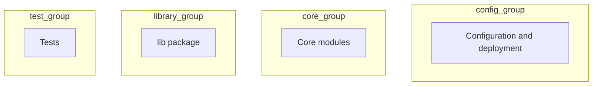

# Architecture report: winstonjs/winston

> Automated static analysis. **Observed** = directly seen in files/imports/AST; **Inferred** = interpretation from that evidence. Repository code was not executed.

## 1. Repository at a glance

| Item | Value |
| --- | --- |
| Repository | winstonjs/winston |
| Description | A logger for just about everything. |
| Language | JavaScript |
| Stars | 24526 |
| Licence | MIT |
| Analysed commit / branch | ff0b79de8562bb322c390fbc82fe71c11f373428 / master |
| Framework(s) | None detected |
| Files analysed | 113 |
| Components | 4 |

## 2. Architecture in one minute

winstonjs/winston - A logger for just about everything.. This repository was analysed statically from 113 file(s) (0 Python). Detected technologies (observed from imports/manifests): GitHub Actions, Jest. Files are grouped into 4 component(s): Configuration and deployment, Core modules, lib package, Tests. Findings below distinguish observed facts from inferred interpretation.

## 3. High-level block diagram

## 4. Main components

### Configuration and deployment (`config`)

- **Kind:** config
- **Status:** Observed
- **Confidence:** 0.85
- **Responsibility:** Groups 4 file(s) under configuration and deployment (observed from repository paths and static analysis).
- **Paths:** `lib/winston/config/index.d.ts`, `lib/winston/config/index.js`, `package.json`, `tsconfig.json`
- **Evidence:** [lib/winston/config/index.d.ts](https://github.com/winstonjs/winston/blob/ff0b79de8562bb322c390fbc82fe71c11f373428/lib/winston/config/index.d.ts); [lib/winston/config/index.js](https://github.com/winstonjs/winston/blob/ff0b79de8562bb322c390fbc82fe71c11f373428/lib/winston/config/index.js); [package.json](https://github.com/winstonjs/winston/blob/ff0b79de8562bb322c390fbc82fe71c11f373428/package.json); [tsconfig.json](https://github.com/winstonjs/winston/blob/ff0b79de8562bb322c390fbc82fe71c11f373428/tsconfig.json)

### Core modules (`core`)

- **Kind:** core
- **Status:** Observed
- **Confidence:** 0.85
- **Responsibility:** Groups 3 file(s) under core modules (observed from repository paths and static analysis).
- **Paths:** `eslint.config.cjs`, `index.d.ts`, `jest.config.js`
- **Evidence:** [eslint.config.cjs](https://github.com/winstonjs/winston/blob/ff0b79de8562bb322c390fbc82fe71c11f373428/eslint.config.cjs); [index.d.ts](https://github.com/winstonjs/winston/blob/ff0b79de8562bb322c390fbc82fe71c11f373428/index.d.ts); [jest.config.js](https://github.com/winstonjs/winston/blob/ff0b79de8562bb322c390fbc82fe71c11f373428/jest.config.js)

### lib package (`lib`)

- **Kind:** library
- **Status:** Observed
- **Confidence:** 0.85
- **Responsibility:** Groups 17 file(s) under lib package (observed from repository paths and static analysis).
- **Paths:** `lib/winston.js`, `lib/winston/common.js`, `lib/winston/container.js`, `lib/winston/create-logger.js`, `lib/winston/exception-handler.js`, `lib/winston/exception-stream.js`, `lib/winston/logger.js`, `lib/winston/profiler.js`, `lib/winston/rejection-handler.js`, `lib/winston/rejection-stream.js`, `lib/winston/tail-file.js`, `lib/winston/transports/console.js`, `lib/winston/transports/file.js`, `lib/winston/transports/http.js`, `lib/winston/transports/index.d.ts`, `lib/winston/transports/index.js`, `lib/winston/transports/stream.js`
- **Evidence:** [lib/winston.js](https://github.com/winstonjs/winston/blob/ff0b79de8562bb322c390fbc82fe71c11f373428/lib/winston.js); [lib/winston/common.js](https://github.com/winstonjs/winston/blob/ff0b79de8562bb322c390fbc82fe71c11f373428/lib/winston/common.js); [lib/winston/container.js](https://github.com/winstonjs/winston/blob/ff0b79de8562bb322c390fbc82fe71c11f373428/lib/winston/container.js); [lib/winston/create-logger.js](https://github.com/winstonjs/winston/blob/ff0b79de8562bb322c390fbc82fe71c11f373428/lib/winston/create-logger.js); [lib/winston/exception-handler.js](https://github.com/winstonjs/winston/blob/ff0b79de8562bb322c390fbc82fe71c11f373428/lib/winston/exception-handler.js); [lib/winston/exception-stream.js](https://github.com/winstonjs/winston/blob/ff0b79de8562bb322c390fbc82fe71c11f373428/lib/winston/exception-stream.js); [lib/winston/logger.js](https://github.com/winstonjs/winston/blob/ff0b79de8562bb322c390fbc82fe71c11f373428/lib/winston/logger.js); [lib/winston/profiler.js](https://github.com/winstonjs/winston/blob/ff0b79de8562bb322c390fbc82fe71c11f373428/lib/winston/profiler.js)

### Tests (`tests`)

- **Kind:** test
- **Status:** Observed
- **Confidence:** 0.85
- **Responsibility:** Groups 40 file(s) under tests (observed from repository paths and static analysis).
- **Paths:** `test/fixtures/.gitkeep`, `test/fixtures/logs/.gitkeep`, `test/globalSetup.js`, `test/helpers/handler-tests.js`, `test/helpers/index.js`, `test/helpers/mocks/legacy-mixed-transport.js`, `test/helpers/mocks/legacy-transport.js`, `test/helpers/mocks/mock-transport.js`, `test/helpers/scripts/colorize.js`, `test/helpers/scripts/default-rejections.js`, `test/helpers/scripts/exit-on-error.js`, `test/helpers/scripts/log-rejections.js`, `test/helpers/scripts/unhandle-exceptions.js`, `test/helpers/scripts/unhandle-rejections.js`, `test/integration/formats.test.js`, `test/integration/logger.test.js`, `test/jest.config.integration.js`, `test/jest.config.unit.js`, `test/tsconfig.json`, `test/typescript-definitions.ts`, `test/unit/formats/errors.test.js`, `test/unit/winston/config/config.test.js`, `test/unit/winston/container.test.js`, `test/unit/winston/create-logger.test.js`, `test/unit/winston/exception-handler.test.js`, `test/unit/winston/exception-stream.test.js`, `test/unit/winston/log-exception.test.js`, `test/unit/winston/logger-legacy.test.js`, `test/unit/winston/logger.test.js`, `test/unit/winston/profiler.test.js`, `test/unit/winston/rejection-handler.test.js`, `test/unit/winston/tail-file.test.js`, `test/unit/winston/transports/00-file-stress.test.js`, `test/unit/winston/transports/console.test.js`, `test/unit/winston/transports/error.test.js`, `test/unit/winston/transports/file-create-dir.test.js`, `test/unit/winston/transports/file.test.js`, `test/unit/winston/transports/http.test.js`, `test/unit/winston/transports/stream.test.js`, `test/unit/winston/winston.test.js`
- **Evidence:** [test/fixtures/.gitkeep](https://github.com/winstonjs/winston/blob/ff0b79de8562bb322c390fbc82fe71c11f373428/test/fixtures/.gitkeep); [test/fixtures/logs/.gitkeep](https://github.com/winstonjs/winston/blob/ff0b79de8562bb322c390fbc82fe71c11f373428/test/fixtures/logs/.gitkeep); [test/globalSetup.js](https://github.com/winstonjs/winston/blob/ff0b79de8562bb322c390fbc82fe71c11f373428/test/globalSetup.js); [test/helpers/handler-tests.js](https://github.com/winstonjs/winston/blob/ff0b79de8562bb322c390fbc82fe71c11f373428/test/helpers/handler-tests.js); [test/helpers/index.js](https://github.com/winstonjs/winston/blob/ff0b79de8562bb322c390fbc82fe71c11f373428/test/helpers/index.js); [test/helpers/mocks/legacy-mixed-transport.js](https://github.com/winstonjs/winston/blob/ff0b79de8562bb322c390fbc82fe71c11f373428/test/helpers/mocks/legacy-mixed-transport.js); [test/helpers/mocks/legacy-transport.js](https://github.com/winstonjs/winston/blob/ff0b79de8562bb322c390fbc82fe71c11f373428/test/helpers/mocks/legacy-transport.js); [test/helpers/mocks/mock-transport.js](https://github.com/winstonjs/winston/blob/ff0b79de8562bb322c390fbc82fe71c11f373428/test/helpers/mocks/mock-transport.js)

## 5. Execution flow

**Observed** entry point(s):

- [lib/winston.js](https://github.com/winstonjs/winston/blob/ff0b79de8562bb322c390fbc82fe71c11f373428/lib/winston.js)
- [lib/winston/config/index.js](https://github.com/winstonjs/winston/blob/ff0b79de8562bb322c390fbc82fe71c11f373428/lib/winston/config/index.js)
- [lib/winston/transports/index.js](https://github.com/winstonjs/winston/blob/ff0b79de8562bb322c390fbc82fe71c11f373428/lib/winston/transports/index.js)

Representative flow (derived from observed entry points and the import graph; steps beyond the entry point are **Inferred**):

1. Execution starts at an observed entry point listed above, if present.
2. No internal import relationships between components were observed.

## 6. Project structure

### `(root)`

- `.babelrc` - other (39 bytes)
- `.editorconfig` - config (305 bytes)
- `.eslintrc` - other (248 bytes)
- `.gitattributes` - other (25 bytes)
- `.gitignore` - other (215 bytes)
- `.npmignore` - other (109 bytes)
- `.prettierrc` - other (403 bytes)
- `CHANGELOG.md` - docs (45075 bytes)
- `CODE_OF_CONDUCT.md` - docs (3234 bytes)
- `CONTRIBUTING.md` - docs (5093 bytes)
- `LICENSE` - docs (1058 bytes)
- `README.md` - docs (36705 bytes)
- `SECURITY.md` - docs (119 bytes)
- `UPGRADE-3.0.md` - docs (10846 bytes)
- `eslint.config.cjs` - source, JavaScript (488 bytes)
- `index.d.ts` - source, TypeScript (5512 bytes)
- `jest.config.js` - source, JavaScript (503 bytes)
- `package.json` - manifest (1849 bytes)
- `publishing.md` - docs (2715 bytes)
- `tsconfig.json` - config (497 bytes)

### `.github`

- `.github/ISSUE_TEMPLATE/bug_report.yml` - config (2741 bytes)
- `.github/ISSUE_TEMPLATE/config.yml` - config (412 bytes)
- `.github/ISSUE_TEMPLATE/feature_request.yml` - config (1406 bytes)
- `.github/dependabot.yml` - config (193 bytes)
- `.github/workflows/ci.yml` - ci, YAML (1158 bytes)

### `docs`

- `docs/publishing.md` - docs (3231 bytes)
- `docs/releases.md` - docs (3985 bytes)
- `docs/transports.md` - docs (44988 bytes)

### `examples`

- `examples/color-message.js` - source, JavaScript (323 bytes)
- `examples/create-file.js` - source, JavaScript (713 bytes)
- `examples/custom-levels-colors.js` - source, JavaScript (723 bytes)
- `examples/custom-levels.js` - source, JavaScript (609 bytes)
- `examples/custom-pretty-print.js` - source, JavaScript (508 bytes)
- `examples/custom-timestamp.js` - source, JavaScript (750 bytes)
- `examples/custom-transport.js` - source, JavaScript (1002 bytes)
- `examples/delete-level.js` - source, JavaScript (518 bytes)
- `examples/errors.js` - source, JavaScript (556 bytes)
- `examples/exception.js` - source, JavaScript (408 bytes)
- `examples/file-maxsize.js` - source, JavaScript (679 bytes)
- `examples/finish-event.js` - source, JavaScript (794 bytes)
- `examples/format-dynamic-content.js` - source, JavaScript (423 bytes)
- `examples/format-filter.js` - source, JavaScript (666 bytes)
- `examples/format-logger-and-transport.js` - source, JavaScript (577 bytes)
- `examples/format-mutate.js` - source, JavaScript (1052 bytes)
- `examples/interpolation.js` - source, JavaScript (872 bytes)
- `examples/json.js` - source, JavaScript (367 bytes)
- `examples/levels.js` - source, JavaScript (587 bytes)
- `examples/metadata.js` - source, JavaScript (552 bytes)
- `examples/quick-start.js` - source, JavaScript (2645 bytes)
- `examples/ready-to-use-pattern.ts` - source, TypeScript (3333 bytes)
- `examples/regular-expressions.js` - source, JavaScript (207 bytes)
- `examples/simple-stream.js` - source, JavaScript (601 bytes)
- `examples/splat-message.js` - source, JavaScript (765 bytes)
- `examples/splat.js` - source, JavaScript (1426 bytes)

### `lib`

- `lib/winston.js` - source, JavaScript (4595 bytes)
- `lib/winston/common.js` - source, JavaScript (1016 bytes)
- `lib/winston/config/index.d.ts` - source, TypeScript (2453 bytes)
- `lib/winston/config/index.js` - source, JavaScript (676 bytes)
- `lib/winston/container.js` - source, JavaScript (3361 bytes)
- `lib/winston/create-logger.js` - source, JavaScript (3140 bytes)
- `lib/winston/exception-handler.js` - source, JavaScript (6909 bytes)
- `lib/winston/exception-stream.js` - source, JavaScript (1506 bytes)
- `lib/winston/logger.js` - source, JavaScript (20480 bytes)
- `lib/winston/profiler.js` - source, JavaScript (1418 bytes)
- `lib/winston/rejection-handler.js` - source, JavaScript (6982 bytes)
- `lib/winston/rejection-stream.js` - source, JavaScript (1353 bytes)
- `lib/winston/tail-file.js` - source, JavaScript (2700 bytes)
- `lib/winston/transports/console.js` - source, JavaScript (3842 bytes)
- `lib/winston/transports/file.js` - source, JavaScript (22713 bytes)
- `lib/winston/transports/http.js` - source, JavaScript (7733 bytes)
- `lib/winston/transports/index.d.ts` - source, TypeScript (2975 bytes)
- `lib/winston/transports/index.js` - source, JavaScript (909 bytes)
- `lib/winston/transports/stream.js` - source, JavaScript (1785 bytes)

### `test`

- `test/fixtures/.gitkeep` - test (0 bytes)
- `test/fixtures/logs/.gitkeep` - test (0 bytes)
- `test/globalSetup.js` - test, JavaScript (343 bytes)
- `test/helpers/handler-tests.js` - test, JavaScript (2779 bytes)
- `test/helpers/index.js` - test, JavaScript (6187 bytes)
- `test/helpers/mocks/legacy-mixed-transport.js` - test, JavaScript (1531 bytes)
- `test/helpers/mocks/legacy-transport.js` - test, JavaScript (1513 bytes)
- `test/helpers/mocks/mock-transport.js` - test, JavaScript (563 bytes)
- `test/helpers/scripts/colorize.js` - test, JavaScript (422 bytes)
- `test/helpers/scripts/default-rejections.js` - test, JavaScript (612 bytes)
- `test/helpers/scripts/exit-on-error.js` - test, JavaScript (675 bytes)
- `test/helpers/scripts/log-rejections.js` - test, JavaScript (599 bytes)
- `test/helpers/scripts/unhandle-exceptions.js` - test, JavaScript (660 bytes)
- `test/helpers/scripts/unhandle-rejections.js` - test, JavaScript (671 bytes)
- `test/integration/formats.test.js` - test, JavaScript (1105 bytes)
- `test/integration/logger.test.js` - test, JavaScript (464 bytes)
- `test/jest.config.integration.js` - test, JavaScript (232 bytes)
- `test/jest.config.unit.js` - test, JavaScript (250 bytes)
- `test/tsconfig.json` - test (471 bytes)
- `test/typescript-definitions.ts` - test, TypeScript (1749 bytes)
- `test/unit/formats/errors.test.js` - test, JavaScript (6947 bytes)
- `test/unit/winston/config/config.test.js` - test, JavaScript (536 bytes)
- `test/unit/winston/container.test.js` - test, JavaScript (2970 bytes)
- `test/unit/winston/create-logger.test.js` - test, JavaScript (3455 bytes)
- `test/unit/winston/exception-handler.test.js` - test, JavaScript (456 bytes)
- `test/unit/winston/exception-stream.test.js` - test, JavaScript (2741 bytes)
- `test/unit/winston/log-exception.test.js` - test, JavaScript (6043 bytes)
- `test/unit/winston/logger-legacy.test.js` - test, JavaScript (3645 bytes)
- `test/unit/winston/logger.test.js` - test, JavaScript (36796 bytes)
- `test/unit/winston/profiler.test.js` - test, JavaScript (1727 bytes)
- `test/unit/winston/rejection-handler.test.js` - test, JavaScript (466 bytes)
- `test/unit/winston/tail-file.test.js` - test, JavaScript (2294 bytes)
- `test/unit/winston/transports/00-file-stress.test.js` - test, JavaScript (5036 bytes)
- `test/unit/winston/transports/console.test.js` - test, JavaScript (6242 bytes)
- `test/unit/winston/transports/error.test.js` - test, JavaScript (3246 bytes)
- `test/unit/winston/transports/file-create-dir.test.js` - test, JavaScript (1230 bytes)
- `test/unit/winston/transports/file.test.js` - test, JavaScript (21532 bytes)
- `test/unit/winston/transports/http.test.js` - test, JavaScript (4297 bytes)
- `test/unit/winston/transports/stream.test.js` - test, JavaScript (1323 bytes)
- `test/unit/winston/winston.test.js` - test, JavaScript (3160 bytes)

## 7. Key dependencies and integrations

| Name | Category | Status | Confidence | Evidence |
| --- | --- | --- | --- | --- |
| GitHub Actions | ci | Observed | 0.85 | [.github/workflows/ci.yml](https://github.com/winstonjs/winston/blob/ff0b79de8562bb322c390fbc82fe71c11f373428/.github/workflows/ci.yml) |
| Jest | tooling | Observed | 0.85 | [package.json:52](https://github.com/winstonjs/winston/blob/ff0b79de8562bb322c390fbc82fe71c11f373428/package.json#L52) |

## 8. Data and state

No database, cache, queue, or persistent-state usage was observed in the analysed files. State handling, if any, may be in-memory or in files that were not analysed.

## 9. Configuration and deployment clues

- `.editorconfig` (config)
- `.github/ISSUE_TEMPLATE/bug_report.yml` (config)
- `.github/ISSUE_TEMPLATE/config.yml` (config)
- `.github/ISSUE_TEMPLATE/feature_request.yml` (config)
- `.github/dependabot.yml` (config)
- `.github/workflows/ci.yml` (ci)
- `package.json` (manifest)
- `tsconfig.json` (config)

## 10. Design observations

- Tests are present alongside source code (Observed from test file paths).

These observations are interpretations (**Inferred**) of the observed structure, not guarantees about runtime design.

## 11. Limitations and unknowns

- Static analysis only: repository code was not executed, installed, or imported at runtime.
- Components and relationships are inferred from file paths, imports, and AST structure; runtime behaviour, dynamic imports, and reflection may not be visible.
- 2 file(s) were skipped during inventory (2 x likely secret file excluded).
- No clear application entry point was observed in the analysed files.
- Repository text was treated as untrusted data; no instructions found in repository files were followed, and likely secret values were redacted/excluded.
- JavaScript and TypeScript files were inventoried from paths and package manifests. They were not parsed with a full language AST, and repository code was not executed.

## 12. Source references

- [.github/workflows/ci.yml](https://github.com/winstonjs/winston/blob/ff0b79de8562bb322c390fbc82fe71c11f373428/.github/workflows/ci.yml)
- [eslint.config.cjs](https://github.com/winstonjs/winston/blob/ff0b79de8562bb322c390fbc82fe71c11f373428/eslint.config.cjs)
- [index.d.ts](https://github.com/winstonjs/winston/blob/ff0b79de8562bb322c390fbc82fe71c11f373428/index.d.ts)
- [jest.config.js](https://github.com/winstonjs/winston/blob/ff0b79de8562bb322c390fbc82fe71c11f373428/jest.config.js)
- [lib/winston.js](https://github.com/winstonjs/winston/blob/ff0b79de8562bb322c390fbc82fe71c11f373428/lib/winston.js)
- [lib/winston/common.js](https://github.com/winstonjs/winston/blob/ff0b79de8562bb322c390fbc82fe71c11f373428/lib/winston/common.js)
- [lib/winston/config/index.d.ts](https://github.com/winstonjs/winston/blob/ff0b79de8562bb322c390fbc82fe71c11f373428/lib/winston/config/index.d.ts)
- [lib/winston/config/index.js](https://github.com/winstonjs/winston/blob/ff0b79de8562bb322c390fbc82fe71c11f373428/lib/winston/config/index.js)
- [lib/winston/container.js](https://github.com/winstonjs/winston/blob/ff0b79de8562bb322c390fbc82fe71c11f373428/lib/winston/container.js)
- [lib/winston/create-logger.js](https://github.com/winstonjs/winston/blob/ff0b79de8562bb322c390fbc82fe71c11f373428/lib/winston/create-logger.js)
- [lib/winston/exception-handler.js](https://github.com/winstonjs/winston/blob/ff0b79de8562bb322c390fbc82fe71c11f373428/lib/winston/exception-handler.js)
- [lib/winston/exception-stream.js](https://github.com/winstonjs/winston/blob/ff0b79de8562bb322c390fbc82fe71c11f373428/lib/winston/exception-stream.js)
- [lib/winston/logger.js](https://github.com/winstonjs/winston/blob/ff0b79de8562bb322c390fbc82fe71c11f373428/lib/winston/logger.js)
- [lib/winston/profiler.js](https://github.com/winstonjs/winston/blob/ff0b79de8562bb322c390fbc82fe71c11f373428/lib/winston/profiler.js)
- [lib/winston/transports/index.js](https://github.com/winstonjs/winston/blob/ff0b79de8562bb322c390fbc82fe71c11f373428/lib/winston/transports/index.js)
- [package.json](https://github.com/winstonjs/winston/blob/ff0b79de8562bb322c390fbc82fe71c11f373428/package.json)
- [package.json:52](https://github.com/winstonjs/winston/blob/ff0b79de8562bb322c390fbc82fe71c11f373428/package.json#L52)
- [test/fixtures/.gitkeep](https://github.com/winstonjs/winston/blob/ff0b79de8562bb322c390fbc82fe71c11f373428/test/fixtures/.gitkeep)
- [test/fixtures/logs/.gitkeep](https://github.com/winstonjs/winston/blob/ff0b79de8562bb322c390fbc82fe71c11f373428/test/fixtures/logs/.gitkeep)
- [test/globalSetup.js](https://github.com/winstonjs/winston/blob/ff0b79de8562bb322c390fbc82fe71c11f373428/test/globalSetup.js)
- [test/helpers/handler-tests.js](https://github.com/winstonjs/winston/blob/ff0b79de8562bb322c390fbc82fe71c11f373428/test/helpers/handler-tests.js)
- [test/helpers/index.js](https://github.com/winstonjs/winston/blob/ff0b79de8562bb322c390fbc82fe71c11f373428/test/helpers/index.js)
- [test/helpers/mocks/legacy-mixed-transport.js](https://github.com/winstonjs/winston/blob/ff0b79de8562bb322c390fbc82fe71c11f373428/test/helpers/mocks/legacy-mixed-transport.js)
- [test/helpers/mocks/legacy-transport.js](https://github.com/winstonjs/winston/blob/ff0b79de8562bb322c390fbc82fe71c11f373428/test/helpers/mocks/legacy-transport.js)
- [test/helpers/mocks/mock-transport.js](https://github.com/winstonjs/winston/blob/ff0b79de8562bb322c390fbc82fe71c11f373428/test/helpers/mocks/mock-transport.js)
- [tsconfig.json](https://github.com/winstonjs/winston/blob/ff0b79de8562bb322c390fbc82fe71c11f373428/tsconfig.json)
