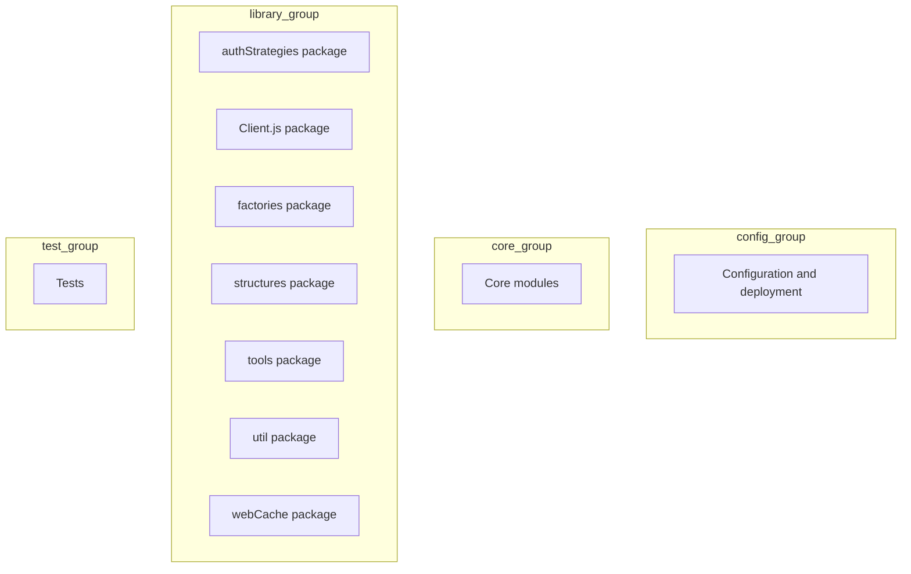

# Architecture report: wwebjs/whatsapp-web.js

> Automated static analysis. **Observed** = directly seen in files/imports/AST; **Inferred** = interpretation from that evidence. Repository code was not executed.

## 1. Repository at a glance

| Item | Value |
| --- | --- |
| Repository | wwebjs/whatsapp-web.js |
| Description | A WhatsApp client library for NodeJS that connects through the WhatsApp Web browser app |
| Language | JavaScript |
| Stars | 22909 |
| Licence | Apache-2.0 |
| Analysed commit / branch | eb076b0c4075f5c295d5633f4c587d02ef4e5cf1 / main |
| Framework(s) | None detected |
| Files analysed | 184 |
| Components | 10 |

## 2. Architecture in one minute

wwebjs/whatsapp-web.js - A WhatsApp client library for NodeJS that connects through the WhatsApp Web browser app. This repository was analysed statically from 184 file(s) (0 Python). Detected technologies (observed from imports/manifests): GitHub Actions. Files are grouped into 10 component(s): authStrategies package, Client.js package, Configuration and deployment, Core modules, factories package, structures package, Tests, tools package. Findings below distinguish observed facts from inferred interpretation.

## 3. High-level block diagram

## 4. Main components

### authStrategies package (`authstrategies`)

- **Kind:** library
- **Status:** Observed
- **Confidence:** 0.85
- **Responsibility:** Groups 4 file(s) under authstrategies package (observed from repository paths and static analysis).
- **Paths:** `src/authStrategies/BaseAuthStrategy.js`, `src/authStrategies/LocalAuth.js`, `src/authStrategies/NoAuth.js`, `src/authStrategies/RemoteAuth.js`
- **Evidence:** [src/authStrategies/BaseAuthStrategy.js](https://github.com/wwebjs/whatsapp-web.js/blob/eb076b0c4075f5c295d5633f4c587d02ef4e5cf1/src/authStrategies/BaseAuthStrategy.js); [src/authStrategies/LocalAuth.js](https://github.com/wwebjs/whatsapp-web.js/blob/eb076b0c4075f5c295d5633f4c587d02ef4e5cf1/src/authStrategies/LocalAuth.js); [src/authStrategies/NoAuth.js](https://github.com/wwebjs/whatsapp-web.js/blob/eb076b0c4075f5c295d5633f4c587d02ef4e5cf1/src/authStrategies/NoAuth.js); [src/authStrategies/RemoteAuth.js](https://github.com/wwebjs/whatsapp-web.js/blob/eb076b0c4075f5c295d5633f4c587d02ef4e5cf1/src/authStrategies/RemoteAuth.js)

### Client.js package (`client_js`)

- **Kind:** library
- **Status:** Observed
- **Confidence:** 0.85
- **Responsibility:** Groups 1 file(s) under client.js package (observed from repository paths and static analysis).
- **Paths:** `src/Client.js`
- **Evidence:** [src/Client.js](https://github.com/wwebjs/whatsapp-web.js/blob/eb076b0c4075f5c295d5633f4c587d02ef4e5cf1/src/Client.js)

### Configuration and deployment (`config`)

- **Kind:** config
- **Status:** Observed
- **Confidence:** 0.85
- **Responsibility:** Groups 1 file(s) under configuration and deployment (observed from repository paths and static analysis).
- **Paths:** `package.json`
- **Evidence:** [package.json](https://github.com/wwebjs/whatsapp-web.js/blob/eb076b0c4075f5c295d5633f4c587d02ef4e5cf1/package.json)

### Core modules (`core`)

- **Kind:** core
- **Status:** Observed
- **Confidence:** 0.85
- **Responsibility:** Groups 6 file(s) under core modules (observed from repository paths and static analysis).
- **Paths:** `commitlint.config.js`, `eslint.config.mjs`, `example.js`, `index.d.ts`, `index.js`, `shell.js`
- **Evidence:** [commitlint.config.js](https://github.com/wwebjs/whatsapp-web.js/blob/eb076b0c4075f5c295d5633f4c587d02ef4e5cf1/commitlint.config.js); [eslint.config.mjs](https://github.com/wwebjs/whatsapp-web.js/blob/eb076b0c4075f5c295d5633f4c587d02ef4e5cf1/eslint.config.mjs); [example.js](https://github.com/wwebjs/whatsapp-web.js/blob/eb076b0c4075f5c295d5633f4c587d02ef4e5cf1/example.js); [index.d.ts](https://github.com/wwebjs/whatsapp-web.js/blob/eb076b0c4075f5c295d5633f4c587d02ef4e5cf1/index.d.ts); [index.js](https://github.com/wwebjs/whatsapp-web.js/blob/eb076b0c4075f5c295d5633f4c587d02ef4e5cf1/index.js); [shell.js](https://github.com/wwebjs/whatsapp-web.js/blob/eb076b0c4075f5c295d5633f4c587d02ef4e5cf1/shell.js)

### factories package (`factories`)

- **Kind:** library
- **Status:** Observed
- **Confidence:** 0.85
- **Responsibility:** Groups 2 file(s) under factories package (observed from repository paths and static analysis).
- **Paths:** `src/factories/ChatFactory.js`, `src/factories/ContactFactory.js`
- **Evidence:** [src/factories/ChatFactory.js](https://github.com/wwebjs/whatsapp-web.js/blob/eb076b0c4075f5c295d5633f4c587d02ef4e5cf1/src/factories/ChatFactory.js); [src/factories/ContactFactory.js](https://github.com/wwebjs/whatsapp-web.js/blob/eb076b0c4075f5c295d5633f4c587d02ef4e5cf1/src/factories/ContactFactory.js)

### structures package (`structures`)

- **Kind:** library
- **Status:** Observed
- **Confidence:** 0.85
- **Responsibility:** Groups 27 file(s) under structures package (observed from repository paths and static analysis).
- **Paths:** `src/structures/Base.js`, `src/structures/Broadcast.js`, `src/structures/BusinessContact.js`, `src/structures/Buttons.js`, `src/structures/Call.js`, `src/structures/Channel.js`, `src/structures/Chat.js`, `src/structures/ClientInfo.js`, `src/structures/Contact.js`, `src/structures/GroupChat.js`, `src/structures/GroupNotification.js`, `src/structures/Label.js`, `src/structures/List.js`, `src/structures/Location.js`, `src/structures/Message.js`, `src/structures/MessageMedia.js`, `src/structures/Order.js`, `src/structures/Payment.js`, `src/structures/Poll.js`, `src/structures/PollVote.js`, `src/structures/PrivateChat.js`, `src/structures/PrivateContact.js`, `src/structures/Product.js`, `src/structures/ProductMetadata.js`, `src/structures/Reaction.js`, `src/structures/ScheduledEvent.js`, `src/structures/index.js`
- **Evidence:** [src/structures/Base.js](https://github.com/wwebjs/whatsapp-web.js/blob/eb076b0c4075f5c295d5633f4c587d02ef4e5cf1/src/structures/Base.js); [src/structures/Broadcast.js](https://github.com/wwebjs/whatsapp-web.js/blob/eb076b0c4075f5c295d5633f4c587d02ef4e5cf1/src/structures/Broadcast.js); [src/structures/BusinessContact.js](https://github.com/wwebjs/whatsapp-web.js/blob/eb076b0c4075f5c295d5633f4c587d02ef4e5cf1/src/structures/BusinessContact.js); [src/structures/Buttons.js](https://github.com/wwebjs/whatsapp-web.js/blob/eb076b0c4075f5c295d5633f4c587d02ef4e5cf1/src/structures/Buttons.js); [src/structures/Call.js](https://github.com/wwebjs/whatsapp-web.js/blob/eb076b0c4075f5c295d5633f4c587d02ef4e5cf1/src/structures/Call.js); [src/structures/Channel.js](https://github.com/wwebjs/whatsapp-web.js/blob/eb076b0c4075f5c295d5633f4c587d02ef4e5cf1/src/structures/Channel.js); [src/structures/Chat.js](https://github.com/wwebjs/whatsapp-web.js/blob/eb076b0c4075f5c295d5633f4c587d02ef4e5cf1/src/structures/Chat.js); [src/structures/ClientInfo.js](https://github.com/wwebjs/whatsapp-web.js/blob/eb076b0c4075f5c295d5633f4c587d02ef4e5cf1/src/structures/ClientInfo.js)

### Tests (`tests`)

- **Kind:** test
- **Status:** Observed
- **Confidence:** 0.85
- **Responsibility:** Groups 6 file(s) under tests (observed from repository paths and static analysis).
- **Paths:** `tests/README.md`, `tests/client.js`, `tests/helper.js`, `tests/structures/chat.js`, `tests/structures/group.js`, `tests/structures/message.js`
- **Evidence:** [tests/README.md](https://github.com/wwebjs/whatsapp-web.js/blob/eb076b0c4075f5c295d5633f4c587d02ef4e5cf1/tests/README.md); [tests/client.js](https://github.com/wwebjs/whatsapp-web.js/blob/eb076b0c4075f5c295d5633f4c587d02ef4e5cf1/tests/client.js); [tests/helper.js](https://github.com/wwebjs/whatsapp-web.js/blob/eb076b0c4075f5c295d5633f4c587d02ef4e5cf1/tests/helper.js); [tests/structures/chat.js](https://github.com/wwebjs/whatsapp-web.js/blob/eb076b0c4075f5c295d5633f4c587d02ef4e5cf1/tests/structures/chat.js); [tests/structures/group.js](https://github.com/wwebjs/whatsapp-web.js/blob/eb076b0c4075f5c295d5633f4c587d02ef4e5cf1/tests/structures/group.js); [tests/structures/message.js](https://github.com/wwebjs/whatsapp-web.js/blob/eb076b0c4075f5c295d5633f4c587d02ef4e5cf1/tests/structures/message.js)

### tools package (`tools`)

- **Kind:** library
- **Status:** Observed
- **Confidence:** 0.85
- **Responsibility:** Groups 1 file(s) under tools package (observed from repository paths and static analysis).
- **Paths:** `tools/changelog.sh`
- **Evidence:** [tools/changelog.sh](https://github.com/wwebjs/whatsapp-web.js/blob/eb076b0c4075f5c295d5633f4c587d02ef4e5cf1/tools/changelog.sh)

### util package (`util`)

- **Kind:** library
- **Status:** Observed
- **Confidence:** 0.85
- **Responsibility:** Groups 5 file(s) under util package (observed from repository paths and static analysis).
- **Paths:** `src/util/Constants.js`, `src/util/Injected/Utils.js`, `src/util/InterfaceController.js`, `src/util/Puppeteer.js`, `src/util/Util.js`
- **Evidence:** [src/util/Constants.js](https://github.com/wwebjs/whatsapp-web.js/blob/eb076b0c4075f5c295d5633f4c587d02ef4e5cf1/src/util/Constants.js); [src/util/Injected/Utils.js](https://github.com/wwebjs/whatsapp-web.js/blob/eb076b0c4075f5c295d5633f4c587d02ef4e5cf1/src/util/Injected/Utils.js); [src/util/InterfaceController.js](https://github.com/wwebjs/whatsapp-web.js/blob/eb076b0c4075f5c295d5633f4c587d02ef4e5cf1/src/util/InterfaceController.js); [src/util/Puppeteer.js](https://github.com/wwebjs/whatsapp-web.js/blob/eb076b0c4075f5c295d5633f4c587d02ef4e5cf1/src/util/Puppeteer.js); [src/util/Util.js](https://github.com/wwebjs/whatsapp-web.js/blob/eb076b0c4075f5c295d5633f4c587d02ef4e5cf1/src/util/Util.js)

### webCache package (`webcache`)

- **Kind:** library
- **Status:** Observed
- **Confidence:** 0.85
- **Responsibility:** Groups 4 file(s) under webcache package (observed from repository paths and static analysis).
- **Paths:** `src/webCache/LocalWebCache.js`, `src/webCache/RemoteWebCache.js`, `src/webCache/WebCache.js`, `src/webCache/WebCacheFactory.js`
- **Evidence:** [src/webCache/LocalWebCache.js](https://github.com/wwebjs/whatsapp-web.js/blob/eb076b0c4075f5c295d5633f4c587d02ef4e5cf1/src/webCache/LocalWebCache.js); [src/webCache/RemoteWebCache.js](https://github.com/wwebjs/whatsapp-web.js/blob/eb076b0c4075f5c295d5633f4c587d02ef4e5cf1/src/webCache/RemoteWebCache.js); [src/webCache/WebCache.js](https://github.com/wwebjs/whatsapp-web.js/blob/eb076b0c4075f5c295d5633f4c587d02ef4e5cf1/src/webCache/WebCache.js); [src/webCache/WebCacheFactory.js](https://github.com/wwebjs/whatsapp-web.js/blob/eb076b0c4075f5c295d5633f4c587d02ef4e5cf1/src/webCache/WebCacheFactory.js)

## 5. Execution flow

**Observed** entry point(s):

- [index.js](https://github.com/wwebjs/whatsapp-web.js/blob/eb076b0c4075f5c295d5633f4c587d02ef4e5cf1/index.js)
- [src/structures/index.js](https://github.com/wwebjs/whatsapp-web.js/blob/eb076b0c4075f5c295d5633f4c587d02ef4e5cf1/src/structures/index.js)

Representative flow (derived from observed entry points and the import graph; steps beyond the entry point are **Inferred**):

1. Execution starts at an observed entry point listed above, if present.
2. No internal import relationships between components were observed.

## 6. Project structure

### `(root)`

- `.editorconfig` - config (187 bytes)
- `.env.example` - config (74 bytes)
- `.gitattributes` - other (127 bytes)
- `.gitignore` - other (1084 bytes)
- `.jsdoc.json` - config (610 bytes)
- `.lintstagedrc.json` - config (164 bytes)
- `.npmignore` - other (182 bytes)
- `.prettierignore` - other (80 bytes)
- `.prettierrc.json` - config (189 bytes)
- `LICENSE` - docs (11343 bytes)
- `README.md` - docs (8714 bytes)
- `commitlint.config.js` - source, JavaScript (683 bytes)
- `eslint.config.mjs` - source, JavaScript (1930 bytes)
- `example.js` - source, JavaScript (30417 bytes)
- `index.d.ts` - source, TypeScript (88369 bytes)
- `index.js` - source, JavaScript (1333 bytes)
- `package.json` - manifest (2191 bytes)
- `shell.js` - source, JavaScript (822 bytes)

### `.github`

- `.github/CODE_OF_CONDUCT.md` - docs (5513 bytes)
- `.github/COMMIT_CONVENTION.md` - docs (4810 bytes)
- `.github/CONTRIBUTING.md` - docs (2322 bytes)
- `.github/DISCLAIMER.md` - docs (2060 bytes)
- `.github/FUNDING.yml` - config (108 bytes)
- `.github/ISSUE_TEMPLATE/01-bug_report.yml` - config (5057 bytes)
- `.github/ISSUE_TEMPLATE/02-feature_request.yml` - config (1972 bytes)
- `.github/ISSUE_TEMPLATE/config.yml` - config (159 bytes)
- `.github/SUPPORT.md` - docs (386 bytes)
- `.github/dependabot.yml` - config (247 bytes)
- `.github/issue-labeler.yml` - config (931 bytes)
- `.github/labels.yml` - config (3404 bytes)
- `.github/pr-labeler.yml` - config (1761 bytes)
- `.github/pull_request_template.md` - docs (2296 bytes)
- `.github/workflows/format-issue-bug.yml` - ci, YAML (5224 bytes)
- `.github/workflows/issue-triage.yml` - ci, YAML (550 bytes)
- `.github/workflows/labels-sync.yml` - ci, YAML (598 bytes)
- `.github/workflows/lint.yml` - ci, YAML (441 bytes)
- `.github/workflows/pr-triage.yml` - ci, YAML (1358 bytes)
- `.github/workflows/release.yml` - ci, YAML (1671 bytes)
- `.github/workflows/stale.yml` - ci, YAML (1737 bytes)
- `.github/workflows/tests.yml` - ci, YAML (601 bytes)
- `.github/workflows/update.yml` - ci, YAML (1526 bytes)

### `.husky`

- `.husky/commit-msg` - other (141 bytes)
- `.husky/pre-commit` - other (16 bytes)

### `docs`

- `docs/Base.html` - docs (4851 bytes)
- `docs/BaseAuthStrategy.html` - docs (2598 bytes)
- `docs/Broadcast.html` - docs (7188 bytes)
- `docs/BusinessContact.html` - docs (18582 bytes)
- `docs/Buttons.html` - docs (9606 bytes)
- `docs/CNAME` - docs (15 bytes)
- `docs/Call.html` - docs (7703 bytes)
- `docs/Channel.html` - docs (40488 bytes)
- `docs/Chat.html` - docs (31761 bytes)
- `docs/Client.html` - docs (165374 bytes)
- `docs/Client.js.html` - docs (148910 bytes)
- `docs/ClientInfo.html` - docs (9897 bytes)
- `docs/Contact.html` - docs (16230 bytes)
- `docs/GroupChat.html` - docs (63488 bytes)
- `docs/GroupNotification.html` - docs (11245 bytes)
- `docs/InterfaceController.html` - docs (15949 bytes)
- `docs/Label.html` - docs (6751 bytes)
- `docs/LegacySessionAuth.html` - docs (7106 bytes)
- `docs/List.html` - docs (10095 bytes)
- `docs/LocalAuth.html` - docs (5728 bytes)
- `docs/LocalWebCache.html` - docs (5199 bytes)
- `docs/Location.html` - docs (7111 bytes)
- `docs/Message.html` - docs (47716 bytes)
- `docs/MessageMedia.html` - docs (14588 bytes)
- `docs/NoAuth.html` - docs (2584 bytes)
- `docs/Order.html` - docs (4654 bytes)
- `docs/Poll.html` - docs (5964 bytes)
- `docs/PollVote.html` - docs (4874 bytes)
- `docs/PrivateChat.html` - docs (34112 bytes)
- `docs/PrivateContact.html` - docs (18203 bytes)
- `docs/Product.html` - docs (5731 bytes)
- `docs/Reaction.html` - docs (6548 bytes)
- `docs/RemoteAuth.html` - docs (6870 bytes)
- `docs/RemoteWebCache.html` - docs (5250 bytes)
- `docs/ScheduledEvent.html` - docs (8691 bytes)
- `docs/Util.html` - docs (10466 bytes)
- `docs/WebCache.html` - docs (2549 bytes)
- `docs/authStrategies_BaseAuthStrategy.js.html` - docs (2578 bytes)
- `docs/authStrategies_LegacySessionAuth.js.html` - docs (4724 bytes)
- `docs/authStrategies_LocalAuth.js.html` - docs (4428 bytes)
- `docs/authStrategies_NoAuth.js.html` - docs (2198 bytes)
- `docs/authStrategies_RemoteAuth.js.html` - docs (11413 bytes)
- `docs/css/baseline.css` - docs (85526 bytes)
- `docs/global.html` - docs (151066 bytes)
- `docs/index.html` - docs (171470 bytes)
- `docs/scripts/jsdoc-toc.js` - docs (3299 bytes)
- `docs/scripts/lang-css.js` - docs (1020 bytes)
- `docs/scripts/linenumber.js` - docs (260 bytes)
- `docs/scripts/prettify.js` - docs (15394 bytes)
- `docs/scripts/scrollanchor.js` - docs (355 bytes)
- `docs/scripts/tree.jquery.js` - docs (52283 bytes)
- `docs/structures_Base.js.html` - docs (2951 bytes)
- `docs/structures_Broadcast.js.html` - docs (3461 bytes)
- `docs/structures_BusinessContact.js.html` - docs (2367 bytes)
- `docs/structures_Buttons.js.html` - docs (4573 bytes)
- `docs/structures_Call.js.html` - docs (3779 bytes)
- `docs/structures_Channel.js.html` - docs (19457 bytes)
- `docs/structures_Chat.js.html` - docs (12632 bytes)
- `docs/structures_ClientInfo.js.html` - docs (4016 bytes)
- `docs/structures_Contact.js.html` - docs (9138 bytes)
- `docs/structures_GroupChat.js.html` - docs (31182 bytes)
- `docs/structures_GroupNotification.js.html` - docs (4941 bytes)
- `docs/structures_Label.js.html` - docs (2976 bytes)
- `docs/structures_List.js.html` - docs (4745 bytes)
- `docs/structures_Location.js.html` - docs (3527 bytes)
- `docs/structures_Message.js.html` - docs (39243 bytes)
- `docs/structures_MessageMedia.js.html` - docs (6209 bytes)
- `docs/structures_Order.js.html` - docs (3077 bytes)
- `docs/structures_Payment.js.html` - docs (3870 bytes)
- `docs/structures_Poll.js.html` - docs (3303 bytes)
- `docs/structures_PollVote.js.html` - docs (4164 bytes)
- `docs/structures_PrivateChat.js.html` - docs (2144 bytes)
- `docs/structures_PrivateContact.js.html` - docs (2171 bytes)
- `docs/structures_Product.js.html` - docs (3616 bytes)
- `docs/structures_ProductMetadata.js.html` - docs (2514 bytes)
- `docs/structures_Reaction.js.html` - docs (3349 bytes)
- `docs/structures_ScheduledEvent.js.html` - docs (5161 bytes)
- `docs/util_Constants.js.html` - docs (7475 bytes)
- `docs/util_Injected.js.html` - docs (51878 bytes)
- `docs/util_Injected_LegacyStore.js.html` - docs (12261 bytes)
- `docs/util_Injected_Store.js.html` - docs (17526 bytes)
- `docs/util_Injected_Utils.js.html` - docs (75173 bytes)
- `docs/util_InterfaceController.js.html` - docs (7885 bytes)
- `docs/util_Puppeteer.js.html` - docs (2573 bytes)
- `docs/util_Util.js.html` - docs (8963 bytes)
- `docs/webCache_LocalWebCache.js.html` - docs (3531 bytes)
- `docs/webCache_RemoteWebCache.js.html` - docs (3600 bytes)
- `docs/webCache_WebCache.js.html` - docs (2202 bytes)

### `src`

- `src/Client.js` - source, JavaScript (136224 bytes)
- `src/authStrategies/BaseAuthStrategy.js` - source, JavaScript (607 bytes)
- `src/authStrategies/LocalAuth.js` - source, JavaScript (2271 bytes)
- `src/authStrategies/NoAuth.js` - source, JavaScript (237 bytes)
- `src/authStrategies/RemoteAuth.js` - source, JavaScript (8777 bytes)
- `src/factories/ChatFactory.js` - source, JavaScript (491 bytes)
- `src/factories/ContactFactory.js` - source, JavaScript (390 bytes)
- `src/structures/Base.js` - source, JavaScript (920 bytes)
- `src/structures/Broadcast.js` - source, JavaScript (1434 bytes)
- `src/structures/BusinessContact.js` - source, JavaScript (386 bytes)
- `src/structures/Buttons.js` - source, JavaScript (2370 bytes)
- `src/structures/Call.js` - source, JavaScript (1777 bytes)
- `src/structures/Channel.js` - source, JavaScript (16597 bytes)
- `src/structures/Chat.js` - source, JavaScript (10129 bytes)
- `src/structures/ClientInfo.js` - source, JavaScript (2007 bytes)
- `src/structures/Contact.js` - source, JavaScript (6698 bytes)
- `src/structures/GroupChat.js` - source, JavaScript (27406 bytes)
- `src/structures/GroupNotification.js` - source, JavaScript (2793 bytes)
- `src/structures/Label.js` - source, JavaScript (975 bytes)
- `src/structures/List.js` - source, JavaScript (2410 bytes)
- `src/structures/Location.js` - source, JavaScript (1514 bytes)
- `src/structures/Message.js` - source, JavaScript (34728 bytes)
- `src/structures/MessageMedia.js` - source, JavaScript (3888 bytes)
- `src/structures/Order.js` - source, JavaScript (1068 bytes)
- `src/structures/Payment.js` - source, JavaScript (1880 bytes)
- `src/structures/Poll.js` - source, JavaScript (1291 bytes)
- `src/structures/PollVote.js` - source, JavaScript (2105 bytes)
- `src/structures/PrivateChat.js` - source, JavaScript (181 bytes)
- `src/structures/PrivateContact.js` - source, JavaScript (202 bytes)
- `src/structures/Product.js` - source, JavaScript (1563 bytes)
- `src/structures/ProductMetadata.js` - source, JavaScript (533 bytes)
- `src/structures/Reaction.js` - source, JavaScript (1347 bytes)
- `src/structures/ScheduledEvent.js` - source, JavaScript (2924 bytes)
- `src/structures/index.js` - source, JavaScript (964 bytes)
- `src/util/Constants.js` - source, JavaScript (4493 bytes)
- `src/util/Injected/Utils.js` - source, JavaScript (65949 bytes)
- `src/util/InterfaceController.js` - source, JavaScript (5563 bytes)
- `src/util/Puppeteer.js` - source, JavaScript (628 bytes)
- `src/util/Util.js` - source, JavaScript (6177 bytes)
- `src/webCache/LocalWebCache.js` - source, JavaScript (1428 bytes)
- `src/webCache/RemoteWebCache.js` - source, JavaScript (1555 bytes)
- `src/webCache/WebCache.js` - source, JavaScript (274 bytes)
- `src/webCache/WebCacheFactory.js` - source, JavaScript (538 bytes)

### `tests`

- `tests/README.md` - test (650 bytes)
- `tests/client.js` - test, JavaScript (27138 bytes)
- `tests/helper.js` - test, JavaScript (843 bytes)
- `tests/structures/chat.js` - test, JavaScript (6770 bytes)
- `tests/structures/group.js` - test, JavaScript (8582 bytes)
- `tests/structures/message.js` - test, JavaScript (3801 bytes)

### `tools`

- `tools/changelog.sh` - source, Shell (98 bytes)
- `tools/publish` - other (2194 bytes)
- `tools/version-checker/.version` - other (17 bytes)
- `tools/version-checker/update-version` - other (3286 bytes)

## 7. Key dependencies and integrations

| Name | Category | Status | Confidence | Evidence |
| --- | --- | --- | --- | --- |
| GitHub Actions | ci | Observed | 0.90 | [.github/workflows/format-issue-bug.yml](https://github.com/wwebjs/whatsapp-web.js/blob/eb076b0c4075f5c295d5633f4c587d02ef4e5cf1/.github/workflows/format-issue-bug.yml); [.github/workflows/issue-triage.yml](https://github.com/wwebjs/whatsapp-web.js/blob/eb076b0c4075f5c295d5633f4c587d02ef4e5cf1/.github/workflows/issue-triage.yml); [.github/workflows/labels-sync.yml](https://github.com/wwebjs/whatsapp-web.js/blob/eb076b0c4075f5c295d5633f4c587d02ef4e5cf1/.github/workflows/labels-sync.yml); [.github/workflows/lint.yml](https://github.com/wwebjs/whatsapp-web.js/blob/eb076b0c4075f5c295d5633f4c587d02ef4e5cf1/.github/workflows/lint.yml) |

## 8. Data and state

No database, cache, queue, or persistent-state usage was observed in the analysed files. State handling, if any, may be in-memory or in files that were not analysed.

## 9. Configuration and deployment clues

- `.editorconfig` (config)
- `.env.example` (config)
- `.github/FUNDING.yml` (config)
- `.github/ISSUE_TEMPLATE/01-bug_report.yml` (config)
- `.github/ISSUE_TEMPLATE/02-feature_request.yml` (config)
- `.github/ISSUE_TEMPLATE/config.yml` (config)
- `.github/dependabot.yml` (config)
- `.github/issue-labeler.yml` (config)
- `.github/labels.yml` (config)
- `.github/pr-labeler.yml` (config)
- `.github/workflows/format-issue-bug.yml` (ci)
- `.github/workflows/issue-triage.yml` (ci)
- `.github/workflows/labels-sync.yml` (ci)
- `.github/workflows/lint.yml` (ci)
- `.github/workflows/pr-triage.yml` (ci)
- `.github/workflows/release.yml` (ci)
- `.github/workflows/stale.yml` (ci)
- `.github/workflows/tests.yml` (ci)
- `.github/workflows/update.yml` (ci)
- `.jsdoc.json` (config)
- `.lintstagedrc.json` (config)
- `.prettierrc.json` (config)
- `package.json` (manifest)

Environment variable *names* seen in example env files (values never recorded):

- `.env.example`: `WWEBJS_TEST_CLIENT_ID`, `WWEBJS_TEST_REMOTE_ID`

## 10. Design observations

- Tests are present alongside source code (Observed from test file paths).

These observations are interpretations (**Inferred**) of the observed structure, not guarantees about runtime design.

## 11. Limitations and unknowns

- Static analysis only: repository code was not executed, installed, or imported at runtime.
- Components and relationships are inferred from file paths, imports, and AST structure; runtime behaviour, dynamic imports, and reflection may not be visible.
- No clear application entry point was observed in the analysed files.
- Repository text was treated as untrusted data; no instructions found in repository files were followed, and likely secret values were redacted/excluded.
- JavaScript and TypeScript files were inventoried from paths and package manifests. They were not parsed with a full language AST, and repository code was not executed.

## 12. Source references

- [.github/workflows/format-issue-bug.yml](https://github.com/wwebjs/whatsapp-web.js/blob/eb076b0c4075f5c295d5633f4c587d02ef4e5cf1/.github/workflows/format-issue-bug.yml)
- [.github/workflows/issue-triage.yml](https://github.com/wwebjs/whatsapp-web.js/blob/eb076b0c4075f5c295d5633f4c587d02ef4e5cf1/.github/workflows/issue-triage.yml)
- [.github/workflows/labels-sync.yml](https://github.com/wwebjs/whatsapp-web.js/blob/eb076b0c4075f5c295d5633f4c587d02ef4e5cf1/.github/workflows/labels-sync.yml)
- [.github/workflows/lint.yml](https://github.com/wwebjs/whatsapp-web.js/blob/eb076b0c4075f5c295d5633f4c587d02ef4e5cf1/.github/workflows/lint.yml)
- [.github/workflows/pr-triage.yml](https://github.com/wwebjs/whatsapp-web.js/blob/eb076b0c4075f5c295d5633f4c587d02ef4e5cf1/.github/workflows/pr-triage.yml)
- [.github/workflows/release.yml](https://github.com/wwebjs/whatsapp-web.js/blob/eb076b0c4075f5c295d5633f4c587d02ef4e5cf1/.github/workflows/release.yml)
- [.github/workflows/stale.yml](https://github.com/wwebjs/whatsapp-web.js/blob/eb076b0c4075f5c295d5633f4c587d02ef4e5cf1/.github/workflows/stale.yml)
- [.github/workflows/tests.yml](https://github.com/wwebjs/whatsapp-web.js/blob/eb076b0c4075f5c295d5633f4c587d02ef4e5cf1/.github/workflows/tests.yml)
- [commitlint.config.js](https://github.com/wwebjs/whatsapp-web.js/blob/eb076b0c4075f5c295d5633f4c587d02ef4e5cf1/commitlint.config.js)
- [eslint.config.mjs](https://github.com/wwebjs/whatsapp-web.js/blob/eb076b0c4075f5c295d5633f4c587d02ef4e5cf1/eslint.config.mjs)
- [example.js](https://github.com/wwebjs/whatsapp-web.js/blob/eb076b0c4075f5c295d5633f4c587d02ef4e5cf1/example.js)
- [index.d.ts](https://github.com/wwebjs/whatsapp-web.js/blob/eb076b0c4075f5c295d5633f4c587d02ef4e5cf1/index.d.ts)
- [index.js](https://github.com/wwebjs/whatsapp-web.js/blob/eb076b0c4075f5c295d5633f4c587d02ef4e5cf1/index.js)
- [package.json](https://github.com/wwebjs/whatsapp-web.js/blob/eb076b0c4075f5c295d5633f4c587d02ef4e5cf1/package.json)
- [shell.js](https://github.com/wwebjs/whatsapp-web.js/blob/eb076b0c4075f5c295d5633f4c587d02ef4e5cf1/shell.js)
- [src/Client.js](https://github.com/wwebjs/whatsapp-web.js/blob/eb076b0c4075f5c295d5633f4c587d02ef4e5cf1/src/Client.js)
- [src/authStrategies/BaseAuthStrategy.js](https://github.com/wwebjs/whatsapp-web.js/blob/eb076b0c4075f5c295d5633f4c587d02ef4e5cf1/src/authStrategies/BaseAuthStrategy.js)
- [src/authStrategies/LocalAuth.js](https://github.com/wwebjs/whatsapp-web.js/blob/eb076b0c4075f5c295d5633f4c587d02ef4e5cf1/src/authStrategies/LocalAuth.js)
- [src/authStrategies/NoAuth.js](https://github.com/wwebjs/whatsapp-web.js/blob/eb076b0c4075f5c295d5633f4c587d02ef4e5cf1/src/authStrategies/NoAuth.js)
- [src/authStrategies/RemoteAuth.js](https://github.com/wwebjs/whatsapp-web.js/blob/eb076b0c4075f5c295d5633f4c587d02ef4e5cf1/src/authStrategies/RemoteAuth.js)
- [src/factories/ChatFactory.js](https://github.com/wwebjs/whatsapp-web.js/blob/eb076b0c4075f5c295d5633f4c587d02ef4e5cf1/src/factories/ChatFactory.js)
- [src/factories/ContactFactory.js](https://github.com/wwebjs/whatsapp-web.js/blob/eb076b0c4075f5c295d5633f4c587d02ef4e5cf1/src/factories/ContactFactory.js)
- [src/structures/Base.js](https://github.com/wwebjs/whatsapp-web.js/blob/eb076b0c4075f5c295d5633f4c587d02ef4e5cf1/src/structures/Base.js)
- [src/structures/Broadcast.js](https://github.com/wwebjs/whatsapp-web.js/blob/eb076b0c4075f5c295d5633f4c587d02ef4e5cf1/src/structures/Broadcast.js)
- [src/structures/BusinessContact.js](https://github.com/wwebjs/whatsapp-web.js/blob/eb076b0c4075f5c295d5633f4c587d02ef4e5cf1/src/structures/BusinessContact.js)
- [src/structures/Buttons.js](https://github.com/wwebjs/whatsapp-web.js/blob/eb076b0c4075f5c295d5633f4c587d02ef4e5cf1/src/structures/Buttons.js)
- [src/structures/Call.js](https://github.com/wwebjs/whatsapp-web.js/blob/eb076b0c4075f5c295d5633f4c587d02ef4e5cf1/src/structures/Call.js)
- [src/structures/Channel.js](https://github.com/wwebjs/whatsapp-web.js/blob/eb076b0c4075f5c295d5633f4c587d02ef4e5cf1/src/structures/Channel.js)
- [src/structures/Chat.js](https://github.com/wwebjs/whatsapp-web.js/blob/eb076b0c4075f5c295d5633f4c587d02ef4e5cf1/src/structures/Chat.js)
- [src/structures/ClientInfo.js](https://github.com/wwebjs/whatsapp-web.js/blob/eb076b0c4075f5c295d5633f4c587d02ef4e5cf1/src/structures/ClientInfo.js)
- [src/structures/index.js](https://github.com/wwebjs/whatsapp-web.js/blob/eb076b0c4075f5c295d5633f4c587d02ef4e5cf1/src/structures/index.js)
- [src/util/Constants.js](https://github.com/wwebjs/whatsapp-web.js/blob/eb076b0c4075f5c295d5633f4c587d02ef4e5cf1/src/util/Constants.js)
- [src/util/Injected/Utils.js](https://github.com/wwebjs/whatsapp-web.js/blob/eb076b0c4075f5c295d5633f4c587d02ef4e5cf1/src/util/Injected/Utils.js)
- [src/util/InterfaceController.js](https://github.com/wwebjs/whatsapp-web.js/blob/eb076b0c4075f5c295d5633f4c587d02ef4e5cf1/src/util/InterfaceController.js)
- [src/util/Puppeteer.js](https://github.com/wwebjs/whatsapp-web.js/blob/eb076b0c4075f5c295d5633f4c587d02ef4e5cf1/src/util/Puppeteer.js)
- [src/util/Util.js](https://github.com/wwebjs/whatsapp-web.js/blob/eb076b0c4075f5c295d5633f4c587d02ef4e5cf1/src/util/Util.js)
- [src/webCache/LocalWebCache.js](https://github.com/wwebjs/whatsapp-web.js/blob/eb076b0c4075f5c295d5633f4c587d02ef4e5cf1/src/webCache/LocalWebCache.js)
- [src/webCache/RemoteWebCache.js](https://github.com/wwebjs/whatsapp-web.js/blob/eb076b0c4075f5c295d5633f4c587d02ef4e5cf1/src/webCache/RemoteWebCache.js)
- [src/webCache/WebCache.js](https://github.com/wwebjs/whatsapp-web.js/blob/eb076b0c4075f5c295d5633f4c587d02ef4e5cf1/src/webCache/WebCache.js)
- [src/webCache/WebCacheFactory.js](https://github.com/wwebjs/whatsapp-web.js/blob/eb076b0c4075f5c295d5633f4c587d02ef4e5cf1/src/webCache/WebCacheFactory.js)
- [tests/README.md](https://github.com/wwebjs/whatsapp-web.js/blob/eb076b0c4075f5c295d5633f4c587d02ef4e5cf1/tests/README.md)
- [tests/client.js](https://github.com/wwebjs/whatsapp-web.js/blob/eb076b0c4075f5c295d5633f4c587d02ef4e5cf1/tests/client.js)
- [tests/helper.js](https://github.com/wwebjs/whatsapp-web.js/blob/eb076b0c4075f5c295d5633f4c587d02ef4e5cf1/tests/helper.js)
- [tests/structures/chat.js](https://github.com/wwebjs/whatsapp-web.js/blob/eb076b0c4075f5c295d5633f4c587d02ef4e5cf1/tests/structures/chat.js)
- [tests/structures/group.js](https://github.com/wwebjs/whatsapp-web.js/blob/eb076b0c4075f5c295d5633f4c587d02ef4e5cf1/tests/structures/group.js)
- [tests/structures/message.js](https://github.com/wwebjs/whatsapp-web.js/blob/eb076b0c4075f5c295d5633f4c587d02ef4e5cf1/tests/structures/message.js)
- [tools/changelog.sh](https://github.com/wwebjs/whatsapp-web.js/blob/eb076b0c4075f5c295d5633f4c587d02ef4e5cf1/tools/changelog.sh)
