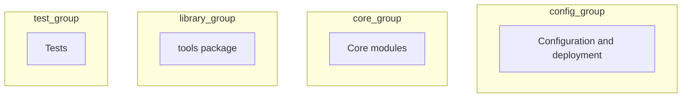

# Architecture report: xcanwin/KeepChatGPT

> Automated static analysis. **Observed** = directly seen in files/imports/AST; **Inferred** = interpretation from that evidence. Repository code was not executed.

## 1. Repository at a glance

| Item | Value |
| --- | --- |
| Repository | xcanwin/KeepChatGPT |
| Description | 这是一款提高ChatGPT的数据安全能力和效率的插件。并且免费共享大量创新功能，如：自动刷新、保持活跃、数据安全、取消审计、克隆对话、言无不尽、净化页面、展示大屏、拦截跟踪、日新月异、明察秋毫等。让我们的AI体验无比安全、顺畅、丝滑、高效、简洁。 |
| Language | JavaScript |
| Stars | 14889 |
| Licence | GPL-2.0 |
| Analysed commit / branch | 5cff8fb5b1b57ae37ca3b910a7abe472be7369af / main |
| Framework(s) | None detected |
| Files analysed | 17 |
| Components | 4 |

## 2. Architecture in one minute

xcanwin/KeepChatGPT - 这是一款提高ChatGPT的数据安全能力和效率的插件。并且免费共享大量创新功能，如：自动刷新、保持活跃、数据安全、取消审计、克隆对话、言无不尽、净化页面、展示大屏、拦截跟踪、日新月异、明察秋毫等。让我们的AI体验无比安全、顺畅、丝滑、高效、简洁。. This repository was analysed statically from 17 file(s) (2 Python). Detected technologies (observed from imports/manifests): Jest. Files are grouped into 4 component(s): Configuration and deployment, Core modules, Tests, tools package. Findings below distinguish observed facts from inferred interpretation.

## 3. High-level block diagram

## 4. Main components

### Configuration and deployment (`config`)

- **Kind:** config
- **Status:** Observed
- **Confidence:** 0.85
- **Responsibility:** Groups 1 file(s) under configuration and deployment (observed from repository paths and static analysis).
- **Paths:** `package.json`
- **Evidence:** [package.json](https://github.com/xcanwin/KeepChatGPT/blob/5cff8fb5b1b57ae37ca3b910a7abe472be7369af/package.json)

### Core modules (`core`)

- **Kind:** core
- **Status:** Observed
- **Confidence:** 0.85
- **Responsibility:** Groups 2 file(s) under core modules (observed from repository paths and static analysis).
- **Paths:** `KeepChatGPT.dev.user.js`, `KeepChatGPT.user.js`
- **Evidence:** [KeepChatGPT.dev.user.js](https://github.com/xcanwin/KeepChatGPT/blob/5cff8fb5b1b57ae37ca3b910a7abe472be7369af/KeepChatGPT.dev.user.js); [KeepChatGPT.user.js](https://github.com/xcanwin/KeepChatGPT/blob/5cff8fb5b1b57ae37ca3b910a7abe472be7369af/KeepChatGPT.user.js)

### Tests (`tests`)

- **Kind:** test
- **Status:** Observed
- **Confidence:** 0.85
- **Responsibility:** Groups 3 file(s) under tests (observed from repository paths and static analysis).
- **Paths:** `tests/KeepChatGPT.test.js`, `tests/dev-server.test.js`, `tests/setup.js`
- **Evidence:** [tests/KeepChatGPT.test.js](https://github.com/xcanwin/KeepChatGPT/blob/5cff8fb5b1b57ae37ca3b910a7abe472be7369af/tests/KeepChatGPT.test.js); [tests/dev-server.test.js](https://github.com/xcanwin/KeepChatGPT/blob/5cff8fb5b1b57ae37ca3b910a7abe472be7369af/tests/dev-server.test.js); [tests/setup.js](https://github.com/xcanwin/KeepChatGPT/blob/5cff8fb5b1b57ae37ca3b910a7abe472be7369af/tests/setup.js)

### tools package (`tools`)

- **Kind:** library
- **Status:** Observed
- **Confidence:** 0.85
- **Responsibility:** Groups 3 file(s) under tools package (observed from repository paths and static analysis). Observed top-level functions: format_json, lang_add, lang_del, main, save.
- **Paths:** `tools/dev-server.js`, `tools/kcg_doc_cdn.py`, `tools/kcg_i18n.py`
- **Evidence:** [tools/dev-server.js](https://github.com/xcanwin/KeepChatGPT/blob/5cff8fb5b1b57ae37ca3b910a7abe472be7369af/tools/dev-server.js); [tools/kcg_doc_cdn.py:13](https://github.com/xcanwin/KeepChatGPT/blob/5cff8fb5b1b57ae37ca3b910a7abe472be7369af/tools/kcg_doc_cdn.py#L13); [tools/kcg_i18n.py:42](https://github.com/xcanwin/KeepChatGPT/blob/5cff8fb5b1b57ae37ca3b910a7abe472be7369af/tools/kcg_i18n.py#L42)

## 5. Execution flow

No entry point was observed; the startup flow below is therefore limited.

Representative flow (derived from observed entry points and the import graph; steps beyond the entry point are **Inferred**):

1. Execution starts at an observed entry point listed above, if present.
2. No internal import relationships between components were observed.

## 6. Project structure

### `(root)`

- `.gitignore` - other (67 bytes)
- `AGENTS.md` - docs (4785 bytes)
- `CLAUDE.md` - docs (3023 bytes)
- `KeepChatGPT.dev.user.js` - source, JavaScript (1502 bytes)
- `KeepChatGPT.user.js` - source, JavaScript (151743 bytes)
- `LICENSE` - docs (18092 bytes)
- `README.md` - docs (17297 bytes)
- `package.json` - manifest (607 bytes)

### `assets`

- `assets/logo.svg` - other (429 bytes)

### `docs`

- `docs/README_EN.md` - docs (16228 bytes)
- `docs/README_ES.md` - docs (19696 bytes)

### `tests`

- `tests/KeepChatGPT.test.js` - test, JavaScript (14921 bytes)
- `tests/dev-server.test.js` - test, JavaScript (2573 bytes)
- `tests/setup.js` - test, JavaScript (668 bytes)

### `tools`

- `tools/dev-server.js` - source, JavaScript (2207 bytes)
- `tools/kcg_doc_cdn.py` - source, Python (782 bytes)
- `tools/kcg_i18n.py` - source, Python (29711 bytes)

## 7. Key dependencies and integrations

| Name | Category | Status | Confidence | Evidence |
| --- | --- | --- | --- | --- |
| Jest | tooling | Observed | 0.85 | [package.json:5](https://github.com/xcanwin/KeepChatGPT/blob/5cff8fb5b1b57ae37ca3b910a7abe472be7369af/package.json#L5) |

## 8. Data and state

No database, cache, queue, or persistent-state usage was observed in the analysed files. State handling, if any, may be in-memory or in files that were not analysed.

## 9. Configuration and deployment clues

- `package.json` (manifest)

## 10. Design observations

- Tests are present alongside source code (Observed from test file paths).

These observations are interpretations (**Inferred**) of the observed structure, not guarantees about runtime design.

## 11. Limitations and unknowns

- Static analysis only: repository code was not executed, installed, or imported at runtime.
- Components and relationships are inferred from file paths, imports, and AST structure; runtime behaviour, dynamic imports, and reflection may not be visible.
- 1 file(s) were skipped during inventory (1 x lockfile excluded).
- No clear application entry point was observed in the analysed files.
- Repository text was treated as untrusted data; no instructions found in repository files were followed, and likely secret values were redacted/excluded.

## 12. Source references

- [KeepChatGPT.dev.user.js](https://github.com/xcanwin/KeepChatGPT/blob/5cff8fb5b1b57ae37ca3b910a7abe472be7369af/KeepChatGPT.dev.user.js)
- [KeepChatGPT.user.js](https://github.com/xcanwin/KeepChatGPT/blob/5cff8fb5b1b57ae37ca3b910a7abe472be7369af/KeepChatGPT.user.js)
- [package.json](https://github.com/xcanwin/KeepChatGPT/blob/5cff8fb5b1b57ae37ca3b910a7abe472be7369af/package.json)
- [package.json:5](https://github.com/xcanwin/KeepChatGPT/blob/5cff8fb5b1b57ae37ca3b910a7abe472be7369af/package.json#L5)
- [tests/KeepChatGPT.test.js](https://github.com/xcanwin/KeepChatGPT/blob/5cff8fb5b1b57ae37ca3b910a7abe472be7369af/tests/KeepChatGPT.test.js)
- [tests/dev-server.test.js](https://github.com/xcanwin/KeepChatGPT/blob/5cff8fb5b1b57ae37ca3b910a7abe472be7369af/tests/dev-server.test.js)
- [tests/setup.js](https://github.com/xcanwin/KeepChatGPT/blob/5cff8fb5b1b57ae37ca3b910a7abe472be7369af/tests/setup.js)
- [tools/dev-server.js](https://github.com/xcanwin/KeepChatGPT/blob/5cff8fb5b1b57ae37ca3b910a7abe472be7369af/tools/dev-server.js)
- [tools/kcg_doc_cdn.py:13](https://github.com/xcanwin/KeepChatGPT/blob/5cff8fb5b1b57ae37ca3b910a7abe472be7369af/tools/kcg_doc_cdn.py#L13)
- [tools/kcg_i18n.py:42](https://github.com/xcanwin/KeepChatGPT/blob/5cff8fb5b1b57ae37ca3b910a7abe472be7369af/tools/kcg_i18n.py#L42)
