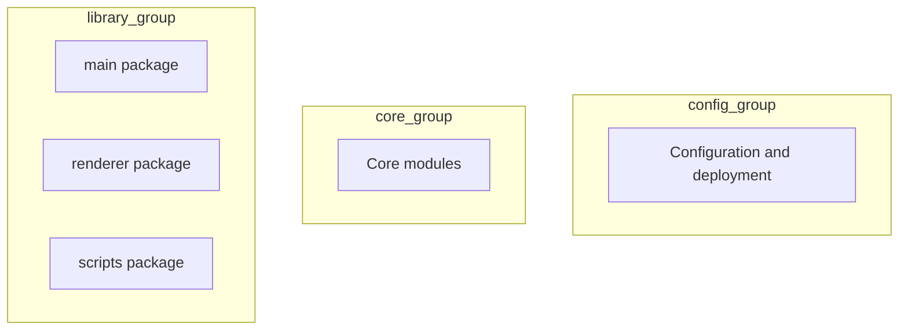

# Architecture report: xiandanin/magnetW

> Automated static analysis. **Observed** = directly seen in files/imports/AST; **Inferred** = interpretation from that evidence. Repository code was not executed.

## 1. Repository at a glance

| Item | Value |
| --- | --- |
| Repository | xiandanin/magnetW |
| Description | [已失效，不再维护] |
| Language | JavaScript |
| Stars | 11230 |
| Licence | GPL-3.0 |
| Analysed commit / branch | 012a86b799b3bff59f34319b5d0ac21fac7a7e20 / master |
| Framework(s) | Electron, Koa, Vue |
| Files analysed | 88 |
| Components | 5 |

## 2. Architecture in one minute

xiandanin/magnetW - [已失效，不再维护]. This repository was analysed statically from 88 file(s) (0 Python). Detected technologies (observed from imports/manifests): Electron, Koa, Vue, axios, webpack. Files are grouped into 5 component(s): Configuration and deployment, Core modules, main package, renderer package, scripts package. Findings below distinguish observed facts from inferred interpretation.

## 3. High-level block diagram

## 4. Main components

### Configuration and deployment (`config`)

- **Kind:** config
- **Status:** Observed
- **Confidence:** 0.85
- **Responsibility:** Groups 3 file(s) under configuration and deployment (observed from repository paths and static analysis).
- **Paths:** `appveyor.yml`, `package.json`, `rule.json`
- **Evidence:** [appveyor.yml](https://github.com/xiandanin/magnetW/blob/012a86b799b3bff59f34319b5d0ac21fac7a7e20/appveyor.yml); [package.json](https://github.com/xiandanin/magnetW/blob/012a86b799b3bff59f34319b5d0ac21fac7a7e20/package.json); [rule.json](https://github.com/xiandanin/magnetW/blob/012a86b799b3bff59f34319b5d0ac21fac7a7e20/rule.json)

### Core modules (`core`)

- **Kind:** core
- **Status:** Observed
- **Confidence:** 0.85
- **Responsibility:** Groups 1 file(s) under core modules (observed from repository paths and static analysis).
- **Paths:** `icns.sh`
- **Evidence:** [icns.sh](https://github.com/xiandanin/magnetW/blob/012a86b799b3bff59f34319b5d0ac21fac7a7e20/icns.sh)

### main package (`main`)

- **Kind:** library
- **Status:** Observed
- **Confidence:** 0.85
- **Responsibility:** Groups 18 file(s) under main package (observed from repository paths and static analysis).
- **Paths:** `src/main/api.js`, `src/main/axios.js`, `src/main/cache.js`, `src/main/defaultConfig.js`, `src/main/electron-cache.js`, `src/main/filter/filter.js`, `src/main/format-parser.js`, `src/main/index.dev.js`, `src/main/index.js`, `src/main/ipc.js`, `src/main/logger.js`, `src/main/memory-cache.js`, `src/main/menu.js`, `src/main/middleware/block.js`, `src/main/middleware/response-template.js`, `src/main/process-config.js`, `src/main/repository.js`, `src/main/service.js`
- **Evidence:** [src/main/api.js](https://github.com/xiandanin/magnetW/blob/012a86b799b3bff59f34319b5d0ac21fac7a7e20/src/main/api.js); [src/main/axios.js](https://github.com/xiandanin/magnetW/blob/012a86b799b3bff59f34319b5d0ac21fac7a7e20/src/main/axios.js); [src/main/cache.js](https://github.com/xiandanin/magnetW/blob/012a86b799b3bff59f34319b5d0ac21fac7a7e20/src/main/cache.js); [src/main/defaultConfig.js](https://github.com/xiandanin/magnetW/blob/012a86b799b3bff59f34319b5d0ac21fac7a7e20/src/main/defaultConfig.js); [src/main/electron-cache.js](https://github.com/xiandanin/magnetW/blob/012a86b799b3bff59f34319b5d0ac21fac7a7e20/src/main/electron-cache.js); [src/main/filter/filter.js](https://github.com/xiandanin/magnetW/blob/012a86b799b3bff59f34319b5d0ac21fac7a7e20/src/main/filter/filter.js); [src/main/format-parser.js](https://github.com/xiandanin/magnetW/blob/012a86b799b3bff59f34319b5d0ac21fac7a7e20/src/main/format-parser.js); [src/main/index.dev.js](https://github.com/xiandanin/magnetW/blob/012a86b799b3bff59f34319b5d0ac21fac7a7e20/src/main/index.dev.js)

### renderer package (`renderer`)

- **Kind:** library
- **Status:** Observed
- **Confidence:** 0.85
- **Responsibility:** Groups 41 file(s) under renderer package (observed from repository paths and static analysis).
- **Paths:** `src/renderer/App.vue`, `src/renderer/components/AsideMenu.vue`, `src/renderer/components/BrowserButton.vue`, `src/renderer/components/BrowserLink.vue`, `src/renderer/components/DetailDialog.vue`, `src/renderer/components/GithubBadge.vue`, `src/renderer/components/GuidePage.vue`, `src/renderer/components/HeaderVersion.vue`, `src/renderer/components/HighlightName.vue`, `src/renderer/components/ItemButtonGroup.vue`, `src/renderer/components/NumberInput.vue`, `src/renderer/components/PagerFooter.vue`, `src/renderer/components/PagerHeader.vue`, `src/renderer/components/PagerItems.vue`, `src/renderer/components/QrcodePopover.vue`, `src/renderer/components/Router.vue`, `src/renderer/components/SearchInput.vue`, `src/renderer/components/SearchPagination.vue`, `src/renderer/components/SearchSort.vue`, `src/renderer/components/ServerConfig.vue`, `src/renderer/components/SettingGroup.vue`, `src/renderer/components/SettingItem.vue`, `src/renderer/components/TooltipFormItem.vue`, `src/renderer/main.js`, `src/renderer/pages/Index.vue`, `src/renderer/pages/Main.vue`, `src/renderer/pages/Setting.vue`, `src/renderer/plugins/app.js`, `src/renderer/plugins/axios.js`, `src/renderer/plugins/clipboard.js`, `src/renderer/plugins/config.js`, `src/renderer/plugins/element-ui.js`, `src/renderer/plugins/event-proxy.js`, `src/renderer/plugins/filter.js`, `src/renderer/plugins/ga.js`, `src/renderer/plugins/head.js`, `src/renderer/plugins/index.js`, `src/renderer/plugins/localsetting.js`, `src/renderer/plugins/localstorage.js`, `src/renderer/plugins/menu.js`, `src/renderer/router/index.js`
- **Evidence:** [src/renderer/App.vue](https://github.com/xiandanin/magnetW/blob/012a86b799b3bff59f34319b5d0ac21fac7a7e20/src/renderer/App.vue); [src/renderer/components/AsideMenu.vue](https://github.com/xiandanin/magnetW/blob/012a86b799b3bff59f34319b5d0ac21fac7a7e20/src/renderer/components/AsideMenu.vue); [src/renderer/components/BrowserButton.vue](https://github.com/xiandanin/magnetW/blob/012a86b799b3bff59f34319b5d0ac21fac7a7e20/src/renderer/components/BrowserButton.vue); [src/renderer/components/BrowserLink.vue](https://github.com/xiandanin/magnetW/blob/012a86b799b3bff59f34319b5d0ac21fac7a7e20/src/renderer/components/BrowserLink.vue); [src/renderer/components/DetailDialog.vue](https://github.com/xiandanin/magnetW/blob/012a86b799b3bff59f34319b5d0ac21fac7a7e20/src/renderer/components/DetailDialog.vue); [src/renderer/components/GithubBadge.vue](https://github.com/xiandanin/magnetW/blob/012a86b799b3bff59f34319b5d0ac21fac7a7e20/src/renderer/components/GithubBadge.vue); [src/renderer/components/GuidePage.vue](https://github.com/xiandanin/magnetW/blob/012a86b799b3bff59f34319b5d0ac21fac7a7e20/src/renderer/components/GuidePage.vue); [src/renderer/components/HeaderVersion.vue](https://github.com/xiandanin/magnetW/blob/012a86b799b3bff59f34319b5d0ac21fac7a7e20/src/renderer/components/HeaderVersion.vue)

### scripts package (`scripts`)

- **Kind:** library
- **Status:** Observed
- **Confidence:** 0.85
- **Responsibility:** Groups 2 file(s) under scripts package (observed from repository paths and static analysis).
- **Paths:** `scripts/build-service.js`, `scripts/merge-filter-db.js`
- **Evidence:** [scripts/build-service.js](https://github.com/xiandanin/magnetW/blob/012a86b799b3bff59f34319b5d0ac21fac7a7e20/scripts/build-service.js); [scripts/merge-filter-db.js](https://github.com/xiandanin/magnetW/blob/012a86b799b3bff59f34319b5d0ac21fac7a7e20/scripts/merge-filter-db.js)

## 5. Execution flow

**Observed** entry point(s):

- [src/main/index.js](https://github.com/xiandanin/magnetW/blob/012a86b799b3bff59f34319b5d0ac21fac7a7e20/src/main/index.js)
- [src/renderer/main.js](https://github.com/xiandanin/magnetW/blob/012a86b799b3bff59f34319b5d0ac21fac7a7e20/src/renderer/main.js)
- [src/renderer/plugins/app.js](https://github.com/xiandanin/magnetW/blob/012a86b799b3bff59f34319b5d0ac21fac7a7e20/src/renderer/plugins/app.js)
- [src/renderer/plugins/index.js](https://github.com/xiandanin/magnetW/blob/012a86b799b3bff59f34319b5d0ac21fac7a7e20/src/renderer/plugins/index.js)
- [src/renderer/router/index.js](https://github.com/xiandanin/magnetW/blob/012a86b799b3bff59f34319b5d0ac21fac7a7e20/src/renderer/router/index.js)

Representative flow (derived from observed entry points and the import graph; steps beyond the entry point are **Inferred**):

1. Execution starts at an observed entry point listed above, if present.
2. No internal import relationships between components were observed.

## 6. Project structure

### `(root)`

- `.babelrc` - other (668 bytes)
- `.editorconfig` - config (147 bytes)
- `.eslintignore` - other (0 bytes)
- `.eslintrc.js` - source, JavaScript (1042 bytes)
- `.gitignore` - other (241 bytes)
- `.travis.yml` - ci, YAML (930 bytes)
- `LICENSE` - docs (35149 bytes)
- `README.md` - docs (2041 bytes)
- `appveyor.yml` - config (415 bytes)
- `icns.sh` - source, Shell (822 bytes)
- `package.json` - manifest (5118 bytes)
- `rule.json` - config (13149 bytes)

### `.electron-vue`

- `.electron-vue/build.js` - source, JavaScript (3058 bytes)
- `.electron-vue/dev-client.js` - source, JavaScript (1205 bytes)
- `.electron-vue/dev-runner.js` - source, JavaScript (4614 bytes)
- `.electron-vue/webpack.main.config.js` - source, JavaScript (1746 bytes)
- `.electron-vue/webpack.renderer.config.js` - source, JavaScript (5629 bytes)
- `.electron-vue/webpack.web.config.js` - source, JavaScript (3674 bytes)

### `.github`

- `.github/ISSUE_TEMPLATE/issue_template.md` - docs (249 bytes)

### `scripts`

- `scripts/build-service.js` - source, JavaScript (2343 bytes)
- `scripts/merge-filter-db.js` - source, JavaScript (1886 bytes)

### `src`

- `src/index.ejs` - other (1009 bytes)
- `src/main/api.js` - source, JavaScript (3112 bytes)
- `src/main/axios.js` - source, JavaScript (1645 bytes)
- `src/main/cache.js` - source, JavaScript (986 bytes)
- `src/main/defaultConfig.js` - source, JavaScript (1022 bytes)
- `src/main/electron-cache.js` - source, JavaScript (323 bytes)
- `src/main/filter/filter.js` - source, JavaScript (1697 bytes)
- `src/main/format-parser.js` - source, JavaScript (4730 bytes)
- `src/main/index.dev.js` - source, JavaScript (715 bytes)
- `src/main/index.js` - source, JavaScript (2915 bytes)
- `src/main/ipc.js` - source, JavaScript (4383 bytes)
- `src/main/logger.js` - source, JavaScript (2768 bytes)
- `src/main/memory-cache.js` - source, JavaScript (292 bytes)
- `src/main/menu.js` - source, JavaScript (2181 bytes)
- `src/main/middleware/block.js` - source, JavaScript (844 bytes)
- `src/main/middleware/response-template.js` - source, JavaScript (689 bytes)
- `src/main/process-config.js` - source, JavaScript (1352 bytes)
- `src/main/repository.js` - source, JavaScript (8308 bytes)
- `src/main/service.js` - source, JavaScript (861 bytes)
- `src/renderer/App.vue` - source, Vue (538 bytes)
- `src/renderer/assets/.gitkeep` - other (0 bytes)
- `src/renderer/assets/fonts/iconfont.css` - other (2438 bytes)
- `src/renderer/assets/fonts/iconfont.svg` - other (5205 bytes)
- `src/renderer/assets/scss/app.scss` - other (714 bytes)
- `src/renderer/assets/scss/element-variables.scss` - other (162 bytes)
- `src/renderer/components/AsideMenu.vue` - source, Vue (6629 bytes)
- `src/renderer/components/BrowserButton.vue` - source, Vue (524 bytes)
- `src/renderer/components/BrowserLink.vue` - source, Vue (1187 bytes)
- `src/renderer/components/DetailDialog.vue` - source, Vue (3983 bytes)
- `src/renderer/components/GithubBadge.vue` - source, Vue (213 bytes)
- `src/renderer/components/GuidePage.vue` - source, Vue (3312 bytes)
- `src/renderer/components/HeaderVersion.vue` - source, Vue (1450 bytes)
- `src/renderer/components/HighlightName.vue` - source, Vue (1074 bytes)
- `src/renderer/components/ItemButtonGroup.vue` - source, Vue (2904 bytes)
- `src/renderer/components/NumberInput.vue` - source, Vue (459 bytes)
- `src/renderer/components/PagerFooter.vue` - source, Vue (624 bytes)
- `src/renderer/components/PagerHeader.vue` - source, Vue (2595 bytes)
- `src/renderer/components/PagerItems.vue` - source, Vue (2832 bytes)
- `src/renderer/components/QrcodePopover.vue` - source, Vue (730 bytes)
- `src/renderer/components/Router.vue` - source, Vue (544 bytes)
- `src/renderer/components/SearchInput.vue` - source, Vue (965 bytes)
- `src/renderer/components/SearchPagination.vue` - source, Vue (667 bytes)
- `src/renderer/components/SearchSort.vue` - source, Vue (3648 bytes)
- `src/renderer/components/ServerConfig.vue` - source, Vue (8952 bytes)
- `src/renderer/components/SettingGroup.vue` - source, Vue (339 bytes)
- `src/renderer/components/SettingItem.vue` - source, Vue (616 bytes)
- `src/renderer/components/TooltipFormItem.vue` - source, Vue (525 bytes)
- `src/renderer/main.js` - source, JavaScript (463 bytes)
- `src/renderer/pages/Index.vue` - source, Vue (7404 bytes)
- `src/renderer/pages/Main.vue` - source, Vue (2883 bytes)
- `src/renderer/pages/Setting.vue` - source, Vue (2836 bytes)
- `src/renderer/plugins/app.js` - source, JavaScript (328 bytes)
- `src/renderer/plugins/axios.js` - source, JavaScript (1043 bytes)
- `src/renderer/plugins/clipboard.js` - source, JavaScript (87 bytes)
- `src/renderer/plugins/config.js` - source, JavaScript (552 bytes)
- `src/renderer/plugins/element-ui.js` - source, JavaScript (167 bytes)
- `src/renderer/plugins/event-proxy.js` - source, JavaScript (84 bytes)
- `src/renderer/plugins/filter.js` - source, JavaScript (2367 bytes)
- `src/renderer/plugins/ga.js` - source, JavaScript (0 bytes)
- `src/renderer/plugins/head.js` - source, JavaScript (93 bytes)
- `src/renderer/plugins/index.js` - source, JavaScript (211 bytes)
- `src/renderer/plugins/localsetting.js` - source, JavaScript (855 bytes)
- `src/renderer/plugins/localstorage.js` - source, JavaScript (95 bytes)
- `src/renderer/plugins/menu.js` - source, JavaScript (826 bytes)
- `src/renderer/router/index.js` - source, JavaScript (359 bytes)

### `static`

- `static/.gitkeep` - other (0 bytes)
- `static/robots.txt` - docs (26 bytes)

## 7. Key dependencies and integrations

| Name | Category | Status | Confidence | Evidence |
| --- | --- | --- | --- | --- |
| Electron | framework | Observed | 0.85 | [package.json:6](https://github.com/xiandanin/magnetW/blob/012a86b799b3bff59f34319b5d0ac21fac7a7e20/package.json#L6) |
| Koa | framework | Observed | 0.85 | [package.json:70](https://github.com/xiandanin/magnetW/blob/012a86b799b3bff59f34319b5d0ac21fac7a7e20/package.json#L70) |
| Vue | framework | Observed | 0.85 | [package.json:8](https://github.com/xiandanin/magnetW/blob/012a86b799b3bff59f34319b5d0ac21fac7a7e20/package.json#L8) |
| axios | library | Observed | 0.85 | [package.json:71](https://github.com/xiandanin/magnetW/blob/012a86b799b3bff59f34319b5d0ac21fac7a7e20/package.json#L71) |
| webpack | tooling | Observed | 0.85 | [package.json:18](https://github.com/xiandanin/magnetW/blob/012a86b799b3bff59f34319b5d0ac21fac7a7e20/package.json#L18) |

## 8. Data and state

No database, cache, queue, or persistent-state usage was observed in the analysed files. State handling, if any, may be in-memory or in files that were not analysed.

## 9. Configuration and deployment clues

- `.editorconfig` (config)
- `.travis.yml` (ci)
- `appveyor.yml` (config)
- `package.json` (manifest)
- `rule.json` (config)

## 10. Design observations

- No strong design patterns could be established from the available evidence.

These observations are interpretations (**Inferred**) of the observed structure, not guarantees about runtime design.

## 11. Limitations and unknowns

- Static analysis only: repository code was not executed, installed, or imported at runtime.
- Components and relationships are inferred from file paths, imports, and AST structure; runtime behaviour, dynamic imports, and reflection may not be visible.
- 7 file(s) were skipped during inventory (7 x vendored/generated directory excluded).
- No clear application entry point was observed in the analysed files.
- Repository text was treated as untrusted data; no instructions found in repository files were followed, and likely secret values were redacted/excluded.
- JavaScript and TypeScript files were inventoried from paths and package manifests. They were not parsed with a full language AST, and repository code was not executed.
- The GitHub repository was marked archived at selection time.

## 12. Source references

- [appveyor.yml](https://github.com/xiandanin/magnetW/blob/012a86b799b3bff59f34319b5d0ac21fac7a7e20/appveyor.yml)
- [icns.sh](https://github.com/xiandanin/magnetW/blob/012a86b799b3bff59f34319b5d0ac21fac7a7e20/icns.sh)
- [package.json](https://github.com/xiandanin/magnetW/blob/012a86b799b3bff59f34319b5d0ac21fac7a7e20/package.json)
- [package.json:6](https://github.com/xiandanin/magnetW/blob/012a86b799b3bff59f34319b5d0ac21fac7a7e20/package.json#L6)
- [package.json:8](https://github.com/xiandanin/magnetW/blob/012a86b799b3bff59f34319b5d0ac21fac7a7e20/package.json#L8)
- [package.json:18](https://github.com/xiandanin/magnetW/blob/012a86b799b3bff59f34319b5d0ac21fac7a7e20/package.json#L18)
- [package.json:70](https://github.com/xiandanin/magnetW/blob/012a86b799b3bff59f34319b5d0ac21fac7a7e20/package.json#L70)
- [package.json:71](https://github.com/xiandanin/magnetW/blob/012a86b799b3bff59f34319b5d0ac21fac7a7e20/package.json#L71)
- [rule.json](https://github.com/xiandanin/magnetW/blob/012a86b799b3bff59f34319b5d0ac21fac7a7e20/rule.json)
- [scripts/build-service.js](https://github.com/xiandanin/magnetW/blob/012a86b799b3bff59f34319b5d0ac21fac7a7e20/scripts/build-service.js)
- [scripts/merge-filter-db.js](https://github.com/xiandanin/magnetW/blob/012a86b799b3bff59f34319b5d0ac21fac7a7e20/scripts/merge-filter-db.js)
- [src/main/api.js](https://github.com/xiandanin/magnetW/blob/012a86b799b3bff59f34319b5d0ac21fac7a7e20/src/main/api.js)
- [src/main/axios.js](https://github.com/xiandanin/magnetW/blob/012a86b799b3bff59f34319b5d0ac21fac7a7e20/src/main/axios.js)
- [src/main/cache.js](https://github.com/xiandanin/magnetW/blob/012a86b799b3bff59f34319b5d0ac21fac7a7e20/src/main/cache.js)
- [src/main/defaultConfig.js](https://github.com/xiandanin/magnetW/blob/012a86b799b3bff59f34319b5d0ac21fac7a7e20/src/main/defaultConfig.js)
- [src/main/electron-cache.js](https://github.com/xiandanin/magnetW/blob/012a86b799b3bff59f34319b5d0ac21fac7a7e20/src/main/electron-cache.js)
- [src/main/filter/filter.js](https://github.com/xiandanin/magnetW/blob/012a86b799b3bff59f34319b5d0ac21fac7a7e20/src/main/filter/filter.js)
- [src/main/format-parser.js](https://github.com/xiandanin/magnetW/blob/012a86b799b3bff59f34319b5d0ac21fac7a7e20/src/main/format-parser.js)
- [src/main/index.dev.js](https://github.com/xiandanin/magnetW/blob/012a86b799b3bff59f34319b5d0ac21fac7a7e20/src/main/index.dev.js)
- [src/main/index.js](https://github.com/xiandanin/magnetW/blob/012a86b799b3bff59f34319b5d0ac21fac7a7e20/src/main/index.js)
- [src/renderer/App.vue](https://github.com/xiandanin/magnetW/blob/012a86b799b3bff59f34319b5d0ac21fac7a7e20/src/renderer/App.vue)
- [src/renderer/components/AsideMenu.vue](https://github.com/xiandanin/magnetW/blob/012a86b799b3bff59f34319b5d0ac21fac7a7e20/src/renderer/components/AsideMenu.vue)
- [src/renderer/components/BrowserButton.vue](https://github.com/xiandanin/magnetW/blob/012a86b799b3bff59f34319b5d0ac21fac7a7e20/src/renderer/components/BrowserButton.vue)
- [src/renderer/components/BrowserLink.vue](https://github.com/xiandanin/magnetW/blob/012a86b799b3bff59f34319b5d0ac21fac7a7e20/src/renderer/components/BrowserLink.vue)
- [src/renderer/components/DetailDialog.vue](https://github.com/xiandanin/magnetW/blob/012a86b799b3bff59f34319b5d0ac21fac7a7e20/src/renderer/components/DetailDialog.vue)
- [src/renderer/components/GithubBadge.vue](https://github.com/xiandanin/magnetW/blob/012a86b799b3bff59f34319b5d0ac21fac7a7e20/src/renderer/components/GithubBadge.vue)
- [src/renderer/components/GuidePage.vue](https://github.com/xiandanin/magnetW/blob/012a86b799b3bff59f34319b5d0ac21fac7a7e20/src/renderer/components/GuidePage.vue)
- [src/renderer/components/HeaderVersion.vue](https://github.com/xiandanin/magnetW/blob/012a86b799b3bff59f34319b5d0ac21fac7a7e20/src/renderer/components/HeaderVersion.vue)
- [src/renderer/main.js](https://github.com/xiandanin/magnetW/blob/012a86b799b3bff59f34319b5d0ac21fac7a7e20/src/renderer/main.js)
- [src/renderer/plugins/app.js](https://github.com/xiandanin/magnetW/blob/012a86b799b3bff59f34319b5d0ac21fac7a7e20/src/renderer/plugins/app.js)
- [src/renderer/plugins/index.js](https://github.com/xiandanin/magnetW/blob/012a86b799b3bff59f34319b5d0ac21fac7a7e20/src/renderer/plugins/index.js)
- [src/renderer/router/index.js](https://github.com/xiandanin/magnetW/blob/012a86b799b3bff59f34319b5d0ac21fac7a7e20/src/renderer/router/index.js)
