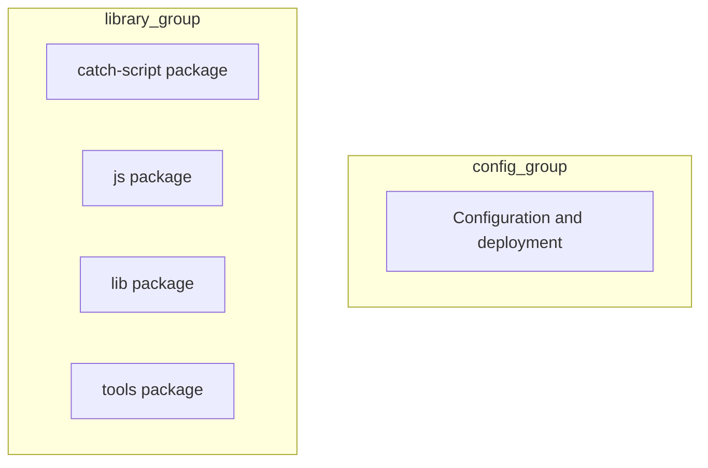

# Architecture report: xifangczy/cat-catch

> Automated static analysis. **Observed** = directly seen in files/imports/AST; **Inferred** = interpretation from that evidence. Repository code was not executed.

## 1. Repository at a glance

| Item | Value |
| --- | --- |
| Repository | xifangczy/cat-catch |
| Description | 猫抓 浏览器资源嗅探扩展 / cat-catch Browser Resource Sniffing Extension |
| Language | JavaScript |
| Stars | 22956 |
| Licence | GPL-3.0 |
| Analysed commit / branch | 019c465794b5871701383e4485c0e9ee7be2f840 / master |
| Framework(s) | None detected |
| Files analysed | 85 |
| Components | 5 |

## 2. Architecture in one minute

xifangczy/cat-catch - 猫抓 浏览器资源嗅探扩展 / cat-catch Browser Resource Sniffing Extension. This repository was analysed statically from 85 file(s) (0 Python). Detected technologies (observed from imports/manifests): no known frameworks/libraries. Files are grouped into 5 component(s): catch-script package, Configuration and deployment, js package, lib package, tools package. Findings below distinguish observed facts from inferred interpretation.

## 3. High-level block diagram

## 4. Main components

### catch-script package (`catch_script`)

- **Kind:** library
- **Status:** Observed
- **Confidence:** 0.85
- **Responsibility:** Groups 6 file(s) under catch-script package (observed from repository paths and static analysis).
- **Paths:** `catch-script/catch.js`, `catch-script/i18n.js`, `catch-script/recorder.js`, `catch-script/recorder2.js`, `catch-script/search.js`, `catch-script/webrtc.js`
- **Evidence:** [catch-script/catch.js](https://github.com/xifangczy/cat-catch/blob/019c465794b5871701383e4485c0e9ee7be2f840/catch-script/catch.js); [catch-script/i18n.js](https://github.com/xifangczy/cat-catch/blob/019c465794b5871701383e4485c0e9ee7be2f840/catch-script/i18n.js); [catch-script/recorder.js](https://github.com/xifangczy/cat-catch/blob/019c465794b5871701383e4485c0e9ee7be2f840/catch-script/recorder.js); [catch-script/recorder2.js](https://github.com/xifangczy/cat-catch/blob/019c465794b5871701383e4485c0e9ee7be2f840/catch-script/recorder2.js); [catch-script/search.js](https://github.com/xifangczy/cat-catch/blob/019c465794b5871701383e4485c0e9ee7be2f840/catch-script/search.js); [catch-script/webrtc.js](https://github.com/xifangczy/cat-catch/blob/019c465794b5871701383e4485c0e9ee7be2f840/catch-script/webrtc.js)

### Configuration and deployment (`config`)

- **Kind:** config
- **Status:** Observed
- **Confidence:** 0.85
- **Responsibility:** Groups 13 file(s) under configuration and deployment (observed from repository paths and static analysis).
- **Paths:** `_locales/en/messages.json`, `_locales/es/messages.json`, `_locales/fr/messages.json`, `_locales/ja/messages.json`, `_locales/ko/messages.json`, `_locales/pt_BR/messages.json`, `_locales/ru/messages.json`, `_locales/tr/messages.json`, `_locales/vi/messages.json`, `_locales/zh_CN/messages.json`, `_locales/zh_TW/messages.json`, `manifest.firefox.json`, `manifest.json`
- **Evidence:** [_locales/en/messages.json](https://github.com/xifangczy/cat-catch/blob/019c465794b5871701383e4485c0e9ee7be2f840/_locales/en/messages.json); [_locales/es/messages.json](https://github.com/xifangczy/cat-catch/blob/019c465794b5871701383e4485c0e9ee7be2f840/_locales/es/messages.json); [_locales/fr/messages.json](https://github.com/xifangczy/cat-catch/blob/019c465794b5871701383e4485c0e9ee7be2f840/_locales/fr/messages.json); [_locales/ja/messages.json](https://github.com/xifangczy/cat-catch/blob/019c465794b5871701383e4485c0e9ee7be2f840/_locales/ja/messages.json); [_locales/ko/messages.json](https://github.com/xifangczy/cat-catch/blob/019c465794b5871701383e4485c0e9ee7be2f840/_locales/ko/messages.json); [_locales/pt_BR/messages.json](https://github.com/xifangczy/cat-catch/blob/019c465794b5871701383e4485c0e9ee7be2f840/_locales/pt_BR/messages.json); [_locales/ru/messages.json](https://github.com/xifangczy/cat-catch/blob/019c465794b5871701383e4485c0e9ee7be2f840/_locales/ru/messages.json); [_locales/tr/messages.json](https://github.com/xifangczy/cat-catch/blob/019c465794b5871701383e4485c0e9ee7be2f840/_locales/tr/messages.json)

### js package (`js`)

- **Kind:** library
- **Status:** Observed
- **Confidence:** 0.85
- **Responsibility:** Groups 18 file(s) under js package (observed from repository paths and static analysis).
- **Paths:** `js/background.js`, `js/content-script.js`, `js/downloader.js`, `js/function.js`, `js/i18n.js`, `js/init.js`, `js/install.js`, `js/json.js`, `js/m3u8.downloader.js`, `js/m3u8.js`, `js/media-control.js`, `js/mpd.js`, `js/options.js`, `js/polyfill.js`, `js/popup-utils.js`, `js/popup.js`, `js/preview.js`, `js/templates.js`
- **Evidence:** [js/background.js](https://github.com/xifangczy/cat-catch/blob/019c465794b5871701383e4485c0e9ee7be2f840/js/background.js); [js/content-script.js](https://github.com/xifangczy/cat-catch/blob/019c465794b5871701383e4485c0e9ee7be2f840/js/content-script.js); [js/downloader.js](https://github.com/xifangczy/cat-catch/blob/019c465794b5871701383e4485c0e9ee7be2f840/js/downloader.js); [js/function.js](https://github.com/xifangczy/cat-catch/blob/019c465794b5871701383e4485c0e9ee7be2f840/js/function.js); [js/i18n.js](https://github.com/xifangczy/cat-catch/blob/019c465794b5871701383e4485c0e9ee7be2f840/js/i18n.js); [js/init.js](https://github.com/xifangczy/cat-catch/blob/019c465794b5871701383e4485c0e9ee7be2f840/js/init.js); [js/install.js](https://github.com/xifangczy/cat-catch/blob/019c465794b5871701383e4485c0e9ee7be2f840/js/install.js); [js/json.js](https://github.com/xifangczy/cat-catch/blob/019c465794b5871701383e4485c0e9ee7be2f840/js/json.js)

### lib package (`lib`)

- **Kind:** library
- **Status:** Observed
- **Confidence:** 0.85
- **Responsibility:** Groups 4 file(s) under lib package (observed from repository paths and static analysis).
- **Paths:** `lib/StreamSaver.js`, `lib/base64.js`, `lib/jquery.json-viewer.js`, `lib/m3u8-decrypt.js`
- **Evidence:** [lib/StreamSaver.js](https://github.com/xifangczy/cat-catch/blob/019c465794b5871701383e4485c0e9ee7be2f840/lib/StreamSaver.js); [lib/base64.js](https://github.com/xifangczy/cat-catch/blob/019c465794b5871701383e4485c0e9ee7be2f840/lib/base64.js); [lib/jquery.json-viewer.js](https://github.com/xifangczy/cat-catch/blob/019c465794b5871701383e4485c0e9ee7be2f840/lib/jquery.json-viewer.js); [lib/m3u8-decrypt.js](https://github.com/xifangczy/cat-catch/blob/019c465794b5871701383e4485c0e9ee7be2f840/lib/m3u8-decrypt.js)

### tools package (`tools`)

- **Kind:** library
- **Status:** Observed
- **Confidence:** 0.85
- **Responsibility:** Groups 1 file(s) under tools package (observed from repository paths and static analysis).
- **Paths:** `tools/sync-locales.js`
- **Evidence:** [tools/sync-locales.js](https://github.com/xifangczy/cat-catch/blob/019c465794b5871701383e4485c0e9ee7be2f840/tools/sync-locales.js)

## 5. Execution flow

No entry point was observed; the startup flow below is therefore limited.

Representative flow (derived from observed entry points and the import graph; steps beyond the entry point are **Inferred**):

1. Execution starts at an observed entry point listed above, if present.
2. No internal import relationships between components were observed.

## 6. Project structure

### `(root)`

- `.gitignore` - other (65 bytes)
- `CHANGELOG.md` - docs (20521 bytes)
- `LICENSE` - docs (35149 bytes)
- `README.md` - docs (3696 bytes)
- `README_en.md` - docs (4227 bytes)
- `README_es.md` - docs (4772 bytes)
- `README_ru.md` - docs (6022 bytes)
- `downloader.html` - other (2232 bytes)
- `install.html` - other (5679 bytes)
- `json.html` - other (1500 bytes)
- `justfile` - other (4615 bytes)
- `m3u8.html` - other (12734 bytes)
- `manifest.firefox.json` - config (1995 bytes)
- `manifest.json` - config (1790 bytes)
- `mpd.html` - other (2517 bytes)
- `options.html` - other (41958 bytes)
- `popup.html` - other (8289 bytes)
- `preview.html` - other (5407 bytes)

### `.github`

- `.github/FUNDING.yml` - config (81 bytes)
- `.github/ISSUE_TEMPLATE/bug.yaml` - config (1704 bytes)
- `.github/ISSUE_TEMPLATE/功能-添加-修改-增强-请求.md` - docs (183 bytes)

### `_locales`

- `_locales/en/messages.json` - config (22820 bytes)
- `_locales/es/messages.json` - config (24228 bytes)
- `_locales/fr/messages.json` - config (25592 bytes)
- `_locales/ja/messages.json` - config (24742 bytes)
- `_locales/ko/messages.json` - config (24976 bytes)
- `_locales/pt_BR/messages.json` - config (24608 bytes)
- `_locales/ru/messages.json` - config (31874 bytes)
- `_locales/tr/messages.json` - config (24409 bytes)
- `_locales/vi/messages.json` - config (25665 bytes)
- `_locales/zh_CN/messages.json` - config (21925 bytes)
- `_locales/zh_TW/messages.json` - config (21926 bytes)

### `catch-script`

- `catch-script/catch.js` - source, JavaScript (42282 bytes)
- `catch-script/i18n.js` - source, JavaScript (12217 bytes)
- `catch-script/recorder.js` - source, JavaScript (16626 bytes)
- `catch-script/recorder2.js` - source, JavaScript (8977 bytes)
- `catch-script/search.js` - source, JavaScript (35152 bytes)
- `catch-script/webrtc.js` - source, JavaScript (13418 bytes)

### `css`

- `css/install.css` - other (7323 bytes)
- `css/mobile.css` - other (173 bytes)
- `css/options.css` - other (13507 bytes)
- `css/popup.css` - other (4375 bytes)
- `css/preview.css` - other (3772 bytes)
- `css/public.css` - other (4902 bytes)

### `img`

- `img/delete-dark.svg` - other (302 bytes)
- `img/delete.svg` - other (305 bytes)
- `img/download-dark.svg` - other (287 bytes)
- `img/download.svg` - other (290 bytes)
- `img/invoke-dark.svg` - other (511 bytes)
- `img/invoke.svg` - other (514 bytes)
- `img/mqtt-dark.svg` - other (673 bytes)
- `img/mqtt.svg` - other (673 bytes)
- `img/music.svg` - other (674 bytes)
- `img/retry-dark.svg` - other (367 bytes)
- `img/retry.svg` - other (370 bytes)
- `img/send-dark.svg` - other (170 bytes)
- `img/send.svg` - other (173 bytes)
- `img/send2ffmpeg-dark.svg` - other (346 bytes)
- `img/send2ffmpeg.svg` - other (349 bytes)
- `img/stop-dark.svg` - other (492 bytes)
- `img/stop.svg` - other (495 bytes)

### `js`

- `js/background.js` - source, JavaScript (41035 bytes)
- `js/content-script.js` - source, JavaScript (12551 bytes)
- `js/downloader.js` - source, JavaScript (17769 bytes)
- `js/function.js` - source, JavaScript (19778 bytes)
- `js/i18n.js` - source, JavaScript (783 bytes)
- `js/init.js` - source, JavaScript (19419 bytes)
- `js/install.js` - source, JavaScript (3038 bytes)
- `js/json.js` - source, JavaScript (2657 bytes)
- `js/m3u8.downloader.js` - source, JavaScript (13400 bytes)
- `js/m3u8.js` - source, JavaScript (89487 bytes)
- `js/media-control.js` - source, JavaScript (11255 bytes)
- `js/mpd.js` - source, JavaScript (7254 bytes)
- `js/options.js` - source, JavaScript (19188 bytes)
- `js/polyfill.js` - source, JavaScript (2168 bytes)
- `js/popup-utils.js` - source, JavaScript (8116 bytes)
- `js/popup.js` - source, JavaScript (44626 bytes)
- `js/preview.js` - source, JavaScript (47258 bytes)
- `js/templates.js` - source, JavaScript (13090 bytes)

### `lib`

- `lib/StreamSaver.js` - source, JavaScript (10303 bytes)
- `lib/base64.js` - source, JavaScript (1217 bytes)
- `lib/jquery.json-viewer.js` - source, JavaScript (5834 bytes)
- `lib/m3u8-decrypt.js` - source, JavaScript (9507 bytes)
- `lib/third-party-libraries.md` - docs (1869 bytes)

### `tools`

- `tools/sync-locales.js` - source, JavaScript (2566 bytes)

## 7. Key dependencies and integrations

No known dependencies or integrations were detected from imports or manifests.

## 8. Data and state

No database, cache, queue, or persistent-state usage was observed in the analysed files. State handling, if any, may be in-memory or in files that were not analysed.

## 9. Configuration and deployment clues

- `.github/FUNDING.yml` (config)
- `.github/ISSUE_TEMPLATE/bug.yaml` (config)
- `_locales/en/messages.json` (config)
- `_locales/es/messages.json` (config)
- `_locales/fr/messages.json` (config)
- `_locales/ja/messages.json` (config)
- `_locales/ko/messages.json` (config)
- `_locales/pt_BR/messages.json` (config)
- `_locales/ru/messages.json` (config)
- `_locales/tr/messages.json` (config)
- `_locales/vi/messages.json` (config)
- `_locales/zh_CN/messages.json` (config)
- `_locales/zh_TW/messages.json` (config)
- `manifest.firefox.json` (config)
- `manifest.json` (config)

## 10. Design observations

- No strong design patterns could be established from the available evidence.

These observations are interpretations (**Inferred**) of the observed structure, not guarantees about runtime design.

## 11. Limitations and unknowns

- Static analysis only: repository code was not executed, installed, or imported at runtime.
- Components and relationships are inferred from file paths, imports, and AST structure; runtime behaviour, dynamic imports, and reflection may not be visible.
- No clear application entry point was observed in the analysed files.
- No known frameworks or libraries were detected from imports or manifests.
- Repository text was treated as untrusted data; no instructions found in repository files were followed, and likely secret values were redacted/excluded.
- JavaScript and TypeScript files were inventoried from paths and package manifests. They were not parsed with a full language AST, and repository code was not executed.

## 12. Source references

- [_locales/en/messages.json](https://github.com/xifangczy/cat-catch/blob/019c465794b5871701383e4485c0e9ee7be2f840/_locales/en/messages.json)
- [_locales/es/messages.json](https://github.com/xifangczy/cat-catch/blob/019c465794b5871701383e4485c0e9ee7be2f840/_locales/es/messages.json)
- [_locales/fr/messages.json](https://github.com/xifangczy/cat-catch/blob/019c465794b5871701383e4485c0e9ee7be2f840/_locales/fr/messages.json)
- [_locales/ja/messages.json](https://github.com/xifangczy/cat-catch/blob/019c465794b5871701383e4485c0e9ee7be2f840/_locales/ja/messages.json)
- [_locales/ko/messages.json](https://github.com/xifangczy/cat-catch/blob/019c465794b5871701383e4485c0e9ee7be2f840/_locales/ko/messages.json)
- [_locales/pt_BR/messages.json](https://github.com/xifangczy/cat-catch/blob/019c465794b5871701383e4485c0e9ee7be2f840/_locales/pt_BR/messages.json)
- [_locales/ru/messages.json](https://github.com/xifangczy/cat-catch/blob/019c465794b5871701383e4485c0e9ee7be2f840/_locales/ru/messages.json)
- [_locales/tr/messages.json](https://github.com/xifangczy/cat-catch/blob/019c465794b5871701383e4485c0e9ee7be2f840/_locales/tr/messages.json)
- [catch-script/catch.js](https://github.com/xifangczy/cat-catch/blob/019c465794b5871701383e4485c0e9ee7be2f840/catch-script/catch.js)
- [catch-script/i18n.js](https://github.com/xifangczy/cat-catch/blob/019c465794b5871701383e4485c0e9ee7be2f840/catch-script/i18n.js)
- [catch-script/recorder.js](https://github.com/xifangczy/cat-catch/blob/019c465794b5871701383e4485c0e9ee7be2f840/catch-script/recorder.js)
- [catch-script/recorder2.js](https://github.com/xifangczy/cat-catch/blob/019c465794b5871701383e4485c0e9ee7be2f840/catch-script/recorder2.js)
- [catch-script/search.js](https://github.com/xifangczy/cat-catch/blob/019c465794b5871701383e4485c0e9ee7be2f840/catch-script/search.js)
- [catch-script/webrtc.js](https://github.com/xifangczy/cat-catch/blob/019c465794b5871701383e4485c0e9ee7be2f840/catch-script/webrtc.js)
- [js/background.js](https://github.com/xifangczy/cat-catch/blob/019c465794b5871701383e4485c0e9ee7be2f840/js/background.js)
- [js/content-script.js](https://github.com/xifangczy/cat-catch/blob/019c465794b5871701383e4485c0e9ee7be2f840/js/content-script.js)
- [js/downloader.js](https://github.com/xifangczy/cat-catch/blob/019c465794b5871701383e4485c0e9ee7be2f840/js/downloader.js)
- [js/function.js](https://github.com/xifangczy/cat-catch/blob/019c465794b5871701383e4485c0e9ee7be2f840/js/function.js)
- [js/i18n.js](https://github.com/xifangczy/cat-catch/blob/019c465794b5871701383e4485c0e9ee7be2f840/js/i18n.js)
- [js/init.js](https://github.com/xifangczy/cat-catch/blob/019c465794b5871701383e4485c0e9ee7be2f840/js/init.js)
- [js/install.js](https://github.com/xifangczy/cat-catch/blob/019c465794b5871701383e4485c0e9ee7be2f840/js/install.js)
- [js/json.js](https://github.com/xifangczy/cat-catch/blob/019c465794b5871701383e4485c0e9ee7be2f840/js/json.js)
- [lib/StreamSaver.js](https://github.com/xifangczy/cat-catch/blob/019c465794b5871701383e4485c0e9ee7be2f840/lib/StreamSaver.js)
- [lib/base64.js](https://github.com/xifangczy/cat-catch/blob/019c465794b5871701383e4485c0e9ee7be2f840/lib/base64.js)
- [lib/jquery.json-viewer.js](https://github.com/xifangczy/cat-catch/blob/019c465794b5871701383e4485c0e9ee7be2f840/lib/jquery.json-viewer.js)
- [lib/m3u8-decrypt.js](https://github.com/xifangczy/cat-catch/blob/019c465794b5871701383e4485c0e9ee7be2f840/lib/m3u8-decrypt.js)
- [tools/sync-locales.js](https://github.com/xifangczy/cat-catch/blob/019c465794b5871701383e4485c0e9ee7be2f840/tools/sync-locales.js)
