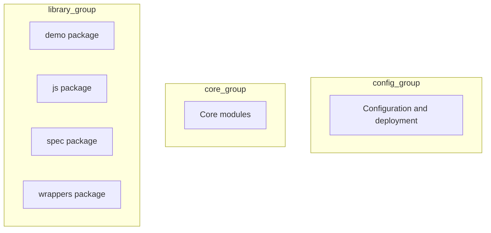

# Architecture report: yabwe/medium-editor

> Automated static analysis. **Observed** = directly seen in files/imports/AST; **Inferred** = interpretation from that evidence. Repository code was not executed.

## 1. Repository at a glance

| Item | Value |
| --- | --- |
| Repository | yabwe/medium-editor |
| Description | Medium.com WYSIWYG editor clone. Uses contenteditable API to implement a rich text solution. |
| Language | JavaScript |
| Stars | 16098 |
| Licence | Other |
| Analysed commit / branch | d113a74437fda6f1cbd5f146b0f2c46288b118ea / master |
| Framework(s) | None detected |
| Files analysed | 115 |
| Components | 6 |

## 2. Architecture in one minute

yabwe/medium-editor - Medium.com WYSIWYG editor clone. Uses contenteditable API to implement a rich text solution.. This repository was analysed statically from 115 file(s) (0 Python). Detected technologies (observed from imports/manifests): no known frameworks/libraries. Files are grouped into 6 component(s): Configuration and deployment, Core modules, demo package, js package, spec package, wrappers package. Findings below distinguish observed facts from inferred interpretation.

## 3. High-level block diagram

## 4. Main components

### Configuration and deployment (`config`)

- **Kind:** config
- **Status:** Observed
- **Confidence:** 0.85
- **Responsibility:** Groups 2 file(s) under configuration and deployment (observed from repository paths and static analysis).
- **Paths:** `bower.json`, `package.json`
- **Evidence:** [bower.json](https://github.com/yabwe/medium-editor/blob/d113a74437fda6f1cbd5f146b0f2c46288b118ea/bower.json); [package.json](https://github.com/yabwe/medium-editor/blob/d113a74437fda6f1cbd5f146b0f2c46288b118ea/package.json)

### Core modules (`core`)

- **Kind:** core
- **Status:** Observed
- **Confidence:** 0.85
- **Responsibility:** Groups 4 file(s) under core modules (observed from repository paths and static analysis).
- **Paths:** `Gruntfile.js`, `index.js`, `karma.conf.js`, `karma.dev.conf.js`
- **Evidence:** [Gruntfile.js](https://github.com/yabwe/medium-editor/blob/d113a74437fda6f1cbd5f146b0f2c46288b118ea/Gruntfile.js); [index.js](https://github.com/yabwe/medium-editor/blob/d113a74437fda6f1cbd5f146b0f2c46288b118ea/index.js); [karma.conf.js](https://github.com/yabwe/medium-editor/blob/d113a74437fda6f1cbd5f146b0f2c46288b118ea/karma.conf.js); [karma.dev.conf.js](https://github.com/yabwe/medium-editor/blob/d113a74437fda6f1cbd5f146b0f2c46288b118ea/karma.dev.conf.js)

### demo package (`demo`)

- **Kind:** library
- **Status:** Observed
- **Confidence:** 0.85
- **Responsibility:** Groups 1 file(s) under demo package (observed from repository paths and static analysis).
- **Paths:** `demo/js/extension-table.js`
- **Evidence:** [demo/js/extension-table.js](https://github.com/yabwe/medium-editor/blob/d113a74437fda6f1cbd5f146b0f2c46288b118ea/demo/js/extension-table.js)

### js package (`js`)

- **Kind:** library
- **Status:** Observed
- **Confidence:** 0.85
- **Responsibility:** Groups 23 file(s) under js package (observed from repository paths and static analysis).
- **Paths:** `src/js/core.js`, `src/js/defaults/buttons.js`, `src/js/defaults/options.js`, `src/js/events.js`, `src/js/extension.js`, `src/js/extensions/anchor-preview.js`, `src/js/extensions/anchor.js`, `src/js/extensions/auto-link.js`, `src/js/extensions/button.js`, `src/js/extensions/deprecated/image-dragging.js`, `src/js/extensions/file-dragging.js`, `src/js/extensions/fontname.js`, `src/js/extensions/fontsize.js`, `src/js/extensions/form.js`, `src/js/extensions/keyboard-commands.js`, `src/js/extensions/paste.js`, `src/js/extensions/placeholder.js`, `src/js/extensions/toolbar.js`, `src/js/globals.js`, `src/js/polyfills.js`, `src/js/selection.js`, `src/js/util.js`, `src/js/version.js`
- **Evidence:** [src/js/core.js](https://github.com/yabwe/medium-editor/blob/d113a74437fda6f1cbd5f146b0f2c46288b118ea/src/js/core.js); [src/js/defaults/buttons.js](https://github.com/yabwe/medium-editor/blob/d113a74437fda6f1cbd5f146b0f2c46288b118ea/src/js/defaults/buttons.js); [src/js/defaults/options.js](https://github.com/yabwe/medium-editor/blob/d113a74437fda6f1cbd5f146b0f2c46288b118ea/src/js/defaults/options.js); [src/js/events.js](https://github.com/yabwe/medium-editor/blob/d113a74437fda6f1cbd5f146b0f2c46288b118ea/src/js/events.js); [src/js/extension.js](https://github.com/yabwe/medium-editor/blob/d113a74437fda6f1cbd5f146b0f2c46288b118ea/src/js/extension.js); [src/js/extensions/anchor-preview.js](https://github.com/yabwe/medium-editor/blob/d113a74437fda6f1cbd5f146b0f2c46288b118ea/src/js/extensions/anchor-preview.js); [src/js/extensions/anchor.js](https://github.com/yabwe/medium-editor/blob/d113a74437fda6f1cbd5f146b0f2c46288b118ea/src/js/extensions/anchor.js); [src/js/extensions/auto-link.js](https://github.com/yabwe/medium-editor/blob/d113a74437fda6f1cbd5f146b0f2c46288b118ea/src/js/extensions/auto-link.js)

### spec package (`spec`)

- **Kind:** library
- **Status:** Observed
- **Confidence:** 0.85
- **Responsibility:** Groups 29 file(s) under spec package (observed from repository paths and static analysis).
- **Paths:** `spec/anchor-preview.spec.js`, `spec/anchor.spec.js`, `spec/auto-link.spec.js`, `spec/buttons.spec.js`, `spec/content.spec.js`, `spec/core-api.spec.js`, `spec/delay.spec.js`, `spec/drag-and-drop.spec.js`, `spec/dyn-elements.spec.js`, `spec/elements.spec.js`, `spec/events.spec.js`, `spec/exploits.spec.js`, `spec/extension.spec.js`, `spec/fontname.spec.js`, `spec/fontsize.spec.js`, `spec/full-content.spec.js`, `spec/header-tags.spec.js`, `spec/helpers/util.js`, `spec/init.spec.js`, `spec/keyboard-commands.spec.js`, `spec/paste.spec.js`, `spec/placeholder.spec.js`, `spec/selection.spec.js`, `spec/serialize.spec.js`, `spec/setup.spec.js`, `spec/textarea.spec.js`, `spec/toolbar.spec.js`, `spec/util.spec.js`, `spec/version.spec.js`
- **Evidence:** [spec/anchor-preview.spec.js](https://github.com/yabwe/medium-editor/blob/d113a74437fda6f1cbd5f146b0f2c46288b118ea/spec/anchor-preview.spec.js); [spec/anchor.spec.js](https://github.com/yabwe/medium-editor/blob/d113a74437fda6f1cbd5f146b0f2c46288b118ea/spec/anchor.spec.js); [spec/auto-link.spec.js](https://github.com/yabwe/medium-editor/blob/d113a74437fda6f1cbd5f146b0f2c46288b118ea/spec/auto-link.spec.js); [spec/buttons.spec.js](https://github.com/yabwe/medium-editor/blob/d113a74437fda6f1cbd5f146b0f2c46288b118ea/spec/buttons.spec.js); [spec/content.spec.js](https://github.com/yabwe/medium-editor/blob/d113a74437fda6f1cbd5f146b0f2c46288b118ea/spec/content.spec.js); [spec/core-api.spec.js](https://github.com/yabwe/medium-editor/blob/d113a74437fda6f1cbd5f146b0f2c46288b118ea/spec/core-api.spec.js); [spec/delay.spec.js](https://github.com/yabwe/medium-editor/blob/d113a74437fda6f1cbd5f146b0f2c46288b118ea/spec/delay.spec.js); [spec/drag-and-drop.spec.js](https://github.com/yabwe/medium-editor/blob/d113a74437fda6f1cbd5f146b0f2c46288b118ea/spec/drag-and-drop.spec.js)

### wrappers package (`wrappers`)

- **Kind:** library
- **Status:** Observed
- **Confidence:** 0.85
- **Responsibility:** Groups 2 file(s) under wrappers package (observed from repository paths and static analysis).
- **Paths:** `src/wrappers/end.js`, `src/wrappers/start.js`
- **Evidence:** [src/wrappers/end.js](https://github.com/yabwe/medium-editor/blob/d113a74437fda6f1cbd5f146b0f2c46288b118ea/src/wrappers/end.js); [src/wrappers/start.js](https://github.com/yabwe/medium-editor/blob/d113a74437fda6f1cbd5f146b0f2c46288b118ea/src/wrappers/start.js)

## 5. Execution flow

**Observed** entry point(s):

- [index.js](https://github.com/yabwe/medium-editor/blob/d113a74437fda6f1cbd5f146b0f2c46288b118ea/index.js)

Representative flow (derived from observed entry points and the import graph; steps beyond the entry point are **Inferred**):

1. Execution starts at an observed entry point listed above, if present.
2. No internal import relationships between components were observed.

## 6. Project structure

### `(root)`

- `.editorconfig` - config (202 bytes)
- `.gitignore` - other (180 bytes)
- `.jscsrc` - other (2684 bytes)
- `.jshintrc` - other (418 bytes)
- `.travis.yml` - ci, YAML (572 bytes)
- `API.md` - docs (19247 bytes)
- `CHANGES.md` - docs (31054 bytes)
- `CODE_OF_CONDUCT.md` - docs (1423 bytes)
- `CONTRIBUTING.md` - docs (2458 bytes)
- `CUSTOM-EVENTS.md` - docs (11178 bytes)
- `Gruntfile.js` - source, JavaScript (7069 bytes)
- `LICENSE` - docs (1580 bytes)
- `MAINTAINERS.md` - docs (2551 bytes)
- `OPTIONS.md` - docs (20704 bytes)
- `README.md` - docs (36736 bytes)
- `UPGRADE-5.md` - docs (8881 bytes)
- `bower.json` - config (903 bytes)
- `index.js` - source, JavaScript (129 bytes)
- `karma.conf.js` - source, JavaScript (4359 bytes)
- `karma.dev.conf.js` - source, JavaScript (1993 bytes)
- `package.json` - manifest (2501 bytes)

### `.github`

- `.github/ISSUE_TEMPLATE.md` - docs (592 bytes)
- `.github/PULL_REQUEST_TEMPLATE.md` - docs (411 bytes)

### `demo`

- `demo/absolute-container.html` - other (4633 bytes)
- `demo/auto-link.html` - other (4494 bytes)
- `demo/button-example.html` - other (3043 bytes)
- `demo/clean-paste.html` - other (3627 bytes)
- `demo/css/demo.css` - other (1773 bytes)
- `demo/custom-toolbar.html` - other (4094 bytes)
- `demo/extension-example.html` - other (2827 bytes)
- `demo/index.html` - other (5412 bytes)
- `demo/js/extension-table.js` - source, JavaScript (4462 bytes)
- `demo/multi-editor.html` - other (1879 bytes)
- `demo/multi-one-instance.html` - other (6984 bytes)
- `demo/multi-paragraph.html` - other (4063 bytes)
- `demo/nested-editable.html` - other (3684 bytes)
- `demo/pass-instance.html` - other (4343 bytes)
- `demo/relative-toolbar.html` - other (2162 bytes)
- `demo/static-toolbar.html` - other (6861 bytes)
- `demo/table-extension.html` - other (1439 bytes)
- `demo/textarea.html` - other (1059 bytes)

### `spec`

- `spec/anchor-preview.spec.js` - source, JavaScript (20271 bytes)
- `spec/anchor.spec.js` - source, JavaScript (47200 bytes)
- `spec/auto-link.spec.js` - source, JavaScript (25232 bytes)
- `spec/buttons.spec.js` - source, JavaScript (54723 bytes)
- `spec/content.spec.js` - source, JavaScript (39259 bytes)
- `spec/core-api.spec.js` - source, JavaScript (16280 bytes)
- `spec/delay.spec.js` - source, JavaScript (991 bytes)
- `spec/drag-and-drop.spec.js` - source, JavaScript (4875 bytes)
- `spec/dyn-elements.spec.js` - source, JavaScript (12902 bytes)
- `spec/elements.spec.js` - source, JavaScript (4613 bytes)
- `spec/events.spec.js` - source, JavaScript (20853 bytes)
- `spec/exploits.spec.js` - source, JavaScript (3284 bytes)
- `spec/extension.spec.js` - source, JavaScript (16250 bytes)
- `spec/fontname.spec.js` - source, JavaScript (7285 bytes)
- `spec/fontsize.spec.js` - source, JavaScript (7389 bytes)
- `spec/full-content.spec.js` - source, JavaScript (3394 bytes)
- `spec/header-tags.spec.js` - source, JavaScript (3044 bytes)
- `spec/helpers/util.js` - source, JavaScript (58597 bytes)
- `spec/init.spec.js` - source, JavaScript (8344 bytes)
- `spec/keyboard-commands.spec.js` - source, JavaScript (10237 bytes)
- `spec/paste.spec.js` - source, JavaScript (55885 bytes)
- `spec/placeholder.spec.js` - source, JavaScript (11554 bytes)
- `spec/selection.spec.js` - source, JavaScript (28959 bytes)
- `spec/serialize.spec.js` - source, JavaScript (1038 bytes)
- `spec/setup.spec.js` - source, JavaScript (4457 bytes)
- `spec/textarea.spec.js` - source, JavaScript (13503 bytes)
- `spec/toolbar.spec.js` - source, JavaScript (35022 bytes)
- `spec/util.spec.js` - source, JavaScript (32432 bytes)
- `spec/version.spec.js` - source, JavaScript (1723 bytes)

### `src`

- `src/js/core.js` - source, JavaScript (57308 bytes)
- `src/js/defaults/buttons.js` - source, JavaScript (8538 bytes)
- `src/js/defaults/options.js` - source, JavaScript (566 bytes)
- `src/js/events.js` - source, JavaScript (24731 bytes)
- `src/js/extension.js` - source, JavaScript (10192 bytes)
- `src/js/extensions/README.md` - docs (30299 bytes)
- `src/js/extensions/WALKTHROUGH-BUTTON.md` - docs (13304 bytes)
- `src/js/extensions/WALKTHROUGH-EXTENSION.md` - docs (5980 bytes)
- `src/js/extensions/anchor-preview.js` - source, JavaScript (12486 bytes)
- `src/js/extensions/anchor.js` - source, JavaScript (14118 bytes)
- `src/js/extensions/auto-link.js` - source, JavaScript (12255 bytes)
- `src/js/extensions/button.js` - source, JavaScript (8651 bytes)
- `src/js/extensions/deprecated/image-dragging.js` - source, JavaScript (2314 bytes)
- `src/js/extensions/file-dragging.js` - source, JavaScript (3362 bytes)
- `src/js/extensions/fontname.js` - source, JavaScript (5975 bytes)
- `src/js/extensions/fontsize.js` - source, JavaScript (5775 bytes)
- `src/js/extensions/form.js` - source, JavaScript (4008 bytes)
- `src/js/extensions/keyboard-commands.js` - source, JavaScript (3082 bytes)
- `src/js/extensions/paste.js` - source, JavaScript (22437 bytes)
- `src/js/extensions/placeholder.js` - source, JavaScript (4675 bytes)
- `src/js/extensions/toolbar.js` - source, JavaScript (28183 bytes)
- `src/js/globals.js` - source, JavaScript (185 bytes)
- `src/js/polyfills.js` - source, JavaScript (11321 bytes)
- `src/js/selection.js` - source, JavaScript (29664 bytes)
- `src/js/util.js` - source, JavaScript (47176 bytes)
- `src/js/version.js` - source, JavaScript (657 bytes)
- `src/sass/_settings.scss` - other (215 bytes)
- `src/sass/animations/_image-loading.scss` - other (132 bytes)
- `src/sass/animations/_pop-upwards.scss` - other (355 bytes)
- `src/sass/components/_anchor-preview.scss` - other (474 bytes)
- `src/sass/components/_file-dragging.scss` - other (267 bytes)
- `src/sass/components/_placeholder.scss` - other (565 bytes)
- `src/sass/components/_toolbar-form.scss` - other (823 bytes)
- `src/sass/components/_toolbar.scss` - other (1839 bytes)
- `src/sass/medium-editor.scss` - other (571 bytes)
- `src/sass/themes/beagle.scss` - other (3547 bytes)
- `src/sass/themes/bootstrap.scss` - other (3219 bytes)
- `src/sass/themes/default.scss` - other (2548 bytes)
- `src/sass/themes/flat.scss` - other (2602 bytes)
- `src/sass/themes/mani.scss` - other (2818 bytes)
- `src/sass/themes/roman.scss` - other (2718 bytes)
- `src/sass/themes/tim.scss` - other (3286 bytes)
- `src/sass/util/_clearfix.scss` - other (100 bytes)
- `src/wrappers/end.js` - source, JavaScript (32 bytes)
- `src/wrappers/start.js` - source, JavaScript (503 bytes)

## 7. Key dependencies and integrations

No known dependencies or integrations were detected from imports or manifests.

## 8. Data and state

No database, cache, queue, or persistent-state usage was observed in the analysed files. State handling, if any, may be in-memory or in files that were not analysed.

## 9. Configuration and deployment clues

- `.editorconfig` (config)
- `.travis.yml` (ci)
- `bower.json` (config)
- `package.json` (manifest)

## 10. Design observations

- No strong design patterns could be established from the available evidence.

These observations are interpretations (**Inferred**) of the observed structure, not guarantees about runtime design.

## 11. Limitations and unknowns

- Static analysis only: repository code was not executed, installed, or imported at runtime.
- Components and relationships are inferred from file paths, imports, and AST structure; runtime behaviour, dynamic imports, and reflection may not be visible.
- 19 file(s) were skipped during inventory (1 x likely secret file excluded; 18 x vendored/generated directory excluded).
- No clear application entry point was observed in the analysed files.
- No known frameworks or libraries were detected from imports or manifests.
- Repository text was treated as untrusted data; no instructions found in repository files were followed, and likely secret values were redacted/excluded.
- JavaScript and TypeScript files were inventoried from paths and package manifests. They were not parsed with a full language AST, and repository code was not executed.

## 12. Source references

- [Gruntfile.js](https://github.com/yabwe/medium-editor/blob/d113a74437fda6f1cbd5f146b0f2c46288b118ea/Gruntfile.js)
- [bower.json](https://github.com/yabwe/medium-editor/blob/d113a74437fda6f1cbd5f146b0f2c46288b118ea/bower.json)
- [demo/js/extension-table.js](https://github.com/yabwe/medium-editor/blob/d113a74437fda6f1cbd5f146b0f2c46288b118ea/demo/js/extension-table.js)
- [index.js](https://github.com/yabwe/medium-editor/blob/d113a74437fda6f1cbd5f146b0f2c46288b118ea/index.js)
- [karma.conf.js](https://github.com/yabwe/medium-editor/blob/d113a74437fda6f1cbd5f146b0f2c46288b118ea/karma.conf.js)
- [karma.dev.conf.js](https://github.com/yabwe/medium-editor/blob/d113a74437fda6f1cbd5f146b0f2c46288b118ea/karma.dev.conf.js)
- [package.json](https://github.com/yabwe/medium-editor/blob/d113a74437fda6f1cbd5f146b0f2c46288b118ea/package.json)
- [spec/anchor-preview.spec.js](https://github.com/yabwe/medium-editor/blob/d113a74437fda6f1cbd5f146b0f2c46288b118ea/spec/anchor-preview.spec.js)
- [spec/anchor.spec.js](https://github.com/yabwe/medium-editor/blob/d113a74437fda6f1cbd5f146b0f2c46288b118ea/spec/anchor.spec.js)
- [spec/auto-link.spec.js](https://github.com/yabwe/medium-editor/blob/d113a74437fda6f1cbd5f146b0f2c46288b118ea/spec/auto-link.spec.js)
- [spec/buttons.spec.js](https://github.com/yabwe/medium-editor/blob/d113a74437fda6f1cbd5f146b0f2c46288b118ea/spec/buttons.spec.js)
- [spec/content.spec.js](https://github.com/yabwe/medium-editor/blob/d113a74437fda6f1cbd5f146b0f2c46288b118ea/spec/content.spec.js)
- [spec/core-api.spec.js](https://github.com/yabwe/medium-editor/blob/d113a74437fda6f1cbd5f146b0f2c46288b118ea/spec/core-api.spec.js)
- [spec/delay.spec.js](https://github.com/yabwe/medium-editor/blob/d113a74437fda6f1cbd5f146b0f2c46288b118ea/spec/delay.spec.js)
- [spec/drag-and-drop.spec.js](https://github.com/yabwe/medium-editor/blob/d113a74437fda6f1cbd5f146b0f2c46288b118ea/spec/drag-and-drop.spec.js)
- [src/js/core.js](https://github.com/yabwe/medium-editor/blob/d113a74437fda6f1cbd5f146b0f2c46288b118ea/src/js/core.js)
- [src/js/defaults/buttons.js](https://github.com/yabwe/medium-editor/blob/d113a74437fda6f1cbd5f146b0f2c46288b118ea/src/js/defaults/buttons.js)
- [src/js/defaults/options.js](https://github.com/yabwe/medium-editor/blob/d113a74437fda6f1cbd5f146b0f2c46288b118ea/src/js/defaults/options.js)
- [src/js/events.js](https://github.com/yabwe/medium-editor/blob/d113a74437fda6f1cbd5f146b0f2c46288b118ea/src/js/events.js)
- [src/js/extension.js](https://github.com/yabwe/medium-editor/blob/d113a74437fda6f1cbd5f146b0f2c46288b118ea/src/js/extension.js)
- [src/js/extensions/anchor-preview.js](https://github.com/yabwe/medium-editor/blob/d113a74437fda6f1cbd5f146b0f2c46288b118ea/src/js/extensions/anchor-preview.js)
- [src/js/extensions/anchor.js](https://github.com/yabwe/medium-editor/blob/d113a74437fda6f1cbd5f146b0f2c46288b118ea/src/js/extensions/anchor.js)
- [src/js/extensions/auto-link.js](https://github.com/yabwe/medium-editor/blob/d113a74437fda6f1cbd5f146b0f2c46288b118ea/src/js/extensions/auto-link.js)
- [src/wrappers/end.js](https://github.com/yabwe/medium-editor/blob/d113a74437fda6f1cbd5f146b0f2c46288b118ea/src/wrappers/end.js)
- [src/wrappers/start.js](https://github.com/yabwe/medium-editor/blob/d113a74437fda6f1cbd5f146b0f2c46288b118ea/src/wrappers/start.js)
