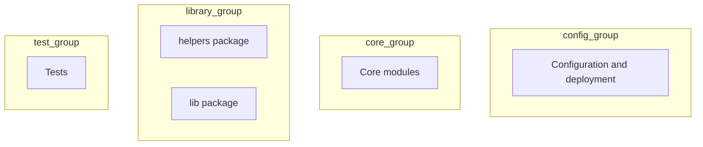

# Architecture report: yargs/yargs

> Automated static analysis. **Observed** = directly seen in files/imports/AST; **Inferred** = interpretation from that evidence. Repository code was not executed.

## 1. Repository at a glance

| Item | Value |
| --- | --- |
| Repository | yargs/yargs |
| Description |  yargs the modern, pirate-themed successor to optimist. |
| Language | JavaScript |
| Stars | 11508 |
| Licence | MIT |
| Analysed commit / branch | f444858808bc11e9910fc5ed0d0322dc40d5638e / main |
| Framework(s) | None detected |
| Files analysed | 173 |
| Components | 5 |

## 2. Architecture in one minute

yargs/yargs -  yargs the modern, pirate-themed successor to optimist.. This repository was analysed statically from 173 file(s) (0 Python). Detected technologies (observed from imports/manifests): GitHub Actions, TypeScript. Files are grouped into 5 component(s): Configuration and deployment, Core modules, helpers package, lib package, Tests. Findings below distinguish observed facts from inferred interpretation.

## 3. High-level block diagram

## 4. Main components

### Configuration and deployment (`config`)

- **Kind:** config
- **Status:** Observed
- **Confidence:** 0.85
- **Responsibility:** Groups 34 file(s) under configuration and deployment (observed from repository paths and static analysis).
- **Paths:** `helpers/package.json`, `locales/be.json`, `locales/cs.json`, `locales/de.json`, `locales/en.json`, `locales/es.json`, `locales/fi.json`, `locales/fr.json`, `locales/he.json`, `locales/hi.json`, `locales/hu.json`, `locales/id.json`, `locales/it.json`, `locales/ja.json`, `locales/ka.json`, `locales/ko.json`, `locales/nb.json`, `locales/nl.json`, `locales/nn.json`, `locales/pirate.json`, `locales/pl.json`, `locales/pt.json`, `locales/pt_BR.json`, `locales/ru.json`, `locales/th.json`, `locales/tr.json`, `locales/uk_UA.json`, `locales/uz.json`, `locales/zh_CN.json`, `locales/zh_TW.json`, `package.json`, `renovate.json`, `tsconfig.json`, `tsconfig.test.json`
- **Evidence:** [helpers/package.json](https://github.com/yargs/yargs/blob/f444858808bc11e9910fc5ed0d0322dc40d5638e/helpers/package.json); [locales/be.json](https://github.com/yargs/yargs/blob/f444858808bc11e9910fc5ed0d0322dc40d5638e/locales/be.json); [locales/cs.json](https://github.com/yargs/yargs/blob/f444858808bc11e9910fc5ed0d0322dc40d5638e/locales/cs.json); [locales/de.json](https://github.com/yargs/yargs/blob/f444858808bc11e9910fc5ed0d0322dc40d5638e/locales/de.json); [locales/en.json](https://github.com/yargs/yargs/blob/f444858808bc11e9910fc5ed0d0322dc40d5638e/locales/en.json); [locales/es.json](https://github.com/yargs/yargs/blob/f444858808bc11e9910fc5ed0d0322dc40d5638e/locales/es.json); [locales/fi.json](https://github.com/yargs/yargs/blob/f444858808bc11e9910fc5ed0d0322dc40d5638e/locales/fi.json); [locales/fr.json](https://github.com/yargs/yargs/blob/f444858808bc11e9910fc5ed0d0322dc40d5638e/locales/fr.json)

### Core modules (`core`)

- **Kind:** core
- **Status:** Observed
- **Confidence:** 0.85
- **Responsibility:** Groups 5 file(s) under core modules (observed from repository paths and static analysis).
- **Paths:** `browser.d.ts`, `browser.mjs`, `deno-types.ts`, `deno.ts`, `index.mjs`
- **Evidence:** [browser.d.ts](https://github.com/yargs/yargs/blob/f444858808bc11e9910fc5ed0d0322dc40d5638e/browser.d.ts); [browser.mjs](https://github.com/yargs/yargs/blob/f444858808bc11e9910fc5ed0d0322dc40d5638e/browser.mjs); [deno-types.ts](https://github.com/yargs/yargs/blob/f444858808bc11e9910fc5ed0d0322dc40d5638e/deno-types.ts); [deno.ts](https://github.com/yargs/yargs/blob/f444858808bc11e9910fc5ed0d0322dc40d5638e/deno.ts); [index.mjs](https://github.com/yargs/yargs/blob/f444858808bc11e9910fc5ed0d0322dc40d5638e/index.mjs)

### helpers package (`helpers`)

- **Kind:** library
- **Status:** Observed
- **Confidence:** 0.85
- **Responsibility:** Groups 1 file(s) under helpers package (observed from repository paths and static analysis).
- **Paths:** `helpers/helpers.mjs`
- **Evidence:** [helpers/helpers.mjs](https://github.com/yargs/yargs/blob/f444858808bc11e9910fc5ed0d0322dc40d5638e/helpers/helpers.mjs)

### lib package (`lib`)

- **Kind:** library
- **Status:** Observed
- **Confidence:** 0.85
- **Responsibility:** Groups 23 file(s) under lib package (observed from repository paths and static analysis).
- **Paths:** `lib/argsert.ts`, `lib/command.ts`, `lib/completion-templates.ts`, `lib/completion.ts`, `lib/middleware.ts`, `lib/parse-command.ts`, `lib/platform-shims/browser.mjs`, `lib/platform-shims/deno.ts`, `lib/platform-shims/esm.mjs`, `lib/typings/common-types.ts`, `lib/typings/yargs-parser-types.ts`, `lib/usage.ts`, `lib/utils/apply-extends.ts`, `lib/utils/is-promise.ts`, `lib/utils/levenshtein.ts`, `lib/utils/maybe-async-result.ts`, `lib/utils/obj-filter.ts`, `lib/utils/process-argv.ts`, `lib/utils/set-blocking.ts`, `lib/utils/which-module.ts`, `lib/validation.ts`, `lib/yargs-factory.ts`, `lib/yerror.ts`
- **Evidence:** [lib/argsert.ts](https://github.com/yargs/yargs/blob/f444858808bc11e9910fc5ed0d0322dc40d5638e/lib/argsert.ts); [lib/command.ts](https://github.com/yargs/yargs/blob/f444858808bc11e9910fc5ed0d0322dc40d5638e/lib/command.ts); [lib/completion-templates.ts](https://github.com/yargs/yargs/blob/f444858808bc11e9910fc5ed0d0322dc40d5638e/lib/completion-templates.ts); [lib/completion.ts](https://github.com/yargs/yargs/blob/f444858808bc11e9910fc5ed0d0322dc40d5638e/lib/completion.ts); [lib/middleware.ts](https://github.com/yargs/yargs/blob/f444858808bc11e9910fc5ed0d0322dc40d5638e/lib/middleware.ts); [lib/parse-command.ts](https://github.com/yargs/yargs/blob/f444858808bc11e9910fc5ed0d0322dc40d5638e/lib/parse-command.ts); [lib/platform-shims/browser.mjs](https://github.com/yargs/yargs/blob/f444858808bc11e9910fc5ed0d0322dc40d5638e/lib/platform-shims/browser.mjs); [lib/platform-shims/deno.ts](https://github.com/yargs/yargs/blob/f444858808bc11e9910fc5ed0d0322dc40d5638e/lib/platform-shims/deno.ts)

### Tests (`tests`)

- **Kind:** test
- **Status:** Observed
- **Confidence:** 0.85
- **Responsibility:** Groups 59 file(s) under tests (observed from repository paths and static analysis).
- **Paths:** `test/argsert.mjs`, `test/before.mjs`, `test/command.mjs`, `test/completion.mjs`, `test/deno/platform-shim.test.ts`, `test/deno/yargs.test.ts`, `test/esm/fixtures/commands/a.mjs`, `test/esm/fixtures/commands/b.mjs`, `test/esm/fixtures/commands/index.mjs`, `test/esm/fixtures/commands/subcommands/c.mjs`, `test/esm/fixtures/commands/subcommands/d.mjs`, `test/esm/fixtures/commands/subcommands/index.mjs`, `test/esm/helpers.mjs`, `test/esm/platform-shim-test.mjs`, `test/esm/yargs-test.mjs`, `test/fixtures/bin.js`, `test/fixtures/broken-json/package.json`, `test/fixtures/cmddir/deep/deeper/deeper_still/limbo.js`, `test/fixtures/cmddir/deep/deeper/inception.js`, `test/fixtures/cmddir/deep/of-memory.json`, `test/fixtures/cmddir/deep/within-a-dream.js`, `test/fixtures/cmddir/dream.js`, `test/fixtures/cmddir_cyclic/cyclic.js`, `test/fixtures/cmddir_noname/nameless.js`, `test/fixtures/command-module.js`, `test/fixtures/command.js`, `test/fixtures/config.json`, `test/fixtures/esm-command/init.mjs`, `test/fixtures/esm-command/remote.mjs`, `test/fixtures/esm-command/remote_cmds/add.mjs`, `test/fixtures/esm-command/remote_cmds/prune.mjs`, `test/fixtures/extends/.myotherrc`, `test/fixtures/extends/.myrc`, `test/fixtures/extends/circular_1.json`, `test/fixtures/extends/circular_2.json`, `test/fixtures/extends/config_1.json`, `test/fixtures/extends/config_2.json`, `test/fixtures/extends/config_deep.json`, `test/fixtures/extends/config_deep_2.json`, `test/fixtures/extends/packageA/package.json`, `test/fixtures/extends/packageB/index.json`, `test/fixtures/issue-497.js`, `test/fixtures/no-extension`, `test/fixtures/no-require-main.js`, `test/fixtures/normal-bin.js`, `test/fixtures/opt-assignment-and-positional-command-arg.js`, `test/fixtures/package.json`, `test/fixtures/symlink-bin.js`, `test/helpers.mjs`, `test/helpers/utils.mjs`, `test/integration.mjs`, `test/is-promise.mjs`, `test/middleware.mjs`, `test/obj-filter.mjs`, `test/parse-command.mjs`, `test/parser.mjs`, `test/usage.mjs`, `test/validation.mjs`, `test/yargs.mjs`
- **Evidence:** [test/argsert.mjs](https://github.com/yargs/yargs/blob/f444858808bc11e9910fc5ed0d0322dc40d5638e/test/argsert.mjs); [test/before.mjs](https://github.com/yargs/yargs/blob/f444858808bc11e9910fc5ed0d0322dc40d5638e/test/before.mjs); [test/command.mjs](https://github.com/yargs/yargs/blob/f444858808bc11e9910fc5ed0d0322dc40d5638e/test/command.mjs); [test/completion.mjs](https://github.com/yargs/yargs/blob/f444858808bc11e9910fc5ed0d0322dc40d5638e/test/completion.mjs); [test/deno/platform-shim.test.ts](https://github.com/yargs/yargs/blob/f444858808bc11e9910fc5ed0d0322dc40d5638e/test/deno/platform-shim.test.ts); [test/deno/yargs.test.ts](https://github.com/yargs/yargs/blob/f444858808bc11e9910fc5ed0d0322dc40d5638e/test/deno/yargs.test.ts); [test/esm/fixtures/commands/a.mjs](https://github.com/yargs/yargs/blob/f444858808bc11e9910fc5ed0d0322dc40d5638e/test/esm/fixtures/commands/a.mjs); [test/esm/fixtures/commands/b.mjs](https://github.com/yargs/yargs/blob/f444858808bc11e9910fc5ed0d0322dc40d5638e/test/esm/fixtures/commands/b.mjs)

## 5. Execution flow

**Observed** entry point(s):

- [index.mjs](https://github.com/yargs/yargs/blob/f444858808bc11e9910fc5ed0d0322dc40d5638e/index.mjs)

Representative flow (derived from observed entry points and the import graph; steps beyond the entry point are **Inferred**):

1. Execution starts at an observed entry point listed above, if present.
2. No internal import relationships between components were observed.

## 6. Project structure

### `(root)`

- `.eslintignore` - other (84 bytes)
- `.eslintrc.json` - config (633 bytes)
- `.gitattributes` - other (20 bytes)
- `.gitignore` - other (119 bytes)
- `.nycrc` - other (192 bytes)
- `.prettierrc.cjs` - source, JavaScript (58 bytes)
- `AI_POLICY.md` - docs (678 bytes)
- `CHANGELOG.md` - docs (132359 bytes)
- `CODE_OF_CONDUCT.md` - docs (3197 bytes)
- `LICENSE` - docs (1146 bytes)
- `README.md` - docs (5197 bytes)
- `SECURITY.md` - docs (303 bytes)
- `browser.d.ts` - source, TypeScript (134 bytes)
- `browser.mjs` - source, JavaScript (232 bytes)
- `contributing.md` - docs (1801 bytes)
- `deno-types.ts` - source, TypeScript (331 bytes)
- `deno.ts` - source, TypeScript (228 bytes)
- `index.mjs` - source, JavaScript (268 bytes)
- `package.json` - manifest (2705 bytes)
- `renovate.json` - config (112 bytes)
- `tsconfig.json` - config (433 bytes)
- `tsconfig.test.json` - config (173 bytes)

### `.github`

- `.github/FUNDING.yml` - config (71 bytes)
- `.github/workflows/ci.yaml` - ci, YAML (2261 bytes)
- `.github/workflows/release-please.yml` - ci, YAML (1198 bytes)

### `docs`

- `docs/advanced.md` - docs (20078 bytes)
- `docs/api.md` - docs (55901 bytes)
- `docs/browser.md` - docs (775 bytes)
- `docs/examples.md` - docs (7494 bytes)
- `docs/release-policy.md` - docs (1064 bytes)
- `docs/tricks.md` - docs (2717 bytes)
- `docs/typescript.md` - docs (3664 bytes)

### `example`

- `example/bool.cjs` - source, JavaScript (231 bytes)
- `example/boolean_double.cjs` - source, JavaScript (179 bytes)
- `example/boolean_single.cjs` - source, JavaScript (166 bytes)
- `example/cmds/init.mjs` - source, JavaScript (237 bytes)
- `example/cmds/remote.mjs` - source, JavaScript (228 bytes)
- `example/cmds/remote_cmds/add.mjs` - source, JavaScript (253 bytes)
- `example/cmds/remote_cmds/prune.mjs` - source, JavaScript (295 bytes)
- `example/command_hierarchy.mjs` - source, JavaScript (128 bytes)
- `example/complex.mjs` - source, JavaScript (1415 bytes)
- `example/count.mjs` - source, JavaScript (544 bytes)
- `example/default_hash.mjs` - source, JavaScript (153 bytes)
- `example/default_singles.mjs` - source, JavaScript (172 bytes)
- `example/demand_count.mjs` - source, JavaScript (128 bytes)
- `example/divide.mjs` - source, JavaScript (195 bytes)
- `example/help.mjs` - source, JavaScript (674 bytes)
- `example/implies.mjs` - source, JavaScript (212 bytes)
- `example/implies_hash.mjs` - source, JavaScript (425 bytes)
- `example/line_count.mjs` - source, JavaScript (439 bytes)
- `example/line_count_options.mjs` - source, JavaScript (608 bytes)
- `example/line_count_wrap.mjs` - source, JavaScript (772 bytes)
- `example/nested.mjs` - source, JavaScript (1444 bytes)
- `example/nonopt.mjs` - source, JavaScript (160 bytes)
- `example/requires_arg.mjs` - source, JavaScript (451 bytes)
- `example/short.mjs` - source, JavaScript (139 bytes)
- `example/string.mjs` - source, JavaScript (248 bytes)
- `example/usage-options.mjs` - source, JavaScript (520 bytes)
- `example/xup.mjs` - source, JavaScript (230 bytes)
- `example/yargs.html` - other (1633 bytes)

### `helpers`

- `helpers/helpers.mjs` - source, JavaScript (384 bytes)
- `helpers/package.json` - manifest (25 bytes)

### `lib`

- `lib/argsert.ts` - source, TypeScript (2910 bytes)
- `lib/command.ts` - source, TypeScript (27194 bytes)
- `lib/completion-templates.ts` - source, TypeScript (2172 bytes)
- `lib/completion.ts` - source, TypeScript (13564 bytes)
- `lib/middleware.ts` - source, TypeScript (3886 bytes)
- `lib/parse-command.ts` - source, TypeScript (1240 bytes)
- `lib/platform-shims/browser.mjs` - source, JavaScript (2375 bytes)
- `lib/platform-shims/deno.ts` - source, TypeScript (3041 bytes)
- `lib/platform-shims/esm.mjs` - source, JavaScript (1829 bytes)
- `lib/typings/common-types.ts` - source, TypeScript (3680 bytes)
- `lib/typings/yargs-parser-types.ts` - source, TypeScript (7699 bytes)
- `lib/usage.ts` - source, TypeScript (24998 bytes)
- `lib/utils/apply-extends.ts` - source, TypeScript (2293 bytes)
- `lib/utils/is-promise.ts` - source, TypeScript (236 bytes)
- `lib/utils/levenshtein.ts` - source, TypeScript (2487 bytes)
- `lib/utils/maybe-async-result.ts` - source, TypeScript (1011 bytes)
- `lib/utils/obj-filter.ts` - source, TypeScript (350 bytes)
- `lib/utils/process-argv.ts` - source, TypeScript (1277 bytes)
- `lib/utils/set-blocking.ts` - source, TypeScript (541 bytes)
- `lib/utils/which-module.ts` - source, TypeScript (310 bytes)
- `lib/validation.ts` - source, TypeScript (15261 bytes)
- `lib/yargs-factory.ts` - source, TypeScript (74718 bytes)
- `lib/yerror.ts` - source, TypeScript (217 bytes)

### `locales`

- `locales/be.json` - config (2602 bytes)
- `locales/cs.json` - config (2024 bytes)
- `locales/de.json` - config (1804 bytes)
- `locales/en.json` - config (2019 bytes)
- `locales/es.json` - config (1885 bytes)
- `locales/fi.json` - config (2113 bytes)
- `locales/fr.json` - config (2117 bytes)
- `locales/he.json` - config (2487 bytes)
- `locales/hi.json` - config (3074 bytes)
- `locales/hu.json` - config (1883 bytes)
- `locales/id.json` - config (1821 bytes)
- `locales/it.json` - config (1855 bytes)
- `locales/ja.json` - config (2411 bytes)
- `locales/ka.json` - config (3918 bytes)
- `locales/ko.json` - config (2257 bytes)
- `locales/nb.json` - config (1680 bytes)
- `locales/nl.json` - config (1958 bytes)
- `locales/nn.json` - config (1661 bytes)
- `locales/pirate.json` - config (569 bytes)
- `locales/pl.json` - config (2075 bytes)
- `locales/pt.json` - config (1917 bytes)
- `locales/pt_BR.json` - config (1932 bytes)
- `locales/ru.json` - config (2972 bytes)
- `locales/th.json` - config (3278 bytes)
- `locales/tr.json` - config (1912 bytes)
- `locales/uk_UA.json` - config (2748 bytes)
- `locales/uz.json` - config (2157 bytes)
- `locales/zh_CN.json` - config (1907 bytes)
- `locales/zh_TW.json` - config (2055 bytes)

### `test`

- `test/argsert.mjs` - test, JavaScript (4864 bytes)
- `test/before.mjs` - test, JavaScript (150 bytes)
- `test/command.mjs` - test, JavaScript (78963 bytes)
- `test/completion.mjs` - test, JavaScript (47121 bytes)
- `test/deno/platform-shim.test.ts` - test, TypeScript (827 bytes)
- `test/deno/yargs.test.ts` - test, TypeScript (1964 bytes)
- `test/esm/fixtures/commands/a.mjs` - test, JavaScript (273 bytes)
- `test/esm/fixtures/commands/b.mjs` - test, JavaScript (250 bytes)
- `test/esm/fixtures/commands/index.mjs` - test, JavaScript (92 bytes)
- `test/esm/fixtures/commands/subcommands/c.mjs` - test, JavaScript (236 bytes)
- `test/esm/fixtures/commands/subcommands/d.mjs` - test, JavaScript (241 bytes)
- `test/esm/fixtures/commands/subcommands/index.mjs` - test, JavaScript (92 bytes)
- `test/esm/helpers.mjs` - test, JavaScript (971 bytes)
- `test/esm/platform-shim-test.mjs` - test, JavaScript (1047 bytes)
- `test/esm/yargs-test.mjs` - test, JavaScript (1744 bytes)
- `test/fixtures/bin.js` - test, JavaScript (290 bytes)
- `test/fixtures/broken-json/package.json` - test (13 bytes)
- `test/fixtures/cmddir/deep/deeper/deeper_still/limbo.js` - test, JavaScript (1031 bytes)
- `test/fixtures/cmddir/deep/deeper/inception.js` - test, JavaScript (1205 bytes)
- `test/fixtures/cmddir/deep/of-memory.json` - test (81 bytes)
- `test/fixtures/cmddir/deep/within-a-dream.js` - test, JavaScript (983 bytes)
- `test/fixtures/cmddir/dream.js` - test, JavaScript (984 bytes)
- `test/fixtures/cmddir_cyclic/cyclic.js` - test, JavaScript (238 bytes)
- `test/fixtures/cmddir_noname/nameless.js` - test, JavaScript (278 bytes)
- `test/fixtures/command-module.js` - test, JavaScript (352 bytes)
- `test/fixtures/command.js` - test, JavaScript (210 bytes)
- `test/fixtures/config.json` - test (98 bytes)
- `test/fixtures/esm-command/init.mjs` - test, JavaScript (218 bytes)
- `test/fixtures/esm-command/remote.mjs` - test, JavaScript (203 bytes)
- `test/fixtures/esm-command/remote_cmds/add.mjs` - test, JavaScript (236 bytes)
- `test/fixtures/esm-command/remote_cmds/prune.mjs` - test, JavaScript (266 bytes)
- `test/fixtures/extends/.myotherrc` - test (50 bytes)
- `test/fixtures/extends/.myrc` - test (45 bytes)
- `test/fixtures/extends/circular_1.json` - test (47 bytes)
- `test/fixtures/extends/circular_2.json` - test (50 bytes)
- `test/fixtures/extends/config_1.json` - test (56 bytes)
- `test/fixtures/extends/config_2.json` - test (13 bytes)
- `test/fixtures/extends/config_deep.json` - test (120 bytes)
- `test/fixtures/extends/config_deep_2.json` - test (75 bytes)
- `test/fixtures/extends/packageA/package.json` - test (72 bytes)
- `test/fixtures/extends/packageB/index.json` - test (37 bytes)
- `test/fixtures/issue-497.js` - test, JavaScript (548 bytes)
- `test/fixtures/no-extension` - test (221 bytes)
- `test/fixtures/no-require-main.js` - test, JavaScript (418 bytes)
- `test/fixtures/normal-bin.js` - test, JavaScript (345 bytes)
- `test/fixtures/opt-assignment-and-positional-command-arg.js` - test, JavaScript (441 bytes)
- `test/fixtures/package.json` - test (110 bytes)
- `test/fixtures/symlink-bin.js` - test, JavaScript (360 bytes)
- `test/helpers.mjs` - test, JavaScript (774 bytes)
- `test/helpers/utils.mjs` - test, JavaScript (2195 bytes)
- `test/integration.mjs` - test, JavaScript (7526 bytes)
- `test/is-promise.mjs` - test, JavaScript (954 bytes)
- `test/middleware.mjs` - test, JavaScript (22944 bytes)
- `test/obj-filter.mjs` - test, JavaScript (418 bytes)
- `test/parse-command.mjs` - test, JavaScript (285 bytes)
- `test/parser.mjs` - test, JavaScript (253 bytes)
- `test/usage.mjs` - test, JavaScript (156101 bytes)
- `test/validation.mjs` - test, JavaScript (39553 bytes)
- `test/yargs.mjs` - test, JavaScript (99613 bytes)

## 7. Key dependencies and integrations

| Name | Category | Status | Confidence | Evidence |
| --- | --- | --- | --- | --- |
| GitHub Actions | ci | Observed | 0.90 | [.github/workflows/ci.yaml](https://github.com/yargs/yargs/blob/f444858808bc11e9910fc5ed0d0322dc40d5638e/.github/workflows/ci.yaml); [.github/workflows/release-please.yml](https://github.com/yargs/yargs/blob/f444858808bc11e9910fc5ed0d0322dc40d5638e/.github/workflows/release-please.yml) |
| TypeScript | tooling | Observed | 0.85 | [package.json:47](https://github.com/yargs/yargs/blob/f444858808bc11e9910fc5ed0d0322dc40d5638e/package.json#L47) |

## 8. Data and state

No database, cache, queue, or persistent-state usage was observed in the analysed files. State handling, if any, may be in-memory or in files that were not analysed.

## 9. Configuration and deployment clues

- `.eslintrc.json` (config)
- `.github/FUNDING.yml` (config)
- `.github/workflows/ci.yaml` (ci)
- `.github/workflows/release-please.yml` (ci)
- `helpers/package.json` (manifest)
- `locales/be.json` (config)
- `locales/cs.json` (config)
- `locales/de.json` (config)
- `locales/en.json` (config)
- `locales/es.json` (config)
- `locales/fi.json` (config)
- `locales/fr.json` (config)
- `locales/he.json` (config)
- `locales/hi.json` (config)
- `locales/hu.json` (config)
- `locales/id.json` (config)
- `locales/it.json` (config)
- `locales/ja.json` (config)
- `locales/ka.json` (config)
- `locales/ko.json` (config)
- `locales/nb.json` (config)
- `locales/nl.json` (config)
- `locales/nn.json` (config)
- `locales/pirate.json` (config)
- `locales/pl.json` (config)
- `locales/pt.json` (config)
- `locales/pt_BR.json` (config)
- `locales/ru.json` (config)
- `locales/th.json` (config)
- `locales/tr.json` (config)
- `locales/uk_UA.json` (config)
- `locales/uz.json` (config)
- `locales/zh_CN.json` (config)
- `locales/zh_TW.json` (config)
- `package.json` (manifest)
- `renovate.json` (config)
- `tsconfig.json` (config)
- `tsconfig.test.json` (config)

## 10. Design observations

- Tests are present alongside source code (Observed from test file paths).

These observations are interpretations (**Inferred**) of the observed structure, not guarantees about runtime design.

## 11. Limitations and unknowns

- Static analysis only: repository code was not executed, installed, or imported at runtime.
- Components and relationships are inferred from file paths, imports, and AST structure; runtime behaviour, dynamic imports, and reflection may not be visible.
- No clear application entry point was observed in the analysed files.
- Repository text was treated as untrusted data; no instructions found in repository files were followed, and likely secret values were redacted/excluded.
- JavaScript and TypeScript files were inventoried from paths and package manifests. They were not parsed with a full language AST, and repository code was not executed.

## 12. Source references

- [.github/workflows/ci.yaml](https://github.com/yargs/yargs/blob/f444858808bc11e9910fc5ed0d0322dc40d5638e/.github/workflows/ci.yaml)
- [.github/workflows/release-please.yml](https://github.com/yargs/yargs/blob/f444858808bc11e9910fc5ed0d0322dc40d5638e/.github/workflows/release-please.yml)
- [browser.d.ts](https://github.com/yargs/yargs/blob/f444858808bc11e9910fc5ed0d0322dc40d5638e/browser.d.ts)
- [browser.mjs](https://github.com/yargs/yargs/blob/f444858808bc11e9910fc5ed0d0322dc40d5638e/browser.mjs)
- [deno-types.ts](https://github.com/yargs/yargs/blob/f444858808bc11e9910fc5ed0d0322dc40d5638e/deno-types.ts)
- [deno.ts](https://github.com/yargs/yargs/blob/f444858808bc11e9910fc5ed0d0322dc40d5638e/deno.ts)
- [helpers/helpers.mjs](https://github.com/yargs/yargs/blob/f444858808bc11e9910fc5ed0d0322dc40d5638e/helpers/helpers.mjs)
- [helpers/package.json](https://github.com/yargs/yargs/blob/f444858808bc11e9910fc5ed0d0322dc40d5638e/helpers/package.json)
- [index.mjs](https://github.com/yargs/yargs/blob/f444858808bc11e9910fc5ed0d0322dc40d5638e/index.mjs)
- [lib/argsert.ts](https://github.com/yargs/yargs/blob/f444858808bc11e9910fc5ed0d0322dc40d5638e/lib/argsert.ts)
- [lib/command.ts](https://github.com/yargs/yargs/blob/f444858808bc11e9910fc5ed0d0322dc40d5638e/lib/command.ts)
- [lib/completion-templates.ts](https://github.com/yargs/yargs/blob/f444858808bc11e9910fc5ed0d0322dc40d5638e/lib/completion-templates.ts)
- [lib/completion.ts](https://github.com/yargs/yargs/blob/f444858808bc11e9910fc5ed0d0322dc40d5638e/lib/completion.ts)
- [lib/middleware.ts](https://github.com/yargs/yargs/blob/f444858808bc11e9910fc5ed0d0322dc40d5638e/lib/middleware.ts)
- [lib/parse-command.ts](https://github.com/yargs/yargs/blob/f444858808bc11e9910fc5ed0d0322dc40d5638e/lib/parse-command.ts)
- [lib/platform-shims/browser.mjs](https://github.com/yargs/yargs/blob/f444858808bc11e9910fc5ed0d0322dc40d5638e/lib/platform-shims/browser.mjs)
- [lib/platform-shims/deno.ts](https://github.com/yargs/yargs/blob/f444858808bc11e9910fc5ed0d0322dc40d5638e/lib/platform-shims/deno.ts)
- [locales/be.json](https://github.com/yargs/yargs/blob/f444858808bc11e9910fc5ed0d0322dc40d5638e/locales/be.json)
- [locales/cs.json](https://github.com/yargs/yargs/blob/f444858808bc11e9910fc5ed0d0322dc40d5638e/locales/cs.json)
- [locales/de.json](https://github.com/yargs/yargs/blob/f444858808bc11e9910fc5ed0d0322dc40d5638e/locales/de.json)
- [locales/en.json](https://github.com/yargs/yargs/blob/f444858808bc11e9910fc5ed0d0322dc40d5638e/locales/en.json)
- [locales/es.json](https://github.com/yargs/yargs/blob/f444858808bc11e9910fc5ed0d0322dc40d5638e/locales/es.json)
- [locales/fi.json](https://github.com/yargs/yargs/blob/f444858808bc11e9910fc5ed0d0322dc40d5638e/locales/fi.json)
- [locales/fr.json](https://github.com/yargs/yargs/blob/f444858808bc11e9910fc5ed0d0322dc40d5638e/locales/fr.json)
- [package.json:47](https://github.com/yargs/yargs/blob/f444858808bc11e9910fc5ed0d0322dc40d5638e/package.json#L47)
- [test/argsert.mjs](https://github.com/yargs/yargs/blob/f444858808bc11e9910fc5ed0d0322dc40d5638e/test/argsert.mjs)
- [test/before.mjs](https://github.com/yargs/yargs/blob/f444858808bc11e9910fc5ed0d0322dc40d5638e/test/before.mjs)
- [test/command.mjs](https://github.com/yargs/yargs/blob/f444858808bc11e9910fc5ed0d0322dc40d5638e/test/command.mjs)
- [test/completion.mjs](https://github.com/yargs/yargs/blob/f444858808bc11e9910fc5ed0d0322dc40d5638e/test/completion.mjs)
- [test/deno/platform-shim.test.ts](https://github.com/yargs/yargs/blob/f444858808bc11e9910fc5ed0d0322dc40d5638e/test/deno/platform-shim.test.ts)
- [test/deno/yargs.test.ts](https://github.com/yargs/yargs/blob/f444858808bc11e9910fc5ed0d0322dc40d5638e/test/deno/yargs.test.ts)
- [test/esm/fixtures/commands/a.mjs](https://github.com/yargs/yargs/blob/f444858808bc11e9910fc5ed0d0322dc40d5638e/test/esm/fixtures/commands/a.mjs)
- [test/esm/fixtures/commands/b.mjs](https://github.com/yargs/yargs/blob/f444858808bc11e9910fc5ed0d0322dc40d5638e/test/esm/fixtures/commands/b.mjs)
