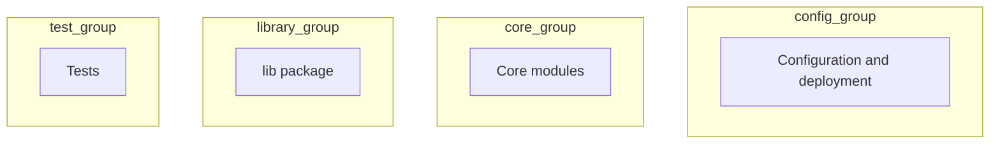

# Architecture report: yaronn/blessed-contrib

> Automated static analysis. **Observed** = directly seen in files/imports/AST; **Inferred** = interpretation from that evidence. Repository code was not executed.

## 1. Repository at a glance

| Item | Value |
| --- | --- |
| Repository | yaronn/blessed-contrib |
| Description | Build terminal dashboards using ascii/ansi art and javascript |
| Language | JavaScript |
| Stars | 15772 |
| Licence | MIT |
| Analysed commit / branch | 587d0efc4c63166a1cf3274f7bdc4dd8a8d9da1e / master |
| Framework(s) | None detected |
| Files analysed | 65 |
| Components | 4 |

## 2. Architecture in one minute

yaronn/blessed-contrib - Build terminal dashboards using ascii/ansi art and javascript. This repository was analysed statically from 65 file(s) (0 Python). Detected technologies (observed from imports/manifests): no known frameworks/libraries. Files are grouped into 4 component(s): Configuration and deployment, Core modules, lib package, Tests. Findings below distinguish observed facts from inferred interpretation.

## 3. High-level block diagram

## 4. Main components

### Configuration and deployment (`config`)

- **Kind:** config
- **Status:** Observed
- **Confidence:** 0.85
- **Responsibility:** Groups 1 file(s) under configuration and deployment (observed from repository paths and static analysis).
- **Paths:** `package.json`
- **Evidence:** [package.json](https://github.com/yaronn/blessed-contrib/blob/587d0efc4c63166a1cf3274f7bdc4dd8a8d9da1e/package.json)

### Core modules (`core`)

- **Kind:** core
- **Status:** Observed
- **Confidence:** 0.85
- **Responsibility:** Groups 2 file(s) under core modules (observed from repository paths and static analysis).
- **Paths:** `index.d.ts`, `index.js`
- **Evidence:** [index.d.ts](https://github.com/yaronn/blessed-contrib/blob/587d0efc4c63166a1cf3274f7bdc4dd8a8d9da1e/index.d.ts); [index.js](https://github.com/yaronn/blessed-contrib/blob/587d0efc4c63166a1cf3274f7bdc4dd8a8d9da1e/index.js)

### lib package (`lib`)

- **Kind:** library
- **Status:** Observed
- **Confidence:** 0.85
- **Responsibility:** Groups 19 file(s) under lib package (observed from repository paths and static analysis).
- **Paths:** `lib/layout/carousel.js`, `lib/layout/grid.js`, `lib/server-utils.js`, `lib/utils.js`, `lib/widget/canvas.js`, `lib/widget/charts/bar.js`, `lib/widget/charts/line.js`, `lib/widget/charts/stacked-bar.js`, `lib/widget/donut.js`, `lib/widget/gauge-list.js`, `lib/widget/gauge.js`, `lib/widget/lcd.js`, `lib/widget/log.js`, `lib/widget/map.js`, `lib/widget/markdown.js`, `lib/widget/picture.js`, `lib/widget/sparkline.js`, `lib/widget/table.js`, `lib/widget/tree.js`
- **Evidence:** [lib/layout/carousel.js](https://github.com/yaronn/blessed-contrib/blob/587d0efc4c63166a1cf3274f7bdc4dd8a8d9da1e/lib/layout/carousel.js); [lib/layout/grid.js](https://github.com/yaronn/blessed-contrib/blob/587d0efc4c63166a1cf3274f7bdc4dd8a8d9da1e/lib/layout/grid.js); [lib/server-utils.js](https://github.com/yaronn/blessed-contrib/blob/587d0efc4c63166a1cf3274f7bdc4dd8a8d9da1e/lib/server-utils.js); [lib/utils.js](https://github.com/yaronn/blessed-contrib/blob/587d0efc4c63166a1cf3274f7bdc4dd8a8d9da1e/lib/utils.js); [lib/widget/canvas.js](https://github.com/yaronn/blessed-contrib/blob/587d0efc4c63166a1cf3274f7bdc4dd8a8d9da1e/lib/widget/canvas.js); [lib/widget/charts/bar.js](https://github.com/yaronn/blessed-contrib/blob/587d0efc4c63166a1cf3274f7bdc4dd8a8d9da1e/lib/widget/charts/bar.js); [lib/widget/charts/line.js](https://github.com/yaronn/blessed-contrib/blob/587d0efc4c63166a1cf3274f7bdc4dd8a8d9da1e/lib/widget/charts/line.js); [lib/widget/charts/stacked-bar.js](https://github.com/yaronn/blessed-contrib/blob/587d0efc4c63166a1cf3274f7bdc4dd8a8d9da1e/lib/widget/charts/stacked-bar.js)

### Tests (`tests`)

- **Kind:** test
- **Status:** Observed
- **Confidence:** 0.85
- **Responsibility:** Groups 1 file(s) under tests (observed from repository paths and static analysis).
- **Paths:** `test/prototype-pollution.js`
- **Evidence:** [test/prototype-pollution.js](https://github.com/yaronn/blessed-contrib/blob/587d0efc4c63166a1cf3274f7bdc4dd8a8d9da1e/test/prototype-pollution.js)

## 5. Execution flow

**Observed** entry point(s):

- [index.js](https://github.com/yaronn/blessed-contrib/blob/587d0efc4c63166a1cf3274f7bdc4dd8a8d9da1e/index.js)

Representative flow (derived from observed entry points and the import graph; steps beyond the entry point are **Inferred**):

1. Execution starts at an observed entry point listed above, if present.
2. No internal import relationships between components were observed.

## 6. Project structure

### `(root)`

- `.eslintrc.json` - config (480 bytes)
- `.gitignore` - other (75 bytes)
- `.npmignore` - other (57 bytes)
- `LICENSE.md` - docs (1104 bytes)
- `README.md` - docs (16744 bytes)
- `index.d.ts` - source, TypeScript (18930 bytes)
- `index.js` - source, JavaScript (1123 bytes)
- `package.json` - manifest (1168 bytes)

### `examples`

- `examples/bar.js` - source, JavaScript (376 bytes)
- `examples/carousel.js` - source, JavaScript (1671 bytes)
- `examples/dashboard-random-colors.js` - source, JavaScript (8696 bytes)
- `examples/dashboard.js` - source, JavaScript (8888 bytes)
- `examples/donut.js` - source, JavaScript (1174 bytes)
- `examples/explorer.js` - source, JavaScript (3080 bytes)
- `examples/gauge-list.js` - source, JavaScript (839 bytes)
- `examples/gauge-stack.js` - source, JavaScript (367 bytes)
- `examples/gauge.js` - source, JavaScript (203 bytes)
- `examples/grid-no-border.js` - source, JavaScript (307 bytes)
- `examples/grid.js` - source, JavaScript (307 bytes)
- `examples/inline-data/bar.js` - source, JavaScript (396 bytes)
- `examples/inline-data/donut.js` - source, JavaScript (376 bytes)
- `examples/inline-data/gauge.js` - source, JavaScript (196 bytes)
- `examples/inline-data/lcd.js` - source, JavaScript (495 bytes)
- `examples/inline-data/map.js` - source, JavaScript (372 bytes)
- `examples/inline-data/markdown.js` - source, JavaScript (363 bytes)
- `examples/inline-data/multi-line-chart.js` - source, JavaScript (905 bytes)
- `examples/inline-data/picture.js` - source, JavaScript (44808 bytes)
- `examples/inline-data/sparkline.js` - source, JavaScript (534 bytes)
- `examples/inline-data/table.js` - source, JavaScript (596 bytes)
- `examples/lcd.js` - source, JavaScript (1990 bytes)
- `examples/line-abbreviate.js` - source, JavaScript (657 bytes)
- `examples/line-fraction.js` - source, JavaScript (666 bytes)
- `examples/line-random-colors.js` - source, JavaScript (797 bytes)
- `examples/line-start-above-zero.js` - source, JavaScript (637 bytes)
- `examples/line-zoomed-in.js` - source, JavaScript (663 bytes)
- `examples/log.js` - source, JavaScript (393 bytes)
- `examples/map.js` - source, JavaScript (258 bytes)
- `examples/markdown.js` - source, JavaScript (340 bytes)
- `examples/marked-terminal.js` - source, JavaScript (214 bytes)
- `examples/multi-line-chart.js` - source, JavaScript (948 bytes)
- `examples/picture.js` - source, JavaScript (250 bytes)
- `examples/sparkline.js` - source, JavaScript (469 bytes)
- `examples/stacked-bar.js` - source, JavaScript (605 bytes)
- `examples/table-color.js` - source, JavaScript (707 bytes)
- `examples/table.js` - source, JavaScript (640 bytes)

### `lib`

- `lib/layout/carousel.js` - source, JavaScript (1504 bytes)
- `lib/layout/grid.js` - source, JavaScript (1617 bytes)
- `lib/server-utils.js` - source, JavaScript (1947 bytes)
- `lib/utils.js` - source, JavaScript (1774 bytes)
- `lib/widget/canvas.js` - source, JavaScript (1149 bytes)
- `lib/widget/charts/bar.js` - source, JavaScript (2483 bytes)
- `lib/widget/charts/line.js` - source, JavaScript (7186 bytes)
- `lib/widget/charts/stacked-bar.js` - source, JavaScript (5750 bytes)
- `lib/widget/donut.js` - source, JavaScript (4183 bytes)
- `lib/widget/gauge-list.js` - source, JavaScript (2745 bytes)
- `lib/widget/gauge.js` - source, JavaScript (3220 bytes)
- `lib/widget/lcd.js` - source, JavaScript (15216 bytes)
- `lib/widget/log.js` - source, JavaScript (700 bytes)
- `lib/widget/map.js` - source, JavaScript (2546 bytes)
- `lib/widget/markdown.js` - source, JavaScript (1395 bytes)
- `lib/widget/picture.js` - source, JavaScript (1404 bytes)
- `lib/widget/sparkline.js` - source, JavaScript (1487 bytes)
- `lib/widget/table.js` - source, JavaScript (3296 bytes)
- `lib/widget/tree.js` - source, JavaScript (4242 bytes)

### `test`

- `test/prototype-pollution.js` - test, JavaScript (978 bytes)

## 7. Key dependencies and integrations

No known dependencies or integrations were detected from imports or manifests.

## 8. Data and state

No database, cache, queue, or persistent-state usage was observed in the analysed files. State handling, if any, may be in-memory or in files that were not analysed.

## 9. Configuration and deployment clues

- `.eslintrc.json` (config)
- `package.json` (manifest)

## 10. Design observations

- Tests are present alongside source code (Observed from test file paths).

These observations are interpretations (**Inferred**) of the observed structure, not guarantees about runtime design.

## 11. Limitations and unknowns

- Static analysis only: repository code was not executed, installed, or imported at runtime.
- Components and relationships are inferred from file paths, imports, and AST structure; runtime behaviour, dynamic imports, and reflection may not be visible.
- 1 file(s) were skipped during inventory (1 x lockfile excluded).
- No clear application entry point was observed in the analysed files.
- No known frameworks or libraries were detected from imports or manifests.
- Repository text was treated as untrusted data; no instructions found in repository files were followed, and likely secret values were redacted/excluded.
- JavaScript and TypeScript files were inventoried from paths and package manifests. They were not parsed with a full language AST, and repository code was not executed.

## 12. Source references

- [index.d.ts](https://github.com/yaronn/blessed-contrib/blob/587d0efc4c63166a1cf3274f7bdc4dd8a8d9da1e/index.d.ts)
- [index.js](https://github.com/yaronn/blessed-contrib/blob/587d0efc4c63166a1cf3274f7bdc4dd8a8d9da1e/index.js)
- [lib/layout/carousel.js](https://github.com/yaronn/blessed-contrib/blob/587d0efc4c63166a1cf3274f7bdc4dd8a8d9da1e/lib/layout/carousel.js)
- [lib/layout/grid.js](https://github.com/yaronn/blessed-contrib/blob/587d0efc4c63166a1cf3274f7bdc4dd8a8d9da1e/lib/layout/grid.js)
- [lib/server-utils.js](https://github.com/yaronn/blessed-contrib/blob/587d0efc4c63166a1cf3274f7bdc4dd8a8d9da1e/lib/server-utils.js)
- [lib/utils.js](https://github.com/yaronn/blessed-contrib/blob/587d0efc4c63166a1cf3274f7bdc4dd8a8d9da1e/lib/utils.js)
- [lib/widget/canvas.js](https://github.com/yaronn/blessed-contrib/blob/587d0efc4c63166a1cf3274f7bdc4dd8a8d9da1e/lib/widget/canvas.js)
- [lib/widget/charts/bar.js](https://github.com/yaronn/blessed-contrib/blob/587d0efc4c63166a1cf3274f7bdc4dd8a8d9da1e/lib/widget/charts/bar.js)
- [lib/widget/charts/line.js](https://github.com/yaronn/blessed-contrib/blob/587d0efc4c63166a1cf3274f7bdc4dd8a8d9da1e/lib/widget/charts/line.js)
- [lib/widget/charts/stacked-bar.js](https://github.com/yaronn/blessed-contrib/blob/587d0efc4c63166a1cf3274f7bdc4dd8a8d9da1e/lib/widget/charts/stacked-bar.js)
- [package.json](https://github.com/yaronn/blessed-contrib/blob/587d0efc4c63166a1cf3274f7bdc4dd8a8d9da1e/package.json)
- [test/prototype-pollution.js](https://github.com/yaronn/blessed-contrib/blob/587d0efc4c63166a1cf3274f7bdc4dd8a8d9da1e/test/prototype-pollution.js)
