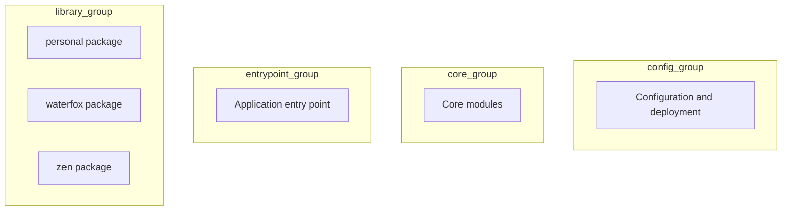

# Architecture report: yokoffing/Betterfox

> Automated static analysis. **Observed** = directly seen in files/imports/AST; **Inferred** = interpretation from that evidence. Repository code was not executed.

## 1. Repository at a glance

| Item | Value |
| --- | --- |
| Repository | yokoffing/Betterfox |
| Description | Firefox user.js for optimal privacy and security. Your favorite browser, but better. |
| Language | JavaScript |
| Stars | 10991 |
| Licence | MIT |
| Analysed commit / branch | 067172a4b0dc90e78e5b8b94d9abfe6430c6a7be / main |
| Framework(s) | None detected |
| Files analysed | 15 |
| Components | 6 |

## 2. Architecture in one minute

yokoffing/Betterfox - Firefox user.js for optimal privacy and security. Your favorite browser, but better.. This repository was analysed statically from 15 file(s) (1 Python). Detected technologies (observed from imports/manifests): no known frameworks/libraries. Files are grouped into 6 component(s): Configuration and deployment, Core modules, Application entry point, personal package, waterfox package, zen package. Observed entry point(s): install.py. Findings below distinguish observed facts from inferred interpretation.

## 3. High-level block diagram

## 4. Main components

### Configuration and deployment (`config`)

- **Kind:** config
- **Status:** Observed
- **Confidence:** 0.85
- **Responsibility:** Groups 1 file(s) under configuration and deployment (observed from repository paths and static analysis).
- **Paths:** `policies.json`
- **Evidence:** [policies.json](https://github.com/yokoffing/Betterfox/blob/067172a4b0dc90e78e5b8b94d9abfe6430c6a7be/policies.json)

### Core modules (`core`)

- **Kind:** core
- **Status:** Observed
- **Confidence:** 0.85
- **Responsibility:** Groups 5 file(s) under core modules (observed from repository paths and static analysis).
- **Paths:** `Fastfox.js`, `Peskyfox.js`, `Securefox.js`, `Smoothfox.js`, `user.js`
- **Evidence:** [Fastfox.js](https://github.com/yokoffing/Betterfox/blob/067172a4b0dc90e78e5b8b94d9abfe6430c6a7be/Fastfox.js); [Peskyfox.js](https://github.com/yokoffing/Betterfox/blob/067172a4b0dc90e78e5b8b94d9abfe6430c6a7be/Peskyfox.js); [Securefox.js](https://github.com/yokoffing/Betterfox/blob/067172a4b0dc90e78e5b8b94d9abfe6430c6a7be/Securefox.js); [Smoothfox.js](https://github.com/yokoffing/Betterfox/blob/067172a4b0dc90e78e5b8b94d9abfe6430c6a7be/Smoothfox.js); [user.js](https://github.com/yokoffing/Betterfox/blob/067172a4b0dc90e78e5b8b94d9abfe6430c6a7be/user.js)

### Application entry point (`entrypoint`)

- **Kind:** entrypoint
- **Status:** Observed
- **Confidence:** 0.85
- **Responsibility:** Groups 1 file(s) under application entry point (observed from repository paths and static analysis). Observed top-level functions: _get_default_firefox_version_and_root, _get_default_profile_folder, _get_firefox_version, _get_latest_compatible_release, _get_releases, _press_enter_to_exit.
- **Paths:** `install.py`
- **Evidence:** [install.py:77](https://github.com/yokoffing/Betterfox/blob/067172a4b0dc90e78e5b8b94d9abfe6430c6a7be/install.py#L77)

### personal package (`personal`)

- **Kind:** library
- **Status:** Observed
- **Confidence:** 0.85
- **Responsibility:** Groups 1 file(s) under personal package (observed from repository paths and static analysis).
- **Paths:** `personal/user-overrides.js`
- **Evidence:** [personal/user-overrides.js](https://github.com/yokoffing/Betterfox/blob/067172a4b0dc90e78e5b8b94d9abfe6430c6a7be/personal/user-overrides.js)

### waterfox package (`waterfox`)

- **Kind:** library
- **Status:** Observed
- **Confidence:** 0.85
- **Responsibility:** Groups 1 file(s) under waterfox package (observed from repository paths and static analysis).
- **Paths:** `waterfox/user.js`
- **Evidence:** [waterfox/user.js](https://github.com/yokoffing/Betterfox/blob/067172a4b0dc90e78e5b8b94d9abfe6430c6a7be/waterfox/user.js)

### zen package (`zen`)

- **Kind:** library
- **Status:** Observed
- **Confidence:** 0.85
- **Responsibility:** Groups 1 file(s) under zen package (observed from repository paths and static analysis).
- **Paths:** `zen/user.js`
- **Evidence:** [zen/user.js](https://github.com/yokoffing/Betterfox/blob/067172a4b0dc90e78e5b8b94d9abfe6430c6a7be/zen/user.js)

## 5. Execution flow

**Observed** entry point(s):

- [install.py:215](https://github.com/yokoffing/Betterfox/blob/067172a4b0dc90e78e5b8b94d9abfe6430c6a7be/install.py#L215)

Representative flow (derived from observed entry points and the import graph; steps beyond the entry point are **Inferred**):

1. Execution starts at an observed entry point listed above, if present.
2. No internal import relationships between components were observed.

## 6. Project structure

### `(root)`

- `.gitattributes` - other (12 bytes)
- `Fastfox.js` - source, JavaScript (29156 bytes)
- `LICENSE` - docs (1066 bytes)
- `Peskyfox.js` - source, JavaScript (33793 bytes)
- `README.md` - docs (10937 bytes)
- `Securefox.js` - source, JavaScript (104063 bytes)
- `Smoothfox.js` - source, JavaScript (5386 bytes)
- `install.py` - source, Python (13660 bytes)
- `policies.json` - config (21661 bytes)
- `user.js` - source, JavaScript (9867 bytes)

### `.github`

- `.github/ISSUE_TEMPLATE/bug_report.yml` - config (3394 bytes)

### `personal`

- `personal/user-overrides.js` - source, JavaScript (12963 bytes)

### `waterfox`

- `waterfox/README.md` - docs (605 bytes)
- `waterfox/user.js` - source, JavaScript (5785 bytes)

### `zen`

- `zen/user.js` - source, JavaScript (9941 bytes)

## 7. Key dependencies and integrations

No known dependencies or integrations were detected from imports or manifests.

## 8. Data and state

No database, cache, queue, or persistent-state usage was observed in the analysed files. State handling, if any, may be in-memory or in files that were not analysed.

## 9. Configuration and deployment clues

- `.github/ISSUE_TEMPLATE/bug_report.yml` (config)
- `policies.json` (config)

## 10. Design observations

- An entry/API layer is separated from other code (Inferred from paths and decorators).

These observations are interpretations (**Inferred**) of the observed structure, not guarantees about runtime design.

## 11. Limitations and unknowns

- Static analysis only: repository code was not executed, installed, or imported at runtime.
- Components and relationships are inferred from file paths, imports, and AST structure; runtime behaviour, dynamic imports, and reflection may not be visible.
- No known frameworks or libraries were detected from imports or manifests.
- Repository text was treated as untrusted data; no instructions found in repository files were followed, and likely secret values were redacted/excluded.

## 12. Source references

- [Fastfox.js](https://github.com/yokoffing/Betterfox/blob/067172a4b0dc90e78e5b8b94d9abfe6430c6a7be/Fastfox.js)
- [Peskyfox.js](https://github.com/yokoffing/Betterfox/blob/067172a4b0dc90e78e5b8b94d9abfe6430c6a7be/Peskyfox.js)
- [Securefox.js](https://github.com/yokoffing/Betterfox/blob/067172a4b0dc90e78e5b8b94d9abfe6430c6a7be/Securefox.js)
- [Smoothfox.js](https://github.com/yokoffing/Betterfox/blob/067172a4b0dc90e78e5b8b94d9abfe6430c6a7be/Smoothfox.js)
- [install.py:77](https://github.com/yokoffing/Betterfox/blob/067172a4b0dc90e78e5b8b94d9abfe6430c6a7be/install.py#L77)
- [install.py:215](https://github.com/yokoffing/Betterfox/blob/067172a4b0dc90e78e5b8b94d9abfe6430c6a7be/install.py#L215)
- [personal/user-overrides.js](https://github.com/yokoffing/Betterfox/blob/067172a4b0dc90e78e5b8b94d9abfe6430c6a7be/personal/user-overrides.js)
- [policies.json](https://github.com/yokoffing/Betterfox/blob/067172a4b0dc90e78e5b8b94d9abfe6430c6a7be/policies.json)
- [user.js](https://github.com/yokoffing/Betterfox/blob/067172a4b0dc90e78e5b8b94d9abfe6430c6a7be/user.js)
- [waterfox/user.js](https://github.com/yokoffing/Betterfox/blob/067172a4b0dc90e78e5b8b94d9abfe6430c6a7be/waterfox/user.js)
- [zen/user.js](https://github.com/yokoffing/Betterfox/blob/067172a4b0dc90e78e5b8b94d9abfe6430c6a7be/zen/user.js)
