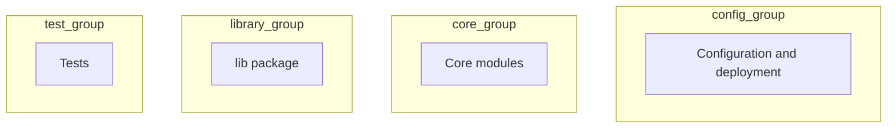

# Architecture report: you-dont-need/You-Dont-Need-Lodash-Underscore

> Automated static analysis. **Observed** = directly seen in files/imports/AST; **Inferred** = interpretation from that evidence. Repository code was not executed.

## 1. Repository at a glance

| Item | Value |
| --- | --- |
| Repository | you-dont-need/You-Dont-Need-Lodash-Underscore |
| Description | List of JavaScript methods which you can use natively + ESLint Plugin |
| Language | JavaScript |
| Stars | 19113 |
| Licence | MIT |
| Analysed commit / branch | 8baa6bf52cf339b3e80ac72294ba848b5f31a38b / master |
| Framework(s) | None detected |
| Files analysed | 18 |
| Components | 4 |

## 2. Architecture in one minute

you-dont-need/You-Dont-Need-Lodash-Underscore - List of JavaScript methods which you can use natively + ESLint Plugin. This repository was analysed statically from 18 file(s) (0 Python). Detected technologies (observed from imports/manifests): GitHub Actions. Files are grouped into 4 component(s): Configuration and deployment, Core modules, lib package, Tests. Findings below distinguish observed facts from inferred interpretation.

## 3. High-level block diagram

## 4. Main components

### Configuration and deployment (`config`)

- **Kind:** config
- **Status:** Observed
- **Confidence:** 0.85
- **Responsibility:** Groups 2 file(s) under configuration and deployment (observed from repository paths and static analysis).
- **Paths:** `lib/rules/rules.json`, `package.json`
- **Evidence:** [lib/rules/rules.json](https://github.com/you-dont-need/You-Dont-Need-Lodash-Underscore/blob/8baa6bf52cf339b3e80ac72294ba848b5f31a38b/lib/rules/rules.json); [package.json](https://github.com/you-dont-need/You-Dont-Need-Lodash-Underscore/blob/8baa6bf52cf339b3e80ac72294ba848b5f31a38b/package.json)

### Core modules (`core`)

- **Kind:** core
- **Status:** Observed
- **Confidence:** 0.85
- **Responsibility:** Groups 1 file(s) under core modules (observed from repository paths and static analysis).
- **Paths:** `index.js`
- **Evidence:** [index.js](https://github.com/you-dont-need/You-Dont-Need-Lodash-Underscore/blob/8baa6bf52cf339b3e80ac72294ba848b5f31a38b/index.js)

### lib package (`lib`)

- **Kind:** library
- **Status:** Observed
- **Confidence:** 0.85
- **Responsibility:** Groups 1 file(s) under lib package (observed from repository paths and static analysis).
- **Paths:** `lib/rules/all.js`
- **Evidence:** [lib/rules/all.js](https://github.com/you-dont-need/You-Dont-Need-Lodash-Underscore/blob/8baa6bf52cf339b3e80ac72294ba848b5f31a38b/lib/rules/all.js)

### Tests (`tests`)

- **Kind:** test
- **Status:** Observed
- **Confidence:** 0.85
- **Responsibility:** Groups 3 file(s) under tests (observed from repository paths and static analysis).
- **Paths:** `tests/index.js`, `tests/lib/rules/all.js`, `tests/unit/all.js`
- **Evidence:** [tests/index.js](https://github.com/you-dont-need/You-Dont-Need-Lodash-Underscore/blob/8baa6bf52cf339b3e80ac72294ba848b5f31a38b/tests/index.js); [tests/lib/rules/all.js](https://github.com/you-dont-need/You-Dont-Need-Lodash-Underscore/blob/8baa6bf52cf339b3e80ac72294ba848b5f31a38b/tests/lib/rules/all.js); [tests/unit/all.js](https://github.com/you-dont-need/You-Dont-Need-Lodash-Underscore/blob/8baa6bf52cf339b3e80ac72294ba848b5f31a38b/tests/unit/all.js)

## 5. Execution flow

**Observed** entry point(s):

- [index.js](https://github.com/you-dont-need/You-Dont-Need-Lodash-Underscore/blob/8baa6bf52cf339b3e80ac72294ba848b5f31a38b/index.js)

Representative flow (derived from observed entry points and the import graph; steps beyond the entry point are **Inferred**):

1. Execution starts at an observed entry point listed above, if present.
2. No internal import relationships between components were observed.

## 6. Project structure

### `(root)`

- `.gitignore` - other (54 bytes)
- `.travis.yml` - ci, YAML (139 bytes)
- `LICENSE` - docs (1070 bytes)
- `README.md` - docs (100612 bytes)
- `TEMPLATE.md` - docs (1670 bytes)
- `configuring.md` - docs (1585 bytes)
- `index.js` - source, JavaScript (1153 bytes)
- `package.json` - manifest (1256 bytes)

### `.github`

- `.github/workflows/master.yml` - ci, YAML (607 bytes)
- `.github/workflows/pr.yml` - ci, YAML (1626 bytes)

### `docs`

- `docs/.nojekyll` - docs (0 bytes)
- `docs/README.md` - docs (117 bytes)
- `docs/index.html` - docs (1353 bytes)

### `lib`

- `lib/rules/all.js` - source, JavaScript (3729 bytes)
- `lib/rules/rules.json` - config (8615 bytes)

### `tests`

- `tests/index.js` - test, JavaScript (850 bytes)
- `tests/lib/rules/all.js` - test, JavaScript (7031 bytes)
- `tests/unit/all.js` - test, JavaScript (28358 bytes)

## 7. Key dependencies and integrations

| Name | Category | Status | Confidence | Evidence |
| --- | --- | --- | --- | --- |
| GitHub Actions | ci | Observed | 0.90 | [.github/workflows/master.yml](https://github.com/you-dont-need/You-Dont-Need-Lodash-Underscore/blob/8baa6bf52cf339b3e80ac72294ba848b5f31a38b/.github/workflows/master.yml); [.github/workflows/pr.yml](https://github.com/you-dont-need/You-Dont-Need-Lodash-Underscore/blob/8baa6bf52cf339b3e80ac72294ba848b5f31a38b/.github/workflows/pr.yml) |

## 8. Data and state

No database, cache, queue, or persistent-state usage was observed in the analysed files. State handling, if any, may be in-memory or in files that were not analysed.

## 9. Configuration and deployment clues

- `.github/workflows/master.yml` (ci)
- `.github/workflows/pr.yml` (ci)
- `.travis.yml` (ci)
- `lib/rules/rules.json` (config)
- `package.json` (manifest)

## 10. Design observations

- Tests are present alongside source code (Observed from test file paths).

These observations are interpretations (**Inferred**) of the observed structure, not guarantees about runtime design.

## 11. Limitations and unknowns

- Static analysis only: repository code was not executed, installed, or imported at runtime.
- Components and relationships are inferred from file paths, imports, and AST structure; runtime behaviour, dynamic imports, and reflection may not be visible.
- 1 file(s) were skipped during inventory (1 x lockfile excluded).
- No clear application entry point was observed in the analysed files.
- Repository text was treated as untrusted data; no instructions found in repository files were followed, and likely secret values were redacted/excluded.
- JavaScript and TypeScript files were inventoried from paths and package manifests. They were not parsed with a full language AST, and repository code was not executed.

## 12. Source references

- [.github/workflows/master.yml](https://github.com/you-dont-need/You-Dont-Need-Lodash-Underscore/blob/8baa6bf52cf339b3e80ac72294ba848b5f31a38b/.github/workflows/master.yml)
- [.github/workflows/pr.yml](https://github.com/you-dont-need/You-Dont-Need-Lodash-Underscore/blob/8baa6bf52cf339b3e80ac72294ba848b5f31a38b/.github/workflows/pr.yml)
- [index.js](https://github.com/you-dont-need/You-Dont-Need-Lodash-Underscore/blob/8baa6bf52cf339b3e80ac72294ba848b5f31a38b/index.js)
- [lib/rules/all.js](https://github.com/you-dont-need/You-Dont-Need-Lodash-Underscore/blob/8baa6bf52cf339b3e80ac72294ba848b5f31a38b/lib/rules/all.js)
- [lib/rules/rules.json](https://github.com/you-dont-need/You-Dont-Need-Lodash-Underscore/blob/8baa6bf52cf339b3e80ac72294ba848b5f31a38b/lib/rules/rules.json)
- [package.json](https://github.com/you-dont-need/You-Dont-Need-Lodash-Underscore/blob/8baa6bf52cf339b3e80ac72294ba848b5f31a38b/package.json)
- [tests/index.js](https://github.com/you-dont-need/You-Dont-Need-Lodash-Underscore/blob/8baa6bf52cf339b3e80ac72294ba848b5f31a38b/tests/index.js)
- [tests/lib/rules/all.js](https://github.com/you-dont-need/You-Dont-Need-Lodash-Underscore/blob/8baa6bf52cf339b3e80ac72294ba848b5f31a38b/tests/lib/rules/all.js)
- [tests/unit/all.js](https://github.com/you-dont-need/You-Dont-Need-Lodash-Underscore/blob/8baa6bf52cf339b3e80ac72294ba848b5f31a38b/tests/unit/all.js)
