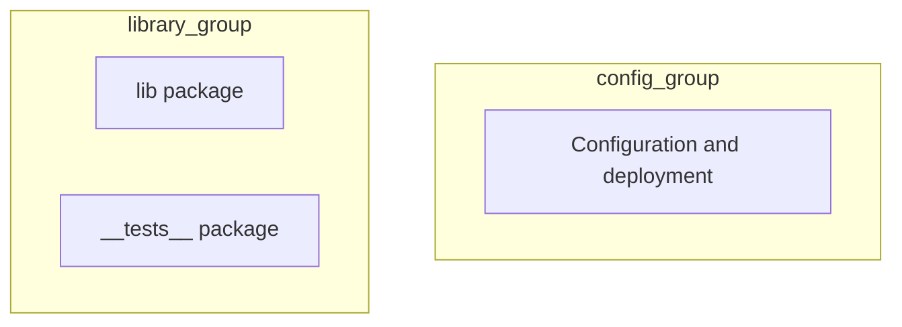

# Architecture report: you-dont-need/You-Dont-Need-Momentjs

> Automated static analysis. **Observed** = directly seen in files/imports/AST; **Inferred** = interpretation from that evidence. Repository code was not executed.

## 1. Repository at a glance

| Item | Value |
| --- | --- |
| Repository | you-dont-need/You-Dont-Need-Momentjs |
| Description | List of functions which you can use to replace moment.js + ESLint Plugin |
| Language | JavaScript |
| Stars | 13280 |
| Licence | MIT |
| Analysed commit / branch | 43977cf990a4af509a758a4e9a6af40f4485d34d / master |
| Framework(s) | None detected |
| Files analysed | 19 |
| Components | 3 |

## 2. Architecture in one minute

you-dont-need/You-Dont-Need-Momentjs - List of functions which you can use to replace moment.js + ESLint Plugin. This repository was analysed statically from 19 file(s) (0 Python). Detected technologies (observed from imports/manifests): Jest. Files are grouped into 3 component(s): Configuration and deployment, lib package, __tests__ package. Findings below distinguish observed facts from inferred interpretation.

## 3. High-level block diagram

## 4. Main components

### Configuration and deployment (`config`)

- **Kind:** config
- **Status:** Observed
- **Confidence:** 0.85
- **Responsibility:** Groups 2 file(s) under configuration and deployment (observed from repository paths and static analysis).
- **Paths:** `lib/rules/methods.json`, `package.json`
- **Evidence:** [lib/rules/methods.json](https://github.com/you-dont-need/You-Dont-Need-Momentjs/blob/43977cf990a4af509a758a4e9a6af40f4485d34d/lib/rules/methods.json); [package.json](https://github.com/you-dont-need/You-Dont-Need-Momentjs/blob/43977cf990a4af509a758a4e9a6af40f4485d34d/package.json)

### lib package (`lib`)

- **Kind:** library
- **Status:** Observed
- **Confidence:** 0.85
- **Responsibility:** Groups 7 file(s) under lib package (observed from repository paths and static analysis).
- **Paths:** `lib/__tests__/index.js`, `lib/index.js`, `lib/rules/no-dynamic-import-moment.js`, `lib/rules/no-import-moment.js`, `lib/rules/no-moment-constructor.js`, `lib/rules/no-moment-methods.js`, `lib/rules/no-require-moment.js`
- **Evidence:** [lib/__tests__/index.js](https://github.com/you-dont-need/You-Dont-Need-Momentjs/blob/43977cf990a4af509a758a4e9a6af40f4485d34d/lib/__tests__/index.js); [lib/index.js](https://github.com/you-dont-need/You-Dont-Need-Momentjs/blob/43977cf990a4af509a758a4e9a6af40f4485d34d/lib/index.js); [lib/rules/no-dynamic-import-moment.js](https://github.com/you-dont-need/You-Dont-Need-Momentjs/blob/43977cf990a4af509a758a4e9a6af40f4485d34d/lib/rules/no-dynamic-import-moment.js); [lib/rules/no-import-moment.js](https://github.com/you-dont-need/You-Dont-Need-Momentjs/blob/43977cf990a4af509a758a4e9a6af40f4485d34d/lib/rules/no-import-moment.js); [lib/rules/no-moment-constructor.js](https://github.com/you-dont-need/You-Dont-Need-Momentjs/blob/43977cf990a4af509a758a4e9a6af40f4485d34d/lib/rules/no-moment-constructor.js); [lib/rules/no-moment-methods.js](https://github.com/you-dont-need/You-Dont-Need-Momentjs/blob/43977cf990a4af509a758a4e9a6af40f4485d34d/lib/rules/no-moment-methods.js); [lib/rules/no-require-moment.js](https://github.com/you-dont-need/You-Dont-Need-Momentjs/blob/43977cf990a4af509a758a4e9a6af40f4485d34d/lib/rules/no-require-moment.js)

### __tests__ package (`tests`)

- **Kind:** library
- **Status:** Observed
- **Confidence:** 0.85
- **Responsibility:** Groups 2 file(s) under __tests__ package (observed from repository paths and static analysis).
- **Paths:** `__tests__/index.js`, `__tests__/performance.js`
- **Evidence:** [__tests__/index.js](https://github.com/you-dont-need/You-Dont-Need-Momentjs/blob/43977cf990a4af509a758a4e9a6af40f4485d34d/__tests__/index.js); [__tests__/performance.js](https://github.com/you-dont-need/You-Dont-Need-Momentjs/blob/43977cf990a4af509a758a4e9a6af40f4485d34d/__tests__/performance.js)

## 5. Execution flow

**Observed** entry point(s):

- [lib/index.js](https://github.com/you-dont-need/You-Dont-Need-Momentjs/blob/43977cf990a4af509a758a4e9a6af40f4485d34d/lib/index.js)

Representative flow (derived from observed entry points and the import graph; steps beyond the entry point are **Inferred**):

1. Execution starts at an observed entry point listed above, if present.
2. No internal import relationships between components were observed.

## 6. Project structure

### `(root)`

- `.gitignore` - other (109 bytes)
- `.prettierrc` - other (52 bytes)
- `.travis.yml` - ci, YAML (85 bytes)
- `LICENSE` - docs (1070 bytes)
- `README.md` - docs (38610 bytes)
- `package.json` - manifest (1714 bytes)

### `__tests__`

- `__tests__/index.js` - source, JavaScript (17710 bytes)
- `__tests__/performance.js` - source, JavaScript (9613 bytes)

### `docs`

- `docs/.nojekyll` - docs (0 bytes)
- `docs/README.md` - docs (109 bytes)
- `docs/index.html` - docs (1404 bytes)

### `lib`

- `lib/__tests__/index.js` - source, JavaScript (4283 bytes)
- `lib/index.js` - source, JavaScript (664 bytes)
- `lib/rules/methods.json` - config (2091 bytes)
- `lib/rules/no-dynamic-import-moment.js` - source, JavaScript (388 bytes)
- `lib/rules/no-import-moment.js` - source, JavaScript (543 bytes)
- `lib/rules/no-moment-constructor.js` - source, JavaScript (529 bytes)
- `lib/rules/no-moment-methods.js` - source, JavaScript (913 bytes)
- `lib/rules/no-require-moment.js` - source, JavaScript (436 bytes)

## 7. Key dependencies and integrations

| Name | Category | Status | Confidence | Evidence |
| --- | --- | --- | --- | --- |
| Jest | tooling | Observed | 0.85 | [package.json:29](https://github.com/you-dont-need/You-Dont-Need-Momentjs/blob/43977cf990a4af509a758a4e9a6af40f4485d34d/package.json#L29) |

## 8. Data and state

No database, cache, queue, or persistent-state usage was observed in the analysed files. State handling, if any, may be in-memory or in files that were not analysed.

## 9. Configuration and deployment clues

- `.travis.yml` (ci)
- `lib/rules/methods.json` (config)
- `package.json` (manifest)

## 10. Design observations

- No strong design patterns could be established from the available evidence.

These observations are interpretations (**Inferred**) of the observed structure, not guarantees about runtime design.

## 11. Limitations and unknowns

- Static analysis only: repository code was not executed, installed, or imported at runtime.
- Components and relationships are inferred from file paths, imports, and AST structure; runtime behaviour, dynamic imports, and reflection may not be visible.
- No clear application entry point was observed in the analysed files.
- Repository text was treated as untrusted data; no instructions found in repository files were followed, and likely secret values were redacted/excluded.
- JavaScript and TypeScript files were inventoried from paths and package manifests. They were not parsed with a full language AST, and repository code was not executed.

## 12. Source references

- [__tests__/index.js](https://github.com/you-dont-need/You-Dont-Need-Momentjs/blob/43977cf990a4af509a758a4e9a6af40f4485d34d/__tests__/index.js)
- [__tests__/performance.js](https://github.com/you-dont-need/You-Dont-Need-Momentjs/blob/43977cf990a4af509a758a4e9a6af40f4485d34d/__tests__/performance.js)
- [lib/__tests__/index.js](https://github.com/you-dont-need/You-Dont-Need-Momentjs/blob/43977cf990a4af509a758a4e9a6af40f4485d34d/lib/__tests__/index.js)
- [lib/index.js](https://github.com/you-dont-need/You-Dont-Need-Momentjs/blob/43977cf990a4af509a758a4e9a6af40f4485d34d/lib/index.js)
- [lib/rules/methods.json](https://github.com/you-dont-need/You-Dont-Need-Momentjs/blob/43977cf990a4af509a758a4e9a6af40f4485d34d/lib/rules/methods.json)
- [lib/rules/no-dynamic-import-moment.js](https://github.com/you-dont-need/You-Dont-Need-Momentjs/blob/43977cf990a4af509a758a4e9a6af40f4485d34d/lib/rules/no-dynamic-import-moment.js)
- [lib/rules/no-import-moment.js](https://github.com/you-dont-need/You-Dont-Need-Momentjs/blob/43977cf990a4af509a758a4e9a6af40f4485d34d/lib/rules/no-import-moment.js)
- [lib/rules/no-moment-constructor.js](https://github.com/you-dont-need/You-Dont-Need-Momentjs/blob/43977cf990a4af509a758a4e9a6af40f4485d34d/lib/rules/no-moment-constructor.js)
- [lib/rules/no-moment-methods.js](https://github.com/you-dont-need/You-Dont-Need-Momentjs/blob/43977cf990a4af509a758a4e9a6af40f4485d34d/lib/rules/no-moment-methods.js)
- [lib/rules/no-require-moment.js](https://github.com/you-dont-need/You-Dont-Need-Momentjs/blob/43977cf990a4af509a758a4e9a6af40f4485d34d/lib/rules/no-require-moment.js)
- [package.json](https://github.com/you-dont-need/You-Dont-Need-Momentjs/blob/43977cf990a4af509a758a4e9a6af40f4485d34d/package.json)
- [package.json:29](https://github.com/you-dont-need/You-Dont-Need-Momentjs/blob/43977cf990a4af509a758a4e9a6af40f4485d34d/package.json#L29)
