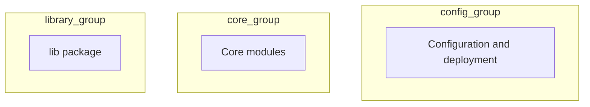

# Architecture report: youzan/vant-weapp

> Automated static analysis. **Observed** = directly seen in files/imports/AST; **Inferred** = interpretation from that evidence. Repository code was not executed.

## 1. Repository at a glance

| Item | Value |
| --- | --- |
| Repository | youzan/vant-weapp |
| Description | 轻量、可靠的小程序 UI 组件库 |
| Language | JavaScript |
| Stars | 18478 |
| Licence | MIT |
| Analysed commit / branch | 5856ed6b1bc4fc8e9cdac73e61ebbf0df0be134f / dev |
| Framework(s) | None detected |
| Files analysed | 326 |
| Components | 3 |

## 2. Architecture in one minute

youzan/vant-weapp - 轻量、可靠的小程序 UI 组件库. This repository was analysed statically from 326 file(s) (0 Python). Detected technologies (observed from imports/manifests): GitHub Actions. Files are grouped into 3 component(s): Configuration and deployment, Core modules, lib package. Findings below distinguish observed facts from inferred interpretation.

## 3. High-level block diagram

## 4. Main components

### Configuration and deployment (`config`)

- **Kind:** config
- **Status:** Observed
- **Confidence:** 0.85
- **Responsibility:** Groups 16 file(s) under configuration and deployment (observed from repository paths and static analysis).
- **Paths:** `lib/action-sheet/index.json`, `lib/area/index.json`, `lib/button/index.json`, `lib/calendar/components/header/index.json`, `lib/calendar/components/month/index.json`, `lib/calendar/index.json`, `lib/card/index.json`, `lib/cascader/index.json`, `lib/cell-group/index.json`, `lib/cell/index.json`, `lib/checkbox-group/index.json`, `lib/checkbox/index.json`, `lib/circle/index.json`, `lib/col/index.json`, `lib/collapse-item/index.json`, `lib/collapse/index.json`
- **Evidence:** [lib/action-sheet/index.json](https://github.com/youzan/vant-weapp/blob/5856ed6b1bc4fc8e9cdac73e61ebbf0df0be134f/lib/action-sheet/index.json); [lib/area/index.json](https://github.com/youzan/vant-weapp/blob/5856ed6b1bc4fc8e9cdac73e61ebbf0df0be134f/lib/area/index.json); [lib/button/index.json](https://github.com/youzan/vant-weapp/blob/5856ed6b1bc4fc8e9cdac73e61ebbf0df0be134f/lib/button/index.json); [lib/calendar/components/header/index.json](https://github.com/youzan/vant-weapp/blob/5856ed6b1bc4fc8e9cdac73e61ebbf0df0be134f/lib/calendar/components/header/index.json); [lib/calendar/components/month/index.json](https://github.com/youzan/vant-weapp/blob/5856ed6b1bc4fc8e9cdac73e61ebbf0df0be134f/lib/calendar/components/month/index.json); [lib/calendar/index.json](https://github.com/youzan/vant-weapp/blob/5856ed6b1bc4fc8e9cdac73e61ebbf0df0be134f/lib/calendar/index.json); [lib/card/index.json](https://github.com/youzan/vant-weapp/blob/5856ed6b1bc4fc8e9cdac73e61ebbf0df0be134f/lib/card/index.json); [lib/cascader/index.json](https://github.com/youzan/vant-weapp/blob/5856ed6b1bc4fc8e9cdac73e61ebbf0df0be134f/lib/cascader/index.json)

### Core modules (`core`)

- **Kind:** core
- **Status:** Observed
- **Confidence:** 0.85
- **Responsibility:** Groups 2 file(s) under core modules (observed from repository paths and static analysis).
- **Paths:** `babel.config.js`, `jest.config.js`
- **Evidence:** [babel.config.js](https://github.com/youzan/vant-weapp/blob/5856ed6b1bc4fc8e9cdac73e61ebbf0df0be134f/babel.config.js); [jest.config.js](https://github.com/youzan/vant-weapp/blob/5856ed6b1bc4fc8e9cdac73e61ebbf0df0be134f/jest.config.js)

### lib package (`lib`)

- **Kind:** library
- **Status:** Observed
- **Confidence:** 0.85
- **Responsibility:** Groups 44 file(s) under lib package (observed from repository paths and static analysis).
- **Paths:** `lib/action-sheet/index.d.ts`, `lib/action-sheet/index.js`, `lib/area/index.d.ts`, `lib/area/index.js`, `lib/button/index.d.ts`, `lib/button/index.js`, `lib/calendar/components/header/index.d.ts`, `lib/calendar/components/header/index.js`, `lib/calendar/components/month/index.d.ts`, `lib/calendar/components/month/index.js`, `lib/calendar/index.d.ts`, `lib/calendar/index.js`, `lib/calendar/utils.d.ts`, `lib/calendar/utils.js`, `lib/card/index.d.ts`, `lib/card/index.js`, `lib/cascader/index.d.ts`, `lib/cascader/index.js`, `lib/cell-group/index.d.ts`, `lib/cell-group/index.js`, `lib/cell/index.d.ts`, `lib/cell/index.js`, `lib/checkbox-group/index.d.ts`, `lib/checkbox-group/index.js`, `lib/checkbox/index.d.ts`, `lib/checkbox/index.js`, `lib/circle/canvas.d.ts`, `lib/circle/canvas.js`, `lib/circle/index.d.ts`, `lib/circle/index.js`, `lib/col/index.d.ts`, `lib/col/index.js`, `lib/collapse-item/animate.d.ts`, `lib/collapse-item/animate.js`, `lib/collapse-item/index.d.ts`, `lib/collapse-item/index.js`, `lib/collapse/index.d.ts`, `lib/collapse/index.js`, `lib/common/color.d.ts`, `lib/common/color.js`, `lib/common/component.d.ts`, `lib/common/component.js`, `lib/common/relation.d.ts`, `lib/common/relation.js`
- **Evidence:** [lib/action-sheet/index.d.ts](https://github.com/youzan/vant-weapp/blob/5856ed6b1bc4fc8e9cdac73e61ebbf0df0be134f/lib/action-sheet/index.d.ts); [lib/action-sheet/index.js](https://github.com/youzan/vant-weapp/blob/5856ed6b1bc4fc8e9cdac73e61ebbf0df0be134f/lib/action-sheet/index.js); [lib/area/index.d.ts](https://github.com/youzan/vant-weapp/blob/5856ed6b1bc4fc8e9cdac73e61ebbf0df0be134f/lib/area/index.d.ts); [lib/area/index.js](https://github.com/youzan/vant-weapp/blob/5856ed6b1bc4fc8e9cdac73e61ebbf0df0be134f/lib/area/index.js); [lib/button/index.d.ts](https://github.com/youzan/vant-weapp/blob/5856ed6b1bc4fc8e9cdac73e61ebbf0df0be134f/lib/button/index.d.ts); [lib/button/index.js](https://github.com/youzan/vant-weapp/blob/5856ed6b1bc4fc8e9cdac73e61ebbf0df0be134f/lib/button/index.js); [lib/calendar/components/header/index.d.ts](https://github.com/youzan/vant-weapp/blob/5856ed6b1bc4fc8e9cdac73e61ebbf0df0be134f/lib/calendar/components/header/index.d.ts); [lib/calendar/components/header/index.js](https://github.com/youzan/vant-weapp/blob/5856ed6b1bc4fc8e9cdac73e61ebbf0df0be134f/lib/calendar/components/header/index.js)

## 5. Execution flow

**Observed** entry point(s):

- [example/functions/foo/index.js](https://github.com/youzan/vant-weapp/blob/5856ed6b1bc4fc8e9cdac73e61ebbf0df0be134f/example/functions/foo/index.js)
- [lib/action-sheet/index.js](https://github.com/youzan/vant-weapp/blob/5856ed6b1bc4fc8e9cdac73e61ebbf0df0be134f/lib/action-sheet/index.js)
- [lib/area/index.js](https://github.com/youzan/vant-weapp/blob/5856ed6b1bc4fc8e9cdac73e61ebbf0df0be134f/lib/area/index.js)
- [lib/button/index.js](https://github.com/youzan/vant-weapp/blob/5856ed6b1bc4fc8e9cdac73e61ebbf0df0be134f/lib/button/index.js)
- [lib/calendar/index.js](https://github.com/youzan/vant-weapp/blob/5856ed6b1bc4fc8e9cdac73e61ebbf0df0be134f/lib/calendar/index.js)
- [lib/card/index.js](https://github.com/youzan/vant-weapp/blob/5856ed6b1bc4fc8e9cdac73e61ebbf0df0be134f/lib/card/index.js)
- [lib/cascader/index.js](https://github.com/youzan/vant-weapp/blob/5856ed6b1bc4fc8e9cdac73e61ebbf0df0be134f/lib/cascader/index.js)
- [lib/cell-group/index.js](https://github.com/youzan/vant-weapp/blob/5856ed6b1bc4fc8e9cdac73e61ebbf0df0be134f/lib/cell-group/index.js)
- [lib/cell/index.js](https://github.com/youzan/vant-weapp/blob/5856ed6b1bc4fc8e9cdac73e61ebbf0df0be134f/lib/cell/index.js)
- [lib/checkbox-group/index.js](https://github.com/youzan/vant-weapp/blob/5856ed6b1bc4fc8e9cdac73e61ebbf0df0be134f/lib/checkbox-group/index.js)
- [lib/checkbox/index.js](https://github.com/youzan/vant-weapp/blob/5856ed6b1bc4fc8e9cdac73e61ebbf0df0be134f/lib/checkbox/index.js)
- [lib/circle/index.js](https://github.com/youzan/vant-weapp/blob/5856ed6b1bc4fc8e9cdac73e61ebbf0df0be134f/lib/circle/index.js)

Representative flow (derived from observed entry points and the import graph; steps beyond the entry point are **Inferred**):

1. Execution starts at an observed entry point listed above, if present.
2. No internal import relationships between components were observed.

## 6. Project structure

### `(root)`

- `.editorconfig` - config (233 bytes)
- `.eslintignore` - other (35 bytes)
- `.eslintrc` - other (214 bytes)
- `.gitignore` - other (199 bytes)
- `.prettierignore` - other (9 bytes)
- `.prettierrc` - other (50 bytes)
- `.stylelintrc` - other (283 bytes)
- `LICENSE` - docs (1053 bytes)
- `README.md` - docs (6126 bytes)
- `babel.config.js` - source, JavaScript (281 bytes)
- `jest.config.js` - source, JavaScript (561 bytes)

### `.gitee`

- `.gitee/ISSUE_TEMPLATE.zh-CN.md` - docs (197 bytes)

### `.github`

- `.github/FUNDING.yml` - config (657 bytes)
- `.github/ISSUE_TEMPLATE/config.yml` - config (27 bytes)
- `.github/ISSUE_TEMPLATE/template-1-bug-report-vant.zh-CN.yml` - config (1835 bytes)
- `.github/ISSUE_TEMPLATE/template-3-feature-request-vant.zh-CN.yml` - config (1193 bytes)
- `.github/PULL_REQUEST_TEMPLATE.md` - docs (313 bytes)
- `.github/dependabot.yml` - config (208 bytes)
- `.github/pr-labeler.yml` - config (177 bytes)
- `.github/workflows/deploy-site.yml` - ci, YAML (901 bytes)
- `.github/workflows/pr-label.yaml` - ci, YAML (428 bytes)
- `.github/workflows/release-tag.yml` - ci, YAML (538 bytes)
- `.github/workflows/test.yml` - ci, YAML (1167 bytes)

### `.husky`

- `.husky/.gitignore` - other (2 bytes)
- `.husky/commit-msg` - other (83 bytes)
- `.husky/pre-commit` - other (71 bytes)

### `docs`

- `docs/markdown/changelog.md` - docs (70098 bytes)
- `docs/markdown/custom-style.md` - docs (2323 bytes)
- `docs/markdown/home.md` - docs (4074 bytes)
- `docs/markdown/quickstart.md` - docs (3905 bytes)
- `docs/markdown/theme.md` - docs (2729 bytes)

### `example`

- `example/app.js` - source, JavaScript (231 bytes)
- `example/app.json` - config (4645 bytes)
- `example/app.wxss` - other (520 bytes)
- `example/common/page.js` - source, JavaScript (180 bytes)
- `example/components/demo-block/index.js` - source, JavaScript (135 bytes)
- `example/components/demo-block/index.json` - config (24 bytes)
- `example/components/demo-block/index.wxml` - other (270 bytes)
- `example/components/demo-block/index.wxss` - other (350 bytes)
- `example/components/demo-home-nav/index.js` - source, JavaScript (276 bytes)
- `example/components/demo-home-nav/index.json` - config (92 bytes)
- `example/components/demo-home-nav/index.wxml` - other (427 bytes)
- `example/components/demo-home-nav/index.wxss` - other (702 bytes)
- `example/components/demo-home/index.js` - source, JavaScript (75 bytes)
- `example/components/demo-home/index.json` - config (98 bytes)
- `example/components/demo-home/index.wxml` - other (452 bytes)
- `example/components/demo-home/index.wxss` - other (674 bytes)
- `example/config.js` - source, JavaScript (4807 bytes)
- `example/database_area.json` - config (92985 bytes)
- `example/functions/foo/index.js` - source, JavaScript (312 bytes)
- `example/functions/foo/package.json` - manifest (254 bytes)
- `example/pages/action-sheet/index.js` - source, JavaScript (46 bytes)
- `example/pages/action-sheet/index.json` - config (59 bytes)
- `example/pages/action-sheet/index.wxml` - other (25 bytes)
- `example/pages/area/index.js` - source, JavaScript (46 bytes)
- `example/pages/area/index.json` - config (55 bytes)
- `example/pages/area/index.wxml` - other (17 bytes)
- `example/pages/button/index.js` - source, JavaScript (46 bytes)
- `example/pages/button/index.json` - config (48 bytes)
- `example/pages/button/index.wxml` - other (19 bytes)
- `example/pages/calendar/index.js` - source, JavaScript (46 bytes)
- `example/pages/calendar/index.json` - config (50 bytes)
- `example/pages/calendar/index.wxml` - other (21 bytes)
- `example/pages/card/index.js` - source, JavaScript (46 bytes)
- `example/pages/card/index.json` - config (52 bytes)
- `example/pages/card/index.wxml` - other (17 bytes)
- `example/pages/cascader/index.js` - source, JavaScript (47 bytes)
- `example/pages/cascader/index.json` - config (55 bytes)
- `example/pages/cascader/index.wxml` - other (21 bytes)
- `example/pages/cell/index.js` - source, JavaScript (46 bytes)
- `example/pages/cell/index.json` - config (49 bytes)
- `example/pages/cell/index.wxml` - other (17 bytes)
- `example/pages/checkbox/index.js` - source, JavaScript (46 bytes)
- `example/pages/checkbox/index.json` - config (53 bytes)
- `example/pages/checkbox/index.wxml` - other (21 bytes)
- `example/pages/circle/index.js` - source, JavaScript (46 bytes)
- `example/pages/circle/index.json` - config (51 bytes)
- `example/pages/circle/index.wxml` - other (19 bytes)
- `example/pages/col/index.js` - source, JavaScript (46 bytes)
- `example/pages/col/index.json` - config (48 bytes)
- `example/pages/col/index.wxml` - other (16 bytes)
- `example/pages/collapse/index.js` - source, JavaScript (46 bytes)
- `example/pages/collapse/index.json` - config (56 bytes)
- `example/pages/collapse/index.wxml` - other (21 bytes)
- `example/pages/config-provider/index.js` - source, JavaScript (46 bytes)
- `example/pages/config-provider/index.json` - config (62 bytes)
- `example/pages/config-provider/index.wxml` - other (28 bytes)
- `example/pages/count-down/index.js` - source, JavaScript (46 bytes)
- `example/pages/count-down/index.json` - config (54 bytes)
- `example/pages/count-down/index.wxml` - other (23 bytes)
- `example/pages/dashboard/index.js` - source, JavaScript (108 bytes)
- `example/pages/dashboard/index.json` - config (125 bytes)
- `example/pages/dashboard/index.wxml` - other (32 bytes)
- `example/pages/datetime-picker/index.js` - source, JavaScript (46 bytes)
- `example/pages/datetime-picker/index.json` - config (62 bytes)
- `example/pages/datetime-picker/index.wxml` - other (28 bytes)
- `example/pages/dialog/index.js` - source, JavaScript (46 bytes)
- `example/pages/dialog/index.json` - config (51 bytes)
- `example/pages/dialog/index.wxml` - other (19 bytes)
- `example/pages/divider/index.js` - source, JavaScript (46 bytes)
- `example/pages/divider/index.json` - config (52 bytes)
- `example/pages/divider/index.wxml` - other (20 bytes)
- `example/pages/dropdown-menu/index.js` - source, JavaScript (46 bytes)
- `example/pages/dropdown-menu/index.json` - config (48 bytes)
- `example/pages/dropdown-menu/index.wxml` - other (26 bytes)
- `example/pages/empty/index.js` - source, JavaScript (46 bytes)
- `example/pages/empty/index.json` - config (50 bytes)
- `example/pages/empty/index.wxml` - other (18 bytes)
- `example/pages/field/index.js` - source, JavaScript (46 bytes)
- `example/pages/field/index.json` - config (50 bytes)
- `example/pages/field/index.wxml` - other (18 bytes)
- `example/pages/goods-action/index.js` - source, JavaScript (46 bytes)
- `example/pages/goods-action/index.json` - config (59 bytes)
- `example/pages/goods-action/index.wxml` - other (25 bytes)
- `example/pages/grid/index.js` - source, JavaScript (46 bytes)
- `example/pages/grid/index.json` - config (46 bytes)
- `example/pages/grid/index.wxml` - other (17 bytes)
- `example/pages/icon/index.js` - source, JavaScript (46 bytes)
- `example/pages/icon/index.json` - config (46 bytes)
- `example/pages/icon/index.wxml` - other (17 bytes)
- `example/pages/image/index.js` - source, JavaScript (46 bytes)
- `example/pages/image/index.json` - config (47 bytes)
- `example/pages/image/index.wxml` - other (18 bytes)
- `example/pages/index-bar/index.js` - source, JavaScript (46 bytes)
- `example/pages/index-bar/index.json` - config (53 bytes)
- `example/pages/index-bar/index.wxml` - other (22 bytes)
- `example/pages/loading/index.js` - source, JavaScript (46 bytes)
- `example/pages/loading/index.json` - config (49 bytes)
- `example/pages/loading/index.wxml` - other (20 bytes)
- `example/pages/nav-bar/index.js` - source, JavaScript (46 bytes)
- `example/pages/nav-bar/index.json` - config (51 bytes)
- `example/pages/nav-bar/index.wxml` - other (20 bytes)
- `example/pages/notice-bar/index.js` - source, JavaScript (46 bytes)
- `example/pages/notice-bar/index.json` - config (54 bytes)
- `example/pages/notice-bar/index.wxml` - other (23 bytes)
- `example/pages/notify/index.js` - source, JavaScript (46 bytes)
- `example/pages/notify/index.json` - config (54 bytes)
- `example/pages/notify/index.wxml` - other (19 bytes)
- `example/pages/overlay/index.js` - source, JavaScript (46 bytes)
- `example/pages/overlay/index.json` - config (52 bytes)
- `example/pages/overlay/index.wxml` - other (20 bytes)
- `example/pages/panel/index.js` - source, JavaScript (46 bytes)
- `example/pages/panel/index.json` - config (47 bytes)
- `example/pages/panel/index.wxml` - other (18 bytes)
- `example/pages/picker/index.js` - source, JavaScript (46 bytes)
- `example/pages/picker/index.json` - config (51 bytes)
- `example/pages/picker/index.wxml` - other (19 bytes)
- `example/pages/popup/index.js` - source, JavaScript (46 bytes)
- `example/pages/popup/index.json` - config (50 bytes)
- `example/pages/popup/index.wxml` - other (18 bytes)
- `example/pages/popup/index.wxss` - other (29 bytes)
- `example/pages/progress/index.js` - source, JavaScript (46 bytes)
- `example/pages/progress/index.json` - config (53 bytes)
- `example/pages/progress/index.wxml` - other (21 bytes)
- `example/pages/radio/index.js` - source, JavaScript (46 bytes)
- `example/pages/radio/index.json` - config (50 bytes)
- `example/pages/radio/index.wxml` - other (18 bytes)
- `example/pages/rate/index.js` - source, JavaScript (46 bytes)
- `example/pages/rate/index.json` - config (46 bytes)
- `example/pages/rate/index.wxml` - other (17 bytes)
- `example/pages/rate/index.wxss` - other (0 bytes)
- `example/pages/search/index.js` - source, JavaScript (46 bytes)
- `example/pages/search/index.json` - config (48 bytes)
- `example/pages/search/index.wxml` - other (19 bytes)
- `example/pages/share-sheet/index.js` - source, JavaScript (46 bytes)
- `example/pages/share-sheet/index.json` - config (58 bytes)
- `example/pages/share-sheet/index.wxml` - other (24 bytes)
- `example/pages/sidebar/index.js` - source, JavaScript (46 bytes)
- `example/pages/sidebar/index.json` - config (55 bytes)
- `example/pages/sidebar/index.wxml` - other (20 bytes)
- `example/pages/sidebar/index.wxss` - other (35 bytes)
- `example/pages/skeleton/index.js` - source, JavaScript (46 bytes)
- `example/pages/skeleton/index.json` - config (53 bytes)
- `example/pages/skeleton/index.wxml` - other (21 bytes)
- `example/pages/slider/index.js` - source, JavaScript (46 bytes)
- `example/pages/slider/index.json` - config (48 bytes)
- `example/pages/slider/index.wxml` - other (19 bytes)
- `example/pages/stepper/index.js` - source, JavaScript (46 bytes)
- `example/pages/stepper/index.json` - config (52 bytes)
- `example/pages/stepper/index.wxml` - other (20 bytes)
- `example/pages/steps/index.js` - source, JavaScript (46 bytes)
- `example/pages/steps/index.json` - config (50 bytes)
- `example/pages/steps/index.wxml` - other (18 bytes)
- `example/pages/sticky/index.js` - source, JavaScript (46 bytes)
- `example/pages/sticky/index.json` - config (54 bytes)
- `example/pages/sticky/index.wxml` - other (19 bytes)
- `example/pages/sticky/index.wxss` - other (26 bytes)
- `example/pages/submit-bar/index.js` - source, JavaScript (46 bytes)
- `example/pages/submit-bar/index.json` - config (60 bytes)
- `example/pages/submit-bar/index.wxml` - other (23 bytes)
- `example/pages/swipe-cell/index.js` - source, JavaScript (46 bytes)
- `example/pages/swipe-cell/index.json` - config (60 bytes)
- `example/pages/swipe-cell/index.wxml` - other (23 bytes)
- `example/pages/switch/index.js` - source, JavaScript (46 bytes)
- `example/pages/switch/index.json` - config (48 bytes)
- `example/pages/switch/index.wxml` - other (19 bytes)
- `example/pages/tab/index.js` - source, JavaScript (46 bytes)
- `example/pages/tab/index.json` - config (48 bytes)
- `example/pages/tab/index.wxml` - other (16 bytes)
- `example/pages/tabbar/index.js` - source, JavaScript (46 bytes)
- `example/pages/tabbar/index.json` - config (51 bytes)
- `example/pages/tabbar/index.wxml` - other (19 bytes)
- `example/pages/tag/index.js` - source, JavaScript (46 bytes)
- `example/pages/tag/index.json` - config (45 bytes)
- `example/pages/tag/index.wxml` - other (16 bytes)
- `example/pages/toast/index.js` - source, JavaScript (46 bytes)
- `example/pages/toast/index.json` - config (50 bytes)
- `example/pages/toast/index.wxml` - other (18 bytes)
- `example/pages/transition/index.js` - source, JavaScript (46 bytes)
- `example/pages/transition/index.json` - config (52 bytes)
- `example/pages/transition/index.wxml` - other (23 bytes)
- `example/pages/tree-select/index.js` - source, JavaScript (46 bytes)
- `example/pages/tree-select/index.json` - config (58 bytes)
- `example/pages/tree-select/index.wxml` - other (24 bytes)
- `example/pages/uploader/index.js` - source, JavaScript (46 bytes)
- `example/pages/uploader/index.json` - config (56 bytes)
- `example/pages/uploader/index.wxml` - other (21 bytes)
- `example/pages/uploader/index.wxss` - other (35 bytes)
- `example/project.config.json` - config (8255 bytes)
- `example/sitemap.json` - config (191 bytes)

### `lib`

- `lib/action-sheet/index.d.ts` - source, TypeScript (11 bytes)
- `lib/action-sheet/index.js` - source, JavaScript (2251 bytes)
- `lib/action-sheet/index.json` - config (158 bytes)
- `lib/action-sheet/index.wxml` - other (2682 bytes)
- `lib/action-sheet/index.wxss` - other (1988 bytes)
- `lib/area/index.d.ts` - source, TypeScript (11 bytes)
- `lib/area/index.js` - source, JavaScript (8650 bytes)
- `lib/area/index.json` - config (88 bytes)
- `lib/area/index.wxml` - other (594 bytes)
- `lib/area/index.wxs` - other (167 bytes)
- `lib/area/index.wxss` - other (31 bytes)
- `lib/button/index.d.ts` - source, TypeScript (11 bytes)
- `lib/button/index.js` - source, JavaScript (1953 bytes)
- `lib/button/index.json` - config (123 bytes)
- `lib/button/index.wxml` - other (2039 bytes)
- `lib/button/index.wxs` - other (757 bytes)
- `lib/button/index.wxss` - other (3517 bytes)
- `lib/calendar/calendar.wxml` - other (1866 bytes)
- `lib/calendar/components/header/index.d.ts` - source, TypeScript (11 bytes)
- `lib/calendar/components/header/index.js` - source, JavaScript (1459 bytes)
- `lib/calendar/components/header/index.json` - config (24 bytes)
- `lib/calendar/components/header/index.wxml` - other (523 bytes)
- `lib/calendar/components/header/index.wxss` - other (741 bytes)
- `lib/calendar/components/month/index.d.ts` - source, TypeScript (102 bytes)
- `lib/calendar/components/month/index.js` - source, JavaScript (5379 bytes)
- `lib/calendar/components/month/index.json` - config (24 bytes)
- `lib/calendar/components/month/index.wxml` - other (1545 bytes)
- `lib/calendar/components/month/index.wxs` - other (1668 bytes)
- `lib/calendar/components/month/index.wxss` - other (2390 bytes)
- `lib/calendar/index.d.ts` - source, TypeScript (11 bytes)
- `lib/calendar/index.js` - source, JavaScript (13471 bytes)
- `lib/calendar/index.json` - config (242 bytes)
- `lib/calendar/index.wxml` - other (744 bytes)
- `lib/calendar/index.wxs` - other (717 bytes)
- `lib/calendar/index.wxss` - other (972 bytes)
- `lib/calendar/utils.d.ts` - source, TypeScript (801 bytes)
- `lib/calendar/utils.js` - source, JavaScript (3054 bytes)
- `lib/calendar/utils.wxs` - other (558 bytes)
- `lib/card/index.d.ts` - source, TypeScript (11 bytes)
- `lib/card/index.js` - source, JavaScript (1306 bytes)
- `lib/card/index.json` - config (82 bytes)
- `lib/card/index.wxml` - other (1894 bytes)
- `lib/card/index.wxss` - other (1750 bytes)
- `lib/cascader/index.d.ts` - source, TypeScript (11 bytes)
- `lib/cascader/index.js` - source, JavaScript (7577 bytes)
- `lib/cascader/index.json` - config (148 bytes)
- `lib/cascader/index.wxml` - other (1690 bytes)
- `lib/cascader/index.wxs` - other (651 bytes)
- `lib/cascader/index.wxss` - other (1050 bytes)
- `lib/cell-group/index.d.ts` - source, TypeScript (11 bytes)
- `lib/cell-group/index.js` - source, JavaScript (312 bytes)
- `lib/cell-group/index.json` - config (24 bytes)
- `lib/cell-group/index.wxml` - other (292 bytes)
- `lib/cell-group/index.wxss` - other (490 bytes)
- `lib/cell/index.d.ts` - source, TypeScript (11 bytes)
- `lib/cell/index.js` - source, JavaScript (981 bytes)
- `lib/cell/index.json` - config (84 bytes)
- `lib/cell/index.wxml` - other (1361 bytes)
- `lib/cell/index.wxs` - other (335 bytes)
- `lib/cell/index.wxss` - other (2201 bytes)
- `lib/checkbox-group/index.d.ts` - source, TypeScript (11 bytes)
- `lib/checkbox-group/index.js` - source, JavaScript (1194 bytes)
- `lib/checkbox-group/index.json` - config (24 bytes)
- `lib/checkbox-group/index.wxml` - other (161 bytes)
- `lib/checkbox-group/index.wxss` - other (91 bytes)
- `lib/checkbox/index.d.ts` - source, TypeScript (11 bytes)
- `lib/checkbox/index.js` - source, JavaScript (2478 bytes)
- `lib/checkbox/index.json` - config (84 bytes)
- `lib/checkbox/index.wxml` - other (1127 bytes)
- `lib/checkbox/index.wxs` - other (477 bytes)
- `lib/checkbox/index.wxss` - other (1456 bytes)
- `lib/circle/canvas.d.ts` - source, TypeScript (209 bytes)
- `lib/circle/canvas.js` - source, JavaScript (1363 bytes)
- `lib/circle/index.d.ts` - source, TypeScript (11 bytes)
- `lib/circle/index.js` - source, JavaScript (7372 bytes)
- `lib/circle/index.json` - config (24 bytes)
- `lib/circle/index.wxml` - other (412 bytes)
- `lib/circle/index.wxss` - other (228 bytes)
- `lib/col/index.d.ts` - source, TypeScript (11 bytes)
- `lib/col/index.js` - source, JavaScript (326 bytes)
- `lib/col/index.json` - config (24 bytes)
- `lib/col/index.wxml` - other (267 bytes)
- `lib/col/index.wxs` - other (343 bytes)
- `lib/col/index.wxss` - other (1773 bytes)
- `lib/collapse-item/animate.d.ts` - source, TypeScript (190 bytes)
- `lib/collapse-item/animate.js` - source, JavaScript (1284 bytes)
- `lib/collapse-item/index.d.ts` - source, TypeScript (11 bytes)
- `lib/collapse-item/index.js` - source, JavaScript (2112 bytes)
- `lib/collapse-item/index.json` - config (84 bytes)
- `lib/collapse-item/index.wxml` - other (1070 bytes)
- `lib/collapse-item/index.wxss` - other (862 bytes)
- `lib/collapse/index.d.ts` - source, TypeScript (11 bytes)
- `lib/collapse/index.js` - source, JavaScript (1463 bytes)
- `lib/collapse/index.json` - config (24 bytes)
- `lib/collapse/index.wxml` - other (107 bytes)
- `lib/collapse/index.wxss` - other (31 bytes)
- `lib/common/color.d.ts` - source, TypeScript (278 bytes)
- `lib/common/color.js` - source, JavaScript (385 bytes)
- `lib/common/component.d.ts` - source, TypeScript (398 bytes)
- `lib/common/component.js` - source, JavaScript (1482 bytes)
- `lib/common/index.wxss` - other (1180 bytes)
- `lib/common/relation.d.ts` - source, TypeScript (568 bytes)
- `lib/common/relation.js` - source, JavaScript (2252 bytes)
- `lib/common/style/clearfix.wxss` - other (56 bytes)
- `lib/common/style/ellipsis.wxss` - other (297 bytes)
- `lib/common/style/hairline.wxss` - other (827 bytes)

## 7. Key dependencies and integrations

| Name | Category | Status | Confidence | Evidence |
| --- | --- | --- | --- | --- |
| GitHub Actions | ci | Observed | 0.90 | [.github/workflows/deploy-site.yml](https://github.com/youzan/vant-weapp/blob/5856ed6b1bc4fc8e9cdac73e61ebbf0df0be134f/.github/workflows/deploy-site.yml); [.github/workflows/pr-label.yaml](https://github.com/youzan/vant-weapp/blob/5856ed6b1bc4fc8e9cdac73e61ebbf0df0be134f/.github/workflows/pr-label.yaml); [.github/workflows/release-tag.yml](https://github.com/youzan/vant-weapp/blob/5856ed6b1bc4fc8e9cdac73e61ebbf0df0be134f/.github/workflows/release-tag.yml); [.github/workflows/test.yml](https://github.com/youzan/vant-weapp/blob/5856ed6b1bc4fc8e9cdac73e61ebbf0df0be134f/.github/workflows/test.yml) |

## 8. Data and state

No database, cache, queue, or persistent-state usage was observed in the analysed files. State handling, if any, may be in-memory or in files that were not analysed.

## 9. Configuration and deployment clues

- `.editorconfig` (config)
- `.github/FUNDING.yml` (config)
- `.github/ISSUE_TEMPLATE/config.yml` (config)
- `.github/ISSUE_TEMPLATE/template-1-bug-report-vant.zh-CN.yml` (config)
- `.github/ISSUE_TEMPLATE/template-3-feature-request-vant.zh-CN.yml` (config)
- `.github/dependabot.yml` (config)
- `.github/pr-labeler.yml` (config)
- `.github/workflows/deploy-site.yml` (ci)
- `.github/workflows/pr-label.yaml` (ci)
- `.github/workflows/release-tag.yml` (ci)
- `.github/workflows/test.yml` (ci)
- `example/app.json` (config)
- `example/components/demo-block/index.json` (config)
- `example/components/demo-home-nav/index.json` (config)
- `example/components/demo-home/index.json` (config)
- `example/database_area.json` (config)
- `example/functions/foo/package.json` (manifest)
- `example/pages/action-sheet/index.json` (config)
- `example/pages/area/index.json` (config)
- `example/pages/button/index.json` (config)
- `example/pages/calendar/index.json` (config)
- `example/pages/card/index.json` (config)
- `example/pages/cascader/index.json` (config)
- `example/pages/cell/index.json` (config)
- `example/pages/checkbox/index.json` (config)
- `example/pages/circle/index.json` (config)
- `example/pages/col/index.json` (config)
- `example/pages/collapse/index.json` (config)
- `example/pages/config-provider/index.json` (config)
- `example/pages/count-down/index.json` (config)
- `example/pages/dashboard/index.json` (config)
- `example/pages/datetime-picker/index.json` (config)
- `example/pages/dialog/index.json` (config)
- `example/pages/divider/index.json` (config)
- `example/pages/dropdown-menu/index.json` (config)
- `example/pages/empty/index.json` (config)
- `example/pages/field/index.json` (config)
- `example/pages/goods-action/index.json` (config)
- `example/pages/grid/index.json` (config)
- `example/pages/icon/index.json` (config)
- `example/pages/image/index.json` (config)
- `example/pages/index-bar/index.json` (config)
- `example/pages/loading/index.json` (config)
- `example/pages/nav-bar/index.json` (config)
- `example/pages/notice-bar/index.json` (config)
- `example/pages/notify/index.json` (config)
- `example/pages/overlay/index.json` (config)
- `example/pages/panel/index.json` (config)
- `example/pages/picker/index.json` (config)
- `example/pages/popup/index.json` (config)
- `example/pages/progress/index.json` (config)
- `example/pages/radio/index.json` (config)
- `example/pages/rate/index.json` (config)
- `example/pages/search/index.json` (config)
- `example/pages/share-sheet/index.json` (config)
- `example/pages/sidebar/index.json` (config)
- `example/pages/skeleton/index.json` (config)
- `example/pages/slider/index.json` (config)
- `example/pages/stepper/index.json` (config)
- `example/pages/steps/index.json` (config)
- `example/pages/sticky/index.json` (config)
- `example/pages/submit-bar/index.json` (config)
- `example/pages/swipe-cell/index.json` (config)
- `example/pages/switch/index.json` (config)
- `example/pages/tab/index.json` (config)
- `example/pages/tabbar/index.json` (config)
- `example/pages/tag/index.json` (config)
- `example/pages/toast/index.json` (config)
- `example/pages/transition/index.json` (config)
- `example/pages/tree-select/index.json` (config)
- `example/pages/uploader/index.json` (config)
- `example/project.config.json` (config)
- `example/sitemap.json` (config)
- `lib/action-sheet/index.json` (config)
- `lib/area/index.json` (config)
- `lib/button/index.json` (config)
- `lib/calendar/components/header/index.json` (config)
- `lib/calendar/components/month/index.json` (config)
- `lib/calendar/index.json` (config)
- `lib/card/index.json` (config)
- `lib/cascader/index.json` (config)
- `lib/cell-group/index.json` (config)
- `lib/cell/index.json` (config)
- `lib/checkbox-group/index.json` (config)
- `lib/checkbox/index.json` (config)
- `lib/circle/index.json` (config)
- `lib/col/index.json` (config)
- `lib/collapse-item/index.json` (config)
- `lib/collapse/index.json` (config)

## 10. Design observations

- No strong design patterns could be established from the available evidence.

These observations are interpretations (**Inferred**) of the observed structure, not guarantees about runtime design.

## 11. Limitations and unknowns

- Static analysis only: repository code was not executed, installed, or imported at runtime.
- Components and relationships are inferred from file paths, imports, and AST structure; runtime behaviour, dynamic imports, and reflection may not be visible.
- 474 file(s) were skipped during inventory (1 x likely secret file excluded; 473 x vendored/generated directory excluded).
- No clear application entry point was observed in the analysed files.
- Repository text was treated as untrusted data; no instructions found in repository files were followed, and likely secret values were redacted/excluded.
- JavaScript and TypeScript files were inventoried from paths and package manifests. They were not parsed with a full language AST, and repository code was not executed.

## 12. Source references

- [.github/workflows/deploy-site.yml](https://github.com/youzan/vant-weapp/blob/5856ed6b1bc4fc8e9cdac73e61ebbf0df0be134f/.github/workflows/deploy-site.yml)
- [.github/workflows/pr-label.yaml](https://github.com/youzan/vant-weapp/blob/5856ed6b1bc4fc8e9cdac73e61ebbf0df0be134f/.github/workflows/pr-label.yaml)
- [.github/workflows/release-tag.yml](https://github.com/youzan/vant-weapp/blob/5856ed6b1bc4fc8e9cdac73e61ebbf0df0be134f/.github/workflows/release-tag.yml)
- [.github/workflows/test.yml](https://github.com/youzan/vant-weapp/blob/5856ed6b1bc4fc8e9cdac73e61ebbf0df0be134f/.github/workflows/test.yml)
- [babel.config.js](https://github.com/youzan/vant-weapp/blob/5856ed6b1bc4fc8e9cdac73e61ebbf0df0be134f/babel.config.js)
- [example/functions/foo/index.js](https://github.com/youzan/vant-weapp/blob/5856ed6b1bc4fc8e9cdac73e61ebbf0df0be134f/example/functions/foo/index.js)
- [jest.config.js](https://github.com/youzan/vant-weapp/blob/5856ed6b1bc4fc8e9cdac73e61ebbf0df0be134f/jest.config.js)
- [lib/action-sheet/index.d.ts](https://github.com/youzan/vant-weapp/blob/5856ed6b1bc4fc8e9cdac73e61ebbf0df0be134f/lib/action-sheet/index.d.ts)
- [lib/action-sheet/index.js](https://github.com/youzan/vant-weapp/blob/5856ed6b1bc4fc8e9cdac73e61ebbf0df0be134f/lib/action-sheet/index.js)
- [lib/action-sheet/index.json](https://github.com/youzan/vant-weapp/blob/5856ed6b1bc4fc8e9cdac73e61ebbf0df0be134f/lib/action-sheet/index.json)
- [lib/area/index.d.ts](https://github.com/youzan/vant-weapp/blob/5856ed6b1bc4fc8e9cdac73e61ebbf0df0be134f/lib/area/index.d.ts)
- [lib/area/index.js](https://github.com/youzan/vant-weapp/blob/5856ed6b1bc4fc8e9cdac73e61ebbf0df0be134f/lib/area/index.js)
- [lib/area/index.json](https://github.com/youzan/vant-weapp/blob/5856ed6b1bc4fc8e9cdac73e61ebbf0df0be134f/lib/area/index.json)
- [lib/button/index.d.ts](https://github.com/youzan/vant-weapp/blob/5856ed6b1bc4fc8e9cdac73e61ebbf0df0be134f/lib/button/index.d.ts)
- [lib/button/index.js](https://github.com/youzan/vant-weapp/blob/5856ed6b1bc4fc8e9cdac73e61ebbf0df0be134f/lib/button/index.js)
- [lib/button/index.json](https://github.com/youzan/vant-weapp/blob/5856ed6b1bc4fc8e9cdac73e61ebbf0df0be134f/lib/button/index.json)
- [lib/calendar/components/header/index.d.ts](https://github.com/youzan/vant-weapp/blob/5856ed6b1bc4fc8e9cdac73e61ebbf0df0be134f/lib/calendar/components/header/index.d.ts)
- [lib/calendar/components/header/index.js](https://github.com/youzan/vant-weapp/blob/5856ed6b1bc4fc8e9cdac73e61ebbf0df0be134f/lib/calendar/components/header/index.js)
- [lib/calendar/components/header/index.json](https://github.com/youzan/vant-weapp/blob/5856ed6b1bc4fc8e9cdac73e61ebbf0df0be134f/lib/calendar/components/header/index.json)
- [lib/calendar/components/month/index.json](https://github.com/youzan/vant-weapp/blob/5856ed6b1bc4fc8e9cdac73e61ebbf0df0be134f/lib/calendar/components/month/index.json)
- [lib/calendar/index.js](https://github.com/youzan/vant-weapp/blob/5856ed6b1bc4fc8e9cdac73e61ebbf0df0be134f/lib/calendar/index.js)
- [lib/calendar/index.json](https://github.com/youzan/vant-weapp/blob/5856ed6b1bc4fc8e9cdac73e61ebbf0df0be134f/lib/calendar/index.json)
- [lib/card/index.js](https://github.com/youzan/vant-weapp/blob/5856ed6b1bc4fc8e9cdac73e61ebbf0df0be134f/lib/card/index.js)
- [lib/card/index.json](https://github.com/youzan/vant-weapp/blob/5856ed6b1bc4fc8e9cdac73e61ebbf0df0be134f/lib/card/index.json)
- [lib/cascader/index.js](https://github.com/youzan/vant-weapp/blob/5856ed6b1bc4fc8e9cdac73e61ebbf0df0be134f/lib/cascader/index.js)
- [lib/cascader/index.json](https://github.com/youzan/vant-weapp/blob/5856ed6b1bc4fc8e9cdac73e61ebbf0df0be134f/lib/cascader/index.json)
- [lib/cell-group/index.js](https://github.com/youzan/vant-weapp/blob/5856ed6b1bc4fc8e9cdac73e61ebbf0df0be134f/lib/cell-group/index.js)
- [lib/cell/index.js](https://github.com/youzan/vant-weapp/blob/5856ed6b1bc4fc8e9cdac73e61ebbf0df0be134f/lib/cell/index.js)
- [lib/checkbox-group/index.js](https://github.com/youzan/vant-weapp/blob/5856ed6b1bc4fc8e9cdac73e61ebbf0df0be134f/lib/checkbox-group/index.js)
- [lib/checkbox/index.js](https://github.com/youzan/vant-weapp/blob/5856ed6b1bc4fc8e9cdac73e61ebbf0df0be134f/lib/checkbox/index.js)
- [lib/circle/index.js](https://github.com/youzan/vant-weapp/blob/5856ed6b1bc4fc8e9cdac73e61ebbf0df0be134f/lib/circle/index.js)
