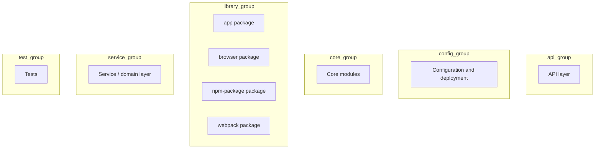

# Architecture report: zalmoxisus/redux-devtools-extension

> Automated static analysis. **Observed** = directly seen in files/imports/AST; **Inferred** = interpretation from that evidence. Repository code was not executed.

## 1. Repository at a glance

| Item | Value |
| --- | --- |
| Repository | zalmoxisus/redux-devtools-extension |
| Description | Redux DevTools extension. |
| Language | JavaScript |
| Stars | 13430 |
| Licence | MIT |
| Analysed commit / branch | 955cfc4f9c2ed7b4212ad8ff50883ad322051678 / master |
| Framework(s) | Electron, Express, React |
| Files analysed | 200 |
| Components | 9 |

## 2. Architecture in one minute

zalmoxisus/redux-devtools-extension - Redux DevTools extension.. This repository was analysed statically from 200 file(s) (0 Python). Detected technologies (observed from imports/manifests): Electron, Express, React, React Router, Redux, webpack. Files are grouped into 9 component(s): API layer, app package, browser package, Configuration and deployment, Core modules, npm-package package, Service / domain layer, Tests. Findings below distinguish observed facts from inferred interpretation.

## 3. High-level block diagram

## 4. Main components

### API layer (`api_layer`)

- **Kind:** api
- **Status:** Observed
- **Confidence:** 0.85
- **Responsibility:** Groups 6 file(s) under api layer (observed from repository paths and static analysis).
- **Paths:** `src/app/api/filters.js`, `src/app/api/generateInstanceId.js`, `src/app/api/importState.js`, `src/app/api/index.js`, `src/app/api/notifyErrors.js`, `src/app/api/openWindow.js`
- **Evidence:** [src/app/api/filters.js](https://github.com/zalmoxisus/redux-devtools-extension/blob/955cfc4f9c2ed7b4212ad8ff50883ad322051678/src/app/api/filters.js); [src/app/api/generateInstanceId.js](https://github.com/zalmoxisus/redux-devtools-extension/blob/955cfc4f9c2ed7b4212ad8ff50883ad322051678/src/app/api/generateInstanceId.js); [src/app/api/importState.js](https://github.com/zalmoxisus/redux-devtools-extension/blob/955cfc4f9c2ed7b4212ad8ff50883ad322051678/src/app/api/importState.js); [src/app/api/index.js](https://github.com/zalmoxisus/redux-devtools-extension/blob/955cfc4f9c2ed7b4212ad8ff50883ad322051678/src/app/api/index.js); [src/app/api/notifyErrors.js](https://github.com/zalmoxisus/redux-devtools-extension/blob/955cfc4f9c2ed7b4212ad8ff50883ad322051678/src/app/api/notifyErrors.js); [src/app/api/openWindow.js](https://github.com/zalmoxisus/redux-devtools-extension/blob/955cfc4f9c2ed7b4212ad8ff50883ad322051678/src/app/api/openWindow.js)

### app package (`app`)

- **Kind:** library
- **Status:** Observed
- **Confidence:** 0.85
- **Responsibility:** Groups 15 file(s) under app package (observed from repository paths and static analysis).
- **Paths:** `src/app/containers/App.js`, `src/app/middlewares/api.js`, `src/app/middlewares/instanceSelector.js`, `src/app/middlewares/panelSync.js`, `src/app/middlewares/windowSync.js`, `src/app/reducers/background/index.js`, `src/app/reducers/background/persistStates.js`, `src/app/reducers/panel/index.js`, `src/app/reducers/window/index.js`, `src/app/reducers/window/instances.js`, `src/app/stores/backgroundStore.js`, `src/app/stores/createStore.js`, `src/app/stores/enhancerStore.js`, `src/app/stores/panelStore.js`, `src/app/stores/windowStore.js`
- **Evidence:** [src/app/containers/App.js](https://github.com/zalmoxisus/redux-devtools-extension/blob/955cfc4f9c2ed7b4212ad8ff50883ad322051678/src/app/containers/App.js); [src/app/middlewares/api.js](https://github.com/zalmoxisus/redux-devtools-extension/blob/955cfc4f9c2ed7b4212ad8ff50883ad322051678/src/app/middlewares/api.js); [src/app/middlewares/instanceSelector.js](https://github.com/zalmoxisus/redux-devtools-extension/blob/955cfc4f9c2ed7b4212ad8ff50883ad322051678/src/app/middlewares/instanceSelector.js); [src/app/middlewares/panelSync.js](https://github.com/zalmoxisus/redux-devtools-extension/blob/955cfc4f9c2ed7b4212ad8ff50883ad322051678/src/app/middlewares/panelSync.js); [src/app/middlewares/windowSync.js](https://github.com/zalmoxisus/redux-devtools-extension/blob/955cfc4f9c2ed7b4212ad8ff50883ad322051678/src/app/middlewares/windowSync.js); [src/app/reducers/background/index.js](https://github.com/zalmoxisus/redux-devtools-extension/blob/955cfc4f9c2ed7b4212ad8ff50883ad322051678/src/app/reducers/background/index.js); [src/app/reducers/background/persistStates.js](https://github.com/zalmoxisus/redux-devtools-extension/blob/955cfc4f9c2ed7b4212ad8ff50883ad322051678/src/app/reducers/background/persistStates.js); [src/app/reducers/panel/index.js](https://github.com/zalmoxisus/redux-devtools-extension/blob/955cfc4f9c2ed7b4212ad8ff50883ad322051678/src/app/reducers/panel/index.js)

### browser package (`browser`)

- **Kind:** library
- **Status:** Observed
- **Confidence:** 0.85
- **Responsibility:** Groups 23 file(s) under browser package (observed from repository paths and static analysis).
- **Paths:** `src/browser/extension/background/contextMenus.js`, `src/browser/extension/background/getPreloadedState.js`, `src/browser/extension/background/index.js`, `src/browser/extension/background/logging.js`, `src/browser/extension/background/openWindow.js`, `src/browser/extension/chromeAPIMock.js`, `src/browser/extension/devpanel/index.js`, `src/browser/extension/devtools/index.js`, `src/browser/extension/inject/contentScript.js`, `src/browser/extension/inject/deprecatedWarn.js`, `src/browser/extension/inject/index.js`, `src/browser/extension/inject/pageScript.js`, `src/browser/extension/inject/pageScriptWrap.js`, `src/browser/extension/options/AllowToRunGroup.js`, `src/browser/extension/options/ContextMenuGroup.js`, `src/browser/extension/options/EditorGroup.js`, `src/browser/extension/options/FilterGroup.js`, `src/browser/extension/options/MiscellaneousGroup.js`, `src/browser/extension/options/Options.js`, `src/browser/extension/options/index.js`, `src/browser/extension/options/syncOptions.js`, `src/browser/extension/window/index.js`, `src/browser/extension/window/remote.js`
- **Evidence:** [src/browser/extension/background/contextMenus.js](https://github.com/zalmoxisus/redux-devtools-extension/blob/955cfc4f9c2ed7b4212ad8ff50883ad322051678/src/browser/extension/background/contextMenus.js); [src/browser/extension/background/getPreloadedState.js](https://github.com/zalmoxisus/redux-devtools-extension/blob/955cfc4f9c2ed7b4212ad8ff50883ad322051678/src/browser/extension/background/getPreloadedState.js); [src/browser/extension/background/index.js](https://github.com/zalmoxisus/redux-devtools-extension/blob/955cfc4f9c2ed7b4212ad8ff50883ad322051678/src/browser/extension/background/index.js); [src/browser/extension/background/logging.js](https://github.com/zalmoxisus/redux-devtools-extension/blob/955cfc4f9c2ed7b4212ad8ff50883ad322051678/src/browser/extension/background/logging.js); [src/browser/extension/background/openWindow.js](https://github.com/zalmoxisus/redux-devtools-extension/blob/955cfc4f9c2ed7b4212ad8ff50883ad322051678/src/browser/extension/background/openWindow.js); [src/browser/extension/chromeAPIMock.js](https://github.com/zalmoxisus/redux-devtools-extension/blob/955cfc4f9c2ed7b4212ad8ff50883ad322051678/src/browser/extension/chromeAPIMock.js); [src/browser/extension/devpanel/index.js](https://github.com/zalmoxisus/redux-devtools-extension/blob/955cfc4f9c2ed7b4212ad8ff50883ad322051678/src/browser/extension/devpanel/index.js); [src/browser/extension/devtools/index.js](https://github.com/zalmoxisus/redux-devtools-extension/blob/955cfc4f9c2ed7b4212ad8ff50883ad322051678/src/browser/extension/devtools/index.js)

### Configuration and deployment (`config`)

- **Kind:** config
- **Status:** Observed
- **Confidence:** 0.85
- **Responsibility:** Groups 6 file(s) under configuration and deployment (observed from repository paths and static analysis).
- **Paths:** `appveyor.yml`, `book.json`, `npm-package/package.json`, `package.json`, `src/browser/extension/manifest.json`, `src/browser/firefox/manifest.json`
- **Evidence:** [appveyor.yml](https://github.com/zalmoxisus/redux-devtools-extension/blob/955cfc4f9c2ed7b4212ad8ff50883ad322051678/appveyor.yml); [book.json](https://github.com/zalmoxisus/redux-devtools-extension/blob/955cfc4f9c2ed7b4212ad8ff50883ad322051678/book.json); [npm-package/package.json](https://github.com/zalmoxisus/redux-devtools-extension/blob/955cfc4f9c2ed7b4212ad8ff50883ad322051678/npm-package/package.json); [package.json](https://github.com/zalmoxisus/redux-devtools-extension/blob/955cfc4f9c2ed7b4212ad8ff50883ad322051678/package.json); [src/browser/extension/manifest.json](https://github.com/zalmoxisus/redux-devtools-extension/blob/955cfc4f9c2ed7b4212ad8ff50883ad322051678/src/browser/extension/manifest.json); [src/browser/firefox/manifest.json](https://github.com/zalmoxisus/redux-devtools-extension/blob/955cfc4f9c2ed7b4212ad8ff50883ad322051678/src/browser/firefox/manifest.json)

### Core modules (`core`)

- **Kind:** core
- **Status:** Observed
- **Confidence:** 0.85
- **Responsibility:** Groups 1 file(s) under core modules (observed from repository paths and static analysis).
- **Paths:** `gulpfile.babel.js`
- **Evidence:** [gulpfile.babel.js](https://github.com/zalmoxisus/redux-devtools-extension/blob/955cfc4f9c2ed7b4212ad8ff50883ad322051678/gulpfile.babel.js)

### npm-package package (`npm_package`)

- **Kind:** library
- **Status:** Observed
- **Confidence:** 0.85
- **Responsibility:** Groups 9 file(s) under npm-package package (observed from repository paths and static analysis).
- **Paths:** `npm-package/developmentOnly.d.ts`, `npm-package/developmentOnly.js`, `npm-package/index.d.ts`, `npm-package/index.js`, `npm-package/logOnly.d.ts`, `npm-package/logOnly.js`, `npm-package/logOnlyInProduction.d.ts`, `npm-package/logOnlyInProduction.js`, `npm-package/utils/assign.js`
- **Evidence:** [npm-package/developmentOnly.d.ts](https://github.com/zalmoxisus/redux-devtools-extension/blob/955cfc4f9c2ed7b4212ad8ff50883ad322051678/npm-package/developmentOnly.d.ts); [npm-package/developmentOnly.js](https://github.com/zalmoxisus/redux-devtools-extension/blob/955cfc4f9c2ed7b4212ad8ff50883ad322051678/npm-package/developmentOnly.js); [npm-package/index.d.ts](https://github.com/zalmoxisus/redux-devtools-extension/blob/955cfc4f9c2ed7b4212ad8ff50883ad322051678/npm-package/index.d.ts); [npm-package/index.js](https://github.com/zalmoxisus/redux-devtools-extension/blob/955cfc4f9c2ed7b4212ad8ff50883ad322051678/npm-package/index.js); [npm-package/logOnly.d.ts](https://github.com/zalmoxisus/redux-devtools-extension/blob/955cfc4f9c2ed7b4212ad8ff50883ad322051678/npm-package/logOnly.d.ts); [npm-package/logOnly.js](https://github.com/zalmoxisus/redux-devtools-extension/blob/955cfc4f9c2ed7b4212ad8ff50883ad322051678/npm-package/logOnly.js); [npm-package/logOnlyInProduction.d.ts](https://github.com/zalmoxisus/redux-devtools-extension/blob/955cfc4f9c2ed7b4212ad8ff50883ad322051678/npm-package/logOnlyInProduction.d.ts); [npm-package/logOnlyInProduction.js](https://github.com/zalmoxisus/redux-devtools-extension/blob/955cfc4f9c2ed7b4212ad8ff50883ad322051678/npm-package/logOnlyInProduction.js)

### Service / domain layer (`service_layer`)

- **Kind:** service
- **Status:** Observed
- **Confidence:** 0.85
- **Responsibility:** Groups 1 file(s) under service / domain layer (observed from repository paths and static analysis).
- **Paths:** `src/app/service/Monitor.js`
- **Evidence:** [src/app/service/Monitor.js](https://github.com/zalmoxisus/redux-devtools-extension/blob/955cfc4f9c2ed7b4212ad8ff50883ad322051678/src/app/service/Monitor.js)

### Tests (`tests`)

- **Kind:** test
- **Status:** Observed
- **Confidence:** 0.85
- **Responsibility:** Groups 36 file(s) under tests (observed from repository paths and static analysis).
- **Paths:** `examples/counter/test/actions/counter.spec.js`, `examples/counter/test/components/Counter.spec.js`, `examples/counter/test/containers/App.spec.js`, `examples/counter/test/reducers/counter.spec.js`, `examples/counter/test/setup.js`, `examples/router/test/actions/todos.spec.js`, `examples/router/test/components/Footer.spec.js`, `examples/router/test/components/Header.spec.js`, `examples/router/test/components/MainSection.spec.js`, `examples/router/test/components/TodoItem.spec.js`, `examples/router/test/components/TodoTextInput.spec.js`, `examples/router/test/reducers/todos.spec.js`, `examples/router/test/setup.js`, `examples/todomvc/test/actions/todos.spec.js`, `examples/todomvc/test/components/Footer.spec.js`, `examples/todomvc/test/components/Header.spec.js`, `examples/todomvc/test/components/MainSection.spec.js`, `examples/todomvc/test/components/TodoItem.spec.js`, `examples/todomvc/test/components/TodoTextInput.spec.js`, `examples/todomvc/test/reducers/todos.spec.js`, `examples/todomvc/test/setup.js`, `test/.eslintrc`, `test/app/containers/App.spec.js`, `test/app/inject/api.spec.js`, `test/app/inject/enhancer.spec.js`, `test/app/setup.js`, `test/chrome/extension.spec.js`, `test/electron/devpanel.spec.js`, `test/electron/fixture/index.html`, `test/electron/fixture/main.js`, `test/electron/fixture/package.json`, `test/electron/fixture/renderer.js`, `test/perf/data.js`, `test/perf/send.spec.js`, `test/utils/e2e.js`, `test/utils/inject.js`
- **Evidence:** [examples/counter/test/actions/counter.spec.js](https://github.com/zalmoxisus/redux-devtools-extension/blob/955cfc4f9c2ed7b4212ad8ff50883ad322051678/examples/counter/test/actions/counter.spec.js); [examples/counter/test/components/Counter.spec.js](https://github.com/zalmoxisus/redux-devtools-extension/blob/955cfc4f9c2ed7b4212ad8ff50883ad322051678/examples/counter/test/components/Counter.spec.js); [examples/counter/test/containers/App.spec.js](https://github.com/zalmoxisus/redux-devtools-extension/blob/955cfc4f9c2ed7b4212ad8ff50883ad322051678/examples/counter/test/containers/App.spec.js); [examples/counter/test/reducers/counter.spec.js](https://github.com/zalmoxisus/redux-devtools-extension/blob/955cfc4f9c2ed7b4212ad8ff50883ad322051678/examples/counter/test/reducers/counter.spec.js); [examples/counter/test/setup.js](https://github.com/zalmoxisus/redux-devtools-extension/blob/955cfc4f9c2ed7b4212ad8ff50883ad322051678/examples/counter/test/setup.js); [examples/router/test/actions/todos.spec.js](https://github.com/zalmoxisus/redux-devtools-extension/blob/955cfc4f9c2ed7b4212ad8ff50883ad322051678/examples/router/test/actions/todos.spec.js); [examples/router/test/components/Footer.spec.js](https://github.com/zalmoxisus/redux-devtools-extension/blob/955cfc4f9c2ed7b4212ad8ff50883ad322051678/examples/router/test/components/Footer.spec.js); [examples/router/test/components/Header.spec.js](https://github.com/zalmoxisus/redux-devtools-extension/blob/955cfc4f9c2ed7b4212ad8ff50883ad322051678/examples/router/test/components/Header.spec.js)

### webpack package (`webpack`)

- **Kind:** library
- **Status:** Observed
- **Confidence:** 0.85
- **Responsibility:** Groups 6 file(s) under webpack package (observed from repository paths and static analysis).
- **Paths:** `webpack/base.config.js`, `webpack/dev.config.js`, `webpack/prod.config.js`, `webpack/replace/JsonpMainTemplate.runtime.js`, `webpack/replace/log-apply-result.js`, `webpack/wrap.config.js`
- **Evidence:** [webpack/base.config.js](https://github.com/zalmoxisus/redux-devtools-extension/blob/955cfc4f9c2ed7b4212ad8ff50883ad322051678/webpack/base.config.js); [webpack/dev.config.js](https://github.com/zalmoxisus/redux-devtools-extension/blob/955cfc4f9c2ed7b4212ad8ff50883ad322051678/webpack/dev.config.js); [webpack/prod.config.js](https://github.com/zalmoxisus/redux-devtools-extension/blob/955cfc4f9c2ed7b4212ad8ff50883ad322051678/webpack/prod.config.js); [webpack/replace/JsonpMainTemplate.runtime.js](https://github.com/zalmoxisus/redux-devtools-extension/blob/955cfc4f9c2ed7b4212ad8ff50883ad322051678/webpack/replace/JsonpMainTemplate.runtime.js); [webpack/replace/log-apply-result.js](https://github.com/zalmoxisus/redux-devtools-extension/blob/955cfc4f9c2ed7b4212ad8ff50883ad322051678/webpack/replace/log-apply-result.js); [webpack/wrap.config.js](https://github.com/zalmoxisus/redux-devtools-extension/blob/955cfc4f9c2ed7b4212ad8ff50883ad322051678/webpack/wrap.config.js)

## 5. Execution flow

**Observed** entry point(s):

- [npm-package/index.js](https://github.com/zalmoxisus/redux-devtools-extension/blob/955cfc4f9c2ed7b4212ad8ff50883ad322051678/npm-package/index.js)
- [src/app/api/index.js](https://github.com/zalmoxisus/redux-devtools-extension/blob/955cfc4f9c2ed7b4212ad8ff50883ad322051678/src/app/api/index.js)
- [src/app/containers/App.js](https://github.com/zalmoxisus/redux-devtools-extension/blob/955cfc4f9c2ed7b4212ad8ff50883ad322051678/src/app/containers/App.js)
- [test/electron/fixture/main.js](https://github.com/zalmoxisus/redux-devtools-extension/blob/955cfc4f9c2ed7b4212ad8ff50883ad322051678/test/electron/fixture/main.js)

Representative flow (derived from observed entry points and the import graph; steps beyond the entry point are **Inferred**):

1. Execution starts at an observed entry point listed above, if present.
2. No internal import relationships between components were observed.

## 6. Project structure

### `(root)`

- `.babelrc` - other (120 bytes)
- `.bookignore` - other (67 bytes)
- `.eslintignore` - other (84 bytes)
- `.eslintrc` - other (699 bytes)
- `.gitignore` - other (73 bytes)
- `.travis.yml` - ci, YAML (615 bytes)
- `CHANGELOG.md` - docs (247 bytes)
- `CODE_OF_CONDUCT.md` - docs (2686 bytes)
- `LICENSE` - docs (1089 bytes)
- `README.md` - docs (22472 bytes)
- `appveyor.yml` - config (254 bytes)
- `book.json` - config (467 bytes)
- `gulpfile.babel.js` - source, JavaScript (4230 bytes)
- `package.json` - manifest (3739 bytes)

### `docs`

- `docs/API/Arguments.md` - docs (12286 bytes)
- `docs/API/Methods.md` - docs (3849 bytes)
- `docs/API/README.md` - docs (70 bytes)
- `docs/Articles.md` - docs (466 bytes)
- `docs/Credits.md` - docs (794 bytes)
- `docs/FAQ.md` - docs (2949 bytes)
- `docs/Features/Trace.md` - docs (2435 bytes)
- `docs/Feedback.md` - docs (798 bytes)
- `docs/Integrations.md` - docs (7158 bytes)
- `docs/README.md` - docs (722 bytes)
- `docs/Recipes.md` - docs (2086 bytes)
- `docs/Troubleshooting.md` - docs (6246 bytes)
- `docs/Videos.md` - docs (397 bytes)

### `examples`

- `examples/buildAll.js` - source, JavaScript (1015 bytes)
- `examples/counter/.babelrc` - other (50 bytes)
- `examples/counter/actions/counter.js` - source, JavaScript (640 bytes)
- `examples/counter/components/Counter.js` - source, JavaScript (834 bytes)
- `examples/counter/containers/App.js` - source, JavaScript (431 bytes)
- `examples/counter/index.html` - other (187 bytes)
- `examples/counter/index.js` - source, JavaScript (325 bytes)
- `examples/counter/package.json` - manifest (1156 bytes)
- `examples/counter/reducers/counter.js` - source, JavaScript (285 bytes)
- `examples/counter/reducers/index.js` - source, JavaScript (156 bytes)
- `examples/counter/server.js` - source, JavaScript (714 bytes)
- `examples/counter/store/configureStore.js` - source, JavaScript (793 bytes)
- `examples/counter/test/actions/counter.spec.js` - test, JavaScript (2270 bytes)
- `examples/counter/test/components/Counter.spec.js` - test, JavaScript (1603 bytes)
- `examples/counter/test/containers/App.spec.js` - test, JavaScript (1697 bytes)
- `examples/counter/test/reducers/counter.spec.js` - test, JavaScript (683 bytes)
- `examples/counter/test/setup.js` - test, JavaScript (184 bytes)
- `examples/counter/webpack.config.js` - source, JavaScript (495 bytes)
- `examples/react-counter-messaging/.babelrc` - other (50 bytes)
- `examples/react-counter-messaging/components/Counter.js` - source, JavaScript (1666 bytes)
- `examples/react-counter-messaging/index.html` - other (187 bytes)
- `examples/react-counter-messaging/index.js` - source, JavaScript (168 bytes)
- `examples/react-counter-messaging/package.json` - manifest (897 bytes)
- `examples/react-counter-messaging/webpack.config.js` - source, JavaScript (430 bytes)
- `examples/router/.babelrc` - other (119 bytes)
- `examples/router/actions/todos.js` - source, JavaScript (527 bytes)
- `examples/router/components/Footer.js` - source, JavaScript (1830 bytes)
- `examples/router/components/Header.js` - source, JavaScript (643 bytes)
- `examples/router/components/MainSection.js` - source, JavaScript (2248 bytes)
- `examples/router/components/TodoItem.js` - source, JavaScript (1702 bytes)
- `examples/router/components/TodoTextInput.js` - source, JavaScript (1283 bytes)
- `examples/router/constants/ActionTypes.js` - source, JavaScript (256 bytes)
- `examples/router/constants/TodoFilters.js` - source, JavaScript (126 bytes)
- `examples/router/containers/App.js` - source, JavaScript (941 bytes)
- `examples/router/containers/Root.js` - source, JavaScript (534 bytes)
- `examples/router/containers/Wrapper.js` - source, JavaScript (1465 bytes)
- `examples/router/index.html` - other (203 bytes)
- `examples/router/index.js` - source, JavaScript (389 bytes)
- `examples/router/package.json` - manifest (1573 bytes)
- `examples/router/reducers/index.js` - source, JavaScript (231 bytes)
- `examples/router/reducers/todos.js` - source, JavaScript (1171 bytes)
- `examples/router/server.js` - source, JavaScript (714 bytes)
- `examples/router/store/configureStore.js` - source, JavaScript (814 bytes)
- `examples/router/test/actions/todos.spec.js` - test, JavaScript (1213 bytes)
- `examples/router/test/components/Footer.spec.js` - test, JavaScript (3381 bytes)
- `examples/router/test/components/Header.spec.js` - test, JavaScript (1391 bytes)
- `examples/router/test/components/MainSection.spec.js` - test, JavaScript (4431 bytes)
- `examples/router/test/components/TodoItem.spec.js` - test, JavaScript (3585 bytes)
- `examples/router/test/components/TodoTextInput.spec.js` - test, JavaScript (2633 bytes)
- `examples/router/test/reducers/todos.spec.js` - test, JavaScript (4594 bytes)
- `examples/router/test/setup.js` - test, JavaScript (184 bytes)
- `examples/router/webpack.config.js` - source, JavaScript (684 bytes)
- `examples/saga-counter/.babelrc` - other (50 bytes)
- `examples/saga-counter/index.html` - other (313 bytes)
- `examples/saga-counter/package.json` - manifest (934 bytes)
- `examples/saga-counter/src/components/Counter.js` - source, JavaScript (842 bytes)
- `examples/saga-counter/src/main.js` - source, JavaScript (1112 bytes)
- `examples/saga-counter/src/reducers/index.js` - source, JavaScript (286 bytes)
- `examples/saga-counter/src/sagas/index.js` - source, JavaScript (358 bytes)
- `examples/saga-counter/webpack.config.js` - source, JavaScript (456 bytes)
- `examples/todomvc/.babelrc` - other (49 bytes)
- `examples/todomvc/actions/index.js` - source, JavaScript (25 bytes)
- `examples/todomvc/actions/todos.js` - source, JavaScript (527 bytes)
- `examples/todomvc/components/Footer.js` - source, JavaScript (1855 bytes)
- `examples/todomvc/components/Header.js` - source, JavaScript (609 bytes)
- `examples/todomvc/components/MainSection.js` - source, JavaScript (2273 bytes)
- `examples/todomvc/components/TodoItem.js` - source, JavaScript (1727 bytes)
- `examples/todomvc/components/TodoTextInput.js` - source, JavaScript (1308 bytes)
- `examples/todomvc/constants/ActionTypes.js` - source, JavaScript (256 bytes)
- `examples/todomvc/constants/TodoFilters.js` - source, JavaScript (126 bytes)
- `examples/todomvc/containers/App.js` - source, JavaScript (906 bytes)
- `examples/todomvc/index.html` - other (203 bytes)
- `examples/todomvc/index.js` - source, JavaScript (386 bytes)
- `examples/todomvc/package.json` - manifest (1155 bytes)
- `examples/todomvc/reducers/index.js` - source, JavaScript (150 bytes)
- `examples/todomvc/reducers/todos.js` - source, JavaScript (1289 bytes)
- `examples/todomvc/server.js` - source, JavaScript (714 bytes)
- `examples/todomvc/store/configureStore.js` - source, JavaScript (793 bytes)
- `examples/todomvc/test/actions/todos.spec.js` - test, JavaScript (1213 bytes)
- `examples/todomvc/test/components/Footer.spec.js` - test, JavaScript (3381 bytes)
- `examples/todomvc/test/components/Header.spec.js` - test, JavaScript (1391 bytes)
- `examples/todomvc/test/components/MainSection.spec.js` - test, JavaScript (4431 bytes)
- `examples/todomvc/test/components/TodoItem.spec.js` - test, JavaScript (3585 bytes)
- `examples/todomvc/test/components/TodoTextInput.spec.js` - test, JavaScript (2633 bytes)
- `examples/todomvc/test/reducers/todos.spec.js` - test, JavaScript (4594 bytes)
- `examples/todomvc/test/setup.js` - test, JavaScript (184 bytes)
- `examples/todomvc/webpack.config.js` - source, JavaScript (599 bytes)

### `npm-package`

- `npm-package/README.md` - docs (1558 bytes)
- `npm-package/developmentOnly.d.ts` - source, TypeScript (42 bytes)
- `npm-package/developmentOnly.js` - source, JavaScript (721 bytes)
- `npm-package/index.d.ts` - source, TypeScript (6493 bytes)
- `npm-package/index.js` - source, JavaScript (635 bytes)
- `npm-package/logOnly.d.ts` - source, TypeScript (42 bytes)
- `npm-package/logOnly.js` - source, JavaScript (1782 bytes)
- `npm-package/logOnlyInProduction.d.ts` - source, TypeScript (42 bytes)
- `npm-package/logOnlyInProduction.js` - source, JavaScript (840 bytes)
- `npm-package/package.json` - manifest (494 bytes)
- `npm-package/utils/assign.js` - source, JavaScript (446 bytes)

### `src`

- `src/app/api/filters.js` - source, JavaScript (4981 bytes)
- `src/app/api/generateInstanceId.js` - source, JavaScript (93 bytes)
- `src/app/api/importState.js` - source, JavaScript (1984 bytes)
- `src/app/api/index.js` - source, JavaScript (11222 bytes)
- `src/app/api/notifyErrors.js` - source, JavaScript (944 bytes)
- `src/app/api/openWindow.js` - source, JavaScript (165 bytes)
- `src/app/containers/App.js` - source, JavaScript (6864 bytes)
- `src/app/middlewares/api.js` - source, JavaScript (7659 bytes)
- `src/app/middlewares/instanceSelector.js` - source, JavaScript (1006 bytes)
- `src/app/middlewares/panelSync.js` - source, JavaScript (1057 bytes)
- `src/app/middlewares/windowSync.js` - source, JavaScript (706 bytes)
- `src/app/reducers/background/index.js` - source, JavaScript (249 bytes)
- `src/app/reducers/background/persistStates.js` - source, JavaScript (136 bytes)
- `src/app/reducers/panel/index.js` - source, JavaScript (469 bytes)
- `src/app/reducers/window/index.js` - source, JavaScript (510 bytes)
- `src/app/reducers/window/instances.js` - source, JavaScript (610 bytes)
- `src/app/service/Monitor.js` - source, JavaScript (1443 bytes)
- `src/app/stores/backgroundStore.js` - source, JavaScript (549 bytes)
- `src/app/stores/createStore.js` - source, JavaScript (169 bytes)
- `src/app/stores/enhancerStore.js` - source, JavaScript (1016 bytes)
- `src/app/stores/panelStore.js` - source, JavaScript (529 bytes)
- `src/app/stores/windowStore.js` - source, JavaScript (1489 bytes)
- `src/assets/img/loading.svg` - other (1784 bytes)
- `src/browser/extension/background/contextMenus.js` - source, JavaScript (935 bytes)
- `src/browser/extension/background/getPreloadedState.js` - source, JavaScript (773 bytes)
- `src/browser/extension/background/index.js` - source, JavaScript (892 bytes)
- `src/browser/extension/background/logging.js` - source, JavaScript (1064 bytes)
- `src/browser/extension/background/openWindow.js` - source, JavaScript (1779 bytes)
- `src/browser/extension/chromeAPIMock.js` - source, JavaScript (2256 bytes)
- `src/browser/extension/devpanel/index.js` - source, JavaScript (2684 bytes)
- `src/browser/extension/devtools/index.js` - source, JavaScript (405 bytes)
- `src/browser/extension/inject/contentScript.js` - source, JavaScript (3315 bytes)
- `src/browser/extension/inject/deprecatedWarn.js` - source, JavaScript (310 bytes)
- `src/browser/extension/inject/index.js` - source, JavaScript (681 bytes)
- `src/browser/extension/inject/pageScript.js` - source, JavaScript (13859 bytes)
- `src/browser/extension/inject/pageScriptWrap.js` - source, JavaScript (517 bytes)
- `src/browser/extension/manifest.json` - config (2280 bytes)
- `src/browser/extension/options/AllowToRunGroup.js` - source, JavaScript (1533 bytes)
- `src/browser/extension/options/ContextMenuGroup.js` - source, JavaScript (733 bytes)
- `src/browser/extension/options/EditorGroup.js` - source, JavaScript (2471 bytes)
- `src/browser/extension/options/FilterGroup.js` - source, JavaScript (2294 bytes)
- `src/browser/extension/options/MiscellaneousGroup.js` - source, JavaScript (1635 bytes)
- `src/browser/extension/options/Options.js` - source, JavaScript (957 bytes)
- `src/browser/extension/options/index.js` - source, JavaScript (544 bytes)
- `src/browser/extension/options/syncOptions.js` - source, JavaScript (2739 bytes)
- `src/browser/extension/window/index.js` - source, JavaScript (1171 bytes)
- `src/browser/extension/window/remote.js` - source, JavaScript (803 bytes)
- `src/browser/firefox/manifest.json` - config (1599 bytes)
- `src/browser/views/devpanel.pug` - other (216 bytes)
- `src/browser/views/devtools.pug` - other (151 bytes)
- `src/browser/views/includes/style.pug` - other (1090 bytes)
- `src/browser/views/options.pug` - other (1911 bytes)
- `src/browser/views/remote.pug` - other (157 bytes)
- `src/browser/views/window.pug` - other (391 bytes)

### `test`

- `test/.eslintrc` - test (121 bytes)
- `test/app/containers/App.spec.js` - test, JavaScript (726 bytes)
- `test/app/inject/api.spec.js` - test, JavaScript (2581 bytes)
- `test/app/inject/enhancer.spec.js` - test, JavaScript (6162 bytes)
- `test/app/setup.js` - test, JavaScript (728 bytes)
- `test/chrome/extension.spec.js` - test, JavaScript (2604 bytes)
- `test/electron/devpanel.spec.js` - test, JavaScript (3282 bytes)
- `test/electron/fixture/index.html` - test (277 bytes)
- `test/electron/fixture/main.js` - test, JavaScript (485 bytes)
- `test/electron/fixture/package.json` - test (107 bytes)
- `test/electron/fixture/renderer.js` - test, JavaScript (930 bytes)
- `test/perf/data.js` - test, JavaScript (132567 bytes)
- `test/perf/send.spec.js` - test, JavaScript (726 bytes)
- `test/utils/e2e.js` - test, JavaScript (1446 bytes)
- `test/utils/inject.js` - test, JavaScript (496 bytes)

### `webpack`

- `webpack/base.config.js` - source, JavaScript (2033 bytes)
- `webpack/dev.config.js` - source, JavaScript (457 bytes)
- `webpack/prod.config.js` - source, JavaScript (240 bytes)
- `webpack/replace/JsonpMainTemplate.runtime.js` - source, JavaScript (2030 bytes)
- `webpack/replace/log-apply-result.js` - source, JavaScript (1016 bytes)
- `webpack/wrap.config.js` - source, JavaScript (322 bytes)

## 7. Key dependencies and integrations

| Name | Category | Status | Confidence | Evidence |
| --- | --- | --- | --- | --- |
| Electron | framework | Observed | 0.85 | [package.json:10](https://github.com/zalmoxisus/redux-devtools-extension/blob/955cfc4f9c2ed7b4212ad8ff50883ad322051678/package.json#L10) |
| Express | framework | Observed | 0.90 | [examples/counter/package.json:35](https://github.com/zalmoxisus/redux-devtools-extension/blob/955cfc4f9c2ed7b4212ad8ff50883ad322051678/examples/counter/package.json#L35); [examples/router/package.json:40](https://github.com/zalmoxisus/redux-devtools-extension/blob/955cfc4f9c2ed7b4212ad8ff50883ad322051678/examples/router/package.json#L40); [examples/todomvc/package.json:34](https://github.com/zalmoxisus/redux-devtools-extension/blob/955cfc4f9c2ed7b4212ad8ff50883ad322051678/examples/todomvc/package.json#L34) |
| React | framework | Observed | 0.90 | [examples/counter/package.json:21](https://github.com/zalmoxisus/redux-devtools-extension/blob/955cfc4f9c2ed7b4212ad8ff50883ad322051678/examples/counter/package.json#L21); [examples/counter/package.json:22](https://github.com/zalmoxisus/redux-devtools-extension/blob/955cfc4f9c2ed7b4212ad8ff50883ad322051678/examples/counter/package.json#L22); [examples/react-counter-messaging/package.json:2](https://github.com/zalmoxisus/redux-devtools-extension/blob/955cfc4f9c2ed7b4212ad8ff50883ad322051678/examples/react-counter-messaging/package.json#L2); [examples/react-counter-messaging/package.json:19](https://github.com/zalmoxisus/redux-devtools-extension/blob/955cfc4f9c2ed7b4212ad8ff50883ad322051678/examples/react-counter-messaging/package.json#L19) |
| React Router | library | Observed | 0.85 | [examples/router/package.json:25](https://github.com/zalmoxisus/redux-devtools-extension/blob/955cfc4f9c2ed7b4212ad8ff50883ad322051678/examples/router/package.json#L25) |
| Redux | library | Observed | 0.90 | [examples/counter/package.json:2](https://github.com/zalmoxisus/redux-devtools-extension/blob/955cfc4f9c2ed7b4212ad8ff50883ad322051678/examples/counter/package.json#L2); [examples/router/package.json:2](https://github.com/zalmoxisus/redux-devtools-extension/blob/955cfc4f9c2ed7b4212ad8ff50883ad322051678/examples/router/package.json#L2); [examples/saga-counter/package.json:2](https://github.com/zalmoxisus/redux-devtools-extension/blob/955cfc4f9c2ed7b4212ad8ff50883ad322051678/examples/saga-counter/package.json#L2); [examples/todomvc/package.json:2](https://github.com/zalmoxisus/redux-devtools-extension/blob/955cfc4f9c2ed7b4212ad8ff50883ad322051678/examples/todomvc/package.json#L2) |
| webpack | tooling | Observed | 0.90 | [examples/counter/package.json:37](https://github.com/zalmoxisus/redux-devtools-extension/blob/955cfc4f9c2ed7b4212ad8ff50883ad322051678/examples/counter/package.json#L37); [examples/react-counter-messaging/package.json:6](https://github.com/zalmoxisus/redux-devtools-extension/blob/955cfc4f9c2ed7b4212ad8ff50883ad322051678/examples/react-counter-messaging/package.json#L6); [examples/router/package.json:49](https://github.com/zalmoxisus/redux-devtools-extension/blob/955cfc4f9c2ed7b4212ad8ff50883ad322051678/examples/router/package.json#L49); [examples/saga-counter/package.json:6](https://github.com/zalmoxisus/redux-devtools-extension/blob/955cfc4f9c2ed7b4212ad8ff50883ad322051678/examples/saga-counter/package.json#L6) |

## 8. Data and state

No database, cache, queue, or persistent-state usage was observed in the analysed files. State handling, if any, may be in-memory or in files that were not analysed.

## 9. Configuration and deployment clues

- `.travis.yml` (ci)
- `appveyor.yml` (config)
- `book.json` (config)
- `examples/counter/package.json` (manifest)
- `examples/react-counter-messaging/package.json` (manifest)
- `examples/router/package.json` (manifest)
- `examples/saga-counter/package.json` (manifest)
- `examples/todomvc/package.json` (manifest)
- `npm-package/package.json` (manifest)
- `package.json` (manifest)
- `src/browser/extension/manifest.json` (config)
- `src/browser/firefox/manifest.json` (config)

## 10. Design observations

- An entry/API layer is separated from other code (Inferred from paths and decorators).
- Service/domain code is distinct from entry and data code, suggesting layered separation (Inferred).
- Tests are present alongside source code (Observed from test file paths).

These observations are interpretations (**Inferred**) of the observed structure, not guarantees about runtime design.

## 11. Limitations and unknowns

- Static analysis only: repository code was not executed, installed, or imported at runtime.
- Components and relationships are inferred from file paths, imports, and AST structure; runtime behaviour, dynamic imports, and reflection may not be visible.
- No clear application entry point was observed in the analysed files.
- Repository text was treated as untrusted data; no instructions found in repository files were followed, and likely secret values were redacted/excluded.
- JavaScript and TypeScript files were inventoried from paths and package manifests. They were not parsed with a full language AST, and repository code was not executed.

## 12. Source references

- [appveyor.yml](https://github.com/zalmoxisus/redux-devtools-extension/blob/955cfc4f9c2ed7b4212ad8ff50883ad322051678/appveyor.yml)
- [book.json](https://github.com/zalmoxisus/redux-devtools-extension/blob/955cfc4f9c2ed7b4212ad8ff50883ad322051678/book.json)
- [examples/counter/package.json:2](https://github.com/zalmoxisus/redux-devtools-extension/blob/955cfc4f9c2ed7b4212ad8ff50883ad322051678/examples/counter/package.json#L2)
- [examples/counter/package.json:21](https://github.com/zalmoxisus/redux-devtools-extension/blob/955cfc4f9c2ed7b4212ad8ff50883ad322051678/examples/counter/package.json#L21)
- [examples/counter/package.json:22](https://github.com/zalmoxisus/redux-devtools-extension/blob/955cfc4f9c2ed7b4212ad8ff50883ad322051678/examples/counter/package.json#L22)
- [examples/counter/package.json:35](https://github.com/zalmoxisus/redux-devtools-extension/blob/955cfc4f9c2ed7b4212ad8ff50883ad322051678/examples/counter/package.json#L35)
- [examples/counter/package.json:37](https://github.com/zalmoxisus/redux-devtools-extension/blob/955cfc4f9c2ed7b4212ad8ff50883ad322051678/examples/counter/package.json#L37)
- [examples/counter/test/actions/counter.spec.js](https://github.com/zalmoxisus/redux-devtools-extension/blob/955cfc4f9c2ed7b4212ad8ff50883ad322051678/examples/counter/test/actions/counter.spec.js)
- [examples/counter/test/components/Counter.spec.js](https://github.com/zalmoxisus/redux-devtools-extension/blob/955cfc4f9c2ed7b4212ad8ff50883ad322051678/examples/counter/test/components/Counter.spec.js)
- [examples/counter/test/containers/App.spec.js](https://github.com/zalmoxisus/redux-devtools-extension/blob/955cfc4f9c2ed7b4212ad8ff50883ad322051678/examples/counter/test/containers/App.spec.js)
- [examples/counter/test/reducers/counter.spec.js](https://github.com/zalmoxisus/redux-devtools-extension/blob/955cfc4f9c2ed7b4212ad8ff50883ad322051678/examples/counter/test/reducers/counter.spec.js)
- [examples/counter/test/setup.js](https://github.com/zalmoxisus/redux-devtools-extension/blob/955cfc4f9c2ed7b4212ad8ff50883ad322051678/examples/counter/test/setup.js)
- [examples/react-counter-messaging/package.json:2](https://github.com/zalmoxisus/redux-devtools-extension/blob/955cfc4f9c2ed7b4212ad8ff50883ad322051678/examples/react-counter-messaging/package.json#L2)
- [examples/react-counter-messaging/package.json:6](https://github.com/zalmoxisus/redux-devtools-extension/blob/955cfc4f9c2ed7b4212ad8ff50883ad322051678/examples/react-counter-messaging/package.json#L6)
- [examples/react-counter-messaging/package.json:19](https://github.com/zalmoxisus/redux-devtools-extension/blob/955cfc4f9c2ed7b4212ad8ff50883ad322051678/examples/react-counter-messaging/package.json#L19)
- [examples/router/package.json:2](https://github.com/zalmoxisus/redux-devtools-extension/blob/955cfc4f9c2ed7b4212ad8ff50883ad322051678/examples/router/package.json#L2)
- [examples/router/package.json:22](https://github.com/zalmoxisus/redux-devtools-extension/blob/955cfc4f9c2ed7b4212ad8ff50883ad322051678/examples/router/package.json#L22)
- [examples/router/package.json:23](https://github.com/zalmoxisus/redux-devtools-extension/blob/955cfc4f9c2ed7b4212ad8ff50883ad322051678/examples/router/package.json#L23)
- [examples/router/package.json:25](https://github.com/zalmoxisus/redux-devtools-extension/blob/955cfc4f9c2ed7b4212ad8ff50883ad322051678/examples/router/package.json#L25)
- [examples/router/package.json:40](https://github.com/zalmoxisus/redux-devtools-extension/blob/955cfc4f9c2ed7b4212ad8ff50883ad322051678/examples/router/package.json#L40)
- [examples/router/package.json:49](https://github.com/zalmoxisus/redux-devtools-extension/blob/955cfc4f9c2ed7b4212ad8ff50883ad322051678/examples/router/package.json#L49)
- [examples/router/test/actions/todos.spec.js](https://github.com/zalmoxisus/redux-devtools-extension/blob/955cfc4f9c2ed7b4212ad8ff50883ad322051678/examples/router/test/actions/todos.spec.js)
- [examples/router/test/components/Footer.spec.js](https://github.com/zalmoxisus/redux-devtools-extension/blob/955cfc4f9c2ed7b4212ad8ff50883ad322051678/examples/router/test/components/Footer.spec.js)
- [examples/router/test/components/Header.spec.js](https://github.com/zalmoxisus/redux-devtools-extension/blob/955cfc4f9c2ed7b4212ad8ff50883ad322051678/examples/router/test/components/Header.spec.js)
- [examples/saga-counter/package.json:2](https://github.com/zalmoxisus/redux-devtools-extension/blob/955cfc4f9c2ed7b4212ad8ff50883ad322051678/examples/saga-counter/package.json#L2)
- [examples/saga-counter/package.json:6](https://github.com/zalmoxisus/redux-devtools-extension/blob/955cfc4f9c2ed7b4212ad8ff50883ad322051678/examples/saga-counter/package.json#L6)
- [examples/saga-counter/package.json:19](https://github.com/zalmoxisus/redux-devtools-extension/blob/955cfc4f9c2ed7b4212ad8ff50883ad322051678/examples/saga-counter/package.json#L19)
- [examples/saga-counter/package.json:20](https://github.com/zalmoxisus/redux-devtools-extension/blob/955cfc4f9c2ed7b4212ad8ff50883ad322051678/examples/saga-counter/package.json#L20)
- [examples/todomvc/package.json:2](https://github.com/zalmoxisus/redux-devtools-extension/blob/955cfc4f9c2ed7b4212ad8ff50883ad322051678/examples/todomvc/package.json#L2)
- [examples/todomvc/package.json:34](https://github.com/zalmoxisus/redux-devtools-extension/blob/955cfc4f9c2ed7b4212ad8ff50883ad322051678/examples/todomvc/package.json#L34)
- [examples/todomvc/package.json:38](https://github.com/zalmoxisus/redux-devtools-extension/blob/955cfc4f9c2ed7b4212ad8ff50883ad322051678/examples/todomvc/package.json#L38)
- [gulpfile.babel.js](https://github.com/zalmoxisus/redux-devtools-extension/blob/955cfc4f9c2ed7b4212ad8ff50883ad322051678/gulpfile.babel.js)
- [npm-package/developmentOnly.d.ts](https://github.com/zalmoxisus/redux-devtools-extension/blob/955cfc4f9c2ed7b4212ad8ff50883ad322051678/npm-package/developmentOnly.d.ts)
- [npm-package/developmentOnly.js](https://github.com/zalmoxisus/redux-devtools-extension/blob/955cfc4f9c2ed7b4212ad8ff50883ad322051678/npm-package/developmentOnly.js)
- [npm-package/index.d.ts](https://github.com/zalmoxisus/redux-devtools-extension/blob/955cfc4f9c2ed7b4212ad8ff50883ad322051678/npm-package/index.d.ts)
- [npm-package/index.js](https://github.com/zalmoxisus/redux-devtools-extension/blob/955cfc4f9c2ed7b4212ad8ff50883ad322051678/npm-package/index.js)
- [npm-package/logOnly.d.ts](https://github.com/zalmoxisus/redux-devtools-extension/blob/955cfc4f9c2ed7b4212ad8ff50883ad322051678/npm-package/logOnly.d.ts)
- [npm-package/logOnly.js](https://github.com/zalmoxisus/redux-devtools-extension/blob/955cfc4f9c2ed7b4212ad8ff50883ad322051678/npm-package/logOnly.js)
- [npm-package/logOnlyInProduction.d.ts](https://github.com/zalmoxisus/redux-devtools-extension/blob/955cfc4f9c2ed7b4212ad8ff50883ad322051678/npm-package/logOnlyInProduction.d.ts)
- [npm-package/logOnlyInProduction.js](https://github.com/zalmoxisus/redux-devtools-extension/blob/955cfc4f9c2ed7b4212ad8ff50883ad322051678/npm-package/logOnlyInProduction.js)
- [npm-package/package.json](https://github.com/zalmoxisus/redux-devtools-extension/blob/955cfc4f9c2ed7b4212ad8ff50883ad322051678/npm-package/package.json)
- [npm-package/package.json:2](https://github.com/zalmoxisus/redux-devtools-extension/blob/955cfc4f9c2ed7b4212ad8ff50883ad322051678/npm-package/package.json#L2)
- [package.json](https://github.com/zalmoxisus/redux-devtools-extension/blob/955cfc4f9c2ed7b4212ad8ff50883ad322051678/package.json)
- [package.json:3](https://github.com/zalmoxisus/redux-devtools-extension/blob/955cfc4f9c2ed7b4212ad8ff50883ad322051678/package.json#L3)
- [package.json:10](https://github.com/zalmoxisus/redux-devtools-extension/blob/955cfc4f9c2ed7b4212ad8ff50883ad322051678/package.json#L10)
- [package.json:72](https://github.com/zalmoxisus/redux-devtools-extension/blob/955cfc4f9c2ed7b4212ad8ff50883ad322051678/package.json#L72)
- [src/app/api/filters.js](https://github.com/zalmoxisus/redux-devtools-extension/blob/955cfc4f9c2ed7b4212ad8ff50883ad322051678/src/app/api/filters.js)
- [src/app/api/generateInstanceId.js](https://github.com/zalmoxisus/redux-devtools-extension/blob/955cfc4f9c2ed7b4212ad8ff50883ad322051678/src/app/api/generateInstanceId.js)
- [src/app/api/importState.js](https://github.com/zalmoxisus/redux-devtools-extension/blob/955cfc4f9c2ed7b4212ad8ff50883ad322051678/src/app/api/importState.js)
- [src/app/api/index.js](https://github.com/zalmoxisus/redux-devtools-extension/blob/955cfc4f9c2ed7b4212ad8ff50883ad322051678/src/app/api/index.js)
- [src/app/api/notifyErrors.js](https://github.com/zalmoxisus/redux-devtools-extension/blob/955cfc4f9c2ed7b4212ad8ff50883ad322051678/src/app/api/notifyErrors.js)
- [src/app/api/openWindow.js](https://github.com/zalmoxisus/redux-devtools-extension/blob/955cfc4f9c2ed7b4212ad8ff50883ad322051678/src/app/api/openWindow.js)
- [src/app/containers/App.js](https://github.com/zalmoxisus/redux-devtools-extension/blob/955cfc4f9c2ed7b4212ad8ff50883ad322051678/src/app/containers/App.js)
- [src/app/middlewares/api.js](https://github.com/zalmoxisus/redux-devtools-extension/blob/955cfc4f9c2ed7b4212ad8ff50883ad322051678/src/app/middlewares/api.js)
- [src/app/middlewares/instanceSelector.js](https://github.com/zalmoxisus/redux-devtools-extension/blob/955cfc4f9c2ed7b4212ad8ff50883ad322051678/src/app/middlewares/instanceSelector.js)
- [src/app/middlewares/panelSync.js](https://github.com/zalmoxisus/redux-devtools-extension/blob/955cfc4f9c2ed7b4212ad8ff50883ad322051678/src/app/middlewares/panelSync.js)
- [src/app/middlewares/windowSync.js](https://github.com/zalmoxisus/redux-devtools-extension/blob/955cfc4f9c2ed7b4212ad8ff50883ad322051678/src/app/middlewares/windowSync.js)
- [src/app/reducers/background/index.js](https://github.com/zalmoxisus/redux-devtools-extension/blob/955cfc4f9c2ed7b4212ad8ff50883ad322051678/src/app/reducers/background/index.js)
- [src/app/reducers/background/persistStates.js](https://github.com/zalmoxisus/redux-devtools-extension/blob/955cfc4f9c2ed7b4212ad8ff50883ad322051678/src/app/reducers/background/persistStates.js)
- [src/app/reducers/panel/index.js](https://github.com/zalmoxisus/redux-devtools-extension/blob/955cfc4f9c2ed7b4212ad8ff50883ad322051678/src/app/reducers/panel/index.js)
- [src/app/service/Monitor.js](https://github.com/zalmoxisus/redux-devtools-extension/blob/955cfc4f9c2ed7b4212ad8ff50883ad322051678/src/app/service/Monitor.js)
- [src/browser/extension/background/contextMenus.js](https://github.com/zalmoxisus/redux-devtools-extension/blob/955cfc4f9c2ed7b4212ad8ff50883ad322051678/src/browser/extension/background/contextMenus.js)
- [src/browser/extension/background/getPreloadedState.js](https://github.com/zalmoxisus/redux-devtools-extension/blob/955cfc4f9c2ed7b4212ad8ff50883ad322051678/src/browser/extension/background/getPreloadedState.js)
- [src/browser/extension/background/index.js](https://github.com/zalmoxisus/redux-devtools-extension/blob/955cfc4f9c2ed7b4212ad8ff50883ad322051678/src/browser/extension/background/index.js)
- [src/browser/extension/background/logging.js](https://github.com/zalmoxisus/redux-devtools-extension/blob/955cfc4f9c2ed7b4212ad8ff50883ad322051678/src/browser/extension/background/logging.js)
- [src/browser/extension/background/openWindow.js](https://github.com/zalmoxisus/redux-devtools-extension/blob/955cfc4f9c2ed7b4212ad8ff50883ad322051678/src/browser/extension/background/openWindow.js)
- [src/browser/extension/chromeAPIMock.js](https://github.com/zalmoxisus/redux-devtools-extension/blob/955cfc4f9c2ed7b4212ad8ff50883ad322051678/src/browser/extension/chromeAPIMock.js)
- [src/browser/extension/devpanel/index.js](https://github.com/zalmoxisus/redux-devtools-extension/blob/955cfc4f9c2ed7b4212ad8ff50883ad322051678/src/browser/extension/devpanel/index.js)
- [src/browser/extension/devtools/index.js](https://github.com/zalmoxisus/redux-devtools-extension/blob/955cfc4f9c2ed7b4212ad8ff50883ad322051678/src/browser/extension/devtools/index.js)
- [src/browser/extension/manifest.json](https://github.com/zalmoxisus/redux-devtools-extension/blob/955cfc4f9c2ed7b4212ad8ff50883ad322051678/src/browser/extension/manifest.json)
- [src/browser/firefox/manifest.json](https://github.com/zalmoxisus/redux-devtools-extension/blob/955cfc4f9c2ed7b4212ad8ff50883ad322051678/src/browser/firefox/manifest.json)
- [test/electron/fixture/main.js](https://github.com/zalmoxisus/redux-devtools-extension/blob/955cfc4f9c2ed7b4212ad8ff50883ad322051678/test/electron/fixture/main.js)
- [webpack/base.config.js](https://github.com/zalmoxisus/redux-devtools-extension/blob/955cfc4f9c2ed7b4212ad8ff50883ad322051678/webpack/base.config.js)
- [webpack/dev.config.js](https://github.com/zalmoxisus/redux-devtools-extension/blob/955cfc4f9c2ed7b4212ad8ff50883ad322051678/webpack/dev.config.js)
- [webpack/prod.config.js](https://github.com/zalmoxisus/redux-devtools-extension/blob/955cfc4f9c2ed7b4212ad8ff50883ad322051678/webpack/prod.config.js)
- [webpack/replace/JsonpMainTemplate.runtime.js](https://github.com/zalmoxisus/redux-devtools-extension/blob/955cfc4f9c2ed7b4212ad8ff50883ad322051678/webpack/replace/JsonpMainTemplate.runtime.js)
- [webpack/replace/log-apply-result.js](https://github.com/zalmoxisus/redux-devtools-extension/blob/955cfc4f9c2ed7b4212ad8ff50883ad322051678/webpack/replace/log-apply-result.js)
- [webpack/wrap.config.js](https://github.com/zalmoxisus/redux-devtools-extension/blob/955cfc4f9c2ed7b4212ad8ff50883ad322051678/webpack/wrap.config.js)
