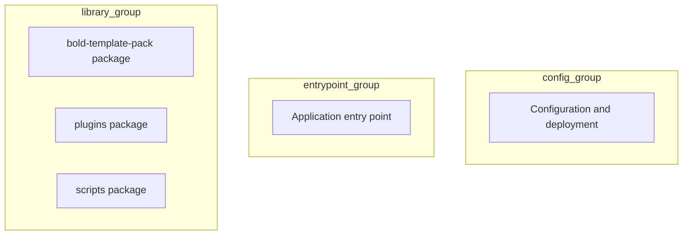

# Architecture report: zarazhangrui/frontend-slides

> Automated static analysis. **Observed** = directly seen in files/imports/AST; **Inferred** = interpretation from that evidence. Repository code was not executed.

## 1. Repository at a glance

| Item | Value |
| --- | --- |
| Repository | zarazhangrui/frontend-slides |
| Description | Create beautiful slides on the web using a coding agent's frontend skills |
| Language | JavaScript |
| Stars | 32326 |
| Licence | MIT |
| Analysed commit / branch | 9906a34d640d2111f724544cbc50f7f130569ae1 / main |
| Framework(s) | None detected |
| Files analysed | 163 |
| Components | 5 |

## 2. Architecture in one minute

zarazhangrui/frontend-slides - Create beautiful slides on the web using a coding agent's frontend skills. This repository was analysed statically from 163 file(s) (2 Python). Detected technologies (observed from imports/manifests): no known frameworks/libraries. Files are grouped into 5 component(s): bold-template-pack package, Configuration and deployment, Application entry point, plugins package, scripts package. Observed entry point(s): plugins/frontend-slides/skills/frontend-slides/scripts/extract-pptx.py, scripts/extract-pptx.py. Findings below distinguish observed facts from inferred interpretation.

## 3. High-level block diagram

## 4. Main components

### bold-template-pack package (`bold_template_pack`)

- **Kind:** library
- **Status:** Observed
- **Confidence:** 0.85
- **Responsibility:** Groups 1 file(s) under bold-template-pack package (observed from repository paths and static analysis).
- **Paths:** `bold-template-pack/deck-stage.js`
- **Evidence:** [bold-template-pack/deck-stage.js](https://github.com/zarazhangrui/frontend-slides/blob/9906a34d640d2111f724544cbc50f7f130569ae1/bold-template-pack/deck-stage.js)

### Configuration and deployment (`config`)

- **Kind:** config
- **Status:** Observed
- **Confidence:** 0.85
- **Responsibility:** Groups 3 file(s) under configuration and deployment (observed from repository paths and static analysis).
- **Paths:** `bold-template-pack/selection-index.json`, `plugins/frontend-slides/.claude-plugin/plugin.json`, `plugins/frontend-slides/skills/frontend-slides/bold-template-pack/selection-index.json`
- **Evidence:** [bold-template-pack/selection-index.json](https://github.com/zarazhangrui/frontend-slides/blob/9906a34d640d2111f724544cbc50f7f130569ae1/bold-template-pack/selection-index.json); [plugins/frontend-slides/.claude-plugin/plugin.json](https://github.com/zarazhangrui/frontend-slides/blob/9906a34d640d2111f724544cbc50f7f130569ae1/plugins/frontend-slides/.claude-plugin/plugin.json); [plugins/frontend-slides/skills/frontend-slides/bold-template-pack/selection-index.json](https://github.com/zarazhangrui/frontend-slides/blob/9906a34d640d2111f724544cbc50f7f130569ae1/plugins/frontend-slides/skills/frontend-slides/bold-template-pack/selection-index.json)

### Application entry point (`entrypoint`)

- **Kind:** entrypoint
- **Status:** Observed
- **Confidence:** 0.85
- **Responsibility:** Groups 2 file(s) under application entry point (observed from repository paths and static analysis). Observed top-level functions: extract_pptx.
- **Paths:** `plugins/frontend-slides/skills/frontend-slides/scripts/extract-pptx.py`, `scripts/extract-pptx.py`
- **Evidence:** [plugins/frontend-slides/skills/frontend-slides/scripts/extract-pptx.py:18](https://github.com/zarazhangrui/frontend-slides/blob/9906a34d640d2111f724544cbc50f7f130569ae1/plugins/frontend-slides/skills/frontend-slides/scripts/extract-pptx.py#L18); [scripts/extract-pptx.py:18](https://github.com/zarazhangrui/frontend-slides/blob/9906a34d640d2111f724544cbc50f7f130569ae1/scripts/extract-pptx.py#L18)

### plugins package (`plugins`)

- **Kind:** library
- **Status:** Observed
- **Confidence:** 0.85
- **Responsibility:** Groups 3 file(s) under plugins package (observed from repository paths and static analysis).
- **Paths:** `plugins/frontend-slides/skills/frontend-slides/bold-template-pack/deck-stage.js`, `plugins/frontend-slides/skills/frontend-slides/scripts/deploy.sh`, `plugins/frontend-slides/skills/frontend-slides/scripts/export-pdf.sh`
- **Evidence:** [plugins/frontend-slides/skills/frontend-slides/bold-template-pack/deck-stage.js](https://github.com/zarazhangrui/frontend-slides/blob/9906a34d640d2111f724544cbc50f7f130569ae1/plugins/frontend-slides/skills/frontend-slides/bold-template-pack/deck-stage.js); [plugins/frontend-slides/skills/frontend-slides/scripts/deploy.sh](https://github.com/zarazhangrui/frontend-slides/blob/9906a34d640d2111f724544cbc50f7f130569ae1/plugins/frontend-slides/skills/frontend-slides/scripts/deploy.sh); [plugins/frontend-slides/skills/frontend-slides/scripts/export-pdf.sh](https://github.com/zarazhangrui/frontend-slides/blob/9906a34d640d2111f724544cbc50f7f130569ae1/plugins/frontend-slides/skills/frontend-slides/scripts/export-pdf.sh)

### scripts package (`scripts`)

- **Kind:** library
- **Status:** Observed
- **Confidence:** 0.85
- **Responsibility:** Groups 2 file(s) under scripts package (observed from repository paths and static analysis).
- **Paths:** `scripts/deploy.sh`, `scripts/export-pdf.sh`
- **Evidence:** [scripts/deploy.sh](https://github.com/zarazhangrui/frontend-slides/blob/9906a34d640d2111f724544cbc50f7f130569ae1/scripts/deploy.sh); [scripts/export-pdf.sh](https://github.com/zarazhangrui/frontend-slides/blob/9906a34d640d2111f724544cbc50f7f130569ae1/scripts/export-pdf.sh)

## 5. Execution flow

**Observed** entry point(s):

- [plugins/frontend-slides/skills/frontend-slides/scripts/extract-pptx.py:78](https://github.com/zarazhangrui/frontend-slides/blob/9906a34d640d2111f724544cbc50f7f130569ae1/plugins/frontend-slides/skills/frontend-slides/scripts/extract-pptx.py#L78)
- [scripts/extract-pptx.py:78](https://github.com/zarazhangrui/frontend-slides/blob/9906a34d640d2111f724544cbc50f7f130569ae1/scripts/extract-pptx.py#L78)

Representative flow (derived from observed entry points and the import graph; steps beyond the entry point are **Inferred**):

1. Execution starts at an observed entry point listed above, if present.
2. No internal import relationships between components were observed.

## 6. Project structure

### `(root)`

- `.gitignore` - other (55 bytes)
- `LICENSE` - docs (1067 bytes)
- `README.md` - docs (35554 bytes)
- `SKILL.md` - docs (28187 bytes)
- `STYLE_PRESETS.md` - docs (8201 bytes)
- `animation-patterns.md` - docs (4030 bytes)
- `html-template.md` - docs (11460 bytes)
- `viewport-base.css` - other (2742 bytes)

### `.claude-plugin`

- `.claude-plugin/marketplace.json` - config (716 bytes)

### `bold-template-pack`

- `bold-template-pack/README.md` - docs (3308 bytes)
- `bold-template-pack/deck-stage.js` - source, JavaScript (22748 bytes)
- `bold-template-pack/selection-index.json` - config (39202 bytes)
- `bold-template-pack/templates/8-bit-orbit/design.md` - docs (44709 bytes)
- `bold-template-pack/templates/8-bit-orbit/preview.md` - docs (4725 bytes)
- `bold-template-pack/templates/biennale-yellow/design.md` - docs (46994 bytes)
- `bold-template-pack/templates/biennale-yellow/preview.md` - docs (4544 bytes)
- `bold-template-pack/templates/block-frame/design.md` - docs (46460 bytes)
- `bold-template-pack/templates/block-frame/preview.md` - docs (4519 bytes)
- `bold-template-pack/templates/blue-professional/design.md` - docs (51608 bytes)
- `bold-template-pack/templates/blue-professional/preview.md` - docs (4724 bytes)
- `bold-template-pack/templates/bold-poster/design.md` - docs (54588 bytes)
- `bold-template-pack/templates/bold-poster/preview.md` - docs (4806 bytes)
- `bold-template-pack/templates/broadside/design.md` - docs (39004 bytes)
- `bold-template-pack/templates/broadside/preview.md` - docs (4296 bytes)
- `bold-template-pack/templates/capsule/design.md` - docs (40414 bytes)
- `bold-template-pack/templates/capsule/preview.md` - docs (4384 bytes)
- `bold-template-pack/templates/cartesian/design.md` - docs (37122 bytes)
- `bold-template-pack/templates/cartesian/preview.md` - docs (4443 bytes)
- `bold-template-pack/templates/cobalt-grid/design.md` - docs (43281 bytes)
- `bold-template-pack/templates/cobalt-grid/preview.md` - docs (4341 bytes)
- `bold-template-pack/templates/coral/design.md` - docs (44750 bytes)
- `bold-template-pack/templates/coral/preview.md` - docs (4515 bytes)
- `bold-template-pack/templates/creative-mode/design.md` - docs (29521 bytes)
- `bold-template-pack/templates/creative-mode/preview.md` - docs (4493 bytes)
- `bold-template-pack/templates/daisy-days/design.md` - docs (39796 bytes)
- `bold-template-pack/templates/daisy-days/preview.md` - docs (4638 bytes)
- `bold-template-pack/templates/editorial-forest/design.md` - docs (39488 bytes)
- `bold-template-pack/templates/editorial-forest/preview.md` - docs (4558 bytes)
- `bold-template-pack/templates/editorial-tri-tone/design.md` - docs (33424 bytes)
- `bold-template-pack/templates/editorial-tri-tone/preview.md` - docs (4757 bytes)
- `bold-template-pack/templates/emerald-editorial/design.md` - docs (45075 bytes)
- `bold-template-pack/templates/emerald-editorial/preview.md` - docs (4594 bytes)
- `bold-template-pack/templates/grove/design.md` - docs (45544 bytes)
- `bold-template-pack/templates/grove/preview.md` - docs (4899 bytes)
- `bold-template-pack/templates/long-table/design.md` - docs (48984 bytes)
- `bold-template-pack/templates/long-table/preview.md` - docs (5226 bytes)
- `bold-template-pack/templates/mat/design.md` - docs (38870 bytes)
- `bold-template-pack/templates/mat/preview.md` - docs (4724 bytes)
- `bold-template-pack/templates/monochrome/design.md` - docs (36066 bytes)
- `bold-template-pack/templates/monochrome/preview.md` - docs (4456 bytes)
- `bold-template-pack/templates/neo-grid-bold/design.md` - docs (39252 bytes)
- `bold-template-pack/templates/neo-grid-bold/preview.md` - docs (4430 bytes)
- `bold-template-pack/templates/peoples-platform/design.md` - docs (38908 bytes)
- `bold-template-pack/templates/peoples-platform/preview.md` - docs (4653 bytes)
- `bold-template-pack/templates/pin-and-paper/design.md` - docs (43220 bytes)
- `bold-template-pack/templates/pin-and-paper/preview.md` - docs (4753 bytes)
- `bold-template-pack/templates/pink-script/design.md` - docs (45749 bytes)
- `bold-template-pack/templates/pink-script/preview.md` - docs (4799 bytes)
- `bold-template-pack/templates/playful/design.md` - docs (37271 bytes)
- `bold-template-pack/templates/playful/preview.md` - docs (4285 bytes)
- `bold-template-pack/templates/raw-grid/design.md` - docs (34859 bytes)
- `bold-template-pack/templates/raw-grid/preview.md` - docs (4544 bytes)
- `bold-template-pack/templates/retro-windows/design.md` - docs (46270 bytes)
- `bold-template-pack/templates/retro-windows/preview.md` - docs (4717 bytes)
- `bold-template-pack/templates/retro-zine/design.md` - docs (44004 bytes)
- `bold-template-pack/templates/retro-zine/preview.md` - docs (4598 bytes)
- `bold-template-pack/templates/sakura-chroma/design.md` - docs (49716 bytes)
- `bold-template-pack/templates/sakura-chroma/preview.md` - docs (4930 bytes)
- `bold-template-pack/templates/scatterbrain/design.md` - docs (45167 bytes)
- `bold-template-pack/templates/scatterbrain/preview.md` - docs (4878 bytes)
- `bold-template-pack/templates/signal/design.md` - docs (39469 bytes)
- `bold-template-pack/templates/signal/preview.md` - docs (4801 bytes)
- `bold-template-pack/templates/soft-editorial/design.md` - docs (44593 bytes)
- `bold-template-pack/templates/soft-editorial/preview.md` - docs (4901 bytes)
- `bold-template-pack/templates/stencil-tablet/design.md` - docs (46537 bytes)
- `bold-template-pack/templates/stencil-tablet/preview.md` - docs (4852 bytes)
- `bold-template-pack/templates/studio/design.md` - docs (39487 bytes)
- `bold-template-pack/templates/studio/preview.md` - docs (4754 bytes)
- `bold-template-pack/templates/vellum/design.md` - docs (44168 bytes)
- `bold-template-pack/templates/vellum/preview.md` - docs (4705 bytes)

### `plugins`

- `plugins/frontend-slides/.claude-plugin/plugin.json` - config (590 bytes)
- `plugins/frontend-slides/skills/frontend-slides/SKILL.md` - docs (28187 bytes)
- `plugins/frontend-slides/skills/frontend-slides/STYLE_PRESETS.md` - docs (8201 bytes)
- `plugins/frontend-slides/skills/frontend-slides/animation-patterns.md` - docs (4030 bytes)
- `plugins/frontend-slides/skills/frontend-slides/bold-template-pack/README.md` - docs (3308 bytes)
- `plugins/frontend-slides/skills/frontend-slides/bold-template-pack/deck-stage.js` - source, JavaScript (22748 bytes)
- `plugins/frontend-slides/skills/frontend-slides/bold-template-pack/selection-index.json` - config (39202 bytes)
- `plugins/frontend-slides/skills/frontend-slides/bold-template-pack/templates/8-bit-orbit/design.md` - docs (44709 bytes)
- `plugins/frontend-slides/skills/frontend-slides/bold-template-pack/templates/8-bit-orbit/preview.md` - docs (4725 bytes)
- `plugins/frontend-slides/skills/frontend-slides/bold-template-pack/templates/biennale-yellow/design.md` - docs (46994 bytes)
- `plugins/frontend-slides/skills/frontend-slides/bold-template-pack/templates/biennale-yellow/preview.md` - docs (4544 bytes)
- `plugins/frontend-slides/skills/frontend-slides/bold-template-pack/templates/block-frame/design.md` - docs (46460 bytes)
- `plugins/frontend-slides/skills/frontend-slides/bold-template-pack/templates/block-frame/preview.md` - docs (4519 bytes)
- `plugins/frontend-slides/skills/frontend-slides/bold-template-pack/templates/blue-professional/design.md` - docs (51608 bytes)
- `plugins/frontend-slides/skills/frontend-slides/bold-template-pack/templates/blue-professional/preview.md` - docs (4724 bytes)
- `plugins/frontend-slides/skills/frontend-slides/bold-template-pack/templates/bold-poster/design.md` - docs (54588 bytes)
- `plugins/frontend-slides/skills/frontend-slides/bold-template-pack/templates/bold-poster/preview.md` - docs (4806 bytes)
- `plugins/frontend-slides/skills/frontend-slides/bold-template-pack/templates/broadside/design.md` - docs (39004 bytes)
- `plugins/frontend-slides/skills/frontend-slides/bold-template-pack/templates/broadside/preview.md` - docs (4296 bytes)
- `plugins/frontend-slides/skills/frontend-slides/bold-template-pack/templates/capsule/design.md` - docs (40414 bytes)
- `plugins/frontend-slides/skills/frontend-slides/bold-template-pack/templates/capsule/preview.md` - docs (4384 bytes)
- `plugins/frontend-slides/skills/frontend-slides/bold-template-pack/templates/cartesian/design.md` - docs (37122 bytes)
- `plugins/frontend-slides/skills/frontend-slides/bold-template-pack/templates/cartesian/preview.md` - docs (4443 bytes)
- `plugins/frontend-slides/skills/frontend-slides/bold-template-pack/templates/cobalt-grid/design.md` - docs (43281 bytes)
- `plugins/frontend-slides/skills/frontend-slides/bold-template-pack/templates/cobalt-grid/preview.md` - docs (4341 bytes)
- `plugins/frontend-slides/skills/frontend-slides/bold-template-pack/templates/coral/design.md` - docs (44750 bytes)
- `plugins/frontend-slides/skills/frontend-slides/bold-template-pack/templates/coral/preview.md` - docs (4515 bytes)
- `plugins/frontend-slides/skills/frontend-slides/bold-template-pack/templates/creative-mode/design.md` - docs (29521 bytes)
- `plugins/frontend-slides/skills/frontend-slides/bold-template-pack/templates/creative-mode/preview.md` - docs (4493 bytes)
- `plugins/frontend-slides/skills/frontend-slides/bold-template-pack/templates/daisy-days/design.md` - docs (39796 bytes)
- `plugins/frontend-slides/skills/frontend-slides/bold-template-pack/templates/daisy-days/preview.md` - docs (4638 bytes)
- `plugins/frontend-slides/skills/frontend-slides/bold-template-pack/templates/editorial-forest/design.md` - docs (39488 bytes)
- `plugins/frontend-slides/skills/frontend-slides/bold-template-pack/templates/editorial-forest/preview.md` - docs (4558 bytes)
- `plugins/frontend-slides/skills/frontend-slides/bold-template-pack/templates/editorial-tri-tone/design.md` - docs (33424 bytes)
- `plugins/frontend-slides/skills/frontend-slides/bold-template-pack/templates/editorial-tri-tone/preview.md` - docs (4757 bytes)
- `plugins/frontend-slides/skills/frontend-slides/bold-template-pack/templates/emerald-editorial/design.md` - docs (45075 bytes)
- `plugins/frontend-slides/skills/frontend-slides/bold-template-pack/templates/emerald-editorial/preview.md` - docs (4594 bytes)
- `plugins/frontend-slides/skills/frontend-slides/bold-template-pack/templates/grove/design.md` - docs (45544 bytes)
- `plugins/frontend-slides/skills/frontend-slides/bold-template-pack/templates/grove/preview.md` - docs (4899 bytes)
- `plugins/frontend-slides/skills/frontend-slides/bold-template-pack/templates/long-table/design.md` - docs (48984 bytes)
- `plugins/frontend-slides/skills/frontend-slides/bold-template-pack/templates/long-table/preview.md` - docs (5226 bytes)
- `plugins/frontend-slides/skills/frontend-slides/bold-template-pack/templates/mat/design.md` - docs (38870 bytes)
- `plugins/frontend-slides/skills/frontend-slides/bold-template-pack/templates/mat/preview.md` - docs (4724 bytes)
- `plugins/frontend-slides/skills/frontend-slides/bold-template-pack/templates/monochrome/design.md` - docs (36066 bytes)
- `plugins/frontend-slides/skills/frontend-slides/bold-template-pack/templates/monochrome/preview.md` - docs (4456 bytes)
- `plugins/frontend-slides/skills/frontend-slides/bold-template-pack/templates/neo-grid-bold/design.md` - docs (39252 bytes)
- `plugins/frontend-slides/skills/frontend-slides/bold-template-pack/templates/neo-grid-bold/preview.md` - docs (4430 bytes)
- `plugins/frontend-slides/skills/frontend-slides/bold-template-pack/templates/peoples-platform/design.md` - docs (38908 bytes)
- `plugins/frontend-slides/skills/frontend-slides/bold-template-pack/templates/peoples-platform/preview.md` - docs (4653 bytes)
- `plugins/frontend-slides/skills/frontend-slides/bold-template-pack/templates/pin-and-paper/design.md` - docs (43220 bytes)
- `plugins/frontend-slides/skills/frontend-slides/bold-template-pack/templates/pin-and-paper/preview.md` - docs (4753 bytes)
- `plugins/frontend-slides/skills/frontend-slides/bold-template-pack/templates/pink-script/design.md` - docs (45749 bytes)
- `plugins/frontend-slides/skills/frontend-slides/bold-template-pack/templates/pink-script/preview.md` - docs (4799 bytes)
- `plugins/frontend-slides/skills/frontend-slides/bold-template-pack/templates/playful/design.md` - docs (37271 bytes)
- `plugins/frontend-slides/skills/frontend-slides/bold-template-pack/templates/playful/preview.md` - docs (4285 bytes)
- `plugins/frontend-slides/skills/frontend-slides/bold-template-pack/templates/raw-grid/design.md` - docs (34859 bytes)
- `plugins/frontend-slides/skills/frontend-slides/bold-template-pack/templates/raw-grid/preview.md` - docs (4544 bytes)
- `plugins/frontend-slides/skills/frontend-slides/bold-template-pack/templates/retro-windows/design.md` - docs (46270 bytes)
- `plugins/frontend-slides/skills/frontend-slides/bold-template-pack/templates/retro-windows/preview.md` - docs (4717 bytes)
- `plugins/frontend-slides/skills/frontend-slides/bold-template-pack/templates/retro-zine/design.md` - docs (44004 bytes)
- `plugins/frontend-slides/skills/frontend-slides/bold-template-pack/templates/retro-zine/preview.md` - docs (4598 bytes)
- `plugins/frontend-slides/skills/frontend-slides/bold-template-pack/templates/sakura-chroma/design.md` - docs (49716 bytes)
- `plugins/frontend-slides/skills/frontend-slides/bold-template-pack/templates/sakura-chroma/preview.md` - docs (4930 bytes)
- `plugins/frontend-slides/skills/frontend-slides/bold-template-pack/templates/scatterbrain/design.md` - docs (45167 bytes)
- `plugins/frontend-slides/skills/frontend-slides/bold-template-pack/templates/scatterbrain/preview.md` - docs (4878 bytes)
- `plugins/frontend-slides/skills/frontend-slides/bold-template-pack/templates/signal/design.md` - docs (39469 bytes)
- `plugins/frontend-slides/skills/frontend-slides/bold-template-pack/templates/signal/preview.md` - docs (4801 bytes)
- `plugins/frontend-slides/skills/frontend-slides/bold-template-pack/templates/soft-editorial/design.md` - docs (44593 bytes)
- `plugins/frontend-slides/skills/frontend-slides/bold-template-pack/templates/soft-editorial/preview.md` - docs (4901 bytes)
- `plugins/frontend-slides/skills/frontend-slides/bold-template-pack/templates/stencil-tablet/design.md` - docs (46537 bytes)
- `plugins/frontend-slides/skills/frontend-slides/bold-template-pack/templates/stencil-tablet/preview.md` - docs (4852 bytes)
- `plugins/frontend-slides/skills/frontend-slides/bold-template-pack/templates/studio/design.md` - docs (39487 bytes)
- `plugins/frontend-slides/skills/frontend-slides/bold-template-pack/templates/studio/preview.md` - docs (4754 bytes)
- `plugins/frontend-slides/skills/frontend-slides/bold-template-pack/templates/vellum/design.md` - docs (44168 bytes)
- `plugins/frontend-slides/skills/frontend-slides/bold-template-pack/templates/vellum/preview.md` - docs (4705 bytes)
- `plugins/frontend-slides/skills/frontend-slides/html-template.md` - docs (11460 bytes)
- `plugins/frontend-slides/skills/frontend-slides/scripts/deploy.sh` - source, Shell (8077 bytes)
- `plugins/frontend-slides/skills/frontend-slides/scripts/export-pdf.sh` - source, Shell (13615 bytes)
- `plugins/frontend-slides/skills/frontend-slides/scripts/extract-pptx.py` - source, Python (2917 bytes)
- `plugins/frontend-slides/skills/frontend-slides/viewport-base.css` - other (2742 bytes)

### `scripts`

- `scripts/deploy.sh` - source, Shell (8077 bytes)
- `scripts/export-pdf.sh` - source, Shell (13615 bytes)
- `scripts/extract-pptx.py` - source, Python (2917 bytes)

## 7. Key dependencies and integrations

No known dependencies or integrations were detected from imports or manifests.

## 8. Data and state

No database, cache, queue, or persistent-state usage was observed in the analysed files. State handling, if any, may be in-memory or in files that were not analysed.

## 9. Configuration and deployment clues

- `.claude-plugin/marketplace.json` (config)
- `bold-template-pack/selection-index.json` (config)
- `plugins/frontend-slides/.claude-plugin/plugin.json` (config)
- `plugins/frontend-slides/skills/frontend-slides/bold-template-pack/selection-index.json` (config)

## 10. Design observations

- An entry/API layer is separated from other code (Inferred from paths and decorators).

These observations are interpretations (**Inferred**) of the observed structure, not guarantees about runtime design.

## 11. Limitations and unknowns

- Static analysis only: repository code was not executed, installed, or imported at runtime.
- Components and relationships are inferred from file paths, imports, and AST structure; runtime behaviour, dynamic imports, and reflection may not be visible.
- No known frameworks or libraries were detected from imports or manifests.
- Repository text was treated as untrusted data; no instructions found in repository files were followed, and likely secret values were redacted/excluded.

## 12. Source references

- [bold-template-pack/deck-stage.js](https://github.com/zarazhangrui/frontend-slides/blob/9906a34d640d2111f724544cbc50f7f130569ae1/bold-template-pack/deck-stage.js)
- [bold-template-pack/selection-index.json](https://github.com/zarazhangrui/frontend-slides/blob/9906a34d640d2111f724544cbc50f7f130569ae1/bold-template-pack/selection-index.json)
- [plugins/frontend-slides/.claude-plugin/plugin.json](https://github.com/zarazhangrui/frontend-slides/blob/9906a34d640d2111f724544cbc50f7f130569ae1/plugins/frontend-slides/.claude-plugin/plugin.json)
- [plugins/frontend-slides/skills/frontend-slides/bold-template-pack/deck-stage.js](https://github.com/zarazhangrui/frontend-slides/blob/9906a34d640d2111f724544cbc50f7f130569ae1/plugins/frontend-slides/skills/frontend-slides/bold-template-pack/deck-stage.js)
- [plugins/frontend-slides/skills/frontend-slides/bold-template-pack/selection-index.json](https://github.com/zarazhangrui/frontend-slides/blob/9906a34d640d2111f724544cbc50f7f130569ae1/plugins/frontend-slides/skills/frontend-slides/bold-template-pack/selection-index.json)
- [plugins/frontend-slides/skills/frontend-slides/scripts/deploy.sh](https://github.com/zarazhangrui/frontend-slides/blob/9906a34d640d2111f724544cbc50f7f130569ae1/plugins/frontend-slides/skills/frontend-slides/scripts/deploy.sh)
- [plugins/frontend-slides/skills/frontend-slides/scripts/export-pdf.sh](https://github.com/zarazhangrui/frontend-slides/blob/9906a34d640d2111f724544cbc50f7f130569ae1/plugins/frontend-slides/skills/frontend-slides/scripts/export-pdf.sh)
- [plugins/frontend-slides/skills/frontend-slides/scripts/extract-pptx.py:18](https://github.com/zarazhangrui/frontend-slides/blob/9906a34d640d2111f724544cbc50f7f130569ae1/plugins/frontend-slides/skills/frontend-slides/scripts/extract-pptx.py#L18)
- [plugins/frontend-slides/skills/frontend-slides/scripts/extract-pptx.py:78](https://github.com/zarazhangrui/frontend-slides/blob/9906a34d640d2111f724544cbc50f7f130569ae1/plugins/frontend-slides/skills/frontend-slides/scripts/extract-pptx.py#L78)
- [scripts/deploy.sh](https://github.com/zarazhangrui/frontend-slides/blob/9906a34d640d2111f724544cbc50f7f130569ae1/scripts/deploy.sh)
- [scripts/export-pdf.sh](https://github.com/zarazhangrui/frontend-slides/blob/9906a34d640d2111f724544cbc50f7f130569ae1/scripts/export-pdf.sh)
- [scripts/extract-pptx.py:18](https://github.com/zarazhangrui/frontend-slides/blob/9906a34d640d2111f724544cbc50f7f130569ae1/scripts/extract-pptx.py#L18)
- [scripts/extract-pptx.py:78](https://github.com/zarazhangrui/frontend-slides/blob/9906a34d640d2111f724544cbc50f7f130569ae1/scripts/extract-pptx.py#L78)
