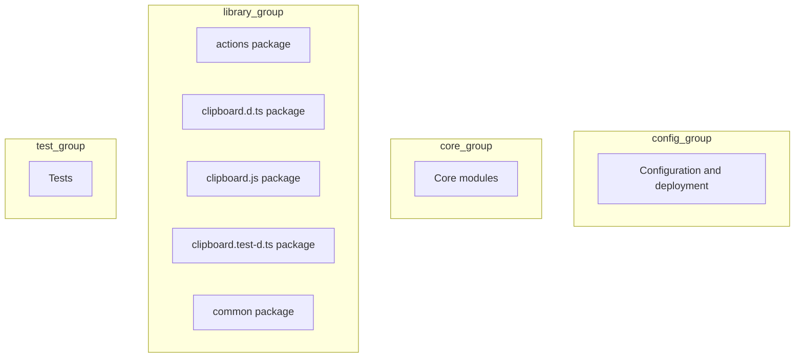

# Architecture report: zenorocha/clipboard.js

> Automated static analysis. **Observed** = directly seen in files/imports/AST; **Inferred** = interpretation from that evidence. Repository code was not executed.

## 1. Repository at a glance

| Item | Value |
| --- | --- |
| Repository | zenorocha/clipboard.js |
| Description | :scissors: Modern copy to clipboard. No Flash. Just 3kb gzipped :clipboard: |
| Language | JavaScript |
| Stars | 34078 |
| Licence | MIT |
| Analysed commit / branch | 899378dee9681dcf4cb3d702c23a3f3cd9f473d8 / master |
| Framework(s) | None detected |
| Files analysed | 52 |
| Components | 8 |

## 2. Architecture in one minute

zenorocha/clipboard.js - :scissors: Modern copy to clipboard. No Flash. Just 3kb gzipped :clipboard:. This repository was analysed statically from 52 file(s) (0 Python). Detected technologies (observed from imports/manifests): GitHub Actions, webpack. Files are grouped into 8 component(s): actions package, clipboard.d.ts package, clipboard.js package, clipboard.test-d.ts package, common package, Configuration and deployment, Core modules, Tests. Findings below distinguish observed facts from inferred interpretation.

## 3. High-level block diagram

## 4. Main components

### actions package (`actions`)

- **Kind:** library
- **Status:** Observed
- **Confidence:** 0.85
- **Responsibility:** Groups 3 file(s) under actions package (observed from repository paths and static analysis).
- **Paths:** `src/actions/copy.js`, `src/actions/cut.js`, `src/actions/default.js`
- **Evidence:** [src/actions/copy.js](https://github.com/zenorocha/clipboard.js/blob/899378dee9681dcf4cb3d702c23a3f3cd9f473d8/src/actions/copy.js); [src/actions/cut.js](https://github.com/zenorocha/clipboard.js/blob/899378dee9681dcf4cb3d702c23a3f3cd9f473d8/src/actions/cut.js); [src/actions/default.js](https://github.com/zenorocha/clipboard.js/blob/899378dee9681dcf4cb3d702c23a3f3cd9f473d8/src/actions/default.js)

### clipboard.d.ts package (`clipboard_d_ts`)

- **Kind:** library
- **Status:** Observed
- **Confidence:** 0.85
- **Responsibility:** Groups 1 file(s) under clipboard.d.ts package (observed from repository paths and static analysis).
- **Paths:** `src/clipboard.d.ts`
- **Evidence:** [src/clipboard.d.ts](https://github.com/zenorocha/clipboard.js/blob/899378dee9681dcf4cb3d702c23a3f3cd9f473d8/src/clipboard.d.ts)

### clipboard.js package (`clipboard_js`)

- **Kind:** library
- **Status:** Observed
- **Confidence:** 0.85
- **Responsibility:** Groups 1 file(s) under clipboard.js package (observed from repository paths and static analysis).
- **Paths:** `src/clipboard.js`
- **Evidence:** [src/clipboard.js](https://github.com/zenorocha/clipboard.js/blob/899378dee9681dcf4cb3d702c23a3f3cd9f473d8/src/clipboard.js)

### clipboard.test-d.ts package (`clipboard_test_d_ts`)

- **Kind:** library
- **Status:** Observed
- **Confidence:** 0.85
- **Responsibility:** Groups 1 file(s) under clipboard.test-d.ts package (observed from repository paths and static analysis).
- **Paths:** `src/clipboard.test-d.ts`
- **Evidence:** [src/clipboard.test-d.ts](https://github.com/zenorocha/clipboard.js/blob/899378dee9681dcf4cb3d702c23a3f3cd9f473d8/src/clipboard.test-d.ts)

### common package (`common`)

- **Kind:** library
- **Status:** Observed
- **Confidence:** 0.85
- **Responsibility:** Groups 2 file(s) under common package (observed from repository paths and static analysis).
- **Paths:** `src/common/command.js`, `src/common/create-fake-element.js`
- **Evidence:** [src/common/command.js](https://github.com/zenorocha/clipboard.js/blob/899378dee9681dcf4cb3d702c23a3f3cd9f473d8/src/common/command.js); [src/common/create-fake-element.js](https://github.com/zenorocha/clipboard.js/blob/899378dee9681dcf4cb3d702c23a3f3cd9f473d8/src/common/create-fake-element.js)

### Configuration and deployment (`config`)

- **Kind:** config
- **Status:** Observed
- **Confidence:** 0.85
- **Responsibility:** Groups 3 file(s) under configuration and deployment (observed from repository paths and static analysis).
- **Paths:** `bower.json`, `composer.json`, `package.json`
- **Evidence:** [bower.json](https://github.com/zenorocha/clipboard.js/blob/899378dee9681dcf4cb3d702c23a3f3cd9f473d8/bower.json); [composer.json](https://github.com/zenorocha/clipboard.js/blob/899378dee9681dcf4cb3d702c23a3f3cd9f473d8/composer.json); [package.json](https://github.com/zenorocha/clipboard.js/blob/899378dee9681dcf4cb3d702c23a3f3cd9f473d8/package.json)

### Core modules (`core`)

- **Kind:** core
- **Status:** Observed
- **Confidence:** 0.85
- **Responsibility:** Groups 3 file(s) under core modules (observed from repository paths and static analysis).
- **Paths:** `karma.conf.js`, `package.js`, `webpack.config.js`
- **Evidence:** [karma.conf.js](https://github.com/zenorocha/clipboard.js/blob/899378dee9681dcf4cb3d702c23a3f3cd9f473d8/karma.conf.js); [package.js](https://github.com/zenorocha/clipboard.js/blob/899378dee9681dcf4cb3d702c23a3f3cd9f473d8/package.js); [webpack.config.js](https://github.com/zenorocha/clipboard.js/blob/899378dee9681dcf4cb3d702c23a3f3cd9f473d8/webpack.config.js)

### Tests (`tests`)

- **Kind:** test
- **Status:** Observed
- **Confidence:** 0.85
- **Responsibility:** Groups 6 file(s) under tests (observed from repository paths and static analysis).
- **Paths:** `test/actions/copy.js`, `test/actions/cut.js`, `test/actions/default.js`, `test/clipboard.js`, `test/common/command.js`, `test/common/create-fake-element.js`
- **Evidence:** [test/actions/copy.js](https://github.com/zenorocha/clipboard.js/blob/899378dee9681dcf4cb3d702c23a3f3cd9f473d8/test/actions/copy.js); [test/actions/cut.js](https://github.com/zenorocha/clipboard.js/blob/899378dee9681dcf4cb3d702c23a3f3cd9f473d8/test/actions/cut.js); [test/actions/default.js](https://github.com/zenorocha/clipboard.js/blob/899378dee9681dcf4cb3d702c23a3f3cd9f473d8/test/actions/default.js); [test/clipboard.js](https://github.com/zenorocha/clipboard.js/blob/899378dee9681dcf4cb3d702c23a3f3cd9f473d8/test/clipboard.js); [test/common/command.js](https://github.com/zenorocha/clipboard.js/blob/899378dee9681dcf4cb3d702c23a3f3cd9f473d8/test/common/command.js); [test/common/create-fake-element.js](https://github.com/zenorocha/clipboard.js/blob/899378dee9681dcf4cb3d702c23a3f3cd9f473d8/test/common/create-fake-element.js)

## 5. Execution flow

No entry point was observed; the startup flow below is therefore limited.

Representative flow (derived from observed entry points and the import graph; steps beyond the entry point are **Inferred**):

1. Execution starts at an observed entry point listed above, if present.
2. No internal import relationships between components were observed.

## 6. Project structure

### `(root)`

- `.babelrc.json` - config (132 bytes)
- `.editorconfig` - config (465 bytes)
- `.eslintignore` - other (115 bytes)
- `.eslintrc.json` - config (619 bytes)
- `.gitignore` - other (83 bytes)
- `.nvmrc` - other (3 bytes)
- `.prettierignore` - other (99 bytes)
- `.prettierrc.json` - config (158 bytes)
- `LICENSE` - docs (1062 bytes)
- `bower.json` - config (343 bytes)
- `composer.json` - config (527 bytes)
- `contributing.md` - docs (1898 bytes)
- `karma.conf.js` - source, JavaScript (719 bytes)
- `package.js` - source, JavaScript (306 bytes)
- `package.json` - manifest (1680 bytes)
- `readme.md` - docs (9461 bytes)
- `webpack.config.js` - source, JavaScript (1233 bytes)

### `.github`

- `.github/ISSUE_TEMPLATE/bug_report.md` - docs (1305 bytes)
- `.github/ISSUE_TEMPLATE/documentation.md` - docs (357 bytes)
- `.github/ISSUE_TEMPLATE/proposal.md` - docs (857 bytes)
- `.github/PULL_REQUEST_TEMPLATE.md` - docs (1166 bytes)
- `.github/stale.yml` - config (674 bytes)
- `.github/workflows/publish.yml` - ci, YAML (1177 bytes)
- `.github/workflows/test.js.yml` - ci, YAML (1012 bytes)

### `.husky`

- `.husky/.gitignore` - other (1 bytes)
- `.husky/pre-commit` - other (71 bytes)

### `demo`

- `demo/constructor-node.html` - other (966 bytes)
- `demo/constructor-nodelist.html` - other (1058 bytes)
- `demo/constructor-selector.html` - other (1036 bytes)
- `demo/function-target.html` - other (975 bytes)
- `demo/function-text.html` - other (941 bytes)
- `demo/target-div.html` - other (962 bytes)
- `demo/target-input-number.html` - other (895 bytes)
- `demo/target-input.html` - other (890 bytes)
- `demo/target-programmatic-copy.html` - other (724 bytes)
- `demo/target-programmatic-cut.html` - other (712 bytes)
- `demo/target-textarea.html` - other (985 bytes)
- `demo/text-programmatic-copy.html` - other (657 bytes)

### `src`

- `src/actions/copy.js` - source, JavaScript (1326 bytes)
- `src/actions/cut.js` - source, JavaScript (320 bytes)
- `src/actions/default.js` - source, JavaScript (1768 bytes)
- `src/clipboard.d.ts` - source, TypeScript (2018 bytes)
- `src/clipboard.js` - source, JavaScript (4075 bytes)
- `src/clipboard.test-d.ts` - source, TypeScript (123 bytes)
- `src/common/command.js` - source, JavaScript (218 bytes)
- `src/common/create-fake-element.js` - source, JavaScript (895 bytes)

### `test`

- `test/actions/copy.js` - test, JavaScript (1939 bytes)
- `test/actions/cut.js` - test, JavaScript (888 bytes)
- `test/actions/default.js` - test, JavaScript (2172 bytes)
- `test/clipboard.js` - test, JavaScript (4954 bytes)
- `test/common/command.js` - test, JavaScript (1163 bytes)
- `test/common/create-fake-element.js` - test, JavaScript (405 bytes)

## 7. Key dependencies and integrations

| Name | Category | Status | Confidence | Evidence |
| --- | --- | --- | --- | --- |
| GitHub Actions | ci | Observed | 0.90 | [.github/workflows/publish.yml](https://github.com/zenorocha/clipboard.js/blob/899378dee9681dcf4cb3d702c23a3f3cd9f473d8/.github/workflows/publish.yml); [.github/workflows/test.js.yml](https://github.com/zenorocha/clipboard.js/blob/899378dee9681dcf4cb3d702c23a3f3cd9f473d8/.github/workflows/test.js.yml) |
| webpack | tooling | Observed | 0.85 | [package.json:37](https://github.com/zenorocha/clipboard.js/blob/899378dee9681dcf4cb3d702c23a3f3cd9f473d8/package.json#L37) |

## 8. Data and state

No database, cache, queue, or persistent-state usage was observed in the analysed files. State handling, if any, may be in-memory or in files that were not analysed.

## 9. Configuration and deployment clues

- `.babelrc.json` (config)
- `.editorconfig` (config)
- `.eslintrc.json` (config)
- `.github/stale.yml` (config)
- `.github/workflows/publish.yml` (ci)
- `.github/workflows/test.js.yml` (ci)
- `.prettierrc.json` (config)
- `bower.json` (config)
- `composer.json` (config)
- `package.json` (manifest)

## 10. Design observations

- Tests are present alongside source code (Observed from test file paths).

These observations are interpretations (**Inferred**) of the observed structure, not guarantees about runtime design.

## 11. Limitations and unknowns

- Static analysis only: repository code was not executed, installed, or imported at runtime.
- Components and relationships are inferred from file paths, imports, and AST structure; runtime behaviour, dynamic imports, and reflection may not be visible.
- 1 file(s) were skipped during inventory (1 x vendored/generated directory excluded).
- No clear application entry point was observed in the analysed files.
- Repository text was treated as untrusted data; no instructions found in repository files were followed, and likely secret values were redacted/excluded.
- JavaScript and TypeScript files were inventoried from paths and package manifests. They were not parsed with a full language AST, and repository code was not executed.

## 12. Source references

- [.github/workflows/publish.yml](https://github.com/zenorocha/clipboard.js/blob/899378dee9681dcf4cb3d702c23a3f3cd9f473d8/.github/workflows/publish.yml)
- [.github/workflows/test.js.yml](https://github.com/zenorocha/clipboard.js/blob/899378dee9681dcf4cb3d702c23a3f3cd9f473d8/.github/workflows/test.js.yml)
- [bower.json](https://github.com/zenorocha/clipboard.js/blob/899378dee9681dcf4cb3d702c23a3f3cd9f473d8/bower.json)
- [composer.json](https://github.com/zenorocha/clipboard.js/blob/899378dee9681dcf4cb3d702c23a3f3cd9f473d8/composer.json)
- [karma.conf.js](https://github.com/zenorocha/clipboard.js/blob/899378dee9681dcf4cb3d702c23a3f3cd9f473d8/karma.conf.js)
- [package.js](https://github.com/zenorocha/clipboard.js/blob/899378dee9681dcf4cb3d702c23a3f3cd9f473d8/package.js)
- [package.json](https://github.com/zenorocha/clipboard.js/blob/899378dee9681dcf4cb3d702c23a3f3cd9f473d8/package.json)
- [package.json:37](https://github.com/zenorocha/clipboard.js/blob/899378dee9681dcf4cb3d702c23a3f3cd9f473d8/package.json#L37)
- [src/actions/copy.js](https://github.com/zenorocha/clipboard.js/blob/899378dee9681dcf4cb3d702c23a3f3cd9f473d8/src/actions/copy.js)
- [src/actions/cut.js](https://github.com/zenorocha/clipboard.js/blob/899378dee9681dcf4cb3d702c23a3f3cd9f473d8/src/actions/cut.js)
- [src/actions/default.js](https://github.com/zenorocha/clipboard.js/blob/899378dee9681dcf4cb3d702c23a3f3cd9f473d8/src/actions/default.js)
- [src/clipboard.d.ts](https://github.com/zenorocha/clipboard.js/blob/899378dee9681dcf4cb3d702c23a3f3cd9f473d8/src/clipboard.d.ts)
- [src/clipboard.js](https://github.com/zenorocha/clipboard.js/blob/899378dee9681dcf4cb3d702c23a3f3cd9f473d8/src/clipboard.js)
- [src/clipboard.test-d.ts](https://github.com/zenorocha/clipboard.js/blob/899378dee9681dcf4cb3d702c23a3f3cd9f473d8/src/clipboard.test-d.ts)
- [src/common/command.js](https://github.com/zenorocha/clipboard.js/blob/899378dee9681dcf4cb3d702c23a3f3cd9f473d8/src/common/command.js)
- [src/common/create-fake-element.js](https://github.com/zenorocha/clipboard.js/blob/899378dee9681dcf4cb3d702c23a3f3cd9f473d8/src/common/create-fake-element.js)
- [test/actions/copy.js](https://github.com/zenorocha/clipboard.js/blob/899378dee9681dcf4cb3d702c23a3f3cd9f473d8/test/actions/copy.js)
- [test/actions/cut.js](https://github.com/zenorocha/clipboard.js/blob/899378dee9681dcf4cb3d702c23a3f3cd9f473d8/test/actions/cut.js)
- [test/actions/default.js](https://github.com/zenorocha/clipboard.js/blob/899378dee9681dcf4cb3d702c23a3f3cd9f473d8/test/actions/default.js)
- [test/clipboard.js](https://github.com/zenorocha/clipboard.js/blob/899378dee9681dcf4cb3d702c23a3f3cd9f473d8/test/clipboard.js)
- [test/common/command.js](https://github.com/zenorocha/clipboard.js/blob/899378dee9681dcf4cb3d702c23a3f3cd9f473d8/test/common/command.js)
- [test/common/create-fake-element.js](https://github.com/zenorocha/clipboard.js/blob/899378dee9681dcf4cb3d702c23a3f3cd9f473d8/test/common/create-fake-element.js)
- [webpack.config.js](https://github.com/zenorocha/clipboard.js/blob/899378dee9681dcf4cb3d702c23a3f3cd9f473d8/webpack.config.js)
