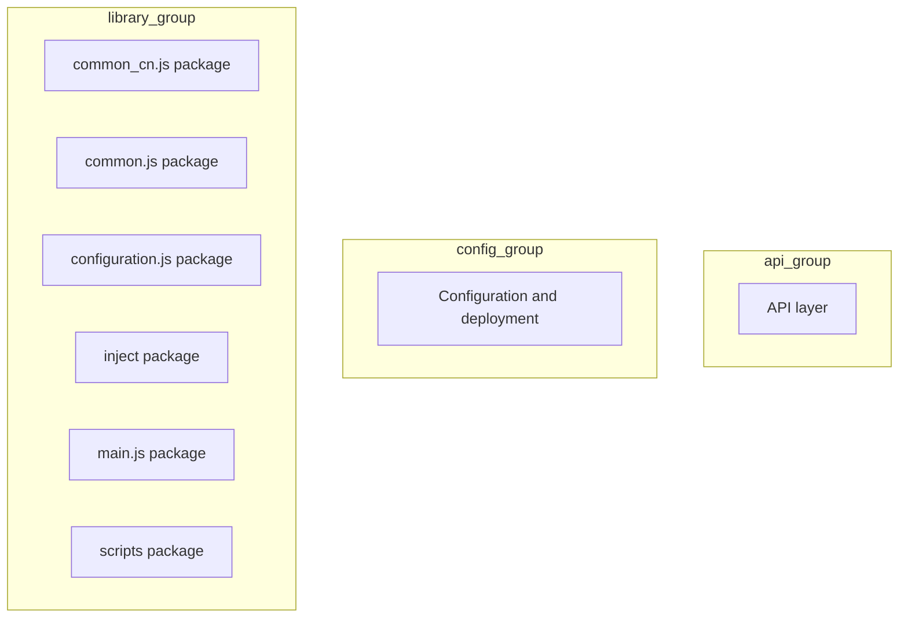

# Architecture report: zhongyi-tong/electronic-wechat

> Automated static analysis. **Observed** = directly seen in files/imports/AST; **Inferred** = interpretation from that evidence. Repository code was not executed.

## 1. Repository at a glance

| Item | Value |
| --- | --- |
| Repository | zhongyi-tong/electronic-wechat |
| Description | :speech_balloon: A better WeChat on macOS and Linux. Built with Electron by Zhongyi Tong. |
| Language | JavaScript |
| Stars | 13810 |
| Licence | MIT |
| Analysed commit / branch | dc50c871d9b5928234fdf91350ad5a90717804f3 / master |
| Framework(s) | Electron |
| Files analysed | 37 |
| Components | 8 |

## 2. Architecture in one minute

zhongyi-tong/electronic-wechat - :speech_balloon: A better WeChat on macOS and Linux. Built with Electron by Zhongyi Tong.. This repository was analysed statically from 37 file(s) (0 Python). Detected technologies (observed from imports/manifests): Electron. Files are grouped into 8 component(s): API layer, common_cn.js package, common.js package, Configuration and deployment, configuration.js package, inject package, main.js package, scripts package. Findings below distinguish observed facts from inferred interpretation.

## 3. High-level block diagram

## 4. Main components

### API layer (`api_layer`)

- **Kind:** api
- **Status:** Observed
- **Confidence:** 0.85
- **Responsibility:** Groups 7 file(s) under api layer (observed from repository paths and static analysis).
- **Paths:** `src/handlers/menu.js`, `src/handlers/message.js`, `src/handlers/update.js`, `src/windows/controllers/app_tray.js`, `src/windows/controllers/settings.js`, `src/windows/controllers/splash.js`, `src/windows/controllers/wechat.js`
- **Evidence:** [src/handlers/menu.js](https://github.com/zhongyi-tong/electronic-wechat/blob/dc50c871d9b5928234fdf91350ad5a90717804f3/src/handlers/menu.js); [src/handlers/message.js](https://github.com/zhongyi-tong/electronic-wechat/blob/dc50c871d9b5928234fdf91350ad5a90717804f3/src/handlers/message.js); [src/handlers/update.js](https://github.com/zhongyi-tong/electronic-wechat/blob/dc50c871d9b5928234fdf91350ad5a90717804f3/src/handlers/update.js); [src/windows/controllers/app_tray.js](https://github.com/zhongyi-tong/electronic-wechat/blob/dc50c871d9b5928234fdf91350ad5a90717804f3/src/windows/controllers/app_tray.js); [src/windows/controllers/settings.js](https://github.com/zhongyi-tong/electronic-wechat/blob/dc50c871d9b5928234fdf91350ad5a90717804f3/src/windows/controllers/settings.js); [src/windows/controllers/splash.js](https://github.com/zhongyi-tong/electronic-wechat/blob/dc50c871d9b5928234fdf91350ad5a90717804f3/src/windows/controllers/splash.js); [src/windows/controllers/wechat.js](https://github.com/zhongyi-tong/electronic-wechat/blob/dc50c871d9b5928234fdf91350ad5a90717804f3/src/windows/controllers/wechat.js)

### common_cn.js package (`common_cn_js`)

- **Kind:** library
- **Status:** Observed
- **Confidence:** 0.85
- **Responsibility:** Groups 1 file(s) under common_cn.js package (observed from repository paths and static analysis).
- **Paths:** `src/common_cn.js`
- **Evidence:** [src/common_cn.js](https://github.com/zhongyi-tong/electronic-wechat/blob/dc50c871d9b5928234fdf91350ad5a90717804f3/src/common_cn.js)

### common.js package (`common_js`)

- **Kind:** library
- **Status:** Observed
- **Confidence:** 0.85
- **Responsibility:** Groups 1 file(s) under common.js package (observed from repository paths and static analysis).
- **Paths:** `src/common.js`
- **Evidence:** [src/common.js](https://github.com/zhongyi-tong/electronic-wechat/blob/dc50c871d9b5928234fdf91350ad5a90717804f3/src/common.js)

### Configuration and deployment (`config`)

- **Kind:** config
- **Status:** Observed
- **Confidence:** 0.85
- **Responsibility:** Groups 2 file(s) under configuration and deployment (observed from repository paths and static analysis).
- **Paths:** `config.json`, `package.json`
- **Evidence:** [config.json](https://github.com/zhongyi-tong/electronic-wechat/blob/dc50c871d9b5928234fdf91350ad5a90717804f3/config.json); [package.json](https://github.com/zhongyi-tong/electronic-wechat/blob/dc50c871d9b5928234fdf91350ad5a90717804f3/package.json)

### configuration.js package (`configuration_js`)

- **Kind:** library
- **Status:** Observed
- **Confidence:** 0.85
- **Responsibility:** Groups 1 file(s) under configuration.js package (observed from repository paths and static analysis).
- **Paths:** `src/configuration.js`
- **Evidence:** [src/configuration.js](https://github.com/zhongyi-tong/electronic-wechat/blob/dc50c871d9b5928234fdf91350ad5a90717804f3/src/configuration.js)

### inject package (`inject`)

- **Kind:** library
- **Status:** Observed
- **Confidence:** 0.85
- **Responsibility:** Groups 6 file(s) under inject package (observed from repository paths and static analysis).
- **Paths:** `src/inject/badge_count.js`, `src/inject/css.js`, `src/inject/emoji_parser.js`, `src/inject/mention_menu.js`, `src/inject/preload.js`, `src/inject/share_menu.js`
- **Evidence:** [src/inject/badge_count.js](https://github.com/zhongyi-tong/electronic-wechat/blob/dc50c871d9b5928234fdf91350ad5a90717804f3/src/inject/badge_count.js); [src/inject/css.js](https://github.com/zhongyi-tong/electronic-wechat/blob/dc50c871d9b5928234fdf91350ad5a90717804f3/src/inject/css.js); [src/inject/emoji_parser.js](https://github.com/zhongyi-tong/electronic-wechat/blob/dc50c871d9b5928234fdf91350ad5a90717804f3/src/inject/emoji_parser.js); [src/inject/mention_menu.js](https://github.com/zhongyi-tong/electronic-wechat/blob/dc50c871d9b5928234fdf91350ad5a90717804f3/src/inject/mention_menu.js); [src/inject/preload.js](https://github.com/zhongyi-tong/electronic-wechat/blob/dc50c871d9b5928234fdf91350ad5a90717804f3/src/inject/preload.js); [src/inject/share_menu.js](https://github.com/zhongyi-tong/electronic-wechat/blob/dc50c871d9b5928234fdf91350ad5a90717804f3/src/inject/share_menu.js)

### main.js package (`main_js`)

- **Kind:** library
- **Status:** Observed
- **Confidence:** 0.85
- **Responsibility:** Groups 1 file(s) under main.js package (observed from repository paths and static analysis).
- **Paths:** `src/main.js`
- **Evidence:** [src/main.js](https://github.com/zhongyi-tong/electronic-wechat/blob/dc50c871d9b5928234fdf91350ad5a90717804f3/src/main.js)

### scripts package (`scripts`)

- **Kind:** library
- **Status:** Observed
- **Confidence:** 0.85
- **Responsibility:** Groups 4 file(s) under scripts package (observed from repository paths and static analysis).
- **Paths:** `scripts/build-all.sh`, `scripts/build.sh`, `scripts/qiniu.sh`, `scripts/tar-all.sh`
- **Evidence:** [scripts/build-all.sh](https://github.com/zhongyi-tong/electronic-wechat/blob/dc50c871d9b5928234fdf91350ad5a90717804f3/scripts/build-all.sh); [scripts/build.sh](https://github.com/zhongyi-tong/electronic-wechat/blob/dc50c871d9b5928234fdf91350ad5a90717804f3/scripts/build.sh); [scripts/qiniu.sh](https://github.com/zhongyi-tong/electronic-wechat/blob/dc50c871d9b5928234fdf91350ad5a90717804f3/scripts/qiniu.sh); [scripts/tar-all.sh](https://github.com/zhongyi-tong/electronic-wechat/blob/dc50c871d9b5928234fdf91350ad5a90717804f3/scripts/tar-all.sh)

## 5. Execution flow

**Observed** entry point(s):

- [src/main.js](https://github.com/zhongyi-tong/electronic-wechat/blob/dc50c871d9b5928234fdf91350ad5a90717804f3/src/main.js)

Representative flow (derived from observed entry points and the import graph; steps beyond the entry point are **Inferred**):

1. Execution starts at an observed entry point listed above, if present.
2. No internal import relationships between components were observed.

## 6. Project structure

### `(root)`

- `.eslintrc` - other (646 bytes)
- `.gitignore` - other (115 bytes)
- `.travis.yml` - ci, YAML (1449 bytes)
- `CHANGELOG.md` - docs (4645 bytes)
- `CONTRIBUTING.md` - docs (747 bytes)
- `ISSUE_TEMPLATE.md` - docs (583 bytes)
- `LICENSE.md` - docs (1079 bytes)
- `README.md` - docs (5564 bytes)
- `README_zh.md` - docs (2963 bytes)
- `config.json` - config (270 bytes)
- `package.json` - manifest (1507 bytes)

### `scripts`

- `scripts/build-all.sh` - source, Shell (299 bytes)
- `scripts/build-win32.bat` - other (334 bytes)
- `scripts/build.sh` - source, Shell (1178 bytes)
- `scripts/qiniu.sh` - source, Shell (788 bytes)
- `scripts/tar-all.sh` - source, Shell (449 bytes)

### `src`

- `src/common.js` - source, JavaScript (3795 bytes)
- `src/common_cn.js` - source, JavaScript (3183 bytes)
- `src/configuration.js` - source, JavaScript (451 bytes)
- `src/handlers/menu.js` - source, JavaScript (6929 bytes)
- `src/handlers/message.js` - source, JavaScript (239 bytes)
- `src/handlers/update.js` - source, JavaScript (2569 bytes)
- `src/inject/badge_count.js` - source, JavaScript (508 bytes)
- `src/inject/css.js` - source, JavaScript (3251 bytes)
- `src/inject/emoji_parser.js` - source, JavaScript (783 bytes)
- `src/inject/mention_menu.js` - source, JavaScript (4058 bytes)
- `src/inject/preload.js` - source, JavaScript (5013 bytes)
- `src/inject/share_menu.js` - source, JavaScript (2316 bytes)
- `src/main.js` - source, JavaScript (3802 bytes)
- `src/windows/controllers/app_tray.js` - source, JavaScript (2771 bytes)
- `src/windows/controllers/settings.js` - source, JavaScript (1908 bytes)
- `src/windows/controllers/splash.js` - source, JavaScript (1083 bytes)
- `src/windows/controllers/wechat.js` - source, JavaScript (4935 bytes)
- `src/windows/styles/settings.css` - other (1460 bytes)
- `src/windows/styles/splash.css` - other (746 bytes)
- `src/windows/views/settings.html` - other (6205 bytes)
- `src/windows/views/splash.html` - other (337 bytes)

## 7. Key dependencies and integrations

| Name | Category | Status | Confidence | Evidence |
| --- | --- | --- | --- | --- |
| Electron | framework | Observed | 0.85 | [package.json:2](https://github.com/zhongyi-tong/electronic-wechat/blob/dc50c871d9b5928234fdf91350ad5a90717804f3/package.json#L2) |

## 8. Data and state

No database, cache, queue, or persistent-state usage was observed in the analysed files. State handling, if any, may be in-memory or in files that were not analysed.

## 9. Configuration and deployment clues

- `.travis.yml` (ci)
- `config.json` (config)
- `package.json` (manifest)

## 10. Design observations

- An entry/API layer is separated from other code (Inferred from paths and decorators).

These observations are interpretations (**Inferred**) of the observed structure, not guarantees about runtime design.

## 11. Limitations and unknowns

- Static analysis only: repository code was not executed, installed, or imported at runtime.
- Components and relationships are inferred from file paths, imports, and AST structure; runtime behaviour, dynamic imports, and reflection may not be visible.
- No clear application entry point was observed in the analysed files.
- Repository text was treated as untrusted data; no instructions found in repository files were followed, and likely secret values were redacted/excluded.
- JavaScript and TypeScript files were inventoried from paths and package manifests. They were not parsed with a full language AST, and repository code was not executed.
- The GitHub repository was marked archived at selection time.

## 12. Source references

- [config.json](https://github.com/zhongyi-tong/electronic-wechat/blob/dc50c871d9b5928234fdf91350ad5a90717804f3/config.json)
- [package.json](https://github.com/zhongyi-tong/electronic-wechat/blob/dc50c871d9b5928234fdf91350ad5a90717804f3/package.json)
- [package.json:2](https://github.com/zhongyi-tong/electronic-wechat/blob/dc50c871d9b5928234fdf91350ad5a90717804f3/package.json#L2)
- [scripts/build-all.sh](https://github.com/zhongyi-tong/electronic-wechat/blob/dc50c871d9b5928234fdf91350ad5a90717804f3/scripts/build-all.sh)
- [scripts/build.sh](https://github.com/zhongyi-tong/electronic-wechat/blob/dc50c871d9b5928234fdf91350ad5a90717804f3/scripts/build.sh)
- [scripts/qiniu.sh](https://github.com/zhongyi-tong/electronic-wechat/blob/dc50c871d9b5928234fdf91350ad5a90717804f3/scripts/qiniu.sh)
- [scripts/tar-all.sh](https://github.com/zhongyi-tong/electronic-wechat/blob/dc50c871d9b5928234fdf91350ad5a90717804f3/scripts/tar-all.sh)
- [src/common.js](https://github.com/zhongyi-tong/electronic-wechat/blob/dc50c871d9b5928234fdf91350ad5a90717804f3/src/common.js)
- [src/common_cn.js](https://github.com/zhongyi-tong/electronic-wechat/blob/dc50c871d9b5928234fdf91350ad5a90717804f3/src/common_cn.js)
- [src/configuration.js](https://github.com/zhongyi-tong/electronic-wechat/blob/dc50c871d9b5928234fdf91350ad5a90717804f3/src/configuration.js)
- [src/handlers/menu.js](https://github.com/zhongyi-tong/electronic-wechat/blob/dc50c871d9b5928234fdf91350ad5a90717804f3/src/handlers/menu.js)
- [src/handlers/message.js](https://github.com/zhongyi-tong/electronic-wechat/blob/dc50c871d9b5928234fdf91350ad5a90717804f3/src/handlers/message.js)
- [src/handlers/update.js](https://github.com/zhongyi-tong/electronic-wechat/blob/dc50c871d9b5928234fdf91350ad5a90717804f3/src/handlers/update.js)
- [src/inject/badge_count.js](https://github.com/zhongyi-tong/electronic-wechat/blob/dc50c871d9b5928234fdf91350ad5a90717804f3/src/inject/badge_count.js)
- [src/inject/css.js](https://github.com/zhongyi-tong/electronic-wechat/blob/dc50c871d9b5928234fdf91350ad5a90717804f3/src/inject/css.js)
- [src/inject/emoji_parser.js](https://github.com/zhongyi-tong/electronic-wechat/blob/dc50c871d9b5928234fdf91350ad5a90717804f3/src/inject/emoji_parser.js)
- [src/inject/mention_menu.js](https://github.com/zhongyi-tong/electronic-wechat/blob/dc50c871d9b5928234fdf91350ad5a90717804f3/src/inject/mention_menu.js)
- [src/inject/preload.js](https://github.com/zhongyi-tong/electronic-wechat/blob/dc50c871d9b5928234fdf91350ad5a90717804f3/src/inject/preload.js)
- [src/inject/share_menu.js](https://github.com/zhongyi-tong/electronic-wechat/blob/dc50c871d9b5928234fdf91350ad5a90717804f3/src/inject/share_menu.js)
- [src/main.js](https://github.com/zhongyi-tong/electronic-wechat/blob/dc50c871d9b5928234fdf91350ad5a90717804f3/src/main.js)
- [src/windows/controllers/app_tray.js](https://github.com/zhongyi-tong/electronic-wechat/blob/dc50c871d9b5928234fdf91350ad5a90717804f3/src/windows/controllers/app_tray.js)
- [src/windows/controllers/settings.js](https://github.com/zhongyi-tong/electronic-wechat/blob/dc50c871d9b5928234fdf91350ad5a90717804f3/src/windows/controllers/settings.js)
- [src/windows/controllers/splash.js](https://github.com/zhongyi-tong/electronic-wechat/blob/dc50c871d9b5928234fdf91350ad5a90717804f3/src/windows/controllers/splash.js)
- [src/windows/controllers/wechat.js](https://github.com/zhongyi-tong/electronic-wechat/blob/dc50c871d9b5928234fdf91350ad5a90717804f3/src/windows/controllers/wechat.js)
