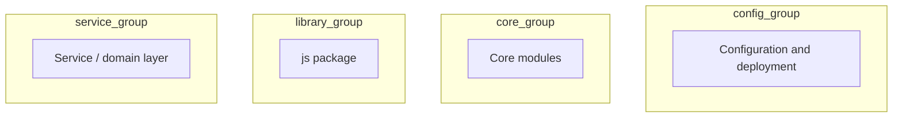

# Architecture report: ziahamza/webui-aria2

> Automated static analysis. **Observed** = directly seen in files/imports/AST; **Inferred** = interpretation from that evidence. Repository code was not executed.

## 1. Repository at a glance

| Item | Value |
| --- | --- |
| Repository | ziahamza/webui-aria2 |
| Description | The aim for this project is to create the worlds best and hottest interface to interact with aria2. Very simple to use, just download and open index.html in any web browser.  |
| Language | JavaScript |
| Stars | 10350 |
| Licence | MIT |
| Analysed commit / branch | 109903f0e2774cf948698cd95a01f77f33d7dd2c / master |
| Framework(s) | None detected |
| Files analysed | 91 |
| Components | 4 |

## 2. Architecture in one minute

ziahamza/webui-aria2 - The aim for this project is to create the worlds best and hottest interface to interact with aria2. Very simple to use, just download and open index.html in any web browser. . This repository was analysed statically from 91 file(s) (0 Python). Detected technologies (observed from imports/manifests): Docker, Docker Compose, webpack. Files are grouped into 4 component(s): Configuration and deployment, Core modules, js package, Service / domain layer. Findings below distinguish observed facts from inferred interpretation.

## 3. High-level block diagram

## 4. Main components

### Configuration and deployment (`config`)

- **Kind:** config
- **Status:** Observed
- **Confidence:** 0.85
- **Responsibility:** Groups 8 file(s) under configuration and deployment (observed from repository paths and static analysis).
- **Paths:** `Dockerfile`, `Dockerfile.arm32v7`, `app.json`, `docker-compose.yml`, `package.json`, `src/js/services/settings/filters.js`, `src/js/services/settings/settings.js`, `static.json`
- **Evidence:** [Dockerfile](https://github.com/ziahamza/webui-aria2/blob/109903f0e2774cf948698cd95a01f77f33d7dd2c/Dockerfile); [Dockerfile.arm32v7](https://github.com/ziahamza/webui-aria2/blob/109903f0e2774cf948698cd95a01f77f33d7dd2c/Dockerfile.arm32v7); [app.json](https://github.com/ziahamza/webui-aria2/blob/109903f0e2774cf948698cd95a01f77f33d7dd2c/app.json); [docker-compose.yml](https://github.com/ziahamza/webui-aria2/blob/109903f0e2774cf948698cd95a01f77f33d7dd2c/docker-compose.yml); [package.json](https://github.com/ziahamza/webui-aria2/blob/109903f0e2774cf948698cd95a01f77f33d7dd2c/package.json); [src/js/services/settings/filters.js](https://github.com/ziahamza/webui-aria2/blob/109903f0e2774cf948698cd95a01f77f33d7dd2c/src/js/services/settings/filters.js); [src/js/services/settings/settings.js](https://github.com/ziahamza/webui-aria2/blob/109903f0e2774cf948698cd95a01f77f33d7dd2c/src/js/services/settings/settings.js); [static.json](https://github.com/ziahamza/webui-aria2/blob/109903f0e2774cf948698cd95a01f77f33d7dd2c/static.json)

### Core modules (`core`)

- **Kind:** core
- **Status:** Observed
- **Confidence:** 0.85
- **Responsibility:** Groups 3 file(s) under core modules (observed from repository paths and static analysis).
- **Paths:** `node-server.js`, `postcss.config.js`, `webpack.config.js`
- **Evidence:** [node-server.js](https://github.com/ziahamza/webui-aria2/blob/109903f0e2774cf948698cd95a01f77f33d7dd2c/node-server.js); [postcss.config.js](https://github.com/ziahamza/webui-aria2/blob/109903f0e2774cf948698cd95a01f77f33d7dd2c/postcss.config.js); [webpack.config.js](https://github.com/ziahamza/webui-aria2/blob/109903f0e2774cf948698cd95a01f77f33d7dd2c/webpack.config.js)

### js package (`js`)

- **Kind:** library
- **Status:** Observed
- **Confidence:** 0.85
- **Responsibility:** Groups 31 file(s) under js package (observed from repository paths and static analysis).
- **Paths:** `src/js/app.js`, `src/js/ctrls/alert.js`, `src/js/ctrls/main.js`, `src/js/ctrls/modal.js`, `src/js/ctrls/nav.js`, `src/js/ctrls/props.js`, `src/js/directives/chunkbar.js`, `src/js/directives/dgraph.js`, `src/js/directives/fileselect.js`, `src/js/directives/fselect.js`, `src/js/directives/textarea.js`, `src/js/filters/bytes.js`, `src/js/filters/url.js`, `src/js/libs/bootstrap-filestyle.js`, `src/js/translate/cs_CZ.js`, `src/js/translate/de_DE.js`, `src/js/translate/en_US.js`, `src/js/translate/es_ES.js`, `src/js/translate/fa_IR.js`, `src/js/translate/fr_FR.js`, `src/js/translate/id_ID.js`, `src/js/translate/it_IT.js`, `src/js/translate/nl_NL.js`, `src/js/translate/pl_PL.js`, `src/js/translate/pt_BR.js`, `src/js/translate/ru_RU.js`, `src/js/translate/template.js`, `src/js/translate/th_TH.js`, `src/js/translate/tr_TR.js`, `src/js/translate/zh_CN.js`, `src/js/translate/zh_TW.js`
- **Evidence:** [src/js/app.js](https://github.com/ziahamza/webui-aria2/blob/109903f0e2774cf948698cd95a01f77f33d7dd2c/src/js/app.js); [src/js/ctrls/alert.js](https://github.com/ziahamza/webui-aria2/blob/109903f0e2774cf948698cd95a01f77f33d7dd2c/src/js/ctrls/alert.js); [src/js/ctrls/main.js](https://github.com/ziahamza/webui-aria2/blob/109903f0e2774cf948698cd95a01f77f33d7dd2c/src/js/ctrls/main.js); [src/js/ctrls/modal.js](https://github.com/ziahamza/webui-aria2/blob/109903f0e2774cf948698cd95a01f77f33d7dd2c/src/js/ctrls/modal.js); [src/js/ctrls/nav.js](https://github.com/ziahamza/webui-aria2/blob/109903f0e2774cf948698cd95a01f77f33d7dd2c/src/js/ctrls/nav.js); [src/js/ctrls/props.js](https://github.com/ziahamza/webui-aria2/blob/109903f0e2774cf948698cd95a01f77f33d7dd2c/src/js/ctrls/props.js); [src/js/directives/chunkbar.js](https://github.com/ziahamza/webui-aria2/blob/109903f0e2774cf948698cd95a01f77f33d7dd2c/src/js/directives/chunkbar.js); [src/js/directives/dgraph.js](https://github.com/ziahamza/webui-aria2/blob/109903f0e2774cf948698cd95a01f77f33d7dd2c/src/js/directives/dgraph.js)

### Service / domain layer (`service_layer`)

- **Kind:** service
- **Status:** Observed
- **Confidence:** 0.85
- **Responsibility:** Groups 12 file(s) under service / domain layer (observed from repository paths and static analysis).
- **Paths:** `src/js/services/alerts.js`, `src/js/services/base64.js`, `src/js/services/configuration.js`, `src/js/services/deps.js`, `src/js/services/errors.js`, `src/js/services/modals.js`, `src/js/services/rpc/helpers.js`, `src/js/services/rpc/jsoncall.js`, `src/js/services/rpc/rpc.js`, `src/js/services/rpc/sockcall.js`, `src/js/services/rpc/syscall.js`, `src/js/services/utils.js`
- **Evidence:** [src/js/services/alerts.js](https://github.com/ziahamza/webui-aria2/blob/109903f0e2774cf948698cd95a01f77f33d7dd2c/src/js/services/alerts.js); [src/js/services/base64.js](https://github.com/ziahamza/webui-aria2/blob/109903f0e2774cf948698cd95a01f77f33d7dd2c/src/js/services/base64.js); [src/js/services/configuration.js](https://github.com/ziahamza/webui-aria2/blob/109903f0e2774cf948698cd95a01f77f33d7dd2c/src/js/services/configuration.js); [src/js/services/deps.js](https://github.com/ziahamza/webui-aria2/blob/109903f0e2774cf948698cd95a01f77f33d7dd2c/src/js/services/deps.js); [src/js/services/errors.js](https://github.com/ziahamza/webui-aria2/blob/109903f0e2774cf948698cd95a01f77f33d7dd2c/src/js/services/errors.js); [src/js/services/modals.js](https://github.com/ziahamza/webui-aria2/blob/109903f0e2774cf948698cd95a01f77f33d7dd2c/src/js/services/modals.js); [src/js/services/rpc/helpers.js](https://github.com/ziahamza/webui-aria2/blob/109903f0e2774cf948698cd95a01f77f33d7dd2c/src/js/services/rpc/helpers.js); [src/js/services/rpc/jsoncall.js](https://github.com/ziahamza/webui-aria2/blob/109903f0e2774cf948698cd95a01f77f33d7dd2c/src/js/services/rpc/jsoncall.js)

## 5. Execution flow

**Observed** entry point(s):

- [src/js/app.js](https://github.com/ziahamza/webui-aria2/blob/109903f0e2774cf948698cd95a01f77f33d7dd2c/src/js/app.js)
- [src/js/ctrls/main.js](https://github.com/ziahamza/webui-aria2/blob/109903f0e2774cf948698cd95a01f77f33d7dd2c/src/js/ctrls/main.js)

Representative flow (derived from observed entry points and the import graph; steps beyond the entry point are **Inferred**):

1. Execution starts at an observed entry point listed above, if present.
2. No internal import relationships between components were observed.

## 6. Project structure

### `(root)`

- `.dockerignore` - container (258 bytes)
- `.gitignore` - other (54 bytes)
- `.prettierignore` - other (32 bytes)
- `.prettierrc` - other (22 bytes)
- `CONTRIBUTING.md` - docs (1780 bytes)
- `Dockerfile` - container (1383 bytes)
- `Dockerfile.arm32v7` - container (3106 bytes)
- `LICENSE` - docs (1060 bytes)
- `README.md` - docs (4784 bytes)
- `app.json` - config (347 bytes)
- `directurl.md` - docs (2428 bytes)
- `docker-compose.yml` - container (268 bytes)
- `node-server.js` - source, JavaScript (1479 bytes)
- `package.json` - manifest (1545 bytes)
- `postcss.config.js` - source, JavaScript (111 bytes)
- `static.json` - config (66 bytes)
- `webpack.config.js` - source, JavaScript (1780 bytes)
- `webui-aria2.spec` - other (4549 bytes)

### `docs`

- `docs/app.css` - docs (110676 bytes)
- `docs/flags/br.svg` - docs (12207 bytes)
- `docs/flags/cn.svg` - docs (792 bytes)
- `docs/flags/cz.svg` - docs (493 bytes)
- `docs/flags/de.svg` - docs (245 bytes)
- `docs/flags/es.svg` - docs (147117 bytes)
- `docs/flags/fr.svg` - docs (305 bytes)
- `docs/flags/id.svg` - docs (252 bytes)
- `docs/flags/ir.svg` - docs (20114 bytes)
- `docs/flags/it.svg` - docs (305 bytes)
- `docs/flags/nl.svg` - docs (379 bytes)
- `docs/flags/pl.svg` - docs (228 bytes)
- `docs/flags/ru.svg` - docs (309 bytes)
- `docs/flags/th.svg` - docs (299 bytes)
- `docs/flags/tr.svg` - docs (690 bytes)
- `docs/flags/tw.svg` - docs (1228 bytes)
- `docs/flags/us.svg` - docs (5433 bytes)
- `docs/index.html` - docs (81760 bytes)
- `docs/precache-manifest.b562a874cfed1a8c74df9b49e6f1c2cc.js` - docs (1638 bytes)
- `docs/service-worker.js` - docs (903 bytes)

### `src`

- `src/index-template.html` - other (81613 bytes)
- `src/js/app.js` - source, JavaScript (5470 bytes)
- `src/js/ctrls/alert.js` - source, JavaScript (1069 bytes)
- `src/js/ctrls/main.js` - source, JavaScript (21853 bytes)
- `src/js/ctrls/modal.js` - source, JavaScript (8961 bytes)
- `src/js/ctrls/nav.js` - source, JavaScript (4027 bytes)
- `src/js/ctrls/props.js` - source, JavaScript (2755 bytes)
- `src/js/directives/chunkbar.js` - source, JavaScript (1495 bytes)
- `src/js/directives/dgraph.js` - source, JavaScript (4703 bytes)
- `src/js/directives/fileselect.js` - source, JavaScript (7074 bytes)
- `src/js/directives/fselect.js` - source, JavaScript (614 bytes)
- `src/js/directives/textarea.js` - source, JavaScript (584 bytes)
- `src/js/filters/bytes.js` - source, JavaScript (1000 bytes)
- `src/js/filters/url.js` - source, JavaScript (188 bytes)
- `src/js/libs/bootstrap-filestyle.js` - source, JavaScript (11502 bytes)
- `src/js/services/alerts.js` - source, JavaScript (630 bytes)
- `src/js/services/base64.js` - source, JavaScript (1556 bytes)
- `src/js/services/configuration.js` - source, JavaScript (2620 bytes)
- `src/js/services/deps.js` - source, JavaScript (205 bytes)
- `src/js/services/errors.js` - source, JavaScript (2431 bytes)
- `src/js/services/modals.js` - source, JavaScript (601 bytes)
- `src/js/services/rpc/helpers.js` - source, JavaScript (2238 bytes)
- `src/js/services/rpc/jsoncall.js` - source, JavaScript (2905 bytes)
- `src/js/services/rpc/rpc.js` - source, JavaScript (9804 bytes)
- `src/js/services/rpc/sockcall.js` - source, JavaScript (5057 bytes)
- `src/js/services/rpc/syscall.js` - source, JavaScript (2185 bytes)
- `src/js/services/settings/filters.js` - source, JavaScript (521 bytes)
- `src/js/services/settings/settings.js` - source, JavaScript (37860 bytes)
- `src/js/services/utils.js` - source, JavaScript (5859 bytes)
- `src/js/translate/cs_CZ.js` - source, JavaScript (8493 bytes)
- `src/js/translate/de_DE.js` - source, JavaScript (6972 bytes)
- `src/js/translate/en_US.js` - source, JavaScript (8381 bytes)
- `src/js/translate/es_ES.js` - source, JavaScript (9112 bytes)
- `src/js/translate/fa_IR.js` - source, JavaScript (10841 bytes)
- `src/js/translate/fr_FR.js` - source, JavaScript (9382 bytes)
- `src/js/translate/id_ID.js` - source, JavaScript (8402 bytes)
- `src/js/translate/it_IT.js` - source, JavaScript (8100 bytes)
- `src/js/translate/nl_NL.js` - source, JavaScript (6649 bytes)
- `src/js/translate/pl_PL.js` - source, JavaScript (8301 bytes)
- `src/js/translate/pt_BR.js` - source, JavaScript (9024 bytes)
- `src/js/translate/ru_RU.js` - source, JavaScript (10938 bytes)
- `src/js/translate/template.js` - source, JavaScript (5736 bytes)
- `src/js/translate/th_TH.js` - source, JavaScript (7037 bytes)
- `src/js/translate/tr_TR.js` - source, JavaScript (8311 bytes)
- `src/js/translate/zh_CN.js` - source, JavaScript (8014 bytes)
- `src/js/translate/zh_TW.js` - source, JavaScript (8026 bytes)
- `src/scss/_bootstrap-custom.scss` - other (2827 bytes)
- `src/scss/_download.scss` - other (2235 bytes)
- `src/scss/_flag-icon-css-custom.scss` - other (553 bytes)
- `src/scss/_icon.scss` - other (264 bytes)
- `src/scss/_modals.scss` - other (883 bytes)
- `src/scss/_style.scss` - other (2154 bytes)
- `src/scss/app.scss` - other (190 bytes)

## 7. Key dependencies and integrations

| Name | Category | Status | Confidence | Evidence |
| --- | --- | --- | --- | --- |
| Docker | tooling | Observed | 0.90 | [Dockerfile](https://github.com/ziahamza/webui-aria2/blob/109903f0e2774cf948698cd95a01f77f33d7dd2c/Dockerfile); [Dockerfile.arm32v7](https://github.com/ziahamza/webui-aria2/blob/109903f0e2774cf948698cd95a01f77f33d7dd2c/Dockerfile.arm32v7) |
| Docker Compose | tooling | Observed | 0.85 | [docker-compose.yml](https://github.com/ziahamza/webui-aria2/blob/109903f0e2774cf948698cd95a01f77f33d7dd2c/docker-compose.yml) |
| webpack | tooling | Observed | 0.85 | [package.json:8](https://github.com/ziahamza/webui-aria2/blob/109903f0e2774cf948698cd95a01f77f33d7dd2c/package.json#L8) |

## 8. Data and state

No database, cache, queue, or persistent-state usage was observed in the analysed files. State handling, if any, may be in-memory or in files that were not analysed.

## 9. Configuration and deployment clues

- `.dockerignore` (container)
- `Dockerfile` (container)
- `Dockerfile.arm32v7` (container)
- `app.json` (config)
- `docker-compose.yml` (container)
- `package.json` (manifest)
- `static.json` (config)

## 10. Design observations

- Service/domain code is distinct from entry and data code, suggesting layered separation (Inferred).

These observations are interpretations (**Inferred**) of the observed structure, not guarantees about runtime design.

## 11. Limitations and unknowns

- Static analysis only: repository code was not executed, installed, or imported at runtime.
- Components and relationships are inferred from file paths, imports, and AST structure; runtime behaviour, dynamic imports, and reflection may not be visible.
- No clear application entry point was observed in the analysed files.
- Repository text was treated as untrusted data; no instructions found in repository files were followed, and likely secret values were redacted/excluded.
- JavaScript and TypeScript files were inventoried from paths and package manifests. They were not parsed with a full language AST, and repository code was not executed.

## 12. Source references

- [Dockerfile](https://github.com/ziahamza/webui-aria2/blob/109903f0e2774cf948698cd95a01f77f33d7dd2c/Dockerfile)
- [Dockerfile.arm32v7](https://github.com/ziahamza/webui-aria2/blob/109903f0e2774cf948698cd95a01f77f33d7dd2c/Dockerfile.arm32v7)
- [app.json](https://github.com/ziahamza/webui-aria2/blob/109903f0e2774cf948698cd95a01f77f33d7dd2c/app.json)
- [docker-compose.yml](https://github.com/ziahamza/webui-aria2/blob/109903f0e2774cf948698cd95a01f77f33d7dd2c/docker-compose.yml)
- [node-server.js](https://github.com/ziahamza/webui-aria2/blob/109903f0e2774cf948698cd95a01f77f33d7dd2c/node-server.js)
- [package.json](https://github.com/ziahamza/webui-aria2/blob/109903f0e2774cf948698cd95a01f77f33d7dd2c/package.json)
- [package.json:8](https://github.com/ziahamza/webui-aria2/blob/109903f0e2774cf948698cd95a01f77f33d7dd2c/package.json#L8)
- [postcss.config.js](https://github.com/ziahamza/webui-aria2/blob/109903f0e2774cf948698cd95a01f77f33d7dd2c/postcss.config.js)
- [src/js/app.js](https://github.com/ziahamza/webui-aria2/blob/109903f0e2774cf948698cd95a01f77f33d7dd2c/src/js/app.js)
- [src/js/ctrls/alert.js](https://github.com/ziahamza/webui-aria2/blob/109903f0e2774cf948698cd95a01f77f33d7dd2c/src/js/ctrls/alert.js)
- [src/js/ctrls/main.js](https://github.com/ziahamza/webui-aria2/blob/109903f0e2774cf948698cd95a01f77f33d7dd2c/src/js/ctrls/main.js)
- [src/js/ctrls/modal.js](https://github.com/ziahamza/webui-aria2/blob/109903f0e2774cf948698cd95a01f77f33d7dd2c/src/js/ctrls/modal.js)
- [src/js/ctrls/nav.js](https://github.com/ziahamza/webui-aria2/blob/109903f0e2774cf948698cd95a01f77f33d7dd2c/src/js/ctrls/nav.js)
- [src/js/ctrls/props.js](https://github.com/ziahamza/webui-aria2/blob/109903f0e2774cf948698cd95a01f77f33d7dd2c/src/js/ctrls/props.js)
- [src/js/directives/chunkbar.js](https://github.com/ziahamza/webui-aria2/blob/109903f0e2774cf948698cd95a01f77f33d7dd2c/src/js/directives/chunkbar.js)
- [src/js/directives/dgraph.js](https://github.com/ziahamza/webui-aria2/blob/109903f0e2774cf948698cd95a01f77f33d7dd2c/src/js/directives/dgraph.js)
- [src/js/services/alerts.js](https://github.com/ziahamza/webui-aria2/blob/109903f0e2774cf948698cd95a01f77f33d7dd2c/src/js/services/alerts.js)
- [src/js/services/base64.js](https://github.com/ziahamza/webui-aria2/blob/109903f0e2774cf948698cd95a01f77f33d7dd2c/src/js/services/base64.js)
- [src/js/services/configuration.js](https://github.com/ziahamza/webui-aria2/blob/109903f0e2774cf948698cd95a01f77f33d7dd2c/src/js/services/configuration.js)
- [src/js/services/deps.js](https://github.com/ziahamza/webui-aria2/blob/109903f0e2774cf948698cd95a01f77f33d7dd2c/src/js/services/deps.js)
- [src/js/services/errors.js](https://github.com/ziahamza/webui-aria2/blob/109903f0e2774cf948698cd95a01f77f33d7dd2c/src/js/services/errors.js)
- [src/js/services/modals.js](https://github.com/ziahamza/webui-aria2/blob/109903f0e2774cf948698cd95a01f77f33d7dd2c/src/js/services/modals.js)
- [src/js/services/rpc/helpers.js](https://github.com/ziahamza/webui-aria2/blob/109903f0e2774cf948698cd95a01f77f33d7dd2c/src/js/services/rpc/helpers.js)
- [src/js/services/rpc/jsoncall.js](https://github.com/ziahamza/webui-aria2/blob/109903f0e2774cf948698cd95a01f77f33d7dd2c/src/js/services/rpc/jsoncall.js)
- [src/js/services/settings/filters.js](https://github.com/ziahamza/webui-aria2/blob/109903f0e2774cf948698cd95a01f77f33d7dd2c/src/js/services/settings/filters.js)
- [src/js/services/settings/settings.js](https://github.com/ziahamza/webui-aria2/blob/109903f0e2774cf948698cd95a01f77f33d7dd2c/src/js/services/settings/settings.js)
- [static.json](https://github.com/ziahamza/webui-aria2/blob/109903f0e2774cf948698cd95a01f77f33d7dd2c/static.json)
- [webpack.config.js](https://github.com/ziahamza/webui-aria2/blob/109903f0e2774cf948698cd95a01f77f33d7dd2c/webpack.config.js)
