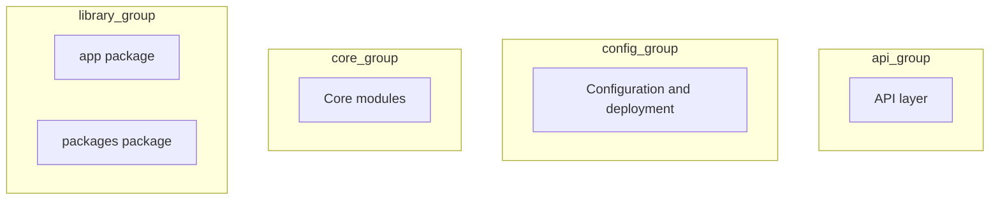

# Architecture report: 0wczar/airframe-react

> Automated static analysis. **Observed** = directly seen in files/imports/AST; **Inferred** = interpretation from that evidence. Repository code was not executed.

## 1. Repository at a glance

| Item | Value |
| --- | --- |
| Repository | 0wczar/airframe-react |
| Description | Free Open Source High Quality Dashboard based on Bootstrap 4 & React 16: https://airframe-react-lime.vercel.app |
| Language | JavaScript |
| Stars | 3989 |
| Licence | MIT |
| Analysed commit / branch | 999e89b9a8ab80056ff2afdc112cdc521e8306a8 / master |
| Framework(s) | React |
| Files analysed | 627 |
| Components | 5 |

## 2. Architecture in one minute

0wczar/airframe-react - Free Open Source High Quality Dashboard based on Bootstrap 4 & React 16: https://airframe-react-lime.vercel.app. This repository was analysed statically from 627 file(s) (0 Python). Detected technologies (observed from imports/manifests): React, React Router, webpack. Files are grouped into 5 component(s): API layer, app package, Configuration and deployment, Core modules, packages package. Findings below distinguish observed facts from inferred interpretation.

## 3. High-level block diagram

## 4. Main components

### API layer (`api_layer`)

- **Kind:** api
- **Status:** Observed
- **Confidence:** 0.85
- **Responsibility:** Groups 373 file(s) under api layer (observed from repository paths and static analysis).
- **Paths:** `app/routes/Apps/AccountEdit/AccountEdit.js`, `app/routes/Apps/AccountEdit/index.js`, `app/routes/Apps/BillingEdit/BillingEdit.js`, `app/routes/Apps/BillingEdit/index.js`, `app/routes/Apps/Chat/Chat.js`, `app/routes/Apps/Chat/index.js`, `app/routes/Apps/Clients/Clients.js`, `app/routes/Apps/Clients/components/TrTableClients.js`, `app/routes/Apps/Clients/components/TrTableCompanies.js`, `app/routes/Apps/Clients/index.js`, `app/routes/Apps/EmailDetails/EmailDetails.js`, `app/routes/Apps/EmailDetails/index.js`, `app/routes/Apps/Files/Files.js`, `app/routes/Apps/Files/FilesGrid.js`, `app/routes/Apps/Files/FilesList.js`, `app/routes/Apps/Files/components/TrTableFilesList.js`, `app/routes/Apps/Files/index.js`, `app/routes/Apps/GalleryGrid/GalleryGrid.js`, `app/routes/Apps/GalleryGrid/index.js`, `app/routes/Apps/GalleryTable/GalleryTable.js`, `app/routes/Apps/GalleryTable/components/TrTableGalleryList.js`, `app/routes/Apps/GalleryTable/index.js`, `app/routes/Apps/ImagesResults/ImagesResults.js`, `app/routes/Apps/ImagesResults/index.js`, `app/routes/Apps/Inbox/Inbox.js`, `app/routes/Apps/Inbox/components/TrTableInbox.js`, `app/routes/Apps/Inbox/index.js`, `app/routes/Apps/NewEmail/NewEmail.js`, `app/routes/Apps/NewEmail/index.js`, `app/routes/Apps/ProfileDetails/ProfileDetails.js`, `app/routes/Apps/ProfileDetails/components/TrTableMessages.js`, `app/routes/Apps/ProfileDetails/index.js`, `app/routes/Apps/ProfileEdit/ProfileEdit.js`, `app/routes/Apps/ProfileEdit/index.js`, `app/routes/Apps/Projects/Projects.js`, `app/routes/Apps/Projects/ProjectsGrid.js`, `app/routes/Apps/Projects/ProjectsList.js`, `app/routes/Apps/Projects/components/TrTableProjectsList.js`, `app/routes/Apps/Projects/index.js`, `app/routes/Apps/SearchResults/SearchResults.js`, `app/routes/Apps/SearchResults/index.js`, `app/routes/Apps/SessionsEdit/SessionsEdit.js`, `app/routes/Apps/SessionsEdit/index.js`, `app/routes/Apps/SettingsEdit/SettingsEdit.js`, `app/routes/Apps/SettingsEdit/index.js`, `app/routes/Apps/Tasks/Tasks.js`, `app/routes/Apps/Tasks/TasksGrid.js`, `app/routes/Apps/Tasks/TasksList.js`, `app/routes/Apps/Tasks/components/TrTableTasksList.js`, `app/routes/Apps/Tasks/index.js`, `app/routes/Apps/TasksDetails/TasksDetails.js`, `app/routes/Apps/TasksDetails/index.js`, `app/routes/Apps/TasksKanban/TasksKanban.js`, `app/routes/Apps/TasksKanban/index.js`, `app/routes/Apps/Users/Users.js`, `app/routes/Apps/Users/UsersGrid.js`, `app/routes/Apps/Users/UsersList.js`, `app/routes/Apps/Users/components/TrTableUsersList.js`, `app/routes/Apps/Users/index.js`, `app/routes/Apps/UsersResults/UsersResults.js`, `app/routes/Apps/UsersResults/index.js`, `app/routes/Apps/VideosResults/VideosResults.js`, `app/routes/Apps/VideosResults/index.js`, `app/routes/Cards/Cards/Cards.js`, `app/routes/Cards/Cards/index.js`, `app/routes/Cards/CardsHeaders/CardsHeaders.js`, `app/routes/Cards/CardsHeaders/index.js`, `app/routes/Dashboards/Analytics/Analytics.js`, `app/routes/Dashboards/Analytics/components/AudienceMetricsChart.js`, `app/routes/Dashboards/Analytics/index.js`, `app/routes/Dashboards/Financial/Financial.js`, `app/routes/Dashboards/Financial/index.js`, `app/routes/Dashboards/Monitor/Monitor.js`, `app/routes/Dashboards/Monitor/index.js`, `app/routes/Dashboards/Projects/DraggableProjects.js`, `app/routes/Dashboards/Projects/ProjectsDashboard.js`, `app/routes/Dashboards/Projects/index.js`, `app/routes/Dashboards/Reports/Reports.js`, `app/routes/Dashboards/Reports/components/TinyArcChart.js`, `app/routes/Dashboards/Reports/components/TinyAreaChart.js`, `app/routes/Dashboards/Reports/components/TinyLineChart.js`, `app/routes/Dashboards/Reports/index.js`, `app/routes/Dashboards/Stock/Stock.js`, `app/routes/Dashboards/Stock/index.js`, `app/routes/Dashboards/System/System.js`, `app/routes/Dashboards/System/components/CardSystem.js`, `app/routes/Dashboards/System/components/TinyAreaChart.js`, `app/routes/Dashboards/System/components/TinyBarChart.js`, `app/routes/Dashboards/System/components/TinyDonutChart.js`, `app/routes/Dashboards/System/components/trSystem.js`, `app/routes/Dashboards/System/index.js`, `app/routes/Dashboards/components/TinyLineChart.js`, `app/routes/Forms/DatePicker/DatePickerExamples.js`, `app/routes/Forms/DatePicker/components/AddonInput.js`, `app/routes/Forms/DatePicker/components/ButtonInput.js`, `app/routes/Forms/DatePicker/components/Example.js`, `app/routes/Forms/DatePicker/components/index.js`, `app/routes/Forms/DatePicker/index.js`, `app/routes/Forms/Dropzone/Dropzone.js`, `app/routes/Forms/Dropzone/components/FilesGrid.js`, `app/routes/Forms/Dropzone/components/FilesList.js`, `app/routes/Forms/Dropzone/components/index.js`, `app/routes/Forms/Dropzone/index.js`, `app/routes/Forms/Dropzone/utilities.js`, `app/routes/Forms/Editor/Editor.js`, `app/routes/Forms/Editor/index.js`, `app/routes/Forms/Forms/Forms.js`, `app/routes/Forms/Forms/index.js`, `app/routes/Forms/FormsLayouts/FormsLayouts.js`, `app/routes/Forms/FormsLayouts/index.js`, `app/routes/Forms/InputGroups/InputGroups.js`, `app/routes/Forms/InputGroups/index.js`, `app/routes/Forms/Sliders/Sliders.js`, `app/routes/Forms/Sliders/index.js`, `app/routes/Forms/TextMask/TextMask.js`, `app/routes/Forms/TextMask/index.js`, `app/routes/Forms/Toggles/Toggles.js`, `app/routes/Forms/Toggles/index.js`, `app/routes/Forms/Typeahead/Typeahead.js`, `app/routes/Forms/Typeahead/components/AsynchronousPagination.js`, `app/routes/Forms/Typeahead/components/AsynchronousSearching.js`, `app/routes/Forms/Typeahead/components/BasicBehaviors.js`, `app/routes/Forms/Typeahead/components/BasicExample.js`, `app/routes/Forms/Typeahead/components/BodyContainer.js`, `app/routes/Forms/Typeahead/components/ControllingSelections.js`, `app/routes/Forms/Typeahead/components/CustomFiltering.js`, `app/routes/Forms/Typeahead/components/CustomSelections.js`, `app/routes/Forms/Typeahead/components/Filtering.js`, `app/routes/Forms/Typeahead/components/FormExample.js`, `app/routes/Forms/Typeahead/components/GithubMenuItem.js`, `app/routes/Forms/Typeahead/components/InputSize.js`, `app/routes/Forms/Typeahead/components/LabelKey.js`, `app/routes/Forms/Typeahead/components/MenuAlignment.js`, `app/routes/Forms/Typeahead/components/PaginationExample.js`, `app/routes/Forms/Typeahead/components/PublicMethods.js`, `app/routes/Forms/Typeahead/components/RenderingExample.js`, `app/routes/Forms/Typeahead/components/exampleData.js`, `app/routes/Forms/Typeahead/components/index.js`, `app/routes/Forms/Typeahead/components/utils.js`, `app/routes/Forms/Typeahead/index.js`, `app/routes/Forms/Wizard/Wizard.js`, `app/routes/Forms/Wizard/index.js`, `app/routes/Graphs/ReCharts/ReCharts.js`, `app/routes/Graphs/ReCharts/components/AreaChartFillByValue.js`, `app/routes/Graphs/ReCharts/components/BarChartHasBackground.js`, `app/routes/Graphs/ReCharts/components/BarChartStackedBySign.js`, `app/routes/Graphs/ReCharts/components/CustomizedLabelLineChart.js`, `app/routes/Graphs/ReCharts/components/DashedLineChart.js`, `app/routes/Graphs/ReCharts/components/LineBarAreaComposedChart.js`, `app/routes/Graphs/ReCharts/components/MixBarChart.js`, `app/routes/Graphs/ReCharts/components/PercentAreaChart.js`, `app/routes/Graphs/ReCharts/components/PieChartWithCustomizedLabel.js`, `app/routes/Graphs/ReCharts/components/PieChartWithPaddingAngle.js`, `app/routes/Graphs/ReCharts/components/PieChartWithPaddingAngleHalf.js`, `app/routes/Graphs/ReCharts/components/PositiveAndNegativeBarChart.js`, `app/routes/Graphs/ReCharts/components/SimpleAreaChart.js`, `app/routes/Graphs/ReCharts/components/SimpleBarChart.js`, `app/routes/Graphs/ReCharts/components/SimpleLineChart.js`, `app/routes/Graphs/ReCharts/components/SimpleRadialBarChart.js`, `app/routes/Graphs/ReCharts/components/SpecifiedDomainRadarChart.js`, `app/routes/Graphs/ReCharts/components/StackedAreaChart.js`, `app/routes/Graphs/ReCharts/components/StackedBarChart.js`, `app/routes/Graphs/ReCharts/components/StraightAnglePieChart.js`, `app/routes/Graphs/ReCharts/components/TinyAreaChart.js`, `app/routes/Graphs/ReCharts/components/TinyBarChart.js`, `app/routes/Graphs/ReCharts/components/TinyDonutChart.js`, `app/routes/Graphs/ReCharts/components/TinyLineChart.js`, `app/routes/Graphs/ReCharts/components/TinyPieChart.js`, `app/routes/Graphs/ReCharts/components/TwoLevelPieChart.js`, `app/routes/Graphs/ReCharts/components/VerticalComposedChart.js`, `app/routes/Graphs/ReCharts/components/VerticalLineChart.js`, `app/routes/Graphs/ReCharts/index.js`, `app/routes/Icons/Icons.js`, `app/routes/Icons/index.js`, `app/routes/Interface/Accordions/Accordions.js`, `app/routes/Interface/Accordions/index.js`, `app/routes/Interface/Alerts/Alerts.js`, `app/routes/Interface/Alerts/index.js`, `app/routes/Interface/Avatars/Avatars.js`, `app/routes/Interface/Avatars/index.js`, `app/routes/Interface/BadgesLabels/BadgesLabels.js`, `app/routes/Interface/BadgesLabels/index.js`, `app/routes/Interface/Breadcrumbs/Breadcrumbs.js`, `app/routes/Interface/Breadcrumbs/index.js`, `app/routes/Interface/Buttons/Buttons.js`, `app/routes/Interface/Buttons/index.js`, `app/routes/Interface/Calendar/Calendar.js`, `app/routes/Interface/Calendar/events.js`, `app/routes/Interface/Calendar/index.js`, `app/routes/Interface/Colors/Colors.js`, `app/routes/Interface/Colors/index.js`, `app/routes/Interface/CropImage/CropImage.js`, `app/routes/Interface/CropImage/components/ExampleProvider.js`, `app/routes/Interface/CropImage/index.js`, `app/routes/Interface/DragAndDropElements/DragAndDropElements.js`, `app/routes/Interface/DragAndDropElements/components/DraggableTable.js`, `app/routes/Interface/DragAndDropElements/components/HorizontalLists.js`, `app/routes/Interface/DragAndDropElements/components/MultipleVerticalLists.js`, `app/routes/Interface/DragAndDropElements/components/index.js`, `app/routes/Interface/DragAndDropElements/components/utilities.js`, `app/routes/Interface/DragAndDropElements/index.js`, `app/routes/Interface/Dropdowns/Dropdowns.js`, `app/routes/Interface/Dropdowns/index.js`, `app/routes/Interface/Images/Images.js`, `app/routes/Interface/Images/index.js`, `app/routes/Interface/ListGroups/ListGroups.js`, `app/routes/Interface/ListGroups/index.js`, `app/routes/Interface/MediaObjects/MediaObjects.js`, `app/routes/Interface/MediaObjects/index.js`, `app/routes/Interface/Modals/Modals.js`, `app/routes/Interface/Modals/index.js`, `app/routes/Interface/Navbars/Navbars.js`, `app/routes/Interface/Navbars/index.js`, `app/routes/Interface/Notifications/Notifications.js`, `app/routes/Interface/Notifications/index.js`, `app/routes/Interface/Paginations/Paginations.js`, `app/routes/Interface/Paginations/index.js`, `app/routes/Interface/ProgressBars/ProgressBars.js`, `app/routes/Interface/ProgressBars/index.js`, `app/routes/Interface/TabsPills/TabsPills.js`, `app/routes/Interface/TabsPills/index.js`, `app/routes/Interface/TooltipsPopovers/TooltipsPopovers.js`, `app/routes/Interface/TooltipsPopovers/index.js`, `app/routes/Interface/Typography/Typography.js`, `app/routes/Interface/Typography/index.js`, `app/routes/Layouts/DragAndDropLayout/DragAndDropLayout.js`, `app/routes/Layouts/DragAndDropLayout/index.js`, `app/routes/Layouts/NavbarOnly/NavbarOnly.js`, `app/routes/Layouts/NavbarOnly/components/LayoutNavbar.js`, `app/routes/Layouts/NavbarOnly/index.js`, `app/routes/Layouts/SidebarA/SidebarA.js`, `app/routes/Layouts/SidebarA/index.js`, `app/routes/Layouts/SidebarDefault/SidebarDefault.js`, `app/routes/Layouts/SidebarDefault/index.js`, `app/routes/Layouts/SidebarWithNavbar/SidebarWithNavbar.js`, `app/routes/Layouts/SidebarWithNavbar/index.js`, `app/routes/Pages/ComingSoon/ComingSoon.js`, `app/routes/Pages/ComingSoon/index.js`, `app/routes/Pages/Confirmation/Confirmation.js`, `app/routes/Pages/Confirmation/index.js`, `app/routes/Pages/Danger/Danger.js`, `app/routes/Pages/Danger/index.js`, `app/routes/Pages/Error404/Error404.js`, `app/routes/Pages/Error404/index.js`, `app/routes/Pages/ForgotPassword/ForgotPassword.js`, `app/routes/Pages/ForgotPassword/index.js`, `app/routes/Pages/LockScreen/LockScreen.js`, `app/routes/Pages/LockScreen/index.js`, `app/routes/Pages/Login/Login.js`, `app/routes/Pages/Login/index.js`, `app/routes/Pages/Register/Register.js`, `app/routes/Pages/Register/index.js`, `app/routes/Pages/Success/Success.js`, `app/routes/Pages/Success/index.js`, `app/routes/Pages/Timeline/Timeline.js`, `app/routes/Pages/Timeline/index.js`, `app/routes/Tables/AgGrid/AgGrid.js`, `app/routes/Tables/AgGrid/index.js`, `app/routes/Tables/ExtendedTable/ExtendedTable.js`, `app/routes/Tables/ExtendedTable/components/AdvancedTableA.js`, `app/routes/Tables/ExtendedTable/components/AdvancedTableB.js`, `app/routes/Tables/ExtendedTable/components/BasicTable.js`, `app/routes/Tables/ExtendedTable/components/BorderedTable.js`, `app/routes/Tables/ExtendedTable/components/CellEdit.js`, `app/routes/Tables/ExtendedTable/components/ClearSearch.js`, `app/routes/Tables/ExtendedTable/components/CustomExportButton.js`, `app/routes/Tables/ExtendedTable/components/CustomPaginationPanel.js`, `app/routes/Tables/ExtendedTable/components/CustomPaginationTotal.js`, `app/routes/Tables/ExtendedTable/components/CustomSearch.js`, `app/routes/Tables/ExtendedTable/components/CustomSizePerPageButton.js`, `app/routes/Tables/ExtendedTable/components/LargeTable.js`, `app/routes/Tables/ExtendedTable/components/SelectAll.js`, `app/routes/Tables/ExtendedTable/components/SortTable.js`, `app/routes/Tables/ExtendedTable/components/index.js`, `app/routes/Tables/ExtendedTable/filters/index.js`, `app/routes/Tables/ExtendedTable/filters/numberFilter.js`, `app/routes/Tables/ExtendedTable/filters/selectFilter.js`, `app/routes/Tables/ExtendedTable/filters/textFilter.js`, `app/routes/Tables/ExtendedTable/index.js`, `app/routes/Tables/Tables/Tables.js`, `app/routes/Tables/Tables/components/TrTableBordered.js`, `app/routes/Tables/Tables/components/TrTableBorderless.js`, `app/routes/Tables/Tables/components/TrTableContextual.js`, `app/routes/Tables/Tables/components/TrTableDefault.js`, `app/routes/Tables/Tables/components/TrTableHeads.js`, `app/routes/Tables/Tables/components/TrTableHoverable.js`, `app/routes/Tables/Tables/components/TrTableResponsive.js`, `app/routes/Tables/Tables/components/TrTableSmall.js`, `app/routes/Tables/Tables/components/TrTableStriped.js`, `app/routes/Tables/Tables/index.js`, `app/routes/Widgets/Widgets.js`, `app/routes/Widgets/index.js`, `app/routes/components/Analytics/MetricVsTarget.js`, `app/routes/components/Analytics/SessionsByDevice.js`, `app/routes/components/Analytics/TinyAreaChart.js`, `app/routes/components/Analytics/TinyAreaChartSpend.js`, `app/routes/components/Analytics/TrTableTrafficChannels.js`, `app/routes/components/Analytics/WebsitePerformance.js`, `app/routes/components/Attachment.js`, `app/routes/components/CardFooterInfo.js`, `app/routes/components/CardTextDemo.js`, `app/routes/components/Chat/ChatCardFooter.js`, `app/routes/components/Chat/ChatCardHeader.js`, `app/routes/components/Chat/ChatLeft.js`, `app/routes/components/Chat/ChatLeftNav.js`, `app/routes/components/Chat/ChatRight.js`, `app/routes/components/Colors/CardColor.js`, `app/routes/components/Colors/CardRgbaColor.js`, `app/routes/components/Colors/InfoPopover.js`, `app/routes/components/Comment.js`, `app/routes/components/Dropdowns/Activity.js`, `app/routes/components/Dropdowns/DropdownProfile.js`, `app/routes/components/Dropdowns/Messages.js`, `app/routes/components/Dropdowns/SwitchVersion.js`, `app/routes/components/Files/FilesCardGrid.js`, `app/routes/components/Files/FilesLeftNav.js`, `app/routes/components/Financial/StackedAreaChart.js`, `app/routes/components/Financial/TinyDonutChartBig.js`, `app/routes/components/Financial/TrTableInvoices.js`, `app/routes/components/Financial/TrTableRecentFundings.js`, `app/routes/components/FooterText.js`, `app/routes/components/Gallery/GalleryCard.js`, `app/routes/components/HeaderDemo.js`, `app/routes/components/HeaderMain.js`, `app/routes/components/LogoThemed/LogoThemed.js`, `app/routes/components/Logos/LogoNavbar.js`, `app/routes/components/Logos/LogotypeNavbar.js`, `app/routes/components/Mailbox/MailboxLeftNav.js`, `app/routes/components/Monitor/TinyAreaChart.js`, `app/routes/components/Monitor/TinyDonutChart.js`, `app/routes/components/Monitor/TinyDonutChartBig.js`, `app/routes/components/Monitor/TrTableMonitor.js`, `app/routes/components/Navbars/NavbarExample.js`, `app/routes/components/Navbars/NavbarNavigation.js`, `app/routes/components/Pages/FooterAuth.js`, `app/routes/components/Pages/HeaderAuth.js`, `app/routes/components/Paginations.js`, `app/routes/components/Profile.js`, `app/routes/components/Profile/DlRowAddress.js`, `app/routes/components/Profile/DlRowContacts.js`, `app/routes/components/Profile/ProfileHeader.js`, `app/routes/components/Profile/ProfileLeftNav.js`, `app/routes/components/Profile/ProfileOverviewCard.js`, `app/routes/components/Projects/ProjectsCardGrid.js`, `app/routes/components/Projects/ProjectsLeftNav.js`, `app/routes/components/Projects/ProjectsSmHeader.js`, `app/routes/components/ProjectsDashboards/ProjectsList.js`, `app/routes/components/ProjectsDashboards/TasksMedia.js`, `app/routes/components/ProjectsDashboards/TinyDonutChart.js`, `app/routes/components/ProjectsDashboards/TinyDonutChartAllProjects.js`, `app/routes/components/SearchResults/ImagesResultsCard.js`, `app/routes/components/SearchResults/SearchResultsCard.js`, `app/routes/components/SearchResults/SearchResultsHeader.js`, `app/routes/components/SearchResults/SearchResultsLeftNav.js`, `app/routes/components/SearchResults/UsersResultsCard.js`, `app/routes/components/SearchResults/VideosResultsCard.js`, `app/routes/components/Sidebar/SidebarBottomA.js`, `app/routes/components/Sidebar/SidebarBottomB.js`, `app/routes/components/Sidebar/SidebarTopA.js`, `app/routes/components/Sidebar/SidebarTopB.js`, `app/routes/components/Stock/SimpleLineChart.js`, `app/routes/components/Stock/TrTableFavStock.js`, `app/routes/components/Stock/TrTableStock.js`, `app/routes/components/Stock/TrTableSummary.js`, `app/routes/components/Tables/TrBorderless.js`, `app/routes/components/Tables/TrResponsive.js`, `app/routes/components/Tasks/TasksCardGrid.js`, `app/routes/components/Timeline/TimelineDefault.js`, `app/routes/components/Timeline/TimelineMini.js`, `app/routes/components/Users/UsersCardGrid.js`, `app/routes/components/Users/UsersLeftNav.js`, `app/routes/components/VersionSelector.js`, `app/routes/index.js`
- **Evidence:** [app/routes/Apps/AccountEdit/AccountEdit.js](https://github.com/0wczar/airframe-react/blob/999e89b9a8ab80056ff2afdc112cdc521e8306a8/app/routes/Apps/AccountEdit/AccountEdit.js); [app/routes/Apps/AccountEdit/index.js](https://github.com/0wczar/airframe-react/blob/999e89b9a8ab80056ff2afdc112cdc521e8306a8/app/routes/Apps/AccountEdit/index.js); [app/routes/Apps/BillingEdit/BillingEdit.js](https://github.com/0wczar/airframe-react/blob/999e89b9a8ab80056ff2afdc112cdc521e8306a8/app/routes/Apps/BillingEdit/BillingEdit.js); [app/routes/Apps/BillingEdit/index.js](https://github.com/0wczar/airframe-react/blob/999e89b9a8ab80056ff2afdc112cdc521e8306a8/app/routes/Apps/BillingEdit/index.js); [app/routes/Apps/Chat/Chat.js](https://github.com/0wczar/airframe-react/blob/999e89b9a8ab80056ff2afdc112cdc521e8306a8/app/routes/Apps/Chat/Chat.js); [app/routes/Apps/Chat/index.js](https://github.com/0wczar/airframe-react/blob/999e89b9a8ab80056ff2afdc112cdc521e8306a8/app/routes/Apps/Chat/index.js); [app/routes/Apps/Clients/Clients.js](https://github.com/0wczar/airframe-react/blob/999e89b9a8ab80056ff2afdc112cdc521e8306a8/app/routes/Apps/Clients/Clients.js); [app/routes/Apps/Clients/components/TrTableClients.js](https://github.com/0wczar/airframe-react/blob/999e89b9a8ab80056ff2afdc112cdc521e8306a8/app/routes/Apps/Clients/components/TrTableClients.js)

### app package (`app`)

- **Kind:** library
- **Status:** Observed
- **Confidence:** 0.85
- **Responsibility:** Groups 140 file(s) under app package (observed from repository paths and static analysis).
- **Paths:** `app/colors.js`, `app/common.js`, `app/components/Accordion/Accordion.js`, `app/components/Accordion/AccordionBody.js`, `app/components/Accordion/AccordionHeader.js`, `app/components/Accordion/AccordionIndicator.js`, `app/components/Accordion/context.js`, `app/components/Accordion/index.js`, `app/components/App/AppClient.js`, `app/components/App/index.js`, `app/components/Avatar/Avatar.js`, `app/components/Avatar/AvatarAddonBadge.js`, `app/components/Avatar/AvatarAddonIcon.js`, `app/components/Avatar/AvatarFont.js`, `app/components/Avatar/AvatarImage.js`, `app/components/Avatar/index.js`, `app/components/Card/Card.js`, `app/components/Card/index.js`, `app/components/CardHeader/CardHeader.js`, `app/components/CardHeader/index.js`, `app/components/Checkable/Checkable.js`, `app/components/Checkable/CheckableInput.js`, `app/components/Checkable/CheckableTrigger.js`, `app/components/Checkable/context.js`, `app/components/Checkable/index.js`, `app/components/CustomInput/CustomInput.js`, `app/components/CustomInput/index.js`, `app/components/Divider/Divider.js`, `app/components/Divider/index.js`, `app/components/EmptyLayout/EmptyLayout.js`, `app/components/EmptyLayout/EmptyLayoutSection.js`, `app/components/EmptyLayout/index.js`, `app/components/ExtendedDropdown/ExtendedDropdown.js`, `app/components/ExtendedDropdown/ExtendedDropdownLink.js`, `app/components/ExtendedDropdown/ExtendedDropdownSection.js`, `app/components/ExtendedDropdown/index.js`, `app/components/FloatGrid/Col.js`, `app/components/FloatGrid/Grid.js`, `app/components/FloatGrid/Ready.js`, `app/components/FloatGrid/Row.js`, `app/components/FloatGrid/floatGridContext.js`, `app/components/FloatGrid/index.js`, `app/components/HolderProvider/HolderIconProvider.js`, `app/components/HolderProvider/HolderTextProvider.js`, `app/components/HolderProvider/index.js`, `app/components/IconWithBadge/IconWithBadge.js`, `app/components/IconWithBadge/index.js`, `app/components/InputGroupAddon/InputGroupAddon.js`, `app/components/InputGroupAddon/index.js`, `app/components/Layout/Layout.js`, `app/components/Layout/LayoutContent.js`, `app/components/Layout/LayoutNavbar.js`, `app/components/Layout/LayoutSidebar.js`, `app/components/Layout/PageConfigContext.js`, `app/components/Layout/index.js`, `app/components/Layout/setupPage.js`, `app/components/Layout/withPageConfig.js`, `app/components/Nav/index.js`, `app/components/Nav/nav.js`, `app/components/Navbar/index.js`, `app/components/Navbar/navbar.js`, `app/components/NavbarThemeProvider/NavbarThemeProvider.js`, `app/components/NavbarThemeProvider/index.js`, `app/components/NestedDropdown/NestedDropdown.js`, `app/components/NestedDropdown/NestedDropdownSubmenu.js`, `app/components/NestedDropdown/context.js`, `app/components/NestedDropdown/index.js`, `app/components/OuterClick/OuterClick.js`, `app/components/OuterClick/index.js`, `app/components/PageLoader/PageLoader.js`, `app/components/PageLoader/index.js`, `app/components/Progress/Progress.js`, `app/components/Progress/index.js`, `app/components/Recharts/CartesianGrid.js`, `app/components/Recharts/DefAreaValueColor.js`, `app/components/Recharts/Legend.js`, `app/components/Recharts/PieValueLabel.js`, `app/components/Recharts/PolarAngleAxis.js`, `app/components/Recharts/PolarGrid.js`, `app/components/Recharts/PolarRadiusAxis.js`, `app/components/Recharts/Tooltip.js`, `app/components/Recharts/ValueLabel.js`, `app/components/Recharts/XAxis.js`, `app/components/Recharts/YAxis.js`, `app/components/Recharts/ZAxis.js`, `app/components/Recharts/config.js`, `app/components/Sidebar/Sidebar.js`, `app/components/Sidebar/SidebarClose.js`, `app/components/Sidebar/SidebarContent.js`, `app/components/Sidebar/SidebarHideSlim.js`, `app/components/Sidebar/SidebarMobileFluid.js`, `app/components/Sidebar/SidebarSection.js`, `app/components/Sidebar/SidebarShowSlim.js`, `app/components/Sidebar/index.js`, `app/components/SidebarMenu/MenuContext.js`, `app/components/SidebarMenu/SidebarMenu.js`, `app/components/SidebarMenu/SidebarMenuItem.js`, `app/components/SidebarMenu/index.js`, `app/components/SidebarTrigger/SidebarTrigger.js`, `app/components/SidebarTrigger/index.js`, `app/components/StarRating/StarRating.js`, `app/components/StarRating/index.js`, `app/components/Theme/ThemeClass.js`, `app/components/Theme/ThemeContext.js`, `app/components/Theme/ThemeProvider.js`, `app/components/Theme/ThemeSelector.js`, `app/components/Theme/index.js`, `app/components/Tools/DefaultOnly.js`, `app/components/Tools/SlimOnly.js`, `app/components/Tools/SlimProps.js`, `app/components/Tools/index.js`, `app/components/UncontrolledModal/UncontrolledModal.js`, `app/components/UncontrolledModal/UncontrolledModalClose.js`, `app/components/UncontrolledModal/context.js`, `app/components/UncontrolledModal/index.js`, `app/components/UncontrolledPopover/UncontrolledPopover.js`, `app/components/UncontrolledPopover/index.js`, `app/components/UncontrolledTabs/UncontrolledTabs.js`, `app/components/UncontrolledTabs/UncontrolledTabsNavLink.js`, `app/components/UncontrolledTabs/UncontrolledTabsTabContent.js`, `app/components/UncontrolledTabs/context.js`, `app/components/UncontrolledTabs/index.js`, `app/components/Wizard/Wizard.js`, `app/components/Wizard/WizardStep.js`, `app/components/Wizard/index.js`, `app/components/agGrid.js`, `app/components/index.js`, `app/components/recharts.js`, `app/index.js`, `app/layout/components/DefaultNavbar.js`, `app/layout/components/DefaultSidebar.js`, `app/layout/components/NavbarActivityFeed.js`, `app/layout/components/NavbarMessages.js`, `app/layout/components/NavbarUser.js`, `app/layout/components/SidebarANavbar.js`, `app/layout/components/SidebarASidebar.js`, `app/layout/components/SidebarMiddleNav.js`, `app/layout/components/SidebarWithNavbarNavbar.js`, `app/layout/default.js`, `app/utilities.js`
- **Evidence:** [app/colors.js](https://github.com/0wczar/airframe-react/blob/999e89b9a8ab80056ff2afdc112cdc521e8306a8/app/colors.js); [app/common.js](https://github.com/0wczar/airframe-react/blob/999e89b9a8ab80056ff2afdc112cdc521e8306a8/app/common.js); [app/components/Accordion/Accordion.js](https://github.com/0wczar/airframe-react/blob/999e89b9a8ab80056ff2afdc112cdc521e8306a8/app/components/Accordion/Accordion.js); [app/components/Accordion/AccordionBody.js](https://github.com/0wczar/airframe-react/blob/999e89b9a8ab80056ff2afdc112cdc521e8306a8/app/components/Accordion/AccordionBody.js); [app/components/Accordion/AccordionHeader.js](https://github.com/0wczar/airframe-react/blob/999e89b9a8ab80056ff2afdc112cdc521e8306a8/app/components/Accordion/AccordionHeader.js); [app/components/Accordion/AccordionIndicator.js](https://github.com/0wczar/airframe-react/blob/999e89b9a8ab80056ff2afdc112cdc521e8306a8/app/components/Accordion/AccordionIndicator.js); [app/components/Accordion/context.js](https://github.com/0wczar/airframe-react/blob/999e89b9a8ab80056ff2afdc112cdc521e8306a8/app/components/Accordion/context.js); [app/components/Accordion/index.js](https://github.com/0wczar/airframe-react/blob/999e89b9a8ab80056ff2afdc112cdc521e8306a8/app/components/Accordion/index.js)

### Configuration and deployment (`config`)

- **Kind:** config
- **Status:** Observed
- **Confidence:** 0.85
- **Responsibility:** Groups 3 file(s) under configuration and deployment (observed from repository paths and static analysis).
- **Paths:** `package.json`, `packages/dashboard-style/package.json`, `vercel.json`
- **Evidence:** [package.json](https://github.com/0wczar/airframe-react/blob/999e89b9a8ab80056ff2afdc112cdc521e8306a8/package.json); [packages/dashboard-style/package.json](https://github.com/0wczar/airframe-react/blob/999e89b9a8ab80056ff2afdc112cdc521e8306a8/packages/dashboard-style/package.json); [vercel.json](https://github.com/0wczar/airframe-react/blob/999e89b9a8ab80056ff2afdc112cdc521e8306a8/vercel.json)

### Core modules (`core`)

- **Kind:** core
- **Status:** Observed
- **Confidence:** 0.85
- **Responsibility:** Groups 2 file(s) under core modules (observed from repository paths and static analysis).
- **Paths:** `config.js`, `postcss.config.js`
- **Evidence:** [config.js](https://github.com/0wczar/airframe-react/blob/999e89b9a8ab80056ff2afdc112cdc521e8306a8/config.js); [postcss.config.js](https://github.com/0wczar/airframe-react/blob/999e89b9a8ab80056ff2afdc112cdc521e8306a8/postcss.config.js)

### packages package (`packages`)

- **Kind:** library
- **Status:** Observed
- **Confidence:** 0.85
- **Responsibility:** Groups 30 file(s) under packages package (observed from repository paths and static analysis).
- **Paths:** `packages/dashboard-style/js-modules/colors.js`, `packages/dashboard-style/js-modules/dashboard-version.js`, `packages/dashboard-style/js-modules/dropdown-menu-animate.js`, `packages/dashboard-style/js-modules/extended-faker.js`, `packages/dashboard-style/js-modules/highcharts.js`, `packages/dashboard-style/js-modules/index.js`, `packages/dashboard-style/js-modules/nested-dropdown-animate.js`, `packages/dashboard-style/js-modules/side-menu-animate.js`, `packages/dashboard-style/js-modules/sidebar-entry-animate.js`, `packages/dashboard-style/js-modules/slim-menu-animate.js`, `packages/dashboard-style/js-modules/slim-sidebar-animate.js`, `packages/dashboard-style/js-modules/utilities.js`, `packages/dashboard-style/js/animate.js`, `packages/dashboard-style/js/colors.js`, `packages/dashboard-style/js/highcharts/area-basic.js`, `packages/dashboard-style/js/highcharts/area-stacked.js`, `packages/dashboard-style/js/highcharts/bar-basic.js`, `packages/dashboard-style/js/highcharts/bar-stacked.js`, `packages/dashboard-style/js/highcharts/column-basic.js`, `packages/dashboard-style/js/highcharts/column-drilldown.js`, `packages/dashboard-style/js/highcharts/line-ajax.js`, `packages/dashboard-style/js/highcharts/line-basic.js`, `packages/dashboard-style/js/highcharts/line-labels.js`, `packages/dashboard-style/js/highcharts/pie-legend.js`, `packages/dashboard-style/js/highcharts/pie-semi-circle.js`, `packages/dashboard-style/js/init.js`, `packages/dashboard-style/js/layout.js`, `packages/dashboard-style/js/nested-dropdown.js`, `packages/dashboard-style/js/side-menu.js`, `packages/dashboard-style/js/theme-config.js`
- **Evidence:** [packages/dashboard-style/js-modules/colors.js](https://github.com/0wczar/airframe-react/blob/999e89b9a8ab80056ff2afdc112cdc521e8306a8/packages/dashboard-style/js-modules/colors.js); [packages/dashboard-style/js-modules/dashboard-version.js](https://github.com/0wczar/airframe-react/blob/999e89b9a8ab80056ff2afdc112cdc521e8306a8/packages/dashboard-style/js-modules/dashboard-version.js); [packages/dashboard-style/js-modules/dropdown-menu-animate.js](https://github.com/0wczar/airframe-react/blob/999e89b9a8ab80056ff2afdc112cdc521e8306a8/packages/dashboard-style/js-modules/dropdown-menu-animate.js); [packages/dashboard-style/js-modules/extended-faker.js](https://github.com/0wczar/airframe-react/blob/999e89b9a8ab80056ff2afdc112cdc521e8306a8/packages/dashboard-style/js-modules/extended-faker.js); [packages/dashboard-style/js-modules/highcharts.js](https://github.com/0wczar/airframe-react/blob/999e89b9a8ab80056ff2afdc112cdc521e8306a8/packages/dashboard-style/js-modules/highcharts.js); [packages/dashboard-style/js-modules/index.js](https://github.com/0wczar/airframe-react/blob/999e89b9a8ab80056ff2afdc112cdc521e8306a8/packages/dashboard-style/js-modules/index.js); [packages/dashboard-style/js-modules/nested-dropdown-animate.js](https://github.com/0wczar/airframe-react/blob/999e89b9a8ab80056ff2afdc112cdc521e8306a8/packages/dashboard-style/js-modules/nested-dropdown-animate.js); [packages/dashboard-style/js-modules/side-menu-animate.js](https://github.com/0wczar/airframe-react/blob/999e89b9a8ab80056ff2afdc112cdc521e8306a8/packages/dashboard-style/js-modules/side-menu-animate.js)

## 5. Execution flow

**Observed** entry point(s):

- [app/components/Accordion/index.js](https://github.com/0wczar/airframe-react/blob/999e89b9a8ab80056ff2afdc112cdc521e8306a8/app/components/Accordion/index.js)
- [app/components/App/index.js](https://github.com/0wczar/airframe-react/blob/999e89b9a8ab80056ff2afdc112cdc521e8306a8/app/components/App/index.js)
- [app/components/Avatar/index.js](https://github.com/0wczar/airframe-react/blob/999e89b9a8ab80056ff2afdc112cdc521e8306a8/app/components/Avatar/index.js)
- [app/components/Card/index.js](https://github.com/0wczar/airframe-react/blob/999e89b9a8ab80056ff2afdc112cdc521e8306a8/app/components/Card/index.js)
- [app/components/CardHeader/index.js](https://github.com/0wczar/airframe-react/blob/999e89b9a8ab80056ff2afdc112cdc521e8306a8/app/components/CardHeader/index.js)
- [app/components/Checkable/index.js](https://github.com/0wczar/airframe-react/blob/999e89b9a8ab80056ff2afdc112cdc521e8306a8/app/components/Checkable/index.js)
- [app/components/CustomInput/index.js](https://github.com/0wczar/airframe-react/blob/999e89b9a8ab80056ff2afdc112cdc521e8306a8/app/components/CustomInput/index.js)
- [app/components/Divider/index.js](https://github.com/0wczar/airframe-react/blob/999e89b9a8ab80056ff2afdc112cdc521e8306a8/app/components/Divider/index.js)
- [app/components/EmptyLayout/index.js](https://github.com/0wczar/airframe-react/blob/999e89b9a8ab80056ff2afdc112cdc521e8306a8/app/components/EmptyLayout/index.js)
- [app/components/ExtendedDropdown/index.js](https://github.com/0wczar/airframe-react/blob/999e89b9a8ab80056ff2afdc112cdc521e8306a8/app/components/ExtendedDropdown/index.js)
- [app/components/FloatGrid/index.js](https://github.com/0wczar/airframe-react/blob/999e89b9a8ab80056ff2afdc112cdc521e8306a8/app/components/FloatGrid/index.js)
- [packages/dashboard-style/js-modules/index.js](https://github.com/0wczar/airframe-react/blob/999e89b9a8ab80056ff2afdc112cdc521e8306a8/packages/dashboard-style/js-modules/index.js)

Representative flow (derived from observed entry points and the import graph; steps beyond the entry point are **Inferred**):

1. Execution starts at an observed entry point listed above, if present.
2. No internal import relationships between components were observed.

## 6. Project structure

### `(root)`

- `.babelrc` - other (404 bytes)
- `.eslintrc` - other (508 bytes)
- `.gitignore` - other (95 bytes)
- `LICENSE` - docs (1066 bytes)
- `README.md` - docs (11549 bytes)
- `config.js` - source, JavaScript (885 bytes)
- `package.json` - manifest (3661 bytes)
- `postcss.config.js` - source, JavaScript (74 bytes)
- `vercel.json` - config (70 bytes)

### `app`

- `app/colors.js` - source, JavaScript (285 bytes)
- `app/colors.scss` - other (291 bytes)
- `app/common.js` - source, JavaScript (112 bytes)
- `app/components/Accordion/Accordion.js` - source, JavaScript (1616 bytes)
- `app/components/Accordion/AccordionBody.js` - source, JavaScript (615 bytes)
- `app/components/Accordion/AccordionHeader.js` - source, JavaScript (799 bytes)
- `app/components/Accordion/AccordionHeader.scss` - other (297 bytes)
- `app/components/Accordion/AccordionIndicator.js` - source, JavaScript (803 bytes)
- `app/components/Accordion/context.js` - source, JavaScript (122 bytes)
- `app/components/Accordion/index.js` - source, JavaScript (340 bytes)
- `app/components/App/AppClient.js` - source, JavaScript (499 bytes)
- `app/components/App/index.js` - source, JavaScript (63 bytes)
- `app/components/Avatar/Avatar.js` - source, JavaScript (2284 bytes)
- `app/components/Avatar/AvatarAddonBadge.js` - source, JavaScript (489 bytes)
- `app/components/Avatar/AvatarAddonIcon.js` - source, JavaScript (660 bytes)
- `app/components/Avatar/AvatarFont.js` - source, JavaScript (1635 bytes)
- `app/components/Avatar/AvatarImage.js` - source, JavaScript (1637 bytes)
- `app/components/Avatar/index.js` - source, JavaScript (415 bytes)
- `app/components/Card/Card.js` - source, JavaScript (773 bytes)
- `app/components/Card/Card.scss` - other (1048 bytes)
- `app/components/Card/index.js` - source, JavaScript (52 bytes)
- `app/components/CardHeader/CardHeader.js` - source, JavaScript (841 bytes)
- `app/components/CardHeader/CardHeader.scss` - other (580 bytes)
- `app/components/CardHeader/index.js` - source, JavaScript (70 bytes)
- `app/components/Checkable/Checkable.js` - source, JavaScript (1039 bytes)
- `app/components/Checkable/CheckableInput.js` - source, JavaScript (1234 bytes)
- `app/components/Checkable/CheckableTrigger.js` - source, JavaScript (928 bytes)
- `app/components/Checkable/CheckableTrigger.scss` - other (44 bytes)
- `app/components/Checkable/context.js` - source, JavaScript (122 bytes)
- `app/components/Checkable/index.js` - source, JavaScript (246 bytes)
- `app/components/CustomInput/CustomInput.js` - source, JavaScript (478 bytes)
- `app/components/CustomInput/index.js` - source, JavaScript (74 bytes)
- `app/components/Divider/Divider.js` - source, JavaScript (570 bytes)
- `app/components/Divider/index.js` - source, JavaScript (65 bytes)
- `app/components/EmptyLayout/EmptyLayout.js` - source, JavaScript (1150 bytes)
- `app/components/EmptyLayout/EmptyLayoutSection.js` - source, JavaScript (992 bytes)
- `app/components/EmptyLayout/index.js` - source, JavaScript (176 bytes)
- `app/components/ExtendedDropdown/ExtendedDropdown.js` - source, JavaScript (452 bytes)
- `app/components/ExtendedDropdown/ExtendedDropdownLink.js` - source, JavaScript (672 bytes)
- `app/components/ExtendedDropdown/ExtendedDropdownSection.js` - source, JavaScript (807 bytes)
- `app/components/ExtendedDropdown/index.js` - source, JavaScript (319 bytes)
- `app/components/FloatGrid/Col.js` - source, JavaScript (2578 bytes)
- `app/components/FloatGrid/Grid.js` - source, JavaScript (3620 bytes)
- `app/components/FloatGrid/Ready.js` - source, JavaScript (345 bytes)
- `app/components/FloatGrid/Row.js` - source, JavaScript (7766 bytes)
- `app/components/FloatGrid/floatGridContext.js` - source, JavaScript (86 bytes)
- `app/components/FloatGrid/index.js` - source, JavaScript (316 bytes)
- `app/components/HolderProvider/HolderIconProvider.js` - source, JavaScript (567 bytes)
- `app/components/HolderProvider/HolderTextProvider.js` - source, JavaScript (2311 bytes)
- `app/components/HolderProvider/index.js` - source, JavaScript (239 bytes)
- `app/components/IconWithBadge/IconWithBadge.js` - source, JavaScript (703 bytes)
- `app/components/IconWithBadge/index.js` - source, JavaScript (80 bytes)
- `app/components/InputGroupAddon/InputGroupAddon.js` - source, JavaScript (997 bytes)
- `app/components/InputGroupAddon/index.js` - source, JavaScript (86 bytes)
- `app/components/Layout/Layout.js` - source, JavaScript (9748 bytes)
- `app/components/Layout/LayoutContent.js` - source, JavaScript (312 bytes)
- `app/components/Layout/LayoutNavbar.js` - source, JavaScript (440 bytes)
- `app/components/Layout/LayoutSidebar.js` - source, JavaScript (630 bytes)
- `app/components/Layout/PageConfigContext.js` - source, JavaScript (112 bytes)
- `app/components/Layout/index.js` - source, JavaScript (637 bytes)
- `app/components/Layout/setupPage.js` - source, JavaScript (942 bytes)
- `app/components/Layout/withPageConfig.js` - source, JavaScript (388 bytes)
- `app/components/Nav/index.js` - source, JavaScript (50 bytes)
- `app/components/Nav/nav.js` - source, JavaScript (521 bytes)
- `app/components/Navbar/index.js` - source, JavaScript (58 bytes)
- `app/components/Navbar/navbar.js` - source, JavaScript (1576 bytes)
- `app/components/NavbarThemeProvider/NavbarThemeProvider.js` - source, JavaScript (955 bytes)
- `app/components/NavbarThemeProvider/index.js` - source, JavaScript (98 bytes)
- `app/components/NestedDropdown/NestedDropdown.js` - source, JavaScript (1257 bytes)
- `app/components/NestedDropdown/NestedDropdownSubmenu.js` - source, JavaScript (2184 bytes)
- `app/components/NestedDropdown/context.js` - source, JavaScript (122 bytes)
- `app/components/NestedDropdown/index.js` - source, JavaScript (197 bytes)
- `app/components/OuterClick/OuterClick.js` - source, JavaScript (2295 bytes)
- `app/components/OuterClick/index.js` - source, JavaScript (70 bytes)
- `app/components/PageLoader/PageLoader.js` - source, JavaScript (186 bytes)
- `app/components/PageLoader/PageLoader.scss` - other (137 bytes)
- `app/components/PageLoader/index.js` - source, JavaScript (66 bytes)
- `app/components/Progress/Progress.js` - source, JavaScript (666 bytes)
- `app/components/Progress/Progress.scss` - other (29 bytes)
- `app/components/Progress/index.js` - source, JavaScript (65 bytes)
- `app/components/Recharts/CartesianGrid.js` - source, JavaScript (285 bytes)
- `app/components/Recharts/DefAreaValueColor.js` - source, JavaScript (1099 bytes)
- `app/components/Recharts/Legend.js` - source, JavaScript (223 bytes)
- `app/components/Recharts/PieValueLabel.js` - source, JavaScript (1049 bytes)
- `app/components/Recharts/PolarAngleAxis.js` - source, JavaScript (270 bytes)
- `app/components/Recharts/PolarGrid.js` - source, JavaScript (265 bytes)
- `app/components/Recharts/PolarRadiusAxis.js` - source, JavaScript (276 bytes)
- `app/components/Recharts/Tooltip.js` - source, JavaScript (229 bytes)
- `app/components/Recharts/ValueLabel.js` - source, JavaScript (416 bytes)
- `app/components/Recharts/XAxis.js` - source, JavaScript (216 bytes)
- `app/components/Recharts/YAxis.js` - source, JavaScript (216 bytes)
- `app/components/Recharts/ZAxis.js` - source, JavaScript (217 bytes)
- `app/components/Recharts/config.js` - source, JavaScript (1213 bytes)
- `app/components/Sidebar/Sidebar.js` - source, JavaScript (1065 bytes)
- `app/components/Sidebar/SidebarClose.js` - source, JavaScript (260 bytes)
- `app/components/Sidebar/SidebarContent.js` - source, JavaScript (2101 bytes)
- `app/components/Sidebar/SidebarHideSlim.js` - source, JavaScript (451 bytes)
- `app/components/Sidebar/SidebarMobileFluid.js` - source, JavaScript (460 bytes)
- `app/components/Sidebar/SidebarSection.js` - source, JavaScript (607 bytes)
- `app/components/Sidebar/SidebarShowSlim.js` - source, JavaScript (451 bytes)
- `app/components/Sidebar/index.js` - source, JavaScript (503 bytes)
- `app/components/SidebarMenu/MenuContext.js` - source, JavaScript (168 bytes)
- `app/components/SidebarMenu/SidebarMenu.js` - source, JavaScript (5224 bytes)
- `app/components/SidebarMenu/SidebarMenuItem.js` - source, JavaScript (5132 bytes)
- `app/components/SidebarMenu/index.js` - source, JavaScript (164 bytes)
- `app/components/SidebarTrigger/SidebarTrigger.js` - source, JavaScript (856 bytes)
- `app/components/SidebarTrigger/index.js` - source, JavaScript (82 bytes)
- `app/components/StarRating/StarRating.js` - source, JavaScript (1782 bytes)
- `app/components/StarRating/StarRating.scss` - other (43 bytes)
- `app/components/StarRating/index.js` - source, JavaScript (74 bytes)
- `app/components/Theme/ThemeClass.js` - source, JavaScript (626 bytes)
- `app/components/Theme/ThemeContext.js` - source, JavaScript (114 bytes)
- `app/components/Theme/ThemeProvider.js` - source, JavaScript (1140 bytes)
- `app/components/Theme/ThemeSelector.js` - source, JavaScript (6644 bytes)
- `app/components/Theme/index.js` - source, JavaScript (156 bytes)
- `app/components/Tools/DefaultOnly.js` - source, JavaScript (706 bytes)
- `app/components/Tools/SlimOnly.js` - source, JavaScript (556 bytes)
- `app/components/Tools/SlimProps.js` - source, JavaScript (1131 bytes)
- `app/components/Tools/index.js` - source, JavaScript (213 bytes)
- `app/components/UncontrolledModal/UncontrolledModal.js` - source, JavaScript (1710 bytes)
- `app/components/UncontrolledModal/UncontrolledModalClose.js` - source, JavaScript (726 bytes)
- `app/components/UncontrolledModal/context.js` - source, JavaScript (121 bytes)
- `app/components/UncontrolledModal/index.js` - source, JavaScript (209 bytes)
- `app/components/UncontrolledPopover/UncontrolledPopover.js` - source, JavaScript (1952 bytes)
- `app/components/UncontrolledPopover/index.js` - source, JavaScript (97 bytes)
- `app/components/UncontrolledTabs/UncontrolledTabs.js` - source, JavaScript (766 bytes)
- `app/components/UncontrolledTabs/UncontrolledTabsNavLink.js` - source, JavaScript (722 bytes)
- `app/components/UncontrolledTabs/UncontrolledTabsTabContent.js` - source, JavaScript (344 bytes)
- `app/components/UncontrolledTabs/context.js` - source, JavaScript (124 bytes)
- `app/components/UncontrolledTabs/index.js` - source, JavaScript (344 bytes)
- `app/components/Wizard/Wizard.js` - source, JavaScript (1976 bytes)
- `app/components/Wizard/WizardStep.js` - source, JavaScript (1197 bytes)
- `app/components/Wizard/index.js` - source, JavaScript (135 bytes)
- `app/components/agGrid.js` - source, JavaScript (65 bytes)
- `app/components/index.js` - source, JavaScript (3356 bytes)
- `app/components/recharts.js` - source, JavaScript (1304 bytes)
- `app/images/logos/logo-danger.svg` - other (3274 bytes)
- `app/images/logos/logo-indigo.svg` - other (3274 bytes)
- `app/images/logos/logo-info.svg` - other (3274 bytes)
- `app/images/logos/logo-pink.svg` - other (3274 bytes)
- `app/images/logos/logo-primary.svg` - other (3274 bytes)
- `app/images/logos/logo-purple.svg` - other (3274 bytes)
- `app/images/logos/logo-success.svg` - other (3274 bytes)
- `app/images/logos/logo-warning.svg` - other (3274 bytes)
- `app/images/logos/logo-white.svg` - other (3274 bytes)
- `app/images/logos/logo-yellow.svg` - other (3274 bytes)
- `app/index.html` - other (8402 bytes)
- `app/index.js` - source, JavaScript (187 bytes)
- `app/layout/components/DefaultNavbar.js` - source, JavaScript (1717 bytes)
- `app/layout/components/DefaultSidebar.js` - source, JavaScript (1537 bytes)
- `app/layout/components/NavbarActivityFeed.js` - source, JavaScript (3007 bytes)
- `app/layout/components/NavbarMessages.js` - source, JavaScript (3076 bytes)
- `app/layout/components/NavbarUser.js` - source, JavaScript (475 bytes)
- `app/layout/components/SidebarANavbar.js` - source, JavaScript (894 bytes)
- `app/layout/components/SidebarASidebar.js` - source, JavaScript (1302 bytes)
- `app/layout/components/SidebarMiddleNav.js` - source, JavaScript (10709 bytes)
- `app/layout/components/SidebarWithNavbarNavbar.js` - source, JavaScript (3959 bytes)
- `app/layout/default.js` - source, JavaScript (2180 bytes)
- `app/routes/Apps/AccountEdit/AccountEdit.js` - source, JavaScript (7075 bytes)
- `app/routes/Apps/AccountEdit/index.js` - source, JavaScript (70 bytes)
- `app/routes/Apps/BillingEdit/BillingEdit.js` - source, JavaScript (7980 bytes)
- `app/routes/Apps/BillingEdit/index.js` - source, JavaScript (70 bytes)
- `app/routes/Apps/Chat/Chat.js` - source, JavaScript (2140 bytes)
- `app/routes/Apps/Chat/index.js` - source, JavaScript (49 bytes)
- `app/routes/Apps/Clients/Clients.js` - source, JavaScript (9431 bytes)
- `app/routes/Apps/Clients/components/TrTableClients.js` - source, JavaScript (2368 bytes)
- `app/routes/Apps/Clients/components/TrTableCompanies.js` - source, JavaScript (7510 bytes)
- `app/routes/Apps/Clients/index.js` - source, JavaScript (58 bytes)
- `app/routes/Apps/EmailDetails/EmailDetails.js` - source, JavaScript (12307 bytes)
- `app/routes/Apps/EmailDetails/index.js` - source, JavaScript (73 bytes)
- `app/routes/Apps/Files/Files.js` - source, JavaScript (1364 bytes)
- `app/routes/Apps/Files/FilesGrid.js` - source, JavaScript (721 bytes)
- `app/routes/Apps/Files/FilesList.js` - source, JavaScript (1745 bytes)
- `app/routes/Apps/Files/components/TrTableFilesList.js` - source, JavaScript (2983 bytes)
- `app/routes/Apps/Files/index.js` - source, JavaScript (52 bytes)
- `app/routes/Apps/GalleryGrid/GalleryGrid.js` - source, JavaScript (1835 bytes)
- `app/routes/Apps/GalleryGrid/index.js` - source, JavaScript (70 bytes)
- `app/routes/Apps/GalleryTable/GalleryTable.js` - source, JavaScript (3041 bytes)
- `app/routes/Apps/GalleryTable/components/TrTableGalleryList.js` - source, JavaScript (3235 bytes)
- `app/routes/Apps/GalleryTable/index.js` - source, JavaScript (73 bytes)
- `app/routes/Apps/ImagesResults/ImagesResults.js` - source, JavaScript (1690 bytes)
- `app/routes/Apps/ImagesResults/index.js` - source, JavaScript (76 bytes)
- `app/routes/Apps/Inbox/Inbox.js` - source, JavaScript (5600 bytes)
- `app/routes/Apps/Inbox/components/TrTableInbox.js` - source, JavaScript (3087 bytes)
- `app/routes/Apps/Inbox/index.js` - source, JavaScript (52 bytes)
- `app/routes/Apps/NewEmail/NewEmail.js` - source, JavaScript (6657 bytes)
- `app/routes/Apps/NewEmail/index.js` - source, JavaScript (61 bytes)
- `app/routes/Apps/ProfileDetails/ProfileDetails.js` - source, JavaScript (13450 bytes)
- `app/routes/Apps/ProfileDetails/components/TrTableMessages.js` - source, JavaScript (1797 bytes)
- `app/routes/Apps/ProfileDetails/index.js` - source, JavaScript (79 bytes)
- `app/routes/Apps/ProfileEdit/ProfileEdit.js` - source, JavaScript (10080 bytes)
- `app/routes/Apps/ProfileEdit/index.js` - source, JavaScript (70 bytes)
- `app/routes/Apps/Projects/Projects.js` - source, JavaScript (1417 bytes)
- `app/routes/Apps/Projects/ProjectsGrid.js` - source, JavaScript (616 bytes)
- `app/routes/Apps/Projects/ProjectsList.js` - source, JavaScript (2377 bytes)
- `app/routes/Apps/Projects/components/TrTableProjectsList.js` - source, JavaScript (3024 bytes)
- `app/routes/Apps/Projects/index.js` - source, JavaScript (61 bytes)
- `app/routes/Apps/SearchResults/SearchResults.js` - source, JavaScript (1497 bytes)
- `app/routes/Apps/SearchResults/index.js` - source, JavaScript (76 bytes)
- `app/routes/Apps/SessionsEdit/SessionsEdit.js` - source, JavaScript (2301 bytes)
- `app/routes/Apps/SessionsEdit/index.js` - source, JavaScript (73 bytes)
- `app/routes/Apps/SettingsEdit/SettingsEdit.js` - source, JavaScript (5221 bytes)
- `app/routes/Apps/SettingsEdit/index.js` - source, JavaScript (73 bytes)
- `app/routes/Apps/Tasks/Tasks.js` - source, JavaScript (1517 bytes)
- `app/routes/Apps/Tasks/TasksGrid.js` - source, JavaScript (1012 bytes)
- `app/routes/Apps/Tasks/TasksList.js` - source, JavaScript (3515 bytes)
- `app/routes/Apps/Tasks/components/TrTableTasksList.js` - source, JavaScript (4755 bytes)
- `app/routes/Apps/Tasks/index.js` - source, JavaScript (52 bytes)
- `app/routes/Apps/TasksDetails/TasksDetails.js` - source, JavaScript (11176 bytes)
- `app/routes/Apps/TasksDetails/index.js` - source, JavaScript (73 bytes)
- `app/routes/Apps/TasksKanban/TasksKanban.js` - source, JavaScript (11003 bytes)
- `app/routes/Apps/TasksKanban/index.js` - source, JavaScript (70 bytes)
- `app/routes/Apps/Users/Users.js` - source, JavaScript (1362 bytes)
- `app/routes/Apps/Users/UsersGrid.js` - source, JavaScript (838 bytes)
- `app/routes/Apps/Users/UsersList.js` - source, JavaScript (2242 bytes)
- `app/routes/Apps/Users/components/TrTableUsersList.js` - source, JavaScript (4571 bytes)
- `app/routes/Apps/Users/index.js` - source, JavaScript (52 bytes)
- `app/routes/Apps/UsersResults/UsersResults.js` - source, JavaScript (1676 bytes)
- `app/routes/Apps/UsersResults/index.js` - source, JavaScript (73 bytes)
- `app/routes/Apps/VideosResults/VideosResults.js` - source, JavaScript (1444 bytes)
- `app/routes/Apps/VideosResults/index.js` - source, JavaScript (76 bytes)
- `app/routes/Cards/Cards/Cards.js` - source, JavaScript (24275 bytes)
- `app/routes/Cards/Cards/index.js` - source, JavaScript (52 bytes)
- `app/routes/Cards/CardsHeaders/CardsHeaders.js` - source, JavaScript (66903 bytes)
- `app/routes/Cards/CardsHeaders/index.js` - source, JavaScript (73 bytes)
- `app/routes/Dashboards/Analytics/Analytics.js` - source, JavaScript (25082 bytes)
- `app/routes/Dashboards/Analytics/Analytics.scss` - other (1009 bytes)
- `app/routes/Dashboards/Analytics/components/AudienceMetricsChart.js` - source, JavaScript (2186 bytes)
- `app/routes/Dashboards/Analytics/index.js` - source, JavaScript (68 bytes)
- `app/routes/Dashboards/Financial/Financial.js` - source, JavaScript (10896 bytes)
- `app/routes/Dashboards/Financial/index.js` - source, JavaScript (64 bytes)
- `app/routes/Dashboards/Monitor/Monitor.js` - source, JavaScript (16753 bytes)
- `app/routes/Dashboards/Monitor/index.js` - source, JavaScript (58 bytes)
- `app/routes/Dashboards/Projects/DraggableProjects.js` - source, JavaScript (3513 bytes)
- `app/routes/Dashboards/Projects/ProjectsDashboard.js` - source, JavaScript (9173 bytes)
- `app/routes/Dashboards/Projects/index.js` - source, JavaScript (88 bytes)
- `app/routes/Dashboards/Reports/Reports.js` - source, JavaScript (43211 bytes)
- `app/routes/Dashboards/Reports/components/TinyArcChart.js` - source, JavaScript (924 bytes)
- `app/routes/Dashboards/Reports/components/TinyAreaChart.js` - source, JavaScript (551 bytes)
- `app/routes/Dashboards/Reports/components/TinyLineChart.js` - source, JavaScript (729 bytes)
- `app/routes/Dashboards/Reports/index.js` - source, JavaScript (58 bytes)
- `app/routes/Dashboards/Stock/Stock.js` - source, JavaScript (10099 bytes)
- `app/routes/Dashboards/Stock/index.js` - source, JavaScript (52 bytes)
- `app/routes/Dashboards/System/System.js` - source, JavaScript (1978 bytes)
- `app/routes/Dashboards/System/components/CardSystem.js` - source, JavaScript (1727 bytes)
- `app/routes/Dashboards/System/components/TinyAreaChart.js` - source, JavaScript (845 bytes)
- `app/routes/Dashboards/System/components/TinyBarChart.js` - source, JavaScript (803 bytes)
- `app/routes/Dashboards/System/components/TinyDonutChart.js` - source, JavaScript (1051 bytes)
- `app/routes/Dashboards/System/components/trSystem.js` - source, JavaScript (2532 bytes)
- `app/routes/Dashboards/System/index.js` - source, JavaScript (55 bytes)
- `app/routes/Dashboards/components/TinyLineChart.js` - source, JavaScript (768 bytes)
- `app/routes/Forms/DatePicker/DatePickerExamples.js` - source, JavaScript (7141 bytes)
- `app/routes/Forms/DatePicker/components/AddonInput.js` - source, JavaScript (830 bytes)
- `app/routes/Forms/DatePicker/components/ButtonInput.js` - source, JavaScript (548 bytes)
- `app/routes/Forms/DatePicker/components/Example.js` - source, JavaScript (1234 bytes)
- `app/routes/Forms/DatePicker/components/index.js` - source, JavaScript (91 bytes)
- `app/routes/Forms/DatePicker/index.js` - source, JavaScript (98 bytes)
- `app/routes/Forms/Dropzone/Dropzone.js` - source, JavaScript (5432 bytes)
- `app/routes/Forms/Dropzone/components/FilesGrid.js` - source, JavaScript (2331 bytes)
- `app/routes/Forms/Dropzone/components/FilesList.js` - source, JavaScript (2575 bytes)
- `app/routes/Forms/Dropzone/components/common.scss` - other (439 bytes)
- `app/routes/Forms/Dropzone/components/index.js` - source, JavaScript (60 bytes)
- `app/routes/Forms/Dropzone/index.js` - source, JavaScript (68 bytes)
- `app/routes/Forms/Dropzone/utilities.js` - source, JavaScript (1128 bytes)
- `app/routes/Forms/Editor/Editor.js` - source, JavaScript (1614 bytes)
- `app/routes/Forms/Editor/index.js` - source, JavaScript (62 bytes)
- `app/routes/Forms/Forms/Forms.js` - source, JavaScript (65304 bytes)
- `app/routes/Forms/Forms/index.js` - source, JavaScript (52 bytes)
- `app/routes/Forms/FormsLayouts/FormsLayouts.js` - source, JavaScript (24701 bytes)
- `app/routes/Forms/FormsLayouts/index.js` - source, JavaScript (73 bytes)
- `app/routes/Forms/InputGroups/InputGroups.js` - source, JavaScript (106920 bytes)
- `app/routes/Forms/InputGroups/index.js` - source, JavaScript (70 bytes)
- `app/routes/Forms/Sliders/Sliders.js` - source, JavaScript (21642 bytes)
- `app/routes/Forms/Sliders/Sliders.scss` - other (356 bytes)
- `app/routes/Forms/Sliders/index.js` - source, JavaScript (65 bytes)
- `app/routes/Forms/TextMask/TextMask.js` - source, JavaScript (9388 bytes)
- `app/routes/Forms/TextMask/index.js` - source, JavaScript (68 bytes)
- `app/routes/Forms/Toggles/Toggles.js` - source, JavaScript (10474 bytes)
- `app/routes/Forms/Toggles/Toggles.scss` - other (72 bytes)
- `app/routes/Forms/Toggles/index.js` - source, JavaScript (63 bytes)
- `app/routes/Forms/Typeahead/Typeahead.js` - source, JavaScript (18283 bytes)
- `app/routes/Forms/Typeahead/components/AsynchronousPagination.js` - source, JavaScript (2587 bytes)
- `app/routes/Forms/Typeahead/components/AsynchronousSearching.js` - source, JavaScript (2126 bytes)
- `app/routes/Forms/Typeahead/components/BasicBehaviors.js` - source, JavaScript (2749 bytes)
- `app/routes/Forms/Typeahead/components/BasicExample.js` - source, JavaScript (1100 bytes)
- `app/routes/Forms/Typeahead/components/BodyContainer.js` - source, JavaScript (2008 bytes)
- `app/routes/Forms/Typeahead/components/ControllingSelections.js` - source, JavaScript (378 bytes)
- `app/routes/Forms/Typeahead/components/CustomFiltering.js` - source, JavaScript (2226 bytes)
- `app/routes/Forms/Typeahead/components/CustomSelections.js` - source, JavaScript (300 bytes)
- `app/routes/Forms/Typeahead/components/Filtering.js` - source, JavaScript (2458 bytes)
- `app/routes/Forms/Typeahead/components/FormExample.js` - source, JavaScript (2207 bytes)
- `app/routes/Forms/Typeahead/components/GithubMenuItem.js` - source, JavaScript (584 bytes)
- `app/routes/Forms/Typeahead/components/InputSize.js` - source, JavaScript (1528 bytes)
- `app/routes/Forms/Typeahead/components/LabelKey.js` - source, JavaScript (631 bytes)
- `app/routes/Forms/Typeahead/components/MenuAlignment.js` - source, JavaScript (1548 bytes)
- `app/routes/Forms/Typeahead/components/PaginationExample.js` - source, JavaScript (1154 bytes)
- `app/routes/Forms/Typeahead/components/PublicMethods.js` - source, JavaScript (1935 bytes)
- `app/routes/Forms/Typeahead/components/RenderingExample.js` - source, JavaScript (3664 bytes)
- `app/routes/Forms/Typeahead/components/exampleData.js` - source, JavaScript (4406 bytes)
- `app/routes/Forms/Typeahead/components/index.js` - source, JavaScript (566 bytes)
- `app/routes/Forms/Typeahead/components/utils.js` - source, JavaScript (457 bytes)
- `app/routes/Forms/Typeahead/index.js` - source, JavaScript (71 bytes)
- `app/routes/Forms/Wizard/Wizard.js` - source, JavaScript (25532 bytes)
- `app/routes/Forms/Wizard/index.js` - source, JavaScript (76 bytes)
- `app/routes/Graphs/ReCharts/ReCharts.js` - source, JavaScript (35672 bytes)
- `app/routes/Graphs/ReCharts/components/AreaChartFillByValue.js` - source, JavaScript (1387 bytes)
- `app/routes/Graphs/ReCharts/components/BarChartHasBackground.js` - source, JavaScript (1251 bytes)
- `app/routes/Graphs/ReCharts/components/BarChartStackedBySign.js` - source, JavaScript (1349 bytes)
- `app/routes/Graphs/ReCharts/components/CustomizedLabelLineChart.js` - source, JavaScript (1483 bytes)
- `app/routes/Graphs/ReCharts/components/DashedLineChart.js` - source, JavaScript (1557 bytes)
- `app/routes/Graphs/ReCharts/components/LineBarAreaComposedChart.js` - source, JavaScript (1893 bytes)
- `app/routes/Graphs/ReCharts/components/MixBarChart.js` - source, JavaScript (1339 bytes)
- `app/routes/Graphs/ReCharts/components/PercentAreaChart.js` - source, JavaScript (1347 bytes)
- `app/routes/Graphs/ReCharts/components/PieChartWithCustomizedLabel.js` - source, JavaScript (1066 bytes)
- `app/routes/Graphs/ReCharts/components/PieChartWithPaddingAngle.js` - source, JavaScript (1033 bytes)
- `app/routes/Graphs/ReCharts/components/PieChartWithPaddingAngleHalf.js` - source, JavaScript (1097 bytes)
- `app/routes/Graphs/ReCharts/components/PositiveAndNegativeBarChart.js` - source, JavaScript (1335 bytes)
- `app/routes/Graphs/ReCharts/components/SimpleAreaChart.js` - source, JavaScript (1122 bytes)
- `app/routes/Graphs/ReCharts/components/SimpleBarChart.js` - source, JavaScript (1483 bytes)
- `app/routes/Graphs/ReCharts/components/SimpleLineChart.js` - source, JavaScript (1964 bytes)
- `app/routes/Graphs/ReCharts/components/SimpleRadialBarChart.js` - source, JavaScript (1392 bytes)
- `app/routes/Graphs/ReCharts/components/SpecifiedDomainRadarChart.js` - source, JavaScript (1255 bytes)
- `app/routes/Graphs/ReCharts/components/StackedAreaChart.js` - source, JavaScript (1347 bytes)
- `app/routes/Graphs/ReCharts/components/StackedBarChart.js` - source, JavaScript (1232 bytes)
- `app/routes/Graphs/ReCharts/components/StraightAnglePieChart.js` - source, JavaScript (949 bytes)
- `app/routes/Graphs/ReCharts/components/TinyAreaChart.js` - source, JavaScript (619 bytes)
- `app/routes/Graphs/ReCharts/components/TinyBarChart.js` - source, JavaScript (524 bytes)
- `app/routes/Graphs/ReCharts/components/TinyDonutChart.js` - source, JavaScript (882 bytes)
- `app/routes/Graphs/ReCharts/components/TinyLineChart.js` - source, JavaScript (768 bytes)
- `app/routes/Graphs/ReCharts/components/TinyPieChart.js` - source, JavaScript (848 bytes)
- `app/routes/Graphs/ReCharts/components/TwoLevelPieChart.js` - source, JavaScript (1419 bytes)
- `app/routes/Graphs/ReCharts/components/VerticalComposedChart.js` - source, JavaScript (1628 bytes)
- `app/routes/Graphs/ReCharts/components/VerticalLineChart.js` - source, JavaScript (1510 bytes)
- `app/routes/Graphs/ReCharts/index.js` - source, JavaScript (61 bytes)
- `app/routes/Icons/Icons.js` - source, JavaScript (142591 bytes)
- `app/routes/Icons/index.js` - source, JavaScript (52 bytes)
- `app/routes/Interface/Accordions/Accordions.js` - source, JavaScript (13596 bytes)
- `app/routes/Interface/Accordions/index.js` - source, JavaScript (67 bytes)
- `app/routes/Interface/Alerts/Alerts.js` - source, JavaScript (34433 bytes)
- `app/routes/Interface/Alerts/index.js` - source, JavaScript (55 bytes)
- `app/routes/Interface/Avatars/Avatars.js` - source, JavaScript (75529 bytes)
- `app/routes/Interface/Avatars/index.js` - source, JavaScript (58 bytes)
- `app/routes/Interface/BadgesLabels/BadgesLabels.js` - source, JavaScript (27368 bytes)
- `app/routes/Interface/BadgesLabels/index.js` - source, JavaScript (73 bytes)
- `app/routes/Interface/Breadcrumbs/Breadcrumbs.js` - source, JavaScript (4070 bytes)
- `app/routes/Interface/Breadcrumbs/index.js` - source, JavaScript (70 bytes)
- `app/routes/Interface/Buttons/Buttons.js` - source, JavaScript (95608 bytes)
- `app/routes/Interface/Buttons/index.js` - source, JavaScript (58 bytes)
- `app/routes/Interface/Calendar/Calendar.js` - source, JavaScript (3458 bytes)
- `app/routes/Interface/Calendar/events.js` - source, JavaScript (3393 bytes)
- `app/routes/Interface/Calendar/index.js` - source, JavaScript (68 bytes)
- `app/routes/Interface/Colors/Colors.js` - source, JavaScript (18429 bytes)
- `app/routes/Interface/Colors/index.js` - source, JavaScript (55 bytes)
- `app/routes/Interface/CropImage/CropImage.js` - source, JavaScript (1835 bytes)
- `app/routes/Interface/CropImage/components/ExampleProvider.js` - source, JavaScript (4916 bytes)
- `app/routes/Interface/CropImage/index.js` - source, JavaScript (71 bytes)
- `app/routes/Interface/DragAndDropElements/DragAndDropElements.js` - source, JavaScript (2436 bytes)
- `app/routes/Interface/DragAndDropElements/components/DraggableTable.js` - source, JavaScript (7983 bytes)
- `app/routes/Interface/DragAndDropElements/components/HorizontalLists.js` - source, JavaScript (6016 bytes)
- `app/routes/Interface/DragAndDropElements/components/MultipleVerticalLists.js` - source, JavaScript (7515 bytes)
- `app/routes/Interface/DragAndDropElements/components/common.scss` - other (1051 bytes)
- `app/routes/Interface/DragAndDropElements/components/index.js` - source, JavaScript (111 bytes)
- `app/routes/Interface/DragAndDropElements/components/utilities.js` - source, JavaScript (698 bytes)
- `app/routes/Interface/DragAndDropElements/index.js` - source, JavaScript (101 bytes)
- `app/routes/Interface/Dropdowns/Dropdowns.js` - source, JavaScript (49232 bytes)
- `app/routes/Interface/Dropdowns/index.js` - source, JavaScript (64 bytes)
- `app/routes/Interface/Images/Images.js` - source, JavaScript (22462 bytes)
- `app/routes/Interface/Images/index.js` - source, JavaScript (58 bytes)
- `app/routes/Interface/ListGroups/ListGroups.js` - source, JavaScript (61918 bytes)
- `app/routes/Interface/ListGroups/index.js` - source, JavaScript (67 bytes)
- `app/routes/Interface/MediaObjects/MediaObjects.js` - source, JavaScript (75901 bytes)
- `app/routes/Interface/MediaObjects/index.js` - source, JavaScript (73 bytes)
- `app/routes/Interface/Modals/Modals.js` - source, JavaScript (26571 bytes)
- `app/routes/Interface/Modals/index.js` - source, JavaScript (59 bytes)
- `app/routes/Interface/Navbars/Navbars.js` - source, JavaScript (4675 bytes)
- `app/routes/Interface/Navbars/index.js` - source, JavaScript (58 bytes)
- `app/routes/Interface/Notifications/Notifications.js` - source, JavaScript (8395 bytes)
- `app/routes/Interface/Notifications/index.js` - source, JavaScript (83 bytes)
- `app/routes/Interface/Paginations/Paginations.js` - source, JavaScript (27416 bytes)
- `app/routes/Interface/Paginations/index.js` - source, JavaScript (70 bytes)
- `app/routes/Interface/ProgressBars/ProgressBars.js` - source, JavaScript (24777 bytes)
- `app/routes/Interface/ProgressBars/index.js` - source, JavaScript (73 bytes)
- `app/routes/Interface/TabsPills/TabsPills.js` - source, JavaScript (77760 bytes)
- `app/routes/Interface/TabsPills/index.js` - source, JavaScript (64 bytes)
- `app/routes/Interface/TooltipsPopovers/TooltipsPopovers.js` - source, JavaScript (10693 bytes)
- `app/routes/Interface/TooltipsPopovers/index.js` - source, JavaScript (85 bytes)
- `app/routes/Interface/Typography/Typography.js` - source, JavaScript (49014 bytes)
- `app/routes/Interface/Typography/index.js` - source, JavaScript (67 bytes)
- `app/routes/Layouts/DragAndDropLayout/DragAndDropLayout.js` - source, JavaScript (6377 bytes)
- `app/routes/Layouts/DragAndDropLayout/index.js` - source, JavaScript (95 bytes)
- `app/routes/Layouts/NavbarOnly/NavbarOnly.js` - source, JavaScript (5795 bytes)
- `app/routes/Layouts/NavbarOnly/components/LayoutNavbar.js` - source, JavaScript (3442 bytes)
- `app/routes/Layouts/NavbarOnly/index.js` - source, JavaScript (164 bytes)
- `app/routes/Layouts/SidebarA/SidebarA.js` - source, JavaScript (4141 bytes)
- `app/routes/Layouts/SidebarA/index.js` - source, JavaScript (68 bytes)
- `app/routes/Layouts/SidebarDefault/SidebarDefault.js` - source, JavaScript (4652 bytes)
- `app/routes/Layouts/SidebarDefault/index.js` - source, JavaScript (86 bytes)
- `app/routes/Layouts/SidebarWithNavbar/SidebarWithNavbar.js` - source, JavaScript (4488 bytes)
- `app/routes/Layouts/SidebarWithNavbar/index.js` - source, JavaScript (371 bytes)
- `app/routes/Pages/ComingSoon/ComingSoon.js` - source, JavaScript (3294 bytes)
- `app/routes/Pages/ComingSoon/index.js` - source, JavaScript (66 bytes)
- `app/routes/Pages/Confirmation/Confirmation.js` - source, JavaScript (1387 bytes)
- `app/routes/Pages/Confirmation/index.js` - source, JavaScript (72 bytes)
- `app/routes/Pages/Danger/Danger.js` - source, JavaScript (1031 bytes)
- `app/routes/Pages/Danger/index.js` - source, JavaScript (54 bytes)
- `app/routes/Pages/Error404/Error404.js` - source, JavaScript (2135 bytes)
- `app/routes/Pages/Error404/index.js` - source, JavaScript (60 bytes)
- `app/routes/Pages/ForgotPassword/ForgotPassword.js` - source, JavaScript (2398 bytes)
- `app/routes/Pages/ForgotPassword/index.js` - source, JavaScript (78 bytes)
- `app/routes/Pages/LockScreen/LockScreen.js` - source, JavaScript (1922 bytes)
- `app/routes/Pages/LockScreen/index.js` - source, JavaScript (66 bytes)
- `app/routes/Pages/Login/Login.js` - source, JavaScript (2500 bytes)
- `app/routes/Pages/Login/index.js` - source, JavaScript (51 bytes)
- `app/routes/Pages/Register/Register.js` - source, JavaScript (3112 bytes)
- `app/routes/Pages/Register/index.js` - source, JavaScript (60 bytes)
- `app/routes/Pages/Success/Success.js` - source, JavaScript (1384 bytes)
- `app/routes/Pages/Success/index.js` - source, JavaScript (57 bytes)
- `app/routes/Pages/Timeline/Timeline.js` - source, JavaScript (4823 bytes)
- `app/routes/Pages/Timeline/index.js` - source, JavaScript (60 bytes)
- `app/routes/Tables/AgGrid/AgGrid.js` - source, JavaScript (14951 bytes)
- `app/routes/Tables/AgGrid/index.js` - source, JavaScript (55 bytes)
- `app/routes/Tables/ExtendedTable/ExtendedTable.js` - source, JavaScript (1475 bytes)
- `app/routes/Tables/ExtendedTable/components/AdvancedTableA.js` - source, JavaScript (9181 bytes)
- `app/routes/Tables/ExtendedTable/components/AdvancedTableB.js` - source, JavaScript (6350 bytes)
- `app/routes/Tables/ExtendedTable/components/BasicTable.js` - source, JavaScript (792 bytes)
- `app/routes/Tables/ExtendedTable/components/BorderedTable.js` - source, JavaScript (790 bytes)
- `app/routes/Tables/ExtendedTable/components/CellEdit.js` - source, JavaScript (2238 bytes)
- `app/routes/Tables/ExtendedTable/components/ClearSearch.js` - source, JavaScript (1236 bytes)
- `app/routes/Tables/ExtendedTable/components/CustomExportButton.js` - source, JavaScript (592 bytes)
- `app/routes/Tables/ExtendedTable/components/CustomPaginationPanel.js` - source, JavaScript (1187 bytes)
- `app/routes/Tables/ExtendedTable/components/CustomPaginationTotal.js` - source, JavaScript (352 bytes)
- `app/routes/Tables/ExtendedTable/components/CustomSearch.js` - source, JavaScript (1710 bytes)
- `app/routes/Tables/ExtendedTable/components/CustomSizePerPageButton.js` - source, JavaScript (1225 bytes)
- `app/routes/Tables/ExtendedTable/components/LargeTable.js` - source, JavaScript (2023 bytes)
- `app/routes/Tables/ExtendedTable/components/LargeTable.scss` - other (70 bytes)
- `app/routes/Tables/ExtendedTable/components/SelectAll.js` - source, JavaScript (888 bytes)
- `app/routes/Tables/ExtendedTable/components/SortTable.js` - source, JavaScript (1047 bytes)
- `app/routes/Tables/ExtendedTable/components/index.js` - source, JavaScript (359 bytes)
- `app/routes/Tables/ExtendedTable/filters/index.js` - source, JavaScript (95 bytes)
- `app/routes/Tables/ExtendedTable/filters/numberFilter.js` - source, JavaScript (4356 bytes)
- `app/routes/Tables/ExtendedTable/filters/selectFilter.js` - source, JavaScript (2528 bytes)
- `app/routes/Tables/ExtendedTable/filters/textFilter.js` - source, JavaScript (2321 bytes)
- `app/routes/Tables/ExtendedTable/index.js` - source, JavaScript (83 bytes)
- `app/routes/Tables/Tables/Tables.js` - source, JavaScript (20515 bytes)
- `app/routes/Tables/Tables/components/TrTableBordered.js` - source, JavaScript (1303 bytes)
- `app/routes/Tables/Tables/components/TrTableBorderless.js` - source, JavaScript (2050 bytes)
- `app/routes/Tables/Tables/components/TrTableContextual.js` - source, JavaScript (1411 bytes)
- `app/routes/Tables/Tables/components/TrTableDefault.js` - source, JavaScript (3370 bytes)
- `app/routes/Tables/Tables/components/TrTableHeads.js` - source, JavaScript (882 bytes)
- `app/routes/Tables/Tables/components/TrTableHoverable.js` - source, JavaScript (594 bytes)
- `app/routes/Tables/Tables/components/TrTableResponsive.js` - source, JavaScript (2218 bytes)
- `app/routes/Tables/Tables/components/TrTableSmall.js` - source, JavaScript (844 bytes)
- `app/routes/Tables/Tables/components/TrTableStriped.js` - source, JavaScript (981 bytes)
- `app/routes/Tables/Tables/index.js` - source, JavaScript (55 bytes)
- `app/routes/Widgets/Widgets.js` - source, JavaScript (24043 bytes)
- `app/routes/Widgets/index.js` - source, JavaScript (58 bytes)
- `app/routes/components/Analytics/MetricVsTarget.js` - source, JavaScript (1218 bytes)
- `app/routes/components/Analytics/SessionsByDevice.js` - source, JavaScript (936 bytes)
- `app/routes/components/Analytics/TinyAreaChart.js` - source, JavaScript (684 bytes)
- `app/routes/components/Analytics/TinyAreaChartSpend.js` - source, JavaScript (534 bytes)
- `app/routes/components/Analytics/TrTableTrafficChannels.js` - source, JavaScript (1062 bytes)
- `app/routes/components/Analytics/WebsitePerformance.js` - source, JavaScript (1441 bytes)
- `app/routes/components/Attachment.js` - source, JavaScript (1780 bytes)
- `app/routes/components/CardFooterInfo.js` - source, JavaScript (742 bytes)
- `app/routes/components/CardTextDemo.js` - source, JavaScript (527 bytes)
- `app/routes/components/Chat/ChatCardFooter.js` - source, JavaScript (817 bytes)
- `app/routes/components/Chat/ChatCardHeader.js` - source, JavaScript (1105 bytes)
- `app/routes/components/Chat/ChatLeft.js` - source, JavaScript (1478 bytes)
- `app/routes/components/Chat/ChatLeftNav.js` - source, JavaScript (7405 bytes)
- `app/routes/components/Chat/ChatRight.js` - source, JavaScript (1494 bytes)
- `app/routes/components/Colors/CardColor.js` - source, JavaScript (1993 bytes)
- `app/routes/components/Colors/CardRgbaColor.js` - source, JavaScript (1227 bytes)
- `app/routes/components/Colors/InfoPopover.js` - source, JavaScript (1383 bytes)
- `app/routes/components/Comment.js` - source, JavaScript (2104 bytes)
- `app/routes/components/Dropdowns/Activity.js` - source, JavaScript (1249 bytes)
- `app/routes/components/Dropdowns/DropdownProfile.js` - source, JavaScript (1129 bytes)
- `app/routes/components/Dropdowns/Messages.js` - source, JavaScript (1376 bytes)
- `app/routes/components/Dropdowns/SwitchVersion.js` - source, JavaScript (1649 bytes)
- `app/routes/components/Files/FilesCardGrid.js` - source, JavaScript (4462 bytes)
- `app/routes/components/Files/FilesLeftNav.js` - source, JavaScript (4543 bytes)
- `app/routes/components/Financial/StackedAreaChart.js` - source, JavaScript (3730 bytes)
- `app/routes/components/Financial/TinyDonutChartBig.js` - source, JavaScript (1026 bytes)
- `app/routes/components/Financial/TrTableInvoices.js` - source, JavaScript (2124 bytes)
- `app/routes/components/Financial/TrTableRecentFundings.js` - source, JavaScript (737 bytes)
- `app/routes/components/FooterText.js` - source, JavaScript (667 bytes)
- `app/routes/components/Gallery/GalleryCard.js` - source, JavaScript (3186 bytes)
- `app/routes/components/HeaderDemo.js` - source, JavaScript (895 bytes)
- `app/routes/components/HeaderMain.js` - source, JavaScript (661 bytes)
- `app/routes/components/LogoThemed/LogoThemed.js` - source, JavaScript (1743 bytes)
- `app/routes/components/Logos/LogoNavbar.js` - source, JavaScript (583 bytes)
- `app/routes/components/Logos/LogotypeNavbar.js` - source, JavaScript (1040 bytes)
- `app/routes/components/Mailbox/MailboxLeftNav.js` - source, JavaScript (3343 bytes)
- `app/routes/components/Monitor/TinyAreaChart.js` - source, JavaScript (545 bytes)
- `app/routes/components/Monitor/TinyDonutChart.js` - source, JavaScript (795 bytes)
- `app/routes/components/Monitor/TinyDonutChartBig.js` - source, JavaScript (854 bytes)
- `app/routes/components/Monitor/TrTableMonitor.js` - source, JavaScript (1484 bytes)
- `app/routes/components/Navbars/NavbarExample.js` - source, JavaScript (4134 bytes)
- `app/routes/components/Navbars/NavbarNavigation.js` - source, JavaScript (8889 bytes)
- `app/routes/components/Pages/FooterAuth.js` - source, JavaScript (357 bytes)
- `app/routes/components/Pages/HeaderAuth.js` - source, JavaScript (1199 bytes)
- `app/routes/components/Paginations.js` - source, JavaScript (1032 bytes)
- `app/routes/components/Profile.js` - source, JavaScript (2440 bytes)
- `app/routes/components/Profile/DlRowAddress.js` - source, JavaScript (1095 bytes)
- `app/routes/components/Profile/DlRowContacts.js` - source, JavaScript (1343 bytes)
- `app/routes/components/Profile/ProfileHeader.js` - source, JavaScript (1391 bytes)
- `app/routes/components/Profile/ProfileLeftNav.js` - source, JavaScript (1420 bytes)
- `app/routes/components/Profile/ProfileOverviewCard.js` - source, JavaScript (1659 bytes)
- `app/routes/components/Projects/ProjectsCardGrid.js` - source, JavaScript (3180 bytes)
- `app/routes/components/Projects/ProjectsLeftNav.js` - source, JavaScript (5164 bytes)
- `app/routes/components/Projects/ProjectsSmHeader.js` - source, JavaScript (4276 bytes)
- `app/routes/components/ProjectsDashboards/ProjectsList.js` - source, JavaScript (1688 bytes)
- `app/routes/components/ProjectsDashboards/TasksMedia.js` - source, JavaScript (1084 bytes)
- `app/routes/components/ProjectsDashboards/TinyDonutChart.js` - source, JavaScript (815 bytes)
- `app/routes/components/ProjectsDashboards/TinyDonutChartAllProjects.js` - source, JavaScript (838 bytes)
- `app/routes/components/SearchResults/ImagesResultsCard.js` - source, JavaScript (2348 bytes)
- `app/routes/components/SearchResults/SearchResultsCard.js` - source, JavaScript (2217 bytes)
- `app/routes/components/SearchResults/SearchResultsHeader.js` - source, JavaScript (1017 bytes)
- `app/routes/components/SearchResults/SearchResultsLeftNav.js` - source, JavaScript (8317 bytes)
- `app/routes/components/SearchResults/UsersResultsCard.js` - source, JavaScript (2953 bytes)
- `app/routes/components/SearchResults/VideosResultsCard.js` - source, JavaScript (4051 bytes)
- `app/routes/components/Sidebar/SidebarBottomA.js` - source, JavaScript (1875 bytes)
- `app/routes/components/Sidebar/SidebarBottomB.js` - source, JavaScript (3817 bytes)
- `app/routes/components/Sidebar/SidebarTopA.js` - source, JavaScript (3016 bytes)
- `app/routes/components/Sidebar/SidebarTopB.js` - source, JavaScript (2518 bytes)
- `app/routes/components/Stock/SimpleLineChart.js` - source, JavaScript (1812 bytes)
- `app/routes/components/Stock/TrTableFavStock.js` - source, JavaScript (2319 bytes)
- `app/routes/components/Stock/TrTableStock.js` - source, JavaScript (2621 bytes)
- `app/routes/components/Stock/TrTableSummary.js` - source, JavaScript (1068 bytes)
- `app/routes/components/Tables/TrBorderless.js` - source, JavaScript (1275 bytes)
- `app/routes/components/Tables/TrResponsive.js` - source, JavaScript (1690 bytes)
- `app/routes/components/Tasks/TasksCardGrid.js` - source, JavaScript (5870 bytes)
- `app/routes/components/Timeline/TimelineDefault.js` - source, JavaScript (2865 bytes)
- `app/routes/components/Timeline/TimelineMini.js` - source, JavaScript (1788 bytes)
- `app/routes/components/Users/UsersCardGrid.js` - source, JavaScript (3657 bytes)
- `app/routes/components/Users/UsersLeftNav.js` - source, JavaScript (3462 bytes)
- `app/routes/components/VersionSelector.js` - source, JavaScript (4812 bytes)
- `app/routes/index.js` - source, JavaScript (12329 bytes)
- `app/styles/bootstrap.scss` - other (70 bytes)
- `app/styles/components/float-grid.scss` - other (900 bytes)
- `app/styles/components/theme-selector.scss` - other (81 bytes)
- `app/styles/components/wizard.scss` - other (1419 bytes)
- `app/styles/main.scss` - other (56 bytes)
- `app/styles/plugins/_ag-grid.scss` - other (161 bytes)
- `app/styles/plugins/_font-awesome.scss` - other (82 bytes)
- `app/styles/plugins/_rc-slider.scss` - other (686 bytes)
- `app/styles/plugins/_react-big-calendar.scss` - other (1333 bytes)
- `app/styles/plugins/_react-bootstrap-table.scss` - other (576 bytes)
- `app/styles/plugins/_react-bootstrap-typeahead.scss` - other (263 bytes)
- `app/styles/plugins/_react-datepicker.scss` - other (2062 bytes)
- `app/styles/plugins/_react-dropzone.scss` - other (273 bytes)
- `app/styles/plugins/_react-grid-layout.scss` - other (1857 bytes)
- `app/styles/plugins/_react-image-crop.scss` - other (52 bytes)
- `app/styles/plugins/_react-quill.scss` - other (2130 bytes)
- `app/styles/plugins/_react-toastify.scss` - other (1695 bytes)
- `app/styles/plugins/_react-toggle.scss` - other (329 bytes)
- `app/styles/plugins/plugins.css` - other (396 bytes)
- `app/styles/plugins/plugins.scss` - other (454 bytes)
- `app/styles/variables.scss` - other (60 bytes)
- `app/utilities.js` - source, JavaScript (331 bytes)

### `packages`

- `packages/dashboard-style/js-modules/colors.js` - source, JavaScript (5440 bytes)
- `packages/dashboard-style/js-modules/dashboard-version.js` - source, JavaScript (2209 bytes)
- `packages/dashboard-style/js-modules/dropdown-menu-animate.js` - source, JavaScript (5015 bytes)
- `packages/dashboard-style/js-modules/extended-faker.js` - source, JavaScript (1416 bytes)
- `packages/dashboard-style/js-modules/highcharts.js` - source, JavaScript (6460 bytes)
- `packages/dashboard-style/js-modules/index.js` - source, JavaScript (952 bytes)
- `packages/dashboard-style/js-modules/nested-dropdown-animate.js` - source, JavaScript (2311 bytes)
- `packages/dashboard-style/js-modules/side-menu-animate.js` - source, JavaScript (2645 bytes)
- `packages/dashboard-style/js-modules/sidebar-entry-animate.js` - source, JavaScript (4414 bytes)
- `packages/dashboard-style/js-modules/slim-menu-animate.js` - source, JavaScript (4034 bytes)
- `packages/dashboard-style/js-modules/slim-sidebar-animate.js` - source, JavaScript (11730 bytes)
- `packages/dashboard-style/js-modules/utilities.js` - source, JavaScript (2057 bytes)
- `packages/dashboard-style/js/animate.js` - source, JavaScript (30727 bytes)
- `packages/dashboard-style/js/colors.js` - source, JavaScript (5191 bytes)
- `packages/dashboard-style/js/highcharts/area-basic.js` - source, JavaScript (2197 bytes)
- `packages/dashboard-style/js/highcharts/area-stacked.js` - source, JavaScript (1396 bytes)
- `packages/dashboard-style/js/highcharts/bar-basic.js` - source, JavaScript (1330 bytes)
- `packages/dashboard-style/js/highcharts/bar-stacked.js` - source, JavaScript (900 bytes)
- `packages/dashboard-style/js/highcharts/column-basic.js` - source, JavaScript (1514 bytes)
- `packages/dashboard-style/js/highcharts/column-drilldown.js` - source, JavaScript (2368 bytes)
- `packages/dashboard-style/js/highcharts/line-ajax.js` - source, JavaScript (1651 bytes)
- `packages/dashboard-style/js/highcharts/line-basic.js` - source, JavaScript (1303 bytes)
- `packages/dashboard-style/js/highcharts/line-labels.js` - source, JavaScript (1033 bytes)
- `packages/dashboard-style/js/highcharts/pie-legend.js` - source, JavaScript (1038 bytes)
- `packages/dashboard-style/js/highcharts/pie-semi-circle.js` - source, JavaScript (1099 bytes)
- `packages/dashboard-style/js/init.js` - source, JavaScript (1251 bytes)
- `packages/dashboard-style/js/layout.js` - source, JavaScript (1689 bytes)
- `packages/dashboard-style/js/nested-dropdown.js` - source, JavaScript (904 bytes)
- `packages/dashboard-style/js/side-menu.js` - source, JavaScript (1191 bytes)
- `packages/dashboard-style/js/theme-config.js` - source, JavaScript (2391 bytes)
- `packages/dashboard-style/package.json` - manifest (497 bytes)
- `packages/dashboard-style/scss/_animations.scss` - other (1569 bytes)
- `packages/dashboard-style/scss/_avatars.scss` - other (4476 bytes)
- `packages/dashboard-style/scss/_custom-card-header.scss` - other (592 bytes)
- `packages/dashboard-style/scss/_custom-card.scss` - other (1088 bytes)
- `packages/dashboard-style/scss/_extended-dropdown.scss` - other (2010 bytes)
- `packages/dashboard-style/scss/_fullScreen.scss` - other (641 bytes)
- `packages/dashboard-style/scss/_hr-text.scss` - other (846 bytes)
- `packages/dashboard-style/scss/_icon-with-badge.scss` - other (244 bytes)
- `packages/dashboard-style/scss/_layout.scss` - other (1883 bytes)
- `packages/dashboard-style/scss/_navbar.scss` - other (8478 bytes)
- `packages/dashboard-style/scss/_nested-dropdown.scss` - other (2444 bytes)
- `packages/dashboard-style/scss/_sidebar-menu.scss` - other (6337 bytes)
- `packages/dashboard-style/scss/_sidebar.scss` - other (3909 bytes)
- `packages/dashboard-style/scss/_theme-config.scss` - other (747 bytes)
- `packages/dashboard-style/scss/_theme-variants.scss` - other (12075 bytes)
- `packages/dashboard-style/scss/_timeline.scss` - other (2324 bytes)
- `packages/dashboard-style/scss/_variables.scss` - other (4382 bytes)
- `packages/dashboard-style/scss/bootstrap/_functions.scss` - other (174 bytes)
- `packages/dashboard-style/scss/bootstrap/_helpers.scss` - other (8783 bytes)
- `packages/dashboard-style/scss/bootstrap/_mixins.scss` - other (1643 bytes)
- `packages/dashboard-style/scss/bootstrap/_variables.scss` - other (56297 bytes)
- `packages/dashboard-style/scss/bootstrap/bootstrap.scss` - other (17903 bytes)
- `packages/dashboard-style/scss/mixins/_layout-theme.scss` - other (19427 bytes)
- `packages/dashboard-style/scss/plugins/ag-grid/_ag-theme-bootstrap-vars.scss` - other (2246 bytes)
- `packages/dashboard-style/scss/plugins/ag-grid/ag-grid.scss` - other (54 bytes)
- `packages/dashboard-style/scss/plugins/ag-grid/ag-theme-bootstrap.scss` - other (7554 bytes)
- `packages/dashboard-style/scss/plugins/highcharts/highcharts.scss` - other (193 bytes)
- `packages/dashboard-style/scss/style.scss` - other (413 bytes)

## 7. Key dependencies and integrations

| Name | Category | Status | Confidence | Evidence |
| --- | --- | --- | --- | --- |
| React | framework | Observed | 0.90 | [package.json:4](https://github.com/0wczar/airframe-react/blob/999e89b9a8ab80056ff2afdc112cdc521e8306a8/package.json#L4); [package.json:79](https://github.com/0wczar/airframe-react/blob/999e89b9a8ab80056ff2afdc112cdc521e8306a8/package.json#L79) |
| React Router | library | Observed | 0.90 | [package.json:87](https://github.com/0wczar/airframe-react/blob/999e89b9a8ab80056ff2afdc112cdc521e8306a8/package.json#L87); [package.json:88](https://github.com/0wczar/airframe-react/blob/999e89b9a8ab80056ff2afdc112cdc521e8306a8/package.json#L88) |
| webpack | tooling | Observed | 0.85 | [package.json:9](https://github.com/0wczar/airframe-react/blob/999e89b9a8ab80056ff2afdc112cdc521e8306a8/package.json#L9) |

## 8. Data and state

No database, cache, queue, or persistent-state usage was observed in the analysed files. State handling, if any, may be in-memory or in files that were not analysed.

## 9. Configuration and deployment clues

- `package.json` (manifest)
- `packages/dashboard-style/package.json` (manifest)
- `vercel.json` (config)

## 10. Design observations

- An entry/API layer is separated from other code (Inferred from paths and decorators).

These observations are interpretations (**Inferred**) of the observed structure, not guarantees about runtime design.

## 11. Limitations and unknowns

- Static analysis only: repository code was not executed, installed, or imported at runtime.
- Components and relationships are inferred from file paths, imports, and AST structure; runtime behaviour, dynamic imports, and reflection may not be visible.
- 3 file(s) were skipped during inventory (3 x vendored/generated directory excluded).
- No clear application entry point was observed in the analysed files.
- Repository text was treated as untrusted data; no instructions found in repository files were followed, and likely secret values were redacted/excluded.
- JavaScript and TypeScript files were inventoried from paths and package manifests. They were not parsed with a full language AST, and repository code was not executed.

## 12. Source references

- [app/colors.js](https://github.com/0wczar/airframe-react/blob/999e89b9a8ab80056ff2afdc112cdc521e8306a8/app/colors.js)
- [app/common.js](https://github.com/0wczar/airframe-react/blob/999e89b9a8ab80056ff2afdc112cdc521e8306a8/app/common.js)
- [app/components/Accordion/Accordion.js](https://github.com/0wczar/airframe-react/blob/999e89b9a8ab80056ff2afdc112cdc521e8306a8/app/components/Accordion/Accordion.js)
- [app/components/Accordion/AccordionBody.js](https://github.com/0wczar/airframe-react/blob/999e89b9a8ab80056ff2afdc112cdc521e8306a8/app/components/Accordion/AccordionBody.js)
- [app/components/Accordion/AccordionHeader.js](https://github.com/0wczar/airframe-react/blob/999e89b9a8ab80056ff2afdc112cdc521e8306a8/app/components/Accordion/AccordionHeader.js)
- [app/components/Accordion/AccordionIndicator.js](https://github.com/0wczar/airframe-react/blob/999e89b9a8ab80056ff2afdc112cdc521e8306a8/app/components/Accordion/AccordionIndicator.js)
- [app/components/Accordion/context.js](https://github.com/0wczar/airframe-react/blob/999e89b9a8ab80056ff2afdc112cdc521e8306a8/app/components/Accordion/context.js)
- [app/components/Accordion/index.js](https://github.com/0wczar/airframe-react/blob/999e89b9a8ab80056ff2afdc112cdc521e8306a8/app/components/Accordion/index.js)
- [app/components/App/index.js](https://github.com/0wczar/airframe-react/blob/999e89b9a8ab80056ff2afdc112cdc521e8306a8/app/components/App/index.js)
- [app/components/Avatar/index.js](https://github.com/0wczar/airframe-react/blob/999e89b9a8ab80056ff2afdc112cdc521e8306a8/app/components/Avatar/index.js)
- [app/components/Card/index.js](https://github.com/0wczar/airframe-react/blob/999e89b9a8ab80056ff2afdc112cdc521e8306a8/app/components/Card/index.js)
- [app/components/CardHeader/index.js](https://github.com/0wczar/airframe-react/blob/999e89b9a8ab80056ff2afdc112cdc521e8306a8/app/components/CardHeader/index.js)
- [app/components/Checkable/index.js](https://github.com/0wczar/airframe-react/blob/999e89b9a8ab80056ff2afdc112cdc521e8306a8/app/components/Checkable/index.js)
- [app/components/CustomInput/index.js](https://github.com/0wczar/airframe-react/blob/999e89b9a8ab80056ff2afdc112cdc521e8306a8/app/components/CustomInput/index.js)
- [app/components/Divider/index.js](https://github.com/0wczar/airframe-react/blob/999e89b9a8ab80056ff2afdc112cdc521e8306a8/app/components/Divider/index.js)
- [app/components/EmptyLayout/index.js](https://github.com/0wczar/airframe-react/blob/999e89b9a8ab80056ff2afdc112cdc521e8306a8/app/components/EmptyLayout/index.js)
- [app/components/ExtendedDropdown/index.js](https://github.com/0wczar/airframe-react/blob/999e89b9a8ab80056ff2afdc112cdc521e8306a8/app/components/ExtendedDropdown/index.js)
- [app/components/FloatGrid/index.js](https://github.com/0wczar/airframe-react/blob/999e89b9a8ab80056ff2afdc112cdc521e8306a8/app/components/FloatGrid/index.js)
- [app/routes/Apps/AccountEdit/AccountEdit.js](https://github.com/0wczar/airframe-react/blob/999e89b9a8ab80056ff2afdc112cdc521e8306a8/app/routes/Apps/AccountEdit/AccountEdit.js)
- [app/routes/Apps/AccountEdit/index.js](https://github.com/0wczar/airframe-react/blob/999e89b9a8ab80056ff2afdc112cdc521e8306a8/app/routes/Apps/AccountEdit/index.js)
- [app/routes/Apps/BillingEdit/BillingEdit.js](https://github.com/0wczar/airframe-react/blob/999e89b9a8ab80056ff2afdc112cdc521e8306a8/app/routes/Apps/BillingEdit/BillingEdit.js)
- [app/routes/Apps/BillingEdit/index.js](https://github.com/0wczar/airframe-react/blob/999e89b9a8ab80056ff2afdc112cdc521e8306a8/app/routes/Apps/BillingEdit/index.js)
- [app/routes/Apps/Chat/Chat.js](https://github.com/0wczar/airframe-react/blob/999e89b9a8ab80056ff2afdc112cdc521e8306a8/app/routes/Apps/Chat/Chat.js)
- [app/routes/Apps/Chat/index.js](https://github.com/0wczar/airframe-react/blob/999e89b9a8ab80056ff2afdc112cdc521e8306a8/app/routes/Apps/Chat/index.js)
- [app/routes/Apps/Clients/Clients.js](https://github.com/0wczar/airframe-react/blob/999e89b9a8ab80056ff2afdc112cdc521e8306a8/app/routes/Apps/Clients/Clients.js)
- [app/routes/Apps/Clients/components/TrTableClients.js](https://github.com/0wczar/airframe-react/blob/999e89b9a8ab80056ff2afdc112cdc521e8306a8/app/routes/Apps/Clients/components/TrTableClients.js)
- [config.js](https://github.com/0wczar/airframe-react/blob/999e89b9a8ab80056ff2afdc112cdc521e8306a8/config.js)
- [package.json](https://github.com/0wczar/airframe-react/blob/999e89b9a8ab80056ff2afdc112cdc521e8306a8/package.json)
- [package.json:4](https://github.com/0wczar/airframe-react/blob/999e89b9a8ab80056ff2afdc112cdc521e8306a8/package.json#L4)
- [package.json:9](https://github.com/0wczar/airframe-react/blob/999e89b9a8ab80056ff2afdc112cdc521e8306a8/package.json#L9)
- [package.json:79](https://github.com/0wczar/airframe-react/blob/999e89b9a8ab80056ff2afdc112cdc521e8306a8/package.json#L79)
- [package.json:87](https://github.com/0wczar/airframe-react/blob/999e89b9a8ab80056ff2afdc112cdc521e8306a8/package.json#L87)
- [package.json:88](https://github.com/0wczar/airframe-react/blob/999e89b9a8ab80056ff2afdc112cdc521e8306a8/package.json#L88)
- [packages/dashboard-style/js-modules/colors.js](https://github.com/0wczar/airframe-react/blob/999e89b9a8ab80056ff2afdc112cdc521e8306a8/packages/dashboard-style/js-modules/colors.js)
- [packages/dashboard-style/js-modules/dashboard-version.js](https://github.com/0wczar/airframe-react/blob/999e89b9a8ab80056ff2afdc112cdc521e8306a8/packages/dashboard-style/js-modules/dashboard-version.js)
- [packages/dashboard-style/js-modules/dropdown-menu-animate.js](https://github.com/0wczar/airframe-react/blob/999e89b9a8ab80056ff2afdc112cdc521e8306a8/packages/dashboard-style/js-modules/dropdown-menu-animate.js)
- [packages/dashboard-style/js-modules/extended-faker.js](https://github.com/0wczar/airframe-react/blob/999e89b9a8ab80056ff2afdc112cdc521e8306a8/packages/dashboard-style/js-modules/extended-faker.js)
- [packages/dashboard-style/js-modules/highcharts.js](https://github.com/0wczar/airframe-react/blob/999e89b9a8ab80056ff2afdc112cdc521e8306a8/packages/dashboard-style/js-modules/highcharts.js)
- [packages/dashboard-style/js-modules/index.js](https://github.com/0wczar/airframe-react/blob/999e89b9a8ab80056ff2afdc112cdc521e8306a8/packages/dashboard-style/js-modules/index.js)
- [packages/dashboard-style/js-modules/nested-dropdown-animate.js](https://github.com/0wczar/airframe-react/blob/999e89b9a8ab80056ff2afdc112cdc521e8306a8/packages/dashboard-style/js-modules/nested-dropdown-animate.js)
- [packages/dashboard-style/js-modules/side-menu-animate.js](https://github.com/0wczar/airframe-react/blob/999e89b9a8ab80056ff2afdc112cdc521e8306a8/packages/dashboard-style/js-modules/side-menu-animate.js)
- [packages/dashboard-style/package.json](https://github.com/0wczar/airframe-react/blob/999e89b9a8ab80056ff2afdc112cdc521e8306a8/packages/dashboard-style/package.json)
- [postcss.config.js](https://github.com/0wczar/airframe-react/blob/999e89b9a8ab80056ff2afdc112cdc521e8306a8/postcss.config.js)
- [vercel.json](https://github.com/0wczar/airframe-react/blob/999e89b9a8ab80056ff2afdc112cdc521e8306a8/vercel.json)
