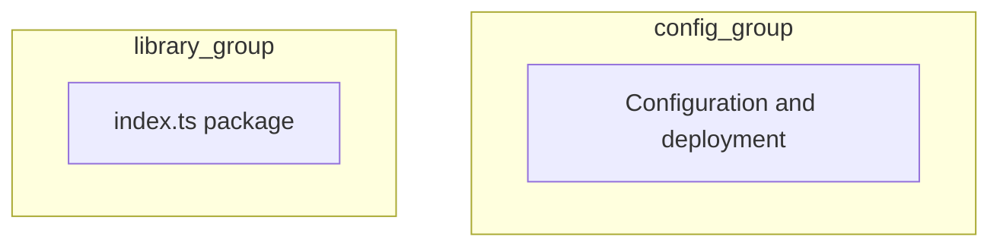

# Architecture report: 21st-dev/magic-mcp

> Automated static analysis. **Observed** = directly seen in files/imports/AST; **Inferred** = interpretation from that evidence. Repository code was not executed.

## 1. Repository at a glance

| Item | Value |
| --- | --- |
| Repository | 21st-dev/magic-mcp |
| Description | It's like v0, but in your Cursor / Claude Code / Windsurf: search 10,000+ React/Tailwind components, generate new UI with AI, and publish your own — right from your editor. Magic MCP is now the 21st MCP; this package keeps old configs working. Setup: 21st.dev/mcp |
| Language | TypeScript |
| Stars | 6531 |
| Licence | ISC |
| Analysed commit / branch | 6b5299e8a83ceffa73d4fc4e148905bb3eeeeb55 / main |
| Framework(s) | None detected |
| Files analysed | 19 |
| Components | 2 |

## 2. Architecture in one minute

21st-dev/magic-mcp - It's like v0, but in your Cursor / Claude Code / Windsurf: search 10,000+ React/Tailwind components, generate new UI with AI, and publish your own — right from your editor. Magic MCP is now the 21st…. This repository was analysed statically from 19 file(s) (0 Python). Detected technologies (observed from imports/manifests): GitHub Actions, Docker, TypeScript. Files are grouped into 2 component(s): Configuration and deployment, index.ts package. Findings below distinguish observed facts from inferred interpretation.

## 3. High-level block diagram

## 4. Main components

### Configuration and deployment (`config`)

- **Kind:** config
- **Status:** Observed
- **Confidence:** 0.85
- **Responsibility:** Groups 6 file(s) under configuration and deployment (observed from repository paths and static analysis).
- **Paths:** `Dockerfile`, `mcp.json`, `package.json`, `server.json`, `smithery.yaml`, `tsconfig.json`
- **Evidence:** [Dockerfile](https://github.com/21st-dev/magic-mcp/blob/6b5299e8a83ceffa73d4fc4e148905bb3eeeeb55/Dockerfile); [mcp.json](https://github.com/21st-dev/magic-mcp/blob/6b5299e8a83ceffa73d4fc4e148905bb3eeeeb55/mcp.json); [package.json](https://github.com/21st-dev/magic-mcp/blob/6b5299e8a83ceffa73d4fc4e148905bb3eeeeb55/package.json); [server.json](https://github.com/21st-dev/magic-mcp/blob/6b5299e8a83ceffa73d4fc4e148905bb3eeeeb55/server.json); [smithery.yaml](https://github.com/21st-dev/magic-mcp/blob/6b5299e8a83ceffa73d4fc4e148905bb3eeeeb55/smithery.yaml); [tsconfig.json](https://github.com/21st-dev/magic-mcp/blob/6b5299e8a83ceffa73d4fc4e148905bb3eeeeb55/tsconfig.json)

### index.ts package (`index_ts`)

- **Kind:** library
- **Status:** Observed
- **Confidence:** 0.85
- **Responsibility:** Groups 1 file(s) under index.ts package (observed from repository paths and static analysis).
- **Paths:** `src/index.ts`
- **Evidence:** [src/index.ts](https://github.com/21st-dev/magic-mcp/blob/6b5299e8a83ceffa73d4fc4e148905bb3eeeeb55/src/index.ts)

## 5. Execution flow

**Observed** entry point(s):

- [src/index.ts](https://github.com/21st-dev/magic-mcp/blob/6b5299e8a83ceffa73d4fc4e148905bb3eeeeb55/src/index.ts)

Representative flow (derived from observed entry points and the import graph; steps beyond the entry point are **Inferred**):

1. Execution starts at an observed entry point listed above, if present.
2. No internal import relationships between components were observed.

## 6. Project structure

### `(root)`

- `.gitignore` - other (399 bytes)
- `.mcp.json` - config (153 bytes)
- `Dockerfile` - container (296 bytes)
- `LICENSE` - docs (739 bytes)
- `README.md` - docs (5261 bytes)
- `llms-install.md` - docs (1773 bytes)
- `mcp.json` - config (153 bytes)
- `package.json` - manifest (1005 bytes)
- `server.json` - config (781 bytes)
- `smithery.yaml` - config (638 bytes)
- `tsconfig.json` - config (405 bytes)

### `.agents`

- `.agents/plugins/marketplace.json` - config (341 bytes)

### `.claude-plugin`

- `.claude-plugin/marketplace.json` - config (568 bytes)
- `.claude-plugin/plugin.json` - config (486 bytes)

### `.codex-plugin`

- `.codex-plugin/plugin.json` - config (756 bytes)

### `.cursor-plugin`

- `.cursor-plugin/plugin.json` - config (986 bytes)

### `.github`

- `.github/workflows/npm-publish.yml` - ci, YAML (8727 bytes)

### `skills`

- `skills/21st-ui/SKILL.md` - docs (3454 bytes)

### `src`

- `src/index.ts` - source, TypeScript (7425 bytes)

## 7. Key dependencies and integrations

| Name | Category | Status | Confidence | Evidence |
| --- | --- | --- | --- | --- |
| GitHub Actions | ci | Observed | 0.85 | [.github/workflows/npm-publish.yml](https://github.com/21st-dev/magic-mcp/blob/6b5299e8a83ceffa73d4fc4e148905bb3eeeeb55/.github/workflows/npm-publish.yml) |
| Docker | tooling | Observed | 0.85 | [Dockerfile](https://github.com/21st-dev/magic-mcp/blob/6b5299e8a83ceffa73d4fc4e148905bb3eeeeb55/Dockerfile) |
| TypeScript | tooling | Observed | 0.85 | [package.json:39](https://github.com/21st-dev/magic-mcp/blob/6b5299e8a83ceffa73d4fc4e148905bb3eeeeb55/package.json#L39) |

## 8. Data and state

No database, cache, queue, or persistent-state usage was observed in the analysed files. State handling, if any, may be in-memory or in files that were not analysed.

## 9. Configuration and deployment clues

- `.agents/plugins/marketplace.json` (config)
- `.claude-plugin/marketplace.json` (config)
- `.claude-plugin/plugin.json` (config)
- `.codex-plugin/plugin.json` (config)
- `.cursor-plugin/plugin.json` (config)
- `.github/workflows/npm-publish.yml` (ci)
- `.mcp.json` (config)
- `Dockerfile` (container)
- `mcp.json` (config)
- `package.json` (manifest)
- `server.json` (config)
- `smithery.yaml` (config)
- `tsconfig.json` (config)

## 10. Design observations

- No strong design patterns could be established from the available evidence.

These observations are interpretations (**Inferred**) of the observed structure, not guarantees about runtime design.

## 11. Limitations and unknowns

- Static analysis only: repository code was not executed, installed, or imported at runtime.
- Components and relationships are inferred from file paths, imports, and AST structure; runtime behaviour, dynamic imports, and reflection may not be visible.
- 1 file(s) were skipped during inventory (1 x lockfile excluded).
- No clear application entry point was observed in the analysed files.
- Repository text was treated as untrusted data; no instructions found in repository files were followed, and likely secret values were redacted/excluded.
- JavaScript and TypeScript files were inventoried from paths and package manifests. They were not parsed with a full language AST, and repository code was not executed.

## 12. Source references

- [.github/workflows/npm-publish.yml](https://github.com/21st-dev/magic-mcp/blob/6b5299e8a83ceffa73d4fc4e148905bb3eeeeb55/.github/workflows/npm-publish.yml)
- [Dockerfile](https://github.com/21st-dev/magic-mcp/blob/6b5299e8a83ceffa73d4fc4e148905bb3eeeeb55/Dockerfile)
- [mcp.json](https://github.com/21st-dev/magic-mcp/blob/6b5299e8a83ceffa73d4fc4e148905bb3eeeeb55/mcp.json)
- [package.json](https://github.com/21st-dev/magic-mcp/blob/6b5299e8a83ceffa73d4fc4e148905bb3eeeeb55/package.json)
- [package.json:39](https://github.com/21st-dev/magic-mcp/blob/6b5299e8a83ceffa73d4fc4e148905bb3eeeeb55/package.json#L39)
- [server.json](https://github.com/21st-dev/magic-mcp/blob/6b5299e8a83ceffa73d4fc4e148905bb3eeeeb55/server.json)
- [smithery.yaml](https://github.com/21st-dev/magic-mcp/blob/6b5299e8a83ceffa73d4fc4e148905bb3eeeeb55/smithery.yaml)
- [src/index.ts](https://github.com/21st-dev/magic-mcp/blob/6b5299e8a83ceffa73d4fc4e148905bb3eeeeb55/src/index.ts)
- [tsconfig.json](https://github.com/21st-dev/magic-mcp/blob/6b5299e8a83ceffa73d4fc4e148905bb3eeeeb55/tsconfig.json)
