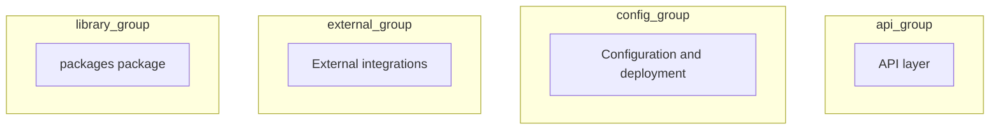

# Architecture report: 47ng/nuqs

> Automated static analysis. **Observed** = directly seen in files/imports/AST; **Inferred** = interpretation from that evidence. Repository code was not executed.

## 1. Repository at a glance

| Item | Value |
| --- | --- |
| Repository | 47ng/nuqs |
| Description | Type-safe search params state manager for React frameworks - Like useState, but stored in the URL query string. |
| Language | TypeScript |
| Stars | 10907 |
| Licence | MIT |
| Analysed commit / branch | 149906a2a6388adf79e868786581eec9cfb16c00 / next |
| Framework(s) | Next.js, React |
| Files analysed | 800 |
| Components | 4 |

## 2. Architecture in one minute

47ng/nuqs - Type-safe search params state manager for React frameworks - Like useState, but stored in the URL query string.. This repository was analysed statically from 800 file(s) (0 Python). Detected technologies (observed from imports/manifests): GitHub Actions, Next.js, React, React Router, Tailwind CSS, TypeScript. Files are grouped into 4 component(s): API layer, Configuration and deployment, External integrations, packages package. Findings below distinguish observed facts from inferred interpretation.

## 3. High-level block diagram

## 4. Main components

### API layer (`api_layer`)

- **Kind:** api
- **Status:** Observed
- **Confidence:** 0.85
- **Responsibility:** Groups 155 file(s) under api layer (observed from repository paths and static analysis).
- **Paths:** `packages/e2e/next/src/app/api/app/loader/route.ts`, `packages/e2e/next/src/pages/api/pages/loader.ts`, `packages/e2e/react-router/v5/src/routes/basic-io.useQueryState.tsx`, `packages/e2e/react-router/v5/src/routes/basic-io.useQueryStates.tsx`, `packages/e2e/react-router/v5/src/routes/conditional-rendering.useQueryState.tsx`, `packages/e2e/react-router/v5/src/routes/conditional-rendering.useQueryStates.tsx`, `packages/e2e/react-router/v5/src/routes/fog-of-war._index.tsx`, `packages/e2e/react-router/v5/src/routes/fog-of-war.result.tsx`, `packages/e2e/react-router/v5/src/routes/form.useQueryState.tsx`, `packages/e2e/react-router/v5/src/routes/form.useQueryStates.tsx`, `packages/e2e/react-router/v5/src/routes/hash-preservation.tsx`, `packages/e2e/react-router/v5/src/routes/history-sync.tsx`, `packages/e2e/react-router/v5/src/routes/json.tsx`, `packages/e2e/react-router/v5/src/routes/key-isolation.useQueryState.tsx`, `packages/e2e/react-router/v5/src/routes/key-isolation.useQueryStates.tsx`, `packages/e2e/react-router/v5/src/routes/lane-priority.tsx`, `packages/e2e/react-router/v5/src/routes/life-and-death.tsx`, `packages/e2e/react-router/v5/src/routes/linking.useQueryState.other.tsx`, `packages/e2e/react-router/v5/src/routes/linking.useQueryState.tsx`, `packages/e2e/react-router/v5/src/routes/linking.useQueryStates.other.tsx`, `packages/e2e/react-router/v5/src/routes/linking.useQueryStates.tsx`, `packages/e2e/react-router/v5/src/routes/native-array.tsx`, `packages/e2e/react-router/v5/src/routes/pretty-urls.tsx`, `packages/e2e/react-router/v5/src/routes/push.useQueryState.tsx`, `packages/e2e/react-router/v5/src/routes/push.useQueryStates.tsx`, `packages/e2e/react-router/v5/src/routes/rate-limits.tsx`, `packages/e2e/react-router/v5/src/routes/referential-stability.useQueryState.tsx`, `packages/e2e/react-router/v5/src/routes/referential-stability.useQueryStates.tsx`, `packages/e2e/react-router/v5/src/routes/render-count.$hook.$shallow.$history.$startTransition.no-loader.tsx`, `packages/e2e/react-router/v5/src/routes/repro-1099.useQueryState.tsx`, `packages/e2e/react-router/v5/src/routes/repro-1099.useQueryStates.tsx`, `packages/e2e/react-router/v5/src/routes/repro-1444.tsx`, `packages/e2e/react-router/v5/src/routes/repro-1501.tsx`, `packages/e2e/react-router/v5/src/routes/repro-1506.tsx`, `packages/e2e/react-router/v5/src/routes/repro-1612.tsx`, `packages/e2e/react-router/v5/src/routes/repro-359.tsx`, `packages/e2e/react-router/v5/src/routes/repro-982.tsx`, `packages/e2e/react-router/v5/src/routes/routing.useQueryState.other.tsx`, `packages/e2e/react-router/v5/src/routes/routing.useQueryState.tsx`, `packages/e2e/react-router/v5/src/routes/routing.useQueryStates.other.tsx`, `packages/e2e/react-router/v5/src/routes/routing.useQueryStates.tsx`, `packages/e2e/react-router/v5/src/routes/scroll.tsx`, `packages/e2e/react-router/v5/src/routes/stitching.tsx`, `packages/e2e/react-router/v6/src/routes/basic-io.useQueryState.tsx`, `packages/e2e/react-router/v6/src/routes/basic-io.useQueryStates.tsx`, `packages/e2e/react-router/v6/src/routes/conditional-rendering.useQueryState.tsx`, `packages/e2e/react-router/v6/src/routes/conditional-rendering.useQueryStates.tsx`, `packages/e2e/react-router/v6/src/routes/debounce.other.tsx`, `packages/e2e/react-router/v6/src/routes/debounce.tsx`, `packages/e2e/react-router/v6/src/routes/dynamic-segments.catch-all.$.tsx`, `packages/e2e/react-router/v6/src/routes/dynamic-segments.dynamic.$segment.tsx`, `packages/e2e/react-router/v6/src/routes/flush-after-navigate.useQueryState.end.tsx`, `packages/e2e/react-router/v6/src/routes/flush-after-navigate.useQueryState.start.tsx`, `packages/e2e/react-router/v6/src/routes/flush-after-navigate.useQueryStates.end.tsx`, `packages/e2e/react-router/v6/src/routes/flush-after-navigate.useQueryStates.start.tsx`, `packages/e2e/react-router/v6/src/routes/fog-of-war._index.tsx`, `packages/e2e/react-router/v6/src/routes/fog-of-war.result.tsx`, `packages/e2e/react-router/v6/src/routes/form.useQueryState.tsx`, `packages/e2e/react-router/v6/src/routes/form.useQueryStates.tsx`, `packages/e2e/react-router/v6/src/routes/hash-preservation.tsx`, `packages/e2e/react-router/v6/src/routes/history-sync.tsx`, `packages/e2e/react-router/v6/src/routes/json.tsx`, `packages/e2e/react-router/v6/src/routes/key-isolation.useQueryState.tsx`, `packages/e2e/react-router/v6/src/routes/key-isolation.useQueryStates.tsx`, `packages/e2e/react-router/v6/src/routes/lane-priority.tsx`, `packages/e2e/react-router/v6/src/routes/life-and-death.tsx`, `packages/e2e/react-router/v6/src/routes/linking.useQueryState.other.tsx`, `packages/e2e/react-router/v6/src/routes/linking.useQueryState.tsx`, `packages/e2e/react-router/v6/src/routes/linking.useQueryStates.other.tsx`, `packages/e2e/react-router/v6/src/routes/linking.useQueryStates.tsx`, `packages/e2e/react-router/v6/src/routes/loader.tsx`, `packages/e2e/react-router/v6/src/routes/native-array.tsx`, `packages/e2e/react-router/v6/src/routes/popstate-queue-reset.other.tsx`, `packages/e2e/react-router/v6/src/routes/popstate-queue-reset.tsx`, `packages/e2e/react-router/v6/src/routes/pretty-urls.tsx`, `packages/e2e/react-router/v6/src/routes/push.useQueryState.tsx`, `packages/e2e/react-router/v6/src/routes/push.useQueryStates.tsx`, `packages/e2e/react-router/v6/src/routes/queue-lifecycle.tsx`, `packages/e2e/react-router/v6/src/routes/rate-limits.tsx`, `packages/e2e/react-router/v6/src/routes/referential-stability.useQueryState.tsx`, `packages/e2e/react-router/v6/src/routes/referential-stability.useQueryStates.tsx`, `packages/e2e/react-router/v6/src/routes/render-count.$hook.$shallow.$history.$startTransition.async-loader.tsx`, `packages/e2e/react-router/v6/src/routes/render-count.$hook.$shallow.$history.$startTransition.no-loader.tsx`, `packages/e2e/react-router/v6/src/routes/render-count.$hook.$shallow.$history.$startTransition.sync-loader.tsx`, `packages/e2e/react-router/v6/src/routes/repro-1099.useQueryState.tsx`, `packages/e2e/react-router/v6/src/routes/repro-1099.useQueryStates.tsx`, `packages/e2e/react-router/v6/src/routes/repro-1293.a.tsx`, `packages/e2e/react-router/v6/src/routes/repro-1293.b.tsx`, `packages/e2e/react-router/v6/src/routes/repro-1358.a.tsx`, `packages/e2e/react-router/v6/src/routes/repro-1358.b.tsx`, `packages/e2e/react-router/v6/src/routes/repro-1365.tsx`, `packages/e2e/react-router/v6/src/routes/repro-1444.tsx`, `packages/e2e/react-router/v6/src/routes/repro-1501.tsx`, `packages/e2e/react-router/v6/src/routes/repro-1612.tsx`, `packages/e2e/react-router/v6/src/routes/repro-359.tsx`, `packages/e2e/react-router/v6/src/routes/repro-839.tsx`, `packages/e2e/react-router/v6/src/routes/repro-982.tsx`, `packages/e2e/react-router/v6/src/routes/routing.useQueryState.other.tsx`, `packages/e2e/react-router/v6/src/routes/routing.useQueryState.tsx`, `packages/e2e/react-router/v6/src/routes/routing.useQueryStates.other.tsx`, `packages/e2e/react-router/v6/src/routes/routing.useQueryStates.tsx`, `packages/e2e/react-router/v6/src/routes/scroll.tsx`, `packages/e2e/react-router/v6/src/routes/shallow.useQueryState.tsx`, `packages/e2e/react-router/v6/src/routes/shallow.useQueryStates.tsx`, `packages/e2e/react-router/v6/src/routes/stitching.tsx`, `packages/e2e/react-router/v7/app/routes/basic-io.useQueryState.tsx`, `packages/e2e/react-router/v7/app/routes/basic-io.useQueryStates.tsx`, `packages/e2e/react-router/v7/app/routes/conditional-rendering.useQueryState.tsx`, `packages/e2e/react-router/v7/app/routes/conditional-rendering.useQueryStates.tsx`, `packages/e2e/react-router/v7/app/routes/debounce.other.tsx`, `packages/e2e/react-router/v7/app/routes/debounce.tsx`, `packages/e2e/react-router/v7/app/routes/dynamic-segments.catch-all.$.tsx`, `packages/e2e/react-router/v7/app/routes/dynamic-segments.dynamic.$segment.tsx`, `packages/e2e/react-router/v7/app/routes/flush-after-navigate.useQueryState.end.tsx`, `packages/e2e/react-router/v7/app/routes/flush-after-navigate.useQueryState.start.tsx`, `packages/e2e/react-router/v7/app/routes/flush-after-navigate.useQueryStates.end.tsx`, `packages/e2e/react-router/v7/app/routes/flush-after-navigate.useQueryStates.start.tsx`, `packages/e2e/react-router/v7/app/routes/fog-of-war._index.tsx`, `packages/e2e/react-router/v7/app/routes/fog-of-war.result.tsx`, `packages/e2e/react-router/v7/app/routes/form.useQueryState.tsx`, `packages/e2e/react-router/v7/app/routes/form.useQueryStates.tsx`, `packages/e2e/react-router/v7/app/routes/hash-preservation.tsx`, `packages/e2e/react-router/v7/app/routes/history-sync.tsx`, `packages/e2e/react-router/v7/app/routes/json.tsx`, `packages/e2e/react-router/v7/app/routes/key-isolation.useQueryState.tsx`, `packages/e2e/react-router/v7/app/routes/key-isolation.useQueryStates.tsx`, `packages/e2e/react-router/v7/app/routes/lane-priority.tsx`, `packages/e2e/react-router/v7/app/routes/life-and-death.tsx`, `packages/e2e/react-router/v7/app/routes/linking.useQueryState.other.tsx`, `packages/e2e/react-router/v7/app/routes/linking.useQueryState.tsx`, `packages/e2e/react-router/v7/app/routes/linking.useQueryStates.other.tsx`, `packages/e2e/react-router/v7/app/routes/linking.useQueryStates.tsx`, `packages/e2e/react-router/v7/app/routes/loader.tsx`, `packages/e2e/react-router/v7/app/routes/native-array.tsx`, `packages/e2e/react-router/v7/app/routes/popstate-queue-reset.other.tsx`, `packages/e2e/react-router/v7/app/routes/popstate-queue-reset.tsx`, `packages/e2e/react-router/v7/app/routes/pretty-urls.tsx`, `packages/e2e/react-router/v7/app/routes/push.useQueryState.tsx`, `packages/e2e/react-router/v7/app/routes/push.useQueryStates.tsx`, `packages/e2e/react-router/v7/app/routes/queue-lifecycle.tsx`, `packages/e2e/react-router/v7/app/routes/rate-limits.tsx`, `packages/e2e/react-router/v7/app/routes/referential-stability.useQueryState.tsx`, `packages/e2e/react-router/v7/app/routes/referential-stability.useQueryStates.tsx`, `packages/e2e/react-router/v7/app/routes/render-count.$hook.$shallow.$history.$startTransition.async-loader.tsx`, `packages/e2e/react-router/v7/app/routes/render-count.$hook.$shallow.$history.$startTransition.no-loader.tsx`, `packages/e2e/react-router/v7/app/routes/render-count.$hook.$shallow.$history.$startTransition.sync-loader.tsx`, `packages/e2e/react-router/v7/app/routes/repro-1099.useQueryState.tsx`, `packages/e2e/react-router/v7/app/routes/repro-1099.useQueryStates.tsx`, `packages/e2e/react-router/v7/app/routes/repro-1184.tsx`, `packages/e2e/react-router/v7/app/routes/repro-1293.a.tsx`, `packages/e2e/react-router/v7/app/routes/repro-1293.b.tsx`, `packages/e2e/react-router/v7/app/routes/repro-1358.a.tsx`, `packages/e2e/react-router/v7/app/routes/repro-1358.b.tsx`, `packages/e2e/react-router/v7/app/routes/repro-1365.tsx`, `packages/e2e/react-router/v7/app/routes/repro-1444.tsx`
- **Evidence:** [packages/e2e/next/src/app/api/app/loader/route.ts](https://github.com/47ng/nuqs/blob/149906a2a6388adf79e868786581eec9cfb16c00/packages/e2e/next/src/app/api/app/loader/route.ts); [packages/e2e/next/src/pages/api/pages/loader.ts](https://github.com/47ng/nuqs/blob/149906a2a6388adf79e868786581eec9cfb16c00/packages/e2e/next/src/pages/api/pages/loader.ts); [packages/e2e/react-router/v5/src/routes/basic-io.useQueryState.tsx](https://github.com/47ng/nuqs/blob/149906a2a6388adf79e868786581eec9cfb16c00/packages/e2e/react-router/v5/src/routes/basic-io.useQueryState.tsx); [packages/e2e/react-router/v5/src/routes/basic-io.useQueryStates.tsx](https://github.com/47ng/nuqs/blob/149906a2a6388adf79e868786581eec9cfb16c00/packages/e2e/react-router/v5/src/routes/basic-io.useQueryStates.tsx); [packages/e2e/react-router/v5/src/routes/conditional-rendering.useQueryState.tsx](https://github.com/47ng/nuqs/blob/149906a2a6388adf79e868786581eec9cfb16c00/packages/e2e/react-router/v5/src/routes/conditional-rendering.useQueryState.tsx); [packages/e2e/react-router/v5/src/routes/conditional-rendering.useQueryStates.tsx](https://github.com/47ng/nuqs/blob/149906a2a6388adf79e868786581eec9cfb16c00/packages/e2e/react-router/v5/src/routes/conditional-rendering.useQueryStates.tsx); [packages/e2e/react-router/v5/src/routes/fog-of-war._index.tsx](https://github.com/47ng/nuqs/blob/149906a2a6388adf79e868786581eec9cfb16c00/packages/e2e/react-router/v5/src/routes/fog-of-war._index.tsx); [packages/e2e/react-router/v5/src/routes/fog-of-war.result.tsx](https://github.com/47ng/nuqs/blob/149906a2a6388adf79e868786581eec9cfb16c00/packages/e2e/react-router/v5/src/routes/fog-of-war.result.tsx)

### Configuration and deployment (`config`)

- **Kind:** config
- **Status:** Observed
- **Confidence:** 0.85
- **Responsibility:** Groups 33 file(s) under configuration and deployment (observed from repository paths and static analysis).
- **Paths:** `knip.json`, `package.json`, `packages/docs/.env.example`, `packages/docs/components.json`, `packages/docs/content/docs/meta.json`, `packages/docs/content/docs/parsers/community/meta.json`, `packages/docs/content/docs/parsers/meta.json`, `packages/docs/package.json`, `packages/docs/public/schemas/changelog-dto.v1.json`, `packages/docs/src/registry/items/adapter-inertia.json`, `packages/docs/src/registry/items/adapter-onejs.json`, `packages/docs/src/registry/items/adapter-react-router-v5.json`, `packages/docs/src/registry/items/adapter-waku.json`, `packages/docs/src/registry/items/next-typed-links.json`, `packages/docs/src/registry/items/parser-uuid.json`, `packages/docs/tsconfig.json`, `packages/docs/turbo.json`, `packages/docs/vercel-doctor.config.json`, `packages/e2e/next/package.json`, `packages/e2e/next/tsconfig.json`, `packages/e2e/next/turbo.json`, `packages/e2e/package.json`, `packages/e2e/react-router/package.json`, `packages/e2e/react-router/v5/package.json`, `packages/e2e/react-router/v5/tsconfig.app.json`, `packages/e2e/react-router/v5/tsconfig.json`, `packages/e2e/react-router/v5/tsconfig.node.json`, `packages/e2e/react-router/v5/turbo.json`, `packages/e2e/react-router/v6/package.json`, `packages/e2e/react-router/v6/tsconfig.app.json`, `packages/e2e/react-router/v6/tsconfig.json`, `packages/e2e/react-router/v6/tsconfig.node.json`, `packages/e2e/react-router/v6/turbo.json`
- **Evidence:** [knip.json](https://github.com/47ng/nuqs/blob/149906a2a6388adf79e868786581eec9cfb16c00/knip.json); [package.json](https://github.com/47ng/nuqs/blob/149906a2a6388adf79e868786581eec9cfb16c00/package.json); [packages/docs/.env.example](https://github.com/47ng/nuqs/blob/149906a2a6388adf79e868786581eec9cfb16c00/packages/docs/.env.example); [packages/docs/components.json](https://github.com/47ng/nuqs/blob/149906a2a6388adf79e868786581eec9cfb16c00/packages/docs/components.json); [packages/docs/content/docs/meta.json](https://github.com/47ng/nuqs/blob/149906a2a6388adf79e868786581eec9cfb16c00/packages/docs/content/docs/meta.json); [packages/docs/content/docs/parsers/community/meta.json](https://github.com/47ng/nuqs/blob/149906a2a6388adf79e868786581eec9cfb16c00/packages/docs/content/docs/parsers/community/meta.json); [packages/docs/content/docs/parsers/meta.json](https://github.com/47ng/nuqs/blob/149906a2a6388adf79e868786581eec9cfb16c00/packages/docs/content/docs/parsers/meta.json); [packages/docs/package.json](https://github.com/47ng/nuqs/blob/149906a2a6388adf79e868786581eec9cfb16c00/packages/docs/package.json)

### External integrations (`external_integrations`)

- **Kind:** external
- **Status:** Observed
- **Confidence:** 0.85
- **Responsibility:** Groups 1 file(s) under external integrations (observed from repository paths and static analysis).
- **Paths:** `packages/e2e/next/src/app/app/routing-tour/start/client/page.tsx`
- **Evidence:** [packages/e2e/next/src/app/app/routing-tour/start/client/page.tsx](https://github.com/47ng/nuqs/blob/149906a2a6388adf79e868786581eec9cfb16c00/packages/e2e/next/src/app/app/routing-tour/start/client/page.tsx)

### packages package (`packages`)

- **Kind:** library
- **Status:** Observed
- **Confidence:** 0.85
- **Responsibility:** Groups 286 file(s) under packages package (observed from repository paths and static analysis).
- **Paths:** `packages/e2e/next/next-env.d.ts`, `packages/e2e/next/next.config.mjs`, `packages/e2e/next/playwright.config.ts`, `packages/e2e/next/scripts/cache-components-codemod.ts`, `packages/e2e/next/specs/cache.spec.ts`, `packages/e2e/next/specs/deferred.spec.ts`, `packages/e2e/next/specs/multitenant.spec.ts`, `packages/e2e/next/specs/persist-across-navigation.spec.ts`, `packages/e2e/next/specs/push.spec.ts`, `packages/e2e/next/specs/queue-lifecycle.spec.ts`, `packages/e2e/next/specs/referential-equality.spec.ts`, `packages/e2e/next/specs/remapped-keys.spec.ts`, `packages/e2e/next/specs/repros.spec.ts`, `packages/e2e/next/specs/rewrites.spec.ts`, `packages/e2e/next/specs/routing-tour.spec.ts`, `packages/e2e/next/specs/shared-layout-sync.spec.ts`, `packages/e2e/next/specs/shared.spec.ts`, `packages/e2e/next/specs/shared/basic-io-agnostic.spec.ts`, `packages/e2e/next/specs/shared/debounce.spec.ts`, `packages/e2e/next/specs/shared/dynamic-segments.spec.ts`, `packages/e2e/next/specs/shared/flush-after-navigate.spec.ts`, `packages/e2e/next/specs/shared/hash-preservation.spec.ts`, `packages/e2e/next/specs/shared/loader.spec.ts`, `packages/e2e/next/specs/shared/popstate-queue-reset.spec.ts`, `packages/e2e/next/specs/shared/push.spec.ts`, `packages/e2e/next/specs/shared/render-count.spec.ts`, `packages/e2e/next/specs/shared/repro-1099.spec.ts`, `packages/e2e/next/specs/shared/repro-1273.spec.ts`, `packages/e2e/next/specs/shared/repro-1293.spec.ts`, `packages/e2e/next/specs/shared/repro-1358.spec.ts`, `packages/e2e/next/specs/shared/repro-1365.spec.ts`, `packages/e2e/next/specs/shared/repro-1444.spec.ts`, `packages/e2e/next/specs/shared/repro-1501.spec.ts`, `packages/e2e/next/specs/shared/repro-1506.spec.ts`, `packages/e2e/next/specs/shared/repro-1612.spec.ts`, `packages/e2e/next/specs/shared/repro-359.spec.ts`, `packages/e2e/next/specs/shared/repro-982.spec.ts`, `packages/e2e/next/specs/shared/shallow.spec.ts`, `packages/e2e/next/specs/shared/stitching.spec.ts`, `packages/e2e/next/specs/transitions.spec.ts`, `packages/e2e/next/specs/useQueryState.spec.ts`, `packages/e2e/next/specs/useQueryStates-clear-all.spec.ts`, `packages/e2e/next/specs/useQueryStates.spec.ts`, `packages/e2e/next/specs/useSearchParams.spec.ts`, `packages/e2e/next/src/app/app/(shared)/basic-io/useQueryState/page.tsx`, `packages/e2e/next/src/app/app/(shared)/basic-io/useQueryStates/page.tsx`, `packages/e2e/next/src/app/app/(shared)/conditional-rendering/useQueryState/page.tsx`, `packages/e2e/next/src/app/app/(shared)/conditional-rendering/useQueryStates/page.tsx`, `packages/e2e/next/src/app/app/(shared)/debounce/other/page.tsx`, `packages/e2e/next/src/app/app/(shared)/debounce/page.tsx`, `packages/e2e/next/src/app/app/(shared)/dynamic-segments/catch-all/[...segments]/client.tsx`, `packages/e2e/next/src/app/app/(shared)/dynamic-segments/catch-all/[...segments]/page.tsx`, `packages/e2e/next/src/app/app/(shared)/dynamic-segments/dynamic/[segment]/client.tsx`, `packages/e2e/next/src/app/app/(shared)/dynamic-segments/dynamic/[segment]/page.tsx`, `packages/e2e/next/src/app/app/(shared)/dynamic-segments/optional-catch-all/[[...segments]]/client.tsx`, `packages/e2e/next/src/app/app/(shared)/dynamic-segments/optional-catch-all/[[...segments]]/page.tsx`, `packages/e2e/next/src/app/app/(shared)/flush-after-navigate/useQueryState/end/page.tsx`, `packages/e2e/next/src/app/app/(shared)/flush-after-navigate/useQueryState/start/page.tsx`, `packages/e2e/next/src/app/app/(shared)/flush-after-navigate/useQueryStates/end/page.tsx`, `packages/e2e/next/src/app/app/(shared)/flush-after-navigate/useQueryStates/start/page.tsx`, `packages/e2e/next/src/app/app/(shared)/form/useQueryState/page.tsx`, `packages/e2e/next/src/app/app/(shared)/form/useQueryStates/page.tsx`, `packages/e2e/next/src/app/app/(shared)/hash-preservation/dynamic/[route]/page.tsx`, `packages/e2e/next/src/app/app/(shared)/hash-preservation/page.tsx`, `packages/e2e/next/src/app/app/(shared)/history-sync/page.tsx`, `packages/e2e/next/src/app/app/(shared)/json/page.tsx`, `packages/e2e/next/src/app/app/(shared)/lane-priority/page.tsx`, `packages/e2e/next/src/app/app/(shared)/life-and-death/page.tsx`, `packages/e2e/next/src/app/app/(shared)/linking/useQueryState/other/page.tsx`, `packages/e2e/next/src/app/app/(shared)/linking/useQueryState/page.tsx`, `packages/e2e/next/src/app/app/(shared)/linking/useQueryStates/other/page.tsx`, `packages/e2e/next/src/app/app/(shared)/linking/useQueryStates/page.tsx`, `packages/e2e/next/src/app/app/(shared)/native-array/page.tsx`, `packages/e2e/next/src/app/app/(shared)/popstate-queue-reset/other/page.tsx`, `packages/e2e/next/src/app/app/(shared)/popstate-queue-reset/page.tsx`, `packages/e2e/next/src/app/app/(shared)/pretty-urls/page.tsx`, `packages/e2e/next/src/app/app/(shared)/push/useQueryState/dynamic/[route]/page.tsx`, `packages/e2e/next/src/app/app/(shared)/push/useQueryState/page.tsx`, `packages/e2e/next/src/app/app/(shared)/push/useQueryStates/dynamic/[route]/page.tsx`, `packages/e2e/next/src/app/app/(shared)/push/useQueryStates/page.tsx`, `packages/e2e/next/src/app/app/(shared)/queue-lifecycle/page.tsx`, `packages/e2e/next/src/app/app/(shared)/rate-limits/page.tsx`, `packages/e2e/next/src/app/app/(shared)/referential-stability/useQueryState/page.tsx`, `packages/e2e/next/src/app/app/(shared)/referential-stability/useQueryStates/page.tsx`, `packages/e2e/next/src/app/app/(shared)/render-count/[hook]/[shallow]/[history]/[startTransition]/page.tsx`, `packages/e2e/next/src/app/app/(shared)/repro-1273/other/page.tsx`, `packages/e2e/next/src/app/app/(shared)/repro-1273/page.tsx`, `packages/e2e/next/src/app/app/(shared)/repro-1365/page.tsx`, `packages/e2e/next/src/app/app/(shared)/repro-1444/page.tsx`, `packages/e2e/next/src/app/app/(shared)/repro-1501/page.tsx`, `packages/e2e/next/src/app/app/(shared)/repro-1506/page.tsx`, `packages/e2e/next/src/app/app/(shared)/repro-1612/page.tsx`, `packages/e2e/next/src/app/app/(shared)/repro-359/page.tsx`, `packages/e2e/next/src/app/app/(shared)/repro-982/page.tsx`, `packages/e2e/next/src/app/app/(shared)/routing/useQueryState/other/page.tsx`, `packages/e2e/next/src/app/app/(shared)/routing/useQueryState/page.tsx`, `packages/e2e/next/src/app/app/(shared)/routing/useQueryStates/other/page.tsx`, `packages/e2e/next/src/app/app/(shared)/routing/useQueryStates/page.tsx`, `packages/e2e/next/src/app/app/(shared)/scroll/page.tsx`, `packages/e2e/next/src/app/app/(shared)/shallow/useQueryState/page.tsx`, `packages/e2e/next/src/app/app/(shared)/shallow/useQueryStates/page.tsx`, `packages/e2e/next/src/app/app/(shared)/stitching/page.tsx`, `packages/e2e/next/src/app/app/agnostic/basic-io/page.tsx`, `packages/e2e/next/src/app/app/agnostic/layout.tsx`, `packages/e2e/next/src/app/app/cache/all.tsx`, `packages/e2e/next/src/app/app/cache/get.tsx`, `packages/e2e/next/src/app/app/cache/layout.tsx`, `packages/e2e/next/src/app/app/cache/page.tsx`, `packages/e2e/next/src/app/app/cache/searchParams.ts`, `packages/e2e/next/src/app/app/cache/set.tsx`, `packages/e2e/next/src/app/app/deferred/page.tsx`, `packages/e2e/next/src/app/app/loader/page.tsx`, `packages/e2e/next/src/app/app/multitenant/[tenant]/client-tenant.tsx`, `packages/e2e/next/src/app/app/multitenant/[tenant]/page.tsx`, `packages/e2e/next/src/app/app/persist-across-navigation/a/page.tsx`, `packages/e2e/next/src/app/app/persist-across-navigation/b/page.tsx`, `packages/e2e/next/src/app/app/persist-across-navigation/client.tsx`, `packages/e2e/next/src/app/app/push/client.tsx`, `packages/e2e/next/src/app/app/push/page.tsx`, `packages/e2e/next/src/app/app/push/searchParams.ts`, `packages/e2e/next/src/app/app/referential-equality/page.tsx`, `packages/e2e/next/src/app/app/remapped-keys/page.tsx`, `packages/e2e/next/src/app/app/repro-1099/useQueryState/page.tsx`, `packages/e2e/next/src/app/app/repro-1099/useQueryStates/page.tsx`, `packages/e2e/next/src/app/app/repro-1293/a/page.tsx`, `packages/e2e/next/src/app/app/repro-1293/b/page.tsx`, `packages/e2e/next/src/app/app/repro-1358/a/page.tsx`, `packages/e2e/next/src/app/app/repro-1358/b/page.tsx`, `packages/e2e/next/src/app/app/repro-388/page.tsx`, `packages/e2e/next/src/app/app/repro-498/page.tsx`, `packages/e2e/next/src/app/app/repro-542/a/page.tsx`, `packages/e2e/next/src/app/app/repro-542/b/page.tsx`, `packages/e2e/next/src/app/app/repro-542/client.tsx`, `packages/e2e/next/src/app/app/repro-630/page.tsx`, `packages/e2e/next/src/app/app/repro-758/page.tsx`, `packages/e2e/next/src/app/app/repro-760/page.tsx`, `packages/e2e/next/src/app/app/repro-774/page.tsx`, `packages/e2e/next/src/app/app/rewrites/destination/client.tsx`, `packages/e2e/next/src/app/app/rewrites/destination/page.tsx`, `packages/e2e/next/src/app/app/rewrites/destination/searchParams.ts`, `packages/e2e/next/src/app/app/routing-tour/_components/parsers.ts`, `packages/e2e/next/src/app/app/routing-tour/_components/view.tsx`, `packages/e2e/next/src/app/app/routing-tour/a/page.tsx`, `packages/e2e/next/src/app/app/routing-tour/b/page.tsx`, `packages/e2e/next/src/app/app/routing-tour/c/page.tsx`, `packages/e2e/next/src/app/app/routing-tour/d/page.tsx`, `packages/e2e/next/src/app/app/routing-tour/start/server/page.tsx`, `packages/e2e/next/src/app/app/shared-layout-sync/SharedFilter.tsx`, `packages/e2e/next/src/app/app/shared-layout-sync/a/page.tsx`, `packages/e2e/next/src/app/app/shared-layout-sync/b/page.tsx`, `packages/e2e/next/src/app/app/shared-layout-sync/layout.tsx`, `packages/e2e/next/src/app/app/template/page.tsx`, `packages/e2e/next/src/app/app/transitions/client.tsx`, `packages/e2e/next/src/app/app/transitions/page.tsx`, `packages/e2e/next/src/app/app/useQueryState/dynamic/[route]/page.tsx`, `packages/e2e/next/src/app/app/useQueryState/page.tsx`, `packages/e2e/next/src/app/app/useQueryStates-clear-all/page.tsx`, `packages/e2e/next/src/app/app/useQueryStates/dynamic/[route]/page.tsx`, `packages/e2e/next/src/app/app/useQueryStates/page.tsx`, `packages/e2e/next/src/app/app/useSearchParams/page.tsx`, `packages/e2e/next/src/app/layout.tsx`, `packages/e2e/next/src/app/page.tsx`, `packages/e2e/next/src/app/providers.tsx`, `packages/e2e/next/src/components/pages-ready-wrapper.tsx`, `packages/e2e/next/src/middleware.ts`, `packages/e2e/next/src/pages/_app.tsx`, `packages/e2e/next/src/pages/pages/agnostic/basic-io.tsx`, `packages/e2e/next/src/pages/pages/basic-io/useQueryState.tsx`, `packages/e2e/next/src/pages/pages/basic-io/useQueryStates.tsx`, `packages/e2e/next/src/pages/pages/conditional-rendering/useQueryState.tsx`, `packages/e2e/next/src/pages/pages/conditional-rendering/useQueryStates.tsx`, `packages/e2e/next/src/pages/pages/debounce/index.tsx`, `packages/e2e/next/src/pages/pages/debounce/other.tsx`, `packages/e2e/next/src/pages/pages/dynamic-segments/catch-all/[...segments].tsx`, `packages/e2e/next/src/pages/pages/dynamic-segments/dynamic/[segment].tsx`, `packages/e2e/next/src/pages/pages/dynamic-segments/optional-catch-all/[[...segments]].tsx`, `packages/e2e/next/src/pages/pages/flush-after-navigate/useQueryState/end.tsx`, `packages/e2e/next/src/pages/pages/flush-after-navigate/useQueryState/start.tsx`, `packages/e2e/next/src/pages/pages/flush-after-navigate/useQueryStates/end.tsx`, `packages/e2e/next/src/pages/pages/flush-after-navigate/useQueryStates/start.tsx`, `packages/e2e/next/src/pages/pages/form/useQueryState.tsx`, `packages/e2e/next/src/pages/pages/form/useQueryStates.tsx`, `packages/e2e/next/src/pages/pages/hash-preservation/dynamic/[route]/index.tsx`, `packages/e2e/next/src/pages/pages/hash-preservation/index.tsx`, `packages/e2e/next/src/pages/pages/history-sync.tsx`, `packages/e2e/next/src/pages/pages/json.tsx`, `packages/e2e/next/src/pages/pages/lane-priority.tsx`, `packages/e2e/next/src/pages/pages/life-and-death.tsx`, `packages/e2e/next/src/pages/pages/linking/useQueryState/index.tsx`, `packages/e2e/next/src/pages/pages/linking/useQueryState/other.tsx`, `packages/e2e/next/src/pages/pages/linking/useQueryStates/index.tsx`, `packages/e2e/next/src/pages/pages/linking/useQueryStates/other.tsx`, `packages/e2e/next/src/pages/pages/loader.tsx`, `packages/e2e/next/src/pages/pages/middleware.tsx`, `packages/e2e/next/src/pages/pages/multitenant/[tenant].tsx`, `packages/e2e/next/src/pages/pages/native-array.tsx`, `packages/e2e/next/src/pages/pages/popstate-queue-reset/index.tsx`, `packages/e2e/next/src/pages/pages/popstate-queue-reset/other.tsx`, `packages/e2e/next/src/pages/pages/pretty-urls.tsx`, `packages/e2e/next/src/pages/pages/push/index.tsx`, `packages/e2e/next/src/pages/pages/push/useQueryState/dynamic/[route]/index.tsx`, `packages/e2e/next/src/pages/pages/push/useQueryState/index.tsx`, `packages/e2e/next/src/pages/pages/push/useQueryStates/dynamic/[route]/index.tsx`, `packages/e2e/next/src/pages/pages/push/useQueryStates/index.tsx`, `packages/e2e/next/src/pages/pages/queue-lifecycle.tsx`, `packages/e2e/next/src/pages/pages/rate-limits.tsx`, `packages/e2e/next/src/pages/pages/referential-stability/useQueryState.tsx`, `packages/e2e/next/src/pages/pages/referential-stability/useQueryStates.tsx`, `packages/e2e/next/src/pages/pages/render-count/[hook]/[shallow]/[history]/[startTransition]/index.tsx`, `packages/e2e/next/src/pages/pages/repro-1099/useQueryState.tsx`, `packages/e2e/next/src/pages/pages/repro-1099/useQueryStates.tsx`, `packages/e2e/next/src/pages/pages/repro-1273/index.tsx`, `packages/e2e/next/src/pages/pages/repro-1273/other.tsx`, `packages/e2e/next/src/pages/pages/repro-1293/a.tsx`, `packages/e2e/next/src/pages/pages/repro-1293/b.tsx`, `packages/e2e/next/src/pages/pages/repro-1358/a.tsx`, `packages/e2e/next/src/pages/pages/repro-1358/b.tsx`, `packages/e2e/next/src/pages/pages/repro-1365.tsx`, `packages/e2e/next/src/pages/pages/repro-1444.tsx`, `packages/e2e/next/src/pages/pages/repro-1501.tsx`, `packages/e2e/next/src/pages/pages/repro-1612.tsx`, `packages/e2e/next/src/pages/pages/repro-359.tsx`, `packages/e2e/next/src/pages/pages/repro-982.tsx`, `packages/e2e/next/src/pages/pages/routing/useQueryState/index.tsx`, `packages/e2e/next/src/pages/pages/routing/useQueryState/other.tsx`, `packages/e2e/next/src/pages/pages/routing/useQueryStates/index.tsx`, `packages/e2e/next/src/pages/pages/routing/useQueryStates/other.tsx`, `packages/e2e/next/src/pages/pages/scroll.tsx`, `packages/e2e/next/src/pages/pages/shallow/useQueryState.tsx`, `packages/e2e/next/src/pages/pages/shallow/useQueryStates.tsx`, `packages/e2e/next/src/pages/pages/stitching.tsx`, `packages/e2e/next/src/pages/pages/useQueryState/dynamic/[route]/index.tsx`, `packages/e2e/next/src/pages/pages/useQueryState/index.tsx`, `packages/e2e/next/src/pages/pages/useQueryStates/dynamic/[route]/index.tsx`, `packages/e2e/next/src/pages/pages/useQueryStates/index.tsx`, `packages/e2e/react-router/v5/playwright.config.ts`, `packages/e2e/react-router/v5/specs/repro-1501.spec.ts`, `packages/e2e/react-router/v5/specs/repro-1506.spec.ts`, `packages/e2e/react-router/v5/specs/shared.spec.ts`, `packages/e2e/react-router/v5/specs/shared/fog-of-war.spec.ts`, `packages/e2e/react-router/v5/specs/shared/push.spec.ts`, `packages/e2e/react-router/v5/specs/shared/render-count.spec.ts`, `packages/e2e/react-router/v5/specs/shared/repro-1099.spec.ts`, `packages/e2e/react-router/v5/specs/shared/repro-1444.spec.ts`, `packages/e2e/react-router/v5/specs/shared/repro-1612.spec.ts`, `packages/e2e/react-router/v5/specs/shared/repro-359.spec.ts`, `packages/e2e/react-router/v5/specs/shared/repro-982.spec.ts`, `packages/e2e/react-router/v5/specs/shared/stitching.spec.ts`, `packages/e2e/react-router/v5/src/adapter.ts`, `packages/e2e/react-router/v5/src/layout.tsx`, `packages/e2e/react-router/v5/src/main.tsx`, `packages/e2e/react-router/v5/src/react-router.tsx`, `packages/e2e/react-router/v5/src/vite-env.d.ts`, `packages/e2e/react-router/v5/vite.config.ts`, `packages/e2e/react-router/v6/playwright.config.ts`, `packages/e2e/react-router/v6/specs/queue-lifecycle.spec.ts`, `packages/e2e/react-router/v6/specs/repro-1501.spec.ts`, `packages/e2e/react-router/v6/specs/repro-839.spec.ts`, `packages/e2e/react-router/v6/specs/shared.spec.ts`, `packages/e2e/react-router/v6/specs/shared/debounce.spec.ts`, `packages/e2e/react-router/v6/specs/shared/dynamic-segments.spec.ts`, `packages/e2e/react-router/v6/specs/shared/flush-after-navigate.spec.ts`, `packages/e2e/react-router/v6/specs/shared/fog-of-war.spec.ts`, `packages/e2e/react-router/v6/specs/shared/key-isolation.spec.ts`, `packages/e2e/react-router/v6/specs/shared/loader.spec.ts`, `packages/e2e/react-router/v6/specs/shared/popstate-queue-reset.spec.ts`, `packages/e2e/react-router/v6/specs/shared/push.spec.ts`, `packages/e2e/react-router/v6/specs/shared/render-count.spec.ts`, `packages/e2e/react-router/v6/specs/shared/repro-1099.spec.ts`, `packages/e2e/react-router/v6/specs/shared/repro-1293.spec.ts`, `packages/e2e/react-router/v6/specs/shared/repro-1358.spec.ts`, `packages/e2e/react-router/v6/specs/shared/repro-1365.spec.ts`, `packages/e2e/react-router/v6/specs/shared/repro-1444.spec.ts`, `packages/e2e/react-router/v6/specs/shared/repro-1612.spec.ts`, `packages/e2e/react-router/v6/specs/shared/repro-359.spec.ts`, `packages/e2e/react-router/v6/specs/shared/repro-982.spec.ts`, `packages/e2e/react-router/v6/specs/shared/shallow.spec.ts`, `packages/e2e/react-router/v6/specs/shared/stitching.spec.ts`, `packages/e2e/react-router/v6/src/layout.tsx`, `packages/e2e/react-router/v6/src/main.tsx`, `packages/e2e/react-router/v6/src/react-router.tsx`, `packages/e2e/react-router/v6/src/vite-env.d.ts`, `packages/e2e/react-router/v6/vite.config.ts`, `packages/e2e/react-router/v7/app/layout.tsx`, `packages/e2e/react-router/v7/app/root.tsx`, `packages/e2e/react-router/v7/app/routes.ts`
- **Evidence:** [packages/e2e/next/next-env.d.ts](https://github.com/47ng/nuqs/blob/149906a2a6388adf79e868786581eec9cfb16c00/packages/e2e/next/next-env.d.ts); [packages/e2e/next/next.config.mjs](https://github.com/47ng/nuqs/blob/149906a2a6388adf79e868786581eec9cfb16c00/packages/e2e/next/next.config.mjs); [packages/e2e/next/playwright.config.ts](https://github.com/47ng/nuqs/blob/149906a2a6388adf79e868786581eec9cfb16c00/packages/e2e/next/playwright.config.ts); [packages/e2e/next/scripts/cache-components-codemod.ts](https://github.com/47ng/nuqs/blob/149906a2a6388adf79e868786581eec9cfb16c00/packages/e2e/next/scripts/cache-components-codemod.ts); [packages/e2e/next/specs/cache.spec.ts](https://github.com/47ng/nuqs/blob/149906a2a6388adf79e868786581eec9cfb16c00/packages/e2e/next/specs/cache.spec.ts); [packages/e2e/next/specs/deferred.spec.ts](https://github.com/47ng/nuqs/blob/149906a2a6388adf79e868786581eec9cfb16c00/packages/e2e/next/specs/deferred.spec.ts); [packages/e2e/next/specs/multitenant.spec.ts](https://github.com/47ng/nuqs/blob/149906a2a6388adf79e868786581eec9cfb16c00/packages/e2e/next/specs/multitenant.spec.ts); [packages/e2e/next/specs/persist-across-navigation.spec.ts](https://github.com/47ng/nuqs/blob/149906a2a6388adf79e868786581eec9cfb16c00/packages/e2e/next/specs/persist-across-navigation.spec.ts)

## 5. Execution flow

No entry point was observed; the startup flow below is therefore limited.

Representative flow (derived from observed entry points and the import graph; steps beyond the entry point are **Inferred**):

1. Execution starts at an observed entry point listed above, if present.
2. No internal import relationships between components were observed.

## 6. Project structure

### `(root)`

- `.gitattributes` - other (193 bytes)
- `.gitconfig` - other (1603 bytes)
- `.gitignore` - other (214 bytes)
- `.node-version` - other (8 bytes)
- `.npm-version` - other (8 bytes)
- `.prettierignore` - other (319 bytes)
- `AGENTS.md` - docs (4839 bytes)
- `CLAUDE.md` - docs (264 bytes)
- `CODE_OF_CONDUCT.md` - docs (5226 bytes)
- `CONTRIBUTING.md` - docs (5558 bytes)
- `LICENSE` - docs (1098 bytes)
- `README.md` - docs (31581 bytes)
- `knip.json` - config (4083 bytes)
- `package.json` - manifest (2595 bytes)

### `.agents`

- `.agents/docs/adapter-development.md` - docs (3401 bytes)
- `.agents/docs/api-design.md` - docs (3451 bytes)
- `.agents/docs/git-workflow.md` - docs (4400 bytes)
- `.agents/docs/parser-implementation.md` - docs (3892 bytes)
- `.agents/docs/quality-standards.md` - docs (5722 bytes)
- `.agents/docs/testing.md` - docs (5270 bytes)
- `.agents/skills/bundle-size-bake-off/SKILL.md` - docs (3763 bytes)

### `.github`

- `.github/FUNDING.yml` - config (45 bytes)
- `.github/ISSUE_TEMPLATE/bug_report.md` - docs (1219 bytes)
- `.github/ISSUE_TEMPLATE/config.yml` - config (349 bytes)
- `.github/dependabot.yml` - config (323 bytes)
- `.github/workflows/analyse-nextjs-release.yml` - ci, YAML (2058 bytes)
- `.github/workflows/backlog-cleaner.yml` - ci, YAML (4096 bytes)
- `.github/workflows/ci-cd.yml` - ci, YAML (20048 bytes)
- `.github/workflows/mutation.yml` - ci, YAML (10926 bytes)
- `.github/workflows/pkg.pr.new.yml` - ci, YAML (1718 bytes)
- `.github/workflows/pr-lint.yml` - ci, YAML (1782 bytes)
- `.github/workflows/release-draft.yml` - ci, YAML (12457 bytes)
- `.github/workflows/release-edited.yml` - ci, YAML (4658 bytes)
- `.github/workflows/release-finalize.yml` - ci, YAML (7584 bytes)
- `.github/workflows/size-comment.yml` - ci, YAML (12744 bytes)
- `.github/workflows/size-compare.yml` - ci, YAML (2680 bytes)
- `.github/workflows/test-against-nextjs-pr.yml` - ci, YAML (5635 bytes)
- `.github/workflows/test-against-nextjs-release.yml` - ci, YAML (6818 bytes)

### `.vscode`

- `.vscode/settings.json` - config (1100 bytes)

### `errors`

- `errors/NUQS-101.md` - docs (896 bytes)
- `errors/NUQS-303.md` - docs (515 bytes)
- `errors/NUQS-404.md` - docs (1737 bytes)
- `errors/NUQS-409.md` - docs (651 bytes)
- `errors/NUQS-414.md` - docs (1121 bytes)
- `errors/NUQS-422.md` - docs (1299 bytes)
- `errors/NUQS-429.md` - docs (582 bytes)
- `errors/NUQS-500.md` - docs (1592 bytes)
- `errors/NUQS-501.md` - docs (527 bytes)

### `packages`

- `packages/docs/.env.example` - config (844 bytes)
- `packages/docs/.gitignore` - docs (311 bytes)
- `packages/docs/CLAUDE.md` - docs (1983 bytes)
- `packages/docs/README.md` - docs (1121 bytes)
- `packages/docs/components.json` - config (460 bytes)
- `packages/docs/content/blog/2025.mdx` - docs (9500 bytes)
- `packages/docs/content/blog/beware-the-url-type-safety-iceberg.components.tsx` - docs (2346 bytes)
- `packages/docs/content/blog/beware-the-url-type-safety-iceberg.mdx` - docs (10837 bytes)
- `packages/docs/content/blog/nuqs-2.5-key-isolation.client.tsx` - docs (2566 bytes)
- `packages/docs/content/blog/nuqs-2.5.mdx` - docs (20562 bytes)
- `packages/docs/content/blog/nuqs-2.mdx` - docs (6584 bytes)
- `packages/docs/content/blog/open-source-pledge-recipient.tsx` - docs (535 bytes)
- `packages/docs/content/blog/open-source-pledge.mdx` - docs (4831 bytes)
- `packages/docs/content/blog/staged-publishing-for-supply-chain-security.client.tsx` - docs (8644 bytes)
- `packages/docs/content/blog/staged-publishing-for-supply-chain-security.components.tsx` - docs (21097 bytes)
- `packages/docs/content/blog/staged-publishing-for-supply-chain-security.mdx` - docs (20016 bytes)
- `packages/docs/content/docs/about.mdx` - docs (1589 bytes)
- `packages/docs/content/docs/adapters.mdx` - docs (12214 bytes)
- `packages/docs/content/docs/basic-usage.mdx` - docs (4092 bytes)
- `packages/docs/content/docs/batching.mdx` - docs (5538 bytes)
- `packages/docs/content/docs/debugging.mdx` - docs (1773 bytes)
- `packages/docs/content/docs/installation.mdx` - docs (2186 bytes)
- `packages/docs/content/docs/internal/design-system.mdx` - docs (2430 bytes)
- `packages/docs/content/docs/limits.mdx` - docs (1528 bytes)
- `packages/docs/content/docs/meta.json` - config (445 bytes)
- `packages/docs/content/docs/migrations/v2.mdx` - docs (8484 bytes)
- `packages/docs/content/docs/options.client.tsx` - docs (3287 bytes)
- `packages/docs/content/docs/options.mdx` - docs (16121 bytes)
- `packages/docs/content/docs/parsers/built-in.mdx` - docs (9709 bytes)
- `packages/docs/content/docs/parsers/community/effect-schema-demo.tsx` - docs (4676 bytes)
- `packages/docs/content/docs/parsers/community/effect-schema.mdx` - docs (2036 bytes)
- `packages/docs/content/docs/parsers/community/meta.json` - config (97 bytes)
- `packages/docs/content/docs/parsers/community/sury-demo.tsx` - docs (3980 bytes)
- `packages/docs/content/docs/parsers/community/sury.mdx` - docs (1938 bytes)
- `packages/docs/content/docs/parsers/community/tanstack-table.generator.tsx` - docs (7869 bytes)
- `packages/docs/content/docs/parsers/community/tanstack-table.mdx` - docs (1416 bytes)
- `packages/docs/content/docs/parsers/community/zod-codecs.demo.tsx` - docs (3602 bytes)
- `packages/docs/content/docs/parsers/community/zod-codecs.lib.ts` - docs (2610 bytes)
- `packages/docs/content/docs/parsers/community/zod-codecs.mdx` - docs (2193 bytes)
- `packages/docs/content/docs/parsers/community/zod-codecs.skeleton.tsx` - docs (803 bytes)
- `packages/docs/content/docs/parsers/community/zod-codecs.source.tsx` - docs (330 bytes)
- `packages/docs/content/docs/parsers/demos.tsx` - docs (24119 bytes)
- `packages/docs/content/docs/parsers/making-your-own.mdx` - docs (5342 bytes)
- `packages/docs/content/docs/parsers/meta.json` - config (82 bytes)
- `packages/docs/content/docs/seo.mdx` - docs (2037 bytes)
- `packages/docs/content/docs/server-side.mdx` - docs (11757 bytes)
- `packages/docs/content/docs/testing.mdx` - docs (11332 bytes)
- `packages/docs/content/docs/tips-tricks.mdx` - docs (1313 bytes)
- `packages/docs/content/docs/troubleshooting.mdx` - docs (2369 bytes)
- `packages/docs/content/docs/utilities.mdx` - docs (6186 bytes)
- `packages/docs/mdx-components.tsx` - docs (979 bytes)
- `packages/docs/next.config.mjs` - docs (2845 bytes)
- `packages/docs/package.json` - manifest (3223 bytes)
- `packages/docs/public/.well-known/atproto-did` - docs (33 bytes)
- `packages/docs/public/icon.dev.svg` - docs (3712 bytes)
- `packages/docs/public/icon.svg` - docs (3706 bytes)
- `packages/docs/public/schemas/changelog-dto.v1.json` - config (3415 bytes)
- `packages/docs/public/sponsors/coderabbit.svg` - docs (1185 bytes)
- `packages/docs/public/sponsors/elmo.svg` - docs (687 bytes)
- `packages/docs/public/sponsors/sentry.svg` - docs (809 bytes)
- `packages/docs/public/sponsors/upstash.svg` - docs (1331 bytes)
- `packages/docs/rehype-code.config.ts` - docs (1169 bytes)
- `packages/docs/source.config.ts` - docs (1421 bytes)
- `packages/docs/src/app/(llms)/llms-full.txt/route.ts` - docs (1191 bytes)
- `packages/docs/src/app/(llms)/llms.txt/route.ts` - docs (1557 bytes)
- `packages/docs/src/app/(llms)/llms/[...slug]/route.tsx` - docs (688 bytes)
- `packages/docs/src/app/(llms)/llms/changelog/route.ts` - docs (417 bytes)
- `packages/docs/src/app/(pages)/(confs)/nextjs-conf-25/page.tsx` - docs (2412 bytes)
- `packages/docs/src/app/(pages)/(confs)/react-advanced-25/page.tsx` - docs (2446 bytes)
- `packages/docs/src/app/(pages)/(confs)/react-paris/page.tsx` - docs (2837 bytes)
- `packages/docs/src/app/(pages)/_landing/bundle-size.tsx` - docs (657 bytes)
- `packages/docs/src/app/(pages)/_landing/contributors.test.ts` - docs (3326 bytes)
- `packages/docs/src/app/(pages)/_landing/contributors.tsx` - docs (4064 bytes)
- `packages/docs/src/app/(pages)/_landing/demo.client.tsx` - docs (1576 bytes)
- `packages/docs/src/app/(pages)/_landing/demo.tsx` - docs (7028 bytes)
- `packages/docs/src/app/(pages)/_landing/dependents.test.ts` - docs (2038 bytes)
- `packages/docs/src/app/(pages)/_landing/dependents.tsx` - docs (24972 bytes)
- `packages/docs/src/app/(pages)/_landing/features.tsx` - docs (6305 bytes)
- `packages/docs/src/app/(pages)/_landing/gha-status.test.ts` - docs (3460 bytes)
- `packages/docs/src/app/(pages)/_landing/gha-status.tsx` - docs (3841 bytes)
- `packages/docs/src/app/(pages)/_landing/hero.tsx` - docs (2058 bytes)
- `packages/docs/src/app/(pages)/_landing/page-footer.tsx` - docs (4774 bytes)
- `packages/docs/src/app/(pages)/_landing/quotes/quotes-section.tsx` - docs (13824 bytes)
- `packages/docs/src/app/(pages)/_landing/sponsors-sidebar.tsx` - docs (3895 bytes)
- `packages/docs/src/app/(pages)/_landing/sponsors.tsx` - docs (13689 bytes)
- `packages/docs/src/app/(pages)/_landing/works-with.tsx` - docs (583 bytes)
- `packages/docs/src/app/(pages)/blog/[slug]/_components/author.tsx` - docs (545 bytes)
- `packages/docs/src/app/(pages)/blog/[slug]/opengraph-image.tsx` - docs (1543 bytes)
- `packages/docs/src/app/(pages)/blog/[slug]/page.tsx` - docs (4330 bytes)
- `packages/docs/src/app/(pages)/blog/[slug]/twitter-image.tsx` - docs (152 bytes)
- `packages/docs/src/app/(pages)/blog/_lib/source.ts` - docs (288 bytes)
- `packages/docs/src/app/(pages)/blog/page.tsx` - docs (3182 bytes)
- `packages/docs/src/app/(pages)/blog/rss.xml/route.ts` - docs (1106 bytes)
- `packages/docs/src/app/(pages)/layout.tsx` - docs (286 bytes)
- `packages/docs/src/app/(pages)/page.tsx` - docs (1008 bytes)
- `packages/docs/src/app/(pages)/stats/_components/downloads.client.tsx` - docs (5138 bytes)
- `packages/docs/src/app/(pages)/stats/_components/downloads.tsx` - docs (7990 bytes)
- `packages/docs/src/app/(pages)/stats/_components/graph.skeleton.tsx` - docs (397 bytes)
- `packages/docs/src/app/(pages)/stats/_components/partial-line.tsx` - docs (6993 bytes)
- `packages/docs/src/app/(pages)/stats/_components/stars.client.tsx` - docs (3877 bytes)
- `packages/docs/src/app/(pages)/stats/_components/stars.gazers-list.tsx` - docs (2716 bytes)
- `packages/docs/src/app/(pages)/stats/_components/stars.tsx` - docs (1500 bytes)
- `packages/docs/src/app/(pages)/stats/_components/versions.tsx` - docs (4880 bytes)
- `packages/docs/src/app/(pages)/stats/_components/widget.skeleton.tsx` - docs (232 bytes)
- `packages/docs/src/app/(pages)/stats/_components/widget.tsx` - docs (552 bytes)
- `packages/docs/src/app/(pages)/stats/lib/format.ts` - docs (832 bytes)
- `packages/docs/src/app/(pages)/stats/lib/github.test.ts` - docs (6679 bytes)
- `packages/docs/src/app/(pages)/stats/lib/github.ts` - docs (5348 bytes)
- `packages/docs/src/app/(pages)/stats/lib/npm.test.ts` - docs (16424 bytes)
- `packages/docs/src/app/(pages)/stats/lib/npm.ts` - docs (9859 bytes)
- `packages/docs/src/app/(pages)/stats/lib/versions.ts` - docs (91577 bytes)
- `packages/docs/src/app/(pages)/stats/page.tsx` - docs (2539 bytes)
- `packages/docs/src/app/(pages)/stats/searchParams.ts` - docs (387 bytes)
- `packages/docs/src/app/(pages)/users/page.tsx` - docs (2483 bytes)
- `packages/docs/src/app/api/isr/.gitignore` - docs (16 bytes)
- `packages/docs/src/app/api/isr/route.ts` - docs (1544 bytes)
- `packages/docs/src/app/api/search/route.ts` - docs (467 bytes)
- `packages/docs/src/app/banners.tsx` - docs (54757 bytes)
- `packages/docs/src/app/docs/[[...slug]]/page.tsx` - docs (3861 bytes)
- `packages/docs/src/app/docs/changelog/_lib.test.ts` - docs (4987 bytes)
- `packages/docs/src/app/docs/changelog/_lib.ts` - docs (5099 bytes)
- `packages/docs/src/app/docs/changelog/page.tsx` - docs (8005 bytes)
- `packages/docs/src/app/docs/layout.tsx` - docs (796 bytes)
- `packages/docs/src/app/global-error.tsx` - docs (364 bytes)
- `packages/docs/src/app/globals.css` - docs (4520 bytes)
- `packages/docs/src/app/layout.tsx` - docs (2452 bytes)
- `packages/docs/src/app/not-found.tsx` - docs (1561 bytes)
- `packages/docs/src/app/playground/(demos)/_components/source-on-github.tsx` - docs (1388 bytes)
- `packages/docs/src/app/playground/(demos)/basic-counter/client.test.tsx` - docs (788 bytes)
- `packages/docs/src/app/playground/(demos)/basic-counter/client.tsx` - docs (911 bytes)
- `packages/docs/src/app/playground/(demos)/basic-counter/page.tsx` - docs (644 bytes)
- `packages/docs/src/app/playground/(demos)/batching/client.tsx` - docs (1013 bytes)
- `packages/docs/src/app/playground/(demos)/batching/page.tsx` - docs (552 bytes)
- `packages/docs/src/app/playground/(demos)/demos.ts` - docs (1200 bytes)
- `packages/docs/src/app/playground/(demos)/hex-colors/client.tsx` - docs (2852 bytes)
- `packages/docs/src/app/playground/(demos)/hex-colors/page.tsx` - docs (551 bytes)
- `packages/docs/src/app/playground/(demos)/layout.tsx` - docs (727 bytes)
- `packages/docs/src/app/playground/(demos)/pagination/api.ts` - docs (705 bytes)
- `packages/docs/src/app/playground/(demos)/pagination/page.tsx` - docs (2828 bytes)
- `packages/docs/src/app/playground/(demos)/pagination/pagination-controls.client.tsx` - docs (1724 bytes)
- `packages/docs/src/app/playground/(demos)/pagination/pagination-controls.server.tsx` - docs (1743 bytes)
- `packages/docs/src/app/playground/(demos)/pagination/product.tsx` - docs (534 bytes)
- `packages/docs/src/app/playground/(demos)/pagination/rendering-controls.tsx` - docs (2141 bytes)
- `packages/docs/src/app/playground/(demos)/pagination/search-params.ts` - docs (946 bytes)
- `packages/docs/src/app/playground/(demos)/tic-tac-toe/client.tsx` - docs (4394 bytes)
- `packages/docs/src/app/playground/(demos)/tic-tac-toe/page.tsx` - docs (629 bytes)
- `packages/docs/src/app/playground/_demos/builder-pattern/page.tsx` - docs (936 bytes)
- `packages/docs/src/app/playground/_demos/compound-parsers/page.tsx` - docs (1871 bytes)
- `packages/docs/src/app/playground/_demos/crosslink/page.tsx` - docs (1820 bytes)
- `packages/docs/src/app/playground/_demos/custom-parser/page.tsx` - docs (2642 bytes)
- `packages/docs/src/app/playground/_demos/parsers/page.tsx` - docs (3730 bytes)
- `packages/docs/src/app/playground/_demos/pretty-urls/page.tsx` - docs (1067 bytes)
- `packages/docs/src/app/playground/_demos/repro-359/page.tsx` - docs (2594 bytes)
- `packages/docs/src/app/playground/_demos/repro-376/page.tsx` - docs (1201 bytes)
- `packages/docs/src/app/playground/_demos/repro-907/page.tsx` - docs (1321 bytes)
- `packages/docs/src/app/playground/_demos/server-side-parsing/client.tsx` - docs (1738 bytes)
- `packages/docs/src/app/playground/_demos/server-side-parsing/page.tsx` - docs (851 bytes)
- `packages/docs/src/app/playground/_demos/server-side-parsing/parser.ts` - docs (105 bytes)
- `packages/docs/src/app/playground/_demos/throttling/client.tsx` - docs (3455 bytes)
- `packages/docs/src/app/playground/_demos/throttling/page.tsx` - docs (1285 bytes)
- `packages/docs/src/app/playground/_demos/throttling/parsers.ts` - docs (175 bytes)
- `packages/docs/src/app/playground/debug-control.tsx` - docs (815 bytes)
- `packages/docs/src/app/playground/layout.tsx` - docs (1090 bytes)
- `packages/docs/src/app/playground/page.tsx` - docs (1172 bytes)
- `packages/docs/src/app/registry/[name]/author.tsx` - docs (775 bytes)
- `packages/docs/src/app/registry/[name]/opengraph-image.tsx` - docs (876 bytes)
- `packages/docs/src/app/registry/[name]/page.tsx` - docs (4438 bytes)
- `packages/docs/src/app/registry/[name]/twitter-image.tsx` - docs (152 bytes)
- `packages/docs/src/app/registry/layout.tsx` - docs (2978 bytes)
- `packages/docs/src/app/registry/page.tsx` - docs (8304 bytes)
- `packages/docs/src/app/registry/rss.xml/route.ts` - docs (1426 bytes)
- `packages/docs/src/app/robots.ts` - docs (549 bytes)
- `packages/docs/src/app/sitemap.ts` - docs (2333 bytes)
- `packages/docs/src/app/source.ts` - docs (1126 bytes)
- `packages/docs/src/app/styles/tweaks.css` - docs (3922 bytes)
- `packages/docs/src/components/47ng.tsx` - docs (3128 bytes)
- `packages/docs/src/components/ai/page-actions.tsx` - docs (11930 bytes)
- `packages/docs/src/components/anchored-details.tsx` - docs (704 bytes)
- `packages/docs/src/components/anchored-tabs.tsx` - docs (752 bytes)
- `packages/docs/src/components/audience.tsx` - docs (529 bytes)
- `packages/docs/src/components/brand-assets-menu.client.tsx` - docs (5887 bytes)
- `packages/docs/src/components/brand-assets-menu.tsx` - docs (1504 bytes)
- `packages/docs/src/components/changelog/breaking-change-marker.tsx` - docs (970 bytes)
- `packages/docs/src/components/changelog/change-description.tsx` - docs (720 bytes)
- `packages/docs/src/components/changelog/commit-line.tsx` - docs (1878 bytes)
- `packages/docs/src/components/changelog/contributors-footer.tsx` - docs (3299 bytes)
- `packages/docs/src/components/changelog/pr-line.tsx` - docs (1980 bytes)
- `packages/docs/src/components/changelog/preamble.tsx` - docs (1297 bytes)
- `packages/docs/src/components/code-block-defs.ts` - docs (350 bytes)
- `packages/docs/src/components/code-block-highlighter.skeleton.ts` - docs (181 bytes)
- `packages/docs/src/components/code-block-highlighter.ts` - docs (479 bytes)
- `packages/docs/src/components/code-block.client.tsx` - docs (1194 bytes)
- `packages/docs/src/components/code-block.tsx` - docs (635 bytes)
- `packages/docs/src/components/commit-graph.tsx` - docs (21371 bytes)
- `packages/docs/src/components/countdown.tsx` - docs (2736 bytes)
- `packages/docs/src/components/favicon.tsx` - docs (316 bytes)
- `packages/docs/src/components/feature-support-matrix.tsx` - docs (11812 bytes)
- `packages/docs/src/components/frameworks.client.tsx` - docs (8680 bytes)
- `packages/docs/src/components/frameworks.test.tsx` - docs (858 bytes)
- `packages/docs/src/components/frameworks.tsx` - docs (16315 bytes)
- `packages/docs/src/components/github-profile.tsx` - docs (631 bytes)
- `packages/docs/src/components/kibo-ui/contribution-graph/index.tsx` - docs (12293 bytes)
- `packages/docs/src/components/link-tree.tsx` - docs (1353 bytes)
- `packages/docs/src/components/logo.tsx` - docs (5423 bytes)
- `packages/docs/src/components/og-image.tsx` - docs (9207 bytes)
- `packages/docs/src/components/query-spy.tsx` - docs (294 bytes)
- `packages/docs/src/components/querystring.tsx` - docs (2122 bytes)
- `packages/docs/src/components/quote.tsx` - docs (1825 bytes)
- `packages/docs/src/components/react-paris.tsx` - docs (13465 bytes)
- `packages/docs/src/components/release-contribution-graph.client.test.tsx` - docs (1505 bytes)
- `packages/docs/src/components/release-contribution-graph.client.tsx` - docs (4428 bytes)
- `packages/docs/src/components/release-contribution-graph.lib.test.ts` - docs (6041 bytes)
- `packages/docs/src/components/release-contribution-graph.lib.ts` - docs (3961 bytes)
- `packages/docs/src/components/release-contribution-graph.tsx` - docs (2280 bytes)
- `packages/docs/src/components/responsive-helpers.tsx` - docs (1597 bytes)
- `packages/docs/src/components/shared-layout.tsx` - docs (1772 bytes)
- `packages/docs/src/components/sidebar-footer.tsx` - docs (459 bytes)
- `packages/docs/src/components/since-version.tsx` - docs (3107 bytes)
- `packages/docs/src/components/theme-toggle-menu.tsx` - docs (4823 bytes)
- `packages/docs/src/components/typography.tsx` - docs (1735 bytes)
- `packages/docs/src/components/ui/badge.tsx` - docs (1128 bytes)
- `packages/docs/src/components/ui/breadcrumb.tsx` - docs (2716 bytes)
- `packages/docs/src/components/ui/button.tsx` - docs (1839 bytes)
- `packages/docs/src/components/ui/card.tsx` - docs (1992 bytes)
- `packages/docs/src/components/ui/chart.tsx` - docs (10497 bytes)
- `packages/docs/src/components/ui/checkbox.tsx` - docs (1074 bytes)
- `packages/docs/src/components/ui/context-menu.tsx` - docs (3085 bytes)
- `packages/docs/src/components/ui/input.tsx` - docs (822 bytes)
- `packages/docs/src/components/ui/label.tsx` - docs (728 bytes)
- `packages/docs/src/components/ui/pagination.tsx` - docs (4355 bytes)
- `packages/docs/src/components/ui/popover.tsx` - docs (1639 bytes)
- `packages/docs/src/components/ui/pr-line.test.tsx` - docs (5374 bytes)
- `packages/docs/src/components/ui/pr-line.tsx` - docs (4452 bytes)
- `packages/docs/src/components/ui/select.tsx` - docs (5633 bytes)
- `packages/docs/src/components/ui/separator.tsx` - docs (774 bytes)
- `packages/docs/src/components/ui/slider.test.tsx` - docs (1153 bytes)
- `packages/docs/src/components/ui/slider.tsx` - docs (1391 bytes)
- `packages/docs/src/components/ui/tabs.tsx` - docs (1976 bytes)
- `packages/docs/src/components/ui/timeline.tsx` - docs (2795 bytes)
- `packages/docs/src/components/ui/toggle-group.tsx` - docs (1759 bytes)
- `packages/docs/src/components/ui/toggle.tsx` - docs (1453 bytes)
- `packages/docs/src/components/ui/tooltip-popover.tsx` - docs (1712 bytes)
- `packages/docs/src/components/ui/tooltip.tsx` - docs (1895 bytes)
- `packages/docs/src/components/vercel-oss-badge.tsx` - docs (13948 bytes)
- `packages/docs/src/instrumentation-client.ts` - docs (437 bytes)
- `packages/docs/src/lib/get-last-modified.ts` - docs (633 bytes)
- `packages/docs/src/lib/get-llm-text.ts` - docs (4532 bytes)
- `packages/docs/src/lib/published-version.test.ts` - docs (2869 bytes)
- `packages/docs/src/lib/published-version.ts` - docs (2671 bytes)
- `packages/docs/src/lib/remark-audience.ts` - docs (2442 bytes)
- `packages/docs/src/lib/strip-unreleased.test.ts` - docs (5307 bytes)
- `packages/docs/src/lib/strip-unreleased.ts` - docs (3335 bytes)
- `packages/docs/src/lib/theme-switcher-key.test.ts` - docs (7349 bytes)
- `packages/docs/src/lib/theme-switcher-key.ts` - docs (2979 bytes)
- `packages/docs/src/lib/typed-links.ts` - docs (400 bytes)
- `packages/docs/src/lib/url.ts` - docs (227 bytes)
- `packages/docs/src/lib/utils.ts` - docs (243 bytes)
- `packages/docs/src/proxy.test.ts` - docs (4406 bytes)
- `packages/docs/src/proxy.ts` - docs (739 bytes)
- `packages/docs/src/registry/assemble.ts` - docs (2862 bytes)
- `packages/docs/src/registry/items/adapter-inertia.json` - config (550 bytes)
- `packages/docs/src/registry/items/adapter-inertia.md` - docs (693 bytes)
- `packages/docs/src/registry/items/adapter-onejs.json` - config (411 bytes)
- `packages/docs/src/registry/items/adapter-onejs.md` - docs (1118 bytes)
- `packages/docs/src/registry/items/adapter-onejs.source` - docs (777 bytes)
- `packages/docs/src/registry/items/adapter-react-router-v5.json` - config (454 bytes)
- `packages/docs/src/registry/items/adapter-react-router-v5.md` - docs (569 bytes)
- `packages/docs/src/registry/items/adapter-react-router-v5.source` - docs (1210 bytes)
- `packages/docs/src/registry/items/adapter-waku.json` - config (525 bytes)
- `packages/docs/src/registry/items/adapter-waku.md` - docs (780 bytes)
- `packages/docs/src/registry/items/next-typed-links.json` - config (434 bytes)
- `packages/docs/src/registry/items/next-typed-links.md` - docs (884 bytes)
- `packages/docs/src/registry/items/parser-uuid.json` - config (420 bytes)
- `packages/docs/src/registry/items/parser-uuid.md` - docs (702 bytes)
- `packages/docs/src/registry/items/parser-uuid.ts` - docs (1658 bytes)
- `packages/docs/src/registry/parser-uuid.test.ts` - docs (2617 bytes)
- `packages/docs/src/registry/read.ts` - docs (1700 bytes)
- `packages/docs/src/registry/remote/.gitignore` - docs (13 bytes)
- `packages/docs/src/registry/schemas.ts` - docs (1692 bytes)
- `packages/docs/src/schemas/changelog-dto.artifact.ts` - docs (749 bytes)
- `packages/docs/src/schemas/changelog-dto.gen.ts` - docs (855 bytes)
- `packages/docs/src/schemas/changelog-dto.test.ts` - docs (807 bytes)
- `packages/docs/tsconfig.json` - config (922 bytes)
- `packages/docs/turbo.json` - config (449 bytes)
- `packages/docs/vercel-doctor.config.json` - config (420 bytes)
- `packages/docs/vitest.config.ts` - docs (776 bytes)
- `packages/e2e/next/.gitignore` - other (12 bytes)
- `packages/e2e/next/next-env.d.ts` - source, TypeScript (354 bytes)
- `packages/e2e/next/next.config.mjs` - source, JavaScript (1343 bytes)
- `packages/e2e/next/package.json` - manifest (1055 bytes)
- `packages/e2e/next/playwright.config.ts` - source, TypeScript (196 bytes)
- `packages/e2e/next/scripts/cache-components-codemod.ts` - source, TypeScript (1612 bytes)
- `packages/e2e/next/specs/cache.spec.ts` - source, TypeScript (1509 bytes)
- `packages/e2e/next/specs/deferred.spec.ts` - source, TypeScript (1286 bytes)
- `packages/e2e/next/specs/multitenant.spec.ts` - source, TypeScript (2704 bytes)
- `packages/e2e/next/specs/persist-across-navigation.spec.ts` - source, TypeScript (664 bytes)
- `packages/e2e/next/specs/push.spec.ts` - source, TypeScript (2273 bytes)
- `packages/e2e/next/specs/queue-lifecycle.spec.ts` - source, TypeScript (229 bytes)
- `packages/e2e/next/specs/referential-equality.spec.ts` - source, TypeScript (1409 bytes)
- `packages/e2e/next/specs/remapped-keys.spec.ts` - source, TypeScript (494 bytes)
- `packages/e2e/next/specs/repros.spec.ts` - source, TypeScript (6457 bytes)
- `packages/e2e/next/specs/rewrites.spec.ts` - source, TypeScript (984 bytes)
- `packages/e2e/next/specs/routing-tour.spec.ts` - source, TypeScript (18850 bytes)
- `packages/e2e/next/specs/shared-layout-sync.spec.ts` - source, TypeScript (2143 bytes)
- `packages/e2e/next/specs/shared.spec.ts` - source, TypeScript (158 bytes)
- `packages/e2e/next/specs/shared/basic-io-agnostic.spec.ts` - source, TypeScript (334 bytes)
- `packages/e2e/next/specs/shared/debounce.spec.ts` - source, TypeScript (199 bytes)
- `packages/e2e/next/specs/shared/dynamic-segments.spec.ts` - source, TypeScript (1741 bytes)
- `packages/e2e/next/specs/shared/flush-after-navigate.spec.ts` - source, TypeScript (603 bytes)
- `packages/e2e/next/specs/shared/hash-preservation.spec.ts` - source, TypeScript (342 bytes)
- `packages/e2e/next/specs/shared/loader.spec.ts` - source, TypeScript (530 bytes)
- `packages/e2e/next/specs/shared/popstate-queue-reset.spec.ts` - source, TypeScript (265 bytes)
- `packages/e2e/next/specs/shared/push.spec.ts` - source, TypeScript (1172 bytes)
- `packages/e2e/next/specs/shared/render-count.spec.ts` - source, TypeScript (1577 bytes)
- `packages/e2e/next/specs/shared/repro-1099.spec.ts` - source, TypeScript (508 bytes)
- `packages/e2e/next/specs/shared/repro-1273.spec.ts` - source, TypeScript (208 bytes)
- `packages/e2e/next/specs/shared/repro-1293.spec.ts` - source, TypeScript (208 bytes)
- `packages/e2e/next/specs/shared/repro-1358.spec.ts` - source, TypeScript (208 bytes)
- `packages/e2e/next/specs/shared/repro-1365.spec.ts` - source, TypeScript (208 bytes)
- `packages/e2e/next/specs/shared/repro-1444.spec.ts` - source, TypeScript (873 bytes)
- `packages/e2e/next/specs/shared/repro-1501.spec.ts` - source, TypeScript (317 bytes)
- `packages/e2e/next/specs/shared/repro-1506.spec.ts` - source, TypeScript (132 bytes)
- `packages/e2e/next/specs/shared/repro-1612.spec.ts` - source, TypeScript (208 bytes)
- `packages/e2e/next/specs/shared/repro-359.spec.ts` - source, TypeScript (202 bytes)
- `packages/e2e/next/specs/shared/repro-982.spec.ts` - source, TypeScript (202 bytes)
- `packages/e2e/next/specs/shared/shallow.spec.ts` - source, TypeScript (483 bytes)
- `packages/e2e/next/specs/shared/stitching.spec.ts` - source, TypeScript (205 bytes)
- `packages/e2e/next/specs/transitions.spec.ts` - source, TypeScript (979 bytes)
- `packages/e2e/next/specs/useQueryState.spec.ts` - source, TypeScript (5992 bytes)
- `packages/e2e/next/specs/useQueryStates-clear-all.spec.ts` - source, TypeScript (340 bytes)
- `packages/e2e/next/specs/useQueryStates.spec.ts` - source, TypeScript (4228 bytes)
- `packages/e2e/next/specs/useSearchParams.spec.ts` - source, TypeScript (433 bytes)
- `packages/e2e/next/src/app/api/app/loader/route.ts` - source, TypeScript (638 bytes)
- `packages/e2e/next/src/app/app/(shared)/basic-io/useQueryState/page.tsx` - source, TypeScript (211 bytes)
- `packages/e2e/next/src/app/app/(shared)/basic-io/useQueryStates/page.tsx` - source, TypeScript (213 bytes)
- `packages/e2e/next/src/app/app/(shared)/conditional-rendering/useQueryState/page.tsx` - source, TypeScript (250 bytes)
- `packages/e2e/next/src/app/app/(shared)/conditional-rendering/useQueryStates/page.tsx` - source, TypeScript (252 bytes)
- `packages/e2e/next/src/app/app/(shared)/debounce/other/page.tsx` - source, TypeScript (134 bytes)
- `packages/e2e/next/src/app/app/(shared)/debounce/page.tsx` - source, TypeScript (643 bytes)
- `packages/e2e/next/src/app/app/(shared)/dynamic-segments/catch-all/[...segments]/client.tsx` - source, TypeScript (426 bytes)
- `packages/e2e/next/src/app/app/(shared)/dynamic-segments/catch-all/[...segments]/page.tsx` - source, TypeScript (986 bytes)
- `packages/e2e/next/src/app/app/(shared)/dynamic-segments/dynamic/[segment]/client.tsx` - source, TypeScript (423 bytes)
- `packages/e2e/next/src/app/app/(shared)/dynamic-segments/dynamic/[segment]/page.tsx` - source, TypeScript (983 bytes)
- `packages/e2e/next/src/app/app/(shared)/dynamic-segments/optional-catch-all/[[...segments]]/client.tsx` - source, TypeScript (426 bytes)
- `packages/e2e/next/src/app/app/(shared)/dynamic-segments/optional-catch-all/[[...segments]]/page.tsx` - source, TypeScript (986 bytes)
- `packages/e2e/next/src/app/app/(shared)/flush-after-navigate/useQueryState/end/page.tsx` - source, TypeScript (225 bytes)
- `packages/e2e/next/src/app/app/(shared)/flush-after-navigate/useQueryState/start/page.tsx` - source, TypeScript (302 bytes)
- `packages/e2e/next/src/app/app/(shared)/flush-after-navigate/useQueryStates/end/page.tsx` - source, TypeScript (225 bytes)
- `packages/e2e/next/src/app/app/(shared)/flush-after-navigate/useQueryStates/start/page.tsx` - source, TypeScript (305 bytes)
- `packages/e2e/next/src/app/app/(shared)/form/useQueryState/page.tsx` - source, TypeScript (209 bytes)
- `packages/e2e/next/src/app/app/(shared)/form/useQueryStates/page.tsx` - source, TypeScript (211 bytes)
- `packages/e2e/next/src/app/app/(shared)/hash-preservation/dynamic/[route]/page.tsx` - source, TypeScript (212 bytes)
- `packages/e2e/next/src/app/app/(shared)/hash-preservation/page.tsx` - source, TypeScript (212 bytes)
- `packages/e2e/next/src/app/app/(shared)/history-sync/page.tsx` - source, TypeScript (197 bytes)
- `packages/e2e/next/src/app/app/(shared)/json/page.tsx` - source, TypeScript (175 bytes)
- `packages/e2e/next/src/app/app/(shared)/lane-priority/page.tsx` - source, TypeScript (200 bytes)
- `packages/e2e/next/src/app/app/(shared)/life-and-death/page.tsx` - source, TypeScript (201 bytes)
- `packages/e2e/next/src/app/app/(shared)/linking/useQueryState/other/page.tsx` - source, TypeScript (244 bytes)
- `packages/e2e/next/src/app/app/(shared)/linking/useQueryState/page.tsx` - source, TypeScript (244 bytes)
- `packages/e2e/next/src/app/app/(shared)/linking/useQueryStates/other/page.tsx` - source, TypeScript (247 bytes)
- `packages/e2e/next/src/app/app/(shared)/linking/useQueryStates/page.tsx` - source, TypeScript (247 bytes)
- `packages/e2e/next/src/app/app/(shared)/native-array/page.tsx` - source, TypeScript (197 bytes)
- `packages/e2e/next/src/app/app/(shared)/popstate-queue-reset/other/page.tsx` - source, TypeScript (120 bytes)
- `packages/e2e/next/src/app/app/(shared)/popstate-queue-reset/page.tsx` - source, TypeScript (492 bytes)
- `packages/e2e/next/src/app/app/(shared)/pretty-urls/page.tsx` - source, TypeScript (194 bytes)
- `packages/e2e/next/src/app/app/(shared)/push/useQueryState/dynamic/[route]/page.tsx` - source, TypeScript (201 bytes)
- `packages/e2e/next/src/app/app/(shared)/push/useQueryState/page.tsx` - source, TypeScript (201 bytes)
- `packages/e2e/next/src/app/app/(shared)/push/useQueryStates/dynamic/[route]/page.tsx` - source, TypeScript (203 bytes)
- `packages/e2e/next/src/app/app/(shared)/push/useQueryStates/page.tsx` - source, TypeScript (203 bytes)
- `packages/e2e/next/src/app/app/(shared)/queue-lifecycle/page.tsx` - source, TypeScript (206 bytes)
- `packages/e2e/next/src/app/app/(shared)/rate-limits/page.tsx` - source, TypeScript (194 bytes)
- `packages/e2e/next/src/app/app/(shared)/referential-stability/useQueryState/page.tsx` - source, TypeScript (250 bytes)
- `packages/e2e/next/src/app/app/(shared)/referential-stability/useQueryStates/page.tsx` - source, TypeScript (252 bytes)
- `packages/e2e/next/src/app/app/(shared)/render-count/[hook]/[shallow]/[history]/[startTransition]/page.tsx` - source, TypeScript (1267 bytes)
- `packages/e2e/next/src/app/app/(shared)/repro-1273/other/page.tsx` - source, TypeScript (209 bytes)
- `packages/e2e/next/src/app/app/(shared)/repro-1273/page.tsx` - source, TypeScript (247 bytes)
- `packages/e2e/next/src/app/app/(shared)/repro-1365/page.tsx` - source, TypeScript (191 bytes)
- `packages/e2e/next/src/app/app/(shared)/repro-1444/page.tsx` - source, TypeScript (191 bytes)
- `packages/e2e/next/src/app/app/(shared)/repro-1501/page.tsx` - source, TypeScript (292 bytes)
- `packages/e2e/next/src/app/app/(shared)/repro-1506/page.tsx` - source, TypeScript (191 bytes)
- `packages/e2e/next/src/app/app/(shared)/repro-1612/page.tsx` - source, TypeScript (191 bytes)
- `packages/e2e/next/src/app/app/(shared)/repro-359/page.tsx` - source, TypeScript (188 bytes)
- `packages/e2e/next/src/app/app/(shared)/repro-982/page.tsx` - source, TypeScript (188 bytes)
- `packages/e2e/next/src/app/app/(shared)/routing/useQueryState/other/page.tsx` - source, TypeScript (244 bytes)
- `packages/e2e/next/src/app/app/(shared)/routing/useQueryState/page.tsx` - source, TypeScript (244 bytes)
- `packages/e2e/next/src/app/app/(shared)/routing/useQueryStates/other/page.tsx` - source, TypeScript (247 bytes)
- `packages/e2e/next/src/app/app/(shared)/routing/useQueryStates/page.tsx` - source, TypeScript (247 bytes)
- `packages/e2e/next/src/app/app/(shared)/scroll/page.tsx` - source, TypeScript (181 bytes)
- `packages/e2e/next/src/app/app/(shared)/shallow/useQueryState/page.tsx` - source, TypeScript (699 bytes)
- `packages/e2e/next/src/app/app/(shared)/shallow/useQueryStates/page.tsx` - source, TypeScript (701 bytes)
- `packages/e2e/next/src/app/app/(shared)/stitching/page.tsx` - source, TypeScript (190 bytes)
- `packages/e2e/next/src/app/app/agnostic/basic-io/page.tsx` - source, TypeScript (211 bytes)
- `packages/e2e/next/src/app/app/agnostic/layout.tsx` - source, TypeScript (228 bytes)
- `packages/e2e/next/src/app/app/cache/all.tsx` - source, TypeScript (508 bytes)
- `packages/e2e/next/src/app/app/cache/get.tsx` - source, TypeScript (641 bytes)
- `packages/e2e/next/src/app/app/cache/layout.tsx` - source, TypeScript (374 bytes)
- `packages/e2e/next/src/app/app/cache/page.tsx` - source, TypeScript (1189 bytes)
- `packages/e2e/next/src/app/app/cache/searchParams.ts` - source, TypeScript (365 bytes)
- `packages/e2e/next/src/app/app/cache/set.tsx` - source, TypeScript (706 bytes)
- `packages/e2e/next/src/app/app/deferred/page.tsx` - source, TypeScript (1198 bytes)
- `packages/e2e/next/src/app/app/loader/page.tsx` - source, TypeScript (368 bytes)
- `packages/e2e/next/src/app/app/multitenant/[tenant]/client-tenant.tsx` - source, TypeScript (293 bytes)
- `packages/e2e/next/src/app/app/multitenant/[tenant]/page.tsx` - source, TypeScript (1002 bytes)
- `packages/e2e/next/src/app/app/persist-across-navigation/a/page.tsx` - source, TypeScript (201 bytes)
- `packages/e2e/next/src/app/app/persist-across-navigation/b/page.tsx` - source, TypeScript (201 bytes)
- `packages/e2e/next/src/app/app/persist-across-navigation/client.tsx` - source, TypeScript (938 bytes)
- `packages/e2e/next/src/app/app/push/client.tsx` - source, TypeScript (673 bytes)
- `packages/e2e/next/src/app/app/push/page.tsx` - source, TypeScript (499 bytes)
- `packages/e2e/next/src/app/app/push/searchParams.ts` - source, TypeScript (237 bytes)
- `packages/e2e/next/src/app/app/referential-equality/page.tsx` - source, TypeScript (2198 bytes)
- `packages/e2e/next/src/app/app/remapped-keys/page.tsx` - source, TypeScript (2180 bytes)
- `packages/e2e/next/src/app/app/repro-1099/useQueryState/page.tsx` - source, TypeScript (217 bytes)
- `packages/e2e/next/src/app/app/repro-1099/useQueryStates/page.tsx` - source, TypeScript (219 bytes)
- `packages/e2e/next/src/app/app/repro-1293/a/page.tsx` - source, TypeScript (230 bytes)
- `packages/e2e/next/src/app/app/repro-1293/b/page.tsx` - source, TypeScript (201 bytes)
- `packages/e2e/next/src/app/app/repro-1358/a/page.tsx` - source, TypeScript (237 bytes)
- `packages/e2e/next/src/app/app/repro-1358/b/page.tsx` - source, TypeScript (237 bytes)
- `packages/e2e/next/src/app/app/repro-388/page.tsx` - source, TypeScript (2072 bytes)
- `packages/e2e/next/src/app/app/repro-498/page.tsx` - source, TypeScript (407 bytes)
- `packages/e2e/next/src/app/app/repro-542/a/page.tsx` - source, TypeScript (201 bytes)
- `packages/e2e/next/src/app/app/repro-542/b/page.tsx` - source, TypeScript (201 bytes)
- `packages/e2e/next/src/app/app/repro-542/client.tsx` - source, TypeScript (892 bytes)
- `packages/e2e/next/src/app/app/repro-630/page.tsx` - source, TypeScript (1608 bytes)
- `packages/e2e/next/src/app/app/repro-758/page.tsx` - source, TypeScript (562 bytes)
- `packages/e2e/next/src/app/app/repro-760/page.tsx` - source, TypeScript (1047 bytes)
- `packages/e2e/next/src/app/app/repro-774/page.tsx` - source, TypeScript (850 bytes)
- `packages/e2e/next/src/app/app/rewrites/destination/client.tsx` - source, TypeScript (422 bytes)
- `packages/e2e/next/src/app/app/rewrites/destination/page.tsx` - source, TypeScript (642 bytes)
- `packages/e2e/next/src/app/app/rewrites/destination/searchParams.ts` - source, TypeScript (254 bytes)
- `packages/e2e/next/src/app/app/routing-tour/_components/parsers.ts` - source, TypeScript (160 bytes)
- `packages/e2e/next/src/app/app/routing-tour/_components/view.tsx` - source, TypeScript (892 bytes)
- `packages/e2e/next/src/app/app/routing-tour/a/page.tsx` - source, TypeScript (222 bytes)
- `packages/e2e/next/src/app/app/routing-tour/b/page.tsx` - source, TypeScript (222 bytes)
- `packages/e2e/next/src/app/app/routing-tour/c/page.tsx` - source, TypeScript (276 bytes)
- `packages/e2e/next/src/app/app/routing-tour/d/page.tsx` - source, TypeScript (276 bytes)
- `packages/e2e/next/src/app/app/routing-tour/start/client/page.tsx` - source, TypeScript (810 bytes)
- `packages/e2e/next/src/app/app/routing-tour/start/server/page.tsx` - source, TypeScript (670 bytes)
- `packages/e2e/next/src/app/app/shared-layout-sync/SharedFilter.tsx` - source, TypeScript (1062 bytes)
- `packages/e2e/next/src/app/app/shared-layout-sync/a/page.tsx` - source, TypeScript (70 bytes)
- `packages/e2e/next/src/app/app/shared-layout-sync/b/page.tsx` - source, TypeScript (70 bytes)
- `packages/e2e/next/src/app/app/shared-layout-sync/layout.tsx` - source, TypeScript (256 bytes)
- `packages/e2e/next/src/app/app/template/page.tsx` - source, TypeScript (386 bytes)
- `packages/e2e/next/src/app/app/transitions/client.tsx` - source, TypeScript (523 bytes)
- `packages/e2e/next/src/app/app/transitions/page.tsx` - source, TypeScript (505 bytes)
- `packages/e2e/next/src/app/app/useQueryState/dynamic/[route]/page.tsx` - source, TypeScript (86 bytes)
- `packages/e2e/next/src/app/app/useQueryState/page.tsx` - source, TypeScript (4728 bytes)
- `packages/e2e/next/src/app/app/useQueryStates-clear-all/page.tsx` - source, TypeScript (434 bytes)
- `packages/e2e/next/src/app/app/useQueryStates/dynamic/[route]/page.tsx` - source, TypeScript (86 bytes)
- `packages/e2e/next/src/app/app/useQueryStates/page.tsx` - source, TypeScript (1760 bytes)
- `packages/e2e/next/src/app/app/useSearchParams/page.tsx` - source, TypeScript (739 bytes)
- `packages/e2e/next/src/app/layout.tsx` - source, TypeScript (765 bytes)
- `packages/e2e/next/src/app/page.tsx` - source, TypeScript (1594 bytes)
- `packages/e2e/next/src/app/providers.tsx` - source, TypeScript (1632 bytes)
- `packages/e2e/next/src/components/pages-ready-wrapper.tsx` - source, TypeScript (288 bytes)
- `packages/e2e/next/src/middleware.ts` - source, TypeScript (809 bytes)
- `packages/e2e/next/src/pages/_app.tsx` - source, TypeScript (1131 bytes)
- `packages/e2e/next/src/pages/api/pages/loader.ts` - source, TypeScript (557 bytes)
- `packages/e2e/next/src/pages/pages/agnostic/basic-io.tsx` - source, TypeScript (354 bytes)
- `packages/e2e/next/src/pages/pages/basic-io/useQueryState.tsx` - source, TypeScript (198 bytes)
- `packages/e2e/next/src/pages/pages/basic-io/useQueryStates.tsx` - source, TypeScript (200 bytes)
- `packages/e2e/next/src/pages/pages/conditional-rendering/useQueryState.tsx` - source, TypeScript (141 bytes)
- `packages/e2e/next/src/pages/pages/conditional-rendering/useQueryStates.tsx` - source, TypeScript (143 bytes)
- `packages/e2e/next/src/pages/pages/debounce/index.tsx` - source, TypeScript (648 bytes)
- `packages/e2e/next/src/pages/pages/debounce/other.tsx` - source, TypeScript (136 bytes)
- `packages/e2e/next/src/pages/pages/dynamic-segments/catch-all/[...segments].tsx` - source, TypeScript (1051 bytes)
- `packages/e2e/next/src/pages/pages/dynamic-segments/dynamic/[segment].tsx` - source, TypeScript (1049 bytes)
- `packages/e2e/next/src/pages/pages/dynamic-segments/optional-catch-all/[[...segments]].tsx` - source, TypeScript (1132 bytes)
- `packages/e2e/next/src/pages/pages/flush-after-navigate/useQueryState/end.tsx` - source, TypeScript (116 bytes)
- `packages/e2e/next/src/pages/pages/flush-after-navigate/useQueryState/start.tsx` - source, TypeScript (238 bytes)
- `packages/e2e/next/src/pages/pages/flush-after-navigate/useQueryStates/end.tsx` - source, TypeScript (116 bytes)
- `packages/e2e/next/src/pages/pages/flush-after-navigate/useQueryStates/start.tsx` - source, TypeScript (241 bytes)
- `packages/e2e/next/src/pages/pages/form/useQueryState.tsx` - source, TypeScript (100 bytes)
- `packages/e2e/next/src/pages/pages/form/useQueryStates.tsx` - source, TypeScript (102 bytes)
- `packages/e2e/next/src/pages/pages/hash-preservation/dynamic/[route]/index.tsx` - source, TypeScript (103 bytes)
- `packages/e2e/next/src/pages/pages/hash-preservation/index.tsx` - source, TypeScript (103 bytes)
- `packages/e2e/next/src/pages/pages/history-sync.tsx` - source, TypeScript (184 bytes)
- `packages/e2e/next/src/pages/pages/json.tsx` - source, TypeScript (66 bytes)
- `packages/e2e/next/src/pages/pages/lane-priority.tsx` - source, TypeScript (187 bytes)
- `packages/e2e/next/src/pages/pages/life-and-death.tsx` - source, TypeScript (92 bytes)
- `packages/e2e/next/src/pages/pages/linking/useQueryState/index.tsx` - source, TypeScript (170 bytes)
- `packages/e2e/next/src/pages/pages/linking/useQueryState/other.tsx` - source, TypeScript (170 bytes)
- `packages/e2e/next/src/pages/pages/linking/useQueryStates/index.tsx` - source, TypeScript (173 bytes)
- `packages/e2e/next/src/pages/pages/linking/useQueryStates/other.tsx` - source, TypeScript (173 bytes)
- `packages/e2e/next/src/pages/pages/loader.tsx` - source, TypeScript (486 bytes)
- `packages/e2e/next/src/pages/pages/middleware.tsx` - source, TypeScript (129 bytes)
- `packages/e2e/next/src/pages/pages/multitenant/[tenant].tsx` - source, TypeScript (1090 bytes)
- `packages/e2e/next/src/pages/pages/native-array.tsx` - source, TypeScript (88 bytes)
- `packages/e2e/next/src/pages/pages/popstate-queue-reset/index.tsx` - source, TypeScript (319 bytes)
- `packages/e2e/next/src/pages/pages/popstate-queue-reset/other.tsx` - source, TypeScript (120 bytes)
- `packages/e2e/next/src/pages/pages/pretty-urls.tsx` - source, TypeScript (85 bytes)
- `packages/e2e/next/src/pages/pages/push/index.tsx` - source, TypeScript (560 bytes)
- `packages/e2e/next/src/pages/pages/push/useQueryState/dynamic/[route]/index.tsx` - source, TypeScript (92 bytes)
- `packages/e2e/next/src/pages/pages/push/useQueryState/index.tsx` - source, TypeScript (92 bytes)
- `packages/e2e/next/src/pages/pages/push/useQueryStates/dynamic/[route]/index.tsx` - source, TypeScript (94 bytes)
- `packages/e2e/next/src/pages/pages/push/useQueryStates/index.tsx` - source, TypeScript (94 bytes)
- `packages/e2e/next/src/pages/pages/queue-lifecycle.tsx` - source, TypeScript (97 bytes)
- `packages/e2e/next/src/pages/pages/rate-limits.tsx` - source, TypeScript (85 bytes)
- `packages/e2e/next/src/pages/pages/referential-stability/useQueryState.tsx` - source, TypeScript (141 bytes)
- `packages/e2e/next/src/pages/pages/referential-stability/useQueryStates.tsx` - source, TypeScript (143 bytes)
- `packages/e2e/next/src/pages/pages/render-count/[hook]/[shallow]/[history]/[startTransition]/index.tsx` - source, TypeScript (646 bytes)
- `packages/e2e/next/src/pages/pages/repro-1099/useQueryState.tsx` - source, TypeScript (108 bytes)
- `packages/e2e/next/src/pages/pages/repro-1099/useQueryStates.tsx` - source, TypeScript (110 bytes)
- `packages/e2e/next/src/pages/pages/repro-1273/index.tsx` - source, TypeScript (173 bytes)
- `packages/e2e/next/src/pages/pages/repro-1273/other.tsx` - source, TypeScript (100 bytes)
- `packages/e2e/next/src/pages/pages/repro-1293/a.tsx` - source, TypeScript (156 bytes)
- `packages/e2e/next/src/pages/pages/repro-1293/b.tsx` - source, TypeScript (92 bytes)
- `packages/e2e/next/src/pages/pages/repro-1358/a.tsx` - source, TypeScript (163 bytes)
- `packages/e2e/next/src/pages/pages/repro-1358/b.tsx` - source, TypeScript (163 bytes)
- `packages/e2e/next/src/pages/pages/repro-1365.tsx` - source, TypeScript (82 bytes)
- `packages/e2e/next/src/pages/pages/repro-1444.tsx` - source, TypeScript (82 bytes)
- `packages/e2e/next/src/pages/pages/repro-1501.tsx` - source, TypeScript (471 bytes)
- `packages/e2e/next/src/pages/pages/repro-1612.tsx` - source, TypeScript (82 bytes)
- `packages/e2e/next/src/pages/pages/repro-359.tsx` - source, TypeScript (79 bytes)
- `packages/e2e/next/src/pages/pages/repro-982.tsx` - source, TypeScript (79 bytes)
- `packages/e2e/next/src/pages/pages/routing/useQueryState/index.tsx` - source, TypeScript (170 bytes)
- `packages/e2e/next/src/pages/pages/routing/useQueryState/other.tsx` - source, TypeScript (170 bytes)
- `packages/e2e/next/src/pages/pages/routing/useQueryStates/index.tsx` - source, TypeScript (173 bytes)
- `packages/e2e/next/src/pages/pages/routing/useQueryStates/other.tsx` - source, TypeScript (173 bytes)
- `packages/e2e/next/src/pages/pages/scroll.tsx` - source, TypeScript (72 bytes)
- `packages/e2e/next/src/pages/pages/shallow/useQueryState.tsx` - source, TypeScript (629 bytes)
- `packages/e2e/next/src/pages/pages/shallow/useQueryStates.tsx` - source, TypeScript (631 bytes)
- `packages/e2e/next/src/pages/pages/stitching.tsx` - source, TypeScript (81 bytes)
- `packages/e2e/next/src/pages/pages/useQueryState/dynamic/[route]/index.tsx` - source, TypeScript (127 bytes)
- `packages/e2e/next/src/pages/pages/useQueryState/index.tsx` - source, TypeScript (4051 bytes)
- `packages/e2e/next/src/pages/pages/useQueryStates/dynamic/[route]/index.tsx` - source, TypeScript (73 bytes)
- `packages/e2e/next/src/pages/pages/useQueryStates/index.tsx` - source, TypeScript (1679 bytes)
- `packages/e2e/next/tsconfig.json` - config (1057 bytes)
- `packages/e2e/next/turbo.json` - config (543 bytes)
- `packages/e2e/package.json` - manifest (60 bytes)
- `packages/e2e/react-router/package.json` - manifest (74 bytes)
- `packages/e2e/react-router/v5/.gitignore` - other (280 bytes)
- `packages/e2e/react-router/v5/README.md` - docs (1607 bytes)
- `packages/e2e/react-router/v5/index.html` - other (373 bytes)
- `packages/e2e/react-router/v5/package.json` - manifest (891 bytes)
- `packages/e2e/react-router/v5/playwright.config.ts` - source, TypeScript (158 bytes)
- `packages/e2e/react-router/v5/specs/repro-1501.spec.ts` - source, TypeScript (110 bytes)
- `packages/e2e/react-router/v5/specs/repro-1506.spec.ts` - source, TypeScript (108 bytes)
- `packages/e2e/react-router/v5/specs/shared.spec.ts` - source, TypeScript (77 bytes)
- `packages/e2e/react-router/v5/specs/shared/fog-of-war.spec.ts` - source, TypeScript (121 bytes)
- `packages/e2e/react-router/v5/specs/shared/push.spec.ts` - source, TypeScript (199 bytes)
- `packages/e2e/react-router/v5/specs/shared/render-count.spec.ts` - source, TypeScript (758 bytes)
- `packages/e2e/react-router/v5/specs/shared/repro-1099.spec.ts` - source, TypeScript (232 bytes)
- `packages/e2e/react-router/v5/specs/shared/repro-1444.spec.ts` - source, TypeScript (110 bytes)
- `packages/e2e/react-router/v5/specs/shared/repro-1612.spec.ts` - source, TypeScript (110 bytes)
- `packages/e2e/react-router/v5/specs/shared/repro-359.spec.ts` - source, TypeScript (106 bytes)
- `packages/e2e/react-router/v5/specs/shared/repro-982.spec.ts` - source, TypeScript (106 bytes)
- `packages/e2e/react-router/v5/specs/shared/stitching.spec.ts` - source, TypeScript (108 bytes)
- `packages/e2e/react-router/v5/src/adapter.ts` - source, TypeScript (1278 bytes)
- `packages/e2e/react-router/v5/src/layout.tsx` - source, TypeScript (1490 bytes)
- `packages/e2e/react-router/v5/src/main.tsx` - source, TypeScript (233 bytes)
- `packages/e2e/react-router/v5/src/react-router.tsx` - source, TypeScript (4774 bytes)
- `packages/e2e/react-router/v5/src/routes/basic-io.useQueryState.tsx` - source, TypeScript (102 bytes)
- `packages/e2e/react-router/v5/src/routes/basic-io.useQueryStates.tsx` - source, TypeScript (104 bytes)
- `packages/e2e/react-router/v5/src/routes/conditional-rendering.useQueryState.tsx` - source, TypeScript (141 bytes)
- `packages/e2e/react-router/v5/src/routes/conditional-rendering.useQueryStates.tsx` - source, TypeScript (143 bytes)
- `packages/e2e/react-router/v5/src/routes/fog-of-war._index.tsx` - source, TypeScript (185 bytes)
- `packages/e2e/react-router/v5/src/routes/fog-of-war.result.tsx` - source, TypeScript (113 bytes)
- `packages/e2e/react-router/v5/src/routes/form.useQueryState.tsx` - source, TypeScript (100 bytes)
- `packages/e2e/react-router/v5/src/routes/form.useQueryStates.tsx` - source, TypeScript (102 bytes)
- `packages/e2e/react-router/v5/src/routes/hash-preservation.tsx` - source, TypeScript (103 bytes)
- `packages/e2e/react-router/v5/src/routes/history-sync.tsx` - source, TypeScript (88 bytes)
- `packages/e2e/react-router/v5/src/routes/json.tsx` - source, TypeScript (66 bytes)
- `packages/e2e/react-router/v5/src/routes/key-isolation.useQueryState.tsx` - source, TypeScript (117 bytes)
- `packages/e2e/react-router/v5/src/routes/key-isolation.useQueryStates.tsx` - source, TypeScript (119 bytes)
- `packages/e2e/react-router/v5/src/routes/lane-priority.tsx` - source, TypeScript (91 bytes)
- `packages/e2e/react-router/v5/src/routes/life-and-death.tsx` - source, TypeScript (92 bytes)
- `packages/e2e/react-router/v5/src/routes/linking.useQueryState.other.tsx` - source, TypeScript (164 bytes)
- `packages/e2e/react-router/v5/src/routes/linking.useQueryState.tsx` - source, TypeScript (164 bytes)
- `packages/e2e/react-router/v5/src/routes/linking.useQueryStates.other.tsx` - source, TypeScript (167 bytes)
- `packages/e2e/react-router/v5/src/routes/linking.useQueryStates.tsx` - source, TypeScript (167 bytes)
- `packages/e2e/react-router/v5/src/routes/native-array.tsx` - source, TypeScript (88 bytes)
- `packages/e2e/react-router/v5/src/routes/pretty-urls.tsx` - source, TypeScript (85 bytes)
- `packages/e2e/react-router/v5/src/routes/push.useQueryState.tsx` - source, TypeScript (92 bytes)
- `packages/e2e/react-router/v5/src/routes/push.useQueryStates.tsx` - source, TypeScript (94 bytes)
- `packages/e2e/react-router/v5/src/routes/rate-limits.tsx` - source, TypeScript (85 bytes)
- `packages/e2e/react-router/v5/src/routes/referential-stability.useQueryState.tsx` - source, TypeScript (141 bytes)
- `packages/e2e/react-router/v5/src/routes/referential-stability.useQueryStates.tsx` - source, TypeScript (143 bytes)
- `packages/e2e/react-router/v5/src/routes/render-count.$hook.$shallow.$history.$startTransition.no-loader.tsx` - source, TypeScript (285 bytes)
- `packages/e2e/react-router/v5/src/routes/repro-1099.useQueryState.tsx` - source, TypeScript (108 bytes)
- `packages/e2e/react-router/v5/src/routes/repro-1099.useQueryStates.tsx` - source, TypeScript (110 bytes)
- `packages/e2e/react-router/v5/src/routes/repro-1444.tsx` - source, TypeScript (82 bytes)
- `packages/e2e/react-router/v5/src/routes/repro-1501.tsx` - source, TypeScript (290 bytes)
- `packages/e2e/react-router/v5/src/routes/repro-1506.tsx` - source, TypeScript (67 bytes)
- `packages/e2e/react-router/v5/src/routes/repro-1612.tsx` - source, TypeScript (82 bytes)
- `packages/e2e/react-router/v5/src/routes/repro-359.tsx` - source, TypeScript (79 bytes)
- `packages/e2e/react-router/v5/src/routes/repro-982.tsx` - source, TypeScript (79 bytes)
- `packages/e2e/react-router/v5/src/routes/routing.useQueryState.other.tsx` - source, TypeScript (164 bytes)
- `packages/e2e/react-router/v5/src/routes/routing.useQueryState.tsx` - source, TypeScript (164 bytes)
- `packages/e2e/react-router/v5/src/routes/routing.useQueryStates.other.tsx` - source, TypeScript (167 bytes)
- `packages/e2e/react-router/v5/src/routes/routing.useQueryStates.tsx` - source, TypeScript (167 bytes)
- `packages/e2e/react-router/v5/src/routes/scroll.tsx` - source, TypeScript (72 bytes)
- `packages/e2e/react-router/v5/src/routes/stitching.tsx` - source, TypeScript (81 bytes)
- `packages/e2e/react-router/v5/src/vite-env.d.ts` - source, TypeScript (38 bytes)
- `packages/e2e/react-router/v5/tsconfig.app.json` - config (575 bytes)
- `packages/e2e/react-router/v5/tsconfig.json` - config (497 bytes)
- `packages/e2e/react-router/v5/tsconfig.node.json` - config (526 bytes)
- `packages/e2e/react-router/v5/turbo.json` - config (377 bytes)
- `packages/e2e/react-router/v5/vite.config.ts` - source, TypeScript (228 bytes)
- `packages/e2e/react-router/v6/.gitignore` - other (281 bytes)
- `packages/e2e/react-router/v6/README.md` - docs (1607 bytes)
- `packages/e2e/react-router/v6/index.html` - other (373 bytes)
- `packages/e2e/react-router/v6/package.json` - manifest (850 bytes)
- `packages/e2e/react-router/v6/playwright.config.ts` - source, TypeScript (158 bytes)
- `packages/e2e/react-router/v6/specs/queue-lifecycle.spec.ts` - source, TypeScript (155 bytes)
- `packages/e2e/react-router/v6/specs/repro-1501.spec.ts` - source, TypeScript (280 bytes)
- `packages/e2e/react-router/v6/specs/repro-839.spec.ts` - source, TypeScript (194 bytes)
- `packages/e2e/react-router/v6/specs/shared.spec.ts` - source, TypeScript (77 bytes)
- `packages/e2e/react-router/v6/specs/shared/debounce.spec.ts` - source, TypeScript (102 bytes)
- `packages/e2e/react-router/v6/specs/shared/dynamic-segments.spec.ts` - source, TypeScript (372 bytes)
- `packages/e2e/react-router/v6/specs/shared/flush-after-navigate.spec.ts` - source, TypeScript (289 bytes)
- `packages/e2e/react-router/v6/specs/shared/fog-of-war.spec.ts` - source, TypeScript (121 bytes)
- `packages/e2e/react-router/v6/specs/shared/key-isolation.spec.ts` - source, TypeScript (250 bytes)
- `packages/e2e/react-router/v6/specs/shared/loader.spec.ts` - source, TypeScript (94 bytes)
- `packages/e2e/react-router/v6/specs/shared/popstate-queue-reset.spec.ts` - source, TypeScript (148 bytes)
- `packages/e2e/react-router/v6/specs/shared/push.spec.ts` - source, TypeScript (199 bytes)
- `packages/e2e/react-router/v6/specs/shared/render-count.spec.ts` - source, TypeScript (1957 bytes)
- `packages/e2e/react-router/v6/specs/shared/repro-1099.spec.ts` - source, TypeScript (232 bytes)
- `packages/e2e/react-router/v6/specs/shared/repro-1293.spec.ts` - source, TypeScript (110 bytes)
- `packages/e2e/react-router/v6/specs/shared/repro-1358.spec.ts` - source, TypeScript (110 bytes)
- `packages/e2e/react-router/v6/specs/shared/repro-1365.spec.ts` - source, TypeScript (110 bytes)
- `packages/e2e/react-router/v6/specs/shared/repro-1444.spec.ts` - source, TypeScript (110 bytes)
- `packages/e2e/react-router/v6/specs/shared/repro-1612.spec.ts` - source, TypeScript (110 bytes)
- `packages/e2e/react-router/v6/specs/shared/repro-359.spec.ts` - source, TypeScript (106 bytes)
- `packages/e2e/react-router/v6/specs/shared/repro-982.spec.ts` - source, TypeScript (106 bytes)
- `packages/e2e/react-router/v6/specs/shared/shallow.spec.ts` - source, TypeScript (261 bytes)
- `packages/e2e/react-router/v6/specs/shared/stitching.spec.ts` - source, TypeScript (108 bytes)
- `packages/e2e/react-router/v6/src/layout.tsx` - source, TypeScript (1720 bytes)
- `packages/e2e/react-router/v6/src/main.tsx` - source, TypeScript (233 bytes)
- `packages/e2e/react-router/v6/src/react-router.tsx` - source, TypeScript (8430 bytes)
- `packages/e2e/react-router/v6/src/routes/basic-io.useQueryState.tsx` - source, TypeScript (102 bytes)
- `packages/e2e/react-router/v6/src/routes/basic-io.useQueryStates.tsx` - source, TypeScript (104 bytes)
- `packages/e2e/react-router/v6/src/routes/conditional-rendering.useQueryState.tsx` - source, TypeScript (141 bytes)
- `packages/e2e/react-router/v6/src/routes/conditional-rendering.useQueryStates.tsx` - source, TypeScript (143 bytes)
- `packages/e2e/react-router/v6/src/routes/debounce.other.tsx` - source, TypeScript (142 bytes)
- `packages/e2e/react-router/v6/src/routes/debounce.tsx` - source, TypeScript (626 bytes)
- `packages/e2e/react-router/v6/src/routes/dynamic-segments.catch-all.$.tsx` - source, TypeScript (1023 bytes)
- `packages/e2e/react-router/v6/src/routes/dynamic-segments.dynamic.$segment.tsx` - source, TypeScript (1023 bytes)
- `packages/e2e/react-router/v6/src/routes/flush-after-navigate.useQueryState.end.tsx` - source, TypeScript (116 bytes)
- `packages/e2e/react-router/v6/src/routes/flush-after-navigate.useQueryState.start.tsx` - source, TypeScript (232 bytes)
- `packages/e2e/react-router/v6/src/routes/flush-after-navigate.useQueryStates.end.tsx` - source, TypeScript (116 bytes)
- `packages/e2e/react-router/v6/src/routes/flush-after-navigate.useQueryStates.start.tsx` - source, TypeScript (235 bytes)
- `packages/e2e/react-router/v6/src/routes/fog-of-war._index.tsx` - source, TypeScript (185 bytes)
- `packages/e2e/react-router/v6/src/routes/fog-of-war.result.tsx` - source, TypeScript (113 bytes)
- `packages/e2e/react-router/v6/src/routes/form.useQueryState.tsx` - source, TypeScript (100 bytes)
- `packages/e2e/react-router/v6/src/routes/form.useQueryStates.tsx` - source, TypeScript (102 bytes)
- `packages/e2e/react-router/v6/src/routes/hash-preservation.tsx` - source, TypeScript (103 bytes)
- `packages/e2e/react-router/v6/src/routes/history-sync.tsx` - source, TypeScript (88 bytes)
- `packages/e2e/react-router/v6/src/routes/json.tsx` - source, TypeScript (66 bytes)
- `packages/e2e/react-router/v6/src/routes/key-isolation.useQueryState.tsx` - source, TypeScript (117 bytes)
- `packages/e2e/react-router/v6/src/routes/key-isolation.useQueryStates.tsx` - source, TypeScript (119 bytes)
- `packages/e2e/react-router/v6/src/routes/lane-priority.tsx` - source, TypeScript (91 bytes)
- `packages/e2e/react-router/v6/src/routes/life-and-death.tsx` - source, TypeScript (92 bytes)
- `packages/e2e/react-router/v6/src/routes/linking.useQueryState.other.tsx` - source, TypeScript (164 bytes)
- `packages/e2e/react-router/v6/src/routes/linking.useQueryState.tsx` - source, TypeScript (164 bytes)
- `packages/e2e/react-router/v6/src/routes/linking.useQueryStates.other.tsx` - source, TypeScript (167 bytes)
- `packages/e2e/react-router/v6/src/routes/linking.useQueryStates.tsx` - source, TypeScript (167 bytes)
- `packages/e2e/react-router/v6/src/routes/loader.tsx` - source, TypeScript (414 bytes)
- `packages/e2e/react-router/v6/src/routes/native-array.tsx` - source, TypeScript (88 bytes)
- `packages/e2e/react-router/v6/src/routes/popstate-queue-reset.other.tsx` - source, TypeScript (120 bytes)
- `packages/e2e/react-router/v6/src/routes/popstate-queue-reset.tsx` - source, TypeScript (321 bytes)
- `packages/e2e/react-router/v6/src/routes/pretty-urls.tsx` - source, TypeScript (85 bytes)
- `packages/e2e/react-router/v6/src/routes/push.useQueryState.tsx` - source, TypeScript (92 bytes)
- `packages/e2e/react-router/v6/src/routes/push.useQueryStates.tsx` - source, TypeScript (94 bytes)
- `packages/e2e/react-router/v6/src/routes/queue-lifecycle.tsx` - source, TypeScript (97 bytes)
- `packages/e2e/react-router/v6/src/routes/rate-limits.tsx` - source, TypeScript (85 bytes)
- `packages/e2e/react-router/v6/src/routes/referential-stability.useQueryState.tsx` - source, TypeScript (141 bytes)
- `packages/e2e/react-router/v6/src/routes/referential-stability.useQueryStates.tsx` - source, TypeScript (143 bytes)
- `packages/e2e/react-router/v6/src/routes/render-count.$hook.$shallow.$history.$startTransition.async-loader.tsx` - source, TypeScript (579 bytes)
- `packages/e2e/react-router/v6/src/routes/render-count.$hook.$shallow.$history.$startTransition.no-loader.tsx` - source, TypeScript (285 bytes)
- `packages/e2e/react-router/v6/src/routes/render-count.$hook.$shallow.$history.$startTransition.sync-loader.tsx` - source, TypeScript (329 bytes)
- `packages/e2e/react-router/v6/src/routes/repro-1099.useQueryState.tsx` - source, TypeScript (108 bytes)
- `packages/e2e/react-router/v6/src/routes/repro-1099.useQueryStates.tsx` - source, TypeScript (110 bytes)
- `packages/e2e/react-router/v6/src/routes/repro-1293.a.tsx` - source, TypeScript (150 bytes)
- `packages/e2e/react-router/v6/src/routes/repro-1293.b.tsx` - source, TypeScript (125 bytes)
- `packages/e2e/react-router/v6/src/routes/repro-1358.a.tsx` - source, TypeScript (157 bytes)
- `packages/e2e/react-router/v6/src/routes/repro-1358.b.tsx` - source, TypeScript (157 bytes)
- `packages/e2e/react-router/v6/src/routes/repro-1365.tsx` - source, TypeScript (82 bytes)
- `packages/e2e/react-router/v6/src/routes/repro-1444.tsx` - source, TypeScript (82 bytes)
- `packages/e2e/react-router/v6/src/routes/repro-1501.tsx` - source, TypeScript (345 bytes)
- `packages/e2e/react-router/v6/src/routes/repro-1612.tsx` - source, TypeScript (82 bytes)
- `packages/e2e/react-router/v6/src/routes/repro-359.tsx` - source, TypeScript (79 bytes)
- `packages/e2e/react-router/v6/src/routes/repro-839.tsx` - source, TypeScript (264 bytes)
- `packages/e2e/react-router/v6/src/routes/repro-982.tsx` - source, TypeScript (79 bytes)
- `packages/e2e/react-router/v6/src/routes/routing.useQueryState.other.tsx` - source, TypeScript (164 bytes)
- `packages/e2e/react-router/v6/src/routes/routing.useQueryState.tsx` - source, TypeScript (164 bytes)
- `packages/e2e/react-router/v6/src/routes/routing.useQueryStates.other.tsx` - source, TypeScript (167 bytes)
- `packages/e2e/react-router/v6/src/routes/routing.useQueryStates.tsx` - source, TypeScript (167 bytes)
- `packages/e2e/react-router/v6/src/routes/scroll.tsx` - source, TypeScript (72 bytes)
- `packages/e2e/react-router/v6/src/routes/shallow.useQueryState.tsx` - source, TypeScript (593 bytes)
- `packages/e2e/react-router/v6/src/routes/shallow.useQueryStates.tsx` - source, TypeScript (595 bytes)
- `packages/e2e/react-router/v6/src/routes/stitching.tsx` - source, TypeScript (81 bytes)
- `packages/e2e/react-router/v6/src/vite-env.d.ts` - source, TypeScript (38 bytes)
- `packages/e2e/react-router/v6/tsconfig.app.json` - config (575 bytes)
- `packages/e2e/react-router/v6/tsconfig.json` - config (497 bytes)
- `packages/e2e/react-router/v6/tsconfig.node.json` - config (526 bytes)
- `packages/e2e/react-router/v6/turbo.json` - config (377 bytes)
- `packages/e2e/react-router/v6/vite.config.ts` - source, TypeScript (228 bytes)
- `packages/e2e/react-router/v7/.gitignore` - other (93 bytes)
- `packages/e2e/react-router/v7/README.md` - docs (2129 bytes)
- `packages/e2e/react-router/v7/app/layout.tsx` - source, TypeScript (1716 bytes)
- `packages/e2e/react-router/v7/app/root.tsx` - source, TypeScript (1489 bytes)
- `packages/e2e/react-router/v7/app/routes.ts` - source, TypeScript (6143 bytes)
- `packages/e2e/react-router/v7/app/routes/basic-io.useQueryState.tsx` - source, TypeScript (102 bytes)
- `packages/e2e/react-router/v7/app/routes/basic-io.useQueryStates.tsx` - source, TypeScript (104 bytes)
- `packages/e2e/react-router/v7/app/routes/conditional-rendering.useQueryState.tsx` - source, TypeScript (141 bytes)
- `packages/e2e/react-router/v7/app/routes/conditional-rendering.useQueryStates.tsx` - source, TypeScript (143 bytes)
- `packages/e2e/react-router/v7/app/routes/debounce.other.tsx` - source, TypeScript (138 bytes)
- `packages/e2e/react-router/v7/app/routes/debounce.tsx` - source, TypeScript (625 bytes)
- `packages/e2e/react-router/v7/app/routes/dynamic-segments.catch-all.$.tsx` - source, TypeScript (991 bytes)
- `packages/e2e/react-router/v7/app/routes/dynamic-segments.dynamic.$segment.tsx` - source, TypeScript (991 bytes)
- `packages/e2e/react-router/v7/app/routes/flush-after-navigate.useQueryState.end.tsx` - source, TypeScript (116 bytes)
- `packages/e2e/react-router/v7/app/routes/flush-after-navigate.useQueryState.start.tsx` - source, TypeScript (232 bytes)
- `packages/e2e/react-router/v7/app/routes/flush-after-navigate.useQueryStates.end.tsx` - source, TypeScript (116 bytes)
- `packages/e2e/react-router/v7/app/routes/flush-after-navigate.useQueryStates.start.tsx` - source, TypeScript (235 bytes)
- `packages/e2e/react-router/v7/app/routes/fog-of-war._index.tsx` - source, TypeScript (185 bytes)
- `packages/e2e/react-router/v7/app/routes/fog-of-war.result.tsx` - source, TypeScript (113 bytes)
- `packages/e2e/react-router/v7/app/routes/form.useQueryState.tsx` - source, TypeScript (100 bytes)
- `packages/e2e/react-router/v7/app/routes/form.useQueryStates.tsx` - source, TypeScript (102 bytes)
- `packages/e2e/react-router/v7/app/routes/hash-preservation.tsx` - source, TypeScript (103 bytes)
- `packages/e2e/react-router/v7/app/routes/history-sync.tsx` - source, TypeScript (88 bytes)
- `packages/e2e/react-router/v7/app/routes/json.tsx` - source, TypeScript (66 bytes)
- `packages/e2e/react-router/v7/app/routes/key-isolation.useQueryState.tsx` - source, TypeScript (117 bytes)
- `packages/e2e/react-router/v7/app/routes/key-isolation.useQueryStates.tsx` - source, TypeScript (119 bytes)
- `packages/e2e/react-router/v7/app/routes/lane-priority.tsx` - source, TypeScript (91 bytes)
- `packages/e2e/react-router/v7/app/routes/life-and-death.tsx` - source, TypeScript (92 bytes)
- `packages/e2e/react-router/v7/app/routes/linking.useQueryState.other.tsx` - source, TypeScript (164 bytes)
- `packages/e2e/react-router/v7/app/routes/linking.useQueryState.tsx` - source, TypeScript (164 bytes)
- `packages/e2e/react-router/v7/app/routes/linking.useQueryStates.other.tsx` - source, TypeScript (167 bytes)
- `packages/e2e/react-router/v7/app/routes/linking.useQueryStates.tsx` - source, TypeScript (167 bytes)
- `packages/e2e/react-router/v7/app/routes/loader.tsx` - source, TypeScript (415 bytes)
- `packages/e2e/react-router/v7/app/routes/native-array.tsx` - source, TypeScript (88 bytes)
- `packages/e2e/react-router/v7/app/routes/popstate-queue-reset.other.tsx` - source, TypeScript (120 bytes)
- `packages/e2e/react-router/v7/app/routes/popstate-queue-reset.tsx` - source, TypeScript (317 bytes)
- `packages/e2e/react-router/v7/app/routes/pretty-urls.tsx` - source, TypeScript (85 bytes)
- `packages/e2e/react-router/v7/app/routes/push.useQueryState.tsx` - source, TypeScript (92 bytes)
- `packages/e2e/react-router/v7/app/routes/push.useQueryStates.tsx` - source, TypeScript (94 bytes)
- `packages/e2e/react-router/v7/app/routes/queue-lifecycle.tsx` - source, TypeScript (97 bytes)
- `packages/e2e/react-router/v7/app/routes/rate-limits.tsx` - source, TypeScript (85 bytes)
- `packages/e2e/react-router/v7/app/routes/referential-stability.useQueryState.tsx` - source, TypeScript (141 bytes)
- `packages/e2e/react-router/v7/app/routes/referential-stability.useQueryStates.tsx` - source, TypeScript (143 bytes)
- `packages/e2e/react-router/v7/app/routes/render-count.$hook.$shallow.$history.$startTransition.async-loader.tsx` - source, TypeScript (552 bytes)
- `packages/e2e/react-router/v7/app/routes/render-count.$hook.$shallow.$history.$startTransition.no-loader.tsx` - source, TypeScript (281 bytes)
- `packages/e2e/react-router/v7/app/routes/render-count.$hook.$shallow.$history.$startTransition.sync-loader.tsx` - source, TypeScript (325 bytes)
- `packages/e2e/react-router/v7/app/routes/repro-1099.useQueryState.tsx` - source, TypeScript (108 bytes)
- `packages/e2e/react-router/v7/app/routes/repro-1099.useQueryStates.tsx` - source, TypeScript (110 bytes)
- `packages/e2e/react-router/v7/app/routes/repro-1184.tsx` - source, TypeScript (452 bytes)
- `packages/e2e/react-router/v7/app/routes/repro-1293.a.tsx` - source, TypeScript (150 bytes)
- `packages/e2e/react-router/v7/app/routes/repro-1293.b.tsx` - source, TypeScript (125 bytes)
- `packages/e2e/react-router/v7/app/routes/repro-1358.a.tsx` - source, TypeScript (157 bytes)
- `packages/e2e/react-router/v7/app/routes/repro-1358.b.tsx` - source, TypeScript (157 bytes)
- `packages/e2e/react-router/v7/app/routes/repro-1365.tsx` - source, TypeScript (82 bytes)
- `packages/e2e/react-router/v7/app/routes/repro-1444.tsx` - source, TypeScript (82 bytes)

## 7. Key dependencies and integrations

| Name | Category | Status | Confidence | Evidence |
| --- | --- | --- | --- | --- |
| GitHub Actions | ci | Observed | 0.90 | [.github/workflows/analyse-nextjs-release.yml](https://github.com/47ng/nuqs/blob/149906a2a6388adf79e868786581eec9cfb16c00/.github/workflows/analyse-nextjs-release.yml); [.github/workflows/backlog-cleaner.yml](https://github.com/47ng/nuqs/blob/149906a2a6388adf79e868786581eec9cfb16c00/.github/workflows/backlog-cleaner.yml); [.github/workflows/ci-cd.yml](https://github.com/47ng/nuqs/blob/149906a2a6388adf79e868786581eec9cfb16c00/.github/workflows/ci-cd.yml); [.github/workflows/mutation.yml](https://github.com/47ng/nuqs/blob/149906a2a6388adf79e868786581eec9cfb16c00/.github/workflows/mutation.yml) |
| Next.js | framework | Observed | 0.90 | [packages/docs/package.json:17](https://github.com/47ng/nuqs/blob/149906a2a6388adf79e868786581eec9cfb16c00/packages/docs/package.json#L17); [packages/e2e/next/package.json:2](https://github.com/47ng/nuqs/blob/149906a2a6388adf79e868786581eec9cfb16c00/packages/e2e/next/package.json#L2) |
| React | framework | Observed | 0.90 | [packages/docs/package.json:31](https://github.com/47ng/nuqs/blob/149906a2a6388adf79e868786581eec9cfb16c00/packages/docs/package.json#L31); [packages/docs/package.json:64](https://github.com/47ng/nuqs/blob/149906a2a6388adf79e868786581eec9cfb16c00/packages/docs/package.json#L64); [packages/e2e/next/package.json:23](https://github.com/47ng/nuqs/blob/149906a2a6388adf79e868786581eec9cfb16c00/packages/e2e/next/package.json#L23); [packages/e2e/next/package.json:24](https://github.com/47ng/nuqs/blob/149906a2a6388adf79e868786581eec9cfb16c00/packages/e2e/next/package.json#L24) |
| React Router | library | Observed | 0.90 | [packages/e2e/react-router/v5/package.json:18](https://github.com/47ng/nuqs/blob/149906a2a6388adf79e868786581eec9cfb16c00/packages/e2e/react-router/v5/package.json#L18); [packages/e2e/react-router/v6/package.json:18](https://github.com/47ng/nuqs/blob/149906a2a6388adf79e868786581eec9cfb16c00/packages/e2e/react-router/v6/package.json#L18) |
| Tailwind CSS | library | Observed | 0.85 | [packages/docs/package.json:30](https://github.com/47ng/nuqs/blob/149906a2a6388adf79e868786581eec9cfb16c00/packages/docs/package.json#L30) |
| TypeScript | tooling | Observed | 0.90 | [package.json:41](https://github.com/47ng/nuqs/blob/149906a2a6388adf79e868786581eec9cfb16c00/package.json#L41); [packages/docs/package.json:88](https://github.com/47ng/nuqs/blob/149906a2a6388adf79e868786581eec9cfb16c00/packages/docs/package.json#L88); [packages/e2e/next/package.json:33](https://github.com/47ng/nuqs/blob/149906a2a6388adf79e868786581eec9cfb16c00/packages/e2e/next/package.json#L33); [packages/e2e/react-router/v5/package.json:28](https://github.com/47ng/nuqs/blob/149906a2a6388adf79e868786581eec9cfb16c00/packages/e2e/react-router/v5/package.json#L28) |
| Vite | tooling | Observed | 0.90 | [packages/e2e/react-router/v5/package.json:7](https://github.com/47ng/nuqs/blob/149906a2a6388adf79e868786581eec9cfb16c00/packages/e2e/react-router/v5/package.json#L7); [packages/e2e/react-router/v6/package.json:7](https://github.com/47ng/nuqs/blob/149906a2a6388adf79e868786581eec9cfb16c00/packages/e2e/react-router/v6/package.json#L7) |
| Vitest | tooling | Observed | 0.85 | [packages/docs/package.json:25](https://github.com/47ng/nuqs/blob/149906a2a6388adf79e868786581eec9cfb16c00/packages/docs/package.json#L25) |

## 8. Data and state

No database, cache, queue, or persistent-state usage was observed in the analysed files. State handling, if any, may be in-memory or in files that were not analysed.

## 9. Configuration and deployment clues

- `.github/FUNDING.yml` (config)
- `.github/ISSUE_TEMPLATE/config.yml` (config)
- `.github/dependabot.yml` (config)
- `.github/workflows/analyse-nextjs-release.yml` (ci)
- `.github/workflows/backlog-cleaner.yml` (ci)
- `.github/workflows/ci-cd.yml` (ci)
- `.github/workflows/mutation.yml` (ci)
- `.github/workflows/pkg.pr.new.yml` (ci)
- `.github/workflows/pr-lint.yml` (ci)
- `.github/workflows/release-draft.yml` (ci)
- `.github/workflows/release-edited.yml` (ci)
- `.github/workflows/release-finalize.yml` (ci)
- `.github/workflows/size-comment.yml` (ci)
- `.github/workflows/size-compare.yml` (ci)
- `.github/workflows/test-against-nextjs-pr.yml` (ci)
- `.github/workflows/test-against-nextjs-release.yml` (ci)
- `.vscode/settings.json` (config)
- `knip.json` (config)
- `package.json` (manifest)
- `packages/docs/.env.example` (config)
- `packages/docs/components.json` (config)
- `packages/docs/content/docs/meta.json` (config)
- `packages/docs/content/docs/parsers/community/meta.json` (config)
- `packages/docs/content/docs/parsers/meta.json` (config)
- `packages/docs/package.json` (manifest)
- `packages/docs/public/schemas/changelog-dto.v1.json` (config)
- `packages/docs/src/registry/items/adapter-inertia.json` (config)
- `packages/docs/src/registry/items/adapter-onejs.json` (config)
- `packages/docs/src/registry/items/adapter-react-router-v5.json` (config)
- `packages/docs/src/registry/items/adapter-waku.json` (config)
- `packages/docs/src/registry/items/next-typed-links.json` (config)
- `packages/docs/src/registry/items/parser-uuid.json` (config)
- `packages/docs/tsconfig.json` (config)
- `packages/docs/turbo.json` (config)
- `packages/docs/vercel-doctor.config.json` (config)
- `packages/e2e/next/package.json` (manifest)
- `packages/e2e/next/tsconfig.json` (config)
- `packages/e2e/next/turbo.json` (config)
- `packages/e2e/package.json` (manifest)
- `packages/e2e/react-router/package.json` (manifest)
- `packages/e2e/react-router/v5/package.json` (manifest)
- `packages/e2e/react-router/v5/tsconfig.app.json` (config)
- `packages/e2e/react-router/v5/tsconfig.json` (config)
- `packages/e2e/react-router/v5/tsconfig.node.json` (config)
- `packages/e2e/react-router/v5/turbo.json` (config)
- `packages/e2e/react-router/v6/package.json` (manifest)
- `packages/e2e/react-router/v6/tsconfig.app.json` (config)
- `packages/e2e/react-router/v6/tsconfig.json` (config)
- `packages/e2e/react-router/v6/tsconfig.node.json` (config)
- `packages/e2e/react-router/v6/turbo.json` (config)

Environment variable *names* seen in example env files (values never recorded):

- `packages/docs/.env.example`: `GITHUB_TOKEN`, `ISR_TOKEN`, `NEXT_PUBLIC_CONFERENCE_COUNTDOWN_DATE`, `NOTRA_GEO_TOKEN`

## 10. Design observations

- An entry/API layer is separated from other code (Inferred from paths and decorators).
- External integrations appear isolated behind a boundary component (Inferred from imports/paths).

These observations are interpretations (**Inferred**) of the observed structure, not guarantees about runtime design.

## 11. Limitations and unknowns

- Static analysis only: repository code was not executed, installed, or imported at runtime.
- Components and relationships are inferred from file paths, imports, and AST structure; runtime behaviour, dynamic imports, and reflection may not be visible.
- No clear application entry point was observed in the analysed files.
- Repository text was treated as untrusted data; no instructions found in repository files were followed, and likely secret values were redacted/excluded.
- JavaScript and TypeScript files were inventoried from paths and package manifests. They were not parsed with a full language AST, and repository code was not executed.

## 12. Source references

- [.github/workflows/analyse-nextjs-release.yml](https://github.com/47ng/nuqs/blob/149906a2a6388adf79e868786581eec9cfb16c00/.github/workflows/analyse-nextjs-release.yml)
- [.github/workflows/backlog-cleaner.yml](https://github.com/47ng/nuqs/blob/149906a2a6388adf79e868786581eec9cfb16c00/.github/workflows/backlog-cleaner.yml)
- [.github/workflows/ci-cd.yml](https://github.com/47ng/nuqs/blob/149906a2a6388adf79e868786581eec9cfb16c00/.github/workflows/ci-cd.yml)
- [.github/workflows/mutation.yml](https://github.com/47ng/nuqs/blob/149906a2a6388adf79e868786581eec9cfb16c00/.github/workflows/mutation.yml)
- [.github/workflows/pkg.pr.new.yml](https://github.com/47ng/nuqs/blob/149906a2a6388adf79e868786581eec9cfb16c00/.github/workflows/pkg.pr.new.yml)
- [.github/workflows/pr-lint.yml](https://github.com/47ng/nuqs/blob/149906a2a6388adf79e868786581eec9cfb16c00/.github/workflows/pr-lint.yml)
- [.github/workflows/release-draft.yml](https://github.com/47ng/nuqs/blob/149906a2a6388adf79e868786581eec9cfb16c00/.github/workflows/release-draft.yml)
- [.github/workflows/release-edited.yml](https://github.com/47ng/nuqs/blob/149906a2a6388adf79e868786581eec9cfb16c00/.github/workflows/release-edited.yml)
- [knip.json](https://github.com/47ng/nuqs/blob/149906a2a6388adf79e868786581eec9cfb16c00/knip.json)
- [package.json](https://github.com/47ng/nuqs/blob/149906a2a6388adf79e868786581eec9cfb16c00/package.json)
- [package.json:41](https://github.com/47ng/nuqs/blob/149906a2a6388adf79e868786581eec9cfb16c00/package.json#L41)
- [packages/docs/.env.example](https://github.com/47ng/nuqs/blob/149906a2a6388adf79e868786581eec9cfb16c00/packages/docs/.env.example)
- [packages/docs/components.json](https://github.com/47ng/nuqs/blob/149906a2a6388adf79e868786581eec9cfb16c00/packages/docs/components.json)
- [packages/docs/content/docs/meta.json](https://github.com/47ng/nuqs/blob/149906a2a6388adf79e868786581eec9cfb16c00/packages/docs/content/docs/meta.json)
- [packages/docs/content/docs/parsers/community/meta.json](https://github.com/47ng/nuqs/blob/149906a2a6388adf79e868786581eec9cfb16c00/packages/docs/content/docs/parsers/community/meta.json)
- [packages/docs/content/docs/parsers/meta.json](https://github.com/47ng/nuqs/blob/149906a2a6388adf79e868786581eec9cfb16c00/packages/docs/content/docs/parsers/meta.json)
- [packages/docs/package.json](https://github.com/47ng/nuqs/blob/149906a2a6388adf79e868786581eec9cfb16c00/packages/docs/package.json)
- [packages/docs/package.json:17](https://github.com/47ng/nuqs/blob/149906a2a6388adf79e868786581eec9cfb16c00/packages/docs/package.json#L17)
- [packages/docs/package.json:25](https://github.com/47ng/nuqs/blob/149906a2a6388adf79e868786581eec9cfb16c00/packages/docs/package.json#L25)
- [packages/docs/package.json:30](https://github.com/47ng/nuqs/blob/149906a2a6388adf79e868786581eec9cfb16c00/packages/docs/package.json#L30)
- [packages/docs/package.json:31](https://github.com/47ng/nuqs/blob/149906a2a6388adf79e868786581eec9cfb16c00/packages/docs/package.json#L31)
- [packages/docs/package.json:64](https://github.com/47ng/nuqs/blob/149906a2a6388adf79e868786581eec9cfb16c00/packages/docs/package.json#L64)
- [packages/docs/package.json:88](https://github.com/47ng/nuqs/blob/149906a2a6388adf79e868786581eec9cfb16c00/packages/docs/package.json#L88)
- [packages/e2e/next/next-env.d.ts](https://github.com/47ng/nuqs/blob/149906a2a6388adf79e868786581eec9cfb16c00/packages/e2e/next/next-env.d.ts)
- [packages/e2e/next/next.config.mjs](https://github.com/47ng/nuqs/blob/149906a2a6388adf79e868786581eec9cfb16c00/packages/e2e/next/next.config.mjs)
- [packages/e2e/next/package.json:2](https://github.com/47ng/nuqs/blob/149906a2a6388adf79e868786581eec9cfb16c00/packages/e2e/next/package.json#L2)
- [packages/e2e/next/package.json:23](https://github.com/47ng/nuqs/blob/149906a2a6388adf79e868786581eec9cfb16c00/packages/e2e/next/package.json#L23)
- [packages/e2e/next/package.json:24](https://github.com/47ng/nuqs/blob/149906a2a6388adf79e868786581eec9cfb16c00/packages/e2e/next/package.json#L24)
- [packages/e2e/next/package.json:33](https://github.com/47ng/nuqs/blob/149906a2a6388adf79e868786581eec9cfb16c00/packages/e2e/next/package.json#L33)
- [packages/e2e/next/playwright.config.ts](https://github.com/47ng/nuqs/blob/149906a2a6388adf79e868786581eec9cfb16c00/packages/e2e/next/playwright.config.ts)
- [packages/e2e/next/scripts/cache-components-codemod.ts](https://github.com/47ng/nuqs/blob/149906a2a6388adf79e868786581eec9cfb16c00/packages/e2e/next/scripts/cache-components-codemod.ts)
- [packages/e2e/next/specs/cache.spec.ts](https://github.com/47ng/nuqs/blob/149906a2a6388adf79e868786581eec9cfb16c00/packages/e2e/next/specs/cache.spec.ts)
- [packages/e2e/next/specs/deferred.spec.ts](https://github.com/47ng/nuqs/blob/149906a2a6388adf79e868786581eec9cfb16c00/packages/e2e/next/specs/deferred.spec.ts)
- [packages/e2e/next/specs/multitenant.spec.ts](https://github.com/47ng/nuqs/blob/149906a2a6388adf79e868786581eec9cfb16c00/packages/e2e/next/specs/multitenant.spec.ts)
- [packages/e2e/next/specs/persist-across-navigation.spec.ts](https://github.com/47ng/nuqs/blob/149906a2a6388adf79e868786581eec9cfb16c00/packages/e2e/next/specs/persist-across-navigation.spec.ts)
- [packages/e2e/next/src/app/api/app/loader/route.ts](https://github.com/47ng/nuqs/blob/149906a2a6388adf79e868786581eec9cfb16c00/packages/e2e/next/src/app/api/app/loader/route.ts)
- [packages/e2e/next/src/app/app/routing-tour/start/client/page.tsx](https://github.com/47ng/nuqs/blob/149906a2a6388adf79e868786581eec9cfb16c00/packages/e2e/next/src/app/app/routing-tour/start/client/page.tsx)
- [packages/e2e/next/src/pages/api/pages/loader.ts](https://github.com/47ng/nuqs/blob/149906a2a6388adf79e868786581eec9cfb16c00/packages/e2e/next/src/pages/api/pages/loader.ts)
- [packages/e2e/react-router/v5/package.json:2](https://github.com/47ng/nuqs/blob/149906a2a6388adf79e868786581eec9cfb16c00/packages/e2e/react-router/v5/package.json#L2)
- [packages/e2e/react-router/v5/package.json:7](https://github.com/47ng/nuqs/blob/149906a2a6388adf79e868786581eec9cfb16c00/packages/e2e/react-router/v5/package.json#L7)
- [packages/e2e/react-router/v5/package.json:17](https://github.com/47ng/nuqs/blob/149906a2a6388adf79e868786581eec9cfb16c00/packages/e2e/react-router/v5/package.json#L17)
- [packages/e2e/react-router/v5/package.json:18](https://github.com/47ng/nuqs/blob/149906a2a6388adf79e868786581eec9cfb16c00/packages/e2e/react-router/v5/package.json#L18)
- [packages/e2e/react-router/v5/package.json:28](https://github.com/47ng/nuqs/blob/149906a2a6388adf79e868786581eec9cfb16c00/packages/e2e/react-router/v5/package.json#L28)
- [packages/e2e/react-router/v5/src/routes/basic-io.useQueryState.tsx](https://github.com/47ng/nuqs/blob/149906a2a6388adf79e868786581eec9cfb16c00/packages/e2e/react-router/v5/src/routes/basic-io.useQueryState.tsx)
- [packages/e2e/react-router/v5/src/routes/basic-io.useQueryStates.tsx](https://github.com/47ng/nuqs/blob/149906a2a6388adf79e868786581eec9cfb16c00/packages/e2e/react-router/v5/src/routes/basic-io.useQueryStates.tsx)
- [packages/e2e/react-router/v5/src/routes/conditional-rendering.useQueryState.tsx](https://github.com/47ng/nuqs/blob/149906a2a6388adf79e868786581eec9cfb16c00/packages/e2e/react-router/v5/src/routes/conditional-rendering.useQueryState.tsx)
- [packages/e2e/react-router/v5/src/routes/conditional-rendering.useQueryStates.tsx](https://github.com/47ng/nuqs/blob/149906a2a6388adf79e868786581eec9cfb16c00/packages/e2e/react-router/v5/src/routes/conditional-rendering.useQueryStates.tsx)
- [packages/e2e/react-router/v5/src/routes/fog-of-war._index.tsx](https://github.com/47ng/nuqs/blob/149906a2a6388adf79e868786581eec9cfb16c00/packages/e2e/react-router/v5/src/routes/fog-of-war._index.tsx)
- [packages/e2e/react-router/v5/src/routes/fog-of-war.result.tsx](https://github.com/47ng/nuqs/blob/149906a2a6388adf79e868786581eec9cfb16c00/packages/e2e/react-router/v5/src/routes/fog-of-war.result.tsx)
- [packages/e2e/react-router/v6/package.json:2](https://github.com/47ng/nuqs/blob/149906a2a6388adf79e868786581eec9cfb16c00/packages/e2e/react-router/v6/package.json#L2)
- [packages/e2e/react-router/v6/package.json:7](https://github.com/47ng/nuqs/blob/149906a2a6388adf79e868786581eec9cfb16c00/packages/e2e/react-router/v6/package.json#L7)
- [packages/e2e/react-router/v6/package.json:17](https://github.com/47ng/nuqs/blob/149906a2a6388adf79e868786581eec9cfb16c00/packages/e2e/react-router/v6/package.json#L17)
- [packages/e2e/react-router/v6/package.json:18](https://github.com/47ng/nuqs/blob/149906a2a6388adf79e868786581eec9cfb16c00/packages/e2e/react-router/v6/package.json#L18)
- [packages/e2e/react-router/v6/package.json:27](https://github.com/47ng/nuqs/blob/149906a2a6388adf79e868786581eec9cfb16c00/packages/e2e/react-router/v6/package.json#L27)
