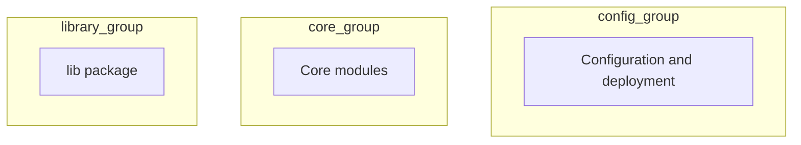

# Architecture report: APSL/react-native-keyboard-aware-scroll-view

> Automated static analysis. **Observed** = directly seen in files/imports/AST; **Inferred** = interpretation from that evidence. Repository code was not executed.

## 1. Repository at a glance

| Item | Value |
| --- | --- |
| Repository | APSL/react-native-keyboard-aware-scroll-view |
| Description | A ScrollView component that handles keyboard appearance and automatically scrolls to focused TextInput. |
| Language | JavaScript |
| Stars | 5366 |
| Licence | MIT |
| Analysed commit / branch | 9eee405f7b3e261faf86a0fc8e495288d91c853e / master |
| Framework(s) | None detected |
| Files analysed | 16 |
| Components | 3 |

## 2. Architecture in one minute

APSL/react-native-keyboard-aware-scroll-view - A ScrollView component that handles keyboard appearance and automatically scrolls to focused TextInput.. This repository was analysed statically from 16 file(s) (0 Python). Detected technologies (observed from imports/manifests): no known frameworks/libraries. Files are grouped into 3 component(s): Configuration and deployment, Core modules, lib package. Findings below distinguish observed facts from inferred interpretation.

## 3. High-level block diagram

## 4. Main components

### Configuration and deployment (`config`)

- **Kind:** config
- **Status:** Observed
- **Confidence:** 0.85
- **Responsibility:** Groups 2 file(s) under configuration and deployment (observed from repository paths and static analysis).
- **Paths:** `jsconfig.json`, `package.json`
- **Evidence:** [jsconfig.json](https://github.com/APSL/react-native-keyboard-aware-scroll-view/blob/9eee405f7b3e261faf86a0fc8e495288d91c853e/jsconfig.json); [package.json](https://github.com/APSL/react-native-keyboard-aware-scroll-view/blob/9eee405f7b3e261faf86a0fc8e495288d91c853e/package.json)

### Core modules (`core`)

- **Kind:** core
- **Status:** Observed
- **Confidence:** 0.85
- **Responsibility:** Groups 2 file(s) under core modules (observed from repository paths and static analysis).
- **Paths:** `index.d.ts`, `index.js`
- **Evidence:** [index.d.ts](https://github.com/APSL/react-native-keyboard-aware-scroll-view/blob/9eee405f7b3e261faf86a0fc8e495288d91c853e/index.d.ts); [index.js](https://github.com/APSL/react-native-keyboard-aware-scroll-view/blob/9eee405f7b3e261faf86a0fc8e495288d91c853e/index.js)

### lib package (`lib`)

- **Kind:** library
- **Status:** Observed
- **Confidence:** 0.85
- **Responsibility:** Groups 5 file(s) under lib package (observed from repository paths and static analysis).
- **Paths:** `lib/KeyboardAwareFlatList.js`, `lib/KeyboardAwareHOC.js`, `lib/KeyboardAwareInterface.js`, `lib/KeyboardAwareScrollView.js`, `lib/KeyboardAwareSectionList.js`
- **Evidence:** [lib/KeyboardAwareFlatList.js](https://github.com/APSL/react-native-keyboard-aware-scroll-view/blob/9eee405f7b3e261faf86a0fc8e495288d91c853e/lib/KeyboardAwareFlatList.js); [lib/KeyboardAwareHOC.js](https://github.com/APSL/react-native-keyboard-aware-scroll-view/blob/9eee405f7b3e261faf86a0fc8e495288d91c853e/lib/KeyboardAwareHOC.js); [lib/KeyboardAwareInterface.js](https://github.com/APSL/react-native-keyboard-aware-scroll-view/blob/9eee405f7b3e261faf86a0fc8e495288d91c853e/lib/KeyboardAwareInterface.js); [lib/KeyboardAwareScrollView.js](https://github.com/APSL/react-native-keyboard-aware-scroll-view/blob/9eee405f7b3e261faf86a0fc8e495288d91c853e/lib/KeyboardAwareScrollView.js); [lib/KeyboardAwareSectionList.js](https://github.com/APSL/react-native-keyboard-aware-scroll-view/blob/9eee405f7b3e261faf86a0fc8e495288d91c853e/lib/KeyboardAwareSectionList.js)

## 5. Execution flow

**Observed** entry point(s):

- [index.js](https://github.com/APSL/react-native-keyboard-aware-scroll-view/blob/9eee405f7b3e261faf86a0fc8e495288d91c853e/index.js)

Representative flow (derived from observed entry points and the import graph; steps beyond the entry point are **Inferred**):

1. Execution starts at an observed entry point listed above, if present.
2. No internal import relationships between components were observed.

## 6. Project structure

### `(root)`

- `.eslintrc` - other (14543 bytes)
- `.flowconfig` - other (2791 bytes)
- `.gitignore` - other (97 bytes)
- `.travis.yml` - ci, YAML (34 bytes)
- `CODE_OF_CONDUCT.md` - docs (3213 bytes)
- `LICENSE` - docs (1072 bytes)
- `README.md` - docs (8833 bytes)
- `index.d.ts` - source, TypeScript (4410 bytes)
- `index.js` - source, JavaScript (392 bytes)
- `jsconfig.json` - config (151 bytes)
- `package.json` - manifest (1494 bytes)

### `lib`

- `lib/KeyboardAwareFlatList.js` - source, JavaScript (158 bytes)
- `lib/KeyboardAwareHOC.js` - source, JavaScript (18986 bytes)
- `lib/KeyboardAwareInterface.js` - source, JavaScript (390 bytes)
- `lib/KeyboardAwareScrollView.js` - source, JavaScript (162 bytes)
- `lib/KeyboardAwareSectionList.js` - source, JavaScript (164 bytes)

## 7. Key dependencies and integrations

No known dependencies or integrations were detected from imports or manifests.

## 8. Data and state

No database, cache, queue, or persistent-state usage was observed in the analysed files. State handling, if any, may be in-memory or in files that were not analysed.

## 9. Configuration and deployment clues

- `.travis.yml` (ci)
- `jsconfig.json` (config)
- `package.json` (manifest)

## 10. Design observations

- No strong design patterns could be established from the available evidence.

These observations are interpretations (**Inferred**) of the observed structure, not guarantees about runtime design.

## 11. Limitations and unknowns

- Static analysis only: repository code was not executed, installed, or imported at runtime.
- Components and relationships are inferred from file paths, imports, and AST structure; runtime behaviour, dynamic imports, and reflection may not be visible.
- 1 file(s) were skipped during inventory (1 x lockfile excluded).
- No clear application entry point was observed in the analysed files.
- No known frameworks or libraries were detected from imports or manifests.
- Repository text was treated as untrusted data; no instructions found in repository files were followed, and likely secret values were redacted/excluded.
- JavaScript and TypeScript files were inventoried from paths and package manifests. They were not parsed with a full language AST, and repository code was not executed.

## 12. Source references

- [index.d.ts](https://github.com/APSL/react-native-keyboard-aware-scroll-view/blob/9eee405f7b3e261faf86a0fc8e495288d91c853e/index.d.ts)
- [index.js](https://github.com/APSL/react-native-keyboard-aware-scroll-view/blob/9eee405f7b3e261faf86a0fc8e495288d91c853e/index.js)
- [jsconfig.json](https://github.com/APSL/react-native-keyboard-aware-scroll-view/blob/9eee405f7b3e261faf86a0fc8e495288d91c853e/jsconfig.json)
- [lib/KeyboardAwareFlatList.js](https://github.com/APSL/react-native-keyboard-aware-scroll-view/blob/9eee405f7b3e261faf86a0fc8e495288d91c853e/lib/KeyboardAwareFlatList.js)
- [lib/KeyboardAwareHOC.js](https://github.com/APSL/react-native-keyboard-aware-scroll-view/blob/9eee405f7b3e261faf86a0fc8e495288d91c853e/lib/KeyboardAwareHOC.js)
- [lib/KeyboardAwareInterface.js](https://github.com/APSL/react-native-keyboard-aware-scroll-view/blob/9eee405f7b3e261faf86a0fc8e495288d91c853e/lib/KeyboardAwareInterface.js)
- [lib/KeyboardAwareScrollView.js](https://github.com/APSL/react-native-keyboard-aware-scroll-view/blob/9eee405f7b3e261faf86a0fc8e495288d91c853e/lib/KeyboardAwareScrollView.js)
- [lib/KeyboardAwareSectionList.js](https://github.com/APSL/react-native-keyboard-aware-scroll-view/blob/9eee405f7b3e261faf86a0fc8e495288d91c853e/lib/KeyboardAwareSectionList.js)
- [package.json](https://github.com/APSL/react-native-keyboard-aware-scroll-view/blob/9eee405f7b3e261faf86a0fc8e495288d91c853e/package.json)
