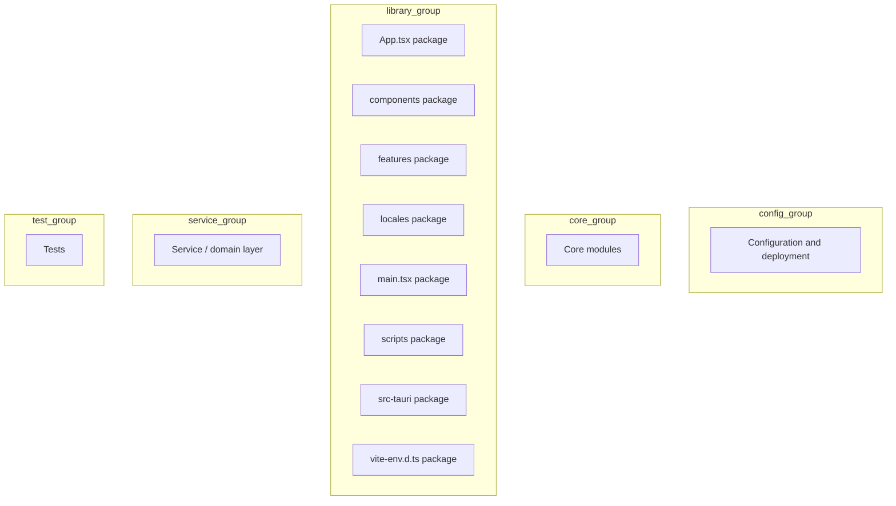

# Architecture report: Achilng/floral-notepaper

> Automated static analysis. **Observed** = directly seen in files/imports/AST; **Inferred** = interpretation from that evidence. Repository code was not executed.

## 1. Repository at a glance

| Item | Value |
| --- | --- |
| Repository | Achilng/floral-notepaper |
| Description | 花笺，轻量优雅的跨平台桌面便签工具，支持 Markdown 编辑与预览 |
| Language | Rust |
| Stars | 5623 |
| Licence | MIT |
| Analysed commit / branch | 8b624e0b1dc38ea66d0fcea83fd4e3117d63d8c3 / main |
| Framework(s) | React |
| Files analysed | 172 |
| Components | 12 |

## 2. Architecture in one minute

Achilng/floral-notepaper - 花笺，轻量优雅的跨平台桌面便签工具，支持 Markdown 编辑与预览. This repository was analysed statically from 172 file(s) (0 Python). Detected technologies (observed from imports/manifests): GitHub Actions, React, Tailwind CSS, TypeScript, Vite, Vitest. Files are grouped into 12 component(s): App.tsx package, components package, Configuration and deployment, Core modules, features package, locales package, main.tsx package, scripts package. Findings below distinguish observed facts from inferred interpretation.

## 3. High-level block diagram

## 4. Main components

### App.tsx package (`app_tsx`)

- **Kind:** library
- **Status:** Observed
- **Confidence:** 0.85
- **Responsibility:** Groups 1 file(s) under app.tsx package (observed from repository paths and static analysis).
- **Paths:** `src/App.tsx`
- **Evidence:** [src/App.tsx](https://github.com/Achilng/floral-notepaper/blob/8b624e0b1dc38ea66d0fcea83fd4e3117d63d8c3/src/App.tsx)

### components package (`components`)

- **Kind:** library
- **Status:** Observed
- **Confidence:** 0.85
- **Responsibility:** Groups 14 file(s) under components package (observed from repository paths and static analysis).
- **Paths:** `src/components/AboutPanel.test.tsx`, `src/components/AboutPanel.tsx`, `src/components/BackgroundLayer.tsx`, `src/components/ContextMenu.tsx`, `src/components/MainWindow.tsx`, `src/components/NotePad.tsx`, `src/components/NotepadOpenPanel.tsx`, `src/components/SettingsPanel.tsx`, `src/components/SlidingButtonGroup.tsx`, `src/components/Tile.tsx`, `src/components/TileShowcase.tsx`, `src/components/Toast.tsx`, `src/components/popupPosition.test.ts`, `src/components/popupPosition.ts`
- **Evidence:** [src/components/AboutPanel.test.tsx](https://github.com/Achilng/floral-notepaper/blob/8b624e0b1dc38ea66d0fcea83fd4e3117d63d8c3/src/components/AboutPanel.test.tsx); [src/components/AboutPanel.tsx](https://github.com/Achilng/floral-notepaper/blob/8b624e0b1dc38ea66d0fcea83fd4e3117d63d8c3/src/components/AboutPanel.tsx); [src/components/BackgroundLayer.tsx](https://github.com/Achilng/floral-notepaper/blob/8b624e0b1dc38ea66d0fcea83fd4e3117d63d8c3/src/components/BackgroundLayer.tsx); [src/components/ContextMenu.tsx](https://github.com/Achilng/floral-notepaper/blob/8b624e0b1dc38ea66d0fcea83fd4e3117d63d8c3/src/components/ContextMenu.tsx); [src/components/MainWindow.tsx](https://github.com/Achilng/floral-notepaper/blob/8b624e0b1dc38ea66d0fcea83fd4e3117d63d8c3/src/components/MainWindow.tsx); [src/components/NotePad.tsx](https://github.com/Achilng/floral-notepaper/blob/8b624e0b1dc38ea66d0fcea83fd4e3117d63d8c3/src/components/NotePad.tsx); [src/components/NotepadOpenPanel.tsx](https://github.com/Achilng/floral-notepaper/blob/8b624e0b1dc38ea66d0fcea83fd4e3117d63d8c3/src/components/NotepadOpenPanel.tsx); [src/components/SettingsPanel.tsx](https://github.com/Achilng/floral-notepaper/blob/8b624e0b1dc38ea66d0fcea83fd4e3117d63d8c3/src/components/SettingsPanel.tsx)

### Configuration and deployment (`config`)

- **Kind:** config
- **Status:** Observed
- **Confidence:** 0.85
- **Responsibility:** Groups 24 file(s) under configuration and deployment (observed from repository paths and static analysis).
- **Paths:** `package.json`, `src-tauri/Cargo.toml`, `src-tauri/capabilities/default.json`, `src-tauri/src/updater/fixtures/update-manifest.valid.json`, `src-tauri/tauri.conf.json`, `src-tauri/tauri.linux.conf.json`, `src-tauri/tauri.macos.conf.json`, `src/features/settings/api.test.ts`, `src/features/settings/api.ts`, `src/features/settings/shortcutRecorder.test.ts`, `src/features/settings/shortcutRecorder.ts`, `src/features/settings/theme.ts`, `src/features/settings/tileColor.test.ts`, `src/features/settings/tileColor.ts`, `src/features/settings/types.ts`, `src/features/settings/useShortcutRecorder.ts`, `src/locales/en-US/tips.json`, `src/locales/en-US/translation.json`, `src/locales/zh-CN/tips.json`, `src/locales/zh-CN/translation.json`, `src/locales/zh-HK/tips.json`, `src/locales/zh-HK/translation.json`, `tsconfig.json`, `tsconfig.node.json`
- **Evidence:** [package.json](https://github.com/Achilng/floral-notepaper/blob/8b624e0b1dc38ea66d0fcea83fd4e3117d63d8c3/package.json); [src-tauri/Cargo.toml](https://github.com/Achilng/floral-notepaper/blob/8b624e0b1dc38ea66d0fcea83fd4e3117d63d8c3/src-tauri/Cargo.toml); [src-tauri/capabilities/default.json](https://github.com/Achilng/floral-notepaper/blob/8b624e0b1dc38ea66d0fcea83fd4e3117d63d8c3/src-tauri/capabilities/default.json); [src-tauri/src/updater/fixtures/update-manifest.valid.json](https://github.com/Achilng/floral-notepaper/blob/8b624e0b1dc38ea66d0fcea83fd4e3117d63d8c3/src-tauri/src/updater/fixtures/update-manifest.valid.json); [src-tauri/tauri.conf.json](https://github.com/Achilng/floral-notepaper/blob/8b624e0b1dc38ea66d0fcea83fd4e3117d63d8c3/src-tauri/tauri.conf.json); [src-tauri/tauri.linux.conf.json](https://github.com/Achilng/floral-notepaper/blob/8b624e0b1dc38ea66d0fcea83fd4e3117d63d8c3/src-tauri/tauri.linux.conf.json); [src-tauri/tauri.macos.conf.json](https://github.com/Achilng/floral-notepaper/blob/8b624e0b1dc38ea66d0fcea83fd4e3117d63d8c3/src-tauri/tauri.macos.conf.json); [src/features/settings/api.test.ts](https://github.com/Achilng/floral-notepaper/blob/8b624e0b1dc38ea66d0fcea83fd4e3117d63d8c3/src/features/settings/api.test.ts)

### Core modules (`core`)

- **Kind:** core
- **Status:** Observed
- **Confidence:** 0.85
- **Responsibility:** Groups 1 file(s) under core modules (observed from repository paths and static analysis).
- **Paths:** `vite.config.ts`
- **Evidence:** [vite.config.ts](https://github.com/Achilng/floral-notepaper/blob/8b624e0b1dc38ea66d0fcea83fd4e3117d63d8c3/vite.config.ts)

### features package (`features`)

- **Kind:** library
- **Status:** Observed
- **Confidence:** 0.85
- **Responsibility:** Groups 43 file(s) under features package (observed from repository paths and static analysis).
- **Paths:** `src/features/images/api.ts`, `src/features/images/useImageBaseDir.ts`, `src/features/images/useImagePaste.ts`, `src/features/importExport/api.test.ts`, `src/features/importExport/api.ts`, `src/features/markdown/MarkdownPreview.test.tsx`, `src/features/markdown/MarkdownPreview.tsx`, `src/features/markdown/MarkdownPreviewLazy.tsx`, `src/features/markdown/imageSrc.test.ts`, `src/features/markdown/imageSrc.ts`, `src/features/markdown/rehypeTaskLists.ts`, `src/features/markdown/remarkAlerts.ts`, `src/features/markdown/scrollSync.test.ts`, `src/features/markdown/scrollSync.ts`, `src/features/notes/api.test.ts`, `src/features/notes/api.ts`, `src/features/notes/noteContextMenu.ts`, `src/features/notes/noteUtils.test.ts`, `src/features/notes/noteUtils.ts`, `src/features/notes/types.ts`, `src/features/update/UpdateSettingsSection.test.tsx`, `src/features/update/UpdateSettingsSection.tsx`, `src/features/update/api.test.ts`, `src/features/update/api.ts`, `src/features/update/presentation.test.ts`, `src/features/update/presentation.ts`, `src/features/update/types.ts`, `src/features/update/updateErrors.test.ts`, `src/features/update/updateErrors.ts`, `src/features/windows/api.test.ts`, `src/features/windows/api.ts`, `src/features/windows/controls.ts`, `src/features/windows/noteSurfaceSavePolicy.test.ts`, `src/features/windows/noteSurfaceSavePolicy.ts`, `src/features/windows/surfaceActions.test.ts`, `src/features/windows/surfaceActions.ts`, `src/features/windows/surfaceMode.test.ts`, `src/features/windows/surfaceMode.ts`, `src/features/windows/tileContextMenu.ts`, `src/features/windows/tileWindowEvents.test.ts`, `src/features/windows/tileWindowEvents.ts`, `src/features/windows/windowRoutes.test.ts`, `src/features/windows/windowRoutes.ts`
- **Evidence:** [src/features/images/api.ts](https://github.com/Achilng/floral-notepaper/blob/8b624e0b1dc38ea66d0fcea83fd4e3117d63d8c3/src/features/images/api.ts); [src/features/images/useImageBaseDir.ts](https://github.com/Achilng/floral-notepaper/blob/8b624e0b1dc38ea66d0fcea83fd4e3117d63d8c3/src/features/images/useImageBaseDir.ts); [src/features/images/useImagePaste.ts](https://github.com/Achilng/floral-notepaper/blob/8b624e0b1dc38ea66d0fcea83fd4e3117d63d8c3/src/features/images/useImagePaste.ts); [src/features/importExport/api.test.ts](https://github.com/Achilng/floral-notepaper/blob/8b624e0b1dc38ea66d0fcea83fd4e3117d63d8c3/src/features/importExport/api.test.ts); [src/features/importExport/api.ts](https://github.com/Achilng/floral-notepaper/blob/8b624e0b1dc38ea66d0fcea83fd4e3117d63d8c3/src/features/importExport/api.ts); [src/features/markdown/MarkdownPreview.test.tsx](https://github.com/Achilng/floral-notepaper/blob/8b624e0b1dc38ea66d0fcea83fd4e3117d63d8c3/src/features/markdown/MarkdownPreview.test.tsx); [src/features/markdown/MarkdownPreview.tsx](https://github.com/Achilng/floral-notepaper/blob/8b624e0b1dc38ea66d0fcea83fd4e3117d63d8c3/src/features/markdown/MarkdownPreview.tsx); [src/features/markdown/MarkdownPreviewLazy.tsx](https://github.com/Achilng/floral-notepaper/blob/8b624e0b1dc38ea66d0fcea83fd4e3117d63d8c3/src/features/markdown/MarkdownPreviewLazy.tsx)

### locales package (`locales`)

- **Kind:** library
- **Status:** Observed
- **Confidence:** 0.85
- **Responsibility:** Groups 8 file(s) under locales package (observed from repository paths and static analysis).
- **Paths:** `src/locales/i18next.d.ts`, `src/locales/index.ts`, `src/locales/locale-whitelist.test.ts`, `src/locales/locale-whitelist.ts`, `src/locales/resources.test.ts`, `src/locales/resources.ts`, `src/locales/test-setup.ts`, `src/locales/tips.ts`
- **Evidence:** [src/locales/i18next.d.ts](https://github.com/Achilng/floral-notepaper/blob/8b624e0b1dc38ea66d0fcea83fd4e3117d63d8c3/src/locales/i18next.d.ts); [src/locales/index.ts](https://github.com/Achilng/floral-notepaper/blob/8b624e0b1dc38ea66d0fcea83fd4e3117d63d8c3/src/locales/index.ts); [src/locales/locale-whitelist.test.ts](https://github.com/Achilng/floral-notepaper/blob/8b624e0b1dc38ea66d0fcea83fd4e3117d63d8c3/src/locales/locale-whitelist.test.ts); [src/locales/locale-whitelist.ts](https://github.com/Achilng/floral-notepaper/blob/8b624e0b1dc38ea66d0fcea83fd4e3117d63d8c3/src/locales/locale-whitelist.ts); [src/locales/resources.test.ts](https://github.com/Achilng/floral-notepaper/blob/8b624e0b1dc38ea66d0fcea83fd4e3117d63d8c3/src/locales/resources.test.ts); [src/locales/resources.ts](https://github.com/Achilng/floral-notepaper/blob/8b624e0b1dc38ea66d0fcea83fd4e3117d63d8c3/src/locales/resources.ts); [src/locales/test-setup.ts](https://github.com/Achilng/floral-notepaper/blob/8b624e0b1dc38ea66d0fcea83fd4e3117d63d8c3/src/locales/test-setup.ts); [src/locales/tips.ts](https://github.com/Achilng/floral-notepaper/blob/8b624e0b1dc38ea66d0fcea83fd4e3117d63d8c3/src/locales/tips.ts)

### main.tsx package (`main_tsx`)

- **Kind:** library
- **Status:** Observed
- **Confidence:** 0.85
- **Responsibility:** Groups 1 file(s) under main.tsx package (observed from repository paths and static analysis).
- **Paths:** `src/main.tsx`
- **Evidence:** [src/main.tsx](https://github.com/Achilng/floral-notepaper/blob/8b624e0b1dc38ea66d0fcea83fd4e3117d63d8c3/src/main.tsx)

### scripts package (`scripts`)

- **Kind:** library
- **Status:** Observed
- **Confidence:** 0.85
- **Responsibility:** Groups 3 file(s) under scripts package (observed from repository paths and static analysis).
- **Paths:** `scripts/fetch-contributors.mjs`, `scripts/set-version.mjs`, `scripts/verify-release-tag.sh`
- **Evidence:** [scripts/fetch-contributors.mjs](https://github.com/Achilng/floral-notepaper/blob/8b624e0b1dc38ea66d0fcea83fd4e3117d63d8c3/scripts/fetch-contributors.mjs); [scripts/set-version.mjs](https://github.com/Achilng/floral-notepaper/blob/8b624e0b1dc38ea66d0fcea83fd4e3117d63d8c3/scripts/set-version.mjs); [scripts/verify-release-tag.sh](https://github.com/Achilng/floral-notepaper/blob/8b624e0b1dc38ea66d0fcea83fd4e3117d63d8c3/scripts/verify-release-tag.sh)

### Service / domain layer (`service_layer`)

- **Kind:** service
- **Status:** Observed
- **Confidence:** 0.85
- **Responsibility:** Groups 2 file(s) under service / domain layer (observed from repository paths and static analysis).
- **Paths:** `src-tauri/src/services/mod.rs`, `src-tauri/src/services/notes.rs`
- **Evidence:** [src-tauri/src/services/mod.rs](https://github.com/Achilng/floral-notepaper/blob/8b624e0b1dc38ea66d0fcea83fd4e3117d63d8c3/src-tauri/src/services/mod.rs); [src-tauri/src/services/notes.rs](https://github.com/Achilng/floral-notepaper/blob/8b624e0b1dc38ea66d0fcea83fd4e3117d63d8c3/src-tauri/src/services/notes.rs)

### src-tauri package (`src_tauri`)

- **Kind:** library
- **Status:** Observed
- **Confidence:** 0.85
- **Responsibility:** Groups 22 file(s) under src-tauri package (observed from repository paths and static analysis).
- **Paths:** `src-tauri/build.rs`, `src-tauri/src/desktop.rs`, `src-tauri/src/json_io.rs`, `src-tauri/src/lib.rs`, `src-tauri/src/locales.rs`, `src-tauri/src/main.rs`, `src-tauri/src/updater/cdk_store.rs`, `src-tauri/src/updater/check.rs`, `src-tauri/src/updater/commands.rs`, `src-tauri/src/updater/download.rs`, `src-tauri/src/updater/errors.rs`, `src-tauri/src/updater/file_lock.rs`, `src-tauri/src/updater/helper.rs`, `src-tauri/src/updater/install.rs`, `src-tauri/src/updater/manifest.rs`, `src-tauri/src/updater/mod.rs`, `src-tauri/src/updater/platform.rs`, `src-tauri/src/updater/scheduler.rs`, `src-tauri/src/updater/settings.rs`, `src-tauri/src/updater/state.rs`, `src-tauri/src/updater/types.rs`, `src-tauri/src/updater/version.rs`
- **Evidence:** [src-tauri/build.rs](https://github.com/Achilng/floral-notepaper/blob/8b624e0b1dc38ea66d0fcea83fd4e3117d63d8c3/src-tauri/build.rs); [src-tauri/src/desktop.rs](https://github.com/Achilng/floral-notepaper/blob/8b624e0b1dc38ea66d0fcea83fd4e3117d63d8c3/src-tauri/src/desktop.rs); [src-tauri/src/json_io.rs](https://github.com/Achilng/floral-notepaper/blob/8b624e0b1dc38ea66d0fcea83fd4e3117d63d8c3/src-tauri/src/json_io.rs); [src-tauri/src/lib.rs](https://github.com/Achilng/floral-notepaper/blob/8b624e0b1dc38ea66d0fcea83fd4e3117d63d8c3/src-tauri/src/lib.rs); [src-tauri/src/locales.rs](https://github.com/Achilng/floral-notepaper/blob/8b624e0b1dc38ea66d0fcea83fd4e3117d63d8c3/src-tauri/src/locales.rs); [src-tauri/src/main.rs](https://github.com/Achilng/floral-notepaper/blob/8b624e0b1dc38ea66d0fcea83fd4e3117d63d8c3/src-tauri/src/main.rs); [src-tauri/src/updater/cdk_store.rs](https://github.com/Achilng/floral-notepaper/blob/8b624e0b1dc38ea66d0fcea83fd4e3117d63d8c3/src-tauri/src/updater/cdk_store.rs); [src-tauri/src/updater/check.rs](https://github.com/Achilng/floral-notepaper/blob/8b624e0b1dc38ea66d0fcea83fd4e3117d63d8c3/src-tauri/src/updater/check.rs)

### Tests (`tests`)

- **Kind:** test
- **Status:** Observed
- **Confidence:** 0.85
- **Responsibility:** Groups 1 file(s) under tests (observed from repository paths and static analysis).
- **Paths:** `tests/AppCss.test.ts`
- **Evidence:** [tests/AppCss.test.ts](https://github.com/Achilng/floral-notepaper/blob/8b624e0b1dc38ea66d0fcea83fd4e3117d63d8c3/tests/AppCss.test.ts)

### vite-env.d.ts package (`vite_env_d_ts`)

- **Kind:** library
- **Status:** Observed
- **Confidence:** 0.85
- **Responsibility:** Groups 1 file(s) under vite-env.d.ts package (observed from repository paths and static analysis).
- **Paths:** `src/vite-env.d.ts`
- **Evidence:** [src/vite-env.d.ts](https://github.com/Achilng/floral-notepaper/blob/8b624e0b1dc38ea66d0fcea83fd4e3117d63d8c3/src/vite-env.d.ts)

## 5. Execution flow

**Observed** entry point(s):

- [src/App.tsx](https://github.com/Achilng/floral-notepaper/blob/8b624e0b1dc38ea66d0fcea83fd4e3117d63d8c3/src/App.tsx)
- [src/locales/index.ts](https://github.com/Achilng/floral-notepaper/blob/8b624e0b1dc38ea66d0fcea83fd4e3117d63d8c3/src/locales/index.ts)
- [src/main.tsx](https://github.com/Achilng/floral-notepaper/blob/8b624e0b1dc38ea66d0fcea83fd4e3117d63d8c3/src/main.tsx)

Representative flow (derived from observed entry points and the import graph; steps beyond the entry point are **Inferred**):

1. Execution starts at an observed entry point listed above, if present.
2. No internal import relationships between components were observed.

## 6. Project structure

### `(root)`

- `.gitattributes` - other (91 bytes)
- `.gitignore` - other (709 bytes)
- `.oxfmtrc.json` - config (73 bytes)
- `.prettierignore` - other (71 bytes)
- `CONTRIBUTING.md` - docs (4623 bytes)
- `LICENSE` - docs (1064 bytes)
- `PRIVACY` - other (4971 bytes)
- `README.md` - docs (8639 bytes)
- `README_en-US.md` - docs (8809 bytes)
- `README_zh-HK.md` - docs (8660 bytes)
- `THIRD_PARTY_NOTICES.md` - docs (496 bytes)
- `index.html` - other (870 bytes)
- `package.json` - manifest (1734 bytes)
- `tsconfig.json` - config (605 bytes)
- `tsconfig.node.json` - config (213 bytes)
- `vite.config.ts` - source, TypeScript (1383 bytes)

### `.github`

- `.github/ISSUE_TEMPLATE/bug.yml` - config (4390 bytes)
- `.github/ISSUE_TEMPLATE/config.yml` - config (321 bytes)
- `.github/ISSUE_TEMPLATE/enhancement.yml` - config (4175 bytes)
- `.github/pull_request_template.md` - docs (1177 bytes)
- `.github/workflows/build-artifacts.yml` - ci, YAML (13627 bytes)
- `.github/workflows/issue-platform-label.yml` - ci, YAML (800 bytes)
- `.github/workflows/mirrorchyan_release.yml` - ci, YAML (1891 bytes)
- `.github/workflows/mirrorchyan_release_note.yml` - ci, YAML (612 bytes)
- `.github/workflows/pulls.yml` - ci, YAML (22592 bytes)
- `.github/workflows/rebuild-release.yml` - ci, YAML (1170 bytes)
- `.github/workflows/release.yml` - ci, YAML (108188 bytes)

### `.husky`

- `.husky/pre-commit` - other (16 bytes)

### `Docs`

- `Docs/CONTRIBUTING_en-US.md` - docs (4782 bytes)
- `Docs/CONTRIBUTING_zh-HK.md` - docs (4444 bytes)
- `Docs/MSSTORE_PUBLISH.md` - docs (10257 bytes)
- `Docs/RELEASE_WORKFLOW.md` - docs (35854 bytes)
- `Docs/release-note/1.1.0.md` - docs (10302 bytes)
- `Docs/release-note/1.2.0.md` - docs (5988 bytes)
- `Docs/signpath-configurations.md` - docs (7380 bytes)

### `scripts`

- `scripts/assert-pe-version.ps1` - other (1232 bytes)
- `scripts/build-msix.ps1` - other (12939 bytes)
- `scripts/build-msixupload.ps1` - other (4882 bytes)
- `scripts/build-windows-local.ps1` - other (10601 bytes)
- `scripts/fetch-contributors.mjs` - source, JavaScript (1695 bytes)
- `scripts/prepare-nsis-toolchain.ps1` - other (3737 bytes)
- `scripts/set-version.mjs` - source, JavaScript (1689 bytes)
- `scripts/sign-msix-self-signed.ps1` - other (5252 bytes)
- `scripts/verify-authenticode.ps1` - other (4246 bytes)
- `scripts/verify-msix-package.ps1` - other (4292 bytes)
- `scripts/verify-release-tag.sh` - source, Shell (1380 bytes)

### `src`

- `src/App.css` - other (15648 bytes)
- `src/App.tsx` - source, TypeScript (3206 bytes)
- `src/assets/fonts/LICENSE_Fonts` - other (3318 bytes)
- `src/assets/fonts/LICENSE_SourceHanSerif` - other (4463 bytes)
- `src/components/AboutPanel.test.tsx` - source, TypeScript (1699 bytes)
- `src/components/AboutPanel.tsx` - source, TypeScript (11491 bytes)
- `src/components/BackgroundLayer.tsx` - source, TypeScript (2005 bytes)
- `src/components/ContextMenu.tsx` - source, TypeScript (8829 bytes)
- `src/components/MainWindow.tsx` - source, TypeScript (130230 bytes)
- `src/components/NotePad.tsx` - source, TypeScript (33167 bytes)
- `src/components/NotepadOpenPanel.tsx` - source, TypeScript (5688 bytes)
- `src/components/SettingsPanel.tsx` - source, TypeScript (31162 bytes)
- `src/components/SlidingButtonGroup.tsx` - source, TypeScript (2247 bytes)
- `src/components/Tile.tsx` - source, TypeScript (4591 bytes)
- `src/components/TileShowcase.tsx` - source, TypeScript (225 bytes)
- `src/components/Toast.tsx` - source, TypeScript (3854 bytes)
- `src/components/popupPosition.test.ts` - source, TypeScript (1075 bytes)
- `src/components/popupPosition.ts` - source, TypeScript (2291 bytes)
- `src/features/images/api.ts` - source, TypeScript (835 bytes)
- `src/features/images/useImageBaseDir.ts` - source, TypeScript (307 bytes)
- `src/features/images/useImagePaste.ts` - source, TypeScript (4486 bytes)
- `src/features/importExport/api.test.ts` - source, TypeScript (3051 bytes)
- `src/features/importExport/api.ts` - source, TypeScript (1622 bytes)
- `src/features/markdown/MarkdownPreview.test.tsx` - source, TypeScript (1135 bytes)
- `src/features/markdown/MarkdownPreview.tsx` - source, TypeScript (13520 bytes)
- `src/features/markdown/MarkdownPreviewLazy.tsx` - source, TypeScript (632 bytes)
- `src/features/markdown/imageSrc.test.ts` - source, TypeScript (1747 bytes)
- `src/features/markdown/imageSrc.ts` - source, TypeScript (486 bytes)
- `src/features/markdown/rehypeTaskLists.ts` - source, TypeScript (1430 bytes)
- `src/features/markdown/remarkAlerts.ts` - source, TypeScript (1334 bytes)
- `src/features/markdown/scrollSync.test.ts` - source, TypeScript (12980 bytes)
- `src/features/markdown/scrollSync.ts` - source, TypeScript (9663 bytes)
- `src/features/notes/api.test.ts` - source, TypeScript (1702 bytes)
- `src/features/notes/api.ts` - source, TypeScript (6940 bytes)
- `src/features/notes/noteContextMenu.ts` - source, TypeScript (712 bytes)
- `src/features/notes/noteUtils.test.ts` - source, TypeScript (2069 bytes)
- `src/features/notes/noteUtils.ts` - source, TypeScript (3069 bytes)
- `src/features/notes/types.ts` - source, TypeScript (451 bytes)
- `src/features/settings/api.test.ts` - source, TypeScript (3807 bytes)
- `src/features/settings/api.ts` - source, TypeScript (1460 bytes)
- `src/features/settings/shortcutRecorder.test.ts` - source, TypeScript (1433 bytes)
- `src/features/settings/shortcutRecorder.ts` - source, TypeScript (3009 bytes)
- `src/features/settings/theme.ts` - source, TypeScript (1623 bytes)
- `src/features/settings/tileColor.test.ts` - source, TypeScript (601 bytes)
- `src/features/settings/tileColor.ts` - source, TypeScript (1219 bytes)
- `src/features/settings/types.ts` - source, TypeScript (1161 bytes)
- `src/features/settings/useShortcutRecorder.ts` - source, TypeScript (5045 bytes)
- `src/features/update/UpdateSettingsSection.test.tsx` - source, TypeScript (9420 bytes)
- `src/features/update/UpdateSettingsSection.tsx` - source, TypeScript (37053 bytes)
- `src/features/update/api.test.ts` - source, TypeScript (3591 bytes)
- `src/features/update/api.ts` - source, TypeScript (1674 bytes)
- `src/features/update/presentation.test.ts` - source, TypeScript (3948 bytes)
- `src/features/update/presentation.ts` - source, TypeScript (2906 bytes)
- `src/features/update/types.ts` - source, TypeScript (2754 bytes)
- `src/features/update/updateErrors.test.ts` - source, TypeScript (1614 bytes)
- `src/features/update/updateErrors.ts` - source, TypeScript (18087 bytes)
- `src/features/windows/api.test.ts` - source, TypeScript (1133 bytes)
- `src/features/windows/api.ts` - source, TypeScript (899 bytes)
- `src/features/windows/controls.ts` - source, TypeScript (3598 bytes)
- `src/features/windows/noteSurfaceSavePolicy.test.ts` - source, TypeScript (1780 bytes)
- `src/features/windows/noteSurfaceSavePolicy.ts` - source, TypeScript (603 bytes)
- `src/features/windows/surfaceActions.test.ts` - source, TypeScript (1577 bytes)
- `src/features/windows/surfaceActions.ts` - source, TypeScript (761 bytes)
- `src/features/windows/surfaceMode.test.ts` - source, TypeScript (1160 bytes)
- `src/features/windows/surfaceMode.ts` - source, TypeScript (1009 bytes)
- `src/features/windows/tileContextMenu.ts` - source, TypeScript (819 bytes)
- `src/features/windows/tileWindowEvents.test.ts` - source, TypeScript (1213 bytes)
- `src/features/windows/tileWindowEvents.ts` - source, TypeScript (823 bytes)
- `src/features/windows/windowRoutes.test.ts` - source, TypeScript (1027 bytes)
- `src/features/windows/windowRoutes.ts` - source, TypeScript (1000 bytes)
- `src/locales/en-US/tips.json` - config (734 bytes)
- `src/locales/en-US/translation.json` - config (19096 bytes)
- `src/locales/i18next.d.ts` - source, TypeScript (229 bytes)
- `src/locales/index.ts` - source, TypeScript (1386 bytes)
- `src/locales/locale-whitelist.test.ts` - source, TypeScript (1309 bytes)
- `src/locales/locale-whitelist.ts` - source, TypeScript (1975 bytes)
- `src/locales/resources.test.ts` - source, TypeScript (1329 bytes)
- `src/locales/resources.ts` - source, TypeScript (1483 bytes)
- `src/locales/test-setup.ts` - source, TypeScript (140 bytes)
- `src/locales/tips.ts` - source, TypeScript (1023 bytes)
- `src/locales/zh-CN/tips.json` - config (685 bytes)
- `src/locales/zh-CN/translation.json` - config (18274 bytes)
- `src/locales/zh-HK/tips.json` - config (688 bytes)
- `src/locales/zh-HK/translation.json` - config (16919 bytes)
- `src/main.tsx` - source, TypeScript (806 bytes)
- `src/vite-env.d.ts` - source, TypeScript (38 bytes)

### `src-tauri`

- `src-tauri/.gitignore` - other (166 bytes)
- `src-tauri/Cargo.toml` - manifest (1986 bytes)
- `src-tauri/build.rs` - source, Rust (472 bytes)
- `src-tauri/capabilities/default.json` - config (1039 bytes)
- `src-tauri/icons/android/mipmap-anydpi-v26/ic_launcher.xml` - other (261 bytes)
- `src-tauri/icons/android/values/ic_launcher_background.xml` - other (115 bytes)
- `src-tauri/linux-desktop-template.hbs` - other (141 bytes)
- `src-tauri/msix/AppxManifest.template.xml` - other (4385 bytes)
- `src-tauri/msix/lang-en-US/resources.resw` - other (230 bytes)
- `src-tauri/msix/lang-zh-CN/resources.resw` - other (208 bytes)
- `src-tauri/msix/lang-zh-HK/resources.resw` - other (208 bytes)
- `src-tauri/nsis-hooks.nsh` - other (375 bytes)
- `src-tauri/src/desktop.rs` - source, Rust (85909 bytes)
- `src-tauri/src/json_io.rs` - source, Rust (1248 bytes)
- `src-tauri/src/lib.rs` - source, Rust (16994 bytes)
- `src-tauri/src/locales.rs` - source, Rust (9479 bytes)
- `src-tauri/src/main.rs` - source, Rust (578 bytes)
- `src-tauri/src/services/mod.rs` - source, Rust (15 bytes)
- `src-tauri/src/services/notes.rs` - source, Rust (86186 bytes)
- `src-tauri/src/updater/cdk_store.rs` - source, Rust (2277 bytes)
- `src-tauri/src/updater/check.rs` - source, Rust (54738 bytes)
- `src-tauri/src/updater/commands.rs` - source, Rust (25044 bytes)
- `src-tauri/src/updater/download.rs` - source, Rust (58448 bytes)
- `src-tauri/src/updater/errors.rs` - source, Rust (4037 bytes)
- `src-tauri/src/updater/file_lock.rs` - source, Rust (2190 bytes)
- `src-tauri/src/updater/fixtures/update-manifest.valid.json` - config (2333 bytes)
- `src-tauri/src/updater/helper.rs` - source, Rust (136874 bytes)
- `src-tauri/src/updater/install.rs` - source, Rust (46161 bytes)
- `src-tauri/src/updater/manifest.rs` - source, Rust (9663 bytes)
- `src-tauri/src/updater/mod.rs` - source, Rust (22551 bytes)
- `src-tauri/src/updater/platform.rs` - source, Rust (19135 bytes)
- `src-tauri/src/updater/scheduler.rs` - source, Rust (6557 bytes)
- `src-tauri/src/updater/settings.rs` - source, Rust (8288 bytes)
- `src-tauri/src/updater/state.rs` - source, Rust (18608 bytes)
- `src-tauri/src/updater/types.rs` - source, Rust (7136 bytes)
- `src-tauri/src/updater/version.rs` - source, Rust (2474 bytes)
- `src-tauri/tauri.conf.json` - config (1974 bytes)
- `src-tauri/tauri.linux.conf.json` - config (499 bytes)
- `src-tauri/tauri.macos.conf.json` - config (489 bytes)

### `tests`

- `tests/AppCss.test.ts` - test, TypeScript (386 bytes)

## 7. Key dependencies and integrations

| Name | Category | Status | Confidence | Evidence |
| --- | --- | --- | --- | --- |
| GitHub Actions | ci | Observed | 0.90 | [.github/workflows/build-artifacts.yml](https://github.com/Achilng/floral-notepaper/blob/8b624e0b1dc38ea66d0fcea83fd4e3117d63d8c3/.github/workflows/build-artifacts.yml); [.github/workflows/issue-platform-label.yml](https://github.com/Achilng/floral-notepaper/blob/8b624e0b1dc38ea66d0fcea83fd4e3117d63d8c3/.github/workflows/issue-platform-label.yml); [.github/workflows/mirrorchyan_release.yml](https://github.com/Achilng/floral-notepaper/blob/8b624e0b1dc38ea66d0fcea83fd4e3117d63d8c3/.github/workflows/mirrorchyan_release.yml); [.github/workflows/mirrorchyan_release_note.yml](https://github.com/Achilng/floral-notepaper/blob/8b624e0b1dc38ea66d0fcea83fd4e3117d63d8c3/.github/workflows/mirrorchyan_release_note.yml) |
| React | framework | Observed | 0.90 | [package.json:26](https://github.com/Achilng/floral-notepaper/blob/8b624e0b1dc38ea66d0fcea83fd4e3117d63d8c3/package.json#L26); [package.json:27](https://github.com/Achilng/floral-notepaper/blob/8b624e0b1dc38ea66d0fcea83fd4e3117d63d8c3/package.json#L27) |
| Tailwind CSS | library | Observed | 0.85 | [package.json:39](https://github.com/Achilng/floral-notepaper/blob/8b624e0b1dc38ea66d0fcea83fd4e3117d63d8c3/package.json#L39) |
| TypeScript | tooling | Observed | 0.85 | [package.json:51](https://github.com/Achilng/floral-notepaper/blob/8b624e0b1dc38ea66d0fcea83fd4e3117d63d8c3/package.json#L51) |
| Vite | tooling | Observed | 0.85 | [package.json:7](https://github.com/Achilng/floral-notepaper/blob/8b624e0b1dc38ea66d0fcea83fd4e3117d63d8c3/package.json#L7) |
| Vitest | tooling | Observed | 0.85 | [package.json:9](https://github.com/Achilng/floral-notepaper/blob/8b624e0b1dc38ea66d0fcea83fd4e3117d63d8c3/package.json#L9) |

## 8. Data and state

No database, cache, queue, or persistent-state usage was observed in the analysed files. State handling, if any, may be in-memory or in files that were not analysed.

## 9. Configuration and deployment clues

- `.github/ISSUE_TEMPLATE/bug.yml` (config)
- `.github/ISSUE_TEMPLATE/config.yml` (config)
- `.github/ISSUE_TEMPLATE/enhancement.yml` (config)
- `.github/workflows/build-artifacts.yml` (ci)
- `.github/workflows/issue-platform-label.yml` (ci)
- `.github/workflows/mirrorchyan_release.yml` (ci)
- `.github/workflows/mirrorchyan_release_note.yml` (ci)
- `.github/workflows/pulls.yml` (ci)
- `.github/workflows/rebuild-release.yml` (ci)
- `.github/workflows/release.yml` (ci)
- `.oxfmtrc.json` (config)
- `package.json` (manifest)
- `src-tauri/Cargo.toml` (manifest)
- `src-tauri/capabilities/default.json` (config)
- `src-tauri/src/updater/fixtures/update-manifest.valid.json` (config)
- `src-tauri/tauri.conf.json` (config)
- `src-tauri/tauri.linux.conf.json` (config)
- `src-tauri/tauri.macos.conf.json` (config)
- `src/locales/en-US/tips.json` (config)
- `src/locales/en-US/translation.json` (config)
- `src/locales/zh-CN/tips.json` (config)
- `src/locales/zh-CN/translation.json` (config)
- `src/locales/zh-HK/tips.json` (config)
- `src/locales/zh-HK/translation.json` (config)
- `tsconfig.json` (config)
- `tsconfig.node.json` (config)

## 10. Design observations

- Service/domain code is distinct from entry and data code, suggesting layered separation (Inferred).
- Tests are present alongside source code (Observed from test file paths).

These observations are interpretations (**Inferred**) of the observed structure, not guarantees about runtime design.

## 11. Limitations and unknowns

- Static analysis only: repository code was not executed, installed, or imported at runtime.
- Components and relationships are inferred from file paths, imports, and AST structure; runtime behaviour, dynamic imports, and reflection may not be visible.
- 2 file(s) were skipped during inventory (2 x lockfile excluded).
- No clear application entry point was observed in the analysed files.
- Repository text was treated as untrusted data; no instructions found in repository files were followed, and likely secret values were redacted/excluded.
- JavaScript and TypeScript files were inventoried from paths and package manifests. They were not parsed with a full language AST, and repository code was not executed.

## 12. Source references

- [.github/workflows/build-artifacts.yml](https://github.com/Achilng/floral-notepaper/blob/8b624e0b1dc38ea66d0fcea83fd4e3117d63d8c3/.github/workflows/build-artifacts.yml)
- [.github/workflows/issue-platform-label.yml](https://github.com/Achilng/floral-notepaper/blob/8b624e0b1dc38ea66d0fcea83fd4e3117d63d8c3/.github/workflows/issue-platform-label.yml)
- [.github/workflows/mirrorchyan_release.yml](https://github.com/Achilng/floral-notepaper/blob/8b624e0b1dc38ea66d0fcea83fd4e3117d63d8c3/.github/workflows/mirrorchyan_release.yml)
- [.github/workflows/mirrorchyan_release_note.yml](https://github.com/Achilng/floral-notepaper/blob/8b624e0b1dc38ea66d0fcea83fd4e3117d63d8c3/.github/workflows/mirrorchyan_release_note.yml)
- [.github/workflows/pulls.yml](https://github.com/Achilng/floral-notepaper/blob/8b624e0b1dc38ea66d0fcea83fd4e3117d63d8c3/.github/workflows/pulls.yml)
- [.github/workflows/rebuild-release.yml](https://github.com/Achilng/floral-notepaper/blob/8b624e0b1dc38ea66d0fcea83fd4e3117d63d8c3/.github/workflows/rebuild-release.yml)
- [.github/workflows/release.yml](https://github.com/Achilng/floral-notepaper/blob/8b624e0b1dc38ea66d0fcea83fd4e3117d63d8c3/.github/workflows/release.yml)
- [package.json](https://github.com/Achilng/floral-notepaper/blob/8b624e0b1dc38ea66d0fcea83fd4e3117d63d8c3/package.json)
- [package.json:7](https://github.com/Achilng/floral-notepaper/blob/8b624e0b1dc38ea66d0fcea83fd4e3117d63d8c3/package.json#L7)
- [package.json:9](https://github.com/Achilng/floral-notepaper/blob/8b624e0b1dc38ea66d0fcea83fd4e3117d63d8c3/package.json#L9)
- [package.json:26](https://github.com/Achilng/floral-notepaper/blob/8b624e0b1dc38ea66d0fcea83fd4e3117d63d8c3/package.json#L26)
- [package.json:27](https://github.com/Achilng/floral-notepaper/blob/8b624e0b1dc38ea66d0fcea83fd4e3117d63d8c3/package.json#L27)
- [package.json:39](https://github.com/Achilng/floral-notepaper/blob/8b624e0b1dc38ea66d0fcea83fd4e3117d63d8c3/package.json#L39)
- [package.json:51](https://github.com/Achilng/floral-notepaper/blob/8b624e0b1dc38ea66d0fcea83fd4e3117d63d8c3/package.json#L51)
- [scripts/fetch-contributors.mjs](https://github.com/Achilng/floral-notepaper/blob/8b624e0b1dc38ea66d0fcea83fd4e3117d63d8c3/scripts/fetch-contributors.mjs)
- [scripts/set-version.mjs](https://github.com/Achilng/floral-notepaper/blob/8b624e0b1dc38ea66d0fcea83fd4e3117d63d8c3/scripts/set-version.mjs)
- [scripts/verify-release-tag.sh](https://github.com/Achilng/floral-notepaper/blob/8b624e0b1dc38ea66d0fcea83fd4e3117d63d8c3/scripts/verify-release-tag.sh)
- [src-tauri/Cargo.toml](https://github.com/Achilng/floral-notepaper/blob/8b624e0b1dc38ea66d0fcea83fd4e3117d63d8c3/src-tauri/Cargo.toml)
- [src-tauri/build.rs](https://github.com/Achilng/floral-notepaper/blob/8b624e0b1dc38ea66d0fcea83fd4e3117d63d8c3/src-tauri/build.rs)
- [src-tauri/capabilities/default.json](https://github.com/Achilng/floral-notepaper/blob/8b624e0b1dc38ea66d0fcea83fd4e3117d63d8c3/src-tauri/capabilities/default.json)
- [src-tauri/src/desktop.rs](https://github.com/Achilng/floral-notepaper/blob/8b624e0b1dc38ea66d0fcea83fd4e3117d63d8c3/src-tauri/src/desktop.rs)
- [src-tauri/src/json_io.rs](https://github.com/Achilng/floral-notepaper/blob/8b624e0b1dc38ea66d0fcea83fd4e3117d63d8c3/src-tauri/src/json_io.rs)
- [src-tauri/src/lib.rs](https://github.com/Achilng/floral-notepaper/blob/8b624e0b1dc38ea66d0fcea83fd4e3117d63d8c3/src-tauri/src/lib.rs)
- [src-tauri/src/locales.rs](https://github.com/Achilng/floral-notepaper/blob/8b624e0b1dc38ea66d0fcea83fd4e3117d63d8c3/src-tauri/src/locales.rs)
- [src-tauri/src/main.rs](https://github.com/Achilng/floral-notepaper/blob/8b624e0b1dc38ea66d0fcea83fd4e3117d63d8c3/src-tauri/src/main.rs)
- [src-tauri/src/services/mod.rs](https://github.com/Achilng/floral-notepaper/blob/8b624e0b1dc38ea66d0fcea83fd4e3117d63d8c3/src-tauri/src/services/mod.rs)
- [src-tauri/src/services/notes.rs](https://github.com/Achilng/floral-notepaper/blob/8b624e0b1dc38ea66d0fcea83fd4e3117d63d8c3/src-tauri/src/services/notes.rs)
- [src-tauri/src/updater/cdk_store.rs](https://github.com/Achilng/floral-notepaper/blob/8b624e0b1dc38ea66d0fcea83fd4e3117d63d8c3/src-tauri/src/updater/cdk_store.rs)
- [src-tauri/src/updater/check.rs](https://github.com/Achilng/floral-notepaper/blob/8b624e0b1dc38ea66d0fcea83fd4e3117d63d8c3/src-tauri/src/updater/check.rs)
- [src-tauri/src/updater/fixtures/update-manifest.valid.json](https://github.com/Achilng/floral-notepaper/blob/8b624e0b1dc38ea66d0fcea83fd4e3117d63d8c3/src-tauri/src/updater/fixtures/update-manifest.valid.json)
- [src-tauri/tauri.conf.json](https://github.com/Achilng/floral-notepaper/blob/8b624e0b1dc38ea66d0fcea83fd4e3117d63d8c3/src-tauri/tauri.conf.json)
- [src-tauri/tauri.linux.conf.json](https://github.com/Achilng/floral-notepaper/blob/8b624e0b1dc38ea66d0fcea83fd4e3117d63d8c3/src-tauri/tauri.linux.conf.json)
- [src-tauri/tauri.macos.conf.json](https://github.com/Achilng/floral-notepaper/blob/8b624e0b1dc38ea66d0fcea83fd4e3117d63d8c3/src-tauri/tauri.macos.conf.json)
- [src/App.tsx](https://github.com/Achilng/floral-notepaper/blob/8b624e0b1dc38ea66d0fcea83fd4e3117d63d8c3/src/App.tsx)
- [src/components/AboutPanel.test.tsx](https://github.com/Achilng/floral-notepaper/blob/8b624e0b1dc38ea66d0fcea83fd4e3117d63d8c3/src/components/AboutPanel.test.tsx)
- [src/components/AboutPanel.tsx](https://github.com/Achilng/floral-notepaper/blob/8b624e0b1dc38ea66d0fcea83fd4e3117d63d8c3/src/components/AboutPanel.tsx)
- [src/components/BackgroundLayer.tsx](https://github.com/Achilng/floral-notepaper/blob/8b624e0b1dc38ea66d0fcea83fd4e3117d63d8c3/src/components/BackgroundLayer.tsx)
- [src/components/ContextMenu.tsx](https://github.com/Achilng/floral-notepaper/blob/8b624e0b1dc38ea66d0fcea83fd4e3117d63d8c3/src/components/ContextMenu.tsx)
- [src/components/MainWindow.tsx](https://github.com/Achilng/floral-notepaper/blob/8b624e0b1dc38ea66d0fcea83fd4e3117d63d8c3/src/components/MainWindow.tsx)
- [src/components/NotePad.tsx](https://github.com/Achilng/floral-notepaper/blob/8b624e0b1dc38ea66d0fcea83fd4e3117d63d8c3/src/components/NotePad.tsx)
- [src/components/NotepadOpenPanel.tsx](https://github.com/Achilng/floral-notepaper/blob/8b624e0b1dc38ea66d0fcea83fd4e3117d63d8c3/src/components/NotepadOpenPanel.tsx)
- [src/components/SettingsPanel.tsx](https://github.com/Achilng/floral-notepaper/blob/8b624e0b1dc38ea66d0fcea83fd4e3117d63d8c3/src/components/SettingsPanel.tsx)
- [src/features/images/api.ts](https://github.com/Achilng/floral-notepaper/blob/8b624e0b1dc38ea66d0fcea83fd4e3117d63d8c3/src/features/images/api.ts)
- [src/features/images/useImageBaseDir.ts](https://github.com/Achilng/floral-notepaper/blob/8b624e0b1dc38ea66d0fcea83fd4e3117d63d8c3/src/features/images/useImageBaseDir.ts)
- [src/features/images/useImagePaste.ts](https://github.com/Achilng/floral-notepaper/blob/8b624e0b1dc38ea66d0fcea83fd4e3117d63d8c3/src/features/images/useImagePaste.ts)
- [src/features/importExport/api.test.ts](https://github.com/Achilng/floral-notepaper/blob/8b624e0b1dc38ea66d0fcea83fd4e3117d63d8c3/src/features/importExport/api.test.ts)
- [src/features/importExport/api.ts](https://github.com/Achilng/floral-notepaper/blob/8b624e0b1dc38ea66d0fcea83fd4e3117d63d8c3/src/features/importExport/api.ts)
- [src/features/markdown/MarkdownPreview.test.tsx](https://github.com/Achilng/floral-notepaper/blob/8b624e0b1dc38ea66d0fcea83fd4e3117d63d8c3/src/features/markdown/MarkdownPreview.test.tsx)
- [src/features/markdown/MarkdownPreview.tsx](https://github.com/Achilng/floral-notepaper/blob/8b624e0b1dc38ea66d0fcea83fd4e3117d63d8c3/src/features/markdown/MarkdownPreview.tsx)
- [src/features/markdown/MarkdownPreviewLazy.tsx](https://github.com/Achilng/floral-notepaper/blob/8b624e0b1dc38ea66d0fcea83fd4e3117d63d8c3/src/features/markdown/MarkdownPreviewLazy.tsx)
- [src/features/settings/api.test.ts](https://github.com/Achilng/floral-notepaper/blob/8b624e0b1dc38ea66d0fcea83fd4e3117d63d8c3/src/features/settings/api.test.ts)
- [src/locales/i18next.d.ts](https://github.com/Achilng/floral-notepaper/blob/8b624e0b1dc38ea66d0fcea83fd4e3117d63d8c3/src/locales/i18next.d.ts)
- [src/locales/index.ts](https://github.com/Achilng/floral-notepaper/blob/8b624e0b1dc38ea66d0fcea83fd4e3117d63d8c3/src/locales/index.ts)
- [src/locales/locale-whitelist.test.ts](https://github.com/Achilng/floral-notepaper/blob/8b624e0b1dc38ea66d0fcea83fd4e3117d63d8c3/src/locales/locale-whitelist.test.ts)
- [src/locales/locale-whitelist.ts](https://github.com/Achilng/floral-notepaper/blob/8b624e0b1dc38ea66d0fcea83fd4e3117d63d8c3/src/locales/locale-whitelist.ts)
- [src/locales/resources.test.ts](https://github.com/Achilng/floral-notepaper/blob/8b624e0b1dc38ea66d0fcea83fd4e3117d63d8c3/src/locales/resources.test.ts)
- [src/locales/resources.ts](https://github.com/Achilng/floral-notepaper/blob/8b624e0b1dc38ea66d0fcea83fd4e3117d63d8c3/src/locales/resources.ts)
- [src/locales/test-setup.ts](https://github.com/Achilng/floral-notepaper/blob/8b624e0b1dc38ea66d0fcea83fd4e3117d63d8c3/src/locales/test-setup.ts)
- [src/locales/tips.ts](https://github.com/Achilng/floral-notepaper/blob/8b624e0b1dc38ea66d0fcea83fd4e3117d63d8c3/src/locales/tips.ts)
- [src/main.tsx](https://github.com/Achilng/floral-notepaper/blob/8b624e0b1dc38ea66d0fcea83fd4e3117d63d8c3/src/main.tsx)
- [src/vite-env.d.ts](https://github.com/Achilng/floral-notepaper/blob/8b624e0b1dc38ea66d0fcea83fd4e3117d63d8c3/src/vite-env.d.ts)
- [tests/AppCss.test.ts](https://github.com/Achilng/floral-notepaper/blob/8b624e0b1dc38ea66d0fcea83fd4e3117d63d8c3/tests/AppCss.test.ts)
- [vite.config.ts](https://github.com/Achilng/floral-notepaper/blob/8b624e0b1dc38ea66d0fcea83fd4e3117d63d8c3/vite.config.ts)
