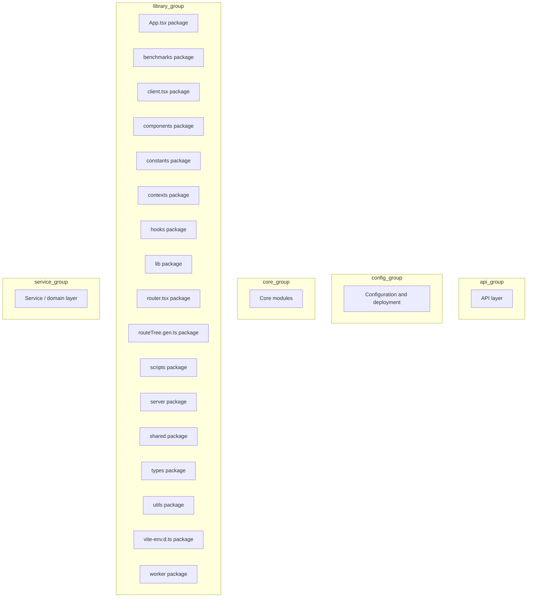

# Architecture report: Adam-CAD/CADAM

> Automated static analysis. **Observed** = directly seen in files/imports/AST; **Inferred** = interpretation from that evidence. Repository code was not executed.

## 1. Repository at a glance

| Item | Value |
| --- | --- |
| Repository | Adam-CAD/CADAM |
| Description | CADAM is the open source text-to-CAD web application |
| Language | TypeScript |
| Stars | 5427 |
| Licence | GPL-3.0 |
| Analysed commit / branch | e339e3ad85601bb1e23a5ff9c7f33b51ddf602f5 / master |
| Framework(s) | React |
| Files analysed | 334 |
| Components | 21 |

## 2. Architecture in one minute

Adam-CAD/CADAM - CADAM is the open source text-to-CAD web application. This repository was analysed statically from 334 file(s) (0 Python). Detected technologies (observed from imports/manifests): React, Tailwind CSS, TypeScript, Vite. Files are grouped into 21 component(s): API layer, App.tsx package, benchmarks package, client.tsx package, components package, Configuration and deployment, constants package, contexts package. Findings below distinguish observed facts from inferred interpretation.

## 3. High-level block diagram

## 4. Main components

### API layer (`api_layer`)

- **Kind:** api
- **Status:** Observed
- **Confidence:** 0.85
- **Responsibility:** Groups 46 file(s) under api layer (observed from repository paths and static analysis).
- **Paths:** `src/routes/__root.tsx`, `src/routes/_layout.tsx`, `src/routes/_layout/$.tsx`, `src/routes/_layout/_auth.tsx`, `src/routes/_layout/_auth/editor/$id.tsx`, `src/routes/_layout/_auth/history.tsx`, `src/routes/_layout/_auth/settings.tsx`, `src/routes/_layout/index.tsx`, `src/routes/_layout/share/$id.tsx`, `src/routes/_layout/subscription.tsx`, `src/routes/api/billing-checkout.ts`, `src/routes/api/billing-products.ts`, `src/routes/api/billing-status.ts`, `src/routes/api/creative-chat.ts`, `src/routes/api/delete-user.ts`, `src/routes/api/fal-webhook.ts`, `src/routes/api/internal/account/delete.ts`, `src/routes/api/jackson-pollock/$.ts`, `src/routes/api/mesh.ts`, `src/routes/api/parametric-chat.ts`, `src/routes/api/prompt-generator.ts`, `src/routes/api/title-generator.ts`, `src/routes/assets.$.ts`, `src/routes/confirm-email.tsx`, `src/routes/privacy-policy.tsx`, `src/routes/reset-password.tsx`, `src/routes/signin.tsx`, `src/routes/signup-email.tsx`, `src/routes/signup.tsx`, `src/routes/terms-of-service.tsx`, `src/routes/update-password.tsx`, `src/views/ConversationView.tsx`, `src/views/EditorView.tsx`, `src/views/EmailConfirmation.tsx`, `src/views/ErrorView.tsx`, `src/views/HistoryView.tsx`, `src/views/PrivacyPolicyView.tsx`, `src/views/PromptView.tsx`, `src/views/ResetPasswordView.tsx`, `src/views/SettingsView.tsx`, `src/views/ShareView.tsx`, `src/views/SignInView.tsx`, `src/views/SignUpEmailView.tsx`, `src/views/SignUpView.tsx`, `src/views/TermsOfServiceView.tsx`, `src/views/UpdatePasswordView.tsx`
- **Evidence:** [src/routes/__root.tsx](https://github.com/Adam-CAD/CADAM/blob/e339e3ad85601bb1e23a5ff9c7f33b51ddf602f5/src/routes/__root.tsx); [src/routes/_layout.tsx](https://github.com/Adam-CAD/CADAM/blob/e339e3ad85601bb1e23a5ff9c7f33b51ddf602f5/src/routes/_layout.tsx); [src/routes/_layout/$.tsx](https://github.com/Adam-CAD/CADAM/blob/e339e3ad85601bb1e23a5ff9c7f33b51ddf602f5/src/routes/_layout/%24.tsx); [src/routes/_layout/_auth.tsx](https://github.com/Adam-CAD/CADAM/blob/e339e3ad85601bb1e23a5ff9c7f33b51ddf602f5/src/routes/_layout/_auth.tsx); [src/routes/_layout/_auth/editor/$id.tsx](https://github.com/Adam-CAD/CADAM/blob/e339e3ad85601bb1e23a5ff9c7f33b51ddf602f5/src/routes/_layout/_auth/editor/%24id.tsx); [src/routes/_layout/_auth/history.tsx](https://github.com/Adam-CAD/CADAM/blob/e339e3ad85601bb1e23a5ff9c7f33b51ddf602f5/src/routes/_layout/_auth/history.tsx); [src/routes/_layout/_auth/settings.tsx](https://github.com/Adam-CAD/CADAM/blob/e339e3ad85601bb1e23a5ff9c7f33b51ddf602f5/src/routes/_layout/_auth/settings.tsx); [src/routes/_layout/index.tsx](https://github.com/Adam-CAD/CADAM/blob/e339e3ad85601bb1e23a5ff9c7f33b51ddf602f5/src/routes/_layout/index.tsx)

### App.tsx package (`app_tsx`)

- **Kind:** library
- **Status:** Observed
- **Confidence:** 0.85
- **Responsibility:** Groups 1 file(s) under app.tsx package (observed from repository paths and static analysis).
- **Paths:** `src/App.tsx`
- **Evidence:** [src/App.tsx](https://github.com/Adam-CAD/CADAM/blob/e339e3ad85601bb1e23a5ff9c7f33b51ddf602f5/src/App.tsx)

### benchmarks package (`benchmarks`)

- **Kind:** library
- **Status:** Observed
- **Confidence:** 0.85
- **Responsibility:** Groups 1 file(s) under benchmarks package (observed from repository paths and static analysis).
- **Paths:** `benchmarks/render.sh`
- **Evidence:** [benchmarks/render.sh](https://github.com/Adam-CAD/CADAM/blob/e339e3ad85601bb1e23a5ff9c7f33b51ddf602f5/benchmarks/render.sh)

### client.tsx package (`client_tsx`)

- **Kind:** library
- **Status:** Observed
- **Confidence:** 0.85
- **Responsibility:** Groups 1 file(s) under client.tsx package (observed from repository paths and static analysis).
- **Paths:** `src/client.tsx`
- **Evidence:** [src/client.tsx](https://github.com/Adam-CAD/CADAM/blob/e339e3ad85601bb1e23a5ff9c7f33b51ddf602f5/src/client.tsx)

### components package (`components`)

- **Kind:** library
- **Status:** Observed
- **Confidence:** 0.85
- **Responsibility:** Groups 109 file(s) under components package (observed from repository paths and static analysis).
- **Paths:** `src/components/ConditionalWrapper.tsx`, `src/components/CreditsButton.tsx`, `src/components/FreePlanTrialPill.tsx`, `src/components/ImageViewer.tsx`, `src/components/Layout.tsx`, `src/components/LimitReachedMessage.tsx`, `src/components/LowPromptsWarningMessage.tsx`, `src/components/ModelSelector.tsx`, `src/components/NewProductBanner.tsx`, `src/components/ProviderLogo.tsx`, `src/components/Sidebar.tsx`, `src/components/TextAreaChat.tsx`, `src/components/ai-elements/reasoning.tsx`, `src/components/ai-elements/shimmer.tsx`, `src/components/auth/AuthGuard.tsx`, `src/components/auth/AvatarUpdateDialog.tsx`, `src/components/auth/DeleteAccountDialog.tsx`, `src/components/auth/TrialDialog.tsx`, `src/components/chat/AnimatedEllipsis.tsx`, `src/components/chat/AssistantLoading.tsx`, `src/components/chat/ChatReasoning.tsx`, `src/components/chat/ChatSession.tsx`, `src/components/chat/ChatTitle.tsx`, `src/components/chat/MessageBubble.tsx`, `src/components/chat/NotificationPrompt.tsx`, `src/components/chat/StreamingCodeBlock.tsx`, `src/components/chat/SuggestionPills.tsx`, `src/components/chat/UserAvatar.tsx`, `src/components/chat/stuckToolRecovery.test.ts`, `src/components/chat/stuckToolRecovery.ts`, `src/components/history/ConversationCard.tsx`, `src/components/history/RenameDialogDrawer.tsx`, `src/components/history/VisualCard.tsx`, `src/components/icons/CompanyIcons.tsx`, `src/components/icons/cubes/OrthographicCube.tsx`, `src/components/icons/cubes/PerspectiveCube.tsx`, `src/components/icons/iconUtils.ts`, `src/components/icons/ui/CreateIcon.tsx`, `src/components/icons/ui/GoodEarth.tsx`, `src/components/icons/ui/WireframeIcon.tsx`, `src/components/parameter/ColorPicker.tsx`, `src/components/parameter/ParameterInput.tsx`, `src/components/parameter/ParameterSection.tsx`, `src/components/parameter/ParameterSheetContent.tsx`, `src/components/parameter/ParameterSlider.tsx`, `src/components/ui/FreeTrialButton.tsx`, `src/components/ui/ParameterSlider.tsx`, `src/components/ui/ShareContent.tsx`, `src/components/ui/accordion.tsx`, `src/components/ui/alert-dialog.tsx`, `src/components/ui/alert.tsx`, `src/components/ui/aspect-ratio.tsx`, `src/components/ui/avatar.tsx`, `src/components/ui/badge.tsx`, `src/components/ui/breadcrumb.tsx`, `src/components/ui/button.tsx`, `src/components/ui/card.tsx`, `src/components/ui/carousel.tsx`, `src/components/ui/chart.tsx`, `src/components/ui/checkbox.tsx`, `src/components/ui/collapsible.tsx`, `src/components/ui/command.tsx`, `src/components/ui/context-menu.tsx`, `src/components/ui/dialog.tsx`, `src/components/ui/drawer.tsx`, `src/components/ui/dropdown-menu.tsx`, `src/components/ui/form.tsx`, `src/components/ui/hover-card.tsx`, `src/components/ui/input-otp.tsx`, `src/components/ui/input.tsx`, `src/components/ui/invoice-status-badge.tsx`, `src/components/ui/label.tsx`, `src/components/ui/menubar.tsx`, `src/components/ui/navigation-menu.tsx`, `src/components/ui/pagination.tsx`, `src/components/ui/popover.tsx`, `src/components/ui/progress.tsx`, `src/components/ui/radio-group.tsx`, `src/components/ui/resizable.tsx`, `src/components/ui/scroll-area.tsx`, `src/components/ui/select.tsx`, `src/components/ui/separator.tsx`, `src/components/ui/sheet.tsx`, `src/components/ui/skeleton.tsx`, `src/components/ui/slider.tsx`, `src/components/ui/switch.tsx`, `src/components/ui/table.tsx`, `src/components/ui/tabs.tsx`, `src/components/ui/textarea.tsx`, `src/components/ui/toast.tsx`, `src/components/ui/toaster.tsx`, `src/components/ui/toggle-group.tsx`, `src/components/ui/toggle.tsx`, `src/components/ui/tooltip.tsx`, `src/components/viewer/DownloadMenu.tsx`, `src/components/viewer/GlbPreview.tsx`, `src/components/viewer/LightingControls.tsx`, `src/components/viewer/Loader.tsx`, `src/components/viewer/MeshGifPreview.tsx`, `src/components/viewer/MeshImagePreview.tsx`, `src/components/viewer/MeshPreview.tsx`, `src/components/viewer/OpenSCADGifPreview.tsx`, `src/components/viewer/OpenSCADViewer.tsx`, `src/components/viewer/OrthographicCube.tsx`, `src/components/viewer/OrthographicPerspectiveToggle.tsx`, `src/components/viewer/PerspectiveCube.tsx`, `src/components/viewer/StageProgress.tsx`, `src/components/viewer/ThreeScene.tsx`, `src/components/viewer/ViewGizmo.tsx`
- **Evidence:** [src/components/ConditionalWrapper.tsx](https://github.com/Adam-CAD/CADAM/blob/e339e3ad85601bb1e23a5ff9c7f33b51ddf602f5/src/components/ConditionalWrapper.tsx); [src/components/CreditsButton.tsx](https://github.com/Adam-CAD/CADAM/blob/e339e3ad85601bb1e23a5ff9c7f33b51ddf602f5/src/components/CreditsButton.tsx); [src/components/FreePlanTrialPill.tsx](https://github.com/Adam-CAD/CADAM/blob/e339e3ad85601bb1e23a5ff9c7f33b51ddf602f5/src/components/FreePlanTrialPill.tsx); [src/components/ImageViewer.tsx](https://github.com/Adam-CAD/CADAM/blob/e339e3ad85601bb1e23a5ff9c7f33b51ddf602f5/src/components/ImageViewer.tsx); [src/components/Layout.tsx](https://github.com/Adam-CAD/CADAM/blob/e339e3ad85601bb1e23a5ff9c7f33b51ddf602f5/src/components/Layout.tsx); [src/components/LimitReachedMessage.tsx](https://github.com/Adam-CAD/CADAM/blob/e339e3ad85601bb1e23a5ff9c7f33b51ddf602f5/src/components/LimitReachedMessage.tsx); [src/components/LowPromptsWarningMessage.tsx](https://github.com/Adam-CAD/CADAM/blob/e339e3ad85601bb1e23a5ff9c7f33b51ddf602f5/src/components/LowPromptsWarningMessage.tsx); [src/components/ModelSelector.tsx](https://github.com/Adam-CAD/CADAM/blob/e339e3ad85601bb1e23a5ff9c7f33b51ddf602f5/src/components/ModelSelector.tsx)

### Configuration and deployment (`config`)

- **Kind:** config
- **Status:** Observed
- **Confidence:** 0.85
- **Responsibility:** Groups 11 file(s) under configuration and deployment (observed from repository paths and static analysis).
- **Paths:** `components.json`, `package.json`, `src/assets/adam-loading.json`, `src/config/billing.ts`, `src/config/plan-features.ts`, `supabase/config.toml`, `supabase/deno.json`, `tsconfig.app.json`, `tsconfig.json`, `tsconfig.node.json`, `vercel.json`
- **Evidence:** [components.json](https://github.com/Adam-CAD/CADAM/blob/e339e3ad85601bb1e23a5ff9c7f33b51ddf602f5/components.json); [package.json](https://github.com/Adam-CAD/CADAM/blob/e339e3ad85601bb1e23a5ff9c7f33b51ddf602f5/package.json); [src/assets/adam-loading.json](https://github.com/Adam-CAD/CADAM/blob/e339e3ad85601bb1e23a5ff9c7f33b51ddf602f5/src/assets/adam-loading.json); [src/config/billing.ts](https://github.com/Adam-CAD/CADAM/blob/e339e3ad85601bb1e23a5ff9c7f33b51ddf602f5/src/config/billing.ts); [src/config/plan-features.ts](https://github.com/Adam-CAD/CADAM/blob/e339e3ad85601bb1e23a5ff9c7f33b51ddf602f5/src/config/plan-features.ts); [supabase/config.toml](https://github.com/Adam-CAD/CADAM/blob/e339e3ad85601bb1e23a5ff9c7f33b51ddf602f5/supabase/config.toml); [supabase/deno.json](https://github.com/Adam-CAD/CADAM/blob/e339e3ad85601bb1e23a5ff9c7f33b51ddf602f5/supabase/deno.json); [tsconfig.app.json](https://github.com/Adam-CAD/CADAM/blob/e339e3ad85601bb1e23a5ff9c7f33b51ddf602f5/tsconfig.app.json)

### constants package (`constants`)

- **Kind:** library
- **Status:** Observed
- **Confidence:** 0.85
- **Responsibility:** Groups 2 file(s) under constants package (observed from repository paths and static analysis).
- **Paths:** `src/constants/meshConstants.ts`, `src/constants/spinnerVerbs.ts`
- **Evidence:** [src/constants/meshConstants.ts](https://github.com/Adam-CAD/CADAM/blob/e339e3ad85601bb1e23a5ff9c7f33b51ddf602f5/src/constants/meshConstants.ts); [src/constants/spinnerVerbs.ts](https://github.com/Adam-CAD/CADAM/blob/e339e3ad85601bb1e23a5ff9c7f33b51ddf602f5/src/constants/spinnerVerbs.ts)

### contexts package (`contexts`)

- **Kind:** library
- **Status:** Observed
- **Confidence:** 0.85
- **Responsibility:** Groups 8 file(s) under contexts package (observed from repository paths and static analysis).
- **Paths:** `src/contexts/AuthContext.tsx`, `src/contexts/AuthProvider.tsx`, `src/contexts/BlobContext.tsx`, `src/contexts/ConversationContext.tsx`, `src/contexts/LayoutContext.ts`, `src/contexts/MeshFilesContext.tsx`, `src/contexts/PostHogProvider.tsx`, `src/contexts/SelectedItemsContext.tsx`
- **Evidence:** [src/contexts/AuthContext.tsx](https://github.com/Adam-CAD/CADAM/blob/e339e3ad85601bb1e23a5ff9c7f33b51ddf602f5/src/contexts/AuthContext.tsx); [src/contexts/AuthProvider.tsx](https://github.com/Adam-CAD/CADAM/blob/e339e3ad85601bb1e23a5ff9c7f33b51ddf602f5/src/contexts/AuthProvider.tsx); [src/contexts/BlobContext.tsx](https://github.com/Adam-CAD/CADAM/blob/e339e3ad85601bb1e23a5ff9c7f33b51ddf602f5/src/contexts/BlobContext.tsx); [src/contexts/ConversationContext.tsx](https://github.com/Adam-CAD/CADAM/blob/e339e3ad85601bb1e23a5ff9c7f33b51ddf602f5/src/contexts/ConversationContext.tsx); [src/contexts/LayoutContext.ts](https://github.com/Adam-CAD/CADAM/blob/e339e3ad85601bb1e23a5ff9c7f33b51ddf602f5/src/contexts/LayoutContext.ts); [src/contexts/MeshFilesContext.tsx](https://github.com/Adam-CAD/CADAM/blob/e339e3ad85601bb1e23a5ff9c7f33b51ddf602f5/src/contexts/MeshFilesContext.tsx); [src/contexts/PostHogProvider.tsx](https://github.com/Adam-CAD/CADAM/blob/e339e3ad85601bb1e23a5ff9c7f33b51ddf602f5/src/contexts/PostHogProvider.tsx); [src/contexts/SelectedItemsContext.tsx](https://github.com/Adam-CAD/CADAM/blob/e339e3ad85601bb1e23a5ff9c7f33b51ddf602f5/src/contexts/SelectedItemsContext.tsx)

### Core modules (`core`)

- **Kind:** core
- **Status:** Observed
- **Confidence:** 0.85
- **Responsibility:** Groups 4 file(s) under core modules (observed from repository paths and static analysis).
- **Paths:** `eslint.config.js`, `postcss.config.js`, `tailwind.config.js`, `vite.config.ts`
- **Evidence:** [eslint.config.js](https://github.com/Adam-CAD/CADAM/blob/e339e3ad85601bb1e23a5ff9c7f33b51ddf602f5/eslint.config.js); [postcss.config.js](https://github.com/Adam-CAD/CADAM/blob/e339e3ad85601bb1e23a5ff9c7f33b51ddf602f5/postcss.config.js); [tailwind.config.js](https://github.com/Adam-CAD/CADAM/blob/e339e3ad85601bb1e23a5ff9c7f33b51ddf602f5/tailwind.config.js); [vite.config.ts](https://github.com/Adam-CAD/CADAM/blob/e339e3ad85601bb1e23a5ff9c7f33b51ddf602f5/vite.config.ts)

### hooks package (`hooks`)

- **Kind:** library
- **Status:** Observed
- **Confidence:** 0.85
- **Responsibility:** Groups 16 file(s) under hooks package (observed from repository paths and static analysis).
- **Paths:** `src/hooks/use-toast.ts`, `src/hooks/useBillingProducts.ts`, `src/hooks/useCachedAiChat.ts`, `src/hooks/useGlbPreview.ts`, `src/hooks/useImageData.ts`, `src/hooks/useIsMobile.ts`, `src/hooks/useItemSelection.ts`, `src/hooks/useLoadingProgress.tsx`, `src/hooks/useMediaQuery.ts`, `src/hooks/useMeshData.ts`, `src/hooks/useModelChange.ts`, `src/hooks/useOpenSCAD.ts`, `src/hooks/usePreview.ts`, `src/hooks/useRequestCancellation.ts`, `src/hooks/useSharedSpinnerVerb.ts`, `src/hooks/useTokenPacks.ts`
- **Evidence:** [src/hooks/use-toast.ts](https://github.com/Adam-CAD/CADAM/blob/e339e3ad85601bb1e23a5ff9c7f33b51ddf602f5/src/hooks/use-toast.ts); [src/hooks/useBillingProducts.ts](https://github.com/Adam-CAD/CADAM/blob/e339e3ad85601bb1e23a5ff9c7f33b51ddf602f5/src/hooks/useBillingProducts.ts); [src/hooks/useCachedAiChat.ts](https://github.com/Adam-CAD/CADAM/blob/e339e3ad85601bb1e23a5ff9c7f33b51ddf602f5/src/hooks/useCachedAiChat.ts); [src/hooks/useGlbPreview.ts](https://github.com/Adam-CAD/CADAM/blob/e339e3ad85601bb1e23a5ff9c7f33b51ddf602f5/src/hooks/useGlbPreview.ts); [src/hooks/useImageData.ts](https://github.com/Adam-CAD/CADAM/blob/e339e3ad85601bb1e23a5ff9c7f33b51ddf602f5/src/hooks/useImageData.ts); [src/hooks/useIsMobile.ts](https://github.com/Adam-CAD/CADAM/blob/e339e3ad85601bb1e23a5ff9c7f33b51ddf602f5/src/hooks/useIsMobile.ts); [src/hooks/useItemSelection.ts](https://github.com/Adam-CAD/CADAM/blob/e339e3ad85601bb1e23a5ff9c7f33b51ddf602f5/src/hooks/useItemSelection.ts); [src/hooks/useLoadingProgress.tsx](https://github.com/Adam-CAD/CADAM/blob/e339e3ad85601bb1e23a5ff9c7f33b51ddf602f5/src/hooks/useLoadingProgress.tsx)

### lib package (`lib`)

- **Kind:** library
- **Status:** Observed
- **Confidence:** 0.85
- **Responsibility:** Groups 8 file(s) under lib package (observed from repository paths and static analysis).
- **Paths:** `src/lib/OpenSCADError.ts`, `src/lib/WorkspaceFile.ts`, `src/lib/aiMessages.ts`, `src/lib/libraries.ts`, `src/lib/posthog.ts`, `src/lib/ssoAuth.ts`, `src/lib/supabase.ts`, `src/lib/utils.ts`
- **Evidence:** [src/lib/OpenSCADError.ts](https://github.com/Adam-CAD/CADAM/blob/e339e3ad85601bb1e23a5ff9c7f33b51ddf602f5/src/lib/OpenSCADError.ts); [src/lib/WorkspaceFile.ts](https://github.com/Adam-CAD/CADAM/blob/e339e3ad85601bb1e23a5ff9c7f33b51ddf602f5/src/lib/WorkspaceFile.ts); [src/lib/aiMessages.ts](https://github.com/Adam-CAD/CADAM/blob/e339e3ad85601bb1e23a5ff9c7f33b51ddf602f5/src/lib/aiMessages.ts); [src/lib/libraries.ts](https://github.com/Adam-CAD/CADAM/blob/e339e3ad85601bb1e23a5ff9c7f33b51ddf602f5/src/lib/libraries.ts); [src/lib/posthog.ts](https://github.com/Adam-CAD/CADAM/blob/e339e3ad85601bb1e23a5ff9c7f33b51ddf602f5/src/lib/posthog.ts); [src/lib/ssoAuth.ts](https://github.com/Adam-CAD/CADAM/blob/e339e3ad85601bb1e23a5ff9c7f33b51ddf602f5/src/lib/ssoAuth.ts); [src/lib/supabase.ts](https://github.com/Adam-CAD/CADAM/blob/e339e3ad85601bb1e23a5ff9c7f33b51ddf602f5/src/lib/supabase.ts); [src/lib/utils.ts](https://github.com/Adam-CAD/CADAM/blob/e339e3ad85601bb1e23a5ff9c7f33b51ddf602f5/src/lib/utils.ts)

### router.tsx package (`router_tsx`)

- **Kind:** library
- **Status:** Observed
- **Confidence:** 0.85
- **Responsibility:** Groups 1 file(s) under router.tsx package (observed from repository paths and static analysis).
- **Paths:** `src/router.tsx`
- **Evidence:** [src/router.tsx](https://github.com/Adam-CAD/CADAM/blob/e339e3ad85601bb1e23a5ff9c7f33b51ddf602f5/src/router.tsx)

### routeTree.gen.ts package (`routetree_gen_ts`)

- **Kind:** library
- **Status:** Observed
- **Confidence:** 0.85
- **Responsibility:** Groups 1 file(s) under routetree.gen.ts package (observed from repository paths and static analysis).
- **Paths:** `src/routeTree.gen.ts`
- **Evidence:** [src/routeTree.gen.ts](https://github.com/Adam-CAD/CADAM/blob/e339e3ad85601bb1e23a5ff9c7f33b51ddf602f5/src/routeTree.gen.ts)

### scripts package (`scripts`)

- **Kind:** library
- **Status:** Observed
- **Confidence:** 0.85
- **Responsibility:** Groups 1 file(s) under scripts package (observed from repository paths and static analysis).
- **Paths:** `scripts/load-prod-snapshot.mjs`
- **Evidence:** [scripts/load-prod-snapshot.mjs](https://github.com/Adam-CAD/CADAM/blob/e339e3ad85601bb1e23a5ff9c7f33b51ddf602f5/scripts/load-prod-snapshot.mjs)

### server package (`server`)

- **Kind:** library
- **Status:** Observed
- **Confidence:** 0.85
- **Responsibility:** Groups 17 file(s) under server package (observed from repository paths and static analysis).
- **Paths:** `src/server/aiChat.ts`, `src/server/anthropic.ts`, `src/server/api.ts`, `src/server/billingClient.ts`, `src/server/chatToolPersistence.test.ts`, `src/server/chatToolPersistence.ts`, `src/server/deleteUserTeardown.ts`, `src/server/env.ts`, `src/server/falWebhook.ts`, `src/server/imageGen.ts`, `src/server/mesh.ts`, `src/server/messageUtils.ts`, `src/server/modelCapabilities.test.ts`, `src/server/modelCapabilities.ts`, `src/server/parseParameter.ts`, `src/server/serverLog.ts`, `src/server/supabaseClient.ts`
- **Evidence:** [src/server/aiChat.ts](https://github.com/Adam-CAD/CADAM/blob/e339e3ad85601bb1e23a5ff9c7f33b51ddf602f5/src/server/aiChat.ts); [src/server/anthropic.ts](https://github.com/Adam-CAD/CADAM/blob/e339e3ad85601bb1e23a5ff9c7f33b51ddf602f5/src/server/anthropic.ts); [src/server/api.ts](https://github.com/Adam-CAD/CADAM/blob/e339e3ad85601bb1e23a5ff9c7f33b51ddf602f5/src/server/api.ts); [src/server/billingClient.ts](https://github.com/Adam-CAD/CADAM/blob/e339e3ad85601bb1e23a5ff9c7f33b51ddf602f5/src/server/billingClient.ts); [src/server/chatToolPersistence.test.ts](https://github.com/Adam-CAD/CADAM/blob/e339e3ad85601bb1e23a5ff9c7f33b51ddf602f5/src/server/chatToolPersistence.test.ts); [src/server/chatToolPersistence.ts](https://github.com/Adam-CAD/CADAM/blob/e339e3ad85601bb1e23a5ff9c7f33b51ddf602f5/src/server/chatToolPersistence.ts); [src/server/deleteUserTeardown.ts](https://github.com/Adam-CAD/CADAM/blob/e339e3ad85601bb1e23a5ff9c7f33b51ddf602f5/src/server/deleteUserTeardown.ts); [src/server/env.ts](https://github.com/Adam-CAD/CADAM/blob/e339e3ad85601bb1e23a5ff9c7f33b51ddf602f5/src/server/env.ts)

### Service / domain layer (`service_layer`)

- **Kind:** service
- **Status:** Observed
- **Confidence:** 0.85
- **Responsibility:** Groups 5 file(s) under service / domain layer (observed from repository paths and static analysis).
- **Paths:** `src/services/api.ts`, `src/services/conversationService.ts`, `src/services/messageService.ts`, `src/services/profileService.ts`, `src/services/subscriptionService.ts`
- **Evidence:** [src/services/api.ts](https://github.com/Adam-CAD/CADAM/blob/e339e3ad85601bb1e23a5ff9c7f33b51ddf602f5/src/services/api.ts); [src/services/conversationService.ts](https://github.com/Adam-CAD/CADAM/blob/e339e3ad85601bb1e23a5ff9c7f33b51ddf602f5/src/services/conversationService.ts); [src/services/messageService.ts](https://github.com/Adam-CAD/CADAM/blob/e339e3ad85601bb1e23a5ff9c7f33b51ddf602f5/src/services/messageService.ts); [src/services/profileService.ts](https://github.com/Adam-CAD/CADAM/blob/e339e3ad85601bb1e23a5ff9c7f33b51ddf602f5/src/services/profileService.ts); [src/services/subscriptionService.ts](https://github.com/Adam-CAD/CADAM/blob/e339e3ad85601bb1e23a5ff9c7f33b51ddf602f5/src/services/subscriptionService.ts)

### shared package (`shared`)

- **Kind:** library
- **Status:** Observed
- **Confidence:** 0.85
- **Responsibility:** Groups 11 file(s) under shared package (observed from repository paths and static analysis).
- **Paths:** `shared/Tree.ts`, `shared/chatAi.ts`, `shared/database.ts`, `shared/imageRefs.ts`, `shared/models.ts`, `shared/parametricParts.test.ts`, `shared/parametricParts.ts`, `shared/parseParameters.ts`, `shared/suggestions.test.ts`, `shared/suggestions.ts`, `shared/types.ts`
- **Evidence:** [shared/Tree.ts](https://github.com/Adam-CAD/CADAM/blob/e339e3ad85601bb1e23a5ff9c7f33b51ddf602f5/shared/Tree.ts); [shared/chatAi.ts](https://github.com/Adam-CAD/CADAM/blob/e339e3ad85601bb1e23a5ff9c7f33b51ddf602f5/shared/chatAi.ts); [shared/database.ts](https://github.com/Adam-CAD/CADAM/blob/e339e3ad85601bb1e23a5ff9c7f33b51ddf602f5/shared/database.ts); [shared/imageRefs.ts](https://github.com/Adam-CAD/CADAM/blob/e339e3ad85601bb1e23a5ff9c7f33b51ddf602f5/shared/imageRefs.ts); [shared/models.ts](https://github.com/Adam-CAD/CADAM/blob/e339e3ad85601bb1e23a5ff9c7f33b51ddf602f5/shared/models.ts); [shared/parametricParts.test.ts](https://github.com/Adam-CAD/CADAM/blob/e339e3ad85601bb1e23a5ff9c7f33b51ddf602f5/shared/parametricParts.test.ts); [shared/parametricParts.ts](https://github.com/Adam-CAD/CADAM/blob/e339e3ad85601bb1e23a5ff9c7f33b51ddf602f5/shared/parametricParts.ts); [shared/parseParameters.ts](https://github.com/Adam-CAD/CADAM/blob/e339e3ad85601bb1e23a5ff9c7f33b51ddf602f5/shared/parseParameters.ts)

### types package (`types`)

- **Kind:** library
- **Status:** Observed
- **Confidence:** 0.85
- **Responsibility:** Groups 1 file(s) under types package (observed from repository paths and static analysis).
- **Paths:** `src/types/misc.ts`
- **Evidence:** [src/types/misc.ts](https://github.com/Adam-CAD/CADAM/blob/e339e3ad85601bb1e23a5ff9c7f33b51ddf602f5/src/types/misc.ts)

### utils package (`utils`)

- **Kind:** library
- **Status:** Observed
- **Confidence:** 0.85
- **Responsibility:** Groups 11 file(s) under utils package (observed from repository paths and static analysis).
- **Paths:** `src/utils/adamLogoVertices.ts`, `src/utils/coloredOffMesh.ts`, `src/utils/downloadUtils.ts`, `src/utils/dxfUtils.ts`, `src/utils/file-utils.ts`, `src/utils/meshPrintProcessUtils.ts`, `src/utils/meshUtils.ts`, `src/utils/offParser.ts`, `src/utils/parameterUtils.ts`, `src/utils/shareUtils.ts`, `src/utils/textureExtraction.ts`
- **Evidence:** [src/utils/adamLogoVertices.ts](https://github.com/Adam-CAD/CADAM/blob/e339e3ad85601bb1e23a5ff9c7f33b51ddf602f5/src/utils/adamLogoVertices.ts); [src/utils/coloredOffMesh.ts](https://github.com/Adam-CAD/CADAM/blob/e339e3ad85601bb1e23a5ff9c7f33b51ddf602f5/src/utils/coloredOffMesh.ts); [src/utils/downloadUtils.ts](https://github.com/Adam-CAD/CADAM/blob/e339e3ad85601bb1e23a5ff9c7f33b51ddf602f5/src/utils/downloadUtils.ts); [src/utils/dxfUtils.ts](https://github.com/Adam-CAD/CADAM/blob/e339e3ad85601bb1e23a5ff9c7f33b51ddf602f5/src/utils/dxfUtils.ts); [src/utils/file-utils.ts](https://github.com/Adam-CAD/CADAM/blob/e339e3ad85601bb1e23a5ff9c7f33b51ddf602f5/src/utils/file-utils.ts); [src/utils/meshPrintProcessUtils.ts](https://github.com/Adam-CAD/CADAM/blob/e339e3ad85601bb1e23a5ff9c7f33b51ddf602f5/src/utils/meshPrintProcessUtils.ts); [src/utils/meshUtils.ts](https://github.com/Adam-CAD/CADAM/blob/e339e3ad85601bb1e23a5ff9c7f33b51ddf602f5/src/utils/meshUtils.ts); [src/utils/offParser.ts](https://github.com/Adam-CAD/CADAM/blob/e339e3ad85601bb1e23a5ff9c7f33b51ddf602f5/src/utils/offParser.ts)

### vite-env.d.ts package (`vite_env_d_ts`)

- **Kind:** library
- **Status:** Observed
- **Confidence:** 0.85
- **Responsibility:** Groups 1 file(s) under vite-env.d.ts package (observed from repository paths and static analysis).
- **Paths:** `src/vite-env.d.ts`
- **Evidence:** [src/vite-env.d.ts](https://github.com/Adam-CAD/CADAM/blob/e339e3ad85601bb1e23a5ff9c7f33b51ddf602f5/src/vite-env.d.ts)

### worker package (`worker`)

- **Kind:** library
- **Status:** Observed
- **Confidence:** 0.85
- **Responsibility:** Groups 5 file(s) under worker package (observed from repository paths and static analysis).
- **Paths:** `src/worker/openSCAD.ts`, `src/worker/toolWorker.ts`, `src/worker/types.ts`, `src/worker/worker.ts`, `src/worker/workerError.ts`
- **Evidence:** [src/worker/openSCAD.ts](https://github.com/Adam-CAD/CADAM/blob/e339e3ad85601bb1e23a5ff9c7f33b51ddf602f5/src/worker/openSCAD.ts); [src/worker/toolWorker.ts](https://github.com/Adam-CAD/CADAM/blob/e339e3ad85601bb1e23a5ff9c7f33b51ddf602f5/src/worker/toolWorker.ts); [src/worker/types.ts](https://github.com/Adam-CAD/CADAM/blob/e339e3ad85601bb1e23a5ff9c7f33b51ddf602f5/src/worker/types.ts); [src/worker/worker.ts](https://github.com/Adam-CAD/CADAM/blob/e339e3ad85601bb1e23a5ff9c7f33b51ddf602f5/src/worker/worker.ts); [src/worker/workerError.ts](https://github.com/Adam-CAD/CADAM/blob/e339e3ad85601bb1e23a5ff9c7f33b51ddf602f5/src/worker/workerError.ts)

## 5. Execution flow

**Observed** entry point(s):

- [src/App.tsx](https://github.com/Adam-CAD/CADAM/blob/e339e3ad85601bb1e23a5ff9c7f33b51ddf602f5/src/App.tsx)
- [src/routes/_layout/index.tsx](https://github.com/Adam-CAD/CADAM/blob/e339e3ad85601bb1e23a5ff9c7f33b51ddf602f5/src/routes/_layout/index.tsx)

Representative flow (derived from observed entry points and the import graph; steps beyond the entry point are **Inferred**):

1. Execution starts at an observed entry point listed above, if present.
2. No internal import relationships between components were observed.

## 6. Project structure

### `(root)`

- `.gitignore` - other (345 bytes)
- `.prettierignore` - other (37 bytes)
- `.prettierrc` - other (72 bytes)
- `CODE_OF_CONDUCT.md` - docs (3526 bytes)
- `CONTRIBUTING.md` - docs (1413 bytes)
- `LICENSE` - docs (31941 bytes)
- `README.md` - docs (15324 bytes)
- `components.json` - config (417 bytes)
- `eslint.config.js` - source, JavaScript (1083 bytes)
- `package.json` - manifest (4550 bytes)
- `postcss.config.js` - source, JavaScript (81 bytes)
- `tailwind.config.js` - source, JavaScript (4785 bytes)
- `tsconfig.app.json` - config (719 bytes)
- `tsconfig.json` - config (248 bytes)
- `tsconfig.node.json` - config (479 bytes)
- `vercel.json` - config (3 bytes)
- `vite.config.ts` - source, TypeScript (2809 bytes)

### `.cursor`

- `.cursor/rules/backend-architecture.mdc` - other (2517 bytes)
- `.cursor/rules/code-style.mdc` - other (730 bytes)
- `.cursor/rules/database-workflow.mdc` - other (2063 bytes)
- `.cursor/rules/deployment-restrictions.mdc` - other (1261 bytes)
- `.cursor/rules/frontend-architecture.mdc` - other (3163 bytes)
- `.cursor/rules/project-overview.mdc` - other (3488 bytes)
- `.cursor/rules/typescript-workflow.mdc` - other (3731 bytes)

### `.husky`

- `.husky/pre-commit` - other (27 bytes)

### `benchmarks`

- `benchmarks/01-twisted-hex-vase.md` - docs (3494 bytes)
- `benchmarks/01-twisted-hex-vase.scad` - other (1949 bytes)
- `benchmarks/02-knurled-control-knob.md` - docs (6029 bytes)
- `benchmarks/02-knurled-control-knob.scad` - other (3856 bytes)
- `benchmarks/03-hex-bolt-and-nut.md` - docs (1617 bytes)
- `benchmarks/03-hex-bolt-and-nut.scad` - other (511 bytes)
- `benchmarks/04-honeycomb-bracket.md` - docs (6159 bytes)
- `benchmarks/04-honeycomb-bracket.scad` - other (4095 bytes)
- `benchmarks/05-naca-airfoil-wing.md` - docs (6083 bytes)
- `benchmarks/05-naca-airfoil-wing.scad` - other (4427 bytes)
- `benchmarks/06-threaded-jar-and-lid.md` - docs (3789 bytes)
- `benchmarks/06-threaded-jar-and-lid.scad` - other (2365 bytes)
- `benchmarks/07-bevel-gear-drive.md` - docs (2880 bytes)
- `benchmarks/07-bevel-gear-drive.scad` - other (1501 bytes)
- `benchmarks/08-centrifugal-impeller.md` - docs (4502 bytes)
- `benchmarks/08-centrifugal-impeller.scad` - other (2546 bytes)
- `benchmarks/09-herringbone-planetary-gearbox.md` - docs (6006 bytes)
- `benchmarks/09-herringbone-planetary-gearbox.scad` - other (4575 bytes)
- `benchmarks/10-radial-aircraft-engine.md` - docs (8435 bytes)
- `benchmarks/10-radial-aircraft-engine.scad` - other (6648 bytes)
- `benchmarks/11-turbofan-jet-engine.md` - docs (5379 bytes)
- `benchmarks/11-turbofan-jet-engine.scad` - other (4264 bytes)
- `benchmarks/12-axial-turbine-blisk.md` - docs (6498 bytes)
- `benchmarks/12-axial-turbine-blisk.scad` - other (4386 bytes)
- `benchmarks/13-v8-engine.md` - docs (14002 bytes)
- `benchmarks/13-v8-engine.scad` - other (13618 bytes)
- `benchmarks/README.md` - docs (3281 bytes)
- `benchmarks/render.sh` - source, Shell (3123 bytes)

### `public`

- `public/adam-logo-full.svg` - other (8005 bytes)
- `public/adam-logo-pink.svg` - other (5330 bytes)
- `public/adam-logo.svg` - other (5402 bytes)
- `public/cadam-icon.svg` - other (6158 bytes)
- `public/cadam-logo.svg` - other (9617 bytes)
- `public/fusion.svg` - other (3479 bytes)
- `public/solidworks.svg` - other (5087 bytes)

### `scripts`

- `scripts/load-prod-snapshot.mjs` - source, JavaScript (6759 bytes)

### `shared`

- `shared/Tree.ts` - source, TypeScript (2328 bytes)
- `shared/chatAi.ts` - source, TypeScript (4556 bytes)
- `shared/database.ts` - source, TypeScript (13534 bytes)
- `shared/imageRefs.ts` - source, TypeScript (1728 bytes)
- `shared/models.ts` - source, TypeScript (1195 bytes)
- `shared/parametricParts.test.ts` - source, TypeScript (679 bytes)
- `shared/parametricParts.ts` - source, TypeScript (5978 bytes)
- `shared/parseParameters.ts` - source, TypeScript (10224 bytes)
- `shared/suggestions.test.ts` - source, TypeScript (1757 bytes)
- `shared/suggestions.ts` - source, TypeScript (1369 bytes)
- `shared/types.ts` - source, TypeScript (2465 bytes)

### `src`

- `src/App.tsx` - source, TypeScript (1451 bytes)
- `src/assets/adam-loading.json` - config (25517 bytes)
- `src/client.tsx` - source, TypeScript (1028 bytes)
- `src/components/ConditionalWrapper.tsx` - source, TypeScript (246 bytes)
- `src/components/CreditsButton.tsx` - source, TypeScript (9357 bytes)
- `src/components/FreePlanTrialPill.tsx` - source, TypeScript (2659 bytes)
- `src/components/ImageViewer.tsx` - source, TypeScript (5200 bytes)
- `src/components/Layout.tsx` - source, TypeScript (3804 bytes)
- `src/components/LimitReachedMessage.tsx` - source, TypeScript (3185 bytes)
- `src/components/LowPromptsWarningMessage.tsx` - source, TypeScript (2269 bytes)
- `src/components/ModelSelector.tsx` - source, TypeScript (9510 bytes)
- `src/components/NewProductBanner.tsx` - source, TypeScript (10142 bytes)
- `src/components/ProviderLogo.tsx` - source, TypeScript (6580 bytes)
- `src/components/Sidebar.tsx` - source, TypeScript (17626 bytes)
- `src/components/TextAreaChat.tsx` - source, TypeScript (60117 bytes)
- `src/components/ai-elements/reasoning.tsx` - source, TypeScript (6373 bytes)
- `src/components/ai-elements/shimmer.tsx` - source, TypeScript (2124 bytes)
- `src/components/auth/AuthGuard.tsx` - source, TypeScript (3069 bytes)
- `src/components/auth/AvatarUpdateDialog.tsx` - source, TypeScript (7414 bytes)
- `src/components/auth/DeleteAccountDialog.tsx` - source, TypeScript (7651 bytes)
- `src/components/auth/TrialDialog.tsx` - source, TypeScript (3895 bytes)
- `src/components/chat/AnimatedEllipsis.tsx` - source, TypeScript (2063 bytes)
- `src/components/chat/AssistantLoading.tsx` - source, TypeScript (716 bytes)
- `src/components/chat/ChatReasoning.tsx` - source, TypeScript (5777 bytes)
- `src/components/chat/ChatSession.tsx` - source, TypeScript (42672 bytes)
- `src/components/chat/ChatTitle.tsx` - source, TypeScript (8930 bytes)
- `src/components/chat/MessageBubble.tsx` - source, TypeScript (38844 bytes)
- `src/components/chat/NotificationPrompt.tsx` - source, TypeScript (3700 bytes)
- `src/components/chat/StreamingCodeBlock.tsx` - source, TypeScript (4227 bytes)
- `src/components/chat/SuggestionPills.tsx` - source, TypeScript (1020 bytes)
- `src/components/chat/UserAvatar.tsx` - source, TypeScript (1554 bytes)
- `src/components/chat/stuckToolRecovery.test.ts` - source, TypeScript (3649 bytes)
- `src/components/chat/stuckToolRecovery.ts` - source, TypeScript (2885 bytes)
- `src/components/history/ConversationCard.tsx` - source, TypeScript (8041 bytes)
- `src/components/history/RenameDialogDrawer.tsx` - source, TypeScript (5139 bytes)
- `src/components/history/VisualCard.tsx` - source, TypeScript (10790 bytes)
- `src/components/icons/CompanyIcons.tsx` - source, TypeScript (5980 bytes)
- `src/components/icons/Flat Cheveron.svg` - other (193 bytes)
- `src/components/icons/cubes/OrthographicCube.tsx` - source, TypeScript (572 bytes)
- `src/components/icons/cubes/PerspectiveCube.tsx` - source, TypeScript (682 bytes)
- `src/components/icons/iconUtils.ts` - source, TypeScript (1176 bytes)
- `src/components/icons/ui/CreateIcon.tsx` - source, TypeScript (976 bytes)
- `src/components/icons/ui/GoodEarth.tsx` - source, TypeScript (1693 bytes)
- `src/components/icons/ui/WireframeIcon.tsx` - source, TypeScript (10274 bytes)
- `src/components/parameter/ColorPicker.tsx` - source, TypeScript (3767 bytes)
- `src/components/parameter/ParameterInput.tsx` - source, TypeScript (14139 bytes)
- `src/components/parameter/ParameterSection.tsx` - source, TypeScript (13897 bytes)
- `src/components/parameter/ParameterSheetContent.tsx` - source, TypeScript (7898 bytes)
- `src/components/parameter/ParameterSlider.tsx` - source, TypeScript (1140 bytes)
- `src/components/ui/FreeTrialButton.tsx` - source, TypeScript (6187 bytes)
- `src/components/ui/ParameterSlider.tsx` - source, TypeScript (1140 bytes)
- `src/components/ui/ShareContent.tsx` - source, TypeScript (7280 bytes)
- `src/components/ui/accordion.tsx` - source, TypeScript (2021 bytes)
- `src/components/ui/alert-dialog.tsx` - source, TypeScript (4498 bytes)
- `src/components/ui/alert.tsx` - source, TypeScript (1610 bytes)
- `src/components/ui/aspect-ratio.tsx` - source, TypeScript (143 bytes)
- `src/components/ui/avatar.tsx` - source, TypeScript (3103 bytes)
- `src/components/ui/badge.tsx` - source, TypeScript (1147 bytes)
- `src/components/ui/breadcrumb.tsx` - source, TypeScript (2750 bytes)
- `src/components/ui/button.tsx` - source, TypeScript (2971 bytes)
- `src/components/ui/card.tsx` - source, TypeScript (1876 bytes)
- `src/components/ui/carousel.tsx` - source, TypeScript (6284 bytes)
- `src/components/ui/chart.tsx` - source, TypeScript (10667 bytes)
- `src/components/ui/checkbox.tsx` - source, TypeScript (1037 bytes)
- `src/components/ui/collapsible.tsx` - source, TypeScript (320 bytes)
- `src/components/ui/command.tsx` - source, TypeScript (4920 bytes)
- `src/components/ui/context-menu.tsx` - source, TypeScript (7320 bytes)
- `src/components/ui/dialog.tsx` - source, TypeScript (3885 bytes)
- `src/components/ui/drawer.tsx` - source, TypeScript (3030 bytes)
- `src/components/ui/dropdown-menu.tsx` - source, TypeScript (7618 bytes)
- `src/components/ui/form.tsx` - source, TypeScript (4151 bytes)
- `src/components/ui/hover-card.tsx` - source, TypeScript (1193 bytes)
- `src/components/ui/input-otp.tsx` - source, TypeScript (2171 bytes)
- `src/components/ui/input.tsx` - source, TypeScript (1023 bytes)
- `src/components/ui/invoice-status-badge.tsx` - source, TypeScript (1899 bytes)
- `src/components/ui/label.tsx` - source, TypeScript (719 bytes)
- `src/components/ui/menubar.tsx` - source, TypeScript (8085 bytes)
- `src/components/ui/navigation-menu.tsx` - source, TypeScript (5085 bytes)
- `src/components/ui/pagination.tsx` - source, TypeScript (2813 bytes)
- `src/components/ui/popover.tsx` - source, TypeScript (1335 bytes)
- `src/components/ui/progress.tsx` - source, TypeScript (910 bytes)
- `src/components/ui/radio-group.tsx` - source, TypeScript (1415 bytes)
- `src/components/ui/resizable.tsx` - source, TypeScript (1742 bytes)
- `src/components/ui/scroll-area.tsx` - source, TypeScript (1904 bytes)
- `src/components/ui/select.tsx` - source, TypeScript (5665 bytes)
- `src/components/ui/separator.tsx` - source, TypeScript (765 bytes)
- `src/components/ui/sheet.tsx` - source, TypeScript (4304 bytes)
- `src/components/ui/skeleton.tsx` - source, TypeScript (304 bytes)
- `src/components/ui/slider.tsx` - source, TypeScript (14213 bytes)
- `src/components/ui/switch.tsx` - source, TypeScript (1335 bytes)
- `src/components/ui/table.tsx` - source, TypeScript (2882 bytes)
- `src/components/ui/tabs.tsx` - source, TypeScript (1942 bytes)
- `src/components/ui/textarea.tsx` - source, TypeScript (705 bytes)
- `src/components/ui/toast.tsx` - source, TypeScript (4872 bytes)
- `src/components/ui/toaster.tsx` - source, TypeScript (777 bytes)
- `src/components/ui/toggle-group.tsx` - source, TypeScript (1753 bytes)
- `src/components/ui/toggle.tsx` - source, TypeScript (1400 bytes)
- `src/components/ui/tooltip.tsx` - source, TypeScript (1138 bytes)
- `src/components/viewer/DownloadMenu.tsx` - source, TypeScript (31706 bytes)
- `src/components/viewer/GlbPreview.tsx` - source, TypeScript (14193 bytes)
- `src/components/viewer/LightingControls.tsx` - source, TypeScript (17718 bytes)
- `src/components/viewer/Loader.tsx` - source, TypeScript (1740 bytes)
- `src/components/viewer/MeshGifPreview.tsx` - source, TypeScript (21400 bytes)
- `src/components/viewer/MeshImagePreview.tsx` - source, TypeScript (1934 bytes)
- `src/components/viewer/MeshPreview.tsx` - source, TypeScript (34606 bytes)
- `src/components/viewer/OpenSCADGifPreview.tsx` - source, TypeScript (4699 bytes)
- `src/components/viewer/OpenSCADViewer.tsx` - source, TypeScript (12030 bytes)
- `src/components/viewer/OrthographicCube.tsx` - source, TypeScript (572 bytes)
- `src/components/viewer/OrthographicPerspectiveToggle.tsx` - source, TypeScript (1771 bytes)
- `src/components/viewer/PerspectiveCube.tsx` - source, TypeScript (682 bytes)
- `src/components/viewer/StageProgress.tsx` - source, TypeScript (1279 bytes)
- `src/components/viewer/ThreeScene.tsx` - source, TypeScript (4789 bytes)
- `src/components/viewer/ViewGizmo.tsx` - source, TypeScript (3899 bytes)
- `src/config/billing.ts` - source, TypeScript (296 bytes)
- `src/config/plan-features.ts` - source, TypeScript (1265 bytes)
- `src/constants/meshConstants.ts` - source, TypeScript (3943 bytes)
- `src/constants/spinnerVerbs.ts` - source, TypeScript (1269 bytes)
- `src/contexts/AuthContext.tsx` - source, TypeScript (1634 bytes)
- `src/contexts/AuthProvider.tsx` - source, TypeScript (9060 bytes)
- `src/contexts/BlobContext.tsx` - source, TypeScript (426 bytes)
- `src/contexts/ConversationContext.tsx` - source, TypeScript (1024 bytes)
- `src/contexts/LayoutContext.ts` - source, TypeScript (278 bytes)
- `src/contexts/MeshFilesContext.tsx` - source, TypeScript (1672 bytes)
- `src/contexts/PostHogProvider.tsx` - source, TypeScript (962 bytes)
- `src/contexts/SelectedItemsContext.tsx` - source, TypeScript (716 bytes)
- `src/hooks/use-toast.ts` - source, TypeScript (3903 bytes)
- `src/hooks/useBillingProducts.ts` - source, TypeScript (1280 bytes)
- `src/hooks/useCachedAiChat.ts` - source, TypeScript (3815 bytes)
- `src/hooks/useGlbPreview.ts` - source, TypeScript (1545 bytes)
- `src/hooks/useImageData.ts` - source, TypeScript (3140 bytes)
- `src/hooks/useIsMobile.ts` - source, TypeScript (568 bytes)
- `src/hooks/useItemSelection.ts` - source, TypeScript (972 bytes)
- `src/hooks/useLoadingProgress.tsx` - source, TypeScript (2957 bytes)
- `src/hooks/useMediaQuery.ts` - source, TypeScript (573 bytes)
- `src/hooks/useMeshData.ts` - source, TypeScript (1570 bytes)
- `src/hooks/useModelChange.ts` - source, TypeScript (539 bytes)
- `src/hooks/useOpenSCAD.ts` - source, TypeScript (9338 bytes)
- `src/hooks/usePreview.ts` - source, TypeScript (1900 bytes)
- `src/hooks/useRequestCancellation.ts` - source, TypeScript (922 bytes)
- `src/hooks/useSharedSpinnerVerb.ts` - source, TypeScript (1039 bytes)
- `src/hooks/useTokenPacks.ts` - source, TypeScript (636 bytes)
- `src/index.css` - other (21928 bytes)
- `src/lib/OpenSCADError.ts` - source, TypeScript (243 bytes)
- `src/lib/WorkspaceFile.ts` - source, TypeScript (378 bytes)
- `src/lib/aiMessages.ts` - source, TypeScript (3626 bytes)
- `src/lib/libraries.ts` - source, TypeScript (654 bytes)
- `src/lib/posthog.ts` - source, TypeScript (1159 bytes)
- `src/lib/ssoAuth.ts` - source, TypeScript (1083 bytes)
- `src/lib/supabase.ts` - source, TypeScript (3215 bytes)
- `src/lib/utils.ts` - source, TypeScript (11232 bytes)
- `src/routeTree.gen.ts` - source, TypeScript (24904 bytes)
- `src/router.tsx` - source, TypeScript (673 bytes)
- `src/routes/__root.tsx` - source, TypeScript (1283 bytes)
- `src/routes/_layout.tsx` - source, TypeScript (181 bytes)
- `src/routes/_layout/$.tsx` - source, TypeScript (174 bytes)
- `src/routes/_layout/_auth.tsx` - source, TypeScript (301 bytes)
- `src/routes/_layout/_auth/editor/$id.tsx` - source, TypeScript (201 bytes)
- `src/routes/_layout/_auth/history.tsx` - source, TypeScript (205 bytes)
- `src/routes/_layout/_auth/settings.tsx` - source, TypeScript (205 bytes)
- `src/routes/_layout/index.tsx` - source, TypeScript (189 bytes)
- `src/routes/_layout/share/$id.tsx` - source, TypeScript (191 bytes)
- `src/routes/_layout/subscription.tsx` - source, TypeScript (595 bytes)
- `src/routes/api/billing-checkout.ts` - source, TypeScript (1794 bytes)
- `src/routes/api/billing-products.ts` - source, TypeScript (983 bytes)
- `src/routes/api/billing-status.ts` - source, TypeScript (767 bytes)
- `src/routes/api/creative-chat.ts` - source, TypeScript (398 bytes)
- `src/routes/api/delete-user.ts` - source, TypeScript (1319 bytes)
- `src/routes/api/fal-webhook.ts` - source, TypeScript (410 bytes)
- `src/routes/api/internal/account/delete.ts` - source, TypeScript (4060 bytes)
- `src/routes/api/jackson-pollock/$.ts` - source, TypeScript (1651 bytes)
- `src/routes/api/mesh.ts` - source, TypeScript (379 bytes)
- `src/routes/api/parametric-chat.ts` - source, TypeScript (400 bytes)
- `src/routes/api/prompt-generator.ts` - source, TypeScript (2239 bytes)
- `src/routes/api/title-generator.ts` - source, TypeScript (1879 bytes)
- `src/routes/assets.$.ts` - source, TypeScript (1082 bytes)
- `src/routes/confirm-email.tsx` - source, TypeScript (211 bytes)
- `src/routes/privacy-policy.tsx` - source, TypeScript (216 bytes)
- `src/routes/reset-password.tsx` - source, TypeScript (216 bytes)
- `src/routes/signin.tsx` - source, TypeScript (496 bytes)
- `src/routes/signup-email.tsx` - source, TypeScript (517 bytes)
- `src/routes/signup.tsx` - source, TypeScript (496 bytes)
- `src/routes/terms-of-service.tsx` - source, TypeScript (221 bytes)
- `src/routes/update-password.tsx` - source, TypeScript (220 bytes)
- `src/server/aiChat.ts` - source, TypeScript (64771 bytes)
- `src/server/anthropic.ts` - source, TypeScript (1831 bytes)
- `src/server/api.ts` - source, TypeScript (1263 bytes)
- `src/server/billingClient.ts` - source, TypeScript (10823 bytes)
- `src/server/chatToolPersistence.test.ts` - source, TypeScript (6571 bytes)
- `src/server/chatToolPersistence.ts` - source, TypeScript (4097 bytes)
- `src/server/deleteUserTeardown.ts` - source, TypeScript (6698 bytes)
- `src/server/env.ts` - source, TypeScript (443 bytes)
- `src/server/falWebhook.ts` - source, TypeScript (11987 bytes)
- `src/server/imageGen.ts` - source, TypeScript (14520 bytes)
- `src/server/mesh.ts` - source, TypeScript (52312 bytes)
- `src/server/messageUtils.ts` - source, TypeScript (304 bytes)
- `src/server/modelCapabilities.test.ts` - source, TypeScript (4458 bytes)
- `src/server/modelCapabilities.ts` - source, TypeScript (4769 bytes)
- `src/server/parseParameter.ts` - source, TypeScript (9473 bytes)
- `src/server/serverLog.ts` - source, TypeScript (2524 bytes)
- `src/server/supabaseClient.ts` - source, TypeScript (804 bytes)
- `src/services/api.ts` - source, TypeScript (1453 bytes)
- `src/services/conversationService.ts` - source, TypeScript (3409 bytes)
- `src/services/messageService.ts` - source, TypeScript (7861 bytes)
- `src/services/profileService.ts` - source, TypeScript (4787 bytes)
- `src/services/subscriptionService.ts` - source, TypeScript (2020 bytes)
- `src/types/misc.ts` - source, TypeScript (747 bytes)
- `src/utils/adamLogoVertices.ts` - source, TypeScript (125699 bytes)
- `src/utils/coloredOffMesh.ts` - source, TypeScript (3647 bytes)
- `src/utils/downloadUtils.ts` - source, TypeScript (2564 bytes)
- `src/utils/dxfUtils.ts` - source, TypeScript (13096 bytes)
- `src/utils/file-utils.ts` - source, TypeScript (4362 bytes)
- `src/utils/meshPrintProcessUtils.ts` - source, TypeScript (37892 bytes)
- `src/utils/meshUtils.ts` - source, TypeScript (15121 bytes)
- `src/utils/offParser.ts` - source, TypeScript (4027 bytes)
- `src/utils/parameterUtils.ts` - source, TypeScript (8367 bytes)
- `src/utils/points.frag` - other (281 bytes)
- `src/utils/points.vert` - other (2276 bytes)
- `src/utils/quantize.frag` - other (1964 bytes)
- `src/utils/shareUtils.ts` - source, TypeScript (1058 bytes)
- `src/utils/textureExtraction.ts` - source, TypeScript (14389 bytes)
- `src/views/ConversationView.tsx` - source, TypeScript (16517 bytes)
- `src/views/EditorView.tsx` - source, TypeScript (32525 bytes)
- `src/views/EmailConfirmation.tsx` - source, TypeScript (4626 bytes)
- `src/views/ErrorView.tsx` - source, TypeScript (928 bytes)
- `src/views/HistoryView.tsx` - source, TypeScript (19697 bytes)
- `src/views/PrivacyPolicyView.tsx` - source, TypeScript (4211 bytes)
- `src/views/PromptView.tsx` - source, TypeScript (14473 bytes)
- `src/views/ResetPasswordView.tsx` - source, TypeScript (3745 bytes)
- `src/views/SettingsView.tsx` - source, TypeScript (20246 bytes)
- `src/views/ShareView.tsx` - source, TypeScript (13183 bytes)
- `src/views/SignInView.tsx` - source, TypeScript (12944 bytes)
- `src/views/SignUpEmailView.tsx` - source, TypeScript (7556 bytes)
- `src/views/SignUpView.tsx` - source, TypeScript (3327 bytes)
- `src/views/TermsOfServiceView.tsx` - source, TypeScript (7730 bytes)
- `src/views/UpdatePasswordView.tsx` - source, TypeScript (3741 bytes)
- `src/vite-env.d.ts` - source, TypeScript (38 bytes)
- `src/worker/openSCAD.ts` - source, TypeScript (16144 bytes)
- `src/worker/toolWorker.ts` - source, TypeScript (3148 bytes)
- `src/worker/types.ts` - source, TypeScript (1570 bytes)
- `src/worker/worker.ts` - source, TypeScript (1888 bytes)
- `src/worker/workerError.ts` - source, TypeScript (1641 bytes)

### `supabase`

- `supabase/.gitignore` - other (32 bytes)
- `supabase/config.toml` - config (701 bytes)
- `supabase/deno.json` - config (104 bytes)
- `supabase/migrations/20250830041942_initialize.sql.sql` - data, SQL (6745 bytes)
- `supabase/migrations/20260302193359_schema_update.sql` - data, SQL (28138 bytes)
- `supabase/migrations/20260303204633_token_payments.sql` - data, SQL (23699 bytes)
- `supabase/migrations/20260419120000_fix_free_tier_token_reset.sql` - data, SQL (8262 bytes)
- `supabase/migrations/20260420000000_unschedule_free_tier_cron.sql` - data, SQL (572 bytes)
- `supabase/migrations/20260429225347_drop_local_billing_schema.sql` - data, SQL (13124 bytes)
- `supabase/migrations/20260518000000_parametric_ai_sdk_parts.sql` - data, SQL (12035 bytes)
- `supabase/schemas/conversations.sql` - data, SQL (1764 bytes)
- `supabase/schemas/images.sql` - data, SQL (1790 bytes)
- `supabase/schemas/meshes.sql` - data, SQL (1702 bytes)
- `supabase/schemas/messages.sql` - data, SQL (1858 bytes)
- `supabase/schemas/previews.sql` - data, SQL (1561 bytes)
- `supabase/schemas/profile.sql` - data, SQL (1025 bytes)
- `supabase/schemas/prompts.sql` - data, SQL (907 bytes)
- `supabase/schemas/storage_policies.sql` - data, SQL (3738 bytes)
- `supabase/schemas/triggers.sql` - data, SQL (1505 bytes)
- `supabase/schemas/types.sql` - data, SQL (524 bytes)
- `supabase/seed.sql` - data, SQL (1180 bytes)

## 7. Key dependencies and integrations

| Name | Category | Status | Confidence | Evidence |
| --- | --- | --- | --- | --- |
| React | framework | Observed | 0.90 | [package.json:2](https://github.com/Adam-CAD/CADAM/blob/e339e3ad85601bb1e23a5ff9c7f33b51ddf602f5/package.json#L2); [package.json:91](https://github.com/Adam-CAD/CADAM/blob/e339e3ad85601bb1e23a5ff9c7f33b51ddf602f5/package.json#L91) |
| Tailwind CSS | library | Observed | 0.85 | [package.json:100](https://github.com/Adam-CAD/CADAM/blob/e339e3ad85601bb1e23a5ff9c7f33b51ddf602f5/package.json#L100) |
| TypeScript | tooling | Observed | 0.85 | [package.json:2](https://github.com/Adam-CAD/CADAM/blob/e339e3ad85601bb1e23a5ff9c7f33b51ddf602f5/package.json#L2) |
| Vite | tooling | Observed | 0.85 | [package.json:2](https://github.com/Adam-CAD/CADAM/blob/e339e3ad85601bb1e23a5ff9c7f33b51ddf602f5/package.json#L2) |

## 8. Data and state

No database, cache, queue, or persistent-state usage was observed in the analysed files. State handling, if any, may be in-memory or in files that were not analysed.

## 9. Configuration and deployment clues

- `components.json` (config)
- `package.json` (manifest)
- `src/assets/adam-loading.json` (config)
- `supabase/config.toml` (config)
- `supabase/deno.json` (config)
- `tsconfig.app.json` (config)
- `tsconfig.json` (config)
- `tsconfig.node.json` (config)
- `vercel.json` (config)

## 10. Design observations

- An entry/API layer is separated from other code (Inferred from paths and decorators).
- Service/domain code is distinct from entry and data code, suggesting layered separation (Inferred).

These observations are interpretations (**Inferred**) of the observed structure, not guarantees about runtime design.

## 11. Limitations and unknowns

- Static analysis only: repository code was not executed, installed, or imported at runtime.
- Components and relationships are inferred from file paths, imports, and AST structure; runtime behaviour, dynamic imports, and reflection may not be visible.
- 5 file(s) were skipped during inventory (2 x likely secret file excluded; 3 x vendored/generated directory excluded).
- No clear application entry point was observed in the analysed files.
- Repository text was treated as untrusted data; no instructions found in repository files were followed, and likely secret values were redacted/excluded.
- JavaScript and TypeScript files were inventoried from paths and package manifests. They were not parsed with a full language AST, and repository code was not executed.

## 12. Source references

- [benchmarks/render.sh](https://github.com/Adam-CAD/CADAM/blob/e339e3ad85601bb1e23a5ff9c7f33b51ddf602f5/benchmarks/render.sh)
- [components.json](https://github.com/Adam-CAD/CADAM/blob/e339e3ad85601bb1e23a5ff9c7f33b51ddf602f5/components.json)
- [eslint.config.js](https://github.com/Adam-CAD/CADAM/blob/e339e3ad85601bb1e23a5ff9c7f33b51ddf602f5/eslint.config.js)
- [package.json](https://github.com/Adam-CAD/CADAM/blob/e339e3ad85601bb1e23a5ff9c7f33b51ddf602f5/package.json)
- [package.json:2](https://github.com/Adam-CAD/CADAM/blob/e339e3ad85601bb1e23a5ff9c7f33b51ddf602f5/package.json#L2)
- [package.json:91](https://github.com/Adam-CAD/CADAM/blob/e339e3ad85601bb1e23a5ff9c7f33b51ddf602f5/package.json#L91)
- [package.json:100](https://github.com/Adam-CAD/CADAM/blob/e339e3ad85601bb1e23a5ff9c7f33b51ddf602f5/package.json#L100)
- [postcss.config.js](https://github.com/Adam-CAD/CADAM/blob/e339e3ad85601bb1e23a5ff9c7f33b51ddf602f5/postcss.config.js)
- [scripts/load-prod-snapshot.mjs](https://github.com/Adam-CAD/CADAM/blob/e339e3ad85601bb1e23a5ff9c7f33b51ddf602f5/scripts/load-prod-snapshot.mjs)
- [shared/Tree.ts](https://github.com/Adam-CAD/CADAM/blob/e339e3ad85601bb1e23a5ff9c7f33b51ddf602f5/shared/Tree.ts)
- [shared/chatAi.ts](https://github.com/Adam-CAD/CADAM/blob/e339e3ad85601bb1e23a5ff9c7f33b51ddf602f5/shared/chatAi.ts)
- [shared/database.ts](https://github.com/Adam-CAD/CADAM/blob/e339e3ad85601bb1e23a5ff9c7f33b51ddf602f5/shared/database.ts)
- [shared/imageRefs.ts](https://github.com/Adam-CAD/CADAM/blob/e339e3ad85601bb1e23a5ff9c7f33b51ddf602f5/shared/imageRefs.ts)
- [shared/models.ts](https://github.com/Adam-CAD/CADAM/blob/e339e3ad85601bb1e23a5ff9c7f33b51ddf602f5/shared/models.ts)
- [shared/parametricParts.test.ts](https://github.com/Adam-CAD/CADAM/blob/e339e3ad85601bb1e23a5ff9c7f33b51ddf602f5/shared/parametricParts.test.ts)
- [shared/parametricParts.ts](https://github.com/Adam-CAD/CADAM/blob/e339e3ad85601bb1e23a5ff9c7f33b51ddf602f5/shared/parametricParts.ts)
- [shared/parseParameters.ts](https://github.com/Adam-CAD/CADAM/blob/e339e3ad85601bb1e23a5ff9c7f33b51ddf602f5/shared/parseParameters.ts)
- [src/App.tsx](https://github.com/Adam-CAD/CADAM/blob/e339e3ad85601bb1e23a5ff9c7f33b51ddf602f5/src/App.tsx)
- [src/assets/adam-loading.json](https://github.com/Adam-CAD/CADAM/blob/e339e3ad85601bb1e23a5ff9c7f33b51ddf602f5/src/assets/adam-loading.json)
- [src/client.tsx](https://github.com/Adam-CAD/CADAM/blob/e339e3ad85601bb1e23a5ff9c7f33b51ddf602f5/src/client.tsx)
- [src/components/ConditionalWrapper.tsx](https://github.com/Adam-CAD/CADAM/blob/e339e3ad85601bb1e23a5ff9c7f33b51ddf602f5/src/components/ConditionalWrapper.tsx)
- [src/components/CreditsButton.tsx](https://github.com/Adam-CAD/CADAM/blob/e339e3ad85601bb1e23a5ff9c7f33b51ddf602f5/src/components/CreditsButton.tsx)
- [src/components/FreePlanTrialPill.tsx](https://github.com/Adam-CAD/CADAM/blob/e339e3ad85601bb1e23a5ff9c7f33b51ddf602f5/src/components/FreePlanTrialPill.tsx)
- [src/components/ImageViewer.tsx](https://github.com/Adam-CAD/CADAM/blob/e339e3ad85601bb1e23a5ff9c7f33b51ddf602f5/src/components/ImageViewer.tsx)
- [src/components/Layout.tsx](https://github.com/Adam-CAD/CADAM/blob/e339e3ad85601bb1e23a5ff9c7f33b51ddf602f5/src/components/Layout.tsx)
- [src/components/LimitReachedMessage.tsx](https://github.com/Adam-CAD/CADAM/blob/e339e3ad85601bb1e23a5ff9c7f33b51ddf602f5/src/components/LimitReachedMessage.tsx)
- [src/components/LowPromptsWarningMessage.tsx](https://github.com/Adam-CAD/CADAM/blob/e339e3ad85601bb1e23a5ff9c7f33b51ddf602f5/src/components/LowPromptsWarningMessage.tsx)
- [src/components/ModelSelector.tsx](https://github.com/Adam-CAD/CADAM/blob/e339e3ad85601bb1e23a5ff9c7f33b51ddf602f5/src/components/ModelSelector.tsx)
- [src/config/billing.ts](https://github.com/Adam-CAD/CADAM/blob/e339e3ad85601bb1e23a5ff9c7f33b51ddf602f5/src/config/billing.ts)
- [src/config/plan-features.ts](https://github.com/Adam-CAD/CADAM/blob/e339e3ad85601bb1e23a5ff9c7f33b51ddf602f5/src/config/plan-features.ts)
- [src/constants/meshConstants.ts](https://github.com/Adam-CAD/CADAM/blob/e339e3ad85601bb1e23a5ff9c7f33b51ddf602f5/src/constants/meshConstants.ts)
- [src/constants/spinnerVerbs.ts](https://github.com/Adam-CAD/CADAM/blob/e339e3ad85601bb1e23a5ff9c7f33b51ddf602f5/src/constants/spinnerVerbs.ts)
- [src/contexts/AuthContext.tsx](https://github.com/Adam-CAD/CADAM/blob/e339e3ad85601bb1e23a5ff9c7f33b51ddf602f5/src/contexts/AuthContext.tsx)
- [src/contexts/AuthProvider.tsx](https://github.com/Adam-CAD/CADAM/blob/e339e3ad85601bb1e23a5ff9c7f33b51ddf602f5/src/contexts/AuthProvider.tsx)
- [src/contexts/BlobContext.tsx](https://github.com/Adam-CAD/CADAM/blob/e339e3ad85601bb1e23a5ff9c7f33b51ddf602f5/src/contexts/BlobContext.tsx)
- [src/contexts/ConversationContext.tsx](https://github.com/Adam-CAD/CADAM/blob/e339e3ad85601bb1e23a5ff9c7f33b51ddf602f5/src/contexts/ConversationContext.tsx)
- [src/contexts/LayoutContext.ts](https://github.com/Adam-CAD/CADAM/blob/e339e3ad85601bb1e23a5ff9c7f33b51ddf602f5/src/contexts/LayoutContext.ts)
- [src/contexts/MeshFilesContext.tsx](https://github.com/Adam-CAD/CADAM/blob/e339e3ad85601bb1e23a5ff9c7f33b51ddf602f5/src/contexts/MeshFilesContext.tsx)
- [src/contexts/PostHogProvider.tsx](https://github.com/Adam-CAD/CADAM/blob/e339e3ad85601bb1e23a5ff9c7f33b51ddf602f5/src/contexts/PostHogProvider.tsx)
- [src/contexts/SelectedItemsContext.tsx](https://github.com/Adam-CAD/CADAM/blob/e339e3ad85601bb1e23a5ff9c7f33b51ddf602f5/src/contexts/SelectedItemsContext.tsx)
- [src/hooks/use-toast.ts](https://github.com/Adam-CAD/CADAM/blob/e339e3ad85601bb1e23a5ff9c7f33b51ddf602f5/src/hooks/use-toast.ts)
- [src/hooks/useBillingProducts.ts](https://github.com/Adam-CAD/CADAM/blob/e339e3ad85601bb1e23a5ff9c7f33b51ddf602f5/src/hooks/useBillingProducts.ts)
- [src/hooks/useCachedAiChat.ts](https://github.com/Adam-CAD/CADAM/blob/e339e3ad85601bb1e23a5ff9c7f33b51ddf602f5/src/hooks/useCachedAiChat.ts)
- [src/hooks/useGlbPreview.ts](https://github.com/Adam-CAD/CADAM/blob/e339e3ad85601bb1e23a5ff9c7f33b51ddf602f5/src/hooks/useGlbPreview.ts)
- [src/hooks/useImageData.ts](https://github.com/Adam-CAD/CADAM/blob/e339e3ad85601bb1e23a5ff9c7f33b51ddf602f5/src/hooks/useImageData.ts)
- [src/hooks/useIsMobile.ts](https://github.com/Adam-CAD/CADAM/blob/e339e3ad85601bb1e23a5ff9c7f33b51ddf602f5/src/hooks/useIsMobile.ts)
- [src/hooks/useItemSelection.ts](https://github.com/Adam-CAD/CADAM/blob/e339e3ad85601bb1e23a5ff9c7f33b51ddf602f5/src/hooks/useItemSelection.ts)
- [src/hooks/useLoadingProgress.tsx](https://github.com/Adam-CAD/CADAM/blob/e339e3ad85601bb1e23a5ff9c7f33b51ddf602f5/src/hooks/useLoadingProgress.tsx)
- [src/lib/OpenSCADError.ts](https://github.com/Adam-CAD/CADAM/blob/e339e3ad85601bb1e23a5ff9c7f33b51ddf602f5/src/lib/OpenSCADError.ts)
- [src/lib/WorkspaceFile.ts](https://github.com/Adam-CAD/CADAM/blob/e339e3ad85601bb1e23a5ff9c7f33b51ddf602f5/src/lib/WorkspaceFile.ts)
- [src/lib/aiMessages.ts](https://github.com/Adam-CAD/CADAM/blob/e339e3ad85601bb1e23a5ff9c7f33b51ddf602f5/src/lib/aiMessages.ts)
- [src/lib/libraries.ts](https://github.com/Adam-CAD/CADAM/blob/e339e3ad85601bb1e23a5ff9c7f33b51ddf602f5/src/lib/libraries.ts)
- [src/lib/posthog.ts](https://github.com/Adam-CAD/CADAM/blob/e339e3ad85601bb1e23a5ff9c7f33b51ddf602f5/src/lib/posthog.ts)
- [src/lib/ssoAuth.ts](https://github.com/Adam-CAD/CADAM/blob/e339e3ad85601bb1e23a5ff9c7f33b51ddf602f5/src/lib/ssoAuth.ts)
- [src/lib/supabase.ts](https://github.com/Adam-CAD/CADAM/blob/e339e3ad85601bb1e23a5ff9c7f33b51ddf602f5/src/lib/supabase.ts)
- [src/lib/utils.ts](https://github.com/Adam-CAD/CADAM/blob/e339e3ad85601bb1e23a5ff9c7f33b51ddf602f5/src/lib/utils.ts)
- [src/routeTree.gen.ts](https://github.com/Adam-CAD/CADAM/blob/e339e3ad85601bb1e23a5ff9c7f33b51ddf602f5/src/routeTree.gen.ts)
- [src/router.tsx](https://github.com/Adam-CAD/CADAM/blob/e339e3ad85601bb1e23a5ff9c7f33b51ddf602f5/src/router.tsx)
- [src/routes/__root.tsx](https://github.com/Adam-CAD/CADAM/blob/e339e3ad85601bb1e23a5ff9c7f33b51ddf602f5/src/routes/__root.tsx)
- [src/routes/_layout.tsx](https://github.com/Adam-CAD/CADAM/blob/e339e3ad85601bb1e23a5ff9c7f33b51ddf602f5/src/routes/_layout.tsx)
- [src/routes/_layout/$.tsx](https://github.com/Adam-CAD/CADAM/blob/e339e3ad85601bb1e23a5ff9c7f33b51ddf602f5/src/routes/_layout/%24.tsx)
- [src/routes/_layout/_auth.tsx](https://github.com/Adam-CAD/CADAM/blob/e339e3ad85601bb1e23a5ff9c7f33b51ddf602f5/src/routes/_layout/_auth.tsx)
- [src/routes/_layout/_auth/editor/$id.tsx](https://github.com/Adam-CAD/CADAM/blob/e339e3ad85601bb1e23a5ff9c7f33b51ddf602f5/src/routes/_layout/_auth/editor/%24id.tsx)
- [src/routes/_layout/_auth/history.tsx](https://github.com/Adam-CAD/CADAM/blob/e339e3ad85601bb1e23a5ff9c7f33b51ddf602f5/src/routes/_layout/_auth/history.tsx)
- [src/routes/_layout/_auth/settings.tsx](https://github.com/Adam-CAD/CADAM/blob/e339e3ad85601bb1e23a5ff9c7f33b51ddf602f5/src/routes/_layout/_auth/settings.tsx)
- [src/routes/_layout/index.tsx](https://github.com/Adam-CAD/CADAM/blob/e339e3ad85601bb1e23a5ff9c7f33b51ddf602f5/src/routes/_layout/index.tsx)
- [src/server/aiChat.ts](https://github.com/Adam-CAD/CADAM/blob/e339e3ad85601bb1e23a5ff9c7f33b51ddf602f5/src/server/aiChat.ts)
- [src/server/anthropic.ts](https://github.com/Adam-CAD/CADAM/blob/e339e3ad85601bb1e23a5ff9c7f33b51ddf602f5/src/server/anthropic.ts)
- [src/server/api.ts](https://github.com/Adam-CAD/CADAM/blob/e339e3ad85601bb1e23a5ff9c7f33b51ddf602f5/src/server/api.ts)
- [src/server/billingClient.ts](https://github.com/Adam-CAD/CADAM/blob/e339e3ad85601bb1e23a5ff9c7f33b51ddf602f5/src/server/billingClient.ts)
- [src/server/chatToolPersistence.test.ts](https://github.com/Adam-CAD/CADAM/blob/e339e3ad85601bb1e23a5ff9c7f33b51ddf602f5/src/server/chatToolPersistence.test.ts)
- [src/server/chatToolPersistence.ts](https://github.com/Adam-CAD/CADAM/blob/e339e3ad85601bb1e23a5ff9c7f33b51ddf602f5/src/server/chatToolPersistence.ts)
- [src/server/deleteUserTeardown.ts](https://github.com/Adam-CAD/CADAM/blob/e339e3ad85601bb1e23a5ff9c7f33b51ddf602f5/src/server/deleteUserTeardown.ts)
- [src/server/env.ts](https://github.com/Adam-CAD/CADAM/blob/e339e3ad85601bb1e23a5ff9c7f33b51ddf602f5/src/server/env.ts)
- [src/services/api.ts](https://github.com/Adam-CAD/CADAM/blob/e339e3ad85601bb1e23a5ff9c7f33b51ddf602f5/src/services/api.ts)
- [src/services/conversationService.ts](https://github.com/Adam-CAD/CADAM/blob/e339e3ad85601bb1e23a5ff9c7f33b51ddf602f5/src/services/conversationService.ts)
- [src/services/messageService.ts](https://github.com/Adam-CAD/CADAM/blob/e339e3ad85601bb1e23a5ff9c7f33b51ddf602f5/src/services/messageService.ts)
- [src/services/profileService.ts](https://github.com/Adam-CAD/CADAM/blob/e339e3ad85601bb1e23a5ff9c7f33b51ddf602f5/src/services/profileService.ts)
- [src/services/subscriptionService.ts](https://github.com/Adam-CAD/CADAM/blob/e339e3ad85601bb1e23a5ff9c7f33b51ddf602f5/src/services/subscriptionService.ts)
- [src/types/misc.ts](https://github.com/Adam-CAD/CADAM/blob/e339e3ad85601bb1e23a5ff9c7f33b51ddf602f5/src/types/misc.ts)
- [src/utils/adamLogoVertices.ts](https://github.com/Adam-CAD/CADAM/blob/e339e3ad85601bb1e23a5ff9c7f33b51ddf602f5/src/utils/adamLogoVertices.ts)
- [src/utils/coloredOffMesh.ts](https://github.com/Adam-CAD/CADAM/blob/e339e3ad85601bb1e23a5ff9c7f33b51ddf602f5/src/utils/coloredOffMesh.ts)
- [src/utils/downloadUtils.ts](https://github.com/Adam-CAD/CADAM/blob/e339e3ad85601bb1e23a5ff9c7f33b51ddf602f5/src/utils/downloadUtils.ts)
- [src/utils/dxfUtils.ts](https://github.com/Adam-CAD/CADAM/blob/e339e3ad85601bb1e23a5ff9c7f33b51ddf602f5/src/utils/dxfUtils.ts)
- [src/utils/file-utils.ts](https://github.com/Adam-CAD/CADAM/blob/e339e3ad85601bb1e23a5ff9c7f33b51ddf602f5/src/utils/file-utils.ts)
- [src/utils/meshPrintProcessUtils.ts](https://github.com/Adam-CAD/CADAM/blob/e339e3ad85601bb1e23a5ff9c7f33b51ddf602f5/src/utils/meshPrintProcessUtils.ts)
- [src/utils/meshUtils.ts](https://github.com/Adam-CAD/CADAM/blob/e339e3ad85601bb1e23a5ff9c7f33b51ddf602f5/src/utils/meshUtils.ts)
- [src/utils/offParser.ts](https://github.com/Adam-CAD/CADAM/blob/e339e3ad85601bb1e23a5ff9c7f33b51ddf602f5/src/utils/offParser.ts)
- [src/vite-env.d.ts](https://github.com/Adam-CAD/CADAM/blob/e339e3ad85601bb1e23a5ff9c7f33b51ddf602f5/src/vite-env.d.ts)
- [src/worker/openSCAD.ts](https://github.com/Adam-CAD/CADAM/blob/e339e3ad85601bb1e23a5ff9c7f33b51ddf602f5/src/worker/openSCAD.ts)
- [src/worker/toolWorker.ts](https://github.com/Adam-CAD/CADAM/blob/e339e3ad85601bb1e23a5ff9c7f33b51ddf602f5/src/worker/toolWorker.ts)
- [src/worker/types.ts](https://github.com/Adam-CAD/CADAM/blob/e339e3ad85601bb1e23a5ff9c7f33b51ddf602f5/src/worker/types.ts)
- [src/worker/worker.ts](https://github.com/Adam-CAD/CADAM/blob/e339e3ad85601bb1e23a5ff9c7f33b51ddf602f5/src/worker/worker.ts)
- [src/worker/workerError.ts](https://github.com/Adam-CAD/CADAM/blob/e339e3ad85601bb1e23a5ff9c7f33b51ddf602f5/src/worker/workerError.ts)
- [supabase/config.toml](https://github.com/Adam-CAD/CADAM/blob/e339e3ad85601bb1e23a5ff9c7f33b51ddf602f5/supabase/config.toml)
- [supabase/deno.json](https://github.com/Adam-CAD/CADAM/blob/e339e3ad85601bb1e23a5ff9c7f33b51ddf602f5/supabase/deno.json)
- [tailwind.config.js](https://github.com/Adam-CAD/CADAM/blob/e339e3ad85601bb1e23a5ff9c7f33b51ddf602f5/tailwind.config.js)
- [tsconfig.app.json](https://github.com/Adam-CAD/CADAM/blob/e339e3ad85601bb1e23a5ff9c7f33b51ddf602f5/tsconfig.app.json)
- [vite.config.ts](https://github.com/Adam-CAD/CADAM/blob/e339e3ad85601bb1e23a5ff9c7f33b51ddf602f5/vite.config.ts)
