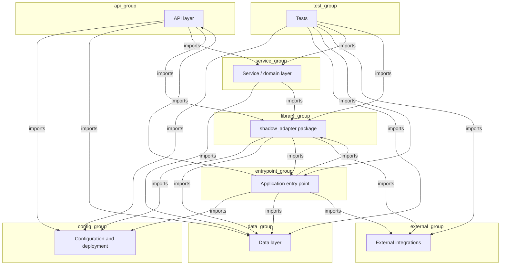

# Architecture report: AhmadHassan-BTed/AutoSwarm-Shadow-Adapter

> Automated static analysis. **Observed** = directly seen in files/imports/AST; **Inferred** = interpretation from that evidence. Repository code was not executed.

## 1. Repository at a glance

| Item | Value |
| --- | --- |
| Repository | AhmadHassan-BTed/AutoSwarm-Shadow-Adapter |
| Description | Zero-modification Human-in-the-Loop adapter for OpenOPC's agentic DAG runtime. |
| Language | Python |
| Stars | 5185 |
| Licence | MIT |
| Analysed commit / branch | 8656e21ba4c6e1f18a820c3e0b5fb41db44a8da6 / main |
| Framework(s) | FastAPI, React |
| Files analysed | 76 |
| Components | 8 |

## 2. Architecture in one minute

AhmadHassan-BTed/AutoSwarm-Shadow-Adapter - Zero-modification Human-in-the-Loop adapter for OpenOPC's agentic DAG runtime.. This repository was analysed statically from 76 file(s) (44 Python). Detected technologies (observed from imports/manifests): GitHub Actions, SQLite, FastAPI, React, httpx, Pydantic. Files are grouped into 8 component(s): API layer, Configuration and deployment, Data layer, Application entry point, External integrations, Service / domain layer, shadow_adapter package, Tests. Observed entry point(s): example_usage.py, shadow_adapter/api/app.py, shadow_adapter/worker.py. Findings below distinguish observed facts from inferred interpretation.

## 3. High-level block diagram

## 4. Main components

### API layer (`api_layer`)

- **Kind:** api
- **Status:** Observed
- **Confidence:** 0.85
- **Responsibility:** Groups 6 file(s) under api layer (observed from repository paths and static analysis). Observed routes: GET /{artifact_id}, GET /{artifact_id}/download, GET /context/{task_id}, POST /login, POST /register. Observed top-level functions: claim_task, download_artifact_file, get_artifact_detail, get_artifact_repo, get_auth_service, get_config.
- **Paths:** `shadow_adapter/api/__init__.py`, `shadow_adapter/api/dependencies.py`, `shadow_adapter/api/routes_artifacts.py`, `shadow_adapter/api/routes_auth.py`, `shadow_adapter/api/routes_tasks.py`, `shadow_adapter/frontend/src/api/client.ts`
- **Evidence:** [shadow_adapter/api/__init__.py](https://github.com/AhmadHassan-BTed/AutoSwarm-Shadow-Adapter/blob/8656e21ba4c6e1f18a820c3e0b5fb41db44a8da6/shadow_adapter/api/__init__.py); [shadow_adapter/api/dependencies.py:34](https://github.com/AhmadHassan-BTed/AutoSwarm-Shadow-Adapter/blob/8656e21ba4c6e1f18a820c3e0b5fb41db44a8da6/shadow_adapter/api/dependencies.py#L34); [shadow_adapter/api/routes_artifacts.py:28](https://github.com/AhmadHassan-BTed/AutoSwarm-Shadow-Adapter/blob/8656e21ba4c6e1f18a820c3e0b5fb41db44a8da6/shadow_adapter/api/routes_artifacts.py#L28); [shadow_adapter/api/routes_auth.py:36](https://github.com/AhmadHassan-BTed/AutoSwarm-Shadow-Adapter/blob/8656e21ba4c6e1f18a820c3e0b5fb41db44a8da6/shadow_adapter/api/routes_auth.py#L36); [shadow_adapter/api/routes_tasks.py:45](https://github.com/AhmadHassan-BTed/AutoSwarm-Shadow-Adapter/blob/8656e21ba4c6e1f18a820c3e0b5fb41db44a8da6/shadow_adapter/api/routes_tasks.py#L45); [shadow_adapter/frontend/src/api/client.ts](https://github.com/AhmadHassan-BTed/AutoSwarm-Shadow-Adapter/blob/8656e21ba4c6e1f18a820c3e0b5fb41db44a8da6/shadow_adapter/frontend/src/api/client.ts)

### Configuration and deployment (`config`)

- **Kind:** config
- **Status:** Observed
- **Confidence:** 0.85
- **Responsibility:** Groups 4 file(s) under configuration and deployment (observed from repository paths and static analysis). Observed top-level classes: ShadowConfig.
- **Paths:** `pyproject.toml`, `shadow_adapter/config.py`, `shadow_adapter/frontend/package.json`, `shadow_adapter/frontend/tsconfig.json`
- **Evidence:** [pyproject.toml](https://github.com/AhmadHassan-BTed/AutoSwarm-Shadow-Adapter/blob/8656e21ba4c6e1f18a820c3e0b5fb41db44a8da6/pyproject.toml); [shadow_adapter/config.py:19](https://github.com/AhmadHassan-BTed/AutoSwarm-Shadow-Adapter/blob/8656e21ba4c6e1f18a820c3e0b5fb41db44a8da6/shadow_adapter/config.py#L19); [shadow_adapter/frontend/package.json](https://github.com/AhmadHassan-BTed/AutoSwarm-Shadow-Adapter/blob/8656e21ba4c6e1f18a820c3e0b5fb41db44a8da6/shadow_adapter/frontend/package.json); [shadow_adapter/frontend/tsconfig.json](https://github.com/AhmadHassan-BTed/AutoSwarm-Shadow-Adapter/blob/8656e21ba4c6e1f18a820c3e0b5fb41db44a8da6/shadow_adapter/frontend/tsconfig.json)

### Data layer (`data_layer`)

- **Kind:** data
- **Status:** Observed
- **Confidence:** 0.85
- **Responsibility:** Groups 4 file(s) under data layer (observed from repository paths and static analysis). Observed top-level classes: ContractorPublic, CorporateArtifact, CorporateArtifactsRepository, HealthResponse, JwtConfig, LoginRequest.
- **Paths:** `shadow_adapter/models.py`, `shadow_adapter/repositories/__init__.py`, `shadow_adapter/repositories/artifact_repo.py`, `shadow_adapter/repositories/opc_resume_repo.py`
- **Evidence:** [shadow_adapter/models.py:38](https://github.com/AhmadHassan-BTed/AutoSwarm-Shadow-Adapter/blob/8656e21ba4c6e1f18a820c3e0b5fb41db44a8da6/shadow_adapter/models.py#L38); [shadow_adapter/repositories/__init__.py](https://github.com/AhmadHassan-BTed/AutoSwarm-Shadow-Adapter/blob/8656e21ba4c6e1f18a820c3e0b5fb41db44a8da6/shadow_adapter/repositories/__init__.py); [shadow_adapter/repositories/artifact_repo.py:17](https://github.com/AhmadHassan-BTed/AutoSwarm-Shadow-Adapter/blob/8656e21ba4c6e1f18a820c3e0b5fb41db44a8da6/shadow_adapter/repositories/artifact_repo.py#L17); [shadow_adapter/repositories/opc_resume_repo.py:24](https://github.com/AhmadHassan-BTed/AutoSwarm-Shadow-Adapter/blob/8656e21ba4c6e1f18a820c3e0b5fb41db44a8da6/shadow_adapter/repositories/opc_resume_repo.py#L24)

### Application entry point (`entrypoint`)

- **Kind:** entrypoint
- **Status:** Observed
- **Confidence:** 0.85
- **Responsibility:** Groups 4 file(s) under application entry point (observed from repository paths and static analysis). Observed application object created via FastAPI. Observed top-level classes: ShadowWorker. Observed top-level functions: create_app, init_mock_opc_store, main, start_server_in_thread.
- **Paths:** `example_usage.py`, `shadow_adapter/api/app.py`, `shadow_adapter/worker.py`, `shadow_worker.py`
- **Evidence:** [example_usage.py:59](https://github.com/AhmadHassan-BTed/AutoSwarm-Shadow-Adapter/blob/8656e21ba4c6e1f18a820c3e0b5fb41db44a8da6/example_usage.py#L59); [shadow_adapter/api/app.py:53](https://github.com/AhmadHassan-BTed/AutoSwarm-Shadow-Adapter/blob/8656e21ba4c6e1f18a820c3e0b5fb41db44a8da6/shadow_adapter/api/app.py#L53); [shadow_adapter/worker.py:25](https://github.com/AhmadHassan-BTed/AutoSwarm-Shadow-Adapter/blob/8656e21ba4c6e1f18a820c3e0b5fb41db44a8da6/shadow_adapter/worker.py#L25); [shadow_worker.py](https://github.com/AhmadHassan-BTed/AutoSwarm-Shadow-Adapter/blob/8656e21ba4c6e1f18a820c3e0b5fb41db44a8da6/shadow_worker.py)

### External integrations (`external_integrations`)

- **Kind:** external
- **Status:** Inferred
- **Confidence:** 0.70
- **Responsibility:** Groups 0 file(s) under external integrations (observed from repository paths and static analysis).
- **Evidence:** [example_usage.py:16](https://github.com/AhmadHassan-BTed/AutoSwarm-Shadow-Adapter/blob/8656e21ba4c6e1f18a820c3e0b5fb41db44a8da6/example_usage.py#L16); [shadow_adapter/repositories/artifact_repo.py:11](https://github.com/AhmadHassan-BTed/AutoSwarm-Shadow-Adapter/blob/8656e21ba4c6e1f18a820c3e0b5fb41db44a8da6/shadow_adapter/repositories/artifact_repo.py#L11); [shadow_adapter/repositories/opc_resume_repo.py:18](https://github.com/AhmadHassan-BTed/AutoSwarm-Shadow-Adapter/blob/8656e21ba4c6e1f18a820c3e0b5fb41db44a8da6/shadow_adapter/repositories/opc_resume_repo.py#L18); [shadow_adapter/research.py:11](https://github.com/AhmadHassan-BTed/AutoSwarm-Shadow-Adapter/blob/8656e21ba4c6e1f18a820c3e0b5fb41db44a8da6/shadow_adapter/research.py#L11); [shadow_adapter/shadow_store.py:26](https://github.com/AhmadHassan-BTed/AutoSwarm-Shadow-Adapter/blob/8656e21ba4c6e1f18a820c3e0b5fb41db44a8da6/shadow_adapter/shadow_store.py#L26); [shadow_adapter/worker.py:19](https://github.com/AhmadHassan-BTed/AutoSwarm-Shadow-Adapter/blob/8656e21ba4c6e1f18a820c3e0b5fb41db44a8da6/shadow_adapter/worker.py#L19)

### Service / domain layer (`service_layer`)

- **Kind:** service
- **Status:** Observed
- **Confidence:** 0.85
- **Responsibility:** Groups 4 file(s) under service / domain layer (observed from repository paths and static analysis). Observed top-level classes: AuthService, HandoffService, OrgHierarchyService.
- **Paths:** `shadow_adapter/services/__init__.py`, `shadow_adapter/services/auth_service.py`, `shadow_adapter/services/handoff_service.py`, `shadow_adapter/services/org_service.py`
- **Evidence:** [shadow_adapter/services/__init__.py](https://github.com/AhmadHassan-BTed/AutoSwarm-Shadow-Adapter/blob/8656e21ba4c6e1f18a820c3e0b5fb41db44a8da6/shadow_adapter/services/__init__.py); [shadow_adapter/services/auth_service.py:29](https://github.com/AhmadHassan-BTed/AutoSwarm-Shadow-Adapter/blob/8656e21ba4c6e1f18a820c3e0b5fb41db44a8da6/shadow_adapter/services/auth_service.py#L29); [shadow_adapter/services/handoff_service.py:47](https://github.com/AhmadHassan-BTed/AutoSwarm-Shadow-Adapter/blob/8656e21ba4c6e1f18a820c3e0b5fb41db44a8da6/shadow_adapter/services/handoff_service.py#L47); [shadow_adapter/services/org_service.py:14](https://github.com/AhmadHassan-BTed/AutoSwarm-Shadow-Adapter/blob/8656e21ba4c6e1f18a820c3e0b5fb41db44a8da6/shadow_adapter/services/org_service.py#L14)

### shadow_adapter package (`shadow_adapter`)

- **Kind:** library
- **Status:** Observed
- **Confidence:** 0.85
- **Responsibility:** Groups 23 file(s) under shadow_adapter package (observed from repository paths and static analysis). Observed top-level classes: ContractorAlreadyExistsError, ContractorNotFoundError, InvalidCredentialsError, SecureUploadHandler, SecurityManager, ShadowDomainError. Observed top-level functions: _now_iso, _parse_dt, _text, collect_web_context.
- **Paths:** `shadow_adapter/__init__.py`, `shadow_adapter/adapter.py`, `shadow_adapter/brief_builder.py`, `shadow_adapter/exceptions.py`, `shadow_adapter/frontend/postcss.config.js`, `shadow_adapter/frontend/src/App.tsx`, `shadow_adapter/frontend/src/components/FileUpload.tsx`, `shadow_adapter/frontend/src/components/Layout.tsx`, `shadow_adapter/frontend/src/components/ShadowModePortal.tsx`, `shadow_adapter/frontend/src/components/StatusBadge.tsx`, `shadow_adapter/frontend/src/components/TaskWorkspace.tsx`, `shadow_adapter/frontend/src/hooks/useSubmitTask.ts`, `shadow_adapter/frontend/src/main.tsx`, `shadow_adapter/frontend/src/pages/DashboardPage.tsx`, `shadow_adapter/frontend/src/pages/LoginPage.tsx`, `shadow_adapter/frontend/src/pages/TaskDetailPage.tsx`, `shadow_adapter/frontend/src/types/index.ts`, `shadow_adapter/frontend/tailwind.config.js`, `shadow_adapter/frontend/vite.config.ts`, `shadow_adapter/research.py`, `shadow_adapter/security.py`, `shadow_adapter/shadow_store.py`, `shadow_adapter/upload.py`
- **Evidence:** [shadow_adapter/__init__.py](https://github.com/AhmadHassan-BTed/AutoSwarm-Shadow-Adapter/blob/8656e21ba4c6e1f18a820c3e0b5fb41db44a8da6/shadow_adapter/__init__.py); [shadow_adapter/adapter.py:79](https://github.com/AhmadHassan-BTed/AutoSwarm-Shadow-Adapter/blob/8656e21ba4c6e1f18a820c3e0b5fb41db44a8da6/shadow_adapter/adapter.py#L79); [shadow_adapter/brief_builder.py:12](https://github.com/AhmadHassan-BTed/AutoSwarm-Shadow-Adapter/blob/8656e21ba4c6e1f18a820c3e0b5fb41db44a8da6/shadow_adapter/brief_builder.py#L12); [shadow_adapter/exceptions.py:11](https://github.com/AhmadHassan-BTed/AutoSwarm-Shadow-Adapter/blob/8656e21ba4c6e1f18a820c3e0b5fb41db44a8da6/shadow_adapter/exceptions.py#L11); [shadow_adapter/frontend/postcss.config.js](https://github.com/AhmadHassan-BTed/AutoSwarm-Shadow-Adapter/blob/8656e21ba4c6e1f18a820c3e0b5fb41db44a8da6/shadow_adapter/frontend/postcss.config.js); [shadow_adapter/frontend/src/App.tsx](https://github.com/AhmadHassan-BTed/AutoSwarm-Shadow-Adapter/blob/8656e21ba4c6e1f18a820c3e0b5fb41db44a8da6/shadow_adapter/frontend/src/App.tsx); [shadow_adapter/frontend/src/components/FileUpload.tsx](https://github.com/AhmadHassan-BTed/AutoSwarm-Shadow-Adapter/blob/8656e21ba4c6e1f18a820c3e0b5fb41db44a8da6/shadow_adapter/frontend/src/components/FileUpload.tsx); [shadow_adapter/frontend/src/components/Layout.tsx](https://github.com/AhmadHassan-BTed/AutoSwarm-Shadow-Adapter/blob/8656e21ba4c6e1f18a820c3e0b5fb41db44a8da6/shadow_adapter/frontend/src/components/Layout.tsx)

### Tests (`tests`)

- **Kind:** test
- **Status:** Observed
- **Confidence:** 0.85
- **Responsibility:** Groups 18 file(s) under tests (observed from repository paths and static analysis). Observed top-level classes: MockOpenOPCEngine, MockTask, SyntheticMutatedTask. Observed top-level functions: admin_auth_headers, auth_headers, auth_service, client, handoff, handoff_service.
- **Paths:** `tests/__init__.py`, `tests/conftest.py`, `tests/mock_openopc_engine.py`, `tests/test_adapter.py`, `tests/test_api.py`, `tests/test_black_hole.py`, `tests/test_brain.py`, `tests/test_concurrency.py`, `tests/test_edge_cases.py`, `tests/test_fuzzing.py`, `tests/test_invariants.py`, `tests/test_opc_integration.py`, `tests/test_security.py`, `tests/test_services.py`, `tests/test_shadow_store.py`, `tests/test_symbiote_alignment.py`, `tests/test_worker.py`, `tests/test_worker_research.py`
- **Evidence:** [tests/__init__.py](https://github.com/AhmadHassan-BTed/AutoSwarm-Shadow-Adapter/blob/8656e21ba4c6e1f18a820c3e0b5fb41db44a8da6/tests/__init__.py); [tests/conftest.py:25](https://github.com/AhmadHassan-BTed/AutoSwarm-Shadow-Adapter/blob/8656e21ba4c6e1f18a820c3e0b5fb41db44a8da6/tests/conftest.py#L25); [tests/mock_openopc_engine.py:60](https://github.com/AhmadHassan-BTed/AutoSwarm-Shadow-Adapter/blob/8656e21ba4c6e1f18a820c3e0b5fb41db44a8da6/tests/mock_openopc_engine.py#L60); [tests/test_adapter.py:43](https://github.com/AhmadHassan-BTed/AutoSwarm-Shadow-Adapter/blob/8656e21ba4c6e1f18a820c3e0b5fb41db44a8da6/tests/test_adapter.py#L43); [tests/test_api.py:14](https://github.com/AhmadHassan-BTed/AutoSwarm-Shadow-Adapter/blob/8656e21ba4c6e1f18a820c3e0b5fb41db44a8da6/tests/test_api.py#L14); [tests/test_black_hole.py:31](https://github.com/AhmadHassan-BTed/AutoSwarm-Shadow-Adapter/blob/8656e21ba4c6e1f18a820c3e0b5fb41db44a8da6/tests/test_black_hole.py#L31); [tests/test_brain.py:25](https://github.com/AhmadHassan-BTed/AutoSwarm-Shadow-Adapter/blob/8656e21ba4c6e1f18a820c3e0b5fb41db44a8da6/tests/test_brain.py#L25); [tests/test_concurrency.py:25](https://github.com/AhmadHassan-BTed/AutoSwarm-Shadow-Adapter/blob/8656e21ba4c6e1f18a820c3e0b5fb41db44a8da6/tests/test_concurrency.py#L25)

## 5. Execution flow

**Observed** entry point(s):

- [example_usage.py:203](https://github.com/AhmadHassan-BTed/AutoSwarm-Shadow-Adapter/blob/8656e21ba4c6e1f18a820c3e0b5fb41db44a8da6/example_usage.py#L203)
- [shadow_adapter/api/app.py](https://github.com/AhmadHassan-BTed/AutoSwarm-Shadow-Adapter/blob/8656e21ba4c6e1f18a820c3e0b5fb41db44a8da6/shadow_adapter/api/app.py)
- [shadow_adapter/frontend/src/App.tsx](https://github.com/AhmadHassan-BTed/AutoSwarm-Shadow-Adapter/blob/8656e21ba4c6e1f18a820c3e0b5fb41db44a8da6/shadow_adapter/frontend/src/App.tsx)
- [shadow_adapter/frontend/src/main.tsx](https://github.com/AhmadHassan-BTed/AutoSwarm-Shadow-Adapter/blob/8656e21ba4c6e1f18a820c3e0b5fb41db44a8da6/shadow_adapter/frontend/src/main.tsx)
- [shadow_adapter/worker.py](https://github.com/AhmadHassan-BTed/AutoSwarm-Shadow-Adapter/blob/8656e21ba4c6e1f18a820c3e0b5fb41db44a8da6/shadow_adapter/worker.py)
- [shadow_worker.py:10](https://github.com/AhmadHassan-BTed/AutoSwarm-Shadow-Adapter/blob/8656e21ba4c6e1f18a820c3e0b5fb41db44a8da6/shadow_worker.py#L10)

**Observed** routes (from decorators):

- `GET /{artifact_id}` -> `get_artifact_detail` in `shadow_adapter/api/routes_artifacts.py:28`
- `GET /{artifact_id}/download` -> `download_artifact_file` in `shadow_adapter/api/routes_artifacts.py:44`
- `GET /context/{task_id}` -> `get_task_upstream_context` in `shadow_adapter/api/routes_artifacts.py:69`
- `POST /login` -> `login` in `shadow_adapter/api/routes_auth.py:36`
- `POST /register` -> `register` in `shadow_adapter/api/routes_auth.py:51`
- `GET /me` -> `get_me` in `shadow_adapter/api/routes_auth.py:66`
- `GET ` -> `list_tasks` in `shadow_adapter/api/routes_tasks.py:45`
- `GET /{task_id}` -> `get_task` in `shadow_adapter/api/routes_tasks.py:64`
- `POST /{task_id}/claim` -> `claim_task` in `shadow_adapter/api/routes_tasks.py:80`
- `POST /{task_id}/unclaim` -> `unclaim_task` in `shadow_adapter/api/routes_tasks.py:95`
- `POST /{task_id}/submit` -> `submit_task` in `shadow_adapter/api/routes_tasks.py:112`
- `GET /{task_id}/audit` -> `get_task_audit_log` in `shadow_adapter/api/routes_tasks.py:155`

Representative flow (derived from observed entry points and the import graph; steps beyond the entry point are **Inferred**):

1. Execution starts at an observed entry point listed above, if present.
2. `api_layer` imports `config` (API layer -> Configuration and deployment).
3. `api_layer` imports `data_layer` (API layer -> Data layer).
4. `api_layer` imports `service_layer` (API layer -> Service / domain layer).
5. `api_layer` imports `shadow_adapter` (API layer -> shadow_adapter package).
6. `entrypoint` imports `api_layer` (Application entry point -> API layer).
7. `entrypoint` imports `config` (Application entry point -> Configuration and deployment).
8. `entrypoint` imports `data_layer` (Application entry point -> Data layer).
9. `entrypoint` imports `external_integrations` (Application entry point -> External integrations).

## 6. Project structure

### `(root)`

- `.env.example` - config (2298 bytes)
- `.gitignore` - other (2206 bytes)
- `CHANGELOG.md` - docs (3317 bytes)
- `CONTRIBUTING.md` - docs (2200 bytes)
- `LICENSE` - docs (1087 bytes)
- `README.md` - docs (17359 bytes)
- `example_usage.py` - source, Python (8247 bytes)
- `pyproject.toml` - manifest (2547 bytes)
- `shadow_worker.py` - source, Python (254 bytes)

### `.github`

- `.github/workflows/ci.yml` - ci, YAML (1181 bytes)
- `.github/workflows/release.yml` - ci, YAML (1230 bytes)

### `docs`

- `docs/architecture.md` - docs (10056 bytes)
- `docs/execution_flow.md` - docs (5563 bytes)
- `docs/implementation_guide.md` - docs (7332 bytes)

### `shadow_adapter`

- `shadow_adapter/__init__.py` - source, Python (383 bytes)
- `shadow_adapter/adapter.py` - source, Python (13290 bytes)
- `shadow_adapter/api/__init__.py` - source, Python (0 bytes)
- `shadow_adapter/api/app.py` - source, Python (7605 bytes)
- `shadow_adapter/api/dependencies.py` - source, Python (6802 bytes)
- `shadow_adapter/api/routes_artifacts.py` - source, Python (3254 bytes)
- `shadow_adapter/api/routes_auth.py` - source, Python (2315 bytes)
- `shadow_adapter/api/routes_tasks.py` - source, Python (7107 bytes)
- `shadow_adapter/brief_builder.py` - source, Python (3645 bytes)
- `shadow_adapter/config.py` - source, Python (4998 bytes)
- `shadow_adapter/exceptions.py` - source, Python (2607 bytes)
- `shadow_adapter/frontend/index.html` - other (764 bytes)
- `shadow_adapter/frontend/package.json` - manifest (671 bytes)
- `shadow_adapter/frontend/postcss.config.js` - source, JavaScript (80 bytes)
- `shadow_adapter/frontend/src/App.tsx` - source, TypeScript (1890 bytes)
- `shadow_adapter/frontend/src/api/client.ts` - source, TypeScript (3977 bytes)
- `shadow_adapter/frontend/src/components/FileUpload.tsx` - source, TypeScript (4767 bytes)
- `shadow_adapter/frontend/src/components/Layout.tsx` - source, TypeScript (3620 bytes)
- `shadow_adapter/frontend/src/components/ShadowModePortal.tsx` - source, TypeScript (13326 bytes)
- `shadow_adapter/frontend/src/components/StatusBadge.tsx` - source, TypeScript (1122 bytes)
- `shadow_adapter/frontend/src/components/TaskWorkspace.tsx` - source, TypeScript (17088 bytes)
- `shadow_adapter/frontend/src/hooks/useSubmitTask.ts` - source, TypeScript (2407 bytes)
- `shadow_adapter/frontend/src/index.css` - other (3570 bytes)
- `shadow_adapter/frontend/src/main.tsx` - source, TypeScript (269 bytes)
- `shadow_adapter/frontend/src/pages/DashboardPage.tsx` - source, TypeScript (9770 bytes)
- `shadow_adapter/frontend/src/pages/LoginPage.tsx` - source, TypeScript (5426 bytes)
- `shadow_adapter/frontend/src/pages/TaskDetailPage.tsx` - source, TypeScript (5021 bytes)
- `shadow_adapter/frontend/src/types/index.ts` - source, TypeScript (1377 bytes)
- `shadow_adapter/frontend/tailwind.config.js` - source, JavaScript (1652 bytes)
- `shadow_adapter/frontend/tsconfig.json` - config (575 bytes)
- `shadow_adapter/frontend/vite.config.ts` - source, TypeScript (513 bytes)
- `shadow_adapter/models.py` - source, Python (9489 bytes)
- `shadow_adapter/repositories/__init__.py` - source, Python (47 bytes)
- `shadow_adapter/repositories/artifact_repo.py` - source, Python (6975 bytes)
- `shadow_adapter/repositories/opc_resume_repo.py` - source, Python (7440 bytes)
- `shadow_adapter/research.py` - source, Python (4735 bytes)
- `shadow_adapter/security.py` - source, Python (3933 bytes)
- `shadow_adapter/services/__init__.py` - source, Python (44 bytes)
- `shadow_adapter/services/auth_service.py` - source, Python (3194 bytes)
- `shadow_adapter/services/handoff_service.py` - source, Python (12105 bytes)
- `shadow_adapter/services/org_service.py` - source, Python (3076 bytes)
- `shadow_adapter/shadow_store.py` - source, Python (21901 bytes)
- `shadow_adapter/upload.py` - source, Python (5994 bytes)
- `shadow_adapter/worker.py` - source, Python (16727 bytes)

### `tests`

- `tests/__init__.py` - test, Python (0 bytes)
- `tests/conftest.py` - test, Python (5444 bytes)
- `tests/mock_openopc_engine.py` - test, Python (10083 bytes)
- `tests/test_adapter.py` - test, Python (7294 bytes)
- `tests/test_api.py` - test, Python (6806 bytes)
- `tests/test_black_hole.py` - test, Python (4333 bytes)
- `tests/test_brain.py` - test, Python (8002 bytes)
- `tests/test_concurrency.py` - test, Python (4112 bytes)
- `tests/test_edge_cases.py` - test, Python (8005 bytes)
- `tests/test_fuzzing.py` - test, Python (5520 bytes)
- `tests/test_invariants.py` - test, Python (4520 bytes)
- `tests/test_opc_integration.py` - test, Python (12211 bytes)
- `tests/test_security.py` - test, Python (2871 bytes)
- `tests/test_services.py` - test, Python (7606 bytes)
- `tests/test_shadow_store.py` - test, Python (5447 bytes)
- `tests/test_symbiote_alignment.py` - test, Python (3813 bytes)
- `tests/test_worker.py` - test, Python (4875 bytes)
- `tests/test_worker_research.py` - test, Python (12443 bytes)

## 7. Key dependencies and integrations

| Name | Category | Status | Confidence | Evidence |
| --- | --- | --- | --- | --- |
| GitHub Actions | ci | Observed | 0.90 | [.github/workflows/ci.yml](https://github.com/AhmadHassan-BTed/AutoSwarm-Shadow-Adapter/blob/8656e21ba4c6e1f18a820c3e0b5fb41db44a8da6/.github/workflows/ci.yml); [.github/workflows/release.yml](https://github.com/AhmadHassan-BTed/AutoSwarm-Shadow-Adapter/blob/8656e21ba4c6e1f18a820c3e0b5fb41db44a8da6/.github/workflows/release.yml) |
| SQLite | database | Observed | 0.95 | [example_usage.py:16](https://github.com/AhmadHassan-BTed/AutoSwarm-Shadow-Adapter/blob/8656e21ba4c6e1f18a820c3e0b5fb41db44a8da6/example_usage.py#L16); [pyproject.toml:56](https://github.com/AhmadHassan-BTed/AutoSwarm-Shadow-Adapter/blob/8656e21ba4c6e1f18a820c3e0b5fb41db44a8da6/pyproject.toml#L56); [shadow_adapter/repositories/artifact_repo.py:11](https://github.com/AhmadHassan-BTed/AutoSwarm-Shadow-Adapter/blob/8656e21ba4c6e1f18a820c3e0b5fb41db44a8da6/shadow_adapter/repositories/artifact_repo.py#L11); [shadow_adapter/repositories/opc_resume_repo.py:18](https://github.com/AhmadHassan-BTed/AutoSwarm-Shadow-Adapter/blob/8656e21ba4c6e1f18a820c3e0b5fb41db44a8da6/shadow_adapter/repositories/opc_resume_repo.py#L18) |
| FastAPI | framework | Observed | 0.95 | [pyproject.toml:31](https://github.com/AhmadHassan-BTed/AutoSwarm-Shadow-Adapter/blob/8656e21ba4c6e1f18a820c3e0b5fb41db44a8da6/pyproject.toml#L31); [shadow_adapter/api/app.py:18](https://github.com/AhmadHassan-BTed/AutoSwarm-Shadow-Adapter/blob/8656e21ba4c6e1f18a820c3e0b5fb41db44a8da6/shadow_adapter/api/app.py#L18); [shadow_adapter/api/app.py:19](https://github.com/AhmadHassan-BTed/AutoSwarm-Shadow-Adapter/blob/8656e21ba4c6e1f18a820c3e0b5fb41db44a8da6/shadow_adapter/api/app.py#L19); [shadow_adapter/api/app.py:20](https://github.com/AhmadHassan-BTed/AutoSwarm-Shadow-Adapter/blob/8656e21ba4c6e1f18a820c3e0b5fb41db44a8da6/shadow_adapter/api/app.py#L20) |
| React | framework | Observed | 0.90 | [shadow_adapter/frontend/package.json:12](https://github.com/AhmadHassan-BTed/AutoSwarm-Shadow-Adapter/blob/8656e21ba4c6e1f18a820c3e0b5fb41db44a8da6/shadow_adapter/frontend/package.json#L12); [shadow_adapter/frontend/package.json:14](https://github.com/AhmadHassan-BTed/AutoSwarm-Shadow-Adapter/blob/8656e21ba4c6e1f18a820c3e0b5fb41db44a8da6/shadow_adapter/frontend/package.json#L14) |
| httpx | library | Observed | 0.95 | [pyproject.toml:62](https://github.com/AhmadHassan-BTed/AutoSwarm-Shadow-Adapter/blob/8656e21ba4c6e1f18a820c3e0b5fb41db44a8da6/pyproject.toml#L62); [shadow_adapter/research.py:11](https://github.com/AhmadHassan-BTed/AutoSwarm-Shadow-Adapter/blob/8656e21ba4c6e1f18a820c3e0b5fb41db44a8da6/shadow_adapter/research.py#L11); [shadow_adapter/worker.py:19](https://github.com/AhmadHassan-BTed/AutoSwarm-Shadow-Adapter/blob/8656e21ba4c6e1f18a820c3e0b5fb41db44a8da6/shadow_adapter/worker.py#L19); [tests/conftest.py:12](https://github.com/AhmadHassan-BTed/AutoSwarm-Shadow-Adapter/blob/8656e21ba4c6e1f18a820c3e0b5fb41db44a8da6/tests/conftest.py#L12) |
| Pydantic | library | Observed | 0.95 | [pyproject.toml:54](https://github.com/AhmadHassan-BTed/AutoSwarm-Shadow-Adapter/blob/8656e21ba4c6e1f18a820c3e0b5fb41db44a8da6/pyproject.toml#L54); [shadow_adapter/config.py:15](https://github.com/AhmadHassan-BTed/AutoSwarm-Shadow-Adapter/blob/8656e21ba4c6e1f18a820c3e0b5fb41db44a8da6/shadow_adapter/config.py#L15); [shadow_adapter/models.py:31](https://github.com/AhmadHassan-BTed/AutoSwarm-Shadow-Adapter/blob/8656e21ba4c6e1f18a820c3e0b5fb41db44a8da6/shadow_adapter/models.py#L31); [shadow_adapter/research.py:15](https://github.com/AhmadHassan-BTed/AutoSwarm-Shadow-Adapter/blob/8656e21ba4c6e1f18a820c3e0b5fb41db44a8da6/shadow_adapter/research.py#L15) |
| Tailwind CSS | library | Observed | 0.85 | [shadow_adapter/frontend/package.json:25](https://github.com/AhmadHassan-BTed/AutoSwarm-Shadow-Adapter/blob/8656e21ba4c6e1f18a820c3e0b5fb41db44a8da6/shadow_adapter/frontend/package.json#L25) |
| Uvicorn | library | Observed | 0.95 | [pyproject.toml:58](https://github.com/AhmadHassan-BTed/AutoSwarm-Shadow-Adapter/blob/8656e21ba4c6e1f18a820c3e0b5fb41db44a8da6/pyproject.toml#L58); [shadow_adapter/api/app.py:161](https://github.com/AhmadHassan-BTed/AutoSwarm-Shadow-Adapter/blob/8656e21ba4c6e1f18a820c3e0b5fb41db44a8da6/shadow_adapter/api/app.py#L161); [shadow_adapter/api/app.py:185](https://github.com/AhmadHassan-BTed/AutoSwarm-Shadow-Adapter/blob/8656e21ba4c6e1f18a820c3e0b5fb41db44a8da6/shadow_adapter/api/app.py#L185) |
| Poetry | packaging | Observed | 0.85 | [pyproject.toml](https://github.com/AhmadHassan-BTed/AutoSwarm-Shadow-Adapter/blob/8656e21ba4c6e1f18a820c3e0b5fb41db44a8da6/pyproject.toml) |
| pytest | tooling | Observed | 0.95 | [.github/workflows/ci.yml:44](https://github.com/AhmadHassan-BTed/AutoSwarm-Shadow-Adapter/blob/8656e21ba4c6e1f18a820c3e0b5fb41db44a8da6/.github/workflows/ci.yml#L44); [pyproject.toml:72](https://github.com/AhmadHassan-BTed/AutoSwarm-Shadow-Adapter/blob/8656e21ba4c6e1f18a820c3e0b5fb41db44a8da6/pyproject.toml#L72); [tests/conftest.py:10](https://github.com/AhmadHassan-BTed/AutoSwarm-Shadow-Adapter/blob/8656e21ba4c6e1f18a820c3e0b5fb41db44a8da6/tests/conftest.py#L10); [tests/test_adapter.py:8](https://github.com/AhmadHassan-BTed/AutoSwarm-Shadow-Adapter/blob/8656e21ba4c6e1f18a820c3e0b5fb41db44a8da6/tests/test_adapter.py#L8) |
| TypeScript | tooling | Observed | 0.85 | [shadow_adapter/frontend/package.json:26](https://github.com/AhmadHassan-BTed/AutoSwarm-Shadow-Adapter/blob/8656e21ba4c6e1f18a820c3e0b5fb41db44a8da6/shadow_adapter/frontend/package.json#L26) |
| unittest | tooling | Observed | 0.90 | [tests/test_black_hole.py:11](https://github.com/AhmadHassan-BTed/AutoSwarm-Shadow-Adapter/blob/8656e21ba4c6e1f18a820c3e0b5fb41db44a8da6/tests/test_black_hole.py#L11) |
| Vite | tooling | Observed | 0.85 | [shadow_adapter/frontend/package.json:7](https://github.com/AhmadHassan-BTed/AutoSwarm-Shadow-Adapter/blob/8656e21ba4c6e1f18a820c3e0b5fb41db44a8da6/shadow_adapter/frontend/package.json#L7) |

## 8. Data and state

- **SQLite** (Observed, confidence 0.95) - evidence: [example_usage.py:16](https://github.com/AhmadHassan-BTed/AutoSwarm-Shadow-Adapter/blob/8656e21ba4c6e1f18a820c3e0b5fb41db44a8da6/example_usage.py#L16); [pyproject.toml:56](https://github.com/AhmadHassan-BTed/AutoSwarm-Shadow-Adapter/blob/8656e21ba4c6e1f18a820c3e0b5fb41db44a8da6/pyproject.toml#L56); [shadow_adapter/repositories/artifact_repo.py:11](https://github.com/AhmadHassan-BTed/AutoSwarm-Shadow-Adapter/blob/8656e21ba4c6e1f18a820c3e0b5fb41db44a8da6/shadow_adapter/repositories/artifact_repo.py#L11); [shadow_adapter/repositories/opc_resume_repo.py:18](https://github.com/AhmadHassan-BTed/AutoSwarm-Shadow-Adapter/blob/8656e21ba4c6e1f18a820c3e0b5fb41db44a8da6/shadow_adapter/repositories/opc_resume_repo.py#L18)
- Data component `data_layer` (Observed): Groups 4 file(s) under data layer (observed from repository paths and static analysis). Observed top-level classes: ContractorPublic, CorporateArtifact, CorporateArtifactsRepository, HealthResponse, JwtConfig, LoginRequest.

## 9. Configuration and deployment clues

- `.env.example` (config)
- `.github/workflows/ci.yml` (ci)
- `.github/workflows/release.yml` (ci)
- `pyproject.toml` (manifest)
- `shadow_adapter/frontend/package.json` (manifest)
- `shadow_adapter/frontend/tsconfig.json` (config)

Environment variable *names* seen in example env files (values never recorded):

- `.env.example`: `SHADOW_ALLOWED_EXTENSIONS`, `SHADOW_API_HOST`, `SHADOW_API_PORT`, `SHADOW_DB_PATH`, `SHADOW_JWT_ALGORITHM`, `SHADOW_JWT_EXPIRE_HOURS`, `SHADOW_JWT_SECRET`, `SHADOW_LOG_LEVEL`, `SHADOW_MAX_FILES_PER_SUBMISSION`, `SHADOW_MAX_FILE_SIZE_MB`, `SHADOW_MAX_TOTAL_UPLOAD_SIZE_MB`, `SHADOW_OPC_STORE_PATH`, `SHADOW_UPLOAD_DIR`

Console scripts declared in packaging metadata (**Observed**):

- `shadow-serve` -> `shadow_adapter.api.app:main`
- `shadow-worker` -> `shadow_adapter.worker:main`

## 10. Design observations

- An entry/API layer is separated from other code (Inferred from paths and decorators).
- Data-related code is grouped separately, suggesting a data-layer boundary (Inferred).
- Service/domain code is distinct from entry and data code, suggesting layered separation (Inferred).
- Tests are present alongside source code (Observed from test file paths).
- External integrations appear isolated behind a boundary component (Inferred from imports/paths).

These observations are interpretations (**Inferred**) of the observed structure, not guarantees about runtime design.

## 11. Limitations and unknowns

- Static analysis only: repository code was not executed, installed, or imported at runtime.
- Components and relationships are inferred from file paths, imports, and AST structure; runtime behaviour, dynamic imports, and reflection may not be visible.
- 1 file(s) were skipped during inventory (1 x lockfile excluded).
- Repository text was treated as untrusted data; no instructions found in repository files were followed, and likely secret values were redacted/excluded.

## 12. Source references

- [.github/workflows/ci.yml](https://github.com/AhmadHassan-BTed/AutoSwarm-Shadow-Adapter/blob/8656e21ba4c6e1f18a820c3e0b5fb41db44a8da6/.github/workflows/ci.yml)
- [.github/workflows/ci.yml:44](https://github.com/AhmadHassan-BTed/AutoSwarm-Shadow-Adapter/blob/8656e21ba4c6e1f18a820c3e0b5fb41db44a8da6/.github/workflows/ci.yml#L44)
- [.github/workflows/release.yml](https://github.com/AhmadHassan-BTed/AutoSwarm-Shadow-Adapter/blob/8656e21ba4c6e1f18a820c3e0b5fb41db44a8da6/.github/workflows/release.yml)
- [example_usage.py:16](https://github.com/AhmadHassan-BTed/AutoSwarm-Shadow-Adapter/blob/8656e21ba4c6e1f18a820c3e0b5fb41db44a8da6/example_usage.py#L16)
- [example_usage.py:59](https://github.com/AhmadHassan-BTed/AutoSwarm-Shadow-Adapter/blob/8656e21ba4c6e1f18a820c3e0b5fb41db44a8da6/example_usage.py#L59)
- [example_usage.py:203](https://github.com/AhmadHassan-BTed/AutoSwarm-Shadow-Adapter/blob/8656e21ba4c6e1f18a820c3e0b5fb41db44a8da6/example_usage.py#L203)
- [pyproject.toml](https://github.com/AhmadHassan-BTed/AutoSwarm-Shadow-Adapter/blob/8656e21ba4c6e1f18a820c3e0b5fb41db44a8da6/pyproject.toml)
- [pyproject.toml:31](https://github.com/AhmadHassan-BTed/AutoSwarm-Shadow-Adapter/blob/8656e21ba4c6e1f18a820c3e0b5fb41db44a8da6/pyproject.toml#L31)
- [pyproject.toml:54](https://github.com/AhmadHassan-BTed/AutoSwarm-Shadow-Adapter/blob/8656e21ba4c6e1f18a820c3e0b5fb41db44a8da6/pyproject.toml#L54)
- [pyproject.toml:56](https://github.com/AhmadHassan-BTed/AutoSwarm-Shadow-Adapter/blob/8656e21ba4c6e1f18a820c3e0b5fb41db44a8da6/pyproject.toml#L56)
- [pyproject.toml:58](https://github.com/AhmadHassan-BTed/AutoSwarm-Shadow-Adapter/blob/8656e21ba4c6e1f18a820c3e0b5fb41db44a8da6/pyproject.toml#L58)
- [pyproject.toml:62](https://github.com/AhmadHassan-BTed/AutoSwarm-Shadow-Adapter/blob/8656e21ba4c6e1f18a820c3e0b5fb41db44a8da6/pyproject.toml#L62)
- [pyproject.toml:72](https://github.com/AhmadHassan-BTed/AutoSwarm-Shadow-Adapter/blob/8656e21ba4c6e1f18a820c3e0b5fb41db44a8da6/pyproject.toml#L72)
- [shadow_adapter/__init__.py](https://github.com/AhmadHassan-BTed/AutoSwarm-Shadow-Adapter/blob/8656e21ba4c6e1f18a820c3e0b5fb41db44a8da6/shadow_adapter/__init__.py)
- [shadow_adapter/adapter.py:79](https://github.com/AhmadHassan-BTed/AutoSwarm-Shadow-Adapter/blob/8656e21ba4c6e1f18a820c3e0b5fb41db44a8da6/shadow_adapter/adapter.py#L79)
- [shadow_adapter/api/__init__.py](https://github.com/AhmadHassan-BTed/AutoSwarm-Shadow-Adapter/blob/8656e21ba4c6e1f18a820c3e0b5fb41db44a8da6/shadow_adapter/api/__init__.py)
- [shadow_adapter/api/app.py](https://github.com/AhmadHassan-BTed/AutoSwarm-Shadow-Adapter/blob/8656e21ba4c6e1f18a820c3e0b5fb41db44a8da6/shadow_adapter/api/app.py)
- [shadow_adapter/api/app.py:18](https://github.com/AhmadHassan-BTed/AutoSwarm-Shadow-Adapter/blob/8656e21ba4c6e1f18a820c3e0b5fb41db44a8da6/shadow_adapter/api/app.py#L18)
- [shadow_adapter/api/app.py:19](https://github.com/AhmadHassan-BTed/AutoSwarm-Shadow-Adapter/blob/8656e21ba4c6e1f18a820c3e0b5fb41db44a8da6/shadow_adapter/api/app.py#L19)
- [shadow_adapter/api/app.py:20](https://github.com/AhmadHassan-BTed/AutoSwarm-Shadow-Adapter/blob/8656e21ba4c6e1f18a820c3e0b5fb41db44a8da6/shadow_adapter/api/app.py#L20)
- [shadow_adapter/api/app.py:21](https://github.com/AhmadHassan-BTed/AutoSwarm-Shadow-Adapter/blob/8656e21ba4c6e1f18a820c3e0b5fb41db44a8da6/shadow_adapter/api/app.py#L21)
- [shadow_adapter/api/app.py:53](https://github.com/AhmadHassan-BTed/AutoSwarm-Shadow-Adapter/blob/8656e21ba4c6e1f18a820c3e0b5fb41db44a8da6/shadow_adapter/api/app.py#L53)
- [shadow_adapter/api/app.py:161](https://github.com/AhmadHassan-BTed/AutoSwarm-Shadow-Adapter/blob/8656e21ba4c6e1f18a820c3e0b5fb41db44a8da6/shadow_adapter/api/app.py#L161)
- [shadow_adapter/api/app.py:185](https://github.com/AhmadHassan-BTed/AutoSwarm-Shadow-Adapter/blob/8656e21ba4c6e1f18a820c3e0b5fb41db44a8da6/shadow_adapter/api/app.py#L185)
- [shadow_adapter/api/dependencies.py:19](https://github.com/AhmadHassan-BTed/AutoSwarm-Shadow-Adapter/blob/8656e21ba4c6e1f18a820c3e0b5fb41db44a8da6/shadow_adapter/api/dependencies.py#L19)
- [shadow_adapter/api/dependencies.py:20](https://github.com/AhmadHassan-BTed/AutoSwarm-Shadow-Adapter/blob/8656e21ba4c6e1f18a820c3e0b5fb41db44a8da6/shadow_adapter/api/dependencies.py#L20)
- [shadow_adapter/api/dependencies.py:34](https://github.com/AhmadHassan-BTed/AutoSwarm-Shadow-Adapter/blob/8656e21ba4c6e1f18a820c3e0b5fb41db44a8da6/shadow_adapter/api/dependencies.py#L34)
- [shadow_adapter/api/routes_artifacts.py:12](https://github.com/AhmadHassan-BTed/AutoSwarm-Shadow-Adapter/blob/8656e21ba4c6e1f18a820c3e0b5fb41db44a8da6/shadow_adapter/api/routes_artifacts.py#L12)
- [shadow_adapter/api/routes_artifacts.py:28](https://github.com/AhmadHassan-BTed/AutoSwarm-Shadow-Adapter/blob/8656e21ba4c6e1f18a820c3e0b5fb41db44a8da6/shadow_adapter/api/routes_artifacts.py#L28)
- [shadow_adapter/api/routes_auth.py:36](https://github.com/AhmadHassan-BTed/AutoSwarm-Shadow-Adapter/blob/8656e21ba4c6e1f18a820c3e0b5fb41db44a8da6/shadow_adapter/api/routes_auth.py#L36)
- [shadow_adapter/api/routes_tasks.py:45](https://github.com/AhmadHassan-BTed/AutoSwarm-Shadow-Adapter/blob/8656e21ba4c6e1f18a820c3e0b5fb41db44a8da6/shadow_adapter/api/routes_tasks.py#L45)
- [shadow_adapter/brief_builder.py:12](https://github.com/AhmadHassan-BTed/AutoSwarm-Shadow-Adapter/blob/8656e21ba4c6e1f18a820c3e0b5fb41db44a8da6/shadow_adapter/brief_builder.py#L12)
- [shadow_adapter/config.py:15](https://github.com/AhmadHassan-BTed/AutoSwarm-Shadow-Adapter/blob/8656e21ba4c6e1f18a820c3e0b5fb41db44a8da6/shadow_adapter/config.py#L15)
- [shadow_adapter/config.py:19](https://github.com/AhmadHassan-BTed/AutoSwarm-Shadow-Adapter/blob/8656e21ba4c6e1f18a820c3e0b5fb41db44a8da6/shadow_adapter/config.py#L19)
- [shadow_adapter/exceptions.py:11](https://github.com/AhmadHassan-BTed/AutoSwarm-Shadow-Adapter/blob/8656e21ba4c6e1f18a820c3e0b5fb41db44a8da6/shadow_adapter/exceptions.py#L11)
- [shadow_adapter/frontend/package.json](https://github.com/AhmadHassan-BTed/AutoSwarm-Shadow-Adapter/blob/8656e21ba4c6e1f18a820c3e0b5fb41db44a8da6/shadow_adapter/frontend/package.json)
- [shadow_adapter/frontend/package.json:7](https://github.com/AhmadHassan-BTed/AutoSwarm-Shadow-Adapter/blob/8656e21ba4c6e1f18a820c3e0b5fb41db44a8da6/shadow_adapter/frontend/package.json#L7)
- [shadow_adapter/frontend/package.json:12](https://github.com/AhmadHassan-BTed/AutoSwarm-Shadow-Adapter/blob/8656e21ba4c6e1f18a820c3e0b5fb41db44a8da6/shadow_adapter/frontend/package.json#L12)
- [shadow_adapter/frontend/package.json:14](https://github.com/AhmadHassan-BTed/AutoSwarm-Shadow-Adapter/blob/8656e21ba4c6e1f18a820c3e0b5fb41db44a8da6/shadow_adapter/frontend/package.json#L14)
- [shadow_adapter/frontend/package.json:25](https://github.com/AhmadHassan-BTed/AutoSwarm-Shadow-Adapter/blob/8656e21ba4c6e1f18a820c3e0b5fb41db44a8da6/shadow_adapter/frontend/package.json#L25)
- [shadow_adapter/frontend/package.json:26](https://github.com/AhmadHassan-BTed/AutoSwarm-Shadow-Adapter/blob/8656e21ba4c6e1f18a820c3e0b5fb41db44a8da6/shadow_adapter/frontend/package.json#L26)
- [shadow_adapter/frontend/postcss.config.js](https://github.com/AhmadHassan-BTed/AutoSwarm-Shadow-Adapter/blob/8656e21ba4c6e1f18a820c3e0b5fb41db44a8da6/shadow_adapter/frontend/postcss.config.js)
- [shadow_adapter/frontend/src/App.tsx](https://github.com/AhmadHassan-BTed/AutoSwarm-Shadow-Adapter/blob/8656e21ba4c6e1f18a820c3e0b5fb41db44a8da6/shadow_adapter/frontend/src/App.tsx)
- [shadow_adapter/frontend/src/api/client.ts](https://github.com/AhmadHassan-BTed/AutoSwarm-Shadow-Adapter/blob/8656e21ba4c6e1f18a820c3e0b5fb41db44a8da6/shadow_adapter/frontend/src/api/client.ts)
- [shadow_adapter/frontend/src/components/FileUpload.tsx](https://github.com/AhmadHassan-BTed/AutoSwarm-Shadow-Adapter/blob/8656e21ba4c6e1f18a820c3e0b5fb41db44a8da6/shadow_adapter/frontend/src/components/FileUpload.tsx)
- [shadow_adapter/frontend/src/components/Layout.tsx](https://github.com/AhmadHassan-BTed/AutoSwarm-Shadow-Adapter/blob/8656e21ba4c6e1f18a820c3e0b5fb41db44a8da6/shadow_adapter/frontend/src/components/Layout.tsx)
- [shadow_adapter/frontend/src/main.tsx](https://github.com/AhmadHassan-BTed/AutoSwarm-Shadow-Adapter/blob/8656e21ba4c6e1f18a820c3e0b5fb41db44a8da6/shadow_adapter/frontend/src/main.tsx)
- [shadow_adapter/frontend/tsconfig.json](https://github.com/AhmadHassan-BTed/AutoSwarm-Shadow-Adapter/blob/8656e21ba4c6e1f18a820c3e0b5fb41db44a8da6/shadow_adapter/frontend/tsconfig.json)
- [shadow_adapter/models.py:31](https://github.com/AhmadHassan-BTed/AutoSwarm-Shadow-Adapter/blob/8656e21ba4c6e1f18a820c3e0b5fb41db44a8da6/shadow_adapter/models.py#L31)
- [shadow_adapter/models.py:38](https://github.com/AhmadHassan-BTed/AutoSwarm-Shadow-Adapter/blob/8656e21ba4c6e1f18a820c3e0b5fb41db44a8da6/shadow_adapter/models.py#L38)
- [shadow_adapter/repositories/__init__.py](https://github.com/AhmadHassan-BTed/AutoSwarm-Shadow-Adapter/blob/8656e21ba4c6e1f18a820c3e0b5fb41db44a8da6/shadow_adapter/repositories/__init__.py)
- [shadow_adapter/repositories/artifact_repo.py:11](https://github.com/AhmadHassan-BTed/AutoSwarm-Shadow-Adapter/blob/8656e21ba4c6e1f18a820c3e0b5fb41db44a8da6/shadow_adapter/repositories/artifact_repo.py#L11)
- [shadow_adapter/repositories/artifact_repo.py:17](https://github.com/AhmadHassan-BTed/AutoSwarm-Shadow-Adapter/blob/8656e21ba4c6e1f18a820c3e0b5fb41db44a8da6/shadow_adapter/repositories/artifact_repo.py#L17)
- [shadow_adapter/repositories/opc_resume_repo.py:18](https://github.com/AhmadHassan-BTed/AutoSwarm-Shadow-Adapter/blob/8656e21ba4c6e1f18a820c3e0b5fb41db44a8da6/shadow_adapter/repositories/opc_resume_repo.py#L18)
- [shadow_adapter/repositories/opc_resume_repo.py:24](https://github.com/AhmadHassan-BTed/AutoSwarm-Shadow-Adapter/blob/8656e21ba4c6e1f18a820c3e0b5fb41db44a8da6/shadow_adapter/repositories/opc_resume_repo.py#L24)
- [shadow_adapter/research.py:11](https://github.com/AhmadHassan-BTed/AutoSwarm-Shadow-Adapter/blob/8656e21ba4c6e1f18a820c3e0b5fb41db44a8da6/shadow_adapter/research.py#L11)
- [shadow_adapter/research.py:15](https://github.com/AhmadHassan-BTed/AutoSwarm-Shadow-Adapter/blob/8656e21ba4c6e1f18a820c3e0b5fb41db44a8da6/shadow_adapter/research.py#L15)
- [shadow_adapter/services/__init__.py](https://github.com/AhmadHassan-BTed/AutoSwarm-Shadow-Adapter/blob/8656e21ba4c6e1f18a820c3e0b5fb41db44a8da6/shadow_adapter/services/__init__.py)
- [shadow_adapter/services/auth_service.py:29](https://github.com/AhmadHassan-BTed/AutoSwarm-Shadow-Adapter/blob/8656e21ba4c6e1f18a820c3e0b5fb41db44a8da6/shadow_adapter/services/auth_service.py#L29)
- [shadow_adapter/services/handoff_service.py:47](https://github.com/AhmadHassan-BTed/AutoSwarm-Shadow-Adapter/blob/8656e21ba4c6e1f18a820c3e0b5fb41db44a8da6/shadow_adapter/services/handoff_service.py#L47)
- [shadow_adapter/services/org_service.py:14](https://github.com/AhmadHassan-BTed/AutoSwarm-Shadow-Adapter/blob/8656e21ba4c6e1f18a820c3e0b5fb41db44a8da6/shadow_adapter/services/org_service.py#L14)
- [shadow_adapter/shadow_store.py:26](https://github.com/AhmadHassan-BTed/AutoSwarm-Shadow-Adapter/blob/8656e21ba4c6e1f18a820c3e0b5fb41db44a8da6/shadow_adapter/shadow_store.py#L26)
- [shadow_adapter/worker.py](https://github.com/AhmadHassan-BTed/AutoSwarm-Shadow-Adapter/blob/8656e21ba4c6e1f18a820c3e0b5fb41db44a8da6/shadow_adapter/worker.py)
- [shadow_adapter/worker.py:19](https://github.com/AhmadHassan-BTed/AutoSwarm-Shadow-Adapter/blob/8656e21ba4c6e1f18a820c3e0b5fb41db44a8da6/shadow_adapter/worker.py#L19)
- [shadow_adapter/worker.py:25](https://github.com/AhmadHassan-BTed/AutoSwarm-Shadow-Adapter/blob/8656e21ba4c6e1f18a820c3e0b5fb41db44a8da6/shadow_adapter/worker.py#L25)
- [shadow_worker.py](https://github.com/AhmadHassan-BTed/AutoSwarm-Shadow-Adapter/blob/8656e21ba4c6e1f18a820c3e0b5fb41db44a8da6/shadow_worker.py)
- [shadow_worker.py:10](https://github.com/AhmadHassan-BTed/AutoSwarm-Shadow-Adapter/blob/8656e21ba4c6e1f18a820c3e0b5fb41db44a8da6/shadow_worker.py#L10)
- [tests/__init__.py](https://github.com/AhmadHassan-BTed/AutoSwarm-Shadow-Adapter/blob/8656e21ba4c6e1f18a820c3e0b5fb41db44a8da6/tests/__init__.py)
- [tests/conftest.py:5](https://github.com/AhmadHassan-BTed/AutoSwarm-Shadow-Adapter/blob/8656e21ba4c6e1f18a820c3e0b5fb41db44a8da6/tests/conftest.py#L5)
- [tests/conftest.py:10](https://github.com/AhmadHassan-BTed/AutoSwarm-Shadow-Adapter/blob/8656e21ba4c6e1f18a820c3e0b5fb41db44a8da6/tests/conftest.py#L10)
- [tests/conftest.py:12](https://github.com/AhmadHassan-BTed/AutoSwarm-Shadow-Adapter/blob/8656e21ba4c6e1f18a820c3e0b5fb41db44a8da6/tests/conftest.py#L12)
- [tests/conftest.py:25](https://github.com/AhmadHassan-BTed/AutoSwarm-Shadow-Adapter/blob/8656e21ba4c6e1f18a820c3e0b5fb41db44a8da6/tests/conftest.py#L25)
- [tests/mock_openopc_engine.py:20](https://github.com/AhmadHassan-BTed/AutoSwarm-Shadow-Adapter/blob/8656e21ba4c6e1f18a820c3e0b5fb41db44a8da6/tests/mock_openopc_engine.py#L20)
- [tests/mock_openopc_engine.py:60](https://github.com/AhmadHassan-BTed/AutoSwarm-Shadow-Adapter/blob/8656e21ba4c6e1f18a820c3e0b5fb41db44a8da6/tests/mock_openopc_engine.py#L60)
- [tests/test_adapter.py:5](https://github.com/AhmadHassan-BTed/AutoSwarm-Shadow-Adapter/blob/8656e21ba4c6e1f18a820c3e0b5fb41db44a8da6/tests/test_adapter.py#L5)
- [tests/test_adapter.py:8](https://github.com/AhmadHassan-BTed/AutoSwarm-Shadow-Adapter/blob/8656e21ba4c6e1f18a820c3e0b5fb41db44a8da6/tests/test_adapter.py#L8)
- [tests/test_adapter.py:43](https://github.com/AhmadHassan-BTed/AutoSwarm-Shadow-Adapter/blob/8656e21ba4c6e1f18a820c3e0b5fb41db44a8da6/tests/test_adapter.py#L43)
- [tests/test_api.py:5](https://github.com/AhmadHassan-BTed/AutoSwarm-Shadow-Adapter/blob/8656e21ba4c6e1f18a820c3e0b5fb41db44a8da6/tests/test_api.py#L5)
- [tests/test_api.py:6](https://github.com/AhmadHassan-BTed/AutoSwarm-Shadow-Adapter/blob/8656e21ba4c6e1f18a820c3e0b5fb41db44a8da6/tests/test_api.py#L6)
- [tests/test_api.py:14](https://github.com/AhmadHassan-BTed/AutoSwarm-Shadow-Adapter/blob/8656e21ba4c6e1f18a820c3e0b5fb41db44a8da6/tests/test_api.py#L14)
- [tests/test_black_hole.py:11](https://github.com/AhmadHassan-BTed/AutoSwarm-Shadow-Adapter/blob/8656e21ba4c6e1f18a820c3e0b5fb41db44a8da6/tests/test_black_hole.py#L11)
- [tests/test_black_hole.py:13](https://github.com/AhmadHassan-BTed/AutoSwarm-Shadow-Adapter/blob/8656e21ba4c6e1f18a820c3e0b5fb41db44a8da6/tests/test_black_hole.py#L13)
- [tests/test_black_hole.py:31](https://github.com/AhmadHassan-BTed/AutoSwarm-Shadow-Adapter/blob/8656e21ba4c6e1f18a820c3e0b5fb41db44a8da6/tests/test_black_hole.py#L31)
- [tests/test_brain.py:8](https://github.com/AhmadHassan-BTed/AutoSwarm-Shadow-Adapter/blob/8656e21ba4c6e1f18a820c3e0b5fb41db44a8da6/tests/test_brain.py#L8)
- [tests/test_brain.py:9](https://github.com/AhmadHassan-BTed/AutoSwarm-Shadow-Adapter/blob/8656e21ba4c6e1f18a820c3e0b5fb41db44a8da6/tests/test_brain.py#L9)
- [tests/test_brain.py:25](https://github.com/AhmadHassan-BTed/AutoSwarm-Shadow-Adapter/blob/8656e21ba4c6e1f18a820c3e0b5fb41db44a8da6/tests/test_brain.py#L25)
- [tests/test_concurrency.py:12](https://github.com/AhmadHassan-BTed/AutoSwarm-Shadow-Adapter/blob/8656e21ba4c6e1f18a820c3e0b5fb41db44a8da6/tests/test_concurrency.py#L12)
- [tests/test_concurrency.py:25](https://github.com/AhmadHassan-BTed/AutoSwarm-Shadow-Adapter/blob/8656e21ba4c6e1f18a820c3e0b5fb41db44a8da6/tests/test_concurrency.py#L25)
- [tests/test_edge_cases.py:18](https://github.com/AhmadHassan-BTed/AutoSwarm-Shadow-Adapter/blob/8656e21ba4c6e1f18a820c3e0b5fb41db44a8da6/tests/test_edge_cases.py#L18)
- [tests/test_opc_integration.py:19](https://github.com/AhmadHassan-BTed/AutoSwarm-Shadow-Adapter/blob/8656e21ba4c6e1f18a820c3e0b5fb41db44a8da6/tests/test_opc_integration.py#L19)
