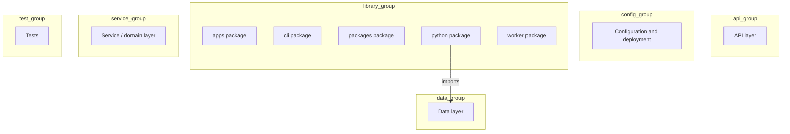

# Architecture report: AhmadHassan-BTed/Jantt

> Automated static analysis. **Observed** = directly seen in files/imports/AST; **Inferred** = interpretation from that evidence. Repository code was not executed.

## 1. Repository at a glance

| Item | Value |
| --- | --- |
| Repository | AhmadHassan-BTed/Jantt |
| Description | The AI-native JSON Gantt chart engine. Dependency-free interactive timelines with React, script-tag, CLI, topological DAG solver, and formal JSON schema. |
| Language | TypeScript |
| Stars | 6225 |
| Licence | MIT |
| Analysed commit / branch | 52ec345e0e5778dd23585aa5fb9c944bab31b363 / main |
| Framework(s) | React, Svelte, Vue |
| Files analysed | 345 |
| Components | 10 |

## 2. Architecture in one minute

AhmadHassan-BTed/Jantt - The AI-native JSON Gantt chart engine. Dependency-free interactive timelines with React, script-tag, CLI, topological DAG solver, and formal JSON schema.. This repository was analysed statically from 345 file(s) (5 Python). Detected technologies (observed from imports/manifests): GitHub Actions, React, Svelte, Vue, pandas, Poetry. Files are grouped into 10 component(s): API layer, apps package, cli package, Configuration and deployment, Data layer, packages package, python package, Service / domain layer. Findings below distinguish observed facts from inferred interpretation.

## 3. High-level block diagram

## 4. Main components

### API layer (`api_layer`)

- **Kind:** api
- **Status:** Observed
- **Confidence:** 0.85
- **Responsibility:** Groups 16 file(s) under api layer (observed from repository paths and static analysis).
- **Paths:** `apps/playground/src/components/views/BudgetKpiView.tsx`, `apps/playground/src/components/views/CanvasView.tsx`, `apps/playground/src/components/views/EvmKpiCards.tsx`, `apps/playground/src/components/views/EvmSCurveChart.tsx`, `apps/playground/src/components/views/KanbanView.tsx`, `apps/playground/src/components/views/NotesView.tsx`, `apps/playground/src/components/views/ScheduleHealthCard.tsx`, `apps/playground/src/components/views/TasksView.tsx`, `apps/playground/src/components/views/ViewRouter.tsx`, `apps/playground/src/components/views/index.ts`, `apps/playground/src/components/views/notes/AttachedTasksDrawer.tsx`, `apps/playground/src/components/views/notes/NoteEditor.tsx`, `apps/playground/src/components/views/notes/NotesSidebar.tsx`, `apps/playground/src/components/views/notes/index.ts`, `apps/playground/src/components/views/notes/note-markdown.ts`, `apps/playground/src/components/views/notes/useNoteMentionEngine.ts`
- **Evidence:** [apps/playground/src/components/views/BudgetKpiView.tsx](https://github.com/AhmadHassan-BTed/Jantt/blob/52ec345e0e5778dd23585aa5fb9c944bab31b363/apps/playground/src/components/views/BudgetKpiView.tsx); [apps/playground/src/components/views/CanvasView.tsx](https://github.com/AhmadHassan-BTed/Jantt/blob/52ec345e0e5778dd23585aa5fb9c944bab31b363/apps/playground/src/components/views/CanvasView.tsx); [apps/playground/src/components/views/EvmKpiCards.tsx](https://github.com/AhmadHassan-BTed/Jantt/blob/52ec345e0e5778dd23585aa5fb9c944bab31b363/apps/playground/src/components/views/EvmKpiCards.tsx); [apps/playground/src/components/views/EvmSCurveChart.tsx](https://github.com/AhmadHassan-BTed/Jantt/blob/52ec345e0e5778dd23585aa5fb9c944bab31b363/apps/playground/src/components/views/EvmSCurveChart.tsx); [apps/playground/src/components/views/KanbanView.tsx](https://github.com/AhmadHassan-BTed/Jantt/blob/52ec345e0e5778dd23585aa5fb9c944bab31b363/apps/playground/src/components/views/KanbanView.tsx); [apps/playground/src/components/views/NotesView.tsx](https://github.com/AhmadHassan-BTed/Jantt/blob/52ec345e0e5778dd23585aa5fb9c944bab31b363/apps/playground/src/components/views/NotesView.tsx); [apps/playground/src/components/views/ScheduleHealthCard.tsx](https://github.com/AhmadHassan-BTed/Jantt/blob/52ec345e0e5778dd23585aa5fb9c944bab31b363/apps/playground/src/components/views/ScheduleHealthCard.tsx); [apps/playground/src/components/views/TasksView.tsx](https://github.com/AhmadHassan-BTed/Jantt/blob/52ec345e0e5778dd23585aa5fb9c944bab31b363/apps/playground/src/components/views/TasksView.tsx)

### apps package (`apps`)

- **Kind:** library
- **Status:** Observed
- **Confidence:** 0.85
- **Responsibility:** Groups 74 file(s) under apps package (observed from repository paths and static analysis).
- **Paths:** `apps/playground/src/App.tsx`, `apps/playground/src/components/cloud/CloudRoomModal.tsx`, `apps/playground/src/components/cloud/GitHubVerificationModal.tsx`, `apps/playground/src/components/cloud/ShareRoomModal.tsx`, `apps/playground/src/components/cloud/UserHubModal.tsx`, `apps/playground/src/components/cloud/UsernameOnboardingModal.tsx`, `apps/playground/src/components/cloud/index.ts`, `apps/playground/src/components/common/CommandPalette.tsx`, `apps/playground/src/components/common/EmptyChartState.tsx`, `apps/playground/src/components/common/JanttLogo.tsx`, `apps/playground/src/components/common/Toast.tsx`, `apps/playground/src/components/common/index.ts`, `apps/playground/src/components/index.ts`, `apps/playground/src/components/layout/CloudBar.tsx`, `apps/playground/src/components/layout/DateFilterBar.tsx`, `apps/playground/src/components/layout/EditorPane.tsx`, `apps/playground/src/components/layout/MobileActionMenuSheet.tsx`, `apps/playground/src/components/layout/MobileBottomNav.tsx`, `apps/playground/src/components/layout/MobileNavbar.tsx`, `apps/playground/src/components/layout/Navbar.tsx`, `apps/playground/src/components/layout/OrientationBanner.tsx`, `apps/playground/src/components/layout/Subheader.tsx`, `apps/playground/src/components/layout/index.ts`, `apps/playground/src/components/modals/AddPlanModal.tsx`, `apps/playground/src/components/modals/AutoSaveModal.tsx`, `apps/playground/src/components/modals/EditorLoginModal.tsx`, `apps/playground/src/components/modals/ModalHost.tsx`, `apps/playground/src/components/modals/MonteCarloModal.tsx`, `apps/playground/src/components/modals/PeopleTeamsModal.tsx`, `apps/playground/src/components/modals/PlanManagerModal.tsx`, `apps/playground/src/components/modals/PromptModal.tsx`, `apps/playground/src/components/modals/ReadOnlyForkModal.tsx`, `apps/playground/src/components/modals/ShareModal.tsx`, `apps/playground/src/components/modals/ShortcutsModal.tsx`, `apps/playground/src/components/modals/VersionHistoryModal.tsx`, `apps/playground/src/components/modals/index.ts`, `apps/playground/src/constants.ts`, `apps/playground/src/context/ModalContext.tsx`, `apps/playground/src/context/index.ts`, `apps/playground/src/firebase/authService.ts`, `apps/playground/src/firebase/dtos/PresenceDto.ts`, `apps/playground/src/firebase/dtos/RoomDto.ts`, `apps/playground/src/firebase/dtos/RtdbCodec.ts`, `apps/playground/src/firebase/dtos/TransactionDto.ts`, `apps/playground/src/firebase/dtos/UserDto.ts`, `apps/playground/src/firebase/dtos/index.ts`, `apps/playground/src/firebase/firebaseConfig.ts`, `apps/playground/src/firebase/githubVerificationService.ts`, `apps/playground/src/firebase/index.ts`, `apps/playground/src/firebase/presenceService.ts`, `apps/playground/src/firebase/roomService.ts`, `apps/playground/src/firebase/types.ts`, `apps/playground/src/hooks/useAuth.ts`, `apps/playground/src/hooks/useAutoSave.ts`, `apps/playground/src/hooks/useDateFilter.ts`, `apps/playground/src/hooks/useDynamicSync.ts`, `apps/playground/src/hooks/useEditorState.ts`, `apps/playground/src/hooks/useGanttViewport.ts`, `apps/playground/src/hooks/useMobileDetection.ts`, `apps/playground/src/hooks/usePeopleTeams.ts`, `apps/playground/src/hooks/useProjectState.ts`, `apps/playground/src/hooks/useRoomSync.ts`, `apps/playground/src/hooks/useSharing.ts`, `apps/playground/src/hooks/useSidebarResize.ts`, `apps/playground/src/hooks/useSnapshotVault.ts`, `apps/playground/src/hooks/useTaskActions.ts`, `apps/playground/src/hooks/useTaskDetailSidebar.ts`, `apps/playground/src/hooks/useToast.ts`, `apps/playground/src/hooks/useUndoRedo.ts`, `apps/playground/src/main.tsx`, `apps/playground/src/room-storage.ts`, `apps/playground/src/types.ts`, `apps/playground/src/utils.ts`, `apps/playground/vite.config.ts`
- **Evidence:** [apps/playground/src/App.tsx](https://github.com/AhmadHassan-BTed/Jantt/blob/52ec345e0e5778dd23585aa5fb9c944bab31b363/apps/playground/src/App.tsx); [apps/playground/src/components/cloud/CloudRoomModal.tsx](https://github.com/AhmadHassan-BTed/Jantt/blob/52ec345e0e5778dd23585aa5fb9c944bab31b363/apps/playground/src/components/cloud/CloudRoomModal.tsx); [apps/playground/src/components/cloud/GitHubVerificationModal.tsx](https://github.com/AhmadHassan-BTed/Jantt/blob/52ec345e0e5778dd23585aa5fb9c944bab31b363/apps/playground/src/components/cloud/GitHubVerificationModal.tsx); [apps/playground/src/components/cloud/ShareRoomModal.tsx](https://github.com/AhmadHassan-BTed/Jantt/blob/52ec345e0e5778dd23585aa5fb9c944bab31b363/apps/playground/src/components/cloud/ShareRoomModal.tsx); [apps/playground/src/components/cloud/UserHubModal.tsx](https://github.com/AhmadHassan-BTed/Jantt/blob/52ec345e0e5778dd23585aa5fb9c944bab31b363/apps/playground/src/components/cloud/UserHubModal.tsx); [apps/playground/src/components/cloud/UsernameOnboardingModal.tsx](https://github.com/AhmadHassan-BTed/Jantt/blob/52ec345e0e5778dd23585aa5fb9c944bab31b363/apps/playground/src/components/cloud/UsernameOnboardingModal.tsx); [apps/playground/src/components/cloud/index.ts](https://github.com/AhmadHassan-BTed/Jantt/blob/52ec345e0e5778dd23585aa5fb9c944bab31b363/apps/playground/src/components/cloud/index.ts); [apps/playground/src/components/common/CommandPalette.tsx](https://github.com/AhmadHassan-BTed/Jantt/blob/52ec345e0e5778dd23585aa5fb9c944bab31b363/apps/playground/src/components/common/CommandPalette.tsx)

### cli package (`cli`)

- **Kind:** library
- **Status:** Observed
- **Confidence:** 0.85
- **Responsibility:** Groups 1 file(s) under cli package (observed from repository paths and static analysis).
- **Paths:** `cli/bin/jantt.js`
- **Evidence:** [cli/bin/jantt.js](https://github.com/AhmadHassan-BTed/Jantt/blob/52ec345e0e5778dd23585aa5fb9c944bab31b363/cli/bin/jantt.js)

### Configuration and deployment (`config`)

- **Kind:** config
- **Status:** Observed
- **Confidence:** 0.85
- **Responsibility:** Groups 31 file(s) under configuration and deployment (observed from repository paths and static analysis).
- **Paths:** `Dockerfile`, `apps/playground/package.json`, `apps/playground/public/schema/v1.json`, `apps/playground/tsconfig.json`, `cli/package.json`, `database.rules.json`, `docker-compose.yml`, `firebase.json`, `package.json`, `packages/core/package.json`, `packages/core/tsconfig.json`, `packages/elements/package.json`, `packages/elements/tsconfig.json`, `packages/interop/package.json`, `packages/interop/tsconfig.json`, `packages/mcp/package.json`, `packages/mcp/tsconfig.json`, `packages/react/package.json`, `packages/react/tsconfig.json`, `packages/render-canvas/package.json`, `packages/render-canvas/tsconfig.json`, `packages/standalone/package.json`, `packages/svelte/package.json`, `packages/svelte/tsconfig.json`, `packages/vue/package.json`, `packages/vue/tsconfig.json`, `packages/yjs/package.json`, `packages/yjs/tsconfig.json`, `python/pyproject.toml`, `schema/jantt.schema.json`, `worker/wrangler.toml`
- **Evidence:** [Dockerfile](https://github.com/AhmadHassan-BTed/Jantt/blob/52ec345e0e5778dd23585aa5fb9c944bab31b363/Dockerfile); [apps/playground/package.json](https://github.com/AhmadHassan-BTed/Jantt/blob/52ec345e0e5778dd23585aa5fb9c944bab31b363/apps/playground/package.json); [apps/playground/public/schema/v1.json](https://github.com/AhmadHassan-BTed/Jantt/blob/52ec345e0e5778dd23585aa5fb9c944bab31b363/apps/playground/public/schema/v1.json); [apps/playground/tsconfig.json](https://github.com/AhmadHassan-BTed/Jantt/blob/52ec345e0e5778dd23585aa5fb9c944bab31b363/apps/playground/tsconfig.json); [cli/package.json](https://github.com/AhmadHassan-BTed/Jantt/blob/52ec345e0e5778dd23585aa5fb9c944bab31b363/cli/package.json); [database.rules.json](https://github.com/AhmadHassan-BTed/Jantt/blob/52ec345e0e5778dd23585aa5fb9c944bab31b363/database.rules.json); [docker-compose.yml](https://github.com/AhmadHassan-BTed/Jantt/blob/52ec345e0e5778dd23585aa5fb9c944bab31b363/docker-compose.yml); [firebase.json](https://github.com/AhmadHassan-BTed/Jantt/blob/52ec345e0e5778dd23585aa5fb9c944bab31b363/firebase.json)

### Data layer (`data_layer`)

- **Kind:** data
- **Status:** Observed
- **Confidence:** 0.85
- **Responsibility:** Groups 6 file(s) under data layer (observed from repository paths and static analysis). Observed top-level classes: JanttPlan, Task.
- **Paths:** `apps/playground/src/services/storage/index.ts`, `apps/playground/src/services/storage/local-storage-service.ts`, `apps/playground/src/services/storage/memory-storage-service.ts`, `apps/playground/src/services/storage/storage-contracts.ts`, `apps/playground/src/services/storage/storage.test.ts`, `python/src/jantt/models.py`
- **Evidence:** [apps/playground/src/services/storage/index.ts](https://github.com/AhmadHassan-BTed/Jantt/blob/52ec345e0e5778dd23585aa5fb9c944bab31b363/apps/playground/src/services/storage/index.ts); [apps/playground/src/services/storage/local-storage-service.ts](https://github.com/AhmadHassan-BTed/Jantt/blob/52ec345e0e5778dd23585aa5fb9c944bab31b363/apps/playground/src/services/storage/local-storage-service.ts); [apps/playground/src/services/storage/memory-storage-service.ts](https://github.com/AhmadHassan-BTed/Jantt/blob/52ec345e0e5778dd23585aa5fb9c944bab31b363/apps/playground/src/services/storage/memory-storage-service.ts); [apps/playground/src/services/storage/storage-contracts.ts](https://github.com/AhmadHassan-BTed/Jantt/blob/52ec345e0e5778dd23585aa5fb9c944bab31b363/apps/playground/src/services/storage/storage-contracts.ts); [apps/playground/src/services/storage/storage.test.ts](https://github.com/AhmadHassan-BTed/Jantt/blob/52ec345e0e5778dd23585aa5fb9c944bab31b363/apps/playground/src/services/storage/storage.test.ts); [python/src/jantt/models.py:13](https://github.com/AhmadHassan-BTed/Jantt/blob/52ec345e0e5778dd23585aa5fb9c944bab31b363/python/src/jantt/models.py#L13)

### packages package (`packages`)

- **Kind:** library
- **Status:** Observed
- **Confidence:** 0.85
- **Responsibility:** Groups 24 file(s) under packages package (observed from repository paths and static analysis).
- **Paths:** `packages/elements/src/index.ts`, `packages/elements/vite.config.ts`, `packages/interop/src/index.ts`, `packages/interop/src/ms-project.ts`, `packages/interop/src/primavera.ts`, `packages/interop/src/report.ts`, `packages/interop/src/spreadsheet.ts`, `packages/mcp/bin/jantt-mcp.js`, `packages/mcp/src/index.ts`, `packages/react/src/Jantt.tsx`, `packages/react/src/Logo.tsx`, `packages/react/src/index.ts`, `packages/react/vite.config.ts`, `packages/render-canvas/src/canvas-renderer.ts`, `packages/render-canvas/src/index.ts`, `packages/render-canvas/src/spatial-grid.ts`, `packages/standalone/src/standalone.ts`, `packages/standalone/vite.config.ts`, `packages/svelte/src/index.ts`, `packages/svelte/vite.config.ts`, `packages/vue/src/index.ts`, `packages/vue/vite.config.ts`, `packages/yjs/src/index.ts`, `packages/yjs/vite.config.ts`
- **Evidence:** [packages/elements/src/index.ts](https://github.com/AhmadHassan-BTed/Jantt/blob/52ec345e0e5778dd23585aa5fb9c944bab31b363/packages/elements/src/index.ts); [packages/elements/vite.config.ts](https://github.com/AhmadHassan-BTed/Jantt/blob/52ec345e0e5778dd23585aa5fb9c944bab31b363/packages/elements/vite.config.ts); [packages/interop/src/index.ts](https://github.com/AhmadHassan-BTed/Jantt/blob/52ec345e0e5778dd23585aa5fb9c944bab31b363/packages/interop/src/index.ts); [packages/interop/src/ms-project.ts](https://github.com/AhmadHassan-BTed/Jantt/blob/52ec345e0e5778dd23585aa5fb9c944bab31b363/packages/interop/src/ms-project.ts); [packages/interop/src/primavera.ts](https://github.com/AhmadHassan-BTed/Jantt/blob/52ec345e0e5778dd23585aa5fb9c944bab31b363/packages/interop/src/primavera.ts); [packages/interop/src/report.ts](https://github.com/AhmadHassan-BTed/Jantt/blob/52ec345e0e5778dd23585aa5fb9c944bab31b363/packages/interop/src/report.ts); [packages/interop/src/spreadsheet.ts](https://github.com/AhmadHassan-BTed/Jantt/blob/52ec345e0e5778dd23585aa5fb9c944bab31b363/packages/interop/src/spreadsheet.ts); [packages/mcp/bin/jantt-mcp.js](https://github.com/AhmadHassan-BTed/Jantt/blob/52ec345e0e5778dd23585aa5fb9c944bab31b363/packages/mcp/bin/jantt-mcp.js)

### python package (`python`)

- **Kind:** library
- **Status:** Observed
- **Confidence:** 0.85
- **Responsibility:** Groups 3 file(s) under python package (observed from repository paths and static analysis). Observed top-level functions: _format_date, from_dataframe, from_records, show, streamlit, to_dataframe.
- **Paths:** `python/src/jantt/__init__.py`, `python/src/jantt/converter.py`, `python/src/jantt/render.py`
- **Evidence:** [python/src/jantt/__init__.py](https://github.com/AhmadHassan-BTed/Jantt/blob/52ec345e0e5778dd23585aa5fb9c944bab31b363/python/src/jantt/__init__.py); [python/src/jantt/converter.py:12](https://github.com/AhmadHassan-BTed/Jantt/blob/52ec345e0e5778dd23585aa5fb9c944bab31b363/python/src/jantt/converter.py#L12); [python/src/jantt/render.py:14](https://github.com/AhmadHassan-BTed/Jantt/blob/52ec345e0e5778dd23585aa5fb9c944bab31b363/python/src/jantt/render.py#L14)

### Service / domain layer (`service_layer`)

- **Kind:** service
- **Status:** Observed
- **Confidence:** 0.85
- **Responsibility:** Groups 83 file(s) under service / domain layer (observed from repository paths and static analysis).
- **Paths:** `apps/playground/src/services/bus/command-bus.ts`, `apps/playground/src/services/bus/index.ts`, `apps/playground/src/services/index.ts`, `apps/playground/src/services/query/contracts.ts`, `apps/playground/src/services/query/filters/assignee-filter-stage.ts`, `apps/playground/src/services/query/filters/completion-filter-stage.ts`, `apps/playground/src/services/query/filters/date-filter-stage.ts`, `apps/playground/src/services/query/filters/search-query-filter-stage.ts`, `apps/playground/src/services/query/index.ts`, `apps/playground/src/services/query/task-query-pipeline.ts`, `packages/core/src/baselines.ts`, `packages/core/src/calendar.ts`, `packages/core/src/constants.ts`, `packages/core/src/controller.ts`, `packages/core/src/controller/contracts.ts`, `packages/core/src/controller/index.ts`, `packages/core/src/controller/strategies/link-gesture.ts`, `packages/core/src/controller/strategies/marquee-gesture.ts`, `packages/core/src/controller/strategies/move-gesture.ts`, `packages/core/src/controller/strategies/pan-gesture.ts`, `packages/core/src/controller/strategies/progress-gesture.ts`, `packages/core/src/controller/strategies/resize-gesture.ts`, `packages/core/src/controller/strategies/splitter-gesture.ts`, `packages/core/src/cpm.ts`, `packages/core/src/date-math.ts`, `packages/core/src/dependencies.ts`, `packages/core/src/detail-modal.ts`, `packages/core/src/evm.ts`, `packages/core/src/exporter.ts`, `packages/core/src/firebase-sync.ts`, `packages/core/src/index.ts`, `packages/core/src/layout.ts`, `packages/core/src/monte-carlo.ts`, `packages/core/src/pert.ts`, `packages/core/src/pipeline/contracts.ts`, `packages/core/src/pipeline/index.ts`, `packages/core/src/pipeline/schedule-pipeline.ts`, `packages/core/src/pipeline/stages/cascade-resolve-stage.ts`, `packages/core/src/pipeline/stages/critical-path-stage.ts`, `packages/core/src/pipeline/stages/cycle-guard-stage.ts`, `packages/core/src/pipeline/stages/sanitize-stage.ts`, `packages/core/src/reconciler.ts`, `packages/core/src/reconciliation/crdt-hash.ts`, `packages/core/src/reconciliation/index.ts`, `packages/core/src/reconciliation/plan-reconciler.ts`, `packages/core/src/reconciliation/task-merger.ts`, `packages/core/src/reconciliation/timestamps.ts`, `packages/core/src/remote-sync.ts`, `packages/core/src/renderer.ts`, `packages/core/src/renderers/dependency-links.ts`, `packages/core/src/renderers/grid-table.ts`, `packages/core/src/renderers/index.ts`, `packages/core/src/renderers/task-bars.ts`, `packages/core/src/renderers/timeline-grid.ts`, `packages/core/src/renderers/timeline-header.ts`, `packages/core/src/renderers/toolbar.ts`, `packages/core/src/renderers/tooltip.ts`, `packages/core/src/rendering/index.ts`, `packages/core/src/rendering/jantt-engine.ts`, `packages/core/src/rendering/task-schedule-coordinator.ts`, `packages/core/src/rendering/viewport-coordinator.ts`, `packages/core/src/resolver.ts`, `packages/core/src/resource-leveler.ts`, `packages/core/src/schedule-health.ts`, `packages/core/src/share-coder.ts`, `packages/core/src/sidebar.ts`, `packages/core/src/team-resolver.ts`, `packages/core/src/themes/beenie.ts`, `packages/core/src/themes/cyber-emerald.ts`, `packages/core/src/themes/index.ts`, `packages/core/src/themes/manager.ts`, `packages/core/src/themes/midnight-rose.ts`, `packages/core/src/themes/nordic-frost.ts`, `packages/core/src/themes/sunset-crimson.ts`, `packages/core/src/themes/swiss-dark.ts`, `packages/core/src/themes/swiss-light.ts`, `packages/core/src/themes/types.ts`, `packages/core/src/types.ts`, `packages/core/src/utils.ts`, `packages/core/src/validator.ts`, `packages/core/src/virtualizer.ts`, `packages/core/src/worker.ts`, `packages/core/vite.config.ts`
- **Evidence:** [apps/playground/src/services/bus/command-bus.ts](https://github.com/AhmadHassan-BTed/Jantt/blob/52ec345e0e5778dd23585aa5fb9c944bab31b363/apps/playground/src/services/bus/command-bus.ts); [apps/playground/src/services/bus/index.ts](https://github.com/AhmadHassan-BTed/Jantt/blob/52ec345e0e5778dd23585aa5fb9c944bab31b363/apps/playground/src/services/bus/index.ts); [apps/playground/src/services/index.ts](https://github.com/AhmadHassan-BTed/Jantt/blob/52ec345e0e5778dd23585aa5fb9c944bab31b363/apps/playground/src/services/index.ts); [apps/playground/src/services/query/contracts.ts](https://github.com/AhmadHassan-BTed/Jantt/blob/52ec345e0e5778dd23585aa5fb9c944bab31b363/apps/playground/src/services/query/contracts.ts); [apps/playground/src/services/query/filters/assignee-filter-stage.ts](https://github.com/AhmadHassan-BTed/Jantt/blob/52ec345e0e5778dd23585aa5fb9c944bab31b363/apps/playground/src/services/query/filters/assignee-filter-stage.ts); [apps/playground/src/services/query/filters/completion-filter-stage.ts](https://github.com/AhmadHassan-BTed/Jantt/blob/52ec345e0e5778dd23585aa5fb9c944bab31b363/apps/playground/src/services/query/filters/completion-filter-stage.ts); [apps/playground/src/services/query/filters/date-filter-stage.ts](https://github.com/AhmadHassan-BTed/Jantt/blob/52ec345e0e5778dd23585aa5fb9c944bab31b363/apps/playground/src/services/query/filters/date-filter-stage.ts); [apps/playground/src/services/query/filters/search-query-filter-stage.ts](https://github.com/AhmadHassan-BTed/Jantt/blob/52ec345e0e5778dd23585aa5fb9c944bab31b363/apps/playground/src/services/query/filters/search-query-filter-stage.ts)

### Tests (`tests`)

- **Kind:** test
- **Status:** Observed
- **Confidence:** 0.85
- **Responsibility:** Groups 41 file(s) under tests (observed from repository paths and static analysis). Observed top-level classes: TestJanttPython.
- **Paths:** `cli/tests/cli.test.ts`, `packages/core/tests/baselines.test.ts`, `packages/core/tests/calendar.test.ts`, `packages/core/tests/date-math.test.ts`, `packages/core/tests/dependencies.test.ts`, `packages/core/tests/exporter.test.ts`, `packages/core/tests/firebase-sync.test.ts`, `packages/core/tests/gesture-strategies.test.ts`, `packages/core/tests/integration.test.ts`, `packages/core/tests/layout.test.ts`, `packages/core/tests/monte-carlo.test.ts`, `packages/core/tests/multi-deps-and-themes.test.ts`, `packages/core/tests/notes.test.ts`, `packages/core/tests/pm-analytics.test.ts`, `packages/core/tests/reconciler.test.ts`, `packages/core/tests/remote-sync.test.ts`, `packages/core/tests/resolver.test.ts`, `packages/core/tests/resource-leveler.test.ts`, `packages/core/tests/room-notes-sync.test.ts`, `packages/core/tests/room-security-and-roles.test.ts`, `packages/core/tests/rtdb-codec.test.ts`, `packages/core/tests/schedule-pipeline.test.ts`, `packages/core/tests/share-coder.test.ts`, `packages/core/tests/team-resolver.test.ts`, `packages/core/tests/timeline-header.test.ts`, `packages/core/tests/touch-interaction.test.ts`, `packages/core/tests/utils.test.ts`, `packages/core/tests/validator.test.ts`, `packages/core/tests/virtualizer.test.ts`, `packages/core/tests/worker.test.ts`, `packages/elements/tests/elements.test.ts`, `packages/interop/tests/ms-project.test.ts`, `packages/interop/tests/primavera.test.ts`, `packages/interop/tests/spreadsheet.test.ts`, `packages/interop/tests/vector-report.test.ts`, `packages/mcp/tests/mcp-server.test.ts`, `packages/render-canvas/tests/canvas-renderer.test.ts`, `packages/svelte/tests/svelte.test.ts`, `packages/vue/tests/vue.test.ts`, `packages/yjs/tests/yjs-binding.test.ts`, `python/tests/test_jantt.py`
- **Evidence:** [cli/tests/cli.test.ts](https://github.com/AhmadHassan-BTed/Jantt/blob/52ec345e0e5778dd23585aa5fb9c944bab31b363/cli/tests/cli.test.ts); [packages/core/tests/baselines.test.ts](https://github.com/AhmadHassan-BTed/Jantt/blob/52ec345e0e5778dd23585aa5fb9c944bab31b363/packages/core/tests/baselines.test.ts); [packages/core/tests/calendar.test.ts](https://github.com/AhmadHassan-BTed/Jantt/blob/52ec345e0e5778dd23585aa5fb9c944bab31b363/packages/core/tests/calendar.test.ts); [packages/core/tests/date-math.test.ts](https://github.com/AhmadHassan-BTed/Jantt/blob/52ec345e0e5778dd23585aa5fb9c944bab31b363/packages/core/tests/date-math.test.ts); [packages/core/tests/dependencies.test.ts](https://github.com/AhmadHassan-BTed/Jantt/blob/52ec345e0e5778dd23585aa5fb9c944bab31b363/packages/core/tests/dependencies.test.ts); [packages/core/tests/exporter.test.ts](https://github.com/AhmadHassan-BTed/Jantt/blob/52ec345e0e5778dd23585aa5fb9c944bab31b363/packages/core/tests/exporter.test.ts); [packages/core/tests/firebase-sync.test.ts](https://github.com/AhmadHassan-BTed/Jantt/blob/52ec345e0e5778dd23585aa5fb9c944bab31b363/packages/core/tests/firebase-sync.test.ts); [packages/core/tests/gesture-strategies.test.ts](https://github.com/AhmadHassan-BTed/Jantt/blob/52ec345e0e5778dd23585aa5fb9c944bab31b363/packages/core/tests/gesture-strategies.test.ts)

### worker package (`worker`)

- **Kind:** library
- **Status:** Observed
- **Confidence:** 0.85
- **Responsibility:** Groups 1 file(s) under worker package (observed from repository paths and static analysis).
- **Paths:** `worker/src/worker.js`
- **Evidence:** [worker/src/worker.js](https://github.com/AhmadHassan-BTed/Jantt/blob/52ec345e0e5778dd23585aa5fb9c944bab31b363/worker/src/worker.js)

## 5. Execution flow

**Observed** entry point(s):

- [apps/playground/src/App.tsx](https://github.com/AhmadHassan-BTed/Jantt/blob/52ec345e0e5778dd23585aa5fb9c944bab31b363/apps/playground/src/App.tsx)
- [apps/playground/src/main.tsx](https://github.com/AhmadHassan-BTed/Jantt/blob/52ec345e0e5778dd23585aa5fb9c944bab31b363/apps/playground/src/main.tsx)
- [cli/bin/jantt.js](https://github.com/AhmadHassan-BTed/Jantt/blob/52ec345e0e5778dd23585aa5fb9c944bab31b363/cli/bin/jantt.js)
- [packages/core/src/index.ts](https://github.com/AhmadHassan-BTed/Jantt/blob/52ec345e0e5778dd23585aa5fb9c944bab31b363/packages/core/src/index.ts)
- [packages/elements/src/index.ts](https://github.com/AhmadHassan-BTed/Jantt/blob/52ec345e0e5778dd23585aa5fb9c944bab31b363/packages/elements/src/index.ts)
- [packages/interop/src/index.ts](https://github.com/AhmadHassan-BTed/Jantt/blob/52ec345e0e5778dd23585aa5fb9c944bab31b363/packages/interop/src/index.ts)
- [packages/mcp/bin/jantt-mcp.js](https://github.com/AhmadHassan-BTed/Jantt/blob/52ec345e0e5778dd23585aa5fb9c944bab31b363/packages/mcp/bin/jantt-mcp.js)
- [packages/mcp/src/index.ts](https://github.com/AhmadHassan-BTed/Jantt/blob/52ec345e0e5778dd23585aa5fb9c944bab31b363/packages/mcp/src/index.ts)
- [packages/react/src/index.ts](https://github.com/AhmadHassan-BTed/Jantt/blob/52ec345e0e5778dd23585aa5fb9c944bab31b363/packages/react/src/index.ts)
- [packages/render-canvas/src/index.ts](https://github.com/AhmadHassan-BTed/Jantt/blob/52ec345e0e5778dd23585aa5fb9c944bab31b363/packages/render-canvas/src/index.ts)
- [packages/svelte/src/index.ts](https://github.com/AhmadHassan-BTed/Jantt/blob/52ec345e0e5778dd23585aa5fb9c944bab31b363/packages/svelte/src/index.ts)
- [packages/vue/src/index.ts](https://github.com/AhmadHassan-BTed/Jantt/blob/52ec345e0e5778dd23585aa5fb9c944bab31b363/packages/vue/src/index.ts)

Representative flow (derived from observed entry points and the import graph; steps beyond the entry point are **Inferred**):

1. Execution starts at an observed entry point listed above, if present.
2. `python` imports `data_layer` (python package -> Data layer).

## 6. Project structure

### `(root)`

- `.editorconfig` - config (256 bytes)
- `.env.example` - config (581 bytes)
- `.gitattributes` - other (355 bytes)
- `.gitignore` - other (486 bytes)
- `CHANGELOG.md` - docs (13451 bytes)
- `CODE_OF_CONDUCT.md` - docs (3183 bytes)
- `CONTRIBUTING.md` - docs (3701 bytes)
- `Dockerfile` - container (1203 bytes)
- `LICENSE` - docs (1098 bytes)
- `Makefile` - other (1261 bytes)
- `README.md` - docs (40976 bytes)
- `ROADMAP.md` - docs (4301 bytes)
- `SECURITY.md` - docs (1707 bytes)
- `SUPPORT.md` - docs (1301 bytes)
- `changes_required.md` - docs (610 bytes)
- `database.rules.json` - config (3463 bytes)
- `docker-compose.yml` - container (440 bytes)
- `firebase.json` - config (59 bytes)
- `package.json` - manifest (1384 bytes)

### `.github`

- `.github/ISSUE_TEMPLATE/bug_report.yml` - config (1566 bytes)
- `.github/ISSUE_TEMPLATE/config.yml` - config (405 bytes)
- `.github/ISSUE_TEMPLATE/feature_request.yml` - config (983 bytes)
- `.github/PULL_REQUEST_TEMPLATE.md` - docs (910 bytes)
- `.github/workflows/ci.yml` - ci, YAML (1034 bytes)
- `.github/workflows/deploy-pages.yml` - ci, YAML (1222 bytes)
- `.github/workflows/release.yml` - ci, YAML (980 bytes)
- `.github/workflows/security.yml` - ci, YAML (979 bytes)

### `.vscode`

- `.vscode/settings.json` - config (433 bytes)

### `apps`

- `apps/playground/.gitignore` - other (27 bytes)
- `apps/playground/README.md` - docs (2920 bytes)
- `apps/playground/index.html` - other (5286 bytes)
- `apps/playground/package.json` - manifest (644 bytes)
- `apps/playground/public/favicon.svg` - other (1137 bytes)
- `apps/playground/public/schema/v1.json` - config (9328 bytes)
- `apps/playground/src/App.tsx` - source, TypeScript (41881 bytes)
- `apps/playground/src/components/cloud/CloudRoomModal.tsx` - source, TypeScript (30805 bytes)
- `apps/playground/src/components/cloud/GitHubVerificationModal.tsx` - source, TypeScript (24556 bytes)
- `apps/playground/src/components/cloud/ShareRoomModal.tsx` - source, TypeScript (41318 bytes)
- `apps/playground/src/components/cloud/UserHubModal.tsx` - source, TypeScript (20773 bytes)
- `apps/playground/src/components/cloud/UsernameOnboardingModal.tsx` - source, TypeScript (8413 bytes)
- `apps/playground/src/components/cloud/index.ts` - source, TypeScript (186 bytes)
- `apps/playground/src/components/common/CommandPalette.tsx` - source, TypeScript (21236 bytes)
- `apps/playground/src/components/common/EmptyChartState.tsx` - source, TypeScript (746 bytes)
- `apps/playground/src/components/common/JanttLogo.tsx` - source, TypeScript (7145 bytes)
- `apps/playground/src/components/common/Toast.tsx` - source, TypeScript (1024 bytes)
- `apps/playground/src/components/common/index.ts` - source, TypeScript (123 bytes)
- `apps/playground/src/components/index.ts` - source, TypeScript (627 bytes)
- `apps/playground/src/components/layout/CloudBar.tsx` - source, TypeScript (9469 bytes)
- `apps/playground/src/components/layout/DateFilterBar.tsx` - source, TypeScript (10779 bytes)
- `apps/playground/src/components/layout/EditorPane.tsx` - source, TypeScript (15114 bytes)
- `apps/playground/src/components/layout/MobileActionMenuSheet.tsx` - source, TypeScript (9866 bytes)
- `apps/playground/src/components/layout/MobileBottomNav.tsx` - source, TypeScript (2196 bytes)
- `apps/playground/src/components/layout/MobileNavbar.tsx` - source, TypeScript (7758 bytes)
- `apps/playground/src/components/layout/Navbar.tsx` - source, TypeScript (17166 bytes)
- `apps/playground/src/components/layout/OrientationBanner.tsx` - source, TypeScript (1616 bytes)
- `apps/playground/src/components/layout/Subheader.tsx` - source, TypeScript (14476 bytes)
- `apps/playground/src/components/layout/index.ts` - source, TypeScript (291 bytes)
- `apps/playground/src/components/modals/AddPlanModal.tsx` - source, TypeScript (20989 bytes)
- `apps/playground/src/components/modals/AutoSaveModal.tsx` - source, TypeScript (10536 bytes)
- `apps/playground/src/components/modals/EditorLoginModal.tsx` - source, TypeScript (6109 bytes)
- `apps/playground/src/components/modals/ModalHost.tsx` - source, TypeScript (10043 bytes)
- `apps/playground/src/components/modals/MonteCarloModal.tsx` - source, TypeScript (15644 bytes)
- `apps/playground/src/components/modals/PeopleTeamsModal.tsx` - source, TypeScript (38235 bytes)
- `apps/playground/src/components/modals/PlanManagerModal.tsx` - source, TypeScript (48989 bytes)
- `apps/playground/src/components/modals/PromptModal.tsx` - source, TypeScript (12738 bytes)
- `apps/playground/src/components/modals/ReadOnlyForkModal.tsx` - source, TypeScript (5238 bytes)
- `apps/playground/src/components/modals/ShareModal.tsx` - source, TypeScript (32268 bytes)
- `apps/playground/src/components/modals/ShortcutsModal.tsx` - source, TypeScript (6811 bytes)
- `apps/playground/src/components/modals/VersionHistoryModal.tsx` - source, TypeScript (8767 bytes)
- `apps/playground/src/components/modals/index.ts` - source, TypeScript (408 bytes)
- `apps/playground/src/components/views/BudgetKpiView.tsx` - source, TypeScript (30973 bytes)
- `apps/playground/src/components/views/CanvasView.tsx` - source, TypeScript (18953 bytes)
- `apps/playground/src/components/views/EvmKpiCards.tsx` - source, TypeScript (12929 bytes)
- `apps/playground/src/components/views/EvmSCurveChart.tsx` - source, TypeScript (9854 bytes)
- `apps/playground/src/components/views/KanbanView.tsx` - source, TypeScript (14616 bytes)
- `apps/playground/src/components/views/NotesView.tsx` - source, TypeScript (12476 bytes)
- `apps/playground/src/components/views/ScheduleHealthCard.tsx` - source, TypeScript (7142 bytes)
- `apps/playground/src/components/views/TasksView.tsx` - source, TypeScript (24593 bytes)
- `apps/playground/src/components/views/ViewRouter.tsx` - source, TypeScript (9091 bytes)
- `apps/playground/src/components/views/index.ts` - source, TypeScript (220 bytes)
- `apps/playground/src/components/views/notes/AttachedTasksDrawer.tsx` - source, TypeScript (4819 bytes)
- `apps/playground/src/components/views/notes/NoteEditor.tsx` - source, TypeScript (10885 bytes)
- `apps/playground/src/components/views/notes/NotesSidebar.tsx` - source, TypeScript (6446 bytes)
- `apps/playground/src/components/views/notes/index.ts` - source, TypeScript (174 bytes)
- `apps/playground/src/components/views/notes/note-markdown.ts` - source, TypeScript (7989 bytes)
- `apps/playground/src/components/views/notes/useNoteMentionEngine.ts` - source, TypeScript (9358 bytes)
- `apps/playground/src/constants.ts` - source, TypeScript (2293 bytes)
- `apps/playground/src/context/ModalContext.tsx` - source, TypeScript (1583 bytes)
- `apps/playground/src/context/index.ts` - source, TypeScript (32 bytes)
- `apps/playground/src/firebase/authService.ts` - source, TypeScript (8028 bytes)
- `apps/playground/src/firebase/dtos/PresenceDto.ts` - source, TypeScript (915 bytes)
- `apps/playground/src/firebase/dtos/RoomDto.ts` - source, TypeScript (3534 bytes)
- `apps/playground/src/firebase/dtos/RtdbCodec.ts` - source, TypeScript (246 bytes)
- `apps/playground/src/firebase/dtos/TransactionDto.ts` - source, TypeScript (1055 bytes)
- `apps/playground/src/firebase/dtos/UserDto.ts` - source, TypeScript (2590 bytes)
- `apps/playground/src/firebase/dtos/index.ts` - source, TypeScript (322 bytes)
- `apps/playground/src/firebase/firebaseConfig.ts` - source, TypeScript (1171 bytes)
- `apps/playground/src/firebase/githubVerificationService.ts` - source, TypeScript (17527 bytes)
- `apps/playground/src/firebase/index.ts` - source, TypeScript (661 bytes)
- `apps/playground/src/firebase/presenceService.ts` - source, TypeScript (2432 bytes)
- `apps/playground/src/firebase/roomService.ts` - source, TypeScript (17131 bytes)
- `apps/playground/src/firebase/types.ts` - source, TypeScript (169 bytes)
- `apps/playground/src/hooks/useAuth.ts` - source, TypeScript (7585 bytes)
- `apps/playground/src/hooks/useAutoSave.ts` - source, TypeScript (6501 bytes)
- `apps/playground/src/hooks/useDateFilter.ts` - source, TypeScript (10318 bytes)
- `apps/playground/src/hooks/useDynamicSync.ts` - source, TypeScript (4215 bytes)
- `apps/playground/src/hooks/useEditorState.ts` - source, TypeScript (8299 bytes)
- `apps/playground/src/hooks/useGanttViewport.ts` - source, TypeScript (3322 bytes)
- `apps/playground/src/hooks/useMobileDetection.ts` - source, TypeScript (2268 bytes)
- `apps/playground/src/hooks/usePeopleTeams.ts` - source, TypeScript (6927 bytes)
- `apps/playground/src/hooks/useProjectState.ts` - source, TypeScript (20827 bytes)
- `apps/playground/src/hooks/useRoomSync.ts` - source, TypeScript (37608 bytes)
- `apps/playground/src/hooks/useSharing.ts` - source, TypeScript (6767 bytes)
- `apps/playground/src/hooks/useSidebarResize.ts` - source, TypeScript (1947 bytes)
- `apps/playground/src/hooks/useSnapshotVault.ts` - source, TypeScript (4459 bytes)
- `apps/playground/src/hooks/useTaskActions.ts` - source, TypeScript (8081 bytes)
- `apps/playground/src/hooks/useTaskDetailSidebar.ts` - source, TypeScript (3481 bytes)
- `apps/playground/src/hooks/useToast.ts` - source, TypeScript (642 bytes)
- `apps/playground/src/hooks/useUndoRedo.ts` - source, TypeScript (2274 bytes)
- `apps/playground/src/index.css` - other (124480 bytes)
- `apps/playground/src/main.tsx` - source, TypeScript (236 bytes)
- `apps/playground/src/room-storage.ts` - source, TypeScript (2170 bytes)
- `apps/playground/src/services/bus/command-bus.ts` - source, TypeScript (1972 bytes)
- `apps/playground/src/services/bus/index.ts` - source, TypeScript (31 bytes)
- `apps/playground/src/services/index.ts` - source, TypeScript (75 bytes)
- `apps/playground/src/services/query/contracts.ts` - source, TypeScript (795 bytes)
- `apps/playground/src/services/query/filters/assignee-filter-stage.ts` - source, TypeScript (538 bytes)
- `apps/playground/src/services/query/filters/completion-filter-stage.ts` - source, TypeScript (443 bytes)
- `apps/playground/src/services/query/filters/date-filter-stage.ts` - source, TypeScript (1831 bytes)
- `apps/playground/src/services/query/filters/search-query-filter-stage.ts` - source, TypeScript (856 bytes)
- `apps/playground/src/services/query/index.ts` - source, TypeScript (266 bytes)
- `apps/playground/src/services/query/task-query-pipeline.ts` - source, TypeScript (2222 bytes)
- `apps/playground/src/services/storage/index.ts` - source, TypeScript (815 bytes)
- `apps/playground/src/services/storage/local-storage-service.ts` - source, TypeScript (2754 bytes)
- `apps/playground/src/services/storage/memory-storage-service.ts` - source, TypeScript (1192 bytes)
- `apps/playground/src/services/storage/storage-contracts.ts` - source, TypeScript (379 bytes)
- `apps/playground/src/services/storage/storage.test.ts` - source, TypeScript (1741 bytes)
- `apps/playground/src/types.ts` - source, TypeScript (1120 bytes)
- `apps/playground/src/utils.ts` - source, TypeScript (17519 bytes)
- `apps/playground/tsconfig.json` - config (652 bytes)
- `apps/playground/vite.config.ts` - source, TypeScript (421 bytes)

### `assets`

- `assets/jantt-icon-duotone.svg` - other (1160 bytes)
- `assets/jantt-icon-gradient.svg` - other (2105 bytes)
- `assets/jantt-icon-monochrome.svg` - other (1203 bytes)
- `assets/jantt-icon-outline.svg` - other (1021 bytes)
- `assets/jantt-logo.svg` - other (3279 bytes)

### `cli`

- `cli/README.md` - docs (2540 bytes)
- `cli/bin/jantt.js` - source, JavaScript (23754 bytes)
- `cli/package.json` - manifest (541 bytes)
- `cli/tests/cli.test.ts` - test, TypeScript (4611 bytes)

### `docs`

- `docs/JANTT_JSON_CHEATSHEET.md` - docs (40440 bytes)
- `docs/algorithms.md` - docs (5001 bytes)
- `docs/api-reference.md` - docs (4441 bytes)
- `docs/architecture.md` - docs (5656 bytes)
- `docs/schema-spec.md` - docs (10278 bytes)
- `docs/security.md` - docs (5512 bytes)

### `examples`

- `examples/academic-roadmap.json` - config (2797 bytes)
- `examples/basic.json` - config (3119 bytes)
- `examples/broken-bad-date.json` - config (434 bytes)
- `examples/broken-dangling-dependency.json` - config (441 bytes)
- `examples/broken-missing-id.json` - config (551 bytes)
- `examples/cheatsheet-default.json` - config (15363 bytes)
- `examples/construction-enterprise.json` - config (4665 bytes)
- `examples/master-template.json` - config (17387 bytes)

### `packages`

- `packages/core/.gitignore` - other (41 bytes)
- `packages/core/README.md` - docs (4440 bytes)
- `packages/core/package.json` - manifest (915 bytes)
- `packages/core/src/baselines.ts` - source, TypeScript (8622 bytes)
- `packages/core/src/calendar.ts` - source, TypeScript (16528 bytes)
- `packages/core/src/constants.ts` - source, TypeScript (761 bytes)
- `packages/core/src/controller.ts` - source, TypeScript (18802 bytes)
- `packages/core/src/controller/contracts.ts` - source, TypeScript (1559 bytes)
- `packages/core/src/controller/index.ts` - source, TypeScript (342 bytes)
- `packages/core/src/controller/strategies/link-gesture.ts` - source, TypeScript (2171 bytes)
- `packages/core/src/controller/strategies/marquee-gesture.ts` - source, TypeScript (2068 bytes)
- `packages/core/src/controller/strategies/move-gesture.ts` - source, TypeScript (2310 bytes)
- `packages/core/src/controller/strategies/pan-gesture.ts` - source, TypeScript (1040 bytes)
- `packages/core/src/controller/strategies/progress-gesture.ts` - source, TypeScript (1401 bytes)
- `packages/core/src/controller/strategies/resize-gesture.ts` - source, TypeScript (1299 bytes)
- `packages/core/src/controller/strategies/splitter-gesture.ts` - source, TypeScript (603 bytes)
- `packages/core/src/cpm.ts` - source, TypeScript (11269 bytes)
- `packages/core/src/date-math.ts` - source, TypeScript (6596 bytes)
- `packages/core/src/dependencies.ts` - source, TypeScript (4265 bytes)
- `packages/core/src/detail-modal.ts` - source, TypeScript (19333 bytes)
- `packages/core/src/evm.ts` - source, TypeScript (8148 bytes)
- `packages/core/src/exporter.ts` - source, TypeScript (3435 bytes)
- `packages/core/src/firebase-sync.ts` - source, TypeScript (14498 bytes)
- `packages/core/src/index.ts` - source, TypeScript (3603 bytes)
- `packages/core/src/layout.ts` - source, TypeScript (19608 bytes)
- `packages/core/src/monte-carlo.ts` - source, TypeScript (15817 bytes)
- `packages/core/src/pert.ts` - source, TypeScript (4747 bytes)
- `packages/core/src/pipeline/contracts.ts` - source, TypeScript (1436 bytes)
- `packages/core/src/pipeline/index.ts` - source, TypeScript (245 bytes)
- `packages/core/src/pipeline/schedule-pipeline.ts` - source, TypeScript (2596 bytes)
- `packages/core/src/pipeline/stages/cascade-resolve-stage.ts` - source, TypeScript (5181 bytes)
- `packages/core/src/pipeline/stages/critical-path-stage.ts` - source, TypeScript (1128 bytes)
- `packages/core/src/pipeline/stages/cycle-guard-stage.ts` - source, TypeScript (2185 bytes)
- `packages/core/src/pipeline/stages/sanitize-stage.ts` - source, TypeScript (1735 bytes)
- `packages/core/src/reconciler.ts` - source, TypeScript (161 bytes)
- `packages/core/src/reconciliation/crdt-hash.ts` - source, TypeScript (3394 bytes)
- `packages/core/src/reconciliation/index.ts` - source, TypeScript (125 bytes)
- `packages/core/src/reconciliation/plan-reconciler.ts` - source, TypeScript (30658 bytes)
- `packages/core/src/reconciliation/task-merger.ts` - source, TypeScript (2398 bytes)
- `packages/core/src/reconciliation/timestamps.ts` - source, TypeScript (612 bytes)
- `packages/core/src/remote-sync.ts` - source, TypeScript (8709 bytes)
- `packages/core/src/renderer.ts` - source, TypeScript (894 bytes)
- `packages/core/src/renderers/dependency-links.ts` - source, TypeScript (4662 bytes)
- `packages/core/src/renderers/grid-table.ts` - source, TypeScript (5757 bytes)
- `packages/core/src/renderers/index.ts` - source, TypeScript (217 bytes)
- `packages/core/src/renderers/task-bars.ts` - source, TypeScript (11511 bytes)
- `packages/core/src/renderers/timeline-grid.ts` - source, TypeScript (2267 bytes)
- `packages/core/src/renderers/timeline-header.ts` - source, TypeScript (12220 bytes)
- `packages/core/src/renderers/toolbar.ts` - source, TypeScript (32552 bytes)
- `packages/core/src/renderers/tooltip.ts` - source, TypeScript (7570 bytes)
- `packages/core/src/rendering/index.ts` - source, TypeScript (117 bytes)
- `packages/core/src/rendering/jantt-engine.ts` - source, TypeScript (24336 bytes)
- `packages/core/src/rendering/task-schedule-coordinator.ts` - source, TypeScript (3846 bytes)
- `packages/core/src/rendering/viewport-coordinator.ts` - source, TypeScript (5852 bytes)
- `packages/core/src/resolver.ts` - source, TypeScript (2318 bytes)
- `packages/core/src/resource-leveler.ts` - source, TypeScript (10686 bytes)
- `packages/core/src/schedule-health.ts` - source, TypeScript (5355 bytes)
- `packages/core/src/share-coder.ts` - source, TypeScript (7357 bytes)
- `packages/core/src/sidebar.ts` - source, TypeScript (30102 bytes)
- `packages/core/src/team-resolver.ts` - source, TypeScript (2012 bytes)
- `packages/core/src/theme.css` - other (59933 bytes)
- `packages/core/src/themes/beenie.ts` - source, TypeScript (1536 bytes)
- `packages/core/src/themes/cyber-emerald.ts` - source, TypeScript (1344 bytes)
- `packages/core/src/themes/index.ts` - source, TypeScript (271 bytes)
- `packages/core/src/themes/manager.ts` - source, TypeScript (5221 bytes)
- `packages/core/src/themes/midnight-rose.ts` - source, TypeScript (1343 bytes)
- `packages/core/src/themes/nordic-frost.ts` - source, TypeScript (1369 bytes)
- `packages/core/src/themes/sunset-crimson.ts` - source, TypeScript (1345 bytes)
- `packages/core/src/themes/swiss-dark.ts` - source, TypeScript (1354 bytes)
- `packages/core/src/themes/swiss-light.ts` - source, TypeScript (1223 bytes)
- `packages/core/src/themes/types.ts` - source, TypeScript (723 bytes)
- `packages/core/src/types.ts` - source, TypeScript (13911 bytes)
- `packages/core/src/utils.ts` - source, TypeScript (5121 bytes)
- `packages/core/src/validator.ts` - source, TypeScript (12120 bytes)
- `packages/core/src/virtualizer.ts` - source, TypeScript (5670 bytes)
- `packages/core/src/worker.ts` - source, TypeScript (4799 bytes)
- `packages/core/tests/baselines.test.ts` - test, TypeScript (4522 bytes)
- `packages/core/tests/calendar.test.ts` - test, TypeScript (10805 bytes)
- `packages/core/tests/date-math.test.ts` - test, TypeScript (13080 bytes)
- `packages/core/tests/dependencies.test.ts` - test, TypeScript (6666 bytes)
- `packages/core/tests/exporter.test.ts` - test, TypeScript (7716 bytes)
- `packages/core/tests/firebase-sync.test.ts` - test, TypeScript (6622 bytes)
- `packages/core/tests/gesture-strategies.test.ts` - test, TypeScript (6811 bytes)
- `packages/core/tests/integration.test.ts` - test, TypeScript (36272 bytes)
- `packages/core/tests/layout.test.ts` - test, TypeScript (14988 bytes)
- `packages/core/tests/monte-carlo.test.ts` - test, TypeScript (5707 bytes)
- `packages/core/tests/multi-deps-and-themes.test.ts` - test, TypeScript (11827 bytes)
- `packages/core/tests/notes.test.ts` - test, TypeScript (4131 bytes)
- `packages/core/tests/pm-analytics.test.ts` - test, TypeScript (4732 bytes)
- `packages/core/tests/reconciler.test.ts` - test, TypeScript (22313 bytes)
- `packages/core/tests/remote-sync.test.ts` - test, TypeScript (5666 bytes)
- `packages/core/tests/resolver.test.ts` - test, TypeScript (17253 bytes)
- `packages/core/tests/resource-leveler.test.ts` - test, TypeScript (7681 bytes)
- `packages/core/tests/room-notes-sync.test.ts` - test, TypeScript (7389 bytes)
- `packages/core/tests/room-security-and-roles.test.ts` - test, TypeScript (5310 bytes)
- `packages/core/tests/rtdb-codec.test.ts` - test, TypeScript (3514 bytes)
- `packages/core/tests/schedule-pipeline.test.ts` - test, TypeScript (4862 bytes)
- `packages/core/tests/share-coder.test.ts` - test, TypeScript (5149 bytes)
- `packages/core/tests/team-resolver.test.ts` - test, TypeScript (4639 bytes)
- `packages/core/tests/timeline-header.test.ts` - test, TypeScript (6839 bytes)
- `packages/core/tests/touch-interaction.test.ts` - test, TypeScript (7353 bytes)
- `packages/core/tests/utils.test.ts` - test, TypeScript (7738 bytes)
- `packages/core/tests/validator.test.ts` - test, TypeScript (15346 bytes)
- `packages/core/tests/virtualizer.test.ts` - test, TypeScript (5349 bytes)
- `packages/core/tests/worker.test.ts` - test, TypeScript (2184 bytes)
- `packages/core/tsconfig.json` - config (456 bytes)
- `packages/core/vite.config.ts` - source, TypeScript (700 bytes)
- `packages/elements/README.md` - docs (2417 bytes)
- `packages/elements/package.json` - manifest (733 bytes)
- `packages/elements/src/index.ts` - source, TypeScript (5551 bytes)
- `packages/elements/tests/elements.test.ts` - test, TypeScript (2040 bytes)
- `packages/elements/tsconfig.json` - config (439 bytes)
- `packages/elements/vite.config.ts` - source, TypeScript (373 bytes)
- `packages/interop/README.md` - docs (2408 bytes)
- `packages/interop/package.json` - manifest (760 bytes)
- `packages/interop/src/index.ts` - source, TypeScript (373 bytes)
- `packages/interop/src/ms-project.ts` - source, TypeScript (8818 bytes)
- `packages/interop/src/primavera.ts` - source, TypeScript (6273 bytes)
- `packages/interop/src/report.ts` - source, TypeScript (28733 bytes)
- `packages/interop/src/spreadsheet.ts` - source, TypeScript (5507 bytes)
- `packages/interop/tests/ms-project.test.ts` - test, TypeScript (2403 bytes)
- `packages/interop/tests/primavera.test.ts` - test, TypeScript (2081 bytes)
- `packages/interop/tests/spreadsheet.test.ts` - test, TypeScript (1709 bytes)
- `packages/interop/tests/vector-report.test.ts` - test, TypeScript (3633 bytes)
- `packages/interop/tsconfig.json` - config (313 bytes)
- `packages/mcp/README.md` - docs (2375 bytes)
- `packages/mcp/bin/jantt-mcp.js` - source, JavaScript (91 bytes)
- `packages/mcp/package.json` - manifest (811 bytes)
- `packages/mcp/src/index.ts` - source, TypeScript (9920 bytes)
- `packages/mcp/tests/mcp-server.test.ts` - test, TypeScript (3809 bytes)
- `packages/mcp/tsconfig.json` - config (338 bytes)
- `packages/react/.gitignore` - other (34 bytes)
- `packages/react/README.md` - docs (3596 bytes)
- `packages/react/package.json` - manifest (920 bytes)
- `packages/react/src/Jantt.tsx` - source, TypeScript (5336 bytes)
- `packages/react/src/Logo.tsx` - source, TypeScript (7145 bytes)
- `packages/react/src/index.ts` - source, TypeScript (93 bytes)
- `packages/react/tsconfig.json` - config (559 bytes)
- `packages/react/vite.config.ts` - source, TypeScript (684 bytes)
- `packages/render-canvas/README.md` - docs (2060 bytes)
- `packages/render-canvas/package.json` - manifest (746 bytes)
- `packages/render-canvas/src/canvas-renderer.ts` - source, TypeScript (15203 bytes)
- `packages/render-canvas/src/index.ts` - source, TypeScript (199 bytes)
- `packages/render-canvas/src/spatial-grid.ts` - source, TypeScript (3058 bytes)
- `packages/render-canvas/tests/canvas-renderer.test.ts` - test, TypeScript (4903 bytes)
- `packages/render-canvas/tsconfig.json` - config (313 bytes)
- `packages/standalone/.gitignore` - other (20 bytes)
- `packages/standalone/README.md` - docs (2669 bytes)
- `packages/standalone/package.json` - manifest (594 bytes)
- `packages/standalone/src/standalone.ts` - source, TypeScript (1054 bytes)
- `packages/standalone/vite.config.ts` - source, TypeScript (495 bytes)
- `packages/svelte/README.md` - docs (1039 bytes)
- `packages/svelte/package.json` - manifest (774 bytes)
- `packages/svelte/src/index.ts` - source, TypeScript (1731 bytes)
- `packages/svelte/tests/svelte.test.ts` - test, TypeScript (2184 bytes)
- `packages/svelte/tsconfig.json` - config (439 bytes)
- `packages/svelte/vite.config.ts` - source, TypeScript (441 bytes)
- `packages/vue/README.md` - docs (2041 bytes)
- `packages/vue/package.json` - manifest (769 bytes)
- `packages/vue/src/index.ts` - source, TypeScript (4050 bytes)
- `packages/vue/tests/vue.test.ts` - test, TypeScript (2207 bytes)
- `packages/vue/tsconfig.json` - config (439 bytes)
- `packages/vue/vite.config.ts` - source, TypeScript (435 bytes)
- `packages/yjs/README.md` - docs (1615 bytes)
- `packages/yjs/package.json` - manifest (808 bytes)
- `packages/yjs/src/index.ts` - source, TypeScript (9853 bytes)
- `packages/yjs/tests/yjs-binding.test.ts` - test, TypeScript (5183 bytes)
- `packages/yjs/tsconfig.json` - config (439 bytes)
- `packages/yjs/vite.config.ts` - source, TypeScript (434 bytes)

### `python`

- `python/.gitignore` - other (74 bytes)
- `python/README.md` - docs (1650 bytes)
- `python/pyproject.toml` - manifest (1298 bytes)
- `python/src/jantt/__init__.py` - source, Python (414 bytes)
- `python/src/jantt/converter.py` - source, Python (3584 bytes)
- `python/src/jantt/models.py` - source, Python (3586 bytes)
- `python/src/jantt/render.py` - source, Python (3313 bytes)
- `python/tests/test_jantt.py` - test, Python (2611 bytes)

### `schema`

- `schema/jantt.schema.json` - config (9328 bytes)

### `worker`

- `worker/README.md` - docs (2459 bytes)
- `worker/src/worker.js` - source, JavaScript (11220 bytes)
- `worker/wrangler.toml` - config (83 bytes)

## 7. Key dependencies and integrations

| Name | Category | Status | Confidence | Evidence |
| --- | --- | --- | --- | --- |
| GitHub Actions | ci | Observed | 0.90 | [.github/workflows/ci.yml](https://github.com/AhmadHassan-BTed/Jantt/blob/52ec345e0e5778dd23585aa5fb9c944bab31b363/.github/workflows/ci.yml); [.github/workflows/deploy-pages.yml](https://github.com/AhmadHassan-BTed/Jantt/blob/52ec345e0e5778dd23585aa5fb9c944bab31b363/.github/workflows/deploy-pages.yml); [.github/workflows/release.yml](https://github.com/AhmadHassan-BTed/Jantt/blob/52ec345e0e5778dd23585aa5fb9c944bab31b363/.github/workflows/release.yml); [.github/workflows/security.yml](https://github.com/AhmadHassan-BTed/Jantt/blob/52ec345e0e5778dd23585aa5fb9c944bab31b363/.github/workflows/security.yml) |
| React | framework | Observed | 0.90 | [apps/playground/package.json:14](https://github.com/AhmadHassan-BTed/Jantt/blob/52ec345e0e5778dd23585aa5fb9c944bab31b363/apps/playground/package.json#L14); [apps/playground/package.json:19](https://github.com/AhmadHassan-BTed/Jantt/blob/52ec345e0e5778dd23585aa5fb9c944bab31b363/apps/playground/package.json#L19); [package.json:16](https://github.com/AhmadHassan-BTed/Jantt/blob/52ec345e0e5778dd23585aa5fb9c944bab31b363/package.json#L16); [package.json:22](https://github.com/AhmadHassan-BTed/Jantt/blob/52ec345e0e5778dd23585aa5fb9c944bab31b363/package.json#L22) |
| Svelte | framework | Observed | 0.90 | [packages/svelte/package.json:2](https://github.com/AhmadHassan-BTed/Jantt/blob/52ec345e0e5778dd23585aa5fb9c944bab31b363/packages/svelte/package.json#L2) |
| Vue | framework | Observed | 0.90 | [packages/vue/package.json:2](https://github.com/AhmadHassan-BTed/Jantt/blob/52ec345e0e5778dd23585aa5fb9c944bab31b363/packages/vue/package.json#L2) |
| pandas | library | Observed | 0.90 | [python/pyproject.toml:8](https://github.com/AhmadHassan-BTed/Jantt/blob/52ec345e0e5778dd23585aa5fb9c944bab31b363/python/pyproject.toml#L8); [python/src/jantt/converter.py:101](https://github.com/AhmadHassan-BTed/Jantt/blob/52ec345e0e5778dd23585aa5fb9c944bab31b363/python/src/jantt/converter.py#L101) |
| Poetry | packaging | Observed | 0.85 | [python/pyproject.toml](https://github.com/AhmadHassan-BTed/Jantt/blob/52ec345e0e5778dd23585aa5fb9c944bab31b363/python/pyproject.toml) |
| setuptools | packaging | Observed | 0.85 | [python/pyproject.toml:2](https://github.com/AhmadHassan-BTed/Jantt/blob/52ec345e0e5778dd23585aa5fb9c944bab31b363/python/pyproject.toml#L2) |
| Docker | tooling | Observed | 0.85 | [Dockerfile](https://github.com/AhmadHassan-BTed/Jantt/blob/52ec345e0e5778dd23585aa5fb9c944bab31b363/Dockerfile) |
| Docker Compose | tooling | Observed | 0.85 | [docker-compose.yml](https://github.com/AhmadHassan-BTed/Jantt/blob/52ec345e0e5778dd23585aa5fb9c944bab31b363/docker-compose.yml) |
| TypeScript | tooling | Observed | 0.90 | [apps/playground/package.json:25](https://github.com/AhmadHassan-BTed/Jantt/blob/52ec345e0e5778dd23585aa5fb9c944bab31b363/apps/playground/package.json#L25); [package.json:26](https://github.com/AhmadHassan-BTed/Jantt/blob/52ec345e0e5778dd23585aa5fb9c944bab31b363/package.json#L26); [packages/core/package.json:32](https://github.com/AhmadHassan-BTed/Jantt/blob/52ec345e0e5778dd23585aa5fb9c944bab31b363/packages/core/package.json#L32); [packages/elements/package.json:31](https://github.com/AhmadHassan-BTed/Jantt/blob/52ec345e0e5778dd23585aa5fb9c944bab31b363/packages/elements/package.json#L31) |
| unittest | tooling | Observed | 0.90 | [python/tests/test_jantt.py:12](https://github.com/AhmadHassan-BTed/Jantt/blob/52ec345e0e5778dd23585aa5fb9c944bab31b363/python/tests/test_jantt.py#L12) |
| Vite | tooling | Observed | 0.90 | [apps/playground/package.json:7](https://github.com/AhmadHassan-BTed/Jantt/blob/52ec345e0e5778dd23585aa5fb9c944bab31b363/apps/playground/package.json#L7); [package.json:17](https://github.com/AhmadHassan-BTed/Jantt/blob/52ec345e0e5778dd23585aa5fb9c944bab31b363/package.json#L17); [packages/core/package.json:25](https://github.com/AhmadHassan-BTed/Jantt/blob/52ec345e0e5778dd23585aa5fb9c944bab31b363/packages/core/package.json#L25); [packages/react/package.json:24](https://github.com/AhmadHassan-BTed/Jantt/blob/52ec345e0e5778dd23585aa5fb9c944bab31b363/packages/react/package.json#L24) |
| Vitest | tooling | Observed | 0.90 | [cli/package.json:14](https://github.com/AhmadHassan-BTed/Jantt/blob/52ec345e0e5778dd23585aa5fb9c944bab31b363/cli/package.json#L14); [package.json:28](https://github.com/AhmadHassan-BTed/Jantt/blob/52ec345e0e5778dd23585aa5fb9c944bab31b363/package.json#L28); [packages/core/package.json:27](https://github.com/AhmadHassan-BTed/Jantt/blob/52ec345e0e5778dd23585aa5fb9c944bab31b363/packages/core/package.json#L27); [packages/elements/package.json:25](https://github.com/AhmadHassan-BTed/Jantt/blob/52ec345e0e5778dd23585aa5fb9c944bab31b363/packages/elements/package.json#L25) |

## 8. Data and state

- Data component `data_layer` (Observed): Groups 6 file(s) under data layer (observed from repository paths and static analysis). Observed top-level classes: JanttPlan, Task.

## 9. Configuration and deployment clues

- `.editorconfig` (config)
- `.env.example` (config)
- `.github/ISSUE_TEMPLATE/bug_report.yml` (config)
- `.github/ISSUE_TEMPLATE/config.yml` (config)
- `.github/ISSUE_TEMPLATE/feature_request.yml` (config)
- `.github/workflows/ci.yml` (ci)
- `.github/workflows/deploy-pages.yml` (ci)
- `.github/workflows/release.yml` (ci)
- `.github/workflows/security.yml` (ci)
- `.vscode/settings.json` (config)
- `Dockerfile` (container)
- `apps/playground/package.json` (manifest)
- `apps/playground/public/schema/v1.json` (config)
- `apps/playground/tsconfig.json` (config)
- `cli/package.json` (manifest)
- `database.rules.json` (config)
- `docker-compose.yml` (container)
- `examples/academic-roadmap.json` (config)
- `examples/basic.json` (config)
- `examples/broken-bad-date.json` (config)
- `examples/broken-dangling-dependency.json` (config)
- `examples/broken-missing-id.json` (config)
- `examples/cheatsheet-default.json` (config)
- `examples/construction-enterprise.json` (config)
- `examples/master-template.json` (config)
- `firebase.json` (config)
- `package.json` (manifest)
- `packages/core/package.json` (manifest)
- `packages/core/tsconfig.json` (config)
- `packages/elements/package.json` (manifest)
- `packages/elements/tsconfig.json` (config)
- `packages/interop/package.json` (manifest)
- `packages/interop/tsconfig.json` (config)
- `packages/mcp/package.json` (manifest)
- `packages/mcp/tsconfig.json` (config)
- `packages/react/package.json` (manifest)
- `packages/react/tsconfig.json` (config)
- `packages/render-canvas/package.json` (manifest)
- `packages/render-canvas/tsconfig.json` (config)
- `packages/standalone/package.json` (manifest)
- `packages/svelte/package.json` (manifest)
- `packages/svelte/tsconfig.json` (config)
- `packages/vue/package.json` (manifest)
- `packages/vue/tsconfig.json` (config)
- `packages/yjs/package.json` (manifest)
- `packages/yjs/tsconfig.json` (config)
- `python/pyproject.toml` (manifest)
- `schema/jantt.schema.json` (config)
- `worker/wrangler.toml` (config)

Environment variable *names* seen in example env files (values never recorded):

- `.env.example`: `HOST`, `JANTT_CLI_PORT`, `NODE_ENV`, `VITE_ENABLE_AI_PROMPTING`, `VITE_ENABLE_ANALYTICS`, `VITE_PLAYGROUND_PORT`

## 10. Design observations

- An entry/API layer is separated from other code (Inferred from paths and decorators).
- Data-related code is grouped separately, suggesting a data-layer boundary (Inferred).
- Service/domain code is distinct from entry and data code, suggesting layered separation (Inferred).
- Tests are present alongside source code (Observed from test file paths).

These observations are interpretations (**Inferred**) of the observed structure, not guarantees about runtime design.

## 11. Limitations and unknowns

- Static analysis only: repository code was not executed, installed, or imported at runtime.
- Components and relationships are inferred from file paths, imports, and AST structure; runtime behaviour, dynamic imports, and reflection may not be visible.
- No clear application entry point was observed in the analysed files.
- Repository text was treated as untrusted data; no instructions found in repository files were followed, and likely secret values were redacted/excluded.

## 12. Source references

- [.github/workflows/ci.yml](https://github.com/AhmadHassan-BTed/Jantt/blob/52ec345e0e5778dd23585aa5fb9c944bab31b363/.github/workflows/ci.yml)
- [.github/workflows/deploy-pages.yml](https://github.com/AhmadHassan-BTed/Jantt/blob/52ec345e0e5778dd23585aa5fb9c944bab31b363/.github/workflows/deploy-pages.yml)
- [.github/workflows/release.yml](https://github.com/AhmadHassan-BTed/Jantt/blob/52ec345e0e5778dd23585aa5fb9c944bab31b363/.github/workflows/release.yml)
- [.github/workflows/security.yml](https://github.com/AhmadHassan-BTed/Jantt/blob/52ec345e0e5778dd23585aa5fb9c944bab31b363/.github/workflows/security.yml)
- [Dockerfile](https://github.com/AhmadHassan-BTed/Jantt/blob/52ec345e0e5778dd23585aa5fb9c944bab31b363/Dockerfile)
- [apps/playground/package.json](https://github.com/AhmadHassan-BTed/Jantt/blob/52ec345e0e5778dd23585aa5fb9c944bab31b363/apps/playground/package.json)
- [apps/playground/package.json:7](https://github.com/AhmadHassan-BTed/Jantt/blob/52ec345e0e5778dd23585aa5fb9c944bab31b363/apps/playground/package.json#L7)
- [apps/playground/package.json:14](https://github.com/AhmadHassan-BTed/Jantt/blob/52ec345e0e5778dd23585aa5fb9c944bab31b363/apps/playground/package.json#L14)
- [apps/playground/package.json:19](https://github.com/AhmadHassan-BTed/Jantt/blob/52ec345e0e5778dd23585aa5fb9c944bab31b363/apps/playground/package.json#L19)
- [apps/playground/package.json:25](https://github.com/AhmadHassan-BTed/Jantt/blob/52ec345e0e5778dd23585aa5fb9c944bab31b363/apps/playground/package.json#L25)
- [apps/playground/public/schema/v1.json](https://github.com/AhmadHassan-BTed/Jantt/blob/52ec345e0e5778dd23585aa5fb9c944bab31b363/apps/playground/public/schema/v1.json)
- [apps/playground/src/App.tsx](https://github.com/AhmadHassan-BTed/Jantt/blob/52ec345e0e5778dd23585aa5fb9c944bab31b363/apps/playground/src/App.tsx)
- [apps/playground/src/components/cloud/CloudRoomModal.tsx](https://github.com/AhmadHassan-BTed/Jantt/blob/52ec345e0e5778dd23585aa5fb9c944bab31b363/apps/playground/src/components/cloud/CloudRoomModal.tsx)
- [apps/playground/src/components/cloud/GitHubVerificationModal.tsx](https://github.com/AhmadHassan-BTed/Jantt/blob/52ec345e0e5778dd23585aa5fb9c944bab31b363/apps/playground/src/components/cloud/GitHubVerificationModal.tsx)
- [apps/playground/src/components/cloud/ShareRoomModal.tsx](https://github.com/AhmadHassan-BTed/Jantt/blob/52ec345e0e5778dd23585aa5fb9c944bab31b363/apps/playground/src/components/cloud/ShareRoomModal.tsx)
- [apps/playground/src/components/cloud/UserHubModal.tsx](https://github.com/AhmadHassan-BTed/Jantt/blob/52ec345e0e5778dd23585aa5fb9c944bab31b363/apps/playground/src/components/cloud/UserHubModal.tsx)
- [apps/playground/src/components/cloud/UsernameOnboardingModal.tsx](https://github.com/AhmadHassan-BTed/Jantt/blob/52ec345e0e5778dd23585aa5fb9c944bab31b363/apps/playground/src/components/cloud/UsernameOnboardingModal.tsx)
- [apps/playground/src/components/cloud/index.ts](https://github.com/AhmadHassan-BTed/Jantt/blob/52ec345e0e5778dd23585aa5fb9c944bab31b363/apps/playground/src/components/cloud/index.ts)
- [apps/playground/src/components/common/CommandPalette.tsx](https://github.com/AhmadHassan-BTed/Jantt/blob/52ec345e0e5778dd23585aa5fb9c944bab31b363/apps/playground/src/components/common/CommandPalette.tsx)
- [apps/playground/src/components/views/BudgetKpiView.tsx](https://github.com/AhmadHassan-BTed/Jantt/blob/52ec345e0e5778dd23585aa5fb9c944bab31b363/apps/playground/src/components/views/BudgetKpiView.tsx)
- [apps/playground/src/components/views/CanvasView.tsx](https://github.com/AhmadHassan-BTed/Jantt/blob/52ec345e0e5778dd23585aa5fb9c944bab31b363/apps/playground/src/components/views/CanvasView.tsx)
- [apps/playground/src/components/views/EvmKpiCards.tsx](https://github.com/AhmadHassan-BTed/Jantt/blob/52ec345e0e5778dd23585aa5fb9c944bab31b363/apps/playground/src/components/views/EvmKpiCards.tsx)
- [apps/playground/src/components/views/EvmSCurveChart.tsx](https://github.com/AhmadHassan-BTed/Jantt/blob/52ec345e0e5778dd23585aa5fb9c944bab31b363/apps/playground/src/components/views/EvmSCurveChart.tsx)
- [apps/playground/src/components/views/KanbanView.tsx](https://github.com/AhmadHassan-BTed/Jantt/blob/52ec345e0e5778dd23585aa5fb9c944bab31b363/apps/playground/src/components/views/KanbanView.tsx)
- [apps/playground/src/components/views/NotesView.tsx](https://github.com/AhmadHassan-BTed/Jantt/blob/52ec345e0e5778dd23585aa5fb9c944bab31b363/apps/playground/src/components/views/NotesView.tsx)
- [apps/playground/src/components/views/ScheduleHealthCard.tsx](https://github.com/AhmadHassan-BTed/Jantt/blob/52ec345e0e5778dd23585aa5fb9c944bab31b363/apps/playground/src/components/views/ScheduleHealthCard.tsx)
- [apps/playground/src/components/views/TasksView.tsx](https://github.com/AhmadHassan-BTed/Jantt/blob/52ec345e0e5778dd23585aa5fb9c944bab31b363/apps/playground/src/components/views/TasksView.tsx)
- [apps/playground/src/main.tsx](https://github.com/AhmadHassan-BTed/Jantt/blob/52ec345e0e5778dd23585aa5fb9c944bab31b363/apps/playground/src/main.tsx)
- [apps/playground/src/services/bus/command-bus.ts](https://github.com/AhmadHassan-BTed/Jantt/blob/52ec345e0e5778dd23585aa5fb9c944bab31b363/apps/playground/src/services/bus/command-bus.ts)
- [apps/playground/src/services/bus/index.ts](https://github.com/AhmadHassan-BTed/Jantt/blob/52ec345e0e5778dd23585aa5fb9c944bab31b363/apps/playground/src/services/bus/index.ts)
- [apps/playground/src/services/index.ts](https://github.com/AhmadHassan-BTed/Jantt/blob/52ec345e0e5778dd23585aa5fb9c944bab31b363/apps/playground/src/services/index.ts)
- [apps/playground/src/services/query/contracts.ts](https://github.com/AhmadHassan-BTed/Jantt/blob/52ec345e0e5778dd23585aa5fb9c944bab31b363/apps/playground/src/services/query/contracts.ts)
- [apps/playground/src/services/query/filters/assignee-filter-stage.ts](https://github.com/AhmadHassan-BTed/Jantt/blob/52ec345e0e5778dd23585aa5fb9c944bab31b363/apps/playground/src/services/query/filters/assignee-filter-stage.ts)
- [apps/playground/src/services/query/filters/completion-filter-stage.ts](https://github.com/AhmadHassan-BTed/Jantt/blob/52ec345e0e5778dd23585aa5fb9c944bab31b363/apps/playground/src/services/query/filters/completion-filter-stage.ts)
- [apps/playground/src/services/query/filters/date-filter-stage.ts](https://github.com/AhmadHassan-BTed/Jantt/blob/52ec345e0e5778dd23585aa5fb9c944bab31b363/apps/playground/src/services/query/filters/date-filter-stage.ts)
- [apps/playground/src/services/query/filters/search-query-filter-stage.ts](https://github.com/AhmadHassan-BTed/Jantt/blob/52ec345e0e5778dd23585aa5fb9c944bab31b363/apps/playground/src/services/query/filters/search-query-filter-stage.ts)
- [apps/playground/src/services/storage/index.ts](https://github.com/AhmadHassan-BTed/Jantt/blob/52ec345e0e5778dd23585aa5fb9c944bab31b363/apps/playground/src/services/storage/index.ts)
- [apps/playground/src/services/storage/local-storage-service.ts](https://github.com/AhmadHassan-BTed/Jantt/blob/52ec345e0e5778dd23585aa5fb9c944bab31b363/apps/playground/src/services/storage/local-storage-service.ts)
- [apps/playground/src/services/storage/memory-storage-service.ts](https://github.com/AhmadHassan-BTed/Jantt/blob/52ec345e0e5778dd23585aa5fb9c944bab31b363/apps/playground/src/services/storage/memory-storage-service.ts)
- [apps/playground/src/services/storage/storage-contracts.ts](https://github.com/AhmadHassan-BTed/Jantt/blob/52ec345e0e5778dd23585aa5fb9c944bab31b363/apps/playground/src/services/storage/storage-contracts.ts)
- [apps/playground/src/services/storage/storage.test.ts](https://github.com/AhmadHassan-BTed/Jantt/blob/52ec345e0e5778dd23585aa5fb9c944bab31b363/apps/playground/src/services/storage/storage.test.ts)
- [apps/playground/tsconfig.json](https://github.com/AhmadHassan-BTed/Jantt/blob/52ec345e0e5778dd23585aa5fb9c944bab31b363/apps/playground/tsconfig.json)
- [cli/bin/jantt.js](https://github.com/AhmadHassan-BTed/Jantt/blob/52ec345e0e5778dd23585aa5fb9c944bab31b363/cli/bin/jantt.js)
- [cli/package.json](https://github.com/AhmadHassan-BTed/Jantt/blob/52ec345e0e5778dd23585aa5fb9c944bab31b363/cli/package.json)
- [cli/package.json:14](https://github.com/AhmadHassan-BTed/Jantt/blob/52ec345e0e5778dd23585aa5fb9c944bab31b363/cli/package.json#L14)
- [cli/tests/cli.test.ts](https://github.com/AhmadHassan-BTed/Jantt/blob/52ec345e0e5778dd23585aa5fb9c944bab31b363/cli/tests/cli.test.ts)
- [database.rules.json](https://github.com/AhmadHassan-BTed/Jantt/blob/52ec345e0e5778dd23585aa5fb9c944bab31b363/database.rules.json)
- [docker-compose.yml](https://github.com/AhmadHassan-BTed/Jantt/blob/52ec345e0e5778dd23585aa5fb9c944bab31b363/docker-compose.yml)
- [firebase.json](https://github.com/AhmadHassan-BTed/Jantt/blob/52ec345e0e5778dd23585aa5fb9c944bab31b363/firebase.json)
- [package.json:16](https://github.com/AhmadHassan-BTed/Jantt/blob/52ec345e0e5778dd23585aa5fb9c944bab31b363/package.json#L16)
- [package.json:17](https://github.com/AhmadHassan-BTed/Jantt/blob/52ec345e0e5778dd23585aa5fb9c944bab31b363/package.json#L17)
- [package.json:22](https://github.com/AhmadHassan-BTed/Jantt/blob/52ec345e0e5778dd23585aa5fb9c944bab31b363/package.json#L22)
- [package.json:26](https://github.com/AhmadHassan-BTed/Jantt/blob/52ec345e0e5778dd23585aa5fb9c944bab31b363/package.json#L26)
- [package.json:28](https://github.com/AhmadHassan-BTed/Jantt/blob/52ec345e0e5778dd23585aa5fb9c944bab31b363/package.json#L28)
- [packages/core/package.json:25](https://github.com/AhmadHassan-BTed/Jantt/blob/52ec345e0e5778dd23585aa5fb9c944bab31b363/packages/core/package.json#L25)
- [packages/core/package.json:27](https://github.com/AhmadHassan-BTed/Jantt/blob/52ec345e0e5778dd23585aa5fb9c944bab31b363/packages/core/package.json#L27)
- [packages/core/package.json:32](https://github.com/AhmadHassan-BTed/Jantt/blob/52ec345e0e5778dd23585aa5fb9c944bab31b363/packages/core/package.json#L32)
- [packages/core/src/index.ts](https://github.com/AhmadHassan-BTed/Jantt/blob/52ec345e0e5778dd23585aa5fb9c944bab31b363/packages/core/src/index.ts)
- [packages/core/tests/baselines.test.ts](https://github.com/AhmadHassan-BTed/Jantt/blob/52ec345e0e5778dd23585aa5fb9c944bab31b363/packages/core/tests/baselines.test.ts)
- [packages/core/tests/calendar.test.ts](https://github.com/AhmadHassan-BTed/Jantt/blob/52ec345e0e5778dd23585aa5fb9c944bab31b363/packages/core/tests/calendar.test.ts)
- [packages/core/tests/date-math.test.ts](https://github.com/AhmadHassan-BTed/Jantt/blob/52ec345e0e5778dd23585aa5fb9c944bab31b363/packages/core/tests/date-math.test.ts)
- [packages/core/tests/dependencies.test.ts](https://github.com/AhmadHassan-BTed/Jantt/blob/52ec345e0e5778dd23585aa5fb9c944bab31b363/packages/core/tests/dependencies.test.ts)
- [packages/core/tests/exporter.test.ts](https://github.com/AhmadHassan-BTed/Jantt/blob/52ec345e0e5778dd23585aa5fb9c944bab31b363/packages/core/tests/exporter.test.ts)
- [packages/core/tests/firebase-sync.test.ts](https://github.com/AhmadHassan-BTed/Jantt/blob/52ec345e0e5778dd23585aa5fb9c944bab31b363/packages/core/tests/firebase-sync.test.ts)
- [packages/core/tests/gesture-strategies.test.ts](https://github.com/AhmadHassan-BTed/Jantt/blob/52ec345e0e5778dd23585aa5fb9c944bab31b363/packages/core/tests/gesture-strategies.test.ts)
- [packages/elements/package.json:25](https://github.com/AhmadHassan-BTed/Jantt/blob/52ec345e0e5778dd23585aa5fb9c944bab31b363/packages/elements/package.json#L25)
- [packages/elements/package.json:31](https://github.com/AhmadHassan-BTed/Jantt/blob/52ec345e0e5778dd23585aa5fb9c944bab31b363/packages/elements/package.json#L31)
- [packages/elements/src/index.ts](https://github.com/AhmadHassan-BTed/Jantt/blob/52ec345e0e5778dd23585aa5fb9c944bab31b363/packages/elements/src/index.ts)
- [packages/elements/vite.config.ts](https://github.com/AhmadHassan-BTed/Jantt/blob/52ec345e0e5778dd23585aa5fb9c944bab31b363/packages/elements/vite.config.ts)
- [packages/interop/package.json:25](https://github.com/AhmadHassan-BTed/Jantt/blob/52ec345e0e5778dd23585aa5fb9c944bab31b363/packages/interop/package.json#L25)
- [packages/interop/package.json:31](https://github.com/AhmadHassan-BTed/Jantt/blob/52ec345e0e5778dd23585aa5fb9c944bab31b363/packages/interop/package.json#L31)
- [packages/interop/src/index.ts](https://github.com/AhmadHassan-BTed/Jantt/blob/52ec345e0e5778dd23585aa5fb9c944bab31b363/packages/interop/src/index.ts)
- [packages/interop/src/ms-project.ts](https://github.com/AhmadHassan-BTed/Jantt/blob/52ec345e0e5778dd23585aa5fb9c944bab31b363/packages/interop/src/ms-project.ts)
- [packages/interop/src/primavera.ts](https://github.com/AhmadHassan-BTed/Jantt/blob/52ec345e0e5778dd23585aa5fb9c944bab31b363/packages/interop/src/primavera.ts)
- [packages/interop/src/report.ts](https://github.com/AhmadHassan-BTed/Jantt/blob/52ec345e0e5778dd23585aa5fb9c944bab31b363/packages/interop/src/report.ts)
- [packages/interop/src/spreadsheet.ts](https://github.com/AhmadHassan-BTed/Jantt/blob/52ec345e0e5778dd23585aa5fb9c944bab31b363/packages/interop/src/spreadsheet.ts)
- [packages/mcp/bin/jantt-mcp.js](https://github.com/AhmadHassan-BTed/Jantt/blob/52ec345e0e5778dd23585aa5fb9c944bab31b363/packages/mcp/bin/jantt-mcp.js)
- [packages/mcp/package.json:29](https://github.com/AhmadHassan-BTed/Jantt/blob/52ec345e0e5778dd23585aa5fb9c944bab31b363/packages/mcp/package.json#L29)
- [packages/mcp/package.json:36](https://github.com/AhmadHassan-BTed/Jantt/blob/52ec345e0e5778dd23585aa5fb9c944bab31b363/packages/mcp/package.json#L36)
- [packages/mcp/src/index.ts](https://github.com/AhmadHassan-BTed/Jantt/blob/52ec345e0e5778dd23585aa5fb9c944bab31b363/packages/mcp/src/index.ts)
- [packages/react/package.json:2](https://github.com/AhmadHassan-BTed/Jantt/blob/52ec345e0e5778dd23585aa5fb9c944bab31b363/packages/react/package.json#L2)
- [packages/react/package.json:24](https://github.com/AhmadHassan-BTed/Jantt/blob/52ec345e0e5778dd23585aa5fb9c944bab31b363/packages/react/package.json#L24)
- [packages/react/package.json:29](https://github.com/AhmadHassan-BTed/Jantt/blob/52ec345e0e5778dd23585aa5fb9c944bab31b363/packages/react/package.json#L29)
- [packages/react/package.json:39](https://github.com/AhmadHassan-BTed/Jantt/blob/52ec345e0e5778dd23585aa5fb9c944bab31b363/packages/react/package.json#L39)
- [packages/react/src/index.ts](https://github.com/AhmadHassan-BTed/Jantt/blob/52ec345e0e5778dd23585aa5fb9c944bab31b363/packages/react/src/index.ts)
- [packages/render-canvas/package.json:25](https://github.com/AhmadHassan-BTed/Jantt/blob/52ec345e0e5778dd23585aa5fb9c944bab31b363/packages/render-canvas/package.json#L25)
- [packages/render-canvas/package.json:31](https://github.com/AhmadHassan-BTed/Jantt/blob/52ec345e0e5778dd23585aa5fb9c944bab31b363/packages/render-canvas/package.json#L31)
- [packages/render-canvas/src/index.ts](https://github.com/AhmadHassan-BTed/Jantt/blob/52ec345e0e5778dd23585aa5fb9c944bab31b363/packages/render-canvas/src/index.ts)
- [packages/standalone/package.json:18](https://github.com/AhmadHassan-BTed/Jantt/blob/52ec345e0e5778dd23585aa5fb9c944bab31b363/packages/standalone/package.json#L18)
- [packages/svelte/package.json:2](https://github.com/AhmadHassan-BTed/Jantt/blob/52ec345e0e5778dd23585aa5fb9c944bab31b363/packages/svelte/package.json#L2)
- [packages/svelte/package.json:25](https://github.com/AhmadHassan-BTed/Jantt/blob/52ec345e0e5778dd23585aa5fb9c944bab31b363/packages/svelte/package.json#L25)
- [packages/svelte/src/index.ts](https://github.com/AhmadHassan-BTed/Jantt/blob/52ec345e0e5778dd23585aa5fb9c944bab31b363/packages/svelte/src/index.ts)
- [packages/vue/package.json:2](https://github.com/AhmadHassan-BTed/Jantt/blob/52ec345e0e5778dd23585aa5fb9c944bab31b363/packages/vue/package.json#L2)
- [packages/vue/src/index.ts](https://github.com/AhmadHassan-BTed/Jantt/blob/52ec345e0e5778dd23585aa5fb9c944bab31b363/packages/vue/src/index.ts)
- [python/pyproject.toml](https://github.com/AhmadHassan-BTed/Jantt/blob/52ec345e0e5778dd23585aa5fb9c944bab31b363/python/pyproject.toml)
- [python/pyproject.toml:2](https://github.com/AhmadHassan-BTed/Jantt/blob/52ec345e0e5778dd23585aa5fb9c944bab31b363/python/pyproject.toml#L2)
- [python/pyproject.toml:8](https://github.com/AhmadHassan-BTed/Jantt/blob/52ec345e0e5778dd23585aa5fb9c944bab31b363/python/pyproject.toml#L8)
- [python/src/jantt/__init__.py](https://github.com/AhmadHassan-BTed/Jantt/blob/52ec345e0e5778dd23585aa5fb9c944bab31b363/python/src/jantt/__init__.py)
- [python/src/jantt/converter.py:12](https://github.com/AhmadHassan-BTed/Jantt/blob/52ec345e0e5778dd23585aa5fb9c944bab31b363/python/src/jantt/converter.py#L12)
- [python/src/jantt/converter.py:101](https://github.com/AhmadHassan-BTed/Jantt/blob/52ec345e0e5778dd23585aa5fb9c944bab31b363/python/src/jantt/converter.py#L101)
- [python/src/jantt/models.py:13](https://github.com/AhmadHassan-BTed/Jantt/blob/52ec345e0e5778dd23585aa5fb9c944bab31b363/python/src/jantt/models.py#L13)
- [python/src/jantt/render.py:14](https://github.com/AhmadHassan-BTed/Jantt/blob/52ec345e0e5778dd23585aa5fb9c944bab31b363/python/src/jantt/render.py#L14)
- [python/tests/test_jantt.py:12](https://github.com/AhmadHassan-BTed/Jantt/blob/52ec345e0e5778dd23585aa5fb9c944bab31b363/python/tests/test_jantt.py#L12)
- [worker/src/worker.js](https://github.com/AhmadHassan-BTed/Jantt/blob/52ec345e0e5778dd23585aa5fb9c944bab31b363/worker/src/worker.js)
