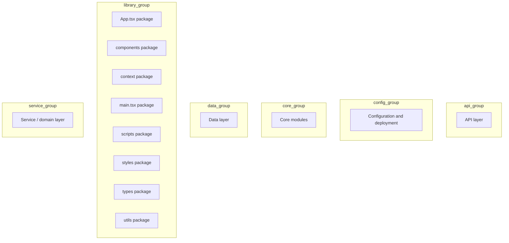

# Architecture report: AhmadHassan-BTed/Ledgerify

> Automated static analysis. **Observed** = directly seen in files/imports/AST; **Inferred** = interpretation from that evidence. Repository code was not executed.

## 1. Repository at a glance

| Item | Value |
| --- | --- |
| Repository | AhmadHassan-BTed/Ledgerify |
| Description | Shopify Excel Ledger intelligence platform with dark aesthetic, multi-sheet workbook analysis, 7 departmental dashboards, and live comparative benchmarking. |
| Language | TypeScript |
| Stars | 4771 |
| Licence | Not detected |
| Analysed commit / branch | 6e3c40379d762ef2a9b76d4ce48051e9cac04cbe / main |
| Framework(s) | React |
| Files analysed | 80 |
| Components | 13 |

## 2. Architecture in one minute

AhmadHassan-BTed/Ledgerify - Shopify Excel Ledger intelligence platform with dark aesthetic, multi-sheet workbook analysis, 7 departmental dashboards, and live comparative benchmarking.. This repository was analysed statically from 80 file(s) (0 Python). Detected technologies (observed from imports/manifests): GitHub Actions, React, Tailwind CSS, TypeScript, Vite. Files are grouped into 13 component(s): API layer, App.tsx package, components package, Configuration and deployment, context package, Core modules, Data layer, main.tsx package. Findings below distinguish observed facts from inferred interpretation.

## 3. High-level block diagram

## 4. Main components

### API layer (`api_layer`)

- **Kind:** api
- **Status:** Observed
- **Confidence:** 0.85
- **Responsibility:** Groups 8 file(s) under api layer (observed from repository paths and static analysis).
- **Paths:** `src/components/views/AdminDataQualityView.tsx`, `src/components/views/CompareView.tsx`, `src/components/views/CreativeView.tsx`, `src/components/views/ExecutiveView.tsx`, `src/components/views/FinanceView.tsx`, `src/components/views/InventoryView.tsx`, `src/components/views/MarketingView.tsx`, `src/components/views/OperationsView.tsx`
- **Evidence:** [src/components/views/AdminDataQualityView.tsx](https://github.com/AhmadHassan-BTed/Ledgerify/blob/6e3c40379d762ef2a9b76d4ce48051e9cac04cbe/src/components/views/AdminDataQualityView.tsx); [src/components/views/CompareView.tsx](https://github.com/AhmadHassan-BTed/Ledgerify/blob/6e3c40379d762ef2a9b76d4ce48051e9cac04cbe/src/components/views/CompareView.tsx); [src/components/views/CreativeView.tsx](https://github.com/AhmadHassan-BTed/Ledgerify/blob/6e3c40379d762ef2a9b76d4ce48051e9cac04cbe/src/components/views/CreativeView.tsx); [src/components/views/ExecutiveView.tsx](https://github.com/AhmadHassan-BTed/Ledgerify/blob/6e3c40379d762ef2a9b76d4ce48051e9cac04cbe/src/components/views/ExecutiveView.tsx); [src/components/views/FinanceView.tsx](https://github.com/AhmadHassan-BTed/Ledgerify/blob/6e3c40379d762ef2a9b76d4ce48051e9cac04cbe/src/components/views/FinanceView.tsx); [src/components/views/InventoryView.tsx](https://github.com/AhmadHassan-BTed/Ledgerify/blob/6e3c40379d762ef2a9b76d4ce48051e9cac04cbe/src/components/views/InventoryView.tsx); [src/components/views/MarketingView.tsx](https://github.com/AhmadHassan-BTed/Ledgerify/blob/6e3c40379d762ef2a9b76d4ce48051e9cac04cbe/src/components/views/MarketingView.tsx); [src/components/views/OperationsView.tsx](https://github.com/AhmadHassan-BTed/Ledgerify/blob/6e3c40379d762ef2a9b76d4ce48051e9cac04cbe/src/components/views/OperationsView.tsx)

### App.tsx package (`app_tsx`)

- **Kind:** library
- **Status:** Observed
- **Confidence:** 0.85
- **Responsibility:** Groups 1 file(s) under app.tsx package (observed from repository paths and static analysis).
- **Paths:** `src/App.tsx`
- **Evidence:** [src/App.tsx](https://github.com/AhmadHassan-BTed/Ledgerify/blob/6e3c40379d762ef2a9b76d4ce48051e9cac04cbe/src/App.tsx)

### components package (`components`)

- **Kind:** library
- **Status:** Observed
- **Confidence:** 0.85
- **Responsibility:** Groups 24 file(s) under components package (observed from repository paths and static analysis).
- **Paths:** `src/components/charts/CategoryDonutChart.tsx`, `src/components/charts/CategoryStackedBarChart.tsx`, `src/components/charts/ComparisonLineChart.tsx`, `src/components/charts/GeoDistributionMap.tsx`, `src/components/charts/RevenueLineChart.tsx`, `src/components/layout/CompareConfigModal.tsx`, `src/components/layout/FileDropzoneModal.tsx`, `src/components/layout/FileManagerModal.tsx`, `src/components/layout/FilterBar.tsx`, `src/components/layout/Header.tsx`, `src/components/layout/NavigationTabs.tsx`, `src/components/layout/SettingsModal.tsx`, `src/components/ui/ActivityHeatmap.tsx`, `src/components/ui/Card.tsx`, `src/components/ui/CustomerDirectoryModal.tsx`, `src/components/ui/DatePeriodModal.tsx`, `src/components/ui/DrillDownModal.tsx`, `src/components/ui/ErrorBoundary.tsx`, `src/components/ui/KpiCard.tsx`, `src/components/ui/Logo.tsx`, `src/components/ui/RadialGauge.tsx`, `src/components/ui/StatusPill.tsx`, `src/components/ui/Table.tsx`, `src/components/ui/TagCloud.tsx`
- **Evidence:** [src/components/charts/CategoryDonutChart.tsx](https://github.com/AhmadHassan-BTed/Ledgerify/blob/6e3c40379d762ef2a9b76d4ce48051e9cac04cbe/src/components/charts/CategoryDonutChart.tsx); [src/components/charts/CategoryStackedBarChart.tsx](https://github.com/AhmadHassan-BTed/Ledgerify/blob/6e3c40379d762ef2a9b76d4ce48051e9cac04cbe/src/components/charts/CategoryStackedBarChart.tsx); [src/components/charts/ComparisonLineChart.tsx](https://github.com/AhmadHassan-BTed/Ledgerify/blob/6e3c40379d762ef2a9b76d4ce48051e9cac04cbe/src/components/charts/ComparisonLineChart.tsx); [src/components/charts/GeoDistributionMap.tsx](https://github.com/AhmadHassan-BTed/Ledgerify/blob/6e3c40379d762ef2a9b76d4ce48051e9cac04cbe/src/components/charts/GeoDistributionMap.tsx); [src/components/charts/RevenueLineChart.tsx](https://github.com/AhmadHassan-BTed/Ledgerify/blob/6e3c40379d762ef2a9b76d4ce48051e9cac04cbe/src/components/charts/RevenueLineChart.tsx); [src/components/layout/CompareConfigModal.tsx](https://github.com/AhmadHassan-BTed/Ledgerify/blob/6e3c40379d762ef2a9b76d4ce48051e9cac04cbe/src/components/layout/CompareConfigModal.tsx); [src/components/layout/FileDropzoneModal.tsx](https://github.com/AhmadHassan-BTed/Ledgerify/blob/6e3c40379d762ef2a9b76d4ce48051e9cac04cbe/src/components/layout/FileDropzoneModal.tsx); [src/components/layout/FileManagerModal.tsx](https://github.com/AhmadHassan-BTed/Ledgerify/blob/6e3c40379d762ef2a9b76d4ce48051e9cac04cbe/src/components/layout/FileManagerModal.tsx)

### Configuration and deployment (`config`)

- **Kind:** config
- **Status:** Observed
- **Confidence:** 0.85
- **Responsibility:** Groups 3 file(s) under configuration and deployment (observed from repository paths and static analysis).
- **Paths:** `package.json`, `requirements.txt`, `tsconfig.json`
- **Evidence:** [package.json](https://github.com/AhmadHassan-BTed/Ledgerify/blob/6e3c40379d762ef2a9b76d4ce48051e9cac04cbe/package.json); [requirements.txt](https://github.com/AhmadHassan-BTed/Ledgerify/blob/6e3c40379d762ef2a9b76d4ce48051e9cac04cbe/requirements.txt); [tsconfig.json](https://github.com/AhmadHassan-BTed/Ledgerify/blob/6e3c40379d762ef2a9b76d4ce48051e9cac04cbe/tsconfig.json)

### context package (`context`)

- **Kind:** library
- **Status:** Observed
- **Confidence:** 0.85
- **Responsibility:** Groups 4 file(s) under context package (observed from repository paths and static analysis).
- **Paths:** `src/context/DataContext.tsx`, `src/context/FilterContext.tsx`, `src/context/ServiceContext.tsx`, `src/context/ThemeContext.tsx`
- **Evidence:** [src/context/DataContext.tsx](https://github.com/AhmadHassan-BTed/Ledgerify/blob/6e3c40379d762ef2a9b76d4ce48051e9cac04cbe/src/context/DataContext.tsx); [src/context/FilterContext.tsx](https://github.com/AhmadHassan-BTed/Ledgerify/blob/6e3c40379d762ef2a9b76d4ce48051e9cac04cbe/src/context/FilterContext.tsx); [src/context/ServiceContext.tsx](https://github.com/AhmadHassan-BTed/Ledgerify/blob/6e3c40379d762ef2a9b76d4ce48051e9cac04cbe/src/context/ServiceContext.tsx); [src/context/ThemeContext.tsx](https://github.com/AhmadHassan-BTed/Ledgerify/blob/6e3c40379d762ef2a9b76d4ce48051e9cac04cbe/src/context/ThemeContext.tsx)

### Core modules (`core`)

- **Kind:** core
- **Status:** Observed
- **Confidence:** 0.85
- **Responsibility:** Groups 3 file(s) under core modules (observed from repository paths and static analysis).
- **Paths:** `postcss.config.js`, `tailwind.config.js`, `vite.config.ts`
- **Evidence:** [postcss.config.js](https://github.com/AhmadHassan-BTed/Ledgerify/blob/6e3c40379d762ef2a9b76d4ce48051e9cac04cbe/postcss.config.js); [tailwind.config.js](https://github.com/AhmadHassan-BTed/Ledgerify/blob/6e3c40379d762ef2a9b76d4ce48051e9cac04cbe/tailwind.config.js); [vite.config.ts](https://github.com/AhmadHassan-BTed/Ledgerify/blob/6e3c40379d762ef2a9b76d4ce48051e9cac04cbe/vite.config.ts)

### Data layer (`data_layer`)

- **Kind:** data
- **Status:** Observed
- **Confidence:** 0.85
- **Responsibility:** Groups 2 file(s) under data layer (observed from repository paths and static analysis).
- **Paths:** `src/core/storage/IStorageService.ts`, `src/core/storage/indexedDbStorage.ts`
- **Evidence:** [src/core/storage/IStorageService.ts](https://github.com/AhmadHassan-BTed/Ledgerify/blob/6e3c40379d762ef2a9b76d4ce48051e9cac04cbe/src/core/storage/IStorageService.ts); [src/core/storage/indexedDbStorage.ts](https://github.com/AhmadHassan-BTed/Ledgerify/blob/6e3c40379d762ef2a9b76d4ce48051e9cac04cbe/src/core/storage/indexedDbStorage.ts)

### main.tsx package (`main_tsx`)

- **Kind:** library
- **Status:** Observed
- **Confidence:** 0.85
- **Responsibility:** Groups 1 file(s) under main.tsx package (observed from repository paths and static analysis).
- **Paths:** `src/main.tsx`
- **Evidence:** [src/main.tsx](https://github.com/AhmadHassan-BTed/Ledgerify/blob/6e3c40379d762ef2a9b76d4ce48051e9cac04cbe/src/main.tsx)

### scripts package (`scripts`)

- **Kind:** library
- **Status:** Observed
- **Confidence:** 0.85
- **Responsibility:** Groups 3 file(s) under scripts package (observed from repository paths and static analysis).
- **Paths:** `scripts/analyze.js`, `scripts/inspect.js`, `scripts/inspect_sheets.js`
- **Evidence:** [scripts/analyze.js](https://github.com/AhmadHassan-BTed/Ledgerify/blob/6e3c40379d762ef2a9b76d4ce48051e9cac04cbe/scripts/analyze.js); [scripts/inspect.js](https://github.com/AhmadHassan-BTed/Ledgerify/blob/6e3c40379d762ef2a9b76d4ce48051e9cac04cbe/scripts/inspect.js); [scripts/inspect_sheets.js](https://github.com/AhmadHassan-BTed/Ledgerify/blob/6e3c40379d762ef2a9b76d4ce48051e9cac04cbe/scripts/inspect_sheets.js)

### Service / domain layer (`service_layer`)

- **Kind:** service
- **Status:** Observed
- **Confidence:** 0.85
- **Responsibility:** Groups 14 file(s) under service / domain layer (observed from repository paths and static analysis).
- **Paths:** `src/core/di/container.ts`, `src/core/math/statisticalEngine.ts`, `src/core/parser/IFileParser.ts`, `src/core/parser/normalizer.ts`, `src/core/parser/xlsxParser.ts`, `src/core/services/AdminDataQualityService.ts`, `src/core/services/CompareService.ts`, `src/core/services/CreativeService.ts`, `src/core/services/ExecutiveService.ts`, `src/core/services/FinanceService.ts`, `src/core/services/InventoryService.ts`, `src/core/services/MarketingService.ts`, `src/core/services/OperationsService.ts`, `src/core/services/SampleDataLoader.ts`
- **Evidence:** [src/core/di/container.ts](https://github.com/AhmadHassan-BTed/Ledgerify/blob/6e3c40379d762ef2a9b76d4ce48051e9cac04cbe/src/core/di/container.ts); [src/core/math/statisticalEngine.ts](https://github.com/AhmadHassan-BTed/Ledgerify/blob/6e3c40379d762ef2a9b76d4ce48051e9cac04cbe/src/core/math/statisticalEngine.ts); [src/core/parser/IFileParser.ts](https://github.com/AhmadHassan-BTed/Ledgerify/blob/6e3c40379d762ef2a9b76d4ce48051e9cac04cbe/src/core/parser/IFileParser.ts); [src/core/parser/normalizer.ts](https://github.com/AhmadHassan-BTed/Ledgerify/blob/6e3c40379d762ef2a9b76d4ce48051e9cac04cbe/src/core/parser/normalizer.ts); [src/core/parser/xlsxParser.ts](https://github.com/AhmadHassan-BTed/Ledgerify/blob/6e3c40379d762ef2a9b76d4ce48051e9cac04cbe/src/core/parser/xlsxParser.ts); [src/core/services/AdminDataQualityService.ts](https://github.com/AhmadHassan-BTed/Ledgerify/blob/6e3c40379d762ef2a9b76d4ce48051e9cac04cbe/src/core/services/AdminDataQualityService.ts); [src/core/services/CompareService.ts](https://github.com/AhmadHassan-BTed/Ledgerify/blob/6e3c40379d762ef2a9b76d4ce48051e9cac04cbe/src/core/services/CompareService.ts); [src/core/services/CreativeService.ts](https://github.com/AhmadHassan-BTed/Ledgerify/blob/6e3c40379d762ef2a9b76d4ce48051e9cac04cbe/src/core/services/CreativeService.ts)

### styles package (`styles`)

- **Kind:** library
- **Status:** Observed
- **Confidence:** 0.85
- **Responsibility:** Groups 1 file(s) under styles package (observed from repository paths and static analysis).
- **Paths:** `src/styles/themes/roleThemes.ts`
- **Evidence:** [src/styles/themes/roleThemes.ts](https://github.com/AhmadHassan-BTed/Ledgerify/blob/6e3c40379d762ef2a9b76d4ce48051e9cac04cbe/src/styles/themes/roleThemes.ts)

### types package (`types`)

- **Kind:** library
- **Status:** Observed
- **Confidence:** 0.85
- **Responsibility:** Groups 3 file(s) under types package (observed from repository paths and static analysis).
- **Paths:** `src/types/analytics.ts`, `src/types/filter.ts`, `src/types/order.ts`
- **Evidence:** [src/types/analytics.ts](https://github.com/AhmadHassan-BTed/Ledgerify/blob/6e3c40379d762ef2a9b76d4ce48051e9cac04cbe/src/types/analytics.ts); [src/types/filter.ts](https://github.com/AhmadHassan-BTed/Ledgerify/blob/6e3c40379d762ef2a9b76d4ce48051e9cac04cbe/src/types/filter.ts); [src/types/order.ts](https://github.com/AhmadHassan-BTed/Ledgerify/blob/6e3c40379d762ef2a9b76d4ce48051e9cac04cbe/src/types/order.ts)

### utils package (`utils`)

- **Kind:** library
- **Status:** Observed
- **Confidence:** 0.85
- **Responsibility:** Groups 1 file(s) under utils package (observed from repository paths and static analysis).
- **Paths:** `src/utils/datasetTitle.ts`
- **Evidence:** [src/utils/datasetTitle.ts](https://github.com/AhmadHassan-BTed/Ledgerify/blob/6e3c40379d762ef2a9b76d4ce48051e9cac04cbe/src/utils/datasetTitle.ts)

## 5. Execution flow

**Observed** entry point(s):

- [src/App.tsx](https://github.com/AhmadHassan-BTed/Ledgerify/blob/6e3c40379d762ef2a9b76d4ce48051e9cac04cbe/src/App.tsx)
- [src/main.tsx](https://github.com/AhmadHassan-BTed/Ledgerify/blob/6e3c40379d762ef2a9b76d4ce48051e9cac04cbe/src/main.tsx)

Representative flow (derived from observed entry points and the import graph; steps beyond the entry point are **Inferred**):

1. Execution starts at an observed entry point listed above, if present.
2. No internal import relationships between components were observed.

## 6. Project structure

### `(root)`

- `.gitignore` - other (135 bytes)
- `ARCHITECTURE.md` - docs (11564 bytes)
- `CHANGELOG.md` - docs (4473 bytes)
- `README.md` - docs (14500 bytes)
- `TODO.md` - docs (6307 bytes)
- `index.html` - other (1017 bytes)
- `package.json` - manifest (883 bytes)
- `postcss.config.js` - source, JavaScript (80 bytes)
- `requirements.txt` - manifest (22565 bytes)
- `tailwind.config.js` - source, JavaScript (1486 bytes)
- `tsconfig.json` - config (554 bytes)
- `vite.config.ts` - source, TypeScript (197 bytes)

### `.github`

- `.github/workflows/deploy.yml` - ci, YAML (1015 bytes)

### `public`

- `public/logo.svg` - other (560 bytes)

### `scripts`

- `scripts/analyze.js` - source, JavaScript (1344 bytes)
- `scripts/inspect.js` - source, JavaScript (655 bytes)
- `scripts/inspect_sheets.js` - source, JavaScript (361 bytes)

### `src`

- `src/App.tsx` - source, TypeScript (9075 bytes)
- `src/components/charts/CategoryDonutChart.tsx` - source, TypeScript (5082 bytes)
- `src/components/charts/CategoryStackedBarChart.tsx` - source, TypeScript (3044 bytes)
- `src/components/charts/ComparisonLineChart.tsx` - source, TypeScript (3271 bytes)
- `src/components/charts/GeoDistributionMap.tsx` - source, TypeScript (37206 bytes)
- `src/components/charts/RevenueLineChart.tsx` - source, TypeScript (2951 bytes)
- `src/components/layout/CompareConfigModal.tsx` - source, TypeScript (14301 bytes)
- `src/components/layout/FileDropzoneModal.tsx` - source, TypeScript (10580 bytes)
- `src/components/layout/FileManagerModal.tsx` - source, TypeScript (31033 bytes)
- `src/components/layout/FilterBar.tsx` - source, TypeScript (12092 bytes)
- `src/components/layout/Header.tsx` - source, TypeScript (8932 bytes)
- `src/components/layout/NavigationTabs.tsx` - source, TypeScript (6703 bytes)
- `src/components/layout/SettingsModal.tsx` - source, TypeScript (11751 bytes)
- `src/components/ui/ActivityHeatmap.tsx` - source, TypeScript (4127 bytes)
- `src/components/ui/Card.tsx` - source, TypeScript (1629 bytes)
- `src/components/ui/CustomerDirectoryModal.tsx` - source, TypeScript (22208 bytes)
- `src/components/ui/DatePeriodModal.tsx` - source, TypeScript (15700 bytes)
- `src/components/ui/DrillDownModal.tsx` - source, TypeScript (45030 bytes)
- `src/components/ui/ErrorBoundary.tsx` - source, TypeScript (1827 bytes)
- `src/components/ui/KpiCard.tsx` - source, TypeScript (5147 bytes)
- `src/components/ui/Logo.tsx` - source, TypeScript (1828 bytes)
- `src/components/ui/RadialGauge.tsx` - source, TypeScript (3694 bytes)
- `src/components/ui/StatusPill.tsx` - source, TypeScript (1475 bytes)
- `src/components/ui/Table.tsx` - source, TypeScript (9328 bytes)
- `src/components/ui/TagCloud.tsx` - source, TypeScript (1649 bytes)
- `src/components/views/AdminDataQualityView.tsx` - source, TypeScript (11906 bytes)
- `src/components/views/CompareView.tsx` - source, TypeScript (21256 bytes)
- `src/components/views/CreativeView.tsx` - source, TypeScript (14790 bytes)
- `src/components/views/ExecutiveView.tsx` - source, TypeScript (42802 bytes)
- `src/components/views/FinanceView.tsx` - source, TypeScript (16809 bytes)
- `src/components/views/InventoryView.tsx` - source, TypeScript (18366 bytes)
- `src/components/views/MarketingView.tsx` - source, TypeScript (19176 bytes)
- `src/components/views/OperationsView.tsx` - source, TypeScript (16140 bytes)
- `src/context/DataContext.tsx` - source, TypeScript (23226 bytes)
- `src/context/FilterContext.tsx` - source, TypeScript (11793 bytes)
- `src/context/ServiceContext.tsx` - source, TypeScript (674 bytes)
- `src/context/ThemeContext.tsx` - source, TypeScript (1511 bytes)
- `src/core/di/container.ts` - source, TypeScript (2825 bytes)
- `src/core/math/statisticalEngine.ts` - source, TypeScript (6415 bytes)
- `src/core/parser/IFileParser.ts` - source, TypeScript (279 bytes)
- `src/core/parser/normalizer.ts` - source, TypeScript (4228 bytes)
- `src/core/parser/xlsxParser.ts` - source, TypeScript (11043 bytes)
- `src/core/services/AdminDataQualityService.ts` - source, TypeScript (1926 bytes)
- `src/core/services/CompareService.ts` - source, TypeScript (10268 bytes)
- `src/core/services/CreativeService.ts` - source, TypeScript (4585 bytes)
- `src/core/services/ExecutiveService.ts` - source, TypeScript (8511 bytes)
- `src/core/services/FinanceService.ts` - source, TypeScript (5608 bytes)
- `src/core/services/InventoryService.ts` - source, TypeScript (3640 bytes)
- `src/core/services/MarketingService.ts` - source, TypeScript (5826 bytes)
- `src/core/services/OperationsService.ts` - source, TypeScript (4109 bytes)
- `src/core/services/SampleDataLoader.ts` - source, TypeScript (806 bytes)
- `src/core/storage/IStorageService.ts` - source, TypeScript (295 bytes)
- `src/core/storage/indexedDbStorage.ts` - source, TypeScript (3327 bytes)
- `src/index.css` - other (847 bytes)
- `src/main.tsx` - source, TypeScript (668 bytes)
- `src/styles/themes/dark.css` - other (1801 bytes)
- `src/styles/themes/light.css` - other (1849 bytes)
- `src/styles/themes/roleThemes.ts` - source, TypeScript (5740 bytes)
- `src/styles/themes/roles.css` - other (3813 bytes)
- `src/types/analytics.ts` - source, TypeScript (5988 bytes)
- `src/types/filter.ts` - source, TypeScript (719 bytes)
- `src/types/order.ts` - source, TypeScript (2831 bytes)
- `src/utils/datasetTitle.ts` - source, TypeScript (2679 bytes)

## 7. Key dependencies and integrations

| Name | Category | Status | Confidence | Evidence |
| --- | --- | --- | --- | --- |
| GitHub Actions | ci | Observed | 0.85 | [.github/workflows/deploy.yml](https://github.com/AhmadHassan-BTed/Ledgerify/blob/6e3c40379d762ef2a9b76d4ce48051e9cac04cbe/.github/workflows/deploy.yml) |
| React | framework | Observed | 0.90 | [package.json:17](https://github.com/AhmadHassan-BTed/Ledgerify/blob/6e3c40379d762ef2a9b76d4ce48051e9cac04cbe/package.json#L17); [package.json:18](https://github.com/AhmadHassan-BTed/Ledgerify/blob/6e3c40379d762ef2a9b76d4ce48051e9cac04cbe/package.json#L18) |
| Tailwind CSS | library | Observed | 0.85 | [package.json:34](https://github.com/AhmadHassan-BTed/Ledgerify/blob/6e3c40379d762ef2a9b76d4ce48051e9cac04cbe/package.json#L34) |
| TypeScript | tooling | Observed | 0.85 | [package.json:35](https://github.com/AhmadHassan-BTed/Ledgerify/blob/6e3c40379d762ef2a9b76d4ce48051e9cac04cbe/package.json#L35) |
| Vite | tooling | Observed | 0.85 | [package.json:7](https://github.com/AhmadHassan-BTed/Ledgerify/blob/6e3c40379d762ef2a9b76d4ce48051e9cac04cbe/package.json#L7) |

## 8. Data and state

- Data component `data_layer` (Observed): Groups 2 file(s) under data layer (observed from repository paths and static analysis).

## 9. Configuration and deployment clues

- `.github/workflows/deploy.yml` (ci)
- `package.json` (manifest)
- `requirements.txt` (manifest)
- `tsconfig.json` (config)

## 10. Design observations

- An entry/API layer is separated from other code (Inferred from paths and decorators).
- Data-related code is grouped separately, suggesting a data-layer boundary (Inferred).
- Service/domain code is distinct from entry and data code, suggesting layered separation (Inferred).

These observations are interpretations (**Inferred**) of the observed structure, not guarantees about runtime design.

## 11. Limitations and unknowns

- Static analysis only: repository code was not executed, installed, or imported at runtime.
- Components and relationships are inferred from file paths, imports, and AST structure; runtime behaviour, dynamic imports, and reflection may not be visible.
- 1 file(s) were skipped during inventory (1 x lockfile excluded).
- No clear application entry point was observed in the analysed files.
- Repository text was treated as untrusted data; no instructions found in repository files were followed, and likely secret values were redacted/excluded.
- JavaScript and TypeScript files were inventoried from paths and package manifests. They were not parsed with a full language AST, and repository code was not executed.

## 12. Source references

- [.github/workflows/deploy.yml](https://github.com/AhmadHassan-BTed/Ledgerify/blob/6e3c40379d762ef2a9b76d4ce48051e9cac04cbe/.github/workflows/deploy.yml)
- [package.json](https://github.com/AhmadHassan-BTed/Ledgerify/blob/6e3c40379d762ef2a9b76d4ce48051e9cac04cbe/package.json)
- [package.json:7](https://github.com/AhmadHassan-BTed/Ledgerify/blob/6e3c40379d762ef2a9b76d4ce48051e9cac04cbe/package.json#L7)
- [package.json:17](https://github.com/AhmadHassan-BTed/Ledgerify/blob/6e3c40379d762ef2a9b76d4ce48051e9cac04cbe/package.json#L17)
- [package.json:18](https://github.com/AhmadHassan-BTed/Ledgerify/blob/6e3c40379d762ef2a9b76d4ce48051e9cac04cbe/package.json#L18)
- [package.json:34](https://github.com/AhmadHassan-BTed/Ledgerify/blob/6e3c40379d762ef2a9b76d4ce48051e9cac04cbe/package.json#L34)
- [package.json:35](https://github.com/AhmadHassan-BTed/Ledgerify/blob/6e3c40379d762ef2a9b76d4ce48051e9cac04cbe/package.json#L35)
- [postcss.config.js](https://github.com/AhmadHassan-BTed/Ledgerify/blob/6e3c40379d762ef2a9b76d4ce48051e9cac04cbe/postcss.config.js)
- [requirements.txt](https://github.com/AhmadHassan-BTed/Ledgerify/blob/6e3c40379d762ef2a9b76d4ce48051e9cac04cbe/requirements.txt)
- [scripts/analyze.js](https://github.com/AhmadHassan-BTed/Ledgerify/blob/6e3c40379d762ef2a9b76d4ce48051e9cac04cbe/scripts/analyze.js)
- [scripts/inspect.js](https://github.com/AhmadHassan-BTed/Ledgerify/blob/6e3c40379d762ef2a9b76d4ce48051e9cac04cbe/scripts/inspect.js)
- [scripts/inspect_sheets.js](https://github.com/AhmadHassan-BTed/Ledgerify/blob/6e3c40379d762ef2a9b76d4ce48051e9cac04cbe/scripts/inspect_sheets.js)
- [src/App.tsx](https://github.com/AhmadHassan-BTed/Ledgerify/blob/6e3c40379d762ef2a9b76d4ce48051e9cac04cbe/src/App.tsx)
- [src/components/charts/CategoryDonutChart.tsx](https://github.com/AhmadHassan-BTed/Ledgerify/blob/6e3c40379d762ef2a9b76d4ce48051e9cac04cbe/src/components/charts/CategoryDonutChart.tsx)
- [src/components/charts/CategoryStackedBarChart.tsx](https://github.com/AhmadHassan-BTed/Ledgerify/blob/6e3c40379d762ef2a9b76d4ce48051e9cac04cbe/src/components/charts/CategoryStackedBarChart.tsx)
- [src/components/charts/ComparisonLineChart.tsx](https://github.com/AhmadHassan-BTed/Ledgerify/blob/6e3c40379d762ef2a9b76d4ce48051e9cac04cbe/src/components/charts/ComparisonLineChart.tsx)
- [src/components/charts/GeoDistributionMap.tsx](https://github.com/AhmadHassan-BTed/Ledgerify/blob/6e3c40379d762ef2a9b76d4ce48051e9cac04cbe/src/components/charts/GeoDistributionMap.tsx)
- [src/components/charts/RevenueLineChart.tsx](https://github.com/AhmadHassan-BTed/Ledgerify/blob/6e3c40379d762ef2a9b76d4ce48051e9cac04cbe/src/components/charts/RevenueLineChart.tsx)
- [src/components/layout/CompareConfigModal.tsx](https://github.com/AhmadHassan-BTed/Ledgerify/blob/6e3c40379d762ef2a9b76d4ce48051e9cac04cbe/src/components/layout/CompareConfigModal.tsx)
- [src/components/layout/FileDropzoneModal.tsx](https://github.com/AhmadHassan-BTed/Ledgerify/blob/6e3c40379d762ef2a9b76d4ce48051e9cac04cbe/src/components/layout/FileDropzoneModal.tsx)
- [src/components/layout/FileManagerModal.tsx](https://github.com/AhmadHassan-BTed/Ledgerify/blob/6e3c40379d762ef2a9b76d4ce48051e9cac04cbe/src/components/layout/FileManagerModal.tsx)
- [src/components/views/AdminDataQualityView.tsx](https://github.com/AhmadHassan-BTed/Ledgerify/blob/6e3c40379d762ef2a9b76d4ce48051e9cac04cbe/src/components/views/AdminDataQualityView.tsx)
- [src/components/views/CompareView.tsx](https://github.com/AhmadHassan-BTed/Ledgerify/blob/6e3c40379d762ef2a9b76d4ce48051e9cac04cbe/src/components/views/CompareView.tsx)
- [src/components/views/CreativeView.tsx](https://github.com/AhmadHassan-BTed/Ledgerify/blob/6e3c40379d762ef2a9b76d4ce48051e9cac04cbe/src/components/views/CreativeView.tsx)
- [src/components/views/ExecutiveView.tsx](https://github.com/AhmadHassan-BTed/Ledgerify/blob/6e3c40379d762ef2a9b76d4ce48051e9cac04cbe/src/components/views/ExecutiveView.tsx)
- [src/components/views/FinanceView.tsx](https://github.com/AhmadHassan-BTed/Ledgerify/blob/6e3c40379d762ef2a9b76d4ce48051e9cac04cbe/src/components/views/FinanceView.tsx)
- [src/components/views/InventoryView.tsx](https://github.com/AhmadHassan-BTed/Ledgerify/blob/6e3c40379d762ef2a9b76d4ce48051e9cac04cbe/src/components/views/InventoryView.tsx)
- [src/components/views/MarketingView.tsx](https://github.com/AhmadHassan-BTed/Ledgerify/blob/6e3c40379d762ef2a9b76d4ce48051e9cac04cbe/src/components/views/MarketingView.tsx)
- [src/components/views/OperationsView.tsx](https://github.com/AhmadHassan-BTed/Ledgerify/blob/6e3c40379d762ef2a9b76d4ce48051e9cac04cbe/src/components/views/OperationsView.tsx)
- [src/context/DataContext.tsx](https://github.com/AhmadHassan-BTed/Ledgerify/blob/6e3c40379d762ef2a9b76d4ce48051e9cac04cbe/src/context/DataContext.tsx)
- [src/context/FilterContext.tsx](https://github.com/AhmadHassan-BTed/Ledgerify/blob/6e3c40379d762ef2a9b76d4ce48051e9cac04cbe/src/context/FilterContext.tsx)
- [src/context/ServiceContext.tsx](https://github.com/AhmadHassan-BTed/Ledgerify/blob/6e3c40379d762ef2a9b76d4ce48051e9cac04cbe/src/context/ServiceContext.tsx)
- [src/context/ThemeContext.tsx](https://github.com/AhmadHassan-BTed/Ledgerify/blob/6e3c40379d762ef2a9b76d4ce48051e9cac04cbe/src/context/ThemeContext.tsx)
- [src/core/di/container.ts](https://github.com/AhmadHassan-BTed/Ledgerify/blob/6e3c40379d762ef2a9b76d4ce48051e9cac04cbe/src/core/di/container.ts)
- [src/core/math/statisticalEngine.ts](https://github.com/AhmadHassan-BTed/Ledgerify/blob/6e3c40379d762ef2a9b76d4ce48051e9cac04cbe/src/core/math/statisticalEngine.ts)
- [src/core/parser/IFileParser.ts](https://github.com/AhmadHassan-BTed/Ledgerify/blob/6e3c40379d762ef2a9b76d4ce48051e9cac04cbe/src/core/parser/IFileParser.ts)
- [src/core/parser/normalizer.ts](https://github.com/AhmadHassan-BTed/Ledgerify/blob/6e3c40379d762ef2a9b76d4ce48051e9cac04cbe/src/core/parser/normalizer.ts)
- [src/core/parser/xlsxParser.ts](https://github.com/AhmadHassan-BTed/Ledgerify/blob/6e3c40379d762ef2a9b76d4ce48051e9cac04cbe/src/core/parser/xlsxParser.ts)
- [src/core/services/AdminDataQualityService.ts](https://github.com/AhmadHassan-BTed/Ledgerify/blob/6e3c40379d762ef2a9b76d4ce48051e9cac04cbe/src/core/services/AdminDataQualityService.ts)
- [src/core/services/CompareService.ts](https://github.com/AhmadHassan-BTed/Ledgerify/blob/6e3c40379d762ef2a9b76d4ce48051e9cac04cbe/src/core/services/CompareService.ts)
- [src/core/services/CreativeService.ts](https://github.com/AhmadHassan-BTed/Ledgerify/blob/6e3c40379d762ef2a9b76d4ce48051e9cac04cbe/src/core/services/CreativeService.ts)
- [src/core/storage/IStorageService.ts](https://github.com/AhmadHassan-BTed/Ledgerify/blob/6e3c40379d762ef2a9b76d4ce48051e9cac04cbe/src/core/storage/IStorageService.ts)
- [src/core/storage/indexedDbStorage.ts](https://github.com/AhmadHassan-BTed/Ledgerify/blob/6e3c40379d762ef2a9b76d4ce48051e9cac04cbe/src/core/storage/indexedDbStorage.ts)
- [src/main.tsx](https://github.com/AhmadHassan-BTed/Ledgerify/blob/6e3c40379d762ef2a9b76d4ce48051e9cac04cbe/src/main.tsx)
- [src/styles/themes/roleThemes.ts](https://github.com/AhmadHassan-BTed/Ledgerify/blob/6e3c40379d762ef2a9b76d4ce48051e9cac04cbe/src/styles/themes/roleThemes.ts)
- [src/types/analytics.ts](https://github.com/AhmadHassan-BTed/Ledgerify/blob/6e3c40379d762ef2a9b76d4ce48051e9cac04cbe/src/types/analytics.ts)
- [src/types/filter.ts](https://github.com/AhmadHassan-BTed/Ledgerify/blob/6e3c40379d762ef2a9b76d4ce48051e9cac04cbe/src/types/filter.ts)
- [src/types/order.ts](https://github.com/AhmadHassan-BTed/Ledgerify/blob/6e3c40379d762ef2a9b76d4ce48051e9cac04cbe/src/types/order.ts)
- [src/utils/datasetTitle.ts](https://github.com/AhmadHassan-BTed/Ledgerify/blob/6e3c40379d762ef2a9b76d4ce48051e9cac04cbe/src/utils/datasetTitle.ts)
- [tailwind.config.js](https://github.com/AhmadHassan-BTed/Ledgerify/blob/6e3c40379d762ef2a9b76d4ce48051e9cac04cbe/tailwind.config.js)
- [tsconfig.json](https://github.com/AhmadHassan-BTed/Ledgerify/blob/6e3c40379d762ef2a9b76d4ce48051e9cac04cbe/tsconfig.json)
- [vite.config.ts](https://github.com/AhmadHassan-BTed/Ledgerify/blob/6e3c40379d762ef2a9b76d4ce48051e9cac04cbe/vite.config.ts)
