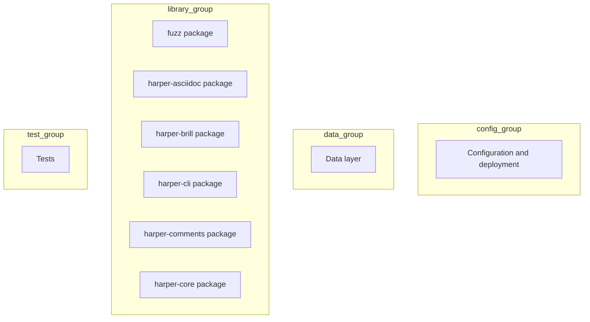

# Architecture report: Automattic/harper

> Automated static analysis. **Observed** = directly seen in files/imports/AST; **Inferred** = interpretation from that evidence. Repository code was not executed.

## 1. Repository at a glance

| Item | Value |
| --- | --- |
| Repository | Automattic/harper |
| Description | Offline, privacy-first grammar checker. Fast, open-source, Rust-powered |
| Language | Rust |
| Stars | 17706 |
| Licence | Apache-2.0 |
| Analysed commit / branch | 4270327e92ecdfd25a8da4fdeb51f6998d5d5443 / master |
| Framework(s) | None detected |
| Files analysed | 798 |
| Components | 9 |

## 2. Architecture in one minute

Automattic/harper - Offline, privacy-first grammar checker. Fast, open-source, Rust-powered. This repository was analysed statically from 798 file(s) (0 Python). Detected technologies (observed from imports/manifests): GitHub Actions, MySQL, Docker, Docker Compose. Files are grouped into 9 component(s): Configuration and deployment, Data layer, fuzz package, harper-asciidoc package, harper-brill package, harper-cli package, harper-comments package, harper-core package. Findings below distinguish observed facts from inferred interpretation.

## 3. High-level block diagram

## 4. Main components

### Configuration and deployment (`config`)

- **Kind:** config
- **Status:** Observed
- **Confidence:** 0.85
- **Responsibility:** Groups 18 file(s) under configuration and deployment (observed from repository paths and static analysis).
- **Paths:** `Cargo.toml`, `Dockerfile`, `biome.json`, `docker-compose.dev.yml`, `docker-compose.yml`, `fuzz/Cargo.toml`, `harper-asciidoc/Cargo.toml`, `harper-brill/Cargo.toml`, `harper-brill/trained_chunker_model.json`, `harper-cli/Cargo.toml`, `harper-comments/Cargo.toml`, `harper-core/Cargo.toml`, `harper-core/annotations.json`, `harper-core/clippy.toml`, `harper-core/default_config.json`, `harper-core/irregular_nouns.json`, `harper-core/irregular_verbs.json`, `harper-core/proper_noun_rules.json`
- **Evidence:** [Cargo.toml](https://github.com/Automattic/harper/blob/4270327e92ecdfd25a8da4fdeb51f6998d5d5443/Cargo.toml); [Dockerfile](https://github.com/Automattic/harper/blob/4270327e92ecdfd25a8da4fdeb51f6998d5d5443/Dockerfile); [biome.json](https://github.com/Automattic/harper/blob/4270327e92ecdfd25a8da4fdeb51f6998d5d5443/biome.json); [docker-compose.dev.yml](https://github.com/Automattic/harper/blob/4270327e92ecdfd25a8da4fdeb51f6998d5d5443/docker-compose.dev.yml); [docker-compose.yml](https://github.com/Automattic/harper/blob/4270327e92ecdfd25a8da4fdeb51f6998d5d5443/docker-compose.yml); [fuzz/Cargo.toml](https://github.com/Automattic/harper/blob/4270327e92ecdfd25a8da4fdeb51f6998d5d5443/fuzz/Cargo.toml); [harper-asciidoc/Cargo.toml](https://github.com/Automattic/harper/blob/4270327e92ecdfd25a8da4fdeb51f6998d5d5443/harper-asciidoc/Cargo.toml); [harper-brill/Cargo.toml](https://github.com/Automattic/harper/blob/4270327e92ecdfd25a8da4fdeb51f6998d5d5443/harper-brill/Cargo.toml)

### Data layer (`data_layer`)

- **Kind:** data
- **Status:** Inferred
- **Confidence:** 0.70
- **Responsibility:** Groups 0 file(s) under data layer (observed from repository paths and static analysis).
- **Evidence:** [docker-compose.yml:13](https://github.com/Automattic/harper/blob/4270327e92ecdfd25a8da4fdeb51f6998d5d5443/docker-compose.yml#L13)

### fuzz package (`fuzz`)

- **Kind:** library
- **Status:** Observed
- **Confidence:** 0.85
- **Responsibility:** Groups 5 file(s) under fuzz package (observed from repository paths and static analysis).
- **Paths:** `fuzz/fuzz_targets/fuzz_harper_comment.rs`, `fuzz/fuzz_targets/fuzz_harper_core_markdown.rs`, `fuzz/fuzz_targets/fuzz_harper_html.rs`, `fuzz/fuzz_targets/fuzz_harper_literate_haskell.rs`, `fuzz/fuzz_targets/fuzz_harper_typst.rs`
- **Evidence:** [fuzz/fuzz_targets/fuzz_harper_comment.rs](https://github.com/Automattic/harper/blob/4270327e92ecdfd25a8da4fdeb51f6998d5d5443/fuzz/fuzz_targets/fuzz_harper_comment.rs); [fuzz/fuzz_targets/fuzz_harper_core_markdown.rs](https://github.com/Automattic/harper/blob/4270327e92ecdfd25a8da4fdeb51f6998d5d5443/fuzz/fuzz_targets/fuzz_harper_core_markdown.rs); [fuzz/fuzz_targets/fuzz_harper_html.rs](https://github.com/Automattic/harper/blob/4270327e92ecdfd25a8da4fdeb51f6998d5d5443/fuzz/fuzz_targets/fuzz_harper_html.rs); [fuzz/fuzz_targets/fuzz_harper_literate_haskell.rs](https://github.com/Automattic/harper/blob/4270327e92ecdfd25a8da4fdeb51f6998d5d5443/fuzz/fuzz_targets/fuzz_harper_literate_haskell.rs); [fuzz/fuzz_targets/fuzz_harper_typst.rs](https://github.com/Automattic/harper/blob/4270327e92ecdfd25a8da4fdeb51f6998d5d5443/fuzz/fuzz_targets/fuzz_harper_typst.rs)

### harper-asciidoc package (`harper_asciidoc`)

- **Kind:** library
- **Status:** Observed
- **Confidence:** 0.85
- **Responsibility:** Groups 1 file(s) under harper-asciidoc package (observed from repository paths and static analysis).
- **Paths:** `harper-asciidoc/src/lib.rs`
- **Evidence:** [harper-asciidoc/src/lib.rs](https://github.com/Automattic/harper/blob/4270327e92ecdfd25a8da4fdeb51f6998d5d5443/harper-asciidoc/src/lib.rs)

### harper-brill package (`harper_brill`)

- **Kind:** library
- **Status:** Observed
- **Confidence:** 0.85
- **Responsibility:** Groups 1 file(s) under harper-brill package (observed from repository paths and static analysis).
- **Paths:** `harper-brill/src/lib.rs`
- **Evidence:** [harper-brill/src/lib.rs](https://github.com/Automattic/harper/blob/4270327e92ecdfd25a8da4fdeb51f6998d5d5443/harper-brill/src/lib.rs)

### harper-cli package (`harper_cli`)

- **Kind:** library
- **Status:** Observed
- **Confidence:** 0.85
- **Responsibility:** Groups 8 file(s) under harper-cli package (observed from repository paths and static analysis).
- **Paths:** `harper-cli/src/annotate.rs`, `harper-cli/src/input.rs`, `harper-cli/src/input/multi_input.rs`, `harper-cli/src/input/single_input.rs`, `harper-cli/src/lint.rs`, `harper-cli/src/lint_engine.rs`, `harper-cli/src/lint_reporter.rs`, `harper-cli/src/main.rs`
- **Evidence:** [harper-cli/src/annotate.rs](https://github.com/Automattic/harper/blob/4270327e92ecdfd25a8da4fdeb51f6998d5d5443/harper-cli/src/annotate.rs); [harper-cli/src/input.rs](https://github.com/Automattic/harper/blob/4270327e92ecdfd25a8da4fdeb51f6998d5d5443/harper-cli/src/input.rs); [harper-cli/src/input/multi_input.rs](https://github.com/Automattic/harper/blob/4270327e92ecdfd25a8da4fdeb51f6998d5d5443/harper-cli/src/input/multi_input.rs); [harper-cli/src/input/single_input.rs](https://github.com/Automattic/harper/blob/4270327e92ecdfd25a8da4fdeb51f6998d5d5443/harper-cli/src/input/single_input.rs); [harper-cli/src/lint.rs](https://github.com/Automattic/harper/blob/4270327e92ecdfd25a8da4fdeb51f6998d5d5443/harper-cli/src/lint.rs); [harper-cli/src/lint_engine.rs](https://github.com/Automattic/harper/blob/4270327e92ecdfd25a8da4fdeb51f6998d5d5443/harper-cli/src/lint_engine.rs); [harper-cli/src/lint_reporter.rs](https://github.com/Automattic/harper/blob/4270327e92ecdfd25a8da4fdeb51f6998d5d5443/harper-cli/src/lint_reporter.rs); [harper-cli/src/main.rs](https://github.com/Automattic/harper/blob/4270327e92ecdfd25a8da4fdeb51f6998d5d5443/harper-cli/src/main.rs)

### harper-comments package (`harper_comments`)

- **Kind:** library
- **Status:** Observed
- **Confidence:** 0.85
- **Responsibility:** Groups 10 file(s) under harper-comments package (observed from repository paths and static analysis).
- **Paths:** `harper-comments/src/comment_parser.rs`, `harper-comments/src/comment_parsers/go.rs`, `harper-comments/src/comment_parsers/javadoc.rs`, `harper-comments/src/comment_parsers/jsdoc.rs`, `harper-comments/src/comment_parsers/lua.rs`, `harper-comments/src/comment_parsers/mod.rs`, `harper-comments/src/comment_parsers/solidity.rs`, `harper-comments/src/comment_parsers/unit.rs`, `harper-comments/src/lib.rs`, `harper-comments/src/masker.rs`
- **Evidence:** [harper-comments/src/comment_parser.rs](https://github.com/Automattic/harper/blob/4270327e92ecdfd25a8da4fdeb51f6998d5d5443/harper-comments/src/comment_parser.rs); [harper-comments/src/comment_parsers/go.rs](https://github.com/Automattic/harper/blob/4270327e92ecdfd25a8da4fdeb51f6998d5d5443/harper-comments/src/comment_parsers/go.rs); [harper-comments/src/comment_parsers/javadoc.rs](https://github.com/Automattic/harper/blob/4270327e92ecdfd25a8da4fdeb51f6998d5d5443/harper-comments/src/comment_parsers/javadoc.rs); [harper-comments/src/comment_parsers/jsdoc.rs](https://github.com/Automattic/harper/blob/4270327e92ecdfd25a8da4fdeb51f6998d5d5443/harper-comments/src/comment_parsers/jsdoc.rs); [harper-comments/src/comment_parsers/lua.rs](https://github.com/Automattic/harper/blob/4270327e92ecdfd25a8da4fdeb51f6998d5d5443/harper-comments/src/comment_parsers/lua.rs); [harper-comments/src/comment_parsers/mod.rs](https://github.com/Automattic/harper/blob/4270327e92ecdfd25a8da4fdeb51f6998d5d5443/harper-comments/src/comment_parsers/mod.rs); [harper-comments/src/comment_parsers/solidity.rs](https://github.com/Automattic/harper/blob/4270327e92ecdfd25a8da4fdeb51f6998d5d5443/harper-comments/src/comment_parsers/solidity.rs); [harper-comments/src/comment_parsers/unit.rs](https://github.com/Automattic/harper/blob/4270327e92ecdfd25a8da4fdeb51f6998d5d5443/harper-comments/src/comment_parsers/unit.rs)

### harper-core package (`harper_core`)

- **Kind:** library
- **Status:** Observed
- **Confidence:** 0.85
- **Responsibility:** Groups 459 file(s) under harper-core package (observed from repository paths and static analysis).
- **Paths:** `harper-core/benches/parse_essay.rs`, `harper-core/benches/spellcheck.rs`, `harper-core/build.rs`, `harper-core/examples/alloc_profile.rs`, `harper-core/expr_linter_skeleton.rs`, `harper-core/expr_linter_skeleton_commented.rs`, `harper-core/src/case.rs`, `harper-core/src/char_ext.rs`, `harper-core/src/char_string.rs`, `harper-core/src/currency.rs`, `harper-core/src/dict_word_metadata.rs`, `harper-core/src/dict_word_metadata/derived_from.rs`, `harper-core/src/dict_word_metadata_orthography.rs`, `harper-core/src/document.rs`, `harper-core/src/edit_distance.rs`, `harper-core/src/expr/all.rs`, `harper-core/src/expr/anchor_end.rs`, `harper-core/src/expr/anchor_start.rs`, `harper-core/src/expr/duration_expr.rs`, `harper-core/src/expr/expr_map.rs`, `harper-core/src/expr/filter.rs`, `harper-core/src/expr/first_match_of.rs`, `harper-core/src/expr/fixed_phrase.rs`, `harper-core/src/expr/longest_match_of.rs`, `harper-core/src/expr/mergeable_words.rs`, `harper-core/src/expr/mod.rs`, `harper-core/src/expr/not.rs`, `harper-core/src/expr/optional.rs`, `harper-core/src/expr/pronoun_be.rs`, `harper-core/src/expr/reflexive_pronoun.rs`, `harper-core/src/expr/repeating.rs`, `harper-core/src/expr/sequence_expr.rs`, `harper-core/src/expr/similar_to_phrase.rs`, `harper-core/src/expr/space_or_hyphen.rs`, `harper-core/src/expr/spelled_number_expr.rs`, `harper-core/src/expr/step.rs`, `harper-core/src/expr/time_unit_expr.rs`, `harper-core/src/expr/unless_step.rs`, `harper-core/src/expr/word_expr_group.rs`, `harper-core/src/fat_token.rs`, `harper-core/src/ignored_lints/lint_context.rs`, `harper-core/src/ignored_lints/mod.rs`, `harper-core/src/indefinite_article.rs`, `harper-core/src/irregular_nouns.rs`, `harper-core/src/irregular_verbs.rs`, `harper-core/src/language_detection.rs`, `harper-core/src/lexing/email_address.rs`, `harper-core/src/lexing/hostname.rs`, `harper-core/src/lexing/mod.rs`, `harper-core/src/lexing/url.rs`, `harper-core/src/lib.rs`, `harper-core/src/linting/a_bit_of_plural.rs`, `harper-core/src/linting/a_part.rs`, `harper-core/src/linting/a_some_time.rs`, `harper-core/src/linting/a_ways_to_go.rs`, `harper-core/src/linting/a_while.rs`, `harper-core/src/linting/accuse_of.rs`, `harper-core/src/linting/addicting.rs`, `harper-core/src/linting/adjective_double_degree.rs`, `harper-core/src/linting/adjective_of_a.rs`, `harper-core/src/linting/after_later.rs`, `harper-core/src/linting/ajar.rs`, `harper-core/src/linting/akimbo.rs`, `harper-core/src/linting/all_hell_break_loose.rs`, `harper-core/src/linting/all_intents_and_purposes.rs`, `harper-core/src/linting/all_thats_are.rs`, `harper-core/src/linting/allow_to.rs`, `harper-core/src/linting/am_in_the_morning.rs`, `harper-core/src/linting/amounts_for.rs`, `harper-core/src/linting/an_a.rs`, `harper-core/src/linting/an_arm_and_a_leg.rs`, `harper-core/src/linting/analog_acoustic_bike.rs`, `harper-core/src/linting/and_the_like.rs`, `harper-core/src/linting/another_thing_coming.rs`, `harper-core/src/linting/another_think_coming.rs`, `harper-core/src/linting/apart_from.rs`, `harper-core/src/linting/arrive_to.rs`, `harper-core/src/linting/as_how.rs`, `harper-core/src/linting/as_to_interrogative.rs`, `harper-core/src/linting/asap.rs`, `harper-core/src/linting/ask_no_preposition.rs`, `harper-core/src/linting/aspire_to.rs`, `harper-core/src/linting/avoid_contractions.rs`, `harper-core/src/linting/avoid_curses.rs`, `harper-core/src/linting/back_in_the_day.rs`, `harper-core/src/linting/bare_bones.rs`, `harper-core/src/linting/barely_un.rs`, `harper-core/src/linting/be_adjective_confusions.rs`, `harper-core/src/linting/be_allowed.rs`, `harper-core/src/linting/behind_the_scenes.rs`, `harper-core/src/linting/bellow_below.rs`, `harper-core/src/linting/best_of_all_time.rs`, `harper-core/src/linting/better_off_served.rs`, `harper-core/src/linting/boring_words.rs`, `harper-core/src/linting/bought.rs`, `harper-core/src/linting/brand_brandish.rs`, `harper-core/src/linting/by_accident.rs`, `harper-core/src/linting/by_extension.rs`, `harper-core/src/linting/by_ones_own.rs`, `harper-core/src/linting/by_the_book.rs`, `harper-core/src/linting/call_it_quits.rs`, `harper-core/src/linting/call_them.rs`, `harper-core/src/linting/cant.rs`, `harper-core/src/linting/capitalize_personal_pronouns.rs`, `harper-core/src/linting/catch_22.rs`, `harper-core/src/linting/cautionary_tale.rs`, `harper-core/src/linting/cease_to.rs`, `harper-core/src/linting/change_tack.rs`, `harper-core/src/linting/chicken_and_egg.rs`, `harper-core/src/linting/chock_full.rs`, `harper-core/src/linting/claim_to_fame.rs`, `harper-core/src/linting/close_tight_knit.rs`, `harper-core/src/linting/closed_compounds.rs`, `harper-core/src/linting/cloud_ones_judgement.rs`, `harper-core/src/linting/code_in_write_in.rs`, `harper-core/src/linting/comfortable_with.rs`, `harper-core/src/linting/comma_fixes.rs`, `harper-core/src/linting/complain_as_noun.rs`, `harper-core/src/linting/compound_nouns/compound_noun_after_det_adj.rs`, `harper-core/src/linting/compound_nouns/compound_noun_after_possessive.rs`, `harper-core/src/linting/compound_nouns/compound_noun_before_aux_verb.rs`, `harper-core/src/linting/compound_nouns/mod.rs`, `harper-core/src/linting/compound_subject_i.rs`, `harper-core/src/linting/confident.rs`, `harper-core/src/linting/convenient_store.rs`, `harper-core/src/linting/cool_calm_collected.rs`, `harper-core/src/linting/correct_number_suffix.rs`, `harper-core/src/linting/crave_for.rs`, `harper-core/src/linting/criteria_phenomena/mod.rs`, `harper-core/src/linting/criteria_phenomena/plural_criterion_phenomenon.rs`, `harper-core/src/linting/criteria_phenomena/singular_criteria_phenomena.rs`, `harper-core/src/linting/cure_for.rs`, `harper-core/src/linting/currency_placement.rs`, `harper-core/src/linting/damages.rs`, `harper-core/src/linting/dashes.rs`, `harper-core/src/linting/day_and_age.rs`, `harper-core/src/linting/deny_offer.rs`, `harper-core/src/linting/despite_it_is.rs`, `harper-core/src/linting/despite_of.rs`, `harper-core/src/linting/determiner_without_noun.rs`, `harper-core/src/linting/did_past.rs`, `harper-core/src/linting/didnt.rs`, `harper-core/src/linting/dig_under_the_hood.rs`, `harper-core/src/linting/discourse_markers.rs`, `harper-core/src/linting/disjoint_prefixes.rs`, `harper-core/src/linting/dissemble_disassemble.rs`, `harper-core/src/linting/do_mistake.rs`, `harper-core/src/linting/dot_initialisms.rs`, `harper-core/src/linting/double_click.rs`, `harper-core/src/linting/double_modal.rs`, `harper-core/src/linting/double_possessive_noun_phrase.rs`, `harper-core/src/linting/ellipsis_length.rs`, `harper-core/src/linting/else_possessive.rs`, `harper-core/src/linting/ever_every.rs`, `harper-core/src/linting/ever_pronoun_rel_pronoun.rs`, `harper-core/src/linting/everyday.rs`, `harper-core/src/linting/except_of.rs`, `harper-core/src/linting/expand_favourite.rs`, `harper-core/src/linting/expand_ime.rs`, `harper-core/src/linting/expand_memory_shorthands.rs`, `harper-core/src/linting/expand_people.rs`, `harper-core/src/linting/expand_time_shorthands.rs`, `harper-core/src/linting/expr_linter.rs`, `harper-core/src/linting/fall_below.rs`, `harper-core/src/linting/far_be_it.rs`, `harper-core/src/linting/fascinated_by.rs`, `harper-core/src/linting/fed_up_with.rs`, `harper-core/src/linting/feel_fell.rs`, `harper-core/src/linting/fellow_co_redundancy.rs`, `harper-core/src/linting/few_units_of_time_ago.rs`, `harper-core/src/linting/filler_words.rs`, `harper-core/src/linting/find_fine.rs`, `harper-core/src/linting/first_aid_kit.rs`, `harper-core/src/linting/fish_nor_fowl.rs`, `harper-core/src/linting/flesh_out_vs_full_fledged.rs`, `harper-core/src/linting/foot_inch_minute_second_symbols.rs`, `harper-core/src/linting/for_free_of_charge.rs`, `harper-core/src/linting/for_noun.rs`, `harper-core/src/linting/for_same_reason.rs`, `harper-core/src/linting/for_the_nth_time.rs`, `harper-core/src/linting/free_predicate.rs`, `harper-core/src/linting/friend_of_me.rs`, `harper-core/src/linting/full_to_the_brim.rs`, `harper-core/src/linting/get_access_at.rs`, `harper-core/src/linting/get_pass_go_pass.rs`, `harper-core/src/linting/go_missing.rs`, `harper-core/src/linting/go_so_far_as_to.rs`, `harper-core/src/linting/go_to_sleep.rs`, `harper-core/src/linting/go_to_war.rs`, `harper-core/src/linting/gonna_gotta_wanna.rs`, `harper-core/src/linting/good_at.rs`, `harper-core/src/linting/handful.rs`, `harper-core/src/linting/handful_of_more.rs`, `harper-core/src/linting/have_a_hard_time.rs`, `harper-core/src/linting/have_pronoun.rs`, `harper-core/src/linting/have_take_a_look.rs`, `harper-core/src/linting/hedging.rs`, `harper-core/src/linting/hello_greeting.rs`, `harper-core/src/linting/helped_past.rs`, `harper-core/src/linting/hereby.rs`, `harper-core/src/linting/high_low_standards.rs`, `harper-core/src/linting/hop_hope/mod.rs`, `harper-core/src/linting/hop_hope/to_hop.rs`, `harper-core/src/linting/hop_hope/to_hope.rs`, `harper-core/src/linting/hope_youre.rs`, `harper-core/src/linting/how_does_compared.rs`, `harper-core/src/linting/how_to.rs`, `harper-core/src/linting/hyphenate_number_day.rs`, `harper-core/src/linting/i_am_agreement.rs`, `harper-core/src/linting/if_wouldve.rs`, `harper-core/src/linting/implement_in.rs`, `harper-core/src/linting/in_demand_in_depth.rs`, `harper-core/src/linting/in_favour_of_doing.rs`, `harper-core/src/linting/in_on_the_cards.rs`, `harper-core/src/linting/in_ones_defense.rs`, `harper-core/src/linting/in_stock.rs`, `harper-core/src/linting/in_time_from_now.rs`, `harper-core/src/linting/inflected_verb_after_to.rs`, `harper-core/src/linting/informal_laughter.rs`, `harper-core/src/linting/initialism_linter.rs`, `harper-core/src/linting/initialisms.rs`, `harper-core/src/linting/interested_in.rs`, `harper-core/src/linting/it_are_the_one.rs`, `harper-core/src/linting/it_is.rs`, `harper-core/src/linting/it_looks_like_that.rs`, `harper-core/src/linting/it_would_be.rs`, `harper-core/src/linting/its_contraction/general.rs`, `harper-core/src/linting/its_contraction/mod.rs`, `harper-core/src/linting/its_contraction/proper_noun.rs`, `harper-core/src/linting/its_possessive.rs`, `harper-core/src/linting/jealous_of.rs`, `harper-core/src/linting/johns_hopkins.rs`, `harper-core/src/linting/jump_the_gun.rs`, `harper-core/src/linting/lead_rise_to.rs`, `harper-core/src/linting/leaving_in_droves.rs`, `harper-core/src/linting/left_right_hand.rs`, `harper-core/src/linting/less_worse.rs`, `harper-core/src/linting/let_to_do.rs`, `harper-core/src/linting/lets_confusion/let_us_redundancy.rs`, `harper-core/src/linting/lets_confusion/mod.rs`, `harper-core/src/linting/lets_confusion/no_contraction_with_verb.rs`, `harper-core/src/linting/likewise.rs`, `harper-core/src/linting/lint.rs`, `harper-core/src/linting/lint_group/flat_config.rs`, `harper-core/src/linting/lint_group/mod.rs`, `harper-core/src/linting/lint_group/structured_config/human_readable_structured_config.rs`, `harper-core/src/linting/lint_group/structured_config/mod.rs`, `harper-core/src/linting/lint_kind.rs`, `harper-core/src/linting/little_known.rs`, `harper-core/src/linting/little_to_no.rs`, `harper-core/src/linting/long_sentences.rs`, `harper-core/src/linting/long_time_ago.rs`, `harper-core/src/linting/look_down_ones_nose.rs`, `harper-core/src/linting/looking_forward_to.rs`, `harper-core/src/linting/map_phrase_linter.rs`, `harper-core/src/linting/map_phrase_set_linter.rs`, `harper-core/src/linting/mass_nouns/mass_plurals.rs`, `harper-core/src/linting/mass_nouns/mod.rs`, `harper-core/src/linting/mass_nouns/noun_countability.rs`, `harper-core/src/linting/means_a_lot_to.rs`, `harper-core/src/linting/merge_linters.rs`, `harper-core/src/linting/merge_words.rs`, `harper-core/src/linting/missing_preposition.rs`, `harper-core/src/linting/missing_space.rs`, `harper-core/src/linting/missing_to.rs`, `harper-core/src/linting/misspell.rs`, `harper-core/src/linting/mixed_bag.rs`, `harper-core/src/linting/mod.rs`, `harper-core/src/linting/modal_be_adjective.rs`, `harper-core/src/linting/modal_of.rs`, `harper-core/src/linting/modal_seem.rs`, `harper-core/src/linting/months.rs`, `harper-core/src/linting/more_adjective.rs`, `harper-core/src/linting/more_better.rs`, `harper-core/src/linting/most_number.rs`, `harper-core/src/linting/most_of_the_times.rs`, `harper-core/src/linting/multiple_frequency_adverbs.rs`, `harper-core/src/linting/multiple_sequential_pronouns.rs`, `harper-core/src/linting/nail_in_coffin.rs`, `harper-core/src/linting/nail_on_the_head.rs`, `harper-core/src/linting/naked_eye.rs`, `harper-core/src/linting/need_to_noun.rs`, `harper-core/src/linting/no_french_spaces.rs`, `harper-core/src/linting/no_harm_no_foul.rs`, `harper-core/src/linting/no_longer.rs`, `harper-core/src/linting/no_longer_pronoun.rs`, `harper-core/src/linting/no_match_for.rs`, `harper-core/src/linting/nobel_noble.rs`, `harper-core/src/linting/nobody.rs`, `harper-core/src/linting/nominal_wants.rs`, `harper-core/src/linting/nor_modal_pronoun.rs`, `harper-core/src/linting/not_only_inversion.rs`, `harper-core/src/linting/noun_verb_confusion/effect_affect/affect_to_effect.rs`, `harper-core/src/linting/noun_verb_confusion/effect_affect/effect_to_affect.rs`, `harper-core/src/linting/noun_verb_confusion/effect_affect/mod.rs`, `harper-core/src/linting/noun_verb_confusion/mod.rs`, `harper-core/src/linting/noun_verb_confusion/noun_instead_of_verb/general.rs`, `harper-core/src/linting/noun_verb_confusion/noun_instead_of_verb/mod.rs`, `harper-core/src/linting/noun_verb_confusion/verb_instead_of_noun.rs`, `harper-core/src/linting/number_suffix_capitalization.rs`, `harper-core/src/linting/numeric_range_en_dash.rs`, `harper-core/src/linting/obsess_preposition.rs`, `harper-core/src/linting/of_course.rs`, `harper-core/src/linting/off_limits.rs`, `harper-core/src/linting/oldest_in_the_book.rs`, `harper-core/src/linting/on_floor.rs`, `harper-core/src/linting/on_the_fence.rs`, `harper-core/src/linting/once_or_twice.rs`, `harper-core/src/linting/one_and_the_same.rs`, `harper-core/src/linting/one_of_the_singular.rs`, `harper-core/src/linting/ones_own_accord.rs`, `harper-core/src/linting/open_compounds.rs`, `harper-core/src/linting/open_the_light.rs`, `harper-core/src/linting/orthographic_consistency.rs`, `harper-core/src/linting/ought_to_be.rs`, `harper-core/src/linting/out_of_curiosity.rs`, `harper-core/src/linting/out_of_date.rs`, `harper-core/src/linting/out_of_outside_the_box.rs`, `harper-core/src/linting/out_of_the_window.rs`, `harper-core/src/linting/over_plus.rs`, `harper-core/src/linting/oxford_commas/mod.rs`, `harper-core/src/linting/oxford_commas/no_oxford_comma.rs`, `harper-core/src/linting/oxford_commas/oxford_comma.rs`, `harper-core/src/linting/oxymorons.rs`, `harper-core/src/linting/pale_by_comparison.rs`, `harper-core/src/linting/passionate_about.rs`, `harper-core/src/linting/pay_for_price.rs`, `harper-core/src/linting/phrasal_verb_as_compound_noun.rs`, `harper-core/src/linting/phrase_set_corrections/many_to_many_tests.rs`, `harper-core/src/linting/phrase_set_corrections/mod.rs`, `harper-core/src/linting/phrase_set_corrections/one_to_one_tests.rs`, `harper-core/src/linting/pique_interest.rs`, `harper-core/src/linting/pleaded_pled.rs`, `harper-core/src/linting/plural_decades/four_digits.rs`, `harper-core/src/linting/plural_decades/mod.rs`, `harper-core/src/linting/plural_decades/two_digits.rs`, `harper-core/src/linting/plural_wrong_word_of_phrase.rs`, `harper-core/src/linting/pooled_linter/mod.rs`, `harper-core/src/linting/pooled_linter/multi_thread_pool.rs`, `harper-core/src/linting/pooled_linter/pool.rs`, `harper-core/src/linting/pooled_linter/single_thread_pool.rs`, `harper-core/src/linting/possessive_noun.rs`, `harper-core/src/linting/possessive_your.rs`, `harper-core/src/linting/progressive_needs_be.rs`, `harper-core/src/linting/pronoun_are.rs`, `harper-core/src/linting/pronoun_contraction/avoid_contraction.rs`, `harper-core/src/linting/pronoun_contraction/mod.rs`, `harper-core/src/linting/pronoun_contraction/should_contract.rs`, `harper-core/src/linting/pronoun_inflection_be.rs`, `harper-core/src/linting/pronoun_knew.rs`, `harper-core/src/linting/pronoun_verb_agreement.rs`, `harper-core/src/linting/proper_noun_capitalization_linters.rs`, `harper-core/src/linting/quantifier_needs_of.rs`, `harper-core/src/linting/quantifier_numeral_conflict.rs`, `harper-core/src/linting/quite_quiet.rs`, `harper-core/src/linting/quote_spacing.rs`, `harper-core/src/linting/rack_ones_brain.rs`, `harper-core/src/linting/reason_for_doing.rs`, `harper-core/src/linting/redundant_acronyms.rs`, `harper-core/src/linting/redundant_additive_adverbs.rs`, `harper-core/src/linting/redundant_almost_nearly.rs`, `harper-core/src/linting/redundant_firsts.rs`, `harper-core/src/linting/redundant_progressive_comparative.rs`, `harper-core/src/linting/redundant_self.rs`, `harper-core/src/linting/regimen_regiment.rs`, `harper-core/src/linting/regionalisms.rs`, `harper-core/src/linting/regular_irregulars.rs`, `harper-core/src/linting/repeated_words.rs`, `harper-core/src/linting/respond.rs`, `harper-core/src/linting/right_click.rs`, `harper-core/src/linting/rise_the_ranks.rs`, `harper-core/src/linting/rogue_rouge.rs`, `harper-core/src/linting/roller_skated.rs`, `harper-core/src/linting/run_into_problems_or_trouble.rs`, `harper-core/src/linting/safe_to_save.rs`, `harper-core/src/linting/save_to_safe.rs`, `harper-core/src/linting/seems_like_adjective.rs`, `harper-core/src/linting/sentence_capitalization.rs`, `harper-core/src/linting/shoot_oneself_in_the_foot.rs`, `harper-core/src/linting/show_case.rs`, `harper-core/src/linting/simple_past_to_past_participle.rs`, `harper-core/src/linting/since_duration.rs`, `harper-core/src/linting/single_be.rs`, `harper-core/src/linting/sneaked_snuck.rs`, `harper-core/src/linting/some_without_article.rs`, `harper-core/src/linting/something_is.rs`, `harper-core/src/linting/somewhat_something.rs`, `harper-core/src/linting/soon_to_be.rs`, `harper-core/src/linting/sought_after.rs`, `harper-core/src/linting/spaces.rs`, `harper-core/src/linting/spell_check.rs`, `harper-core/src/linting/spelled_numbers.rs`, `harper-core/src/linting/split_words.rs`, `harper-core/src/linting/subject_pronoun.rs`, `harper-core/src/linting/such_shame.rs`, `harper-core/src/linting/suggestion.rs`, `harper-core/src/linting/summary_summery.rs`, `harper-core/src/linting/take_a_look_to.rs`, `harper-core/src/linting/take_care_of.rs`, `harper-core/src/linting/take_medicine.rs`, `harper-core/src/linting/take_pride_in.rs`, `harper-core/src/linting/take_serious.rs`, `harper-core/src/linting/that_than.rs`, `harper-core/src/linting/that_which.rs`, `harper-core/src/linting/the_how_why.rs`, `harper-core/src/linting/the_last_days.rs`, `harper-core/src/linting/the_my.rs`, `harper-core/src/linting/the_point_for.rs`, `harper-core/src/linting/the_proper_noun_possessive.rs`, `harper-core/src/linting/the_the_to_that_the.rs`, `harper-core/src/linting/themself.rs`, `harper-core/src/linting/then_than.rs`, `harper-core/src/linting/there_is_agreement.rs`, `harper-core/src/linting/there_own.rs`, `harper-core/src/linting/therein.rs`, `harper-core/src/linting/theres.rs`, `harper-core/src/linting/theses_these.rs`, `harper-core/src/linting/theyre_confusions/mod.rs`, `harper-core/src/linting/theyre_confusions/over_theyre_to_there.rs`, `harper-core/src/linting/theyre_confusions/typographic_theyre_to_their.rs`, `harper-core/src/linting/thing_think.rs`, `harper-core/src/linting/this_type_of_thing.rs`, `harper-core/src/linting/though_thought.rs`, `harper-core/src/linting/thrive_on.rs`, `harper-core/src/linting/throw_away.rs`, `harper-core/src/linting/throw_baby_with_bathwater.rs`, `harper-core/src/linting/throw_rubbish.rs`, `harper-core/src/linting/till_date.rs`, `harper-core/src/linting/to_adverb.rs`, `harper-core/src/linting/to_to.rs`, `harper-core/src/linting/to_two_too/mod.rs`, `harper-core/src/linting/to_two_too/to_too_adjective_end.rs`, `harper-core/src/linting/to_two_too/to_too_adjective_punct.rs`, `harper-core/src/linting/to_two_too/to_too_adjverb_ed_punct.rs`, `harper-core/src/linting/to_two_too/to_too_adverb.rs`, `harper-core/src/linting/to_two_too/to_too_chunk_start_comma.rs`, `harper-core/src/linting/to_two_too/to_too_degree_words.rs`, `harper-core/src/linting/to_two_too/to_too_eos.rs`, `harper-core/src/linting/to_two_too/to_too_pronoun_end.rs`, `harper-core/src/linting/to_two_too/too_to.rs`, `harper-core/src/linting/tote_tout.rs`, `harper-core/src/linting/touristic.rs`, `harper-core/src/linting/transposed_space.rs`, `harper-core/src/linting/try_ones_hand_at.rs`, `harper-core/src/linting/try_ones_luck.rs`, `harper-core/src/linting/unclosed_quotes.rs`, `harper-core/src/linting/update_place_names.rs`, `harper-core/src/linting/use_ellipsis_character.rs`, `harper-core/src/linting/use_title_case.rs`, `harper-core/src/linting/verb_to_adjective.rs`, `harper-core/src/linting/very_less.rs`, `harper-core/src/linting/very_unique.rs`, `harper-core/src/linting/vice_versa.rs`, `harper-core/src/linting/vicious_loop/mod.rs`, `harper-core/src/linting/waist_waste.rs`, `harper-core/src/linting/was_aloud.rs`, `harper-core/src/linting/way_too_adjective.rs`, `harper-core/src/linting/we_see_us.rs`, `harper-core/src/linting/web_scraping.rs`
- **Evidence:** [harper-core/benches/parse_essay.rs](https://github.com/Automattic/harper/blob/4270327e92ecdfd25a8da4fdeb51f6998d5d5443/harper-core/benches/parse_essay.rs); [harper-core/benches/spellcheck.rs](https://github.com/Automattic/harper/blob/4270327e92ecdfd25a8da4fdeb51f6998d5d5443/harper-core/benches/spellcheck.rs); [harper-core/build.rs](https://github.com/Automattic/harper/blob/4270327e92ecdfd25a8da4fdeb51f6998d5d5443/harper-core/build.rs); [harper-core/examples/alloc_profile.rs](https://github.com/Automattic/harper/blob/4270327e92ecdfd25a8da4fdeb51f6998d5d5443/harper-core/examples/alloc_profile.rs); [harper-core/expr_linter_skeleton.rs](https://github.com/Automattic/harper/blob/4270327e92ecdfd25a8da4fdeb51f6998d5d5443/harper-core/expr_linter_skeleton.rs); [harper-core/expr_linter_skeleton_commented.rs](https://github.com/Automattic/harper/blob/4270327e92ecdfd25a8da4fdeb51f6998d5d5443/harper-core/expr_linter_skeleton_commented.rs); [harper-core/src/case.rs](https://github.com/Automattic/harper/blob/4270327e92ecdfd25a8da4fdeb51f6998d5d5443/harper-core/src/case.rs); [harper-core/src/char_ext.rs](https://github.com/Automattic/harper/blob/4270327e92ecdfd25a8da4fdeb51f6998d5d5443/harper-core/src/char_ext.rs)

### Tests (`tests`)

- **Kind:** test
- **Status:** Observed
- **Confidence:** 0.85
- **Responsibility:** Groups 53 file(s) under tests (observed from repository paths and static analysis).
- **Paths:** `harper-asciidoc/tests/asciidoc_tests.rs`, `harper-asciidoc/tests/test_sources/basic.adoc`, `harper-asciidoc/tests/test_sources/comment.adoc`, `harper-asciidoc/tests/test_sources/comprehensive.adoc`, `harper-asciidoc/tests/test_sources/table.adoc`, `harper-cli/tests/no_color.rs`, `harper-cli/tests/output_format.rs`, `harper-comments/tests/language_support.rs`, `harper-comments/tests/language_support_sources/basic.clj`, `harper-comments/tests/language_support_sources/basic_groovy.groovy`, `harper-comments/tests/language_support_sources/basic_kotlin.kt`, `harper-comments/tests/language_support_sources/clean.exs`, `harper-comments/tests/language_support_sources/clean.gleam`, `harper-comments/tests/language_support_sources/clean.lua`, `harper-comments/tests/language_support_sources/clean.ps1`, `harper-comments/tests/language_support_sources/clean.rs`, `harper-comments/tests/language_support_sources/clean.sol`, `harper-comments/tests/language_support_sources/clean.zig`, `harper-comments/tests/language_support_sources/common.mill`, `harper-comments/tests/language_support_sources/complex_gradle_build.gradle`, `harper-comments/tests/language_support_sources/complex_groovy_block_comments.groovy`, `harper-comments/tests/language_support_sources/complex_groovy_strings_regex.groovy`, `harper-comments/tests/language_support_sources/dirty.exs`, `harper-comments/tests/language_support_sources/dirty.gleam`, `harper-comments/tests/language_support_sources/dirty.lua`, `harper-comments/tests/language_support_sources/dirty.zig`, `harper-comments/tests/language_support_sources/empty.js`, `harper-comments/tests/language_support_sources/eof.rs`, `harper-comments/tests/language_support_sources/ignore_comments.c`, `harper-comments/tests/language_support_sources/ignore_comments.ps1`, `harper-comments/tests/language_support_sources/ignore_comments.rs`, `harper-comments/tests/language_support_sources/ignore_comments.sol`, `harper-comments/tests/language_support_sources/ignore_shebang_1.sh`, `harper-comments/tests/language_support_sources/ignore_shebang_2.sh`, `harper-comments/tests/language_support_sources/ignore_shebang_3.sh`, `harper-comments/tests/language_support_sources/ignore_shebang_4.sh`, `harper-comments/tests/language_support_sources/issue_1097.lua`, `harper-comments/tests/language_support_sources/issue_132.rs`, `harper-comments/tests/language_support_sources/issue_229.c`, `harper-comments/tests/language_support_sources/issue_229.cs`, `harper-comments/tests/language_support_sources/issue_229.js`, `harper-comments/tests/language_support_sources/issue_96.lua`, `harper-comments/tests/language_support_sources/issue_96.rb`, `harper-comments/tests/language_support_sources/issue_962.sh`, `harper-comments/tests/language_support_sources/javadoc_clean_simple.java`, `harper-comments/tests/language_support_sources/javadoc_complex.java`, `harper-comments/tests/language_support_sources/jsdoc.ts`, `harper-comments/tests/language_support_sources/laravel_app.php`, `harper-comments/tests/language_support_sources/mean.r`, `harper-comments/tests/language_support_sources/merged_lines.ts`, `harper-comments/tests/language_support_sources/multiline_comments.cpp`, `harper-comments/tests/language_support_sources/multiline_comments.sol`, `harper-comments/tests/language_support_sources/multiline_comments.ts`
- **Evidence:** [harper-asciidoc/tests/asciidoc_tests.rs](https://github.com/Automattic/harper/blob/4270327e92ecdfd25a8da4fdeb51f6998d5d5443/harper-asciidoc/tests/asciidoc_tests.rs); [harper-asciidoc/tests/test_sources/basic.adoc](https://github.com/Automattic/harper/blob/4270327e92ecdfd25a8da4fdeb51f6998d5d5443/harper-asciidoc/tests/test_sources/basic.adoc); [harper-asciidoc/tests/test_sources/comment.adoc](https://github.com/Automattic/harper/blob/4270327e92ecdfd25a8da4fdeb51f6998d5d5443/harper-asciidoc/tests/test_sources/comment.adoc); [harper-asciidoc/tests/test_sources/comprehensive.adoc](https://github.com/Automattic/harper/blob/4270327e92ecdfd25a8da4fdeb51f6998d5d5443/harper-asciidoc/tests/test_sources/comprehensive.adoc); [harper-asciidoc/tests/test_sources/table.adoc](https://github.com/Automattic/harper/blob/4270327e92ecdfd25a8da4fdeb51f6998d5d5443/harper-asciidoc/tests/test_sources/table.adoc); [harper-cli/tests/no_color.rs](https://github.com/Automattic/harper/blob/4270327e92ecdfd25a8da4fdeb51f6998d5d5443/harper-cli/tests/no_color.rs); [harper-cli/tests/output_format.rs](https://github.com/Automattic/harper/blob/4270327e92ecdfd25a8da4fdeb51f6998d5d5443/harper-cli/tests/output_format.rs); [harper-comments/tests/language_support.rs](https://github.com/Automattic/harper/blob/4270327e92ecdfd25a8da4fdeb51f6998d5d5443/harper-comments/tests/language_support.rs)

## 5. Execution flow

No entry point was observed; the startup flow below is therefore limited.

Representative flow (derived from observed entry points and the import graph; steps beyond the entry point are **Inferred**):

1. Execution starts at an observed entry point listed above, if present.
2. No internal import relationships between components were observed.

## 6. Project structure

### `(root)`

- `.dockerignore` - container (32 bytes)
- `.editorconfig` - config (34 bytes)
- `.envrc` - other (10 bytes)
- `.gitattributes` - other (96 bytes)
- `.gitignore` - other (204 bytes)
- `.node-version` - other (5 bytes)
- `.nvmrc` - other (8 bytes)
- `.ruby-version` - other (6 bytes)
- `.xcode-version` - other (8 bytes)
- `AGENTS.md` - docs (22040 bytes)
- `AGENT_POLICY.md` - docs (5328 bytes)
- `ARCHITECTURE.md` - docs (145 bytes)
- `COMPARISON.md` - docs (1771 bytes)
- `CONTRIBUTING.md` - docs (130 bytes)
- `Cargo.toml` - manifest (773 bytes)
- `Dockerfile` - container (1753 bytes)
- `Gemfile` - other (140 bytes)
- `Gemfile.lock` - other (8690 bytes)
- `LICENSE` - docs (11345 bytes)
- `README.md` - docs (3884 bytes)
- `biome.json` - config (2326 bytes)
- `demo.md` - docs (739 bytes)
- `docker-compose.dev.yml` - config (547 bytes)
- `docker-compose.yml` - container (822 bytes)
- `flake.lock` - other (1420 bytes)
- `flake.nix` - other (2893 bytes)

### `.buildkite`

- `.buildkite/commands/build-desktop-windows.ps1` - other (3439 bytes)
- `.buildkite/commands/build-desktop.sh` - source, Shell (6111 bytes)
- `.buildkite/commands/release-desktop-windows.sh` - source, Shell (809 bytes)
- `.buildkite/commands/sign-windows.cjs` - source, JavaScript (1322 bytes)
- `.buildkite/commands/sign-windows.test.cjs` - source, JavaScript (2525 bytes)
- `.buildkite/commands/upload-release.cjs` - source, JavaScript (5298 bytes)
- `.buildkite/commands/upload-release.test.cjs` - source, JavaScript (13074 bytes)
- `.buildkite/pipeline.yml` - config (1886 bytes)
- `.buildkite/shared-pipeline-vars` - other (473 bytes)

### `.bundle`

- `.bundle/config` - other (33 bytes)

### `.github`

- `.github/ISSUE_TEMPLATE/bug_report.md` - docs (675 bytes)
- `.github/ISSUE_TEMPLATE/report-false-negative.md` - docs (279 bytes)
- `.github/ISSUE_TEMPLATE/report-false-positive.md` - docs (306 bytes)
- `.github/ISSUE_TEMPLATE/report-grammatical-error.md` - docs (314 bytes)
- `.github/ISSUE_TEMPLATE/suggest-a-feature.md` - docs (337 bytes)
- `.github/dependabot.yml` - config (616 bytes)
- `.github/pull_request_template.md` - docs (1694 bytes)
- `.github/scripts/apt-install.sh` - source, Shell (817 bytes)
- `.github/workflows/binaries.yml` - ci, YAML (5493 bytes)
- `.github/workflows/build_web.yml` - ci, YAML (1105 bytes)
- `.github/workflows/chrome_plugin.yml` - ci, YAML (1835 bytes)
- `.github/workflows/desktop_windows.yml` - ci, YAML (3113 bytes)
- `.github/workflows/just_checks.yml` - ci, YAML (2419 bytes)
- `.github/workflows/stale.yml` - ci, YAML (1535 bytes)
- `.github/workflows/vscode_plugin.yml` - ci, YAML (3859 bytes)
- `.github/workflows/wp_plugin.yml` - ci, YAML (1480 bytes)

### `.vscode`

- `.vscode/extensions.json` - config (66 bytes)

### `fastlane`

- `fastlane/Fastfile` - other (2971 bytes)
- `fastlane/Matchfile` - other (0 bytes)

### `fuzz`

- `fuzz/.gitignore` - other (33 bytes)
- `fuzz/Cargo.toml` - manifest (960 bytes)
- `fuzz/README.md` - docs (1336 bytes)
- `fuzz/fuzz_targets/fuzz_harper_comment.rs` - source, Rust (1656 bytes)
- `fuzz/fuzz_targets/fuzz_harper_core_markdown.rs` - source, Rust (264 bytes)
- `fuzz/fuzz_targets/fuzz_harper_html.rs` - source, Rust (207 bytes)
- `fuzz/fuzz_targets/fuzz_harper_literate_haskell.rs` - source, Rust (225 bytes)
- `fuzz/fuzz_targets/fuzz_harper_typst.rs` - source, Rust (190 bytes)

### `harper-asciidoc`

- `harper-asciidoc/Cargo.toml` - manifest (442 bytes)
- `harper-asciidoc/src/lib.rs` - source, Rust (1047 bytes)
- `harper-asciidoc/tests/asciidoc_tests.rs` - test, Rust (1487 bytes)
- `harper-asciidoc/tests/test_sources/basic.adoc` - test (73 bytes)
- `harper-asciidoc/tests/test_sources/comment.adoc` - test (78 bytes)
- `harper-asciidoc/tests/test_sources/comprehensive.adoc` - test (497 bytes)
- `harper-asciidoc/tests/test_sources/table.adoc` - test (53 bytes)

### `harper-brill`

- `harper-brill/Cargo.toml` - manifest (306 bytes)
- `harper-brill/src/lib.rs` - source, Rust (2028 bytes)
- `harper-brill/trained_chunker_model.json` - config (52717 bytes)

### `harper-cli`

- `harper-cli/Cargo.toml` - manifest (1298 bytes)
- `harper-cli/README.md` - docs (508 bytes)
- `harper-cli/src/annotate.rs` - source, Rust (6089 bytes)
- `harper-cli/src/input.rs` - source, Rust (2097 bytes)
- `harper-cli/src/input/multi_input.rs` - source, Rust (2867 bytes)
- `harper-cli/src/input/single_input.rs` - source, Rust (6970 bytes)
- `harper-cli/src/lint.rs` - source, Rust (18447 bytes)
- `harper-cli/src/lint_engine.rs` - source, Rust (8965 bytes)
- `harper-cli/src/lint_reporter.rs` - source, Rust (6973 bytes)
- `harper-cli/src/main.rs` - source, Rust (40400 bytes)
- `harper-cli/tests/no_color.rs` - test, Rust (1386 bytes)
- `harper-cli/tests/output_format.rs` - test, Rust (5272 bytes)

### `harper-comments`

- `harper-comments/Cargo.toml` - manifest (1326 bytes)
- `harper-comments/README.md` - docs (412 bytes)
- `harper-comments/src/comment_parser.rs` - source, Rust (5840 bytes)
- `harper-comments/src/comment_parsers/go.rs` - source, Rust (1234 bytes)
- `harper-comments/src/comment_parsers/javadoc.rs` - source, Rust (2297 bytes)
- `harper-comments/src/comment_parsers/jsdoc.rs` - source, Rust (6650 bytes)
- `harper-comments/src/comment_parsers/lua.rs` - source, Rust (2101 bytes)
- `harper-comments/src/comment_parsers/mod.rs` - source, Rust (1340 bytes)
- `harper-comments/src/comment_parsers/solidity.rs` - source, Rust (2109 bytes)
- `harper-comments/src/comment_parsers/unit.rs` - source, Rust (2332 bytes)
- `harper-comments/src/lib.rs` - source, Rust (132 bytes)
- `harper-comments/src/masker.rs` - source, Rust (2889 bytes)
- `harper-comments/tests/language_support.rs` - test, Rust (3298 bytes)
- `harper-comments/tests/language_support_sources/basic.clj` - test (1860 bytes)
- `harper-comments/tests/language_support_sources/basic_groovy.groovy` - test (54 bytes)
- `harper-comments/tests/language_support_sources/basic_kotlin.kt` - test (5305 bytes)
- `harper-comments/tests/language_support_sources/clean.exs` - test (752 bytes)
- `harper-comments/tests/language_support_sources/clean.gleam` - test (254 bytes)
- `harper-comments/tests/language_support_sources/clean.lua` - test (157 bytes)
- `harper-comments/tests/language_support_sources/clean.ps1` - test (265 bytes)
- `harper-comments/tests/language_support_sources/clean.rs` - test, Rust (906 bytes)
- `harper-comments/tests/language_support_sources/clean.sol` - test (1048 bytes)
- `harper-comments/tests/language_support_sources/clean.zig` - test (228 bytes)
- `harper-comments/tests/language_support_sources/common.mill` - test (498 bytes)
- `harper-comments/tests/language_support_sources/complex_gradle_build.gradle` - test (366 bytes)
- `harper-comments/tests/language_support_sources/complex_groovy_block_comments.groovy` - test (635 bytes)
- `harper-comments/tests/language_support_sources/complex_groovy_strings_regex.groovy` - test (343 bytes)
- `harper-comments/tests/language_support_sources/dirty.exs` - test (469 bytes)
- `harper-comments/tests/language_support_sources/dirty.gleam` - test (205 bytes)
- `harper-comments/tests/language_support_sources/dirty.lua` - test (189 bytes)
- `harper-comments/tests/language_support_sources/dirty.zig` - test (223 bytes)
- `harper-comments/tests/language_support_sources/empty.js` - test, JavaScript (51 bytes)
- `harper-comments/tests/language_support_sources/eof.rs` - test, Rust (95 bytes)
- `harper-comments/tests/language_support_sources/ignore_comments.c` - test, C (93 bytes)
- `harper-comments/tests/language_support_sources/ignore_comments.ps1` - test (232 bytes)
- `harper-comments/tests/language_support_sources/ignore_comments.rs` - test, Rust (206 bytes)
- `harper-comments/tests/language_support_sources/ignore_comments.sol` - test (315 bytes)
- `harper-comments/tests/language_support_sources/ignore_shebang_1.sh` - test, Shell (74 bytes)
- `harper-comments/tests/language_support_sources/ignore_shebang_2.sh` - test, Shell (83 bytes)
- `harper-comments/tests/language_support_sources/ignore_shebang_3.sh` - test, Shell (83 bytes)
- `harper-comments/tests/language_support_sources/ignore_shebang_4.sh` - test, Shell (83 bytes)
- `harper-comments/tests/language_support_sources/issue_1097.lua` - test (133 bytes)
- `harper-comments/tests/language_support_sources/issue_132.rs` - test, Rust (115 bytes)
- `harper-comments/tests/language_support_sources/issue_229.c` - test, C (3 bytes)
- `harper-comments/tests/language_support_sources/issue_229.cs` - test, C# (3 bytes)
- `harper-comments/tests/language_support_sources/issue_229.js` - test, JavaScript (3 bytes)
- `harper-comments/tests/language_support_sources/issue_96.lua` - test (459 bytes)
- `harper-comments/tests/language_support_sources/issue_96.rb` - test, Ruby (364 bytes)
- `harper-comments/tests/language_support_sources/issue_962.sh` - test, Shell (52 bytes)
- `harper-comments/tests/language_support_sources/javadoc_clean_simple.java` - test, Java (194 bytes)
- `harper-comments/tests/language_support_sources/javadoc_complex.java` - test, Java (704 bytes)
- `harper-comments/tests/language_support_sources/jsdoc.ts` - test, TypeScript (616 bytes)
- `harper-comments/tests/language_support_sources/laravel_app.php` - test, PHP (4283 bytes)
- `harper-comments/tests/language_support_sources/mean.r` - test (105 bytes)
- `harper-comments/tests/language_support_sources/merged_lines.ts` - test, TypeScript (410 bytes)
- `harper-comments/tests/language_support_sources/multiline_comments.cpp` - test, C++ (326 bytes)
- `harper-comments/tests/language_support_sources/multiline_comments.sol` - test (392 bytes)
- `harper-comments/tests/language_support_sources/multiline_comments.ts` - test, TypeScript (332 bytes)

### `harper-core`

- `harper-core/Cargo.toml` - manifest (1621 bytes)
- `harper-core/README.md` - docs (1744 bytes)
- `harper-core/annotations.json` - config (17586 bytes)
- `harper-core/benches/essay.md` - docs (11436 bytes)
- `harper-core/benches/misspelled_words/capitalized.md` - docs (232 bytes)
- `harper-core/benches/misspelled_words/lowercase.md` - docs (232 bytes)
- `harper-core/benches/misspelled_words/mixed.md` - docs (271 bytes)
- `harper-core/benches/parse_essay.rs` - source, Rust (1367 bytes)
- `harper-core/benches/spellcheck.rs` - source, Rust (6816 bytes)
- `harper-core/build.rs` - source, Rust (4804 bytes)
- `harper-core/clippy.toml` - config (78 bytes)
- `harper-core/default_config.json` - config (130737 bytes)
- `harper-core/examples/alloc_profile.rs` - source, Rust (3898 bytes)
- `harper-core/expr_linter_skeleton.rs` - source, Rust (1629 bytes)
- `harper-core/expr_linter_skeleton_commented.rs` - source, Rust (6233 bytes)
- `harper-core/irregular_nouns.json` - config (5063 bytes)
- `harper-core/irregular_verbs.json` - config (4500 bytes)
- `harper-core/proper_noun_rules.json` - config (14840 bytes)
- `harper-core/src/case.rs` - source, Rust (3389 bytes)
- `harper-core/src/char_ext.rs` - source, Rust (3698 bytes)
- `harper-core/src/char_string.rs` - source, Rust (11504 bytes)
- `harper-core/src/currency.rs` - source, Rust (2239 bytes)
- `harper-core/src/dict_word_metadata.rs` - source, Rust (73759 bytes)
- `harper-core/src/dict_word_metadata/derived_from.rs` - source, Rust (2137 bytes)
- `harper-core/src/dict_word_metadata_orthography.rs` - source, Rust (14234 bytes)
- `harper-core/src/document.rs` - source, Rust (45567 bytes)
- `harper-core/src/edit_distance.rs` - source, Rust (2689 bytes)
- `harper-core/src/expr/all.rs` - source, Rust (1305 bytes)
- `harper-core/src/expr/anchor_end.rs` - source, Rust (4599 bytes)
- `harper-core/src/expr/anchor_start.rs` - source, Rust (1092 bytes)
- `harper-core/src/expr/duration_expr.rs` - source, Rust (2480 bytes)
- `harper-core/src/expr/expr_map.rs` - source, Rust (1675 bytes)
- `harper-core/src/expr/filter.rs` - source, Rust (2205 bytes)
- `harper-core/src/expr/first_match_of.rs` - source, Rust (982 bytes)
- `harper-core/src/expr/fixed_phrase.rs` - source, Rust (3569 bytes)
- `harper-core/src/expr/longest_match_of.rs` - source, Rust (912 bytes)
- `harper-core/src/expr/mergeable_words.rs` - source, Rust (6162 bytes)
- `harper-core/src/expr/mod.rs` - source, Rust (6837 bytes)
- `harper-core/src/expr/not.rs` - source, Rust (2060 bytes)
- `harper-core/src/expr/optional.rs` - source, Rust (668 bytes)
- `harper-core/src/expr/pronoun_be.rs` - source, Rust (3856 bytes)
- `harper-core/src/expr/reflexive_pronoun.rs` - source, Rust (6010 bytes)
- `harper-core/src/expr/repeating.rs` - source, Rust (2265 bytes)
- `harper-core/src/expr/sequence_expr.rs` - source, Rust (33111 bytes)
- `harper-core/src/expr/similar_to_phrase.rs` - source, Rust (2517 bytes)
- `harper-core/src/expr/space_or_hyphen.rs` - source, Rust (579 bytes)
- `harper-core/src/expr/spelled_number_expr.rs` - source, Rust (6234 bytes)
- `harper-core/src/expr/step.rs` - source, Rust (624 bytes)
- `harper-core/src/expr/time_unit_expr.rs` - source, Rust (2758 bytes)
- `harper-core/src/expr/unless_step.rs` - source, Rust (738 bytes)
- `harper-core/src/expr/word_expr_group.rs` - source, Rust (1479 bytes)
- `harper-core/src/fat_token.rs` - source, Rust (992 bytes)
- `harper-core/src/ignored_lints/lint_context.rs` - source, Rust (1677 bytes)
- `harper-core/src/ignored_lints/mod.rs` - source, Rust (4195 bytes)
- `harper-core/src/indefinite_article.rs` - source, Rust (6706 bytes)
- `harper-core/src/irregular_nouns.rs` - source, Rust (3671 bytes)
- `harper-core/src/irregular_verbs.rs` - source, Rust (4271 bytes)
- `harper-core/src/language_detection.rs` - source, Rust (3882 bytes)
- `harper-core/src/lexing/email_address.rs` - source, Rust (5426 bytes)
- `harper-core/src/lexing/hostname.rs` - source, Rust (2895 bytes)
- `harper-core/src/lexing/mod.rs` - source, Rust (24721 bytes)
- `harper-core/src/lexing/url.rs` - source, Rust (5821 bytes)
- `harper-core/src/lib.rs` - source, Rust (8754 bytes)
- `harper-core/src/linting/a_bit_of_plural.rs` - source, Rust (5457 bytes)
- `harper-core/src/linting/a_part.rs` - source, Rust (8844 bytes)
- `harper-core/src/linting/a_some_time.rs` - source, Rust (3797 bytes)
- `harper-core/src/linting/a_ways_to_go.rs` - source, Rust (5817 bytes)
- `harper-core/src/linting/a_while.rs` - source, Rust (3657 bytes)
- `harper-core/src/linting/accuse_of.rs` - source, Rust (5788 bytes)
- `harper-core/src/linting/addicting.rs` - source, Rust (5980 bytes)
- `harper-core/src/linting/adjective_double_degree.rs` - source, Rust (7351 bytes)
- `harper-core/src/linting/adjective_of_a.rs` - source, Rust (20084 bytes)
- `harper-core/src/linting/after_later.rs` - source, Rust (4937 bytes)
- `harper-core/src/linting/ajar.rs` - source, Rust (3691 bytes)
- `harper-core/src/linting/akimbo.rs` - source, Rust (2792 bytes)
- `harper-core/src/linting/all_hell_break_loose.rs` - source, Rust (2883 bytes)
- `harper-core/src/linting/all_intents_and_purposes.rs` - source, Rust (12643 bytes)
- `harper-core/src/linting/all_thats_are.rs` - source, Rust (3777 bytes)
- `harper-core/src/linting/allow_to.rs` - source, Rust (3200 bytes)
- `harper-core/src/linting/am_in_the_morning.rs` - source, Rust (10017 bytes)
- `harper-core/src/linting/amounts_for.rs` - source, Rust (7917 bytes)
- `harper-core/src/linting/an_a.rs` - source, Rust (15016 bytes)
- `harper-core/src/linting/an_arm_and_a_leg.rs` - source, Rust (4848 bytes)
- `harper-core/src/linting/analog_acoustic_bike.rs` - source, Rust (6094 bytes)
- `harper-core/src/linting/and_the_like.rs` - source, Rust (5205 bytes)
- `harper-core/src/linting/another_thing_coming.rs` - source, Rust (2785 bytes)
- `harper-core/src/linting/another_think_coming.rs` - source, Rust (2822 bytes)
- `harper-core/src/linting/apart_from.rs` - source, Rust (3556 bytes)
- `harper-core/src/linting/arrive_to.rs` - source, Rust (4663 bytes)
- `harper-core/src/linting/as_how.rs` - source, Rust (5351 bytes)
- `harper-core/src/linting/as_to_interrogative.rs` - source, Rust (5906 bytes)
- `harper-core/src/linting/asap.rs` - source, Rust (5813 bytes)
- `harper-core/src/linting/ask_no_preposition.rs` - source, Rust (5286 bytes)
- `harper-core/src/linting/aspire_to.rs` - source, Rust (4399 bytes)
- `harper-core/src/linting/avoid_contractions.rs` - source, Rust (10276 bytes)
- `harper-core/src/linting/avoid_curses.rs` - source, Rust (9781 bytes)
- `harper-core/src/linting/back_in_the_day.rs` - source, Rust (5541 bytes)
- `harper-core/src/linting/bare_bones.rs` - source, Rust (3457 bytes)
- `harper-core/src/linting/barely_un.rs` - source, Rust (6178 bytes)
- `harper-core/src/linting/be_adjective_confusions.rs` - source, Rust (21926 bytes)
- `harper-core/src/linting/be_allowed.rs` - source, Rust (4862 bytes)
- `harper-core/src/linting/behind_the_scenes.rs` - source, Rust (2752 bytes)
- `harper-core/src/linting/bellow_below.rs` - source, Rust (6178 bytes)
- `harper-core/src/linting/best_of_all_time.rs` - source, Rust (6003 bytes)
- `harper-core/src/linting/better_off_served.rs` - source, Rust (9255 bytes)
- `harper-core/src/linting/boring_words.rs` - source, Rust (1581 bytes)
- `harper-core/src/linting/bought.rs` - source, Rust (4288 bytes)
- `harper-core/src/linting/brand_brandish.rs` - source, Rust (7482 bytes)
- `harper-core/src/linting/by_accident.rs` - source, Rust (4054 bytes)
- `harper-core/src/linting/by_extension.rs` - source, Rust (3851 bytes)
- `harper-core/src/linting/by_ones_own.rs` - source, Rust (12347 bytes)
- `harper-core/src/linting/by_the_book.rs` - source, Rust (4877 bytes)
- `harper-core/src/linting/call_it_quits.rs` - source, Rust (4832 bytes)
- `harper-core/src/linting/call_them.rs` - source, Rust (10989 bytes)
- `harper-core/src/linting/cant.rs` - source, Rust (3887 bytes)
- `harper-core/src/linting/capitalize_personal_pronouns.rs` - source, Rust (4779 bytes)
- `harper-core/src/linting/catch_22.rs` - source, Rust (3538 bytes)
- `harper-core/src/linting/cautionary_tale.rs` - source, Rust (4656 bytes)
- `harper-core/src/linting/cease_to.rs` - source, Rust (7775 bytes)
- `harper-core/src/linting/change_tack.rs` - source, Rust (7217 bytes)
- `harper-core/src/linting/chicken_and_egg.rs` - source, Rust (8568 bytes)
- `harper-core/src/linting/chock_full.rs` - source, Rust (5413 bytes)
- `harper-core/src/linting/claim_to_fame.rs` - source, Rust (4793 bytes)
- `harper-core/src/linting/close_tight_knit.rs` - source, Rust (4259 bytes)
- `harper-core/src/linting/closed_compounds.rs` - source, Rust (20082 bytes)
- `harper-core/src/linting/cloud_ones_judgement.rs` - source, Rust (4279 bytes)
- `harper-core/src/linting/code_in_write_in.rs` - source, Rust (12512 bytes)
- `harper-core/src/linting/comfortable_with.rs` - source, Rust (5679 bytes)
- `harper-core/src/linting/comma_fixes.rs` - source, Rust (7354 bytes)
- `harper-core/src/linting/complain_as_noun.rs` - source, Rust (4228 bytes)
- `harper-core/src/linting/compound_nouns/compound_noun_after_det_adj.rs` - source, Rust (2922 bytes)
- `harper-core/src/linting/compound_nouns/compound_noun_after_possessive.rs` - source, Rust (3959 bytes)
- `harper-core/src/linting/compound_nouns/compound_noun_before_aux_verb.rs` - source, Rust (2236 bytes)
- `harper-core/src/linting/compound_nouns/mod.rs` - source, Rust (14196 bytes)
- `harper-core/src/linting/compound_subject_i.rs` - source, Rust (4741 bytes)
- `harper-core/src/linting/confident.rs` - source, Rust (4483 bytes)
- `harper-core/src/linting/convenient_store.rs` - source, Rust (10169 bytes)
- `harper-core/src/linting/cool_calm_collected.rs` - source, Rust (2861 bytes)
- `harper-core/src/linting/correct_number_suffix.rs` - source, Rust (2131 bytes)
- `harper-core/src/linting/crave_for.rs` - source, Rust (5479 bytes)
- `harper-core/src/linting/criteria_phenomena/mod.rs` - source, Rust (496 bytes)
- `harper-core/src/linting/criteria_phenomena/plural_criterion_phenomenon.rs` - source, Rust (9222 bytes)
- `harper-core/src/linting/criteria_phenomena/singular_criteria_phenomena.rs` - source, Rust (3334 bytes)
- `harper-core/src/linting/cure_for.rs` - source, Rust (3783 bytes)
- `harper-core/src/linting/currency_placement.rs` - source, Rust (4898 bytes)
- `harper-core/src/linting/damages.rs` - source, Rust (10457 bytes)
- `harper-core/src/linting/dashes.rs` - source, Rust (2991 bytes)
- `harper-core/src/linting/day_and_age.rs` - source, Rust (10227 bytes)
- `harper-core/src/linting/deny_offer.rs` - source, Rust (3629 bytes)
- `harper-core/src/linting/despite_it_is.rs` - source, Rust (10347 bytes)
- `harper-core/src/linting/despite_of.rs` - source, Rust (2232 bytes)
- `harper-core/src/linting/determiner_without_noun.rs` - source, Rust (2247 bytes)
- `harper-core/src/linting/did_past.rs` - source, Rust (9665 bytes)
- `harper-core/src/linting/didnt.rs` - source, Rust (3070 bytes)
- `harper-core/src/linting/dig_under_the_hood.rs` - source, Rust (5402 bytes)
- `harper-core/src/linting/discourse_markers.rs` - source, Rust (15836 bytes)
- `harper-core/src/linting/disjoint_prefixes.rs` - source, Rust (8562 bytes)
- `harper-core/src/linting/dissemble_disassemble.rs` - source, Rust (8572 bytes)
- `harper-core/src/linting/do_mistake.rs` - source, Rust (9517 bytes)
- `harper-core/src/linting/dot_initialisms.rs` - source, Rust (2134 bytes)
- `harper-core/src/linting/double_click.rs` - source, Rust (4901 bytes)
- `harper-core/src/linting/double_modal.rs` - source, Rust (3190 bytes)
- `harper-core/src/linting/double_possessive_noun_phrase.rs` - source, Rust (4043 bytes)
- `harper-core/src/linting/ellipsis_length.rs` - source, Rust (1848 bytes)
- `harper-core/src/linting/else_possessive.rs` - source, Rust (2719 bytes)
- `harper-core/src/linting/ever_every.rs` - source, Rust (6673 bytes)
- `harper-core/src/linting/ever_pronoun_rel_pronoun.rs` - source, Rust (6761 bytes)
- `harper-core/src/linting/everyday.rs` - source, Rust (15980 bytes)
- `harper-core/src/linting/except_of.rs` - source, Rust (3702 bytes)
- `harper-core/src/linting/expand_favourite.rs` - source, Rust (4524 bytes)
- `harper-core/src/linting/expand_ime.rs` - source, Rust (3562 bytes)
- `harper-core/src/linting/expand_memory_shorthands.rs` - source, Rust (8503 bytes)
- `harper-core/src/linting/expand_people.rs` - source, Rust (2685 bytes)
- `harper-core/src/linting/expand_time_shorthands.rs` - source, Rust (5085 bytes)
- `harper-core/src/linting/expr_linter.rs` - source, Rust (12790 bytes)
- `harper-core/src/linting/fall_below.rs` - source, Rust (5592 bytes)
- `harper-core/src/linting/far_be_it.rs` - source, Rust (3863 bytes)
- `harper-core/src/linting/fascinated_by.rs` - source, Rust (6620 bytes)
- `harper-core/src/linting/fed_up_with.rs` - source, Rust (2973 bytes)
- `harper-core/src/linting/feel_fell.rs` - source, Rust (7371 bytes)
- `harper-core/src/linting/fellow_co_redundancy.rs` - source, Rust (8289 bytes)
- `harper-core/src/linting/few_units_of_time_ago.rs` - source, Rust (13714 bytes)
- `harper-core/src/linting/filler_words.rs` - source, Rust (1994 bytes)
- `harper-core/src/linting/find_fine.rs` - source, Rust (2809 bytes)
- `harper-core/src/linting/first_aid_kit.rs` - source, Rust (2784 bytes)
- `harper-core/src/linting/fish_nor_fowl.rs` - source, Rust (2586 bytes)
- `harper-core/src/linting/flesh_out_vs_full_fledged.rs` - source, Rust (11493 bytes)
- `harper-core/src/linting/foot_inch_minute_second_symbols.rs` - source, Rust (11641 bytes)
- `harper-core/src/linting/for_free_of_charge.rs` - source, Rust (8935 bytes)
- `harper-core/src/linting/for_noun.rs` - source, Rust (1972 bytes)
- `harper-core/src/linting/for_same_reason.rs` - source, Rust (6003 bytes)
- `harper-core/src/linting/for_the_nth_time.rs` - source, Rust (9050 bytes)
- `harper-core/src/linting/free_predicate.rs` - source, Rust (5019 bytes)
- `harper-core/src/linting/friend_of_me.rs` - source, Rust (3900 bytes)
- `harper-core/src/linting/full_to_the_brim.rs` - source, Rust (14849 bytes)
- `harper-core/src/linting/get_access_at.rs` - source, Rust (4621 bytes)
- `harper-core/src/linting/get_pass_go_pass.rs` - source, Rust (3691 bytes)
- `harper-core/src/linting/go_missing.rs` - source, Rust (4581 bytes)
- `harper-core/src/linting/go_so_far_as_to.rs` - source, Rust (4788 bytes)
- `harper-core/src/linting/go_to_sleep.rs` - source, Rust (5312 bytes)
- `harper-core/src/linting/go_to_war.rs` - source, Rust (4091 bytes)
- `harper-core/src/linting/gonna_gotta_wanna.rs` - source, Rust (11306 bytes)
- `harper-core/src/linting/good_at.rs` - source, Rust (7535 bytes)
- `harper-core/src/linting/handful.rs` - source, Rust (4191 bytes)
- `harper-core/src/linting/handful_of_more.rs` - source, Rust (2292 bytes)
- `harper-core/src/linting/have_a_hard_time.rs` - source, Rust (4324 bytes)
- `harper-core/src/linting/have_pronoun.rs` - source, Rust (2840 bytes)
- `harper-core/src/linting/have_take_a_look.rs` - source, Rust (5407 bytes)
- `harper-core/src/linting/hedging.rs` - source, Rust (2838 bytes)
- `harper-core/src/linting/hello_greeting.rs` - source, Rust (3298 bytes)
- `harper-core/src/linting/helped_past.rs` - source, Rust (10360 bytes)
- `harper-core/src/linting/hereby.rs` - source, Rust (2011 bytes)
- `harper-core/src/linting/high_low_standards.rs` - source, Rust (4944 bytes)
- `harper-core/src/linting/hop_hope/mod.rs` - source, Rust (2327 bytes)
- `harper-core/src/linting/hop_hope/to_hop.rs` - source, Rust (2183 bytes)
- `harper-core/src/linting/hop_hope/to_hope.rs` - source, Rust (1482 bytes)
- `harper-core/src/linting/hope_youre.rs` - source, Rust (4159 bytes)
- `harper-core/src/linting/how_does_compared.rs` - source, Rust (3934 bytes)
- `harper-core/src/linting/how_to.rs` - source, Rust (10749 bytes)
- `harper-core/src/linting/hyphenate_number_day.rs` - source, Rust (3967 bytes)
- `harper-core/src/linting/i_am_agreement.rs` - source, Rust (4317 bytes)
- `harper-core/src/linting/if_wouldve.rs` - source, Rust (6353 bytes)
- `harper-core/src/linting/implement_in.rs` - source, Rust (5807 bytes)
- `harper-core/src/linting/in_demand_in_depth.rs` - source, Rust (4582 bytes)
- `harper-core/src/linting/in_favour_of_doing.rs` - source, Rust (3770 bytes)
- `harper-core/src/linting/in_on_the_cards.rs` - source, Rust (9491 bytes)
- `harper-core/src/linting/in_ones_defense.rs` - source, Rust (3840 bytes)
- `harper-core/src/linting/in_stock.rs` - source, Rust (5774 bytes)
- `harper-core/src/linting/in_time_from_now.rs` - source, Rust (4576 bytes)
- `harper-core/src/linting/inflected_verb_after_to.rs` - source, Rust (9813 bytes)
- `harper-core/src/linting/informal_laughter.rs` - source, Rust (1266 bytes)
- `harper-core/src/linting/initialism_linter.rs` - source, Rust (2618 bytes)
- `harper-core/src/linting/initialisms.rs` - source, Rust (8813 bytes)
- `harper-core/src/linting/interested_in.rs` - source, Rust (5096 bytes)
- `harper-core/src/linting/it_are_the_one.rs` - source, Rust (3534 bytes)
- `harper-core/src/linting/it_is.rs` - source, Rust (8088 bytes)
- `harper-core/src/linting/it_looks_like_that.rs` - source, Rust (10833 bytes)
- `harper-core/src/linting/it_would_be.rs` - source, Rust (3935 bytes)
- `harper-core/src/linting/its_contraction/general.rs` - source, Rust (8430 bytes)
- `harper-core/src/linting/its_contraction/mod.rs` - source, Rust (12458 bytes)
- `harper-core/src/linting/its_contraction/proper_noun.rs` - source, Rust (3296 bytes)
- `harper-core/src/linting/its_possessive.rs` - source, Rust (11301 bytes)
- `harper-core/src/linting/jealous_of.rs` - source, Rust (4061 bytes)
- `harper-core/src/linting/johns_hopkins.rs` - source, Rust (3750 bytes)
- `harper-core/src/linting/jump_the_gun.rs` - source, Rust (3095 bytes)
- `harper-core/src/linting/lead_rise_to.rs` - source, Rust (4036 bytes)
- `harper-core/src/linting/leaving_in_droves.rs` - source, Rust (2902 bytes)
- `harper-core/src/linting/left_right_hand.rs` - source, Rust (2098 bytes)
- `harper-core/src/linting/less_worse.rs` - source, Rust (5855 bytes)
- `harper-core/src/linting/let_to_do.rs` - source, Rust (11749 bytes)
- `harper-core/src/linting/lets_confusion/let_us_redundancy.rs` - source, Rust (1939 bytes)
- `harper-core/src/linting/lets_confusion/mod.rs` - source, Rust (3150 bytes)
- `harper-core/src/linting/lets_confusion/no_contraction_with_verb.rs` - source, Rust (6508 bytes)
- `harper-core/src/linting/likewise.rs` - source, Rust (1993 bytes)
- `harper-core/src/linting/lint.rs` - source, Rust (2363 bytes)
- `harper-core/src/linting/lint_group/flat_config.rs` - source, Rust (4027 bytes)
- `harper-core/src/linting/lint_group/mod.rs` - source, Rust (55859 bytes)
- `harper-core/src/linting/lint_group/structured_config/human_readable_structured_config.rs` - source, Rust (13738 bytes)
- `harper-core/src/linting/lint_group/structured_config/mod.rs` - source, Rust (10419 bytes)
- `harper-core/src/linting/lint_kind.rs` - source, Rust (6335 bytes)
- `harper-core/src/linting/little_known.rs` - source, Rust (3343 bytes)
- `harper-core/src/linting/little_to_no.rs` - source, Rust (2927 bytes)
- `harper-core/src/linting/long_sentences.rs` - source, Rust (1092 bytes)
- `harper-core/src/linting/long_time_ago.rs` - source, Rust (2709 bytes)
- `harper-core/src/linting/look_down_ones_nose.rs` - source, Rust (5479 bytes)
- `harper-core/src/linting/looking_forward_to.rs` - source, Rust (4080 bytes)
- `harper-core/src/linting/map_phrase_linter.rs` - source, Rust (4020 bytes)
- `harper-core/src/linting/map_phrase_set_linter.rs` - source, Rust (4024 bytes)
- `harper-core/src/linting/mass_nouns/mass_plurals.rs` - source, Rust (7670 bytes)
- `harper-core/src/linting/mass_nouns/mod.rs` - source, Rust (2188 bytes)
- `harper-core/src/linting/mass_nouns/noun_countability.rs` - source, Rust (19812 bytes)
- `harper-core/src/linting/means_a_lot_to.rs` - source, Rust (4170 bytes)
- `harper-core/src/linting/merge_linters.rs` - source, Rust (1154 bytes)
- `harper-core/src/linting/merge_words.rs` - source, Rust (4142 bytes)
- `harper-core/src/linting/missing_preposition.rs` - source, Rust (3857 bytes)
- `harper-core/src/linting/missing_space.rs` - source, Rust (5959 bytes)
- `harper-core/src/linting/missing_to.rs` - source, Rust (24869 bytes)
- `harper-core/src/linting/misspell.rs` - source, Rust (2899 bytes)
- `harper-core/src/linting/mixed_bag.rs` - source, Rust (6043 bytes)
- `harper-core/src/linting/mod.rs` - source, Rust (30276 bytes)
- `harper-core/src/linting/modal_be_adjective.rs` - source, Rust (5282 bytes)
- `harper-core/src/linting/modal_of.rs` - source, Rust (9648 bytes)
- `harper-core/src/linting/modal_seem.rs` - source, Rust (4779 bytes)
- `harper-core/src/linting/months.rs` - source, Rust (6271 bytes)
- `harper-core/src/linting/more_adjective.rs` - source, Rust (9916 bytes)
- `harper-core/src/linting/more_better.rs` - source, Rust (2511 bytes)
- `harper-core/src/linting/most_number.rs` - source, Rust (3858 bytes)
- `harper-core/src/linting/most_of_the_times.rs` - source, Rust (2709 bytes)
- `harper-core/src/linting/multiple_frequency_adverbs.rs` - source, Rust (3136 bytes)
- `harper-core/src/linting/multiple_sequential_pronouns.rs` - source, Rust (6208 bytes)
- `harper-core/src/linting/nail_in_coffin.rs` - source, Rust (3055 bytes)
- `harper-core/src/linting/nail_on_the_head.rs` - source, Rust (2544 bytes)
- `harper-core/src/linting/naked_eye.rs` - source, Rust (6472 bytes)
- `harper-core/src/linting/need_to_noun.rs` - source, Rust (14424 bytes)
- `harper-core/src/linting/no_french_spaces.rs` - source, Rust (1580 bytes)
- `harper-core/src/linting/no_harm_no_foul.rs` - source, Rust (8466 bytes)
- `harper-core/src/linting/no_longer.rs` - source, Rust (9181 bytes)
- `harper-core/src/linting/no_longer_pronoun.rs` - source, Rust (4646 bytes)
- `harper-core/src/linting/no_match_for.rs` - source, Rust (4233 bytes)
- `harper-core/src/linting/nobel_noble.rs` - source, Rust (8303 bytes)
- `harper-core/src/linting/nobody.rs` - source, Rust (3104 bytes)
- `harper-core/src/linting/nominal_wants.rs` - source, Rust (8866 bytes)
- `harper-core/src/linting/nor_modal_pronoun.rs` - source, Rust (7861 bytes)
- `harper-core/src/linting/not_only_inversion.rs` - source, Rust (6403 bytes)
- `harper-core/src/linting/noun_verb_confusion/effect_affect/affect_to_effect.rs` - source, Rust (6667 bytes)
- `harper-core/src/linting/noun_verb_confusion/effect_affect/effect_to_affect.rs` - source, Rust (6488 bytes)
- `harper-core/src/linting/noun_verb_confusion/effect_affect/mod.rs` - source, Rust (401 bytes)
- `harper-core/src/linting/noun_verb_confusion/mod.rs` - source, Rust (44038 bytes)
- `harper-core/src/linting/noun_verb_confusion/noun_instead_of_verb/general.rs` - source, Rust (4302 bytes)
- `harper-core/src/linting/noun_verb_confusion/noun_instead_of_verb/mod.rs` - source, Rust (353 bytes)
- `harper-core/src/linting/noun_verb_confusion/verb_instead_of_noun.rs` - source, Rust (2450 bytes)
- `harper-core/src/linting/number_suffix_capitalization.rs` - source, Rust (1916 bytes)
- `harper-core/src/linting/numeric_range_en_dash.rs` - source, Rust (6478 bytes)
- `harper-core/src/linting/obsess_preposition.rs` - source, Rust (5072 bytes)
- `harper-core/src/linting/of_course.rs` - source, Rust (5304 bytes)
- `harper-core/src/linting/off_limits.rs` - source, Rust (5179 bytes)
- `harper-core/src/linting/oldest_in_the_book.rs` - source, Rust (5705 bytes)
- `harper-core/src/linting/on_floor.rs` - source, Rust (4604 bytes)
- `harper-core/src/linting/on_the_fence.rs` - source, Rust (6010 bytes)
- `harper-core/src/linting/once_or_twice.rs` - source, Rust (8052 bytes)
- `harper-core/src/linting/one_and_the_same.rs` - source, Rust (5539 bytes)
- `harper-core/src/linting/one_of_the_singular.rs` - source, Rust (10821 bytes)
- `harper-core/src/linting/ones_own_accord.rs` - source, Rust (4827 bytes)
- `harper-core/src/linting/open_compounds.rs` - source, Rust (12076 bytes)
- `harper-core/src/linting/open_the_light.rs` - source, Rust (10978 bytes)
- `harper-core/src/linting/orthographic_consistency.rs` - source, Rust (18765 bytes)
- `harper-core/src/linting/ought_to_be.rs` - source, Rust (5758 bytes)
- `harper-core/src/linting/out_of_curiosity.rs` - source, Rust (2661 bytes)
- `harper-core/src/linting/out_of_date.rs` - source, Rust (2246 bytes)
- `harper-core/src/linting/out_of_outside_the_box.rs` - source, Rust (4334 bytes)
- `harper-core/src/linting/out_of_the_window.rs` - source, Rust (3671 bytes)
- `harper-core/src/linting/over_plus.rs` - source, Rust (7268 bytes)
- `harper-core/src/linting/oxford_commas/mod.rs` - source, Rust (522 bytes)
- `harper-core/src/linting/oxford_commas/no_oxford_comma.rs` - source, Rust (4961 bytes)
- `harper-core/src/linting/oxford_commas/oxford_comma.rs` - source, Rust (7304 bytes)
- `harper-core/src/linting/oxymorons.rs` - source, Rust (4070 bytes)
- `harper-core/src/linting/pale_by_comparison.rs` - source, Rust (4618 bytes)
- `harper-core/src/linting/passionate_about.rs` - source, Rust (9200 bytes)
- `harper-core/src/linting/pay_for_price.rs` - source, Rust (5863 bytes)
- `harper-core/src/linting/phrasal_verb_as_compound_noun.rs` - source, Rust (27562 bytes)
- `harper-core/src/linting/phrase_set_corrections/many_to_many_tests.rs` - source, Rust (73761 bytes)
- `harper-core/src/linting/phrase_set_corrections/mod.rs` - source, Rust (58434 bytes)
- `harper-core/src/linting/phrase_set_corrections/one_to_one_tests.rs` - source, Rust (76756 bytes)
- `harper-core/src/linting/pique_interest.rs` - source, Rust (4136 bytes)
- `harper-core/src/linting/pleaded_pled.rs` - source, Rust (3566 bytes)
- `harper-core/src/linting/plural_decades/four_digits.rs` - source, Rust (31662 bytes)
- `harper-core/src/linting/plural_decades/mod.rs` - source, Rust (2485 bytes)
- `harper-core/src/linting/plural_decades/two_digits.rs` - source, Rust (26413 bytes)
- `harper-core/src/linting/plural_wrong_word_of_phrase.rs` - source, Rust (11019 bytes)
- `harper-core/src/linting/pooled_linter/mod.rs` - source, Rust (3191 bytes)
- `harper-core/src/linting/pooled_linter/multi_thread_pool.rs` - source, Rust (1121 bytes)
- `harper-core/src/linting/pooled_linter/pool.rs` - source, Rust (140 bytes)
- `harper-core/src/linting/pooled_linter/single_thread_pool.rs` - source, Rust (451 bytes)
- `harper-core/src/linting/possessive_noun.rs` - source, Rust (11258 bytes)
- `harper-core/src/linting/possessive_your.rs` - source, Rust (4452 bytes)
- `harper-core/src/linting/progressive_needs_be.rs` - source, Rust (23603 bytes)
- `harper-core/src/linting/pronoun_are.rs` - source, Rust (4946 bytes)
- `harper-core/src/linting/pronoun_contraction/avoid_contraction.rs` - source, Rust (1382 bytes)
- `harper-core/src/linting/pronoun_contraction/mod.rs` - source, Rust (1959 bytes)
- `harper-core/src/linting/pronoun_contraction/should_contract.rs` - source, Rust (4791 bytes)
- `harper-core/src/linting/pronoun_inflection_be.rs` - source, Rust (10286 bytes)
- `harper-core/src/linting/pronoun_knew.rs` - source, Rust (5585 bytes)
- `harper-core/src/linting/pronoun_verb_agreement.rs` - source, Rust (16885 bytes)
- `harper-core/src/linting/proper_noun_capitalization_linters.rs` - source, Rust (13681 bytes)
- `harper-core/src/linting/quantifier_needs_of.rs` - source, Rust (3186 bytes)
- `harper-core/src/linting/quantifier_numeral_conflict.rs` - source, Rust (5546 bytes)
- `harper-core/src/linting/quite_quiet.rs` - source, Rust (10925 bytes)
- `harper-core/src/linting/quote_spacing.rs` - source, Rust (4241 bytes)
- `harper-core/src/linting/rack_ones_brain.rs` - source, Rust (4048 bytes)
- `harper-core/src/linting/reason_for_doing.rs` - source, Rust (7251 bytes)
- `harper-core/src/linting/redundant_acronyms.rs` - source, Rust (16828 bytes)
- `harper-core/src/linting/redundant_additive_adverbs.rs` - source, Rust (5249 bytes)
- `harper-core/src/linting/redundant_almost_nearly.rs` - source, Rust (2403 bytes)
- `harper-core/src/linting/redundant_firsts.rs` - source, Rust (6570 bytes)
- `harper-core/src/linting/redundant_progressive_comparative.rs` - source, Rust (6807 bytes)
- `harper-core/src/linting/redundant_self.rs` - source, Rust (29452 bytes)
- `harper-core/src/linting/regimen_regiment.rs` - source, Rust (6968 bytes)
- `harper-core/src/linting/regionalisms.rs` - source, Rust (25557 bytes)
- `harper-core/src/linting/regular_irregulars.rs` - source, Rust (12840 bytes)
- `harper-core/src/linting/repeated_words.rs` - source, Rust (5698 bytes)
- `harper-core/src/linting/respond.rs` - source, Rust (4430 bytes)
- `harper-core/src/linting/right_click.rs` - source, Rust (4034 bytes)
- `harper-core/src/linting/rise_the_ranks.rs` - source, Rust (11573 bytes)
- `harper-core/src/linting/rogue_rouge.rs` - source, Rust (7543 bytes)
- `harper-core/src/linting/roller_skated.rs` - source, Rust (5275 bytes)
- `harper-core/src/linting/run_into_problems_or_trouble.rs` - source, Rust (7035 bytes)
- `harper-core/src/linting/safe_to_save.rs` - source, Rust (4758 bytes)
- `harper-core/src/linting/save_to_safe.rs` - source, Rust (2087 bytes)
- `harper-core/src/linting/seems_like_adjective.rs` - source, Rust (2962 bytes)
- `harper-core/src/linting/sentence_capitalization.rs` - source, Rust (8363 bytes)
- `harper-core/src/linting/shoot_oneself_in_the_foot.rs` - source, Rust (6924 bytes)
- `harper-core/src/linting/show_case.rs` - source, Rust (3626 bytes)
- `harper-core/src/linting/simple_past_to_past_participle.rs` - source, Rust (17723 bytes)
- `harper-core/src/linting/since_duration.rs` - source, Rust (10037 bytes)
- `harper-core/src/linting/single_be.rs` - source, Rust (8100 bytes)
- `harper-core/src/linting/sneaked_snuck.rs` - source, Rust (5338 bytes)
- `harper-core/src/linting/some_without_article.rs` - source, Rust (3921 bytes)
- `harper-core/src/linting/something_is.rs` - source, Rust (4016 bytes)
- `harper-core/src/linting/somewhat_something.rs` - source, Rust (1750 bytes)
- `harper-core/src/linting/soon_to_be.rs` - source, Rust (6285 bytes)
- `harper-core/src/linting/sought_after.rs` - source, Rust (11924 bytes)
- `harper-core/src/linting/spaces.rs` - source, Rust (2904 bytes)
- `harper-core/src/linting/spell_check.rs` - source, Rust (32108 bytes)
- `harper-core/src/linting/spelled_numbers.rs` - source, Rust (4465 bytes)
- `harper-core/src/linting/split_words.rs` - source, Rust (12684 bytes)
- `harper-core/src/linting/subject_pronoun.rs` - source, Rust (4145 bytes)
- `harper-core/src/linting/such_shame.rs` - source, Rust (3860 bytes)
- `harper-core/src/linting/suggestion.rs` - source, Rust (4996 bytes)
- `harper-core/src/linting/summary_summery.rs` - source, Rust (11181 bytes)
- `harper-core/src/linting/take_a_look_to.rs` - source, Rust (6163 bytes)
- `harper-core/src/linting/take_care_of.rs` - source, Rust (2733 bytes)
- `harper-core/src/linting/take_medicine.rs` - source, Rust (6384 bytes)
- `harper-core/src/linting/take_pride_in.rs` - source, Rust (4402 bytes)
- `harper-core/src/linting/take_serious.rs` - source, Rust (5054 bytes)
- `harper-core/src/linting/that_than.rs` - source, Rust (6654 bytes)
- `harper-core/src/linting/that_which.rs` - source, Rust (2261 bytes)
- `harper-core/src/linting/the_how_why.rs` - source, Rust (4502 bytes)
- `harper-core/src/linting/the_last_days.rs` - source, Rust (5630 bytes)
- `harper-core/src/linting/the_my.rs` - source, Rust (7878 bytes)
- `harper-core/src/linting/the_point_for.rs` - source, Rust (3903 bytes)
- `harper-core/src/linting/the_proper_noun_possessive.rs` - source, Rust (3523 bytes)
- `harper-core/src/linting/the_the_to_that_the.rs` - source, Rust (6223 bytes)
- `harper-core/src/linting/themself.rs` - source, Rust (3815 bytes)
- `harper-core/src/linting/then_than.rs` - source, Rust (14254 bytes)
- `harper-core/src/linting/there_is_agreement.rs` - source, Rust (48955 bytes)
- `harper-core/src/linting/there_own.rs` - source, Rust (6223 bytes)
- `harper-core/src/linting/therein.rs` - source, Rust (5887 bytes)
- `harper-core/src/linting/theres.rs` - source, Rust (3482 bytes)
- `harper-core/src/linting/theses_these.rs` - source, Rust (3781 bytes)
- `harper-core/src/linting/theyre_confusions/mod.rs` - source, Rust (2480 bytes)
- `harper-core/src/linting/theyre_confusions/over_theyre_to_there.rs` - source, Rust (2109 bytes)
- `harper-core/src/linting/theyre_confusions/typographic_theyre_to_their.rs` - source, Rust (2872 bytes)
- `harper-core/src/linting/thing_think.rs` - source, Rust (12789 bytes)
- `harper-core/src/linting/this_type_of_thing.rs` - source, Rust (8975 bytes)
- `harper-core/src/linting/though_thought.rs` - source, Rust (4866 bytes)
- `harper-core/src/linting/thrive_on.rs` - source, Rust (5096 bytes)
- `harper-core/src/linting/throw_away.rs` - source, Rust (3790 bytes)
- `harper-core/src/linting/throw_baby_with_bathwater.rs` - source, Rust (12783 bytes)
- `harper-core/src/linting/throw_rubbish.rs` - source, Rust (10426 bytes)
- `harper-core/src/linting/till_date.rs` - source, Rust (4269 bytes)
- `harper-core/src/linting/to_adverb.rs` - source, Rust (4590 bytes)
- `harper-core/src/linting/to_to.rs` - source, Rust (8395 bytes)
- `harper-core/src/linting/to_two_too/mod.rs` - source, Rust (12449 bytes)
- `harper-core/src/linting/to_two_too/to_too_adjective_end.rs` - source, Rust (3309 bytes)
- `harper-core/src/linting/to_two_too/to_too_adjective_punct.rs` - source, Rust (2504 bytes)
- `harper-core/src/linting/to_two_too/to_too_adjverb_ed_punct.rs` - source, Rust (1704 bytes)
- `harper-core/src/linting/to_two_too/to_too_adverb.rs` - source, Rust (1871 bytes)
- `harper-core/src/linting/to_two_too/to_too_chunk_start_comma.rs` - source, Rust (1363 bytes)
- `harper-core/src/linting/to_two_too/to_too_degree_words.rs` - source, Rust (1896 bytes)
- `harper-core/src/linting/to_two_too/to_too_eos.rs` - source, Rust (1374 bytes)
- `harper-core/src/linting/to_two_too/to_too_pronoun_end.rs` - source, Rust (2209 bytes)
- `harper-core/src/linting/to_two_too/too_to.rs` - source, Rust (1614 bytes)
- `harper-core/src/linting/tote_tout.rs` - source, Rust (6005 bytes)
- `harper-core/src/linting/touristic.rs` - source, Rust (14653 bytes)
- `harper-core/src/linting/transposed_space.rs` - source, Rust (4982 bytes)
- `harper-core/src/linting/try_ones_hand_at.rs` - source, Rust (4350 bytes)
- `harper-core/src/linting/try_ones_luck.rs` - source, Rust (6269 bytes)
- `harper-core/src/linting/unclosed_quotes.rs` - source, Rust (1494 bytes)
- `harper-core/src/linting/update_place_names.rs` - source, Rust (9374 bytes)
- `harper-core/src/linting/use_ellipsis_character.rs` - source, Rust (3201 bytes)
- `harper-core/src/linting/use_title_case.rs` - source, Rust (3898 bytes)
- `harper-core/src/linting/verb_to_adjective.rs` - source, Rust (5446 bytes)
- `harper-core/src/linting/very_less.rs` - source, Rust (7749 bytes)
- `harper-core/src/linting/very_unique.rs` - source, Rust (4420 bytes)
- `harper-core/src/linting/vice_versa.rs` - source, Rust (5150 bytes)
- `harper-core/src/linting/vicious_loop/mod.rs` - source, Rust (10954 bytes)
- `harper-core/src/linting/waist_waste.rs` - source, Rust (6187 bytes)
- `harper-core/src/linting/was_aloud.rs` - source, Rust (2897 bytes)
- `harper-core/src/linting/way_too_adjective.rs` - source, Rust (2776 bytes)
- `harper-core/src/linting/we_see_us.rs` - source, Rust (5930 bytes)
- `harper-core/src/linting/web_scraping.rs` - source, Rust (15830 bytes)
- `harper-core/src/linting/weir_rules/ACoupleMore.weir` - other (377 bytes)
- `harper-core/src/linting/weir_rules/ALittleOfPractice.weir` - other (914 bytes)
- `harper-core/src/linting/weir_rules/ALongTime.weir` - other (379 bytes)
- `harper-core/src/linting/weir_rules/AMeansToAnEnd.weir` - other (453 bytes)
- `harper-core/src/linting/weir_rules/AOkHyphen.weir` - other (1886 bytes)
- `harper-core/src/linting/weir_rules/AWholeOther.weir` - other (994 bytes)
- `harper-core/src/linting/weir_rules/AdNauseam/AdNausea.weir` - other (683 bytes)
- `harper-core/src/linting/weir_rules/AdNauseam/AsNauseam.weir` - other (490 bytes)
- `harper-core/src/linting/weir_rules/AdvantageOf.weir` - other (1931 bytes)
- `harper-core/src/linting/weir_rules/AfterAWhile.weir` - other (316 bytes)
- `harper-core/src/linting/weir_rules/AfterAll.weir` - other (296 bytes)
- `harper-core/src/linting/weir_rules/AheadAnd.weir` - other (263 bytes)
- `harper-core/src/linting/weir_rules/AirToErr.weir` - other (487 bytes)
- `harper-core/src/linting/weir_rules/Albeit.weir` - other (1008 bytes)
- `harper-core/src/linting/weir_rules/AllOfASudden.weir` - other (1441 bytes)
- `harper-core/src/linting/weir_rules/AllReady.weir` - other (2573 bytes)
- `harper-core/src/linting/weir_rules/AllThough.weir` - other (1961 bytes)
- `harper-core/src/linting/weir_rules/AllWellAndGood.weir` - other (1241 bytes)
- `harper-core/src/linting/weir_rules/Alongside.weir` - other (894 bytes)
- `harper-core/src/linting/weir_rules/AltarAlter/ToAltar.weir` - other (467 bytes)
- `harper-core/src/linting/weir_rules/AltarAlter/ToAlter.weir` - other (1086 bytes)
- `harper-core/src/linting/weir_rules/AlzheimersDisease.weir` - other (267 bytes)
- `harper-core/src/linting/weir_rules/AnAnother.weir` - other (420 bytes)
- `harper-core/src/linting/weir_rules/AndIn.weir` - other (1813 bytes)
- `harper-core/src/linting/weir_rules/AndSuch.weir` - other (556 bytes)
- `harper-core/src/linting/weir_rules/AnotherAn.weir` - other (247 bytes)
- `harper-core/src/linting/weir_rules/AnotherOnes.weir` - other (374 bytes)
- `harper-core/src/linting/weir_rules/AnotherThings.weir` - other (290 bytes)
- `harper-core/src/linting/weir_rules/ArriveOnWeekday.weir` - other (1696 bytes)
- `harper-core/src/linting/weir_rules/AsComparedTo.weir` - other (513 bytes)
- `harper-core/src/linting/weir_rules/AsEvidentBy.weir` - other (1936 bytes)
- `harper-core/src/linting/weir_rules/AsFarBackAs.weir` - other (467 bytes)
- `harper-core/src/linting/weir_rules/AsFollows.weir` - other (1549 bytes)
- `harper-core/src/linting/weir_rules/AsIfThough.weir` - other (454 bytes)
- `harper-core/src/linting/weir_rules/AsIsWithAnything.weir` - other (877 bytes)
- `harper-core/src/linting/weir_rules/AsItHappens.weir` - other (472 bytes)
- `harper-core/src/linting/weir_rules/AsLongAs.weir` - other (807 bytes)
- `harper-core/src/linting/weir_rules/AsMuchAs.weir` - other (1314 bytes)
- `harper-core/src/linting/weir_rules/AsOfCurrently.weir` - other (759 bytes)
- `harper-core/src/linting/weir_rules/AsOfLately.weir` - other (528 bytes)
- `harper-core/src/linting/weir_rules/AsOpposedTo.weir` - other (366 bytes)
- `harper-core/src/linting/weir_rules/AtAllCosts.weir` - other (466 bytes)
- `harper-core/src/linting/weir_rules/AtFaceValue.weir` - other (764 bytes)
- `harper-core/src/linting/weir_rules/AtLeasToLeast.weir` - other (1588 bytes)
- `harper-core/src/linting/weir_rules/AtLestToLeast.weir` - other (598 bytes)
- `harper-core/src/linting/weir_rules/AtTheBestOfTimes.weir` - other (453 bytes)
- `harper-core/src/linting/weir_rules/AtTheEndOfTheDay.weir` - other (322 bytes)
- `harper-core/src/linting/weir_rules/AtTheExpenseOf.weir` - other (1012 bytes)
- `harper-core/src/linting/weir_rules/AtTheVeryLeast.weir` - other (388 bytes)
- `harper-core/src/linting/weir_rules/Audible.weir` - other (492 bytes)
- `harper-core/src/linting/weir_rules/AvoidAndAlso.weir` - other (177 bytes)
- `harper-core/src/linting/weir_rules/AwareOf.weir` - other (503 bytes)
- `harper-core/src/linting/weir_rules/BacklashBackslash/ToBacklash.weir` - other (1208 bytes)
- `harper-core/src/linting/weir_rules/BacklashBackslash/ToBacklashes.weir` - other (908 bytes)
- `harper-core/src/linting/weir_rules/BacklashBackslash/ToBackslash.weir` - other (1226 bytes)
- `harper-core/src/linting/weir_rules/BacklashBackslash/ToBackslashes.weir` - other (1351 bytes)
- `harper-core/src/linting/weir_rules/BadRap.weir` - other (206 bytes)
- `harper-core/src/linting/weir_rules/BanTogether.weir` - other (273 bytes)
- `harper-core/src/linting/weir_rules/BareInMind.weir` - other (213 bytes)
- `harper-core/src/linting/weir_rules/BareWithMe.weir` - other (807 bytes)
- `harper-core/src/linting/weir_rules/BatedBreath.weir` - other (226 bytes)
- `harper-core/src/linting/weir_rules/BeAgree/Am.weir` - other (1642 bytes)
- `harper-core/src/linting/weir_rules/BeAgree/Are.weir` - other (1683 bytes)
- `harper-core/src/linting/weir_rules/BeAgree/Im.weir` - other (1347 bytes)
- `harper-core/src/linting/weir_rules/BeAgree/Is.weir` - other (1244 bytes)
- `harper-core/src/linting/weir_rules/BeckAndCall.weir` - other (555 bytes)
- `harper-core/src/linting/weir_rules/BeenThere.weir` - other (196 bytes)
- `harper-core/src/linting/weir_rules/Beforehand.weir` - other (517 bytes)
- `harper-core/src/linting/weir_rules/BesideThePoint.weir` - other (384 bytes)
- `harper-core/src/linting/weir_rules/BesidesFor.weir` - other (1543 bytes)
- `harper-core/src/linting/weir_rules/BestRegards.weir` - other (252 bytes)
- `harper-core/src/linting/weir_rules/BetterOffPhrase.weir` - other (2575 bytes)
- `harper-core/src/linting/weir_rules/BetterOffWith.weir` - other (371 bytes)
- `harper-core/src/linting/weir_rules/BewareOf.weir` - other (1903 bytes)
- `harper-core/src/linting/weir_rules/BlacklistWhitelist.weir` - other (1553 bytes)
- `harper-core/src/linting/weir_rules/BlanketStatement.weir` - other (1563 bytes)
- `harper-core/src/linting/weir_rules/BluRayHyphen.weir` - other (1395 bytes)
- `harper-core/src/linting/weir_rules/BoarderBorder.weir` - other (3438 bytes)
- `harper-core/src/linting/weir_rules/Brutality.weir` - other (318 bytes)
- `harper-core/src/linting/weir_rules/BuiltIn.weir` - other (1059 bytes)
- `harper-core/src/linting/weir_rules/ByHand.weir` - other (1054 bytes)
- `harper-core/src/linting/weir_rules/CanBeSeen.weir` - other (187 bytes)
- `harper-core/src/linting/weir_rules/CantWay.weir` - other (2368 bytes)
- `harper-core/src/linting/weir_rules/CapitalizeOn/Ise3PersSing.weir` - other (208 bytes)
- `harper-core/src/linting/weir_rules/CapitalizeOn/IseLemma.weir` - other (354 bytes)
- `harper-core/src/linting/weir_rules/CapitalizeOn/IsePast.weir` - other (208 bytes)
- `harper-core/src/linting/weir_rules/CapitalizeOn/IseProgressive.weir` - other (446 bytes)
- `harper-core/src/linting/weir_rules/CapitalizeOn/Ize3PersSing.weir` - other (334 bytes)
- `harper-core/src/linting/weir_rules/CapitalizeOn/IzeLemma.weir` - other (532 bytes)
- `harper-core/src/linting/weir_rules/CapitalizeOn/IzePast.weir` - other (566 bytes)
- `harper-core/src/linting/weir_rules/CapitalizeOn/IzeProgressive.weir` - other (538 bytes)
- `harper-core/src/linting/weir_rules/CaseInPoint.weir` - other (499 bytes)
- `harper-core/src/linting/weir_rules/CaseSensitive.weir` - other (209 bytes)
- `harper-core/src/linting/weir_rules/CauseItIsBecause.weir` - other (1691 bytes)
- `harper-core/src/linting/weir_rules/ClicheAccent/Plural.weir` - other (906 bytes)
- `harper-core/src/linting/weir_rules/ClicheAccent/Singular.weir` - other (1163 bytes)
- `harper-core/src/linting/weir_rules/ClickThroughRate.weir` - other (2487 bytes)
- `harper-core/src/linting/weir_rules/ColdModalTypo.weir` - other (1687 bytes)
- `harper-core/src/linting/weir_rules/ComeAcross.weir` - other (1571 bytes)
- `harper-core/src/linting/weir_rules/CompeteWithEachOther.weir` - other (1563 bytes)
- `harper-core/src/linting/weir_rules/ComprisesOf.weir` - other (2157 bytes)
- `harper-core/src/linting/weir_rules/CondenseAllThe.weir` - other (202 bytes)
- `harper-core/src/linting/weir_rules/CoursingThroughVeins.weir` - other (510 bytes)
- `harper-core/src/linting/weir_rules/CrossPlatform.weir` - other (555 bytes)
- `harper-core/src/linting/weir_rules/CuriousAbout.weir` - other (823 bytes)
- `harper-core/src/linting/weir_rules/CuttingAgeEggcorn.weir` - other (1159 bytes)
- `harper-core/src/linting/weir_rules/Cybersec.weir` - other (1331 bytes)
- `harper-core/src/linting/weir_rules/DampSquib.weir` - other (272 bytes)
- `harper-core/src/linting/weir_rules/DegreesKelvin.weir` - other (292 bytes)
- `harper-core/src/linting/weir_rules/DegreesKelvinSymbol.weir` - other (185 bytes)
- `harper-core/src/linting/weir_rules/DependOf.weir` - other (2865 bytes)
- `harper-core/src/linting/weir_rules/Dereference/ContextAfter.weir` - other (655 bytes)
- `harper-core/src/linting/weir_rules/Dereference/ContextBefore.weir` - other (384 bytes)
- `harper-core/src/linting/weir_rules/DoIAdjective.weir` - other (1688 bytes)
- `harper-core/src/linting/weir_rules/DoNotWant.weir` - other (459 bytes)
- `harper-core/src/linting/weir_rules/DoToDueTo.weir` - other (1850 bytes)
- `harper-core/src/linting/weir_rules/DoinToDoing.weir` - other (1012 bytes)
- `harper-core/src/linting/weir_rules/DontCan.weir` - other (398 bytes)
- `harper-core/src/linting/weir_rules/DoubleCheckHyphen.weir` - other (1666 bytes)
- `harper-core/src/linting/weir_rules/DoubleNegative.weir` - other (1750 bytes)
- `harper-core/src/linting/weir_rules/DueDiligence.weir` - other (707 bytes)
- `harper-core/src/linting/weir_rules/DuringAges.weir` - other (1648 bytes)
- `harper-core/src/linting/weir_rules/EachAndEveryOne.weir` - other (457 bytes)
- `harper-core/src/linting/weir_rules/EachOthersPossessive.weir` - other (2077 bytes)
- `harper-core/src/linting/weir_rules/EagleEyed.weir` - other (2087 bytes)
- `harper-core/src/linting/weir_rules/EasyGoingCompoundAdjective.weir` - other (1811 bytes)
- `harper-core/src/linting/weir_rules/EggYolk.weir` - other (945 bytes)
- `harper-core/src/linting/weir_rules/EludedTo.weir` - other (214 bytes)
- `harper-core/src/linting/weir_rules/EnMasse.weir` - other (536 bytes)
- `harper-core/src/linting/weir_rules/EnRoute.weir` - other (787 bytes)
- `harper-core/src/linting/weir_rules/EnvironmentVariable/Plural.weir` - other (446 bytes)
- `harper-core/src/linting/weir_rules/EnvironmentVariable/PluralAbbreviation.weir` - other (361 bytes)
- `harper-core/src/linting/weir_rules/EnvironmentVariable/Singular.weir` - other (459 bytes)
- `harper-core/src/linting/weir_rules/EnvironmentVariable/SingularAbbreviation.weir` - other (438 bytes)
- `harper-core/src/linting/weir_rules/EverPresent.weir` - other (425 bytes)
- `harper-core/src/linting/weir_rules/EverSince.weir` - other (274 bytes)
- `harper-core/src/linting/weir_rules/EveryOnceAndAgain.weir` - other (528 bytes)
- `harper-core/src/linting/weir_rules/EverySingleOneOf.weir` - other (859 bytes)
- `harper-core/src/linting/weir_rules/EveryTime.weir` - other (324 bytes)
- `harper-core/src/linting/weir_rules/ExMachina/WithDeus.weir` - other (337 bytes)
- `harper-core/src/linting/weir_rules/ExMachina/WithoutDeus.weir` - other (560 bytes)
- `harper-core/src/linting/weir_rules/Excellent.weir` - other (599 bytes)
- `harper-core/src/linting/weir_rules/ExitedExcitedContext.weir` - other (2949 bytes)
- `harper-core/src/linting/weir_rules/ExpandBecause.weir` - other (332 bytes)
- `harper-core/src/linting/weir_rules/ExpandConfiguration/Plural.weir` - other (453 bytes)
- `harper-core/src/linting/weir_rules/ExpandConfiguration/Singular.weir` - other (458 bytes)
- `harper-core/src/linting/weir_rules/ExpandControl.weir` - other (246 bytes)
- `harper-core/src/linting/weir_rules/ExpandForward.weir` - other (300 bytes)
- `harper-core/src/linting/weir_rules/ExpandLegitimate.weir` - other (540 bytes)
- `harper-core/src/linting/weir_rules/ExpandMinimum.weir` - other (191 bytes)
- `harper-core/src/linting/weir_rules/ExpandPerformance.weir` - other (335 bytes)
- `harper-core/src/linting/weir_rules/ExpandPreference/Plural.weir` - other (404 bytes)
- `harper-core/src/linting/weir_rules/ExpandPreference/Singular.weir` - other (328 bytes)
- `harper-core/src/linting/weir_rules/ExpandPrevious.weir` - other (475 bytes)
- `harper-core/src/linting/weir_rules/ExpandThough.weir` - other (485 bytes)
- `harper-core/src/linting/weir_rules/ExpandThrough.weir` - other (360 bytes)
- `harper-core/src/linting/weir_rules/ExpandWith.weir` - other (179 bytes)
- `harper-core/src/linting/weir_rules/ExpandWithout.weir` - other (507 bytes)
- `harper-core/src/linting/weir_rules/FaceFirst.weir` - other (230 bytes)
- `harper-core/src/linting/weir_rules/FairBit.weir` - other (411 bytes)
- `harper-core/src/linting/weir_rules/FarAndFewBetween.weir` - other (548 bytes)
- `harper-core/src/linting/weir_rules/FastPaste.weir` - other (249 bytes)
- `harper-core/src/linting/weir_rules/FatalOutcome.weir` - other (209 bytes)
- `harper-core/src/linting/weir_rules/FetalPosition.weir` - other (288 bytes)
- `harper-core/src/linting/weir_rules/FibreOptic.weir` - other (1329 bytes)
- `harper-core/src/linting/weir_rules/FindOut.weir` - other (1630 bytes)
- `harper-core/src/linting/weir_rules/FinishingTouches.weir` - other (807 bytes)
- `harper-core/src/linting/weir_rules/FirstPersonModifierHyphen.weir` - other (1837 bytes)
- `harper-core/src/linting/weir_rules/FondOn.weir` - other (636 bytes)
- `harper-core/src/linting/weir_rules/ForALongTime.weir` - other (318 bytes)
- `harper-core/src/linting/weir_rules/ForAWhile.weir` - other (381 bytes)
- `harper-core/src/linting/weir_rules/ForArgumentsSake.weir` - other (539 bytes)
- `harper-core/src/linting/weir_rules/ForTheMostPart.weir` - other (559 bytes)
- `harper-core/src/linting/weir_rules/FormativeYears.weir` - other (906 bytes)
- `harper-core/src/linting/weir_rules/FreeRein.weir` - other (295 bytes)
- `harper-core/src/linting/weir_rules/Freezing.weir` - other (293 bytes)
- `harper-core/src/linting/weir_rules/FromTheGetGo.weir` - other (277 bytes)
- `harper-core/src/linting/weir_rules/FuzzyLogic.weir` - other (514 bytes)
- `harper-core/src/linting/weir_rules/GildedAge.weir` - other (610 bytes)
- `harper-core/src/linting/weir_rules/GoggleBrand.weir` - other (2127 bytes)
- `harper-core/src/linting/weir_rules/GoingTo.weir` - other (172 bytes)
- `harper-core/src/linting/weir_rules/GuineaBissau.weir` - other (246 bytes)
- `harper-core/src/linting/weir_rules/HadOf.weir` - other (222 bytes)
- `harper-core/src/linting/weir_rules/HalfAnHour.weir` - other (304 bytes)

## 7. Key dependencies and integrations

| Name | Category | Status | Confidence | Evidence |
| --- | --- | --- | --- | --- |
| GitHub Actions | ci | Observed | 0.90 | [.github/workflows/binaries.yml](https://github.com/Automattic/harper/blob/4270327e92ecdfd25a8da4fdeb51f6998d5d5443/.github/workflows/binaries.yml); [.github/workflows/build_web.yml](https://github.com/Automattic/harper/blob/4270327e92ecdfd25a8da4fdeb51f6998d5d5443/.github/workflows/build_web.yml); [.github/workflows/chrome_plugin.yml](https://github.com/Automattic/harper/blob/4270327e92ecdfd25a8da4fdeb51f6998d5d5443/.github/workflows/chrome_plugin.yml); [.github/workflows/desktop_windows.yml](https://github.com/Automattic/harper/blob/4270327e92ecdfd25a8da4fdeb51f6998d5d5443/.github/workflows/desktop_windows.yml) |
| MySQL | database | Observed | 0.80 | [docker-compose.yml:13](https://github.com/Automattic/harper/blob/4270327e92ecdfd25a8da4fdeb51f6998d5d5443/docker-compose.yml#L13) |
| Docker | tooling | Observed | 0.90 | [.github/workflows/build_web.yml:32](https://github.com/Automattic/harper/blob/4270327e92ecdfd25a8da4fdeb51f6998d5d5443/.github/workflows/build_web.yml#L32); [Dockerfile](https://github.com/Automattic/harper/blob/4270327e92ecdfd25a8da4fdeb51f6998d5d5443/Dockerfile) |
| Docker Compose | tooling | Observed | 0.85 | [docker-compose.yml](https://github.com/Automattic/harper/blob/4270327e92ecdfd25a8da4fdeb51f6998d5d5443/docker-compose.yml) |

## 8. Data and state

- **MySQL** (Observed, confidence 0.80) - evidence: [docker-compose.yml:13](https://github.com/Automattic/harper/blob/4270327e92ecdfd25a8da4fdeb51f6998d5d5443/docker-compose.yml#L13)
- Data component `data_layer` (Inferred): Groups 0 file(s) under data layer (observed from repository paths and static analysis).

## 9. Configuration and deployment clues

- `.buildkite/pipeline.yml` (config)
- `.dockerignore` (container)
- `.editorconfig` (config)
- `.github/dependabot.yml` (config)
- `.github/workflows/binaries.yml` (ci)
- `.github/workflows/build_web.yml` (ci)
- `.github/workflows/chrome_plugin.yml` (ci)
- `.github/workflows/desktop_windows.yml` (ci)
- `.github/workflows/just_checks.yml` (ci)
- `.github/workflows/stale.yml` (ci)
- `.github/workflows/vscode_plugin.yml` (ci)
- `.github/workflows/wp_plugin.yml` (ci)
- `.vscode/extensions.json` (config)
- `Cargo.toml` (manifest)
- `Dockerfile` (container)
- `biome.json` (config)
- `docker-compose.dev.yml` (config)
- `docker-compose.yml` (container)
- `fuzz/Cargo.toml` (manifest)
- `harper-asciidoc/Cargo.toml` (manifest)
- `harper-brill/Cargo.toml` (manifest)
- `harper-brill/trained_chunker_model.json` (config)
- `harper-cli/Cargo.toml` (manifest)
- `harper-comments/Cargo.toml` (manifest)
- `harper-core/Cargo.toml` (manifest)
- `harper-core/annotations.json` (config)
- `harper-core/clippy.toml` (config)
- `harper-core/default_config.json` (config)
- `harper-core/irregular_nouns.json` (config)
- `harper-core/irregular_verbs.json` (config)
- `harper-core/proper_noun_rules.json` (config)

## 10. Design observations

- Data-related code is grouped separately, suggesting a data-layer boundary (Inferred).
- Tests are present alongside source code (Observed from test file paths).

These observations are interpretations (**Inferred**) of the observed structure, not guarantees about runtime design.

## 11. Limitations and unknowns

- Static analysis only: repository code was not executed, installed, or imported at runtime.
- Components and relationships are inferred from file paths, imports, and AST structure; runtime behaviour, dynamic imports, and reflection may not be visible.
- 2 file(s) were skipped during inventory (1 x likely secret file excluded; 1 x lockfile excluded).
- No clear application entry point was observed in the analysed files.
- Repository text was treated as untrusted data; no instructions found in repository files were followed, and likely secret values were redacted/excluded.
- JavaScript and TypeScript files were inventoried from paths and package manifests. They were not parsed with a full language AST, and repository code was not executed.

## 12. Source references

- [.github/workflows/binaries.yml](https://github.com/Automattic/harper/blob/4270327e92ecdfd25a8da4fdeb51f6998d5d5443/.github/workflows/binaries.yml)
- [.github/workflows/build_web.yml](https://github.com/Automattic/harper/blob/4270327e92ecdfd25a8da4fdeb51f6998d5d5443/.github/workflows/build_web.yml)
- [.github/workflows/build_web.yml:32](https://github.com/Automattic/harper/blob/4270327e92ecdfd25a8da4fdeb51f6998d5d5443/.github/workflows/build_web.yml#L32)
- [.github/workflows/chrome_plugin.yml](https://github.com/Automattic/harper/blob/4270327e92ecdfd25a8da4fdeb51f6998d5d5443/.github/workflows/chrome_plugin.yml)
- [.github/workflows/desktop_windows.yml](https://github.com/Automattic/harper/blob/4270327e92ecdfd25a8da4fdeb51f6998d5d5443/.github/workflows/desktop_windows.yml)
- [.github/workflows/just_checks.yml](https://github.com/Automattic/harper/blob/4270327e92ecdfd25a8da4fdeb51f6998d5d5443/.github/workflows/just_checks.yml)
- [.github/workflows/stale.yml](https://github.com/Automattic/harper/blob/4270327e92ecdfd25a8da4fdeb51f6998d5d5443/.github/workflows/stale.yml)
- [.github/workflows/vscode_plugin.yml](https://github.com/Automattic/harper/blob/4270327e92ecdfd25a8da4fdeb51f6998d5d5443/.github/workflows/vscode_plugin.yml)
- [.github/workflows/wp_plugin.yml](https://github.com/Automattic/harper/blob/4270327e92ecdfd25a8da4fdeb51f6998d5d5443/.github/workflows/wp_plugin.yml)
- [Cargo.toml](https://github.com/Automattic/harper/blob/4270327e92ecdfd25a8da4fdeb51f6998d5d5443/Cargo.toml)
- [Dockerfile](https://github.com/Automattic/harper/blob/4270327e92ecdfd25a8da4fdeb51f6998d5d5443/Dockerfile)
- [biome.json](https://github.com/Automattic/harper/blob/4270327e92ecdfd25a8da4fdeb51f6998d5d5443/biome.json)
- [docker-compose.dev.yml](https://github.com/Automattic/harper/blob/4270327e92ecdfd25a8da4fdeb51f6998d5d5443/docker-compose.dev.yml)
- [docker-compose.yml](https://github.com/Automattic/harper/blob/4270327e92ecdfd25a8da4fdeb51f6998d5d5443/docker-compose.yml)
- [docker-compose.yml:13](https://github.com/Automattic/harper/blob/4270327e92ecdfd25a8da4fdeb51f6998d5d5443/docker-compose.yml#L13)
- [fuzz/Cargo.toml](https://github.com/Automattic/harper/blob/4270327e92ecdfd25a8da4fdeb51f6998d5d5443/fuzz/Cargo.toml)
- [fuzz/fuzz_targets/fuzz_harper_comment.rs](https://github.com/Automattic/harper/blob/4270327e92ecdfd25a8da4fdeb51f6998d5d5443/fuzz/fuzz_targets/fuzz_harper_comment.rs)
- [fuzz/fuzz_targets/fuzz_harper_core_markdown.rs](https://github.com/Automattic/harper/blob/4270327e92ecdfd25a8da4fdeb51f6998d5d5443/fuzz/fuzz_targets/fuzz_harper_core_markdown.rs)
- [fuzz/fuzz_targets/fuzz_harper_html.rs](https://github.com/Automattic/harper/blob/4270327e92ecdfd25a8da4fdeb51f6998d5d5443/fuzz/fuzz_targets/fuzz_harper_html.rs)
- [fuzz/fuzz_targets/fuzz_harper_literate_haskell.rs](https://github.com/Automattic/harper/blob/4270327e92ecdfd25a8da4fdeb51f6998d5d5443/fuzz/fuzz_targets/fuzz_harper_literate_haskell.rs)
- [fuzz/fuzz_targets/fuzz_harper_typst.rs](https://github.com/Automattic/harper/blob/4270327e92ecdfd25a8da4fdeb51f6998d5d5443/fuzz/fuzz_targets/fuzz_harper_typst.rs)
- [harper-asciidoc/Cargo.toml](https://github.com/Automattic/harper/blob/4270327e92ecdfd25a8da4fdeb51f6998d5d5443/harper-asciidoc/Cargo.toml)
- [harper-asciidoc/src/lib.rs](https://github.com/Automattic/harper/blob/4270327e92ecdfd25a8da4fdeb51f6998d5d5443/harper-asciidoc/src/lib.rs)
- [harper-asciidoc/tests/asciidoc_tests.rs](https://github.com/Automattic/harper/blob/4270327e92ecdfd25a8da4fdeb51f6998d5d5443/harper-asciidoc/tests/asciidoc_tests.rs)
- [harper-asciidoc/tests/test_sources/basic.adoc](https://github.com/Automattic/harper/blob/4270327e92ecdfd25a8da4fdeb51f6998d5d5443/harper-asciidoc/tests/test_sources/basic.adoc)
- [harper-asciidoc/tests/test_sources/comment.adoc](https://github.com/Automattic/harper/blob/4270327e92ecdfd25a8da4fdeb51f6998d5d5443/harper-asciidoc/tests/test_sources/comment.adoc)
- [harper-asciidoc/tests/test_sources/comprehensive.adoc](https://github.com/Automattic/harper/blob/4270327e92ecdfd25a8da4fdeb51f6998d5d5443/harper-asciidoc/tests/test_sources/comprehensive.adoc)
- [harper-asciidoc/tests/test_sources/table.adoc](https://github.com/Automattic/harper/blob/4270327e92ecdfd25a8da4fdeb51f6998d5d5443/harper-asciidoc/tests/test_sources/table.adoc)
- [harper-brill/Cargo.toml](https://github.com/Automattic/harper/blob/4270327e92ecdfd25a8da4fdeb51f6998d5d5443/harper-brill/Cargo.toml)
- [harper-brill/src/lib.rs](https://github.com/Automattic/harper/blob/4270327e92ecdfd25a8da4fdeb51f6998d5d5443/harper-brill/src/lib.rs)
- [harper-cli/src/annotate.rs](https://github.com/Automattic/harper/blob/4270327e92ecdfd25a8da4fdeb51f6998d5d5443/harper-cli/src/annotate.rs)
- [harper-cli/src/input.rs](https://github.com/Automattic/harper/blob/4270327e92ecdfd25a8da4fdeb51f6998d5d5443/harper-cli/src/input.rs)
- [harper-cli/src/input/multi_input.rs](https://github.com/Automattic/harper/blob/4270327e92ecdfd25a8da4fdeb51f6998d5d5443/harper-cli/src/input/multi_input.rs)
- [harper-cli/src/input/single_input.rs](https://github.com/Automattic/harper/blob/4270327e92ecdfd25a8da4fdeb51f6998d5d5443/harper-cli/src/input/single_input.rs)
- [harper-cli/src/lint.rs](https://github.com/Automattic/harper/blob/4270327e92ecdfd25a8da4fdeb51f6998d5d5443/harper-cli/src/lint.rs)
- [harper-cli/src/lint_engine.rs](https://github.com/Automattic/harper/blob/4270327e92ecdfd25a8da4fdeb51f6998d5d5443/harper-cli/src/lint_engine.rs)
- [harper-cli/src/lint_reporter.rs](https://github.com/Automattic/harper/blob/4270327e92ecdfd25a8da4fdeb51f6998d5d5443/harper-cli/src/lint_reporter.rs)
- [harper-cli/src/main.rs](https://github.com/Automattic/harper/blob/4270327e92ecdfd25a8da4fdeb51f6998d5d5443/harper-cli/src/main.rs)
- [harper-cli/tests/no_color.rs](https://github.com/Automattic/harper/blob/4270327e92ecdfd25a8da4fdeb51f6998d5d5443/harper-cli/tests/no_color.rs)
- [harper-cli/tests/output_format.rs](https://github.com/Automattic/harper/blob/4270327e92ecdfd25a8da4fdeb51f6998d5d5443/harper-cli/tests/output_format.rs)
- [harper-comments/src/comment_parser.rs](https://github.com/Automattic/harper/blob/4270327e92ecdfd25a8da4fdeb51f6998d5d5443/harper-comments/src/comment_parser.rs)
- [harper-comments/src/comment_parsers/go.rs](https://github.com/Automattic/harper/blob/4270327e92ecdfd25a8da4fdeb51f6998d5d5443/harper-comments/src/comment_parsers/go.rs)
- [harper-comments/src/comment_parsers/javadoc.rs](https://github.com/Automattic/harper/blob/4270327e92ecdfd25a8da4fdeb51f6998d5d5443/harper-comments/src/comment_parsers/javadoc.rs)
- [harper-comments/src/comment_parsers/jsdoc.rs](https://github.com/Automattic/harper/blob/4270327e92ecdfd25a8da4fdeb51f6998d5d5443/harper-comments/src/comment_parsers/jsdoc.rs)
- [harper-comments/src/comment_parsers/lua.rs](https://github.com/Automattic/harper/blob/4270327e92ecdfd25a8da4fdeb51f6998d5d5443/harper-comments/src/comment_parsers/lua.rs)
- [harper-comments/src/comment_parsers/mod.rs](https://github.com/Automattic/harper/blob/4270327e92ecdfd25a8da4fdeb51f6998d5d5443/harper-comments/src/comment_parsers/mod.rs)
- [harper-comments/src/comment_parsers/solidity.rs](https://github.com/Automattic/harper/blob/4270327e92ecdfd25a8da4fdeb51f6998d5d5443/harper-comments/src/comment_parsers/solidity.rs)
- [harper-comments/src/comment_parsers/unit.rs](https://github.com/Automattic/harper/blob/4270327e92ecdfd25a8da4fdeb51f6998d5d5443/harper-comments/src/comment_parsers/unit.rs)
- [harper-comments/tests/language_support.rs](https://github.com/Automattic/harper/blob/4270327e92ecdfd25a8da4fdeb51f6998d5d5443/harper-comments/tests/language_support.rs)
- [harper-core/benches/parse_essay.rs](https://github.com/Automattic/harper/blob/4270327e92ecdfd25a8da4fdeb51f6998d5d5443/harper-core/benches/parse_essay.rs)
- [harper-core/benches/spellcheck.rs](https://github.com/Automattic/harper/blob/4270327e92ecdfd25a8da4fdeb51f6998d5d5443/harper-core/benches/spellcheck.rs)
- [harper-core/build.rs](https://github.com/Automattic/harper/blob/4270327e92ecdfd25a8da4fdeb51f6998d5d5443/harper-core/build.rs)
- [harper-core/examples/alloc_profile.rs](https://github.com/Automattic/harper/blob/4270327e92ecdfd25a8da4fdeb51f6998d5d5443/harper-core/examples/alloc_profile.rs)
- [harper-core/expr_linter_skeleton.rs](https://github.com/Automattic/harper/blob/4270327e92ecdfd25a8da4fdeb51f6998d5d5443/harper-core/expr_linter_skeleton.rs)
- [harper-core/expr_linter_skeleton_commented.rs](https://github.com/Automattic/harper/blob/4270327e92ecdfd25a8da4fdeb51f6998d5d5443/harper-core/expr_linter_skeleton_commented.rs)
- [harper-core/src/case.rs](https://github.com/Automattic/harper/blob/4270327e92ecdfd25a8da4fdeb51f6998d5d5443/harper-core/src/case.rs)
- [harper-core/src/char_ext.rs](https://github.com/Automattic/harper/blob/4270327e92ecdfd25a8da4fdeb51f6998d5d5443/harper-core/src/char_ext.rs)
