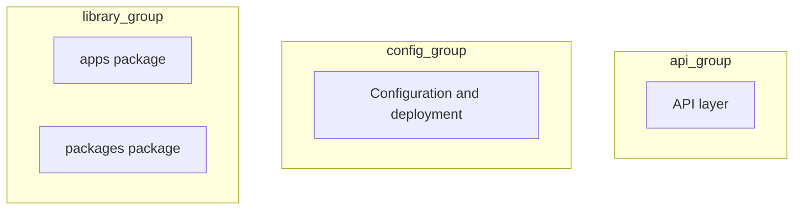

# Architecture report: AykutSarac/jsoncrack.com

> Automated static analysis. **Observed** = directly seen in files/imports/AST; **Inferred** = interpretation from that evidence. Repository code was not executed.

## 1. Repository at a glance

| Item | Value |
| --- | --- |
| Repository | AykutSarac/jsoncrack.com |
| Description | ✨ Innovative and open-source visualization application that transforms various data formats, such as JSON, YAML, XML and CSV into interactive graphs. |
| Language | TypeScript |
| Stars | 44595 |
| Licence | Apache-2.0 |
| Analysed commit / branch | a46d0d0adb098e12e577a083e87ead7f61f90098 / main |
| Framework(s) | Next.js, React |
| Files analysed | 183 |
| Components | 4 |

## 2. Architecture in one minute

AykutSarac/jsoncrack.com - ✨ Innovative and open-source visualization application that transforms various data formats, such as JSON, YAML, XML and CSV into interactive graphs.. This repository was analysed statically from 183 file(s) (0 Python). Detected technologies (observed from imports/manifests): GitHub Actions, Next.js, React, Docker, Docker Compose, TypeScript. Files are grouped into 4 component(s): API layer, apps package, Configuration and deployment, packages package. Findings below distinguish observed facts from inferred interpretation.

## 3. High-level block diagram

## 4. Main components

### API layer (`api_layer`)

- **Kind:** api
- **Status:** Observed
- **Confidence:** 0.85
- **Responsibility:** Groups 11 file(s) under api layer (observed from repository paths and static analysis).
- **Paths:** `apps/www/src/features/editor/views/GraphView/CustomEdge/index.tsx`, `apps/www/src/features/editor/views/GraphView/NotSupported.tsx`, `apps/www/src/features/editor/views/GraphView/OpenInToDiagram.tsx`, `apps/www/src/features/editor/views/GraphView/SecureInfo.tsx`, `apps/www/src/features/editor/views/GraphView/Toolbar/index.tsx`, `apps/www/src/features/editor/views/GraphView/index.tsx`, `apps/www/src/features/editor/views/GraphView/stores/useGraph.ts`, `apps/www/src/features/editor/views/TreeView/Label.tsx`, `apps/www/src/features/editor/views/TreeView/TextRenderer.tsx`, `apps/www/src/features/editor/views/TreeView/Value.tsx`, `apps/www/src/features/editor/views/TreeView/index.tsx`
- **Evidence:** [apps/www/src/features/editor/views/GraphView/CustomEdge/index.tsx](https://github.com/AykutSarac/jsoncrack.com/blob/a46d0d0adb098e12e577a083e87ead7f61f90098/apps/www/src/features/editor/views/GraphView/CustomEdge/index.tsx); [apps/www/src/features/editor/views/GraphView/NotSupported.tsx](https://github.com/AykutSarac/jsoncrack.com/blob/a46d0d0adb098e12e577a083e87ead7f61f90098/apps/www/src/features/editor/views/GraphView/NotSupported.tsx); [apps/www/src/features/editor/views/GraphView/OpenInToDiagram.tsx](https://github.com/AykutSarac/jsoncrack.com/blob/a46d0d0adb098e12e577a083e87ead7f61f90098/apps/www/src/features/editor/views/GraphView/OpenInToDiagram.tsx); [apps/www/src/features/editor/views/GraphView/SecureInfo.tsx](https://github.com/AykutSarac/jsoncrack.com/blob/a46d0d0adb098e12e577a083e87ead7f61f90098/apps/www/src/features/editor/views/GraphView/SecureInfo.tsx); [apps/www/src/features/editor/views/GraphView/Toolbar/index.tsx](https://github.com/AykutSarac/jsoncrack.com/blob/a46d0d0adb098e12e577a083e87ead7f61f90098/apps/www/src/features/editor/views/GraphView/Toolbar/index.tsx); [apps/www/src/features/editor/views/GraphView/index.tsx](https://github.com/AykutSarac/jsoncrack.com/blob/a46d0d0adb098e12e577a083e87ead7f61f90098/apps/www/src/features/editor/views/GraphView/index.tsx); [apps/www/src/features/editor/views/GraphView/stores/useGraph.ts](https://github.com/AykutSarac/jsoncrack.com/blob/a46d0d0adb098e12e577a083e87ead7f61f90098/apps/www/src/features/editor/views/GraphView/stores/useGraph.ts); [apps/www/src/features/editor/views/TreeView/Label.tsx](https://github.com/AykutSarac/jsoncrack.com/blob/a46d0d0adb098e12e577a083e87ead7f61f90098/apps/www/src/features/editor/views/TreeView/Label.tsx)

### apps package (`apps`)

- **Kind:** library
- **Status:** Observed
- **Confidence:** 0.85
- **Responsibility:** Groups 81 file(s) under apps package (observed from repository paths and static analysis).
- **Paths:** `apps/chrome-extension/src/content-script.tsx`, `apps/chrome-extension/src/vite-env.d.ts`, `apps/chrome-extension/vite.config.ts`, `apps/chrome-extension/zip.sh`, `apps/vscode/esbuild.config.mjs`, `apps/vscode/eslint.config.mjs`, `apps/vscode/ext-src/extension.ts`, `apps/vscode/ext-src/webview.ts`, `apps/vscode/src/App.tsx`, `apps/vscode/src/components/NodeModal.tsx`, `apps/vscode/src/env.d.ts`, `apps/vscode/src/index.tsx`, `apps/vscode/vite.config.ts`, `apps/www/eslint.config.mjs`, `apps/www/next-env.d.ts`, `apps/www/next-sitemap.config.js`, `apps/www/next.config.js`, `apps/www/shims/empty.ts`, `apps/www/src/constants/globalStyle.ts`, `apps/www/src/constants/graph.ts`, `apps/www/src/constants/seo.ts`, `apps/www/src/constants/theme.ts`, `apps/www/src/enums/file.enum.ts`, `apps/www/src/enums/viewMode.enum.ts`, `apps/www/src/features/editor/BottomBar.tsx`, `apps/www/src/features/editor/ExternalMode.tsx`, `apps/www/src/features/editor/FullscreenDropzone.tsx`, `apps/www/src/features/editor/LiveEditor.tsx`, `apps/www/src/features/editor/TextEditor.tsx`, `apps/www/src/features/editor/Toolbar/FileMenu.tsx`, `apps/www/src/features/editor/Toolbar/SearchInput.tsx`, `apps/www/src/features/editor/Toolbar/ThemeToggle.tsx`, `apps/www/src/features/editor/Toolbar/ToolsMenu.tsx`, `apps/www/src/features/editor/Toolbar/ViewMenu.tsx`, `apps/www/src/features/editor/Toolbar/index.tsx`, `apps/www/src/features/editor/Toolbar/styles.ts`, `apps/www/src/features/modals/DownloadModal/index.tsx`, `apps/www/src/features/modals/EditorChoiceModal/index.tsx`, `apps/www/src/features/modals/ImportModal/index.tsx`, `apps/www/src/features/modals/JPathModal/index.tsx`, `apps/www/src/features/modals/JQModal/index.tsx`, `apps/www/src/features/modals/ModalController.tsx`, `apps/www/src/features/modals/NodeModal/index.tsx`, `apps/www/src/features/modals/SchemaModal/index.tsx`, `apps/www/src/features/modals/TypeModal/index.tsx`, `apps/www/src/features/modals/index.ts`, `apps/www/src/features/modals/modalTypes.ts`, `apps/www/src/hooks/useFocusNode.ts`, `apps/www/src/hooks/useJsonQuery.ts`, `apps/www/src/layout/JSONCrackBrandLogo.tsx`, `apps/www/src/layout/Landing/FAQ.tsx`, `apps/www/src/layout/Landing/Features.tsx`, `apps/www/src/layout/Landing/HeroPreview.tsx`, `apps/www/src/layout/Landing/HeroSection.tsx`, `apps/www/src/layout/Landing/Section1.tsx`, `apps/www/src/layout/Landing/Section2.tsx`, `apps/www/src/layout/Landing/Section3.tsx`, `apps/www/src/layout/PageLayout/Footer.tsx`, `apps/www/src/layout/PageLayout/Navbar.tsx`, `apps/www/src/layout/PageLayout/index.tsx`, `apps/www/src/lib/utils/helpers.ts`, `apps/www/src/lib/utils/json2go.js`, `apps/www/src/lib/utils/jsonAdapter.ts`, `apps/www/src/lib/utils/mantineColorScheme.ts`, `apps/www/src/lib/utils/search.ts`, `apps/www/src/lib/utils/todiagramHandoff.ts`, `apps/www/src/pages/404.tsx`, `apps/www/src/pages/_app.tsx`, `apps/www/src/pages/_document.tsx`, `apps/www/src/pages/_error.tsx`, `apps/www/src/pages/docs.tsx`, `apps/www/src/pages/editor.tsx`, `apps/www/src/pages/index.tsx`, `apps/www/src/pages/legal/privacy.tsx`, `apps/www/src/pages/legal/terms.tsx`, `apps/www/src/pages/widget.tsx`, `apps/www/src/store/useConfig.ts`, `apps/www/src/store/useFile.ts`, `apps/www/src/store/useJson.ts`, `apps/www/src/store/useModal.ts`, `apps/www/src/types/styled.d.ts`
- **Evidence:** [apps/chrome-extension/src/content-script.tsx](https://github.com/AykutSarac/jsoncrack.com/blob/a46d0d0adb098e12e577a083e87ead7f61f90098/apps/chrome-extension/src/content-script.tsx); [apps/chrome-extension/src/vite-env.d.ts](https://github.com/AykutSarac/jsoncrack.com/blob/a46d0d0adb098e12e577a083e87ead7f61f90098/apps/chrome-extension/src/vite-env.d.ts); [apps/chrome-extension/vite.config.ts](https://github.com/AykutSarac/jsoncrack.com/blob/a46d0d0adb098e12e577a083e87ead7f61f90098/apps/chrome-extension/vite.config.ts); [apps/chrome-extension/zip.sh](https://github.com/AykutSarac/jsoncrack.com/blob/a46d0d0adb098e12e577a083e87ead7f61f90098/apps/chrome-extension/zip.sh); [apps/vscode/esbuild.config.mjs](https://github.com/AykutSarac/jsoncrack.com/blob/a46d0d0adb098e12e577a083e87ead7f61f90098/apps/vscode/esbuild.config.mjs); [apps/vscode/eslint.config.mjs](https://github.com/AykutSarac/jsoncrack.com/blob/a46d0d0adb098e12e577a083e87ead7f61f90098/apps/vscode/eslint.config.mjs); [apps/vscode/ext-src/extension.ts](https://github.com/AykutSarac/jsoncrack.com/blob/a46d0d0adb098e12e577a083e87ead7f61f90098/apps/vscode/ext-src/extension.ts); [apps/vscode/ext-src/webview.ts](https://github.com/AykutSarac/jsoncrack.com/blob/a46d0d0adb098e12e577a083e87ead7f61f90098/apps/vscode/ext-src/webview.ts)

### Configuration and deployment (`config`)

- **Kind:** config
- **Status:** Observed
- **Confidence:** 0.85
- **Responsibility:** Groups 21 file(s) under configuration and deployment (observed from repository paths and static analysis).
- **Paths:** `apps/chrome-extension/package.json`, `apps/chrome-extension/public/manifest.json`, `apps/chrome-extension/tsconfig.json`, `apps/vscode/package.json`, `apps/vscode/tsconfig.json`, `apps/www/.dockerignore`, `apps/www/Dockerfile`, `apps/www/docker-compose.yml`, `apps/www/package.json`, `apps/www/public/manifest.json`, `apps/www/src/data/example.json`, `apps/www/src/data/faq.json`, `apps/www/src/data/privacy.json`, `apps/www/src/data/terms.json`, `apps/www/tsconfig.json`, `package.json`, `packages/jsoncrack-react/package.json`, `packages/jsoncrack-react/tsconfig.build.json`, `packages/jsoncrack-react/tsconfig.json`, `pnpm-workspace.yaml`, `turbo.json`
- **Evidence:** [apps/chrome-extension/package.json](https://github.com/AykutSarac/jsoncrack.com/blob/a46d0d0adb098e12e577a083e87ead7f61f90098/apps/chrome-extension/package.json); [apps/chrome-extension/public/manifest.json](https://github.com/AykutSarac/jsoncrack.com/blob/a46d0d0adb098e12e577a083e87ead7f61f90098/apps/chrome-extension/public/manifest.json); [apps/chrome-extension/tsconfig.json](https://github.com/AykutSarac/jsoncrack.com/blob/a46d0d0adb098e12e577a083e87ead7f61f90098/apps/chrome-extension/tsconfig.json); [apps/vscode/package.json](https://github.com/AykutSarac/jsoncrack.com/blob/a46d0d0adb098e12e577a083e87ead7f61f90098/apps/vscode/package.json); [apps/vscode/tsconfig.json](https://github.com/AykutSarac/jsoncrack.com/blob/a46d0d0adb098e12e577a083e87ead7f61f90098/apps/vscode/tsconfig.json); [apps/www/.dockerignore](https://github.com/AykutSarac/jsoncrack.com/blob/a46d0d0adb098e12e577a083e87ead7f61f90098/apps/www/.dockerignore); [apps/www/Dockerfile](https://github.com/AykutSarac/jsoncrack.com/blob/a46d0d0adb098e12e577a083e87ead7f61f90098/apps/www/Dockerfile); [apps/www/docker-compose.yml](https://github.com/AykutSarac/jsoncrack.com/blob/a46d0d0adb098e12e577a083e87ead7f61f90098/apps/www/docker-compose.yml)

### packages package (`packages`)

- **Kind:** library
- **Status:** Observed
- **Confidence:** 0.85
- **Responsibility:** Groups 22 file(s) under packages package (observed from repository paths and static analysis).
- **Paths:** `packages/jsoncrack-react/eslint.config.mjs`, `packages/jsoncrack-react/src/JSONCrackComponent.tsx`, `packages/jsoncrack-react/src/__tests__/CollapseContext.test.ts`, `packages/jsoncrack-react/src/__tests__/canvasHelpers.test.ts`, `packages/jsoncrack-react/src/__tests__/parser.test.ts`, `packages/jsoncrack-react/src/canvasHelpers.ts`, `packages/jsoncrack-react/src/components/CollapseContext.ts`, `packages/jsoncrack-react/src/components/Controls.tsx`, `packages/jsoncrack-react/src/components/CustomEdge.tsx`, `packages/jsoncrack-react/src/components/CustomNode.tsx`, `packages/jsoncrack-react/src/components/ObjectNode.tsx`, `packages/jsoncrack-react/src/components/TextNode.tsx`, `packages/jsoncrack-react/src/components/TextRenderer.tsx`, `packages/jsoncrack-react/src/components/nodeStyles.ts`, `packages/jsoncrack-react/src/css-modules.d.ts`, `packages/jsoncrack-react/src/index.ts`, `packages/jsoncrack-react/src/parser.ts`, `packages/jsoncrack-react/src/theme.ts`, `packages/jsoncrack-react/src/types.ts`, `packages/jsoncrack-react/src/utils/calculateNodeSize.ts`, `packages/jsoncrack-react/src/utils/colorFormat.ts`, `packages/jsoncrack-react/vite.config.ts`
- **Evidence:** [packages/jsoncrack-react/eslint.config.mjs](https://github.com/AykutSarac/jsoncrack.com/blob/a46d0d0adb098e12e577a083e87ead7f61f90098/packages/jsoncrack-react/eslint.config.mjs); [packages/jsoncrack-react/src/JSONCrackComponent.tsx](https://github.com/AykutSarac/jsoncrack.com/blob/a46d0d0adb098e12e577a083e87ead7f61f90098/packages/jsoncrack-react/src/JSONCrackComponent.tsx); [packages/jsoncrack-react/src/__tests__/CollapseContext.test.ts](https://github.com/AykutSarac/jsoncrack.com/blob/a46d0d0adb098e12e577a083e87ead7f61f90098/packages/jsoncrack-react/src/__tests__/CollapseContext.test.ts); [packages/jsoncrack-react/src/__tests__/canvasHelpers.test.ts](https://github.com/AykutSarac/jsoncrack.com/blob/a46d0d0adb098e12e577a083e87ead7f61f90098/packages/jsoncrack-react/src/__tests__/canvasHelpers.test.ts); [packages/jsoncrack-react/src/__tests__/parser.test.ts](https://github.com/AykutSarac/jsoncrack.com/blob/a46d0d0adb098e12e577a083e87ead7f61f90098/packages/jsoncrack-react/src/__tests__/parser.test.ts); [packages/jsoncrack-react/src/canvasHelpers.ts](https://github.com/AykutSarac/jsoncrack.com/blob/a46d0d0adb098e12e577a083e87ead7f61f90098/packages/jsoncrack-react/src/canvasHelpers.ts); [packages/jsoncrack-react/src/components/CollapseContext.ts](https://github.com/AykutSarac/jsoncrack.com/blob/a46d0d0adb098e12e577a083e87ead7f61f90098/packages/jsoncrack-react/src/components/CollapseContext.ts); [packages/jsoncrack-react/src/components/Controls.tsx](https://github.com/AykutSarac/jsoncrack.com/blob/a46d0d0adb098e12e577a083e87ead7f61f90098/packages/jsoncrack-react/src/components/Controls.tsx)

## 5. Execution flow

**Observed** entry point(s):

- [apps/vscode/src/App.tsx](https://github.com/AykutSarac/jsoncrack.com/blob/a46d0d0adb098e12e577a083e87ead7f61f90098/apps/vscode/src/App.tsx)
- [apps/vscode/src/index.tsx](https://github.com/AykutSarac/jsoncrack.com/blob/a46d0d0adb098e12e577a083e87ead7f61f90098/apps/vscode/src/index.tsx)
- [packages/jsoncrack-react/src/index.ts](https://github.com/AykutSarac/jsoncrack.com/blob/a46d0d0adb098e12e577a083e87ead7f61f90098/packages/jsoncrack-react/src/index.ts)

Representative flow (derived from observed entry points and the import graph; steps beyond the entry point are **Inferred**):

1. Execution starts at an observed entry point listed above, if present.
2. No internal import relationships between components were observed.

## 6. Project structure

### `(root)`

- `.gitignore` - other (313 bytes)
- `CODE_OF_CONDUCT.md` - docs (5487 bytes)
- `CONTRIBUTING.md` - docs (3459 bytes)
- `LICENSE.md` - docs (11342 bytes)
- `README.md` - docs (5609 bytes)
- `package.json` - manifest (1508 bytes)
- `pnpm-workspace.yaml` - config (136 bytes)
- `turbo.json` - config (854 bytes)

### `.github`

- `.github/ISSUE_TEMPLATE/bug_report.yml` - config (1426 bytes)
- `.github/ISSUE_TEMPLATE/feature_request.yml` - config (851 bytes)
- `.github/pull_request_template.md` - docs (1038 bytes)
- `.github/workflows/deploy.yml` - ci, YAML (2308 bytes)
- `.github/workflows/pull-request.yml` - ci, YAML (1524 bytes)

### `.vscode`

- `.vscode/launch.json` - config (353 bytes)
- `.vscode/tasks.json` - config (381 bytes)

### `apps`

- `apps/chrome-extension/.gitignore` - other (11 bytes)
- `apps/chrome-extension/PRIVACY.md` - docs (2134 bytes)
- `apps/chrome-extension/README.md` - docs (811 bytes)
- `apps/chrome-extension/package.json` - manifest (620 bytes)
- `apps/chrome-extension/public/icons/logo.svg` - other (919 bytes)
- `apps/chrome-extension/public/manifest.json` - config (794 bytes)
- `apps/chrome-extension/src/content-script.css` - other (6192 bytes)
- `apps/chrome-extension/src/content-script.tsx` - source, TypeScript (12978 bytes)
- `apps/chrome-extension/src/vite-env.d.ts` - source, TypeScript (124 bytes)
- `apps/chrome-extension/tsconfig.json` - config (469 bytes)
- `apps/chrome-extension/vite.config.ts` - source, TypeScript (802 bytes)
- `apps/chrome-extension/zip.sh` - source, Shell (537 bytes)
- `apps/vscode/.gitignore` - other (27 bytes)
- `apps/vscode/.prettierignore` - other (80 bytes)
- `apps/vscode/.prettierrc` - other (444 bytes)
- `apps/vscode/.vscodeignore` - other (210 bytes)
- `apps/vscode/LICENSE.md` - docs (1076 bytes)
- `apps/vscode/README.md` - docs (2074 bytes)
- `apps/vscode/assets/icon-dark.svg` - other (561 bytes)
- `apps/vscode/assets/icon-light.svg` - other (561 bytes)
- `apps/vscode/esbuild.config.mjs` - source, JavaScript (599 bytes)
- `apps/vscode/eslint.config.mjs` - source, JavaScript (1593 bytes)
- `apps/vscode/ext-src/extension.ts` - source, TypeScript (3284 bytes)
- `apps/vscode/ext-src/webview.ts` - source, TypeScript (1985 bytes)
- `apps/vscode/index.html` - other (356 bytes)
- `apps/vscode/package.json` - manifest (3578 bytes)
- `apps/vscode/src/App.tsx` - source, TypeScript (2509 bytes)
- `apps/vscode/src/components/NodeModal.tsx` - source, TypeScript (1999 bytes)
- `apps/vscode/src/env.d.ts` - source, TypeScript (38 bytes)
- `apps/vscode/src/global.css` - other (204 bytes)
- `apps/vscode/src/index.tsx` - source, TypeScript (336 bytes)
- `apps/vscode/tsconfig.json` - config (430 bytes)
- `apps/vscode/vite.config.ts` - source, TypeScript (706 bytes)
- `apps/www/.dockerignore` - container (72 bytes)
- `apps/www/.gitignore` - other (413 bytes)
- `apps/www/.prettierignore` - other (64 bytes)
- `apps/www/.prettierrc` - other (444 bytes)
- `apps/www/Dockerfile` - container (839 bytes)
- `apps/www/LICENSE.md` - docs (11342 bytes)
- `apps/www/docker-compose.yml` - container (207 bytes)
- `apps/www/eslint.config.mjs` - source, JavaScript (1749 bytes)
- `apps/www/next-env.d.ts` - source, TypeScript (298 bytes)
- `apps/www/next-sitemap.config.js` - source, JavaScript (173 bytes)
- `apps/www/next.config.js` - source, JavaScript (939 bytes)
- `apps/www/nginx.conf` - other (280 bytes)
- `apps/www/package.json` - manifest (2089 bytes)
- `apps/www/public/.nojekyll` - other (0 bytes)
- `apps/www/public/CNAME` - other (13 bytes)
- `apps/www/public/assets/cursor.svg` - other (620 bytes)
- `apps/www/public/assets/open-in-todiagram.svg` - other (22029 bytes)
- `apps/www/public/manifest.json` - config (612 bytes)
- `apps/www/public/robots.txt` - docs (68 bytes)
- `apps/www/public/sitemap-0.xml` - other (928 bytes)
- `apps/www/public/sitemap.xml` - other (187 bytes)
- `apps/www/shims/empty.ts` - source, TypeScript (11 bytes)
- `apps/www/src/constants/globalStyle.ts` - source, TypeScript (782 bytes)
- `apps/www/src/constants/graph.ts` - source, TypeScript (214 bytes)
- `apps/www/src/constants/seo.ts` - source, TypeScript (831 bytes)
- `apps/www/src/constants/theme.ts` - source, TypeScript (2696 bytes)
- `apps/www/src/data/example.json` - config (771 bytes)
- `apps/www/src/data/faq.json` - config (2422 bytes)
- `apps/www/src/data/privacy.json` - config (3243 bytes)
- `apps/www/src/data/terms.json` - config (9563 bytes)
- `apps/www/src/enums/file.enum.ts` - source, TypeScript (1042 bytes)
- `apps/www/src/enums/viewMode.enum.ts` - source, TypeScript (61 bytes)
- `apps/www/src/features/editor/BottomBar.tsx` - source, TypeScript (5346 bytes)
- `apps/www/src/features/editor/ExternalMode.tsx` - source, TypeScript (5949 bytes)
- `apps/www/src/features/editor/FullscreenDropzone.tsx` - source, TypeScript (1903 bytes)
- `apps/www/src/features/editor/LiveEditor.tsx` - source, TypeScript (1092 bytes)
- `apps/www/src/features/editor/TextEditor.tsx` - source, TypeScript (3182 bytes)
- `apps/www/src/features/editor/Toolbar/FileMenu.tsx` - source, TypeScript (1304 bytes)
- `apps/www/src/features/editor/Toolbar/SearchInput.tsx` - source, TypeScript (3316 bytes)
- `apps/www/src/features/editor/Toolbar/ThemeToggle.tsx` - source, TypeScript (576 bytes)
- `apps/www/src/features/editor/Toolbar/ToolsMenu.tsx` - source, TypeScript (1826 bytes)
- `apps/www/src/features/editor/Toolbar/ViewMenu.tsx` - source, TypeScript (1271 bytes)
- `apps/www/src/features/editor/Toolbar/index.tsx` - source, TypeScript (3329 bytes)
- `apps/www/src/features/editor/Toolbar/styles.ts` - source, TypeScript (679 bytes)
- `apps/www/src/features/editor/views/GraphView/CustomEdge/index.tsx` - source, TypeScript (1371 bytes)
- `apps/www/src/features/editor/views/GraphView/NotSupported.tsx` - source, TypeScript (4761 bytes)
- `apps/www/src/features/editor/views/GraphView/OpenInToDiagram.tsx` - source, TypeScript (1392 bytes)
- `apps/www/src/features/editor/views/GraphView/SecureInfo.tsx` - source, TypeScript (781 bytes)
- `apps/www/src/features/editor/views/GraphView/Toolbar/index.tsx` - source, TypeScript (10631 bytes)
- `apps/www/src/features/editor/views/GraphView/index.tsx` - source, TypeScript (3670 bytes)
- `apps/www/src/features/editor/views/GraphView/stores/useGraph.ts` - source, TypeScript (2095 bytes)
- `apps/www/src/features/editor/views/TreeView/Label.tsx` - source, TypeScript (859 bytes)
- `apps/www/src/features/editor/views/TreeView/TextRenderer.tsx` - source, TypeScript (1741 bytes)
- `apps/www/src/features/editor/views/TreeView/Value.tsx` - source, TypeScript (1030 bytes)
- `apps/www/src/features/editor/views/TreeView/index.tsx` - source, TypeScript (832 bytes)
- `apps/www/src/features/modals/DownloadModal/index.tsx` - source, TypeScript (4989 bytes)
- `apps/www/src/features/modals/EditorChoiceModal/index.tsx` - source, TypeScript (6797 bytes)
- `apps/www/src/features/modals/ImportModal/index.tsx` - source, TypeScript (2878 bytes)
- `apps/www/src/features/modals/JPathModal/index.tsx` - source, TypeScript (2142 bytes)
- `apps/www/src/features/modals/JQModal/index.tsx` - source, TypeScript (1336 bytes)
- `apps/www/src/features/modals/ModalController.tsx` - source, TypeScript (624 bytes)
- `apps/www/src/features/modals/NodeModal/index.tsx` - source, TypeScript (3223 bytes)
- `apps/www/src/features/modals/SchemaModal/index.tsx` - source, TypeScript (2834 bytes)
- `apps/www/src/features/modals/TypeModal/index.tsx` - source, TypeScript (2973 bytes)
- `apps/www/src/features/modals/index.ts` - source, TypeScript (301 bytes)
- `apps/www/src/features/modals/modalTypes.ts` - source, TypeScript (274 bytes)
- `apps/www/src/hooks/useFocusNode.ts` - source, TypeScript (1933 bytes)
- `apps/www/src/hooks/useJsonQuery.ts` - source, TypeScript (1023 bytes)
- `apps/www/src/layout/JSONCrackBrandLogo.tsx` - source, TypeScript (1777 bytes)
- `apps/www/src/layout/Landing/FAQ.tsx` - source, TypeScript (1276 bytes)
- `apps/www/src/layout/Landing/Features.tsx` - source, TypeScript (4262 bytes)
- `apps/www/src/layout/Landing/HeroPreview.tsx` - source, TypeScript (575 bytes)
- `apps/www/src/layout/Landing/HeroSection.tsx` - source, TypeScript (4111 bytes)
- `apps/www/src/layout/Landing/Section1.tsx` - source, TypeScript (3852 bytes)
- `apps/www/src/layout/Landing/Section2.tsx` - source, TypeScript (4451 bytes)
- `apps/www/src/layout/Landing/Section3.tsx` - source, TypeScript (2902 bytes)
- `apps/www/src/layout/PageLayout/Footer.tsx` - source, TypeScript (4062 bytes)
- `apps/www/src/layout/PageLayout/Navbar.tsx` - source, TypeScript (3325 bytes)
- `apps/www/src/layout/PageLayout/index.tsx` - source, TypeScript (842 bytes)
- `apps/www/src/lib/utils/helpers.ts` - source, TypeScript (111 bytes)
- `apps/www/src/lib/utils/json2go.js` - source, JavaScript (11521 bytes)
- `apps/www/src/lib/utils/jsonAdapter.ts` - source, TypeScript (2490 bytes)
- `apps/www/src/lib/utils/mantineColorScheme.ts` - source, TypeScript (2507 bytes)
- `apps/www/src/lib/utils/search.ts` - source, TypeScript (544 bytes)
- `apps/www/src/lib/utils/todiagramHandoff.ts` - source, TypeScript (1855 bytes)
- `apps/www/src/pages/404.tsx` - source, TypeScript (1093 bytes)
- `apps/www/src/pages/_app.tsx` - source, TypeScript (3628 bytes)
- `apps/www/src/pages/_document.tsx` - source, TypeScript (1157 bytes)
- `apps/www/src/pages/_error.tsx` - source, TypeScript (1155 bytes)
- `apps/www/src/pages/docs.tsx` - source, TypeScript (9508 bytes)
- `apps/www/src/pages/editor.tsx` - source, TypeScript (5602 bytes)
- `apps/www/src/pages/index.tsx` - source, TypeScript (1433 bytes)
- `apps/www/src/pages/legal/privacy.tsx` - source, TypeScript (1475 bytes)
- `apps/www/src/pages/legal/terms.tsx` - source, TypeScript (1467 bytes)
- `apps/www/src/pages/widget.tsx` - source, TypeScript (3054 bytes)
- `apps/www/src/store/useConfig.ts` - source, TypeScript (894 bytes)
- `apps/www/src/store/useFile.ts` - source, TypeScript (4998 bytes)
- `apps/www/src/store/useJson.ts` - source, TypeScript (519 bytes)
- `apps/www/src/store/useModal.ts` - source, TypeScript (558 bytes)
- `apps/www/src/types/styled.d.ts` - source, TypeScript (263 bytes)
- `apps/www/tsconfig.json` - config (609 bytes)

### `packages`

- `packages/jsoncrack-react/.gitignore` - other (51 bytes)
- `packages/jsoncrack-react/.prettierrc` - other (343 bytes)
- `packages/jsoncrack-react/CHANGELOG.md` - docs (1396 bytes)
- `packages/jsoncrack-react/LICENSE.md` - docs (11342 bytes)
- `packages/jsoncrack-react/README.md` - docs (4172 bytes)
- `packages/jsoncrack-react/eslint.config.mjs` - source, JavaScript (1445 bytes)
- `packages/jsoncrack-react/package.json` - manifest (1891 bytes)
- `packages/jsoncrack-react/src/JSONCrackComponent.tsx` - source, TypeScript (24116 bytes)
- `packages/jsoncrack-react/src/JSONCrackStyles.module.css` - other (1919 bytes)
- `packages/jsoncrack-react/src/__tests__/CollapseContext.test.ts` - source, TypeScript (3658 bytes)
- `packages/jsoncrack-react/src/__tests__/canvasHelpers.test.ts` - source, TypeScript (6553 bytes)
- `packages/jsoncrack-react/src/__tests__/parser.test.ts` - source, TypeScript (4524 bytes)
- `packages/jsoncrack-react/src/canvasHelpers.ts` - source, TypeScript (12043 bytes)
- `packages/jsoncrack-react/src/components/CollapseContext.ts` - source, TypeScript (2117 bytes)
- `packages/jsoncrack-react/src/components/Controls.module.css` - other (555 bytes)
- `packages/jsoncrack-react/src/components/Controls.tsx` - source, TypeScript (871 bytes)
- `packages/jsoncrack-react/src/components/CustomEdge.tsx` - source, TypeScript (1915 bytes)
- `packages/jsoncrack-react/src/components/CustomNode.tsx` - source, TypeScript (1347 bytes)
- `packages/jsoncrack-react/src/components/Node.module.css` - other (1831 bytes)
- `packages/jsoncrack-react/src/components/ObjectNode.tsx` - source, TypeScript (4771 bytes)
- `packages/jsoncrack-react/src/components/TextNode.tsx` - source, TypeScript (1210 bytes)
- `packages/jsoncrack-react/src/components/TextRenderer.module.css` - other (316 bytes)
- `packages/jsoncrack-react/src/components/TextRenderer.tsx` - source, TypeScript (1193 bytes)
- `packages/jsoncrack-react/src/components/nodeStyles.ts` - source, TypeScript (458 bytes)
- `packages/jsoncrack-react/src/css-modules.d.ts` - source, TypeScript (101 bytes)
- `packages/jsoncrack-react/src/index.ts` - source, TypeScript (331 bytes)
- `packages/jsoncrack-react/src/parser.ts` - source, TypeScript (5901 bytes)
- `packages/jsoncrack-react/src/theme.ts` - source, TypeScript (1749 bytes)
- `packages/jsoncrack-react/src/types.ts` - source, TypeScript (666 bytes)
- `packages/jsoncrack-react/src/utils/calculateNodeSize.ts` - source, TypeScript (3580 bytes)
- `packages/jsoncrack-react/src/utils/colorFormat.ts` - source, TypeScript (410 bytes)
- `packages/jsoncrack-react/tsconfig.build.json` - config (440 bytes)
- `packages/jsoncrack-react/tsconfig.json` - config (149 bytes)
- `packages/jsoncrack-react/vite.config.ts` - source, TypeScript (674 bytes)

## 7. Key dependencies and integrations

| Name | Category | Status | Confidence | Evidence |
| --- | --- | --- | --- | --- |
| GitHub Actions | ci | Observed | 0.90 | [.github/workflows/deploy.yml](https://github.com/AykutSarac/jsoncrack.com/blob/a46d0d0adb098e12e577a083e87ead7f61f90098/.github/workflows/deploy.yml); [.github/workflows/pull-request.yml](https://github.com/AykutSarac/jsoncrack.com/blob/a46d0d0adb098e12e577a083e87ead7f61f90098/.github/workflows/pull-request.yml) |
| Next.js | framework | Observed | 0.85 | [apps/www/package.json:7](https://github.com/AykutSarac/jsoncrack.com/blob/a46d0d0adb098e12e577a083e87ead7f61f90098/apps/www/package.json#L7) |
| React | framework | Observed | 0.90 | [apps/chrome-extension/package.json:15](https://github.com/AykutSarac/jsoncrack.com/blob/a46d0d0adb098e12e577a083e87ead7f61f90098/apps/chrome-extension/package.json#L15); [apps/chrome-extension/package.json:17](https://github.com/AykutSarac/jsoncrack.com/blob/a46d0d0adb098e12e577a083e87ead7f61f90098/apps/chrome-extension/package.json#L17); [apps/vscode/package.json:96](https://github.com/AykutSarac/jsoncrack.com/blob/a46d0d0adb098e12e577a083e87ead7f61f90098/apps/vscode/package.json#L96); [apps/vscode/package.json:97](https://github.com/AykutSarac/jsoncrack.com/blob/a46d0d0adb098e12e577a083e87ead7f61f90098/apps/vscode/package.json#L97) |
| Docker | tooling | Observed | 0.85 | [apps/www/Dockerfile](https://github.com/AykutSarac/jsoncrack.com/blob/a46d0d0adb098e12e577a083e87ead7f61f90098/apps/www/Dockerfile) |
| Docker Compose | tooling | Observed | 0.85 | [apps/www/docker-compose.yml](https://github.com/AykutSarac/jsoncrack.com/blob/a46d0d0adb098e12e577a083e87ead7f61f90098/apps/www/docker-compose.yml) |
| TypeScript | tooling | Observed | 0.90 | [apps/chrome-extension/package.json:22](https://github.com/AykutSarac/jsoncrack.com/blob/a46d0d0adb098e12e577a083e87ead7f61f90098/apps/chrome-extension/package.json#L22); [apps/vscode/package.json:99](https://github.com/AykutSarac/jsoncrack.com/blob/a46d0d0adb098e12e577a083e87ead7f61f90098/apps/vscode/package.json#L99); [apps/www/package.json:64](https://github.com/AykutSarac/jsoncrack.com/blob/a46d0d0adb098e12e577a083e87ead7f61f90098/apps/www/package.json#L64); [packages/jsoncrack-react/package.json:19](https://github.com/AykutSarac/jsoncrack.com/blob/a46d0d0adb098e12e577a083e87ead7f61f90098/packages/jsoncrack-react/package.json#L19) |
| Vite | tooling | Observed | 0.90 | [apps/chrome-extension/package.json:8](https://github.com/AykutSarac/jsoncrack.com/blob/a46d0d0adb098e12e577a083e87ead7f61f90098/apps/chrome-extension/package.json#L8); [apps/vscode/package.json:79](https://github.com/AykutSarac/jsoncrack.com/blob/a46d0d0adb098e12e577a083e87ead7f61f90098/apps/vscode/package.json#L79); [packages/jsoncrack-react/package.json:39](https://github.com/AykutSarac/jsoncrack.com/blob/a46d0d0adb098e12e577a083e87ead7f61f90098/packages/jsoncrack-react/package.json#L39) |
| Vitest | tooling | Observed | 0.85 | [packages/jsoncrack-react/package.json:43](https://github.com/AykutSarac/jsoncrack.com/blob/a46d0d0adb098e12e577a083e87ead7f61f90098/packages/jsoncrack-react/package.json#L43) |

## 8. Data and state

No database, cache, queue, or persistent-state usage was observed in the analysed files. State handling, if any, may be in-memory or in files that were not analysed.

## 9. Configuration and deployment clues

- `.github/ISSUE_TEMPLATE/bug_report.yml` (config)
- `.github/ISSUE_TEMPLATE/feature_request.yml` (config)
- `.github/workflows/deploy.yml` (ci)
- `.github/workflows/pull-request.yml` (ci)
- `.vscode/launch.json` (config)
- `.vscode/tasks.json` (config)
- `apps/chrome-extension/package.json` (manifest)
- `apps/chrome-extension/public/manifest.json` (config)
- `apps/chrome-extension/tsconfig.json` (config)
- `apps/vscode/package.json` (manifest)
- `apps/vscode/tsconfig.json` (config)
- `apps/www/.dockerignore` (container)
- `apps/www/Dockerfile` (container)
- `apps/www/docker-compose.yml` (container)
- `apps/www/package.json` (manifest)
- `apps/www/public/manifest.json` (config)
- `apps/www/src/data/example.json` (config)
- `apps/www/src/data/faq.json` (config)
- `apps/www/src/data/privacy.json` (config)
- `apps/www/src/data/terms.json` (config)
- `apps/www/tsconfig.json` (config)
- `package.json` (manifest)
- `packages/jsoncrack-react/package.json` (manifest)
- `packages/jsoncrack-react/tsconfig.build.json` (config)
- `packages/jsoncrack-react/tsconfig.json` (config)
- `pnpm-workspace.yaml` (config)
- `turbo.json` (config)

## 10. Design observations

- An entry/API layer is separated from other code (Inferred from paths and decorators).

These observations are interpretations (**Inferred**) of the observed structure, not guarantees about runtime design.

## 11. Limitations and unknowns

- Static analysis only: repository code was not executed, installed, or imported at runtime.
- Components and relationships are inferred from file paths, imports, and AST structure; runtime behaviour, dynamic imports, and reflection may not be visible.
- 3 file(s) were skipped during inventory (3 x likely secret file excluded).
- No clear application entry point was observed in the analysed files.
- Repository text was treated as untrusted data; no instructions found in repository files were followed, and likely secret values were redacted/excluded.
- JavaScript and TypeScript files were inventoried from paths and package manifests. They were not parsed with a full language AST, and repository code was not executed.

## 12. Source references

- [.github/workflows/deploy.yml](https://github.com/AykutSarac/jsoncrack.com/blob/a46d0d0adb098e12e577a083e87ead7f61f90098/.github/workflows/deploy.yml)
- [.github/workflows/pull-request.yml](https://github.com/AykutSarac/jsoncrack.com/blob/a46d0d0adb098e12e577a083e87ead7f61f90098/.github/workflows/pull-request.yml)
- [apps/chrome-extension/package.json](https://github.com/AykutSarac/jsoncrack.com/blob/a46d0d0adb098e12e577a083e87ead7f61f90098/apps/chrome-extension/package.json)
- [apps/chrome-extension/package.json:8](https://github.com/AykutSarac/jsoncrack.com/blob/a46d0d0adb098e12e577a083e87ead7f61f90098/apps/chrome-extension/package.json#L8)
- [apps/chrome-extension/package.json:15](https://github.com/AykutSarac/jsoncrack.com/blob/a46d0d0adb098e12e577a083e87ead7f61f90098/apps/chrome-extension/package.json#L15)
- [apps/chrome-extension/package.json:17](https://github.com/AykutSarac/jsoncrack.com/blob/a46d0d0adb098e12e577a083e87ead7f61f90098/apps/chrome-extension/package.json#L17)
- [apps/chrome-extension/package.json:22](https://github.com/AykutSarac/jsoncrack.com/blob/a46d0d0adb098e12e577a083e87ead7f61f90098/apps/chrome-extension/package.json#L22)
- [apps/chrome-extension/public/manifest.json](https://github.com/AykutSarac/jsoncrack.com/blob/a46d0d0adb098e12e577a083e87ead7f61f90098/apps/chrome-extension/public/manifest.json)
- [apps/chrome-extension/src/content-script.tsx](https://github.com/AykutSarac/jsoncrack.com/blob/a46d0d0adb098e12e577a083e87ead7f61f90098/apps/chrome-extension/src/content-script.tsx)
- [apps/chrome-extension/src/vite-env.d.ts](https://github.com/AykutSarac/jsoncrack.com/blob/a46d0d0adb098e12e577a083e87ead7f61f90098/apps/chrome-extension/src/vite-env.d.ts)
- [apps/chrome-extension/tsconfig.json](https://github.com/AykutSarac/jsoncrack.com/blob/a46d0d0adb098e12e577a083e87ead7f61f90098/apps/chrome-extension/tsconfig.json)
- [apps/chrome-extension/vite.config.ts](https://github.com/AykutSarac/jsoncrack.com/blob/a46d0d0adb098e12e577a083e87ead7f61f90098/apps/chrome-extension/vite.config.ts)
- [apps/chrome-extension/zip.sh](https://github.com/AykutSarac/jsoncrack.com/blob/a46d0d0adb098e12e577a083e87ead7f61f90098/apps/chrome-extension/zip.sh)
- [apps/vscode/esbuild.config.mjs](https://github.com/AykutSarac/jsoncrack.com/blob/a46d0d0adb098e12e577a083e87ead7f61f90098/apps/vscode/esbuild.config.mjs)
- [apps/vscode/eslint.config.mjs](https://github.com/AykutSarac/jsoncrack.com/blob/a46d0d0adb098e12e577a083e87ead7f61f90098/apps/vscode/eslint.config.mjs)
- [apps/vscode/ext-src/extension.ts](https://github.com/AykutSarac/jsoncrack.com/blob/a46d0d0adb098e12e577a083e87ead7f61f90098/apps/vscode/ext-src/extension.ts)
- [apps/vscode/ext-src/webview.ts](https://github.com/AykutSarac/jsoncrack.com/blob/a46d0d0adb098e12e577a083e87ead7f61f90098/apps/vscode/ext-src/webview.ts)
- [apps/vscode/package.json](https://github.com/AykutSarac/jsoncrack.com/blob/a46d0d0adb098e12e577a083e87ead7f61f90098/apps/vscode/package.json)
- [apps/vscode/package.json:79](https://github.com/AykutSarac/jsoncrack.com/blob/a46d0d0adb098e12e577a083e87ead7f61f90098/apps/vscode/package.json#L79)
- [apps/vscode/package.json:96](https://github.com/AykutSarac/jsoncrack.com/blob/a46d0d0adb098e12e577a083e87ead7f61f90098/apps/vscode/package.json#L96)
- [apps/vscode/package.json:97](https://github.com/AykutSarac/jsoncrack.com/blob/a46d0d0adb098e12e577a083e87ead7f61f90098/apps/vscode/package.json#L97)
- [apps/vscode/package.json:99](https://github.com/AykutSarac/jsoncrack.com/blob/a46d0d0adb098e12e577a083e87ead7f61f90098/apps/vscode/package.json#L99)
- [apps/vscode/src/App.tsx](https://github.com/AykutSarac/jsoncrack.com/blob/a46d0d0adb098e12e577a083e87ead7f61f90098/apps/vscode/src/App.tsx)
- [apps/vscode/src/index.tsx](https://github.com/AykutSarac/jsoncrack.com/blob/a46d0d0adb098e12e577a083e87ead7f61f90098/apps/vscode/src/index.tsx)
- [apps/vscode/tsconfig.json](https://github.com/AykutSarac/jsoncrack.com/blob/a46d0d0adb098e12e577a083e87ead7f61f90098/apps/vscode/tsconfig.json)
- [apps/www/.dockerignore](https://github.com/AykutSarac/jsoncrack.com/blob/a46d0d0adb098e12e577a083e87ead7f61f90098/apps/www/.dockerignore)
- [apps/www/Dockerfile](https://github.com/AykutSarac/jsoncrack.com/blob/a46d0d0adb098e12e577a083e87ead7f61f90098/apps/www/Dockerfile)
- [apps/www/docker-compose.yml](https://github.com/AykutSarac/jsoncrack.com/blob/a46d0d0adb098e12e577a083e87ead7f61f90098/apps/www/docker-compose.yml)
- [apps/www/package.json:7](https://github.com/AykutSarac/jsoncrack.com/blob/a46d0d0adb098e12e577a083e87ead7f61f90098/apps/www/package.json#L7)
- [apps/www/package.json:20](https://github.com/AykutSarac/jsoncrack.com/blob/a46d0d0adb098e12e577a083e87ead7f61f90098/apps/www/package.json#L20)
- [apps/www/package.json:38](https://github.com/AykutSarac/jsoncrack.com/blob/a46d0d0adb098e12e577a083e87ead7f61f90098/apps/www/package.json#L38)
- [apps/www/package.json:64](https://github.com/AykutSarac/jsoncrack.com/blob/a46d0d0adb098e12e577a083e87ead7f61f90098/apps/www/package.json#L64)
- [apps/www/src/features/editor/views/GraphView/CustomEdge/index.tsx](https://github.com/AykutSarac/jsoncrack.com/blob/a46d0d0adb098e12e577a083e87ead7f61f90098/apps/www/src/features/editor/views/GraphView/CustomEdge/index.tsx)
- [apps/www/src/features/editor/views/GraphView/NotSupported.tsx](https://github.com/AykutSarac/jsoncrack.com/blob/a46d0d0adb098e12e577a083e87ead7f61f90098/apps/www/src/features/editor/views/GraphView/NotSupported.tsx)
- [apps/www/src/features/editor/views/GraphView/OpenInToDiagram.tsx](https://github.com/AykutSarac/jsoncrack.com/blob/a46d0d0adb098e12e577a083e87ead7f61f90098/apps/www/src/features/editor/views/GraphView/OpenInToDiagram.tsx)
- [apps/www/src/features/editor/views/GraphView/SecureInfo.tsx](https://github.com/AykutSarac/jsoncrack.com/blob/a46d0d0adb098e12e577a083e87ead7f61f90098/apps/www/src/features/editor/views/GraphView/SecureInfo.tsx)
- [apps/www/src/features/editor/views/GraphView/Toolbar/index.tsx](https://github.com/AykutSarac/jsoncrack.com/blob/a46d0d0adb098e12e577a083e87ead7f61f90098/apps/www/src/features/editor/views/GraphView/Toolbar/index.tsx)
- [apps/www/src/features/editor/views/GraphView/index.tsx](https://github.com/AykutSarac/jsoncrack.com/blob/a46d0d0adb098e12e577a083e87ead7f61f90098/apps/www/src/features/editor/views/GraphView/index.tsx)
- [apps/www/src/features/editor/views/GraphView/stores/useGraph.ts](https://github.com/AykutSarac/jsoncrack.com/blob/a46d0d0adb098e12e577a083e87ead7f61f90098/apps/www/src/features/editor/views/GraphView/stores/useGraph.ts)
- [apps/www/src/features/editor/views/TreeView/Label.tsx](https://github.com/AykutSarac/jsoncrack.com/blob/a46d0d0adb098e12e577a083e87ead7f61f90098/apps/www/src/features/editor/views/TreeView/Label.tsx)
- [packages/jsoncrack-react/eslint.config.mjs](https://github.com/AykutSarac/jsoncrack.com/blob/a46d0d0adb098e12e577a083e87ead7f61f90098/packages/jsoncrack-react/eslint.config.mjs)
- [packages/jsoncrack-react/package.json:2](https://github.com/AykutSarac/jsoncrack.com/blob/a46d0d0adb098e12e577a083e87ead7f61f90098/packages/jsoncrack-react/package.json#L2)
- [packages/jsoncrack-react/package.json:19](https://github.com/AykutSarac/jsoncrack.com/blob/a46d0d0adb098e12e577a083e87ead7f61f90098/packages/jsoncrack-react/package.json#L19)
- [packages/jsoncrack-react/package.json:39](https://github.com/AykutSarac/jsoncrack.com/blob/a46d0d0adb098e12e577a083e87ead7f61f90098/packages/jsoncrack-react/package.json#L39)
- [packages/jsoncrack-react/package.json:43](https://github.com/AykutSarac/jsoncrack.com/blob/a46d0d0adb098e12e577a083e87ead7f61f90098/packages/jsoncrack-react/package.json#L43)
- [packages/jsoncrack-react/package.json:48](https://github.com/AykutSarac/jsoncrack.com/blob/a46d0d0adb098e12e577a083e87ead7f61f90098/packages/jsoncrack-react/package.json#L48)
- [packages/jsoncrack-react/src/JSONCrackComponent.tsx](https://github.com/AykutSarac/jsoncrack.com/blob/a46d0d0adb098e12e577a083e87ead7f61f90098/packages/jsoncrack-react/src/JSONCrackComponent.tsx)
- [packages/jsoncrack-react/src/__tests__/CollapseContext.test.ts](https://github.com/AykutSarac/jsoncrack.com/blob/a46d0d0adb098e12e577a083e87ead7f61f90098/packages/jsoncrack-react/src/__tests__/CollapseContext.test.ts)
- [packages/jsoncrack-react/src/__tests__/canvasHelpers.test.ts](https://github.com/AykutSarac/jsoncrack.com/blob/a46d0d0adb098e12e577a083e87ead7f61f90098/packages/jsoncrack-react/src/__tests__/canvasHelpers.test.ts)
- [packages/jsoncrack-react/src/__tests__/parser.test.ts](https://github.com/AykutSarac/jsoncrack.com/blob/a46d0d0adb098e12e577a083e87ead7f61f90098/packages/jsoncrack-react/src/__tests__/parser.test.ts)
- [packages/jsoncrack-react/src/canvasHelpers.ts](https://github.com/AykutSarac/jsoncrack.com/blob/a46d0d0adb098e12e577a083e87ead7f61f90098/packages/jsoncrack-react/src/canvasHelpers.ts)
- [packages/jsoncrack-react/src/components/CollapseContext.ts](https://github.com/AykutSarac/jsoncrack.com/blob/a46d0d0adb098e12e577a083e87ead7f61f90098/packages/jsoncrack-react/src/components/CollapseContext.ts)
- [packages/jsoncrack-react/src/components/Controls.tsx](https://github.com/AykutSarac/jsoncrack.com/blob/a46d0d0adb098e12e577a083e87ead7f61f90098/packages/jsoncrack-react/src/components/Controls.tsx)
- [packages/jsoncrack-react/src/index.ts](https://github.com/AykutSarac/jsoncrack.com/blob/a46d0d0adb098e12e577a083e87ead7f61f90098/packages/jsoncrack-react/src/index.ts)
