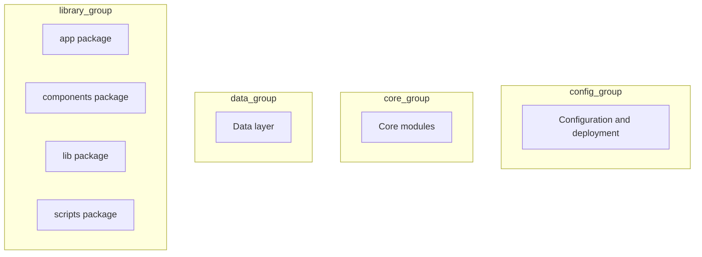

# Architecture report: BartoszJarocki/cv

> Automated static analysis. **Observed** = directly seen in files/imports/AST; **Inferred** = interpretation from that evidence. Repository code was not executed.

## 1. Repository at a glance

| Item | Value |
| --- | --- |
| Repository | BartoszJarocki/cv |
| Description | Print-friendly, minimalist CV page |
| Language | TypeScript |
| Stars | 9677 |
| Licence | MIT |
| Analysed commit / branch | 8faa527766b0504f4a016bc283dbd960b0707314 / main |
| Framework(s) | Next.js, React |
| Files analysed | 44 |
| Components | 7 |

## 2. Architecture in one minute

BartoszJarocki/cv - Print-friendly, minimalist CV page. This repository was analysed statically from 44 file(s) (0 Python). Detected technologies (observed from imports/manifests): GitHub Actions, Next.js, React, Tailwind CSS, TypeScript. Files are grouped into 7 component(s): app package, components package, Configuration and deployment, Core modules, Data layer, lib package, scripts package. Findings below distinguish observed facts from inferred interpretation.

## 3. High-level block diagram

## 4. Main components

### app package (`app`)

- **Kind:** library
- **Status:** Observed
- **Confidence:** 0.85
- **Responsibility:** Groups 14 file(s) under app package (observed from repository paths and static analysis).
- **Paths:** `src/app/components/education.tsx`, `src/app/components/header.tsx`, `src/app/components/projects.tsx`, `src/app/components/skills.tsx`, `src/app/components/summary.tsx`, `src/app/components/work-experience.tsx`, `src/app/index.md/route.ts`, `src/app/index.txt/route.ts`, `src/app/layout.tsx`, `src/app/llms.txt/route.ts`, `src/app/opengraph-image.tsx`, `src/app/page.tsx`, `src/app/robots.ts`, `src/app/sitemap.ts`
- **Evidence:** [src/app/components/education.tsx](https://github.com/BartoszJarocki/cv/blob/8faa527766b0504f4a016bc283dbd960b0707314/src/app/components/education.tsx); [src/app/components/header.tsx](https://github.com/BartoszJarocki/cv/blob/8faa527766b0504f4a016bc283dbd960b0707314/src/app/components/header.tsx); [src/app/components/projects.tsx](https://github.com/BartoszJarocki/cv/blob/8faa527766b0504f4a016bc283dbd960b0707314/src/app/components/projects.tsx); [src/app/components/skills.tsx](https://github.com/BartoszJarocki/cv/blob/8faa527766b0504f4a016bc283dbd960b0707314/src/app/components/skills.tsx); [src/app/components/summary.tsx](https://github.com/BartoszJarocki/cv/blob/8faa527766b0504f4a016bc283dbd960b0707314/src/app/components/summary.tsx); [src/app/components/work-experience.tsx](https://github.com/BartoszJarocki/cv/blob/8faa527766b0504f4a016bc283dbd960b0707314/src/app/components/work-experience.tsx); [src/app/index.md/route.ts](https://github.com/BartoszJarocki/cv/blob/8faa527766b0504f4a016bc283dbd960b0707314/src/app/index.md/route.ts); [src/app/index.txt/route.ts](https://github.com/BartoszJarocki/cv/blob/8faa527766b0504f4a016bc283dbd960b0707314/src/app/index.txt/route.ts)

### components package (`components`)

- **Kind:** library
- **Status:** Observed
- **Confidence:** 0.85
- **Responsibility:** Groups 9 file(s) under components package (observed from repository paths and static analysis).
- **Paths:** `src/components/command-menu-dialog.tsx`, `src/components/command-menu.tsx`, `src/components/icons/github-icon.tsx`, `src/components/icons/linkedin-icon.tsx`, `src/components/icons/x-icon.tsx`, `src/components/ui/date-range.tsx`, `src/components/ui/external-arrow.tsx`, `src/components/ui/section.tsx`, `src/components/ui/tag-list.tsx`
- **Evidence:** [src/components/command-menu-dialog.tsx](https://github.com/BartoszJarocki/cv/blob/8faa527766b0504f4a016bc283dbd960b0707314/src/components/command-menu-dialog.tsx); [src/components/command-menu.tsx](https://github.com/BartoszJarocki/cv/blob/8faa527766b0504f4a016bc283dbd960b0707314/src/components/command-menu.tsx); [src/components/icons/github-icon.tsx](https://github.com/BartoszJarocki/cv/blob/8faa527766b0504f4a016bc283dbd960b0707314/src/components/icons/github-icon.tsx); [src/components/icons/linkedin-icon.tsx](https://github.com/BartoszJarocki/cv/blob/8faa527766b0504f4a016bc283dbd960b0707314/src/components/icons/linkedin-icon.tsx); [src/components/icons/x-icon.tsx](https://github.com/BartoszJarocki/cv/blob/8faa527766b0504f4a016bc283dbd960b0707314/src/components/icons/x-icon.tsx); [src/components/ui/date-range.tsx](https://github.com/BartoszJarocki/cv/blob/8faa527766b0504f4a016bc283dbd960b0707314/src/components/ui/date-range.tsx); [src/components/ui/external-arrow.tsx](https://github.com/BartoszJarocki/cv/blob/8faa527766b0504f4a016bc283dbd960b0707314/src/components/ui/external-arrow.tsx); [src/components/ui/section.tsx](https://github.com/BartoszJarocki/cv/blob/8faa527766b0504f4a016bc283dbd960b0707314/src/components/ui/section.tsx)

### Configuration and deployment (`config`)

- **Kind:** config
- **Status:** Observed
- **Confidence:** 0.85
- **Responsibility:** Groups 4 file(s) under configuration and deployment (observed from repository paths and static analysis).
- **Paths:** `biome.json`, `package.json`, `pnpm-workspace.yaml`, `tsconfig.json`
- **Evidence:** [biome.json](https://github.com/BartoszJarocki/cv/blob/8faa527766b0504f4a016bc283dbd960b0707314/biome.json); [package.json](https://github.com/BartoszJarocki/cv/blob/8faa527766b0504f4a016bc283dbd960b0707314/package.json); [pnpm-workspace.yaml](https://github.com/BartoszJarocki/cv/blob/8faa527766b0504f4a016bc283dbd960b0707314/pnpm-workspace.yaml); [tsconfig.json](https://github.com/BartoszJarocki/cv/blob/8faa527766b0504f4a016bc283dbd960b0707314/tsconfig.json)

### Core modules (`core`)

- **Kind:** core
- **Status:** Observed
- **Confidence:** 0.85
- **Responsibility:** Groups 3 file(s) under core modules (observed from repository paths and static analysis).
- **Paths:** `next.config.js`, `postcss.config.js`, `tailwind.config.js`
- **Evidence:** [next.config.js](https://github.com/BartoszJarocki/cv/blob/8faa527766b0504f4a016bc283dbd960b0707314/next.config.js); [postcss.config.js](https://github.com/BartoszJarocki/cv/blob/8faa527766b0504f4a016bc283dbd960b0707314/postcss.config.js); [tailwind.config.js](https://github.com/BartoszJarocki/cv/blob/8faa527766b0504f4a016bc283dbd960b0707314/tailwind.config.js)

### Data layer (`data_layer`)

- **Kind:** data
- **Status:** Observed
- **Confidence:** 0.85
- **Responsibility:** Groups 1 file(s) under data layer (observed from repository paths and static analysis).
- **Paths:** `src/data/resume-data.ts`
- **Evidence:** [src/data/resume-data.ts](https://github.com/BartoszJarocki/cv/blob/8faa527766b0504f4a016bc283dbd960b0707314/src/data/resume-data.ts)

### lib package (`lib`)

- **Kind:** library
- **Status:** Observed
- **Confidence:** 0.85
- **Responsibility:** Groups 7 file(s) under lib package (observed from repository paths and static analysis).
- **Paths:** `src/lib/document.ts`, `src/lib/markdown.ts`, `src/lib/resume.ts`, `src/lib/structured-data.ts`, `src/lib/text.ts`, `src/lib/types.ts`, `src/lib/utils.ts`
- **Evidence:** [src/lib/document.ts](https://github.com/BartoszJarocki/cv/blob/8faa527766b0504f4a016bc283dbd960b0707314/src/lib/document.ts); [src/lib/markdown.ts](https://github.com/BartoszJarocki/cv/blob/8faa527766b0504f4a016bc283dbd960b0707314/src/lib/markdown.ts); [src/lib/resume.ts](https://github.com/BartoszJarocki/cv/blob/8faa527766b0504f4a016bc283dbd960b0707314/src/lib/resume.ts); [src/lib/structured-data.ts](https://github.com/BartoszJarocki/cv/blob/8faa527766b0504f4a016bc283dbd960b0707314/src/lib/structured-data.ts); [src/lib/text.ts](https://github.com/BartoszJarocki/cv/blob/8faa527766b0504f4a016bc283dbd960b0707314/src/lib/text.ts); [src/lib/types.ts](https://github.com/BartoszJarocki/cv/blob/8faa527766b0504f4a016bc283dbd960b0707314/src/lib/types.ts); [src/lib/utils.ts](https://github.com/BartoszJarocki/cv/blob/8faa527766b0504f4a016bc283dbd960b0707314/src/lib/utils.ts)

### scripts package (`scripts`)

- **Kind:** library
- **Status:** Observed
- **Confidence:** 0.85
- **Responsibility:** Groups 1 file(s) under scripts package (observed from repository paths and static analysis).
- **Paths:** `scripts/verify.mjs`
- **Evidence:** [scripts/verify.mjs](https://github.com/BartoszJarocki/cv/blob/8faa527766b0504f4a016bc283dbd960b0707314/scripts/verify.mjs)

## 5. Execution flow

**Observed** entry point(s):

- [src/app/page.tsx](https://github.com/BartoszJarocki/cv/blob/8faa527766b0504f4a016bc283dbd960b0707314/src/app/page.tsx)

Representative flow (derived from observed entry points and the import graph; steps beyond the entry point are **Inferred**):

1. Execution starts at an observed entry point listed above, if present.
2. No internal import relationships between components were observed.

## 6. Project structure

### `(root)`

- `.gitignore` - other (403 bytes)
- `LICENSE` - docs (1072 bytes)
- `README.md` - docs (6248 bytes)
- `biome.json` - config (4193 bytes)
- `next.config.js` - source, JavaScript (825 bytes)
- `package.json` - manifest (1089 bytes)
- `pnpm-workspace.yaml` - config (405 bytes)
- `postcss.config.js` - source, JavaScript (82 bytes)
- `tailwind.config.js` - source, JavaScript (1213 bytes)
- `tsconfig.json` - config (702 bytes)

### `.github`

- `.github/workflows/ci.yml` - ci, YAML (408 bytes)

### `scripts`

- `scripts/verify.mjs` - source, JavaScript (19402 bytes)

### `src`

- `src/app/components/education.tsx` - source, TypeScript (1300 bytes)
- `src/app/components/header.tsx` - source, TypeScript (3751 bytes)
- `src/app/components/projects.tsx` - source, TypeScript (2126 bytes)
- `src/app/components/skills.tsx` - source, TypeScript (437 bytes)
- `src/app/components/summary.tsx` - source, TypeScript (508 bytes)
- `src/app/components/work-experience.tsx` - source, TypeScript (2490 bytes)
- `src/app/globals.css` - other (1381 bytes)
- `src/app/index.md/route.ts` - source, TypeScript (384 bytes)
- `src/app/index.txt/route.ts` - source, TypeScript (381 bytes)
- `src/app/layout.tsx` - source, TypeScript (2206 bytes)
- `src/app/llms.txt/route.ts` - source, TypeScript (344 bytes)
- `src/app/opengraph-image.tsx` - source, TypeScript (3653 bytes)
- `src/app/page.tsx` - source, TypeScript (2075 bytes)
- `src/app/robots.ts` - source, TypeScript (276 bytes)
- `src/app/sitemap.ts` - source, TypeScript (301 bytes)
- `src/components/command-menu-dialog.tsx` - source, TypeScript (4653 bytes)
- `src/components/command-menu.tsx` - source, TypeScript (1510 bytes)
- `src/components/icons/github-icon.tsx` - source, TypeScript (978 bytes)
- `src/components/icons/linkedin-icon.tsx` - source, TypeScript (768 bytes)
- `src/components/icons/x-icon.tsx` - source, TypeScript (403 bytes)
- `src/components/ui/date-range.tsx` - source, TypeScript (383 bytes)
- `src/components/ui/external-arrow.tsx` - source, TypeScript (190 bytes)
- `src/components/ui/section.tsx` - source, TypeScript (572 bytes)
- `src/components/ui/tag-list.tsx` - source, TypeScript (969 bytes)
- `src/data/resume-data.ts` - source, TypeScript (5833 bytes)
- `src/lib/document.ts` - source, TypeScript (3104 bytes)
- `src/lib/markdown.ts` - source, TypeScript (1871 bytes)
- `src/lib/resume.ts` - source, TypeScript (2216 bytes)
- `src/lib/structured-data.ts` - source, TypeScript (1181 bytes)
- `src/lib/text.ts` - source, TypeScript (4744 bytes)
- `src/lib/types.ts` - source, TypeScript (984 bytes)
- `src/lib/utils.ts` - source, TypeScript (169 bytes)

## 7. Key dependencies and integrations

| Name | Category | Status | Confidence | Evidence |
| --- | --- | --- | --- | --- |
| GitHub Actions | ci | Observed | 0.85 | [.github/workflows/ci.yml](https://github.com/BartoszJarocki/cv/blob/8faa527766b0504f4a016bc283dbd960b0707314/.github/workflows/ci.yml) |
| Next.js | framework | Observed | 0.85 | [package.json:7](https://github.com/BartoszJarocki/cv/blob/8faa527766b0504f4a016bc283dbd960b0707314/package.json#L7) |
| React | framework | Observed | 0.90 | [package.json:19](https://github.com/BartoszJarocki/cv/blob/8faa527766b0504f4a016bc283dbd960b0707314/package.json#L19); [package.json:27](https://github.com/BartoszJarocki/cv/blob/8faa527766b0504f4a016bc283dbd960b0707314/package.json#L27) |
| Tailwind CSS | library | Observed | 0.85 | [package.json:29](https://github.com/BartoszJarocki/cv/blob/8faa527766b0504f4a016bc283dbd960b0707314/package.json#L29) |
| TypeScript | tooling | Observed | 0.85 | [package.json:39](https://github.com/BartoszJarocki/cv/blob/8faa527766b0504f4a016bc283dbd960b0707314/package.json#L39) |

## 8. Data and state

- Data component `data_layer` (Observed): Groups 1 file(s) under data layer (observed from repository paths and static analysis).

## 9. Configuration and deployment clues

- `.github/workflows/ci.yml` (ci)
- `biome.json` (config)
- `package.json` (manifest)
- `pnpm-workspace.yaml` (config)
- `tsconfig.json` (config)

## 10. Design observations

- Data-related code is grouped separately, suggesting a data-layer boundary (Inferred).

These observations are interpretations (**Inferred**) of the observed structure, not guarantees about runtime design.

## 11. Limitations and unknowns

- Static analysis only: repository code was not executed, installed, or imported at runtime.
- Components and relationships are inferred from file paths, imports, and AST structure; runtime behaviour, dynamic imports, and reflection may not be visible.
- 1 file(s) were skipped during inventory (1 x lockfile excluded).
- No clear application entry point was observed in the analysed files.
- Repository text was treated as untrusted data; no instructions found in repository files were followed, and likely secret values were redacted/excluded.
- JavaScript and TypeScript files were inventoried from paths and package manifests. They were not parsed with a full language AST, and repository code was not executed.

## 12. Source references

- [.github/workflows/ci.yml](https://github.com/BartoszJarocki/cv/blob/8faa527766b0504f4a016bc283dbd960b0707314/.github/workflows/ci.yml)
- [biome.json](https://github.com/BartoszJarocki/cv/blob/8faa527766b0504f4a016bc283dbd960b0707314/biome.json)
- [next.config.js](https://github.com/BartoszJarocki/cv/blob/8faa527766b0504f4a016bc283dbd960b0707314/next.config.js)
- [package.json](https://github.com/BartoszJarocki/cv/blob/8faa527766b0504f4a016bc283dbd960b0707314/package.json)
- [package.json:7](https://github.com/BartoszJarocki/cv/blob/8faa527766b0504f4a016bc283dbd960b0707314/package.json#L7)
- [package.json:19](https://github.com/BartoszJarocki/cv/blob/8faa527766b0504f4a016bc283dbd960b0707314/package.json#L19)
- [package.json:27](https://github.com/BartoszJarocki/cv/blob/8faa527766b0504f4a016bc283dbd960b0707314/package.json#L27)
- [package.json:29](https://github.com/BartoszJarocki/cv/blob/8faa527766b0504f4a016bc283dbd960b0707314/package.json#L29)
- [package.json:39](https://github.com/BartoszJarocki/cv/blob/8faa527766b0504f4a016bc283dbd960b0707314/package.json#L39)
- [pnpm-workspace.yaml](https://github.com/BartoszJarocki/cv/blob/8faa527766b0504f4a016bc283dbd960b0707314/pnpm-workspace.yaml)
- [postcss.config.js](https://github.com/BartoszJarocki/cv/blob/8faa527766b0504f4a016bc283dbd960b0707314/postcss.config.js)
- [scripts/verify.mjs](https://github.com/BartoszJarocki/cv/blob/8faa527766b0504f4a016bc283dbd960b0707314/scripts/verify.mjs)
- [src/app/components/education.tsx](https://github.com/BartoszJarocki/cv/blob/8faa527766b0504f4a016bc283dbd960b0707314/src/app/components/education.tsx)
- [src/app/components/header.tsx](https://github.com/BartoszJarocki/cv/blob/8faa527766b0504f4a016bc283dbd960b0707314/src/app/components/header.tsx)
- [src/app/components/projects.tsx](https://github.com/BartoszJarocki/cv/blob/8faa527766b0504f4a016bc283dbd960b0707314/src/app/components/projects.tsx)
- [src/app/components/skills.tsx](https://github.com/BartoszJarocki/cv/blob/8faa527766b0504f4a016bc283dbd960b0707314/src/app/components/skills.tsx)
- [src/app/components/summary.tsx](https://github.com/BartoszJarocki/cv/blob/8faa527766b0504f4a016bc283dbd960b0707314/src/app/components/summary.tsx)
- [src/app/components/work-experience.tsx](https://github.com/BartoszJarocki/cv/blob/8faa527766b0504f4a016bc283dbd960b0707314/src/app/components/work-experience.tsx)
- [src/app/index.md/route.ts](https://github.com/BartoszJarocki/cv/blob/8faa527766b0504f4a016bc283dbd960b0707314/src/app/index.md/route.ts)
- [src/app/index.txt/route.ts](https://github.com/BartoszJarocki/cv/blob/8faa527766b0504f4a016bc283dbd960b0707314/src/app/index.txt/route.ts)
- [src/app/page.tsx](https://github.com/BartoszJarocki/cv/blob/8faa527766b0504f4a016bc283dbd960b0707314/src/app/page.tsx)
- [src/components/command-menu-dialog.tsx](https://github.com/BartoszJarocki/cv/blob/8faa527766b0504f4a016bc283dbd960b0707314/src/components/command-menu-dialog.tsx)
- [src/components/command-menu.tsx](https://github.com/BartoszJarocki/cv/blob/8faa527766b0504f4a016bc283dbd960b0707314/src/components/command-menu.tsx)
- [src/components/icons/github-icon.tsx](https://github.com/BartoszJarocki/cv/blob/8faa527766b0504f4a016bc283dbd960b0707314/src/components/icons/github-icon.tsx)
- [src/components/icons/linkedin-icon.tsx](https://github.com/BartoszJarocki/cv/blob/8faa527766b0504f4a016bc283dbd960b0707314/src/components/icons/linkedin-icon.tsx)
- [src/components/icons/x-icon.tsx](https://github.com/BartoszJarocki/cv/blob/8faa527766b0504f4a016bc283dbd960b0707314/src/components/icons/x-icon.tsx)
- [src/components/ui/date-range.tsx](https://github.com/BartoszJarocki/cv/blob/8faa527766b0504f4a016bc283dbd960b0707314/src/components/ui/date-range.tsx)
- [src/components/ui/external-arrow.tsx](https://github.com/BartoszJarocki/cv/blob/8faa527766b0504f4a016bc283dbd960b0707314/src/components/ui/external-arrow.tsx)
- [src/components/ui/section.tsx](https://github.com/BartoszJarocki/cv/blob/8faa527766b0504f4a016bc283dbd960b0707314/src/components/ui/section.tsx)
- [src/data/resume-data.ts](https://github.com/BartoszJarocki/cv/blob/8faa527766b0504f4a016bc283dbd960b0707314/src/data/resume-data.ts)
- [src/lib/document.ts](https://github.com/BartoszJarocki/cv/blob/8faa527766b0504f4a016bc283dbd960b0707314/src/lib/document.ts)
- [src/lib/markdown.ts](https://github.com/BartoszJarocki/cv/blob/8faa527766b0504f4a016bc283dbd960b0707314/src/lib/markdown.ts)
- [src/lib/resume.ts](https://github.com/BartoszJarocki/cv/blob/8faa527766b0504f4a016bc283dbd960b0707314/src/lib/resume.ts)
- [src/lib/structured-data.ts](https://github.com/BartoszJarocki/cv/blob/8faa527766b0504f4a016bc283dbd960b0707314/src/lib/structured-data.ts)
- [src/lib/text.ts](https://github.com/BartoszJarocki/cv/blob/8faa527766b0504f4a016bc283dbd960b0707314/src/lib/text.ts)
- [src/lib/types.ts](https://github.com/BartoszJarocki/cv/blob/8faa527766b0504f4a016bc283dbd960b0707314/src/lib/types.ts)
- [src/lib/utils.ts](https://github.com/BartoszJarocki/cv/blob/8faa527766b0504f4a016bc283dbd960b0707314/src/lib/utils.ts)
- [tailwind.config.js](https://github.com/BartoszJarocki/cv/blob/8faa527766b0504f4a016bc283dbd960b0707314/tailwind.config.js)
- [tsconfig.json](https://github.com/BartoszJarocki/cv/blob/8faa527766b0504f4a016bc283dbd960b0707314/tsconfig.json)
