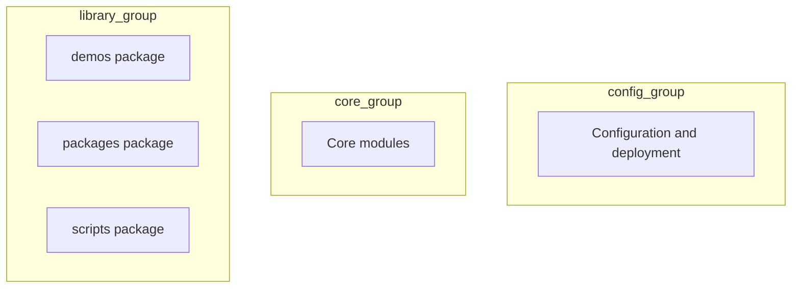

# Architecture report: BetaSu/big-react

> Automated static analysis. **Observed** = directly seen in files/imports/AST; **Inferred** = interpretation from that evidence. Repository code was not executed.

## 1. Repository at a glance

| Item | Value |
| --- | --- |
| Repository | BetaSu/big-react |
| Description | 跟着我，从0实现React18 |
| Language | TypeScript |
| Stars | 3898 |
| Licence | Not detected |
| Analysed commit / branch | 0b5bb94d3bb750bed2255b4519eed0d4fb6aed53 / master |
| Framework(s) | React |
| Files analysed | 104 |
| Components | 5 |

## 2. Architecture in one minute

BetaSu/big-react - 跟着我，从0实现React18. This repository was analysed statically from 104 file(s) (0 Python). Detected technologies (observed from imports/manifests): React, Jest, TypeScript, Vite. Files are grouped into 5 component(s): Configuration and deployment, Core modules, demos package, packages package, scripts package. Findings below distinguish observed facts from inferred interpretation.

## 3. High-level block diagram

## 4. Main components

### Configuration and deployment (`config`)

- **Kind:** config
- **Status:** Observed
- **Confidence:** 0.85
- **Responsibility:** Groups 8 file(s) under configuration and deployment (observed from repository paths and static analysis).
- **Paths:** `package.json`, `packages/react-dom/package.json`, `packages/react-noop-renderer/package.json`, `packages/react-reconciler/package.json`, `packages/react/package.json`, `packages/shared/package.json`, `pnpm-workspace.yaml`, `tsconfig.json`
- **Evidence:** [package.json](https://github.com/BetaSu/big-react/blob/0b5bb94d3bb750bed2255b4519eed0d4fb6aed53/package.json); [packages/react-dom/package.json](https://github.com/BetaSu/big-react/blob/0b5bb94d3bb750bed2255b4519eed0d4fb6aed53/packages/react-dom/package.json); [packages/react-noop-renderer/package.json](https://github.com/BetaSu/big-react/blob/0b5bb94d3bb750bed2255b4519eed0d4fb6aed53/packages/react-noop-renderer/package.json); [packages/react-reconciler/package.json](https://github.com/BetaSu/big-react/blob/0b5bb94d3bb750bed2255b4519eed0d4fb6aed53/packages/react-reconciler/package.json); [packages/react/package.json](https://github.com/BetaSu/big-react/blob/0b5bb94d3bb750bed2255b4519eed0d4fb6aed53/packages/react/package.json); [packages/shared/package.json](https://github.com/BetaSu/big-react/blob/0b5bb94d3bb750bed2255b4519eed0d4fb6aed53/packages/shared/package.json); [pnpm-workspace.yaml](https://github.com/BetaSu/big-react/blob/0b5bb94d3bb750bed2255b4519eed0d4fb6aed53/pnpm-workspace.yaml); [tsconfig.json](https://github.com/BetaSu/big-react/blob/0b5bb94d3bb750bed2255b4519eed0d4fb6aed53/tsconfig.json)

### Core modules (`core`)

- **Kind:** core
- **Status:** Observed
- **Confidence:** 0.85
- **Responsibility:** Groups 1 file(s) under core modules (observed from repository paths and static analysis).
- **Paths:** `babel.config.js`
- **Evidence:** [babel.config.js](https://github.com/BetaSu/big-react/blob/0b5bb94d3bb750bed2255b4519eed0d4fb6aed53/babel.config.js)

### demos package (`demos`)

- **Kind:** library
- **Status:** Observed
- **Confidence:** 0.85
- **Responsibility:** Groups 25 file(s) under demos package (observed from repository paths and static analysis).
- **Paths:** `demos/context/main.tsx`, `demos/context/vite-env.d.ts`, `demos/performance/Context.tsx`, `demos/performance/Hook.tsx`, `demos/performance/Principle_demo1.tsx`, `demos/performance/Principle_demo2.tsx`, `demos/performance/Simple.tsx`, `demos/performance/main.tsx`, `demos/performance/memo.tsx`, `demos/performance/useMemo.tsx`, `demos/performance/vite-env.d.ts`, `demos/ref/main.tsx`, `demos/ref/vite-env.d.ts`, `demos/suspense-lazy/Cpn.tsx`, `demos/suspense-lazy/main.tsx`, `demos/suspense-use/Cpn.tsx`, `demos/suspense-use/main.tsx`, `demos/suspense-use/vite-env.d.ts`, `demos/test-fc/main.ts`, `demos/test-fc/main.tsx`, `demos/transition/AboutTab.tsx`, `demos/transition/ContactTab.tsx`, `demos/transition/PostsTab.tsx`, `demos/transition/TabButton.tsx`, `demos/transition/main.tsx`
- **Evidence:** [demos/context/main.tsx](https://github.com/BetaSu/big-react/blob/0b5bb94d3bb750bed2255b4519eed0d4fb6aed53/demos/context/main.tsx); [demos/context/vite-env.d.ts](https://github.com/BetaSu/big-react/blob/0b5bb94d3bb750bed2255b4519eed0d4fb6aed53/demos/context/vite-env.d.ts); [demos/performance/Context.tsx](https://github.com/BetaSu/big-react/blob/0b5bb94d3bb750bed2255b4519eed0d4fb6aed53/demos/performance/Context.tsx); [demos/performance/Hook.tsx](https://github.com/BetaSu/big-react/blob/0b5bb94d3bb750bed2255b4519eed0d4fb6aed53/demos/performance/Hook.tsx); [demos/performance/Principle_demo1.tsx](https://github.com/BetaSu/big-react/blob/0b5bb94d3bb750bed2255b4519eed0d4fb6aed53/demos/performance/Principle_demo1.tsx); [demos/performance/Principle_demo2.tsx](https://github.com/BetaSu/big-react/blob/0b5bb94d3bb750bed2255b4519eed0d4fb6aed53/demos/performance/Principle_demo2.tsx); [demos/performance/Simple.tsx](https://github.com/BetaSu/big-react/blob/0b5bb94d3bb750bed2255b4519eed0d4fb6aed53/demos/performance/Simple.tsx); [demos/performance/main.tsx](https://github.com/BetaSu/big-react/blob/0b5bb94d3bb750bed2255b4519eed0d4fb6aed53/demos/performance/main.tsx)

### packages package (`packages`)

- **Kind:** library
- **Status:** Observed
- **Confidence:** 0.85
- **Responsibility:** Groups 43 file(s) under packages package (observed from repository paths and static analysis).
- **Paths:** `packages/react-dom/client.ts`, `packages/react-dom/index.ts`, `packages/react-dom/src/SyntheticEvent.ts`, `packages/react-dom/src/hostConfig.ts`, `packages/react-dom/src/root.ts`, `packages/react-dom/test-utils.ts`, `packages/react-noop-renderer/index.ts`, `packages/react-noop-renderer/src/hostConfig.ts`, `packages/react-noop-renderer/src/root.ts`, `packages/react-reconciler/src/__tests__/ReactEffectOrdering-test.js`, `packages/react-reconciler/src/beginWork.ts`, `packages/react-reconciler/src/childFibers.ts`, `packages/react-reconciler/src/commitWork.ts`, `packages/react-reconciler/src/completeWork.ts`, `packages/react-reconciler/src/fiber.ts`, `packages/react-reconciler/src/fiberContext.ts`, `packages/react-reconciler/src/fiberFlags.ts`, `packages/react-reconciler/src/fiberHooks.ts`, `packages/react-reconciler/src/fiberLanes.ts`, `packages/react-reconciler/src/fiberReconciler.ts`, `packages/react-reconciler/src/fiberThrow.ts`, `packages/react-reconciler/src/fiberUnwindWork.ts`, `packages/react-reconciler/src/hookEffectTags.ts`, `packages/react-reconciler/src/reconciler.d.ts`, `packages/react-reconciler/src/suspenseContext.ts`, `packages/react-reconciler/src/syncTaskQueue.ts`, `packages/react-reconciler/src/thenable.ts`, `packages/react-reconciler/src/updateQueue.ts`, `packages/react-reconciler/src/workLoop.ts`, `packages/react-reconciler/src/workTags.ts`, `packages/react/index.ts`, `packages/react/jsx-dev-runtime.ts`, `packages/react/src/__tests__/ReactElement-test.js`, `packages/react/src/context.ts`, `packages/react/src/currentBatchConfig.ts`, `packages/react/src/currentDispatcher.ts`, `packages/react/src/jsx.ts`, `packages/react/src/lazy.ts`, `packages/react/src/memo.ts`, `packages/shared/ReactSymbols.ts`, `packages/shared/ReactTypes.ts`, `packages/shared/internals.ts`, `packages/shared/shallowEquals.ts`
- **Evidence:** [packages/react-dom/client.ts](https://github.com/BetaSu/big-react/blob/0b5bb94d3bb750bed2255b4519eed0d4fb6aed53/packages/react-dom/client.ts); [packages/react-dom/index.ts](https://github.com/BetaSu/big-react/blob/0b5bb94d3bb750bed2255b4519eed0d4fb6aed53/packages/react-dom/index.ts); [packages/react-dom/src/SyntheticEvent.ts](https://github.com/BetaSu/big-react/blob/0b5bb94d3bb750bed2255b4519eed0d4fb6aed53/packages/react-dom/src/SyntheticEvent.ts); [packages/react-dom/src/hostConfig.ts](https://github.com/BetaSu/big-react/blob/0b5bb94d3bb750bed2255b4519eed0d4fb6aed53/packages/react-dom/src/hostConfig.ts); [packages/react-dom/src/root.ts](https://github.com/BetaSu/big-react/blob/0b5bb94d3bb750bed2255b4519eed0d4fb6aed53/packages/react-dom/src/root.ts); [packages/react-dom/test-utils.ts](https://github.com/BetaSu/big-react/blob/0b5bb94d3bb750bed2255b4519eed0d4fb6aed53/packages/react-dom/test-utils.ts); [packages/react-noop-renderer/index.ts](https://github.com/BetaSu/big-react/blob/0b5bb94d3bb750bed2255b4519eed0d4fb6aed53/packages/react-noop-renderer/index.ts); [packages/react-noop-renderer/src/hostConfig.ts](https://github.com/BetaSu/big-react/blob/0b5bb94d3bb750bed2255b4519eed0d4fb6aed53/packages/react-noop-renderer/src/hostConfig.ts)

### scripts package (`scripts`)

- **Kind:** library
- **Status:** Observed
- **Confidence:** 0.85
- **Responsibility:** Groups 10 file(s) under scripts package (observed from repository paths and static analysis).
- **Paths:** `scripts/jest/jest.config.js`, `scripts/jest/reactTestMatchers.js`, `scripts/jest/schedulerTestMatchers.js`, `scripts/jest/setupJest.js`, `scripts/rollup/dev.config.js`, `scripts/rollup/react-dom.config.js`, `scripts/rollup/react-noop-renderer.config.js`, `scripts/rollup/react.config.js`, `scripts/rollup/utils.js`, `scripts/vite/vite.config.js`
- **Evidence:** [scripts/jest/jest.config.js](https://github.com/BetaSu/big-react/blob/0b5bb94d3bb750bed2255b4519eed0d4fb6aed53/scripts/jest/jest.config.js); [scripts/jest/reactTestMatchers.js](https://github.com/BetaSu/big-react/blob/0b5bb94d3bb750bed2255b4519eed0d4fb6aed53/scripts/jest/reactTestMatchers.js); [scripts/jest/schedulerTestMatchers.js](https://github.com/BetaSu/big-react/blob/0b5bb94d3bb750bed2255b4519eed0d4fb6aed53/scripts/jest/schedulerTestMatchers.js); [scripts/jest/setupJest.js](https://github.com/BetaSu/big-react/blob/0b5bb94d3bb750bed2255b4519eed0d4fb6aed53/scripts/jest/setupJest.js); [scripts/rollup/dev.config.js](https://github.com/BetaSu/big-react/blob/0b5bb94d3bb750bed2255b4519eed0d4fb6aed53/scripts/rollup/dev.config.js); [scripts/rollup/react-dom.config.js](https://github.com/BetaSu/big-react/blob/0b5bb94d3bb750bed2255b4519eed0d4fb6aed53/scripts/rollup/react-dom.config.js); [scripts/rollup/react-noop-renderer.config.js](https://github.com/BetaSu/big-react/blob/0b5bb94d3bb750bed2255b4519eed0d4fb6aed53/scripts/rollup/react-noop-renderer.config.js); [scripts/rollup/react.config.js](https://github.com/BetaSu/big-react/blob/0b5bb94d3bb750bed2255b4519eed0d4fb6aed53/scripts/rollup/react.config.js)

## 5. Execution flow

**Observed** entry point(s):

- [demos/context/main.tsx](https://github.com/BetaSu/big-react/blob/0b5bb94d3bb750bed2255b4519eed0d4fb6aed53/demos/context/main.tsx)
- [demos/performance/main.tsx](https://github.com/BetaSu/big-react/blob/0b5bb94d3bb750bed2255b4519eed0d4fb6aed53/demos/performance/main.tsx)
- [demos/ref/main.tsx](https://github.com/BetaSu/big-react/blob/0b5bb94d3bb750bed2255b4519eed0d4fb6aed53/demos/ref/main.tsx)
- [demos/suspense-lazy/main.tsx](https://github.com/BetaSu/big-react/blob/0b5bb94d3bb750bed2255b4519eed0d4fb6aed53/demos/suspense-lazy/main.tsx)
- [demos/suspense-use/main.tsx](https://github.com/BetaSu/big-react/blob/0b5bb94d3bb750bed2255b4519eed0d4fb6aed53/demos/suspense-use/main.tsx)
- [demos/test-fc/main.ts](https://github.com/BetaSu/big-react/blob/0b5bb94d3bb750bed2255b4519eed0d4fb6aed53/demos/test-fc/main.ts)
- [demos/test-fc/main.tsx](https://github.com/BetaSu/big-react/blob/0b5bb94d3bb750bed2255b4519eed0d4fb6aed53/demos/test-fc/main.tsx)
- [demos/transition/main.tsx](https://github.com/BetaSu/big-react/blob/0b5bb94d3bb750bed2255b4519eed0d4fb6aed53/demos/transition/main.tsx)
- [packages/react-dom/index.ts](https://github.com/BetaSu/big-react/blob/0b5bb94d3bb750bed2255b4519eed0d4fb6aed53/packages/react-dom/index.ts)
- [packages/react-noop-renderer/index.ts](https://github.com/BetaSu/big-react/blob/0b5bb94d3bb750bed2255b4519eed0d4fb6aed53/packages/react-noop-renderer/index.ts)
- [packages/react/index.ts](https://github.com/BetaSu/big-react/blob/0b5bb94d3bb750bed2255b4519eed0d4fb6aed53/packages/react/index.ts)

Representative flow (derived from observed entry points and the import graph; steps beyond the entry point are **Inferred**):

1. Execution starts at an observed entry point listed above, if present.
2. No internal import relationships between components were observed.

## 6. Project structure

### `(root)`

- `.commitlintrc.js` - source, JavaScript (68 bytes)
- `.eslintrc.json` - config (660 bytes)
- `.gitignore` - other (27 bytes)
- `.prettierrc.json` - config (150 bytes)
- `README.md` - docs (15134 bytes)
- `babel.config.js` - source, JavaScript (134 bytes)
- `package.json` - manifest (1573 bytes)
- `pnpm-workspace.yaml` - config (26 bytes)
- `tsconfig.json` - config (570 bytes)

### `.husky`

- `.husky/commit-msg` - other (85 bytes)
- `.husky/pre-commit` - other (63 bytes)

### `.vscode`

- `.vscode/settings.json` - config (3 bytes)

### `demos`

- `demos/context/index.html` - other (339 bytes)
- `demos/context/main.tsx` - source, TypeScript (614 bytes)
- `demos/context/vite-env.d.ts` - source, TypeScript (38 bytes)
- `demos/performance/Context.tsx` - source, TypeScript (565 bytes)
- `demos/performance/Hook.tsx` - source, TypeScript (517 bytes)
- `demos/performance/Principle_demo1.tsx` - source, TypeScript (409 bytes)
- `demos/performance/Principle_demo2.tsx` - source, TypeScript (501 bytes)
- `demos/performance/Simple.tsx` - source, TypeScript (297 bytes)
- `demos/performance/index.html` - other (342 bytes)
- `demos/performance/main.tsx` - source, TypeScript (377 bytes)
- `demos/performance/memo.tsx` - source, TypeScript (496 bytes)
- `demos/performance/useMemo.tsx` - source, TypeScript (513 bytes)
- `demos/performance/vite-env.d.ts` - source, TypeScript (38 bytes)
- `demos/ref/index.html` - other (345 bytes)
- `demos/ref/main.tsx` - source, TypeScript (591 bytes)
- `demos/ref/vite-env.d.ts` - source, TypeScript (38 bytes)
- `demos/suspense-lazy/Cpn.tsx` - source, TypeScript (58 bytes)
- `demos/suspense-lazy/index.html` - other (337 bytes)
- `demos/suspense-lazy/main.tsx` - source, TypeScript (445 bytes)
- `demos/suspense-use/Cpn.tsx` - source, TypeScript (799 bytes)
- `demos/suspense-use/index.html` - other (334 bytes)
- `demos/suspense-use/main.tsx` - source, TypeScript (983 bytes)
- `demos/suspense-use/vite-env.d.ts` - source, TypeScript (38 bytes)
- `demos/test-fc/index.html` - other (400 bytes)
- `demos/test-fc/main.ts` - source, TypeScript (2771 bytes)
- `demos/test-fc/main.tsx` - source, TypeScript (508 bytes)
- `demos/test-fc/style.css` - other (145 bytes)
- `demos/transition/AboutTab.tsx` - source, TypeScript (92 bytes)
- `demos/transition/ContactTab.tsx` - source, TypeScript (201 bytes)
- `demos/transition/PostsTab.tsx` - source, TypeScript (387 bytes)
- `demos/transition/TabButton.tsx` - source, TypeScript (254 bytes)
- `demos/transition/index.html` - other (400 bytes)
- `demos/transition/main.tsx` - source, TypeScript (1063 bytes)
- `demos/transition/style.css` - other (27 bytes)

### `packages`

- `packages/react-dom/client.ts` - source, TypeScript (66 bytes)
- `packages/react-dom/index.ts` - source, TypeScript (66 bytes)
- `packages/react-dom/package.json` - manifest (278 bytes)
- `packages/react-dom/src/SyntheticEvent.ts` - source, TypeScript (3510 bytes)
- `packages/react-dom/src/hostConfig.ts` - source, TypeScript (2406 bytes)
- `packages/react-dom/src/root.ts` - source, TypeScript (507 bytes)
- `packages/react-dom/test-utils.ts` - source, TypeScript (272 bytes)
- `packages/react-noop-renderer/index.ts` - source, TypeScript (84 bytes)
- `packages/react-noop-renderer/package.json` - manifest (288 bytes)
- `packages/react-noop-renderer/src/hostConfig.ts` - source, TypeScript (2830 bytes)
- `packages/react-noop-renderer/src/root.ts` - source, TypeScript (2223 bytes)
- `packages/react-reconciler/package.json` - manifest (285 bytes)
- `packages/react-reconciler/src/__tests__/ReactEffectOrdering-test.js` - source, JavaScript (1307 bytes)
- `packages/react-reconciler/src/beginWork.ts` - source, TypeScript (11701 bytes)
- `packages/react-reconciler/src/childFibers.ts` - source, TypeScript (9068 bytes)
- `packages/react-reconciler/src/commitWork.ts` - source, TypeScript (12634 bytes)
- `packages/react-reconciler/src/completeWork.ts` - source, TypeScript (4014 bytes)
- `packages/react-reconciler/src/fiber.ts` - source, TypeScript (5092 bytes)
- `packages/react-reconciler/src/fiberContext.ts` - source, TypeScript (3912 bytes)
- `packages/react-reconciler/src/fiberFlags.ts` - source, TypeScript (690 bytes)
- `packages/react-reconciler/src/fiberHooks.ts` - source, TypeScript (13814 bytes)
- `packages/react-reconciler/src/fiberLanes.ts` - source, TypeScript (3104 bytes)
- `packages/react-reconciler/src/fiberReconciler.ts` - source, TypeScript (1208 bytes)
- `packages/react-reconciler/src/fiberThrow.ts` - source, TypeScript (1616 bytes)
- `packages/react-reconciler/src/fiberUnwindWork.ts` - source, TypeScript (747 bytes)
- `packages/react-reconciler/src/hookEffectTags.ts` - source, TypeScript (68 bytes)
- `packages/react-reconciler/src/reconciler.d.ts` - source, TypeScript (30 bytes)
- `packages/react-reconciler/src/suspenseContext.ts` - source, TypeScript (358 bytes)
- `packages/react-reconciler/src/syncTaskQueue.ts` - source, TypeScript (593 bytes)
- `packages/react-reconciler/src/thenable.ts` - source, TypeScript (1663 bytes)
- `packages/react-reconciler/src/updateQueue.ts` - source, TypeScript (3730 bytes)
- `packages/react-reconciler/src/workLoop.ts` - source, TypeScript (12192 bytes)
- `packages/react-reconciler/src/workTags.ts` - source, TypeScript (609 bytes)
- `packages/react/index.ts` - source, TypeScript (2158 bytes)
- `packages/react/jsx-dev-runtime.ts` - source, TypeScript (46 bytes)
- `packages/react/package.json` - manifest (202 bytes)
- `packages/react/src/__tests__/ReactElement-test.js` - source, JavaScript (7930 bytes)
- `packages/react/src/context.ts` - source, TypeScript (417 bytes)
- `packages/react/src/currentBatchConfig.ts` - source, TypeScript (164 bytes)
- `packages/react/src/currentDispatcher.ts` - source, TypeScript (1026 bytes)
- `packages/react/src/jsx.ts` - source, TypeScript (1955 bytes)
- `packages/react/src/lazy.ts` - source, TypeScript (1893 bytes)
- `packages/react/src/memo.ts` - source, TypeScript (466 bytes)
- `packages/shared/ReactSymbols.ts` - source, TypeScript (697 bytes)
- `packages/shared/ReactTypes.ts` - source, TypeScript (1611 bytes)
- `packages/shared/internals.ts` - source, TypeScript (136 bytes)
- `packages/shared/package.json` - manifest (153 bytes)
- `packages/shared/shallowEquals.ts` - source, TypeScript (543 bytes)

### `scripts`

- `scripts/jest/jest.config.js` - source, JavaScript (474 bytes)
- `scripts/jest/reactTestMatchers.js` - source, JavaScript (1231 bytes)
- `scripts/jest/schedulerTestMatchers.js` - source, JavaScript (2495 bytes)
- `scripts/jest/setupJest.js` - source, JavaScript (55 bytes)
- `scripts/rollup/dev.config.js` - source, JavaScript (259 bytes)
- `scripts/rollup/react-dom.config.js` - source, JavaScript (1406 bytes)
- `scripts/rollup/react-noop-renderer.config.js` - source, JavaScript (1323 bytes)
- `scripts/rollup/react.config.js` - source, JavaScript (1101 bytes)
- `scripts/rollup/utils.js` - source, JavaScript (827 bytes)
- `scripts/vite/vite.config.js` - source, JavaScript (765 bytes)

## 7. Key dependencies and integrations

| Name | Category | Status | Confidence | Evidence |
| --- | --- | --- | --- | --- |
| React | framework | Observed | 0.90 | [packages/react-dom/package.json:2](https://github.com/BetaSu/big-react/blob/0b5bb94d3bb750bed2255b4519eed0d4fb6aed53/packages/react-dom/package.json#L2); [packages/react-noop-renderer/package.json:2](https://github.com/BetaSu/big-react/blob/0b5bb94d3bb750bed2255b4519eed0d4fb6aed53/packages/react-noop-renderer/package.json#L2) |
| Jest | tooling | Observed | 0.85 | [package.json:10](https://github.com/BetaSu/big-react/blob/0b5bb94d3bb750bed2255b4519eed0d4fb6aed53/package.json#L10) |
| TypeScript | tooling | Observed | 0.85 | [package.json:26](https://github.com/BetaSu/big-react/blob/0b5bb94d3bb750bed2255b4519eed0d4fb6aed53/package.json#L26) |
| Vite | tooling | Observed | 0.85 | [package.json:8](https://github.com/BetaSu/big-react/blob/0b5bb94d3bb750bed2255b4519eed0d4fb6aed53/package.json#L8) |

## 8. Data and state

No database, cache, queue, or persistent-state usage was observed in the analysed files. State handling, if any, may be in-memory or in files that were not analysed.

## 9. Configuration and deployment clues

- `.eslintrc.json` (config)
- `.prettierrc.json` (config)
- `.vscode/settings.json` (config)
- `package.json` (manifest)
- `packages/react-dom/package.json` (manifest)
- `packages/react-noop-renderer/package.json` (manifest)
- `packages/react-reconciler/package.json` (manifest)
- `packages/react/package.json` (manifest)
- `packages/shared/package.json` (manifest)
- `pnpm-workspace.yaml` (config)
- `tsconfig.json` (config)

## 10. Design observations

- No strong design patterns could be established from the available evidence.

These observations are interpretations (**Inferred**) of the observed structure, not guarantees about runtime design.

## 11. Limitations and unknowns

- Static analysis only: repository code was not executed, installed, or imported at runtime.
- Components and relationships are inferred from file paths, imports, and AST structure; runtime behaviour, dynamic imports, and reflection may not be visible.
- 1 file(s) were skipped during inventory (1 x likely secret file excluded).
- No clear application entry point was observed in the analysed files.
- Repository text was treated as untrusted data; no instructions found in repository files were followed, and likely secret values were redacted/excluded.
- JavaScript and TypeScript files were inventoried from paths and package manifests. They were not parsed with a full language AST, and repository code was not executed.

## 12. Source references

- [babel.config.js](https://github.com/BetaSu/big-react/blob/0b5bb94d3bb750bed2255b4519eed0d4fb6aed53/babel.config.js)
- [demos/context/main.tsx](https://github.com/BetaSu/big-react/blob/0b5bb94d3bb750bed2255b4519eed0d4fb6aed53/demos/context/main.tsx)
- [demos/context/vite-env.d.ts](https://github.com/BetaSu/big-react/blob/0b5bb94d3bb750bed2255b4519eed0d4fb6aed53/demos/context/vite-env.d.ts)
- [demos/performance/Context.tsx](https://github.com/BetaSu/big-react/blob/0b5bb94d3bb750bed2255b4519eed0d4fb6aed53/demos/performance/Context.tsx)
- [demos/performance/Hook.tsx](https://github.com/BetaSu/big-react/blob/0b5bb94d3bb750bed2255b4519eed0d4fb6aed53/demos/performance/Hook.tsx)
- [demos/performance/Principle_demo1.tsx](https://github.com/BetaSu/big-react/blob/0b5bb94d3bb750bed2255b4519eed0d4fb6aed53/demos/performance/Principle_demo1.tsx)
- [demos/performance/Principle_demo2.tsx](https://github.com/BetaSu/big-react/blob/0b5bb94d3bb750bed2255b4519eed0d4fb6aed53/demos/performance/Principle_demo2.tsx)
- [demos/performance/Simple.tsx](https://github.com/BetaSu/big-react/blob/0b5bb94d3bb750bed2255b4519eed0d4fb6aed53/demos/performance/Simple.tsx)
- [demos/performance/main.tsx](https://github.com/BetaSu/big-react/blob/0b5bb94d3bb750bed2255b4519eed0d4fb6aed53/demos/performance/main.tsx)
- [demos/ref/main.tsx](https://github.com/BetaSu/big-react/blob/0b5bb94d3bb750bed2255b4519eed0d4fb6aed53/demos/ref/main.tsx)
- [demos/suspense-lazy/main.tsx](https://github.com/BetaSu/big-react/blob/0b5bb94d3bb750bed2255b4519eed0d4fb6aed53/demos/suspense-lazy/main.tsx)
- [demos/suspense-use/main.tsx](https://github.com/BetaSu/big-react/blob/0b5bb94d3bb750bed2255b4519eed0d4fb6aed53/demos/suspense-use/main.tsx)
- [demos/test-fc/main.ts](https://github.com/BetaSu/big-react/blob/0b5bb94d3bb750bed2255b4519eed0d4fb6aed53/demos/test-fc/main.ts)
- [demos/test-fc/main.tsx](https://github.com/BetaSu/big-react/blob/0b5bb94d3bb750bed2255b4519eed0d4fb6aed53/demos/test-fc/main.tsx)
- [demos/transition/main.tsx](https://github.com/BetaSu/big-react/blob/0b5bb94d3bb750bed2255b4519eed0d4fb6aed53/demos/transition/main.tsx)
- [package.json](https://github.com/BetaSu/big-react/blob/0b5bb94d3bb750bed2255b4519eed0d4fb6aed53/package.json)
- [package.json:8](https://github.com/BetaSu/big-react/blob/0b5bb94d3bb750bed2255b4519eed0d4fb6aed53/package.json#L8)
- [package.json:10](https://github.com/BetaSu/big-react/blob/0b5bb94d3bb750bed2255b4519eed0d4fb6aed53/package.json#L10)
- [package.json:26](https://github.com/BetaSu/big-react/blob/0b5bb94d3bb750bed2255b4519eed0d4fb6aed53/package.json#L26)
- [packages/react-dom/client.ts](https://github.com/BetaSu/big-react/blob/0b5bb94d3bb750bed2255b4519eed0d4fb6aed53/packages/react-dom/client.ts)
- [packages/react-dom/index.ts](https://github.com/BetaSu/big-react/blob/0b5bb94d3bb750bed2255b4519eed0d4fb6aed53/packages/react-dom/index.ts)
- [packages/react-dom/package.json](https://github.com/BetaSu/big-react/blob/0b5bb94d3bb750bed2255b4519eed0d4fb6aed53/packages/react-dom/package.json)
- [packages/react-dom/package.json:2](https://github.com/BetaSu/big-react/blob/0b5bb94d3bb750bed2255b4519eed0d4fb6aed53/packages/react-dom/package.json#L2)
- [packages/react-dom/src/SyntheticEvent.ts](https://github.com/BetaSu/big-react/blob/0b5bb94d3bb750bed2255b4519eed0d4fb6aed53/packages/react-dom/src/SyntheticEvent.ts)
- [packages/react-dom/src/hostConfig.ts](https://github.com/BetaSu/big-react/blob/0b5bb94d3bb750bed2255b4519eed0d4fb6aed53/packages/react-dom/src/hostConfig.ts)
- [packages/react-dom/src/root.ts](https://github.com/BetaSu/big-react/blob/0b5bb94d3bb750bed2255b4519eed0d4fb6aed53/packages/react-dom/src/root.ts)
- [packages/react-dom/test-utils.ts](https://github.com/BetaSu/big-react/blob/0b5bb94d3bb750bed2255b4519eed0d4fb6aed53/packages/react-dom/test-utils.ts)
- [packages/react-noop-renderer/index.ts](https://github.com/BetaSu/big-react/blob/0b5bb94d3bb750bed2255b4519eed0d4fb6aed53/packages/react-noop-renderer/index.ts)
- [packages/react-noop-renderer/package.json](https://github.com/BetaSu/big-react/blob/0b5bb94d3bb750bed2255b4519eed0d4fb6aed53/packages/react-noop-renderer/package.json)
- [packages/react-noop-renderer/package.json:2](https://github.com/BetaSu/big-react/blob/0b5bb94d3bb750bed2255b4519eed0d4fb6aed53/packages/react-noop-renderer/package.json#L2)
- [packages/react-noop-renderer/src/hostConfig.ts](https://github.com/BetaSu/big-react/blob/0b5bb94d3bb750bed2255b4519eed0d4fb6aed53/packages/react-noop-renderer/src/hostConfig.ts)
- [packages/react-reconciler/package.json](https://github.com/BetaSu/big-react/blob/0b5bb94d3bb750bed2255b4519eed0d4fb6aed53/packages/react-reconciler/package.json)
- [packages/react/index.ts](https://github.com/BetaSu/big-react/blob/0b5bb94d3bb750bed2255b4519eed0d4fb6aed53/packages/react/index.ts)
- [packages/react/package.json](https://github.com/BetaSu/big-react/blob/0b5bb94d3bb750bed2255b4519eed0d4fb6aed53/packages/react/package.json)
- [packages/shared/package.json](https://github.com/BetaSu/big-react/blob/0b5bb94d3bb750bed2255b4519eed0d4fb6aed53/packages/shared/package.json)
- [pnpm-workspace.yaml](https://github.com/BetaSu/big-react/blob/0b5bb94d3bb750bed2255b4519eed0d4fb6aed53/pnpm-workspace.yaml)
- [scripts/jest/jest.config.js](https://github.com/BetaSu/big-react/blob/0b5bb94d3bb750bed2255b4519eed0d4fb6aed53/scripts/jest/jest.config.js)
- [scripts/jest/reactTestMatchers.js](https://github.com/BetaSu/big-react/blob/0b5bb94d3bb750bed2255b4519eed0d4fb6aed53/scripts/jest/reactTestMatchers.js)
- [scripts/jest/schedulerTestMatchers.js](https://github.com/BetaSu/big-react/blob/0b5bb94d3bb750bed2255b4519eed0d4fb6aed53/scripts/jest/schedulerTestMatchers.js)
- [scripts/jest/setupJest.js](https://github.com/BetaSu/big-react/blob/0b5bb94d3bb750bed2255b4519eed0d4fb6aed53/scripts/jest/setupJest.js)
- [scripts/rollup/dev.config.js](https://github.com/BetaSu/big-react/blob/0b5bb94d3bb750bed2255b4519eed0d4fb6aed53/scripts/rollup/dev.config.js)
- [scripts/rollup/react-dom.config.js](https://github.com/BetaSu/big-react/blob/0b5bb94d3bb750bed2255b4519eed0d4fb6aed53/scripts/rollup/react-dom.config.js)
- [scripts/rollup/react-noop-renderer.config.js](https://github.com/BetaSu/big-react/blob/0b5bb94d3bb750bed2255b4519eed0d4fb6aed53/scripts/rollup/react-noop-renderer.config.js)
- [scripts/rollup/react.config.js](https://github.com/BetaSu/big-react/blob/0b5bb94d3bb750bed2255b4519eed0d4fb6aed53/scripts/rollup/react.config.js)
- [tsconfig.json](https://github.com/BetaSu/big-react/blob/0b5bb94d3bb750bed2255b4519eed0d4fb6aed53/tsconfig.json)
