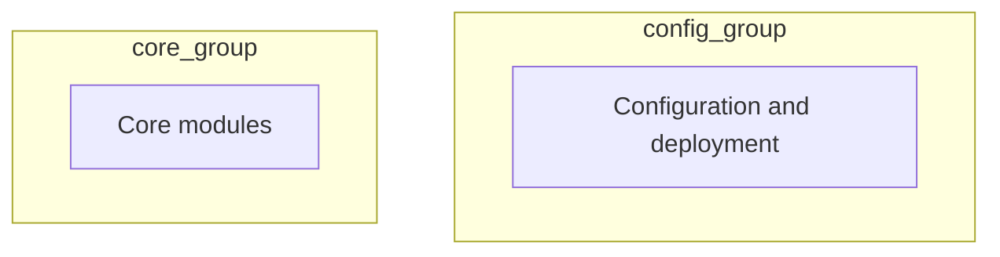

# Architecture report: BetaSu/just-react

> Automated static analysis. **Observed** = directly seen in files/imports/AST; **Inferred** = interpretation from that evidence. Repository code was not executed.

## 1. Repository at a glance

| Item | Value |
| --- | --- |
| Repository | BetaSu/just-react |
| Description | 「React技术揭秘」  一本自顶向下的React源码分析书 |
| Language | JavaScript |
| Stars | 6380 |
| Licence | MIT |
| Analysed commit / branch | 45a85e238fa07050d5c6fb672d60aeced7f6b77f / master |
| Framework(s) | None detected |
| Files analysed | 52 |
| Components | 2 |

## 2. Architecture in one minute

BetaSu/just-react - 「React技术揭秘」  一本自顶向下的React源码分析书. This repository was analysed statically from 52 file(s) (0 Python). Detected technologies (observed from imports/manifests): Docker. Files are grouped into 2 component(s): Configuration and deployment, Core modules. Findings below distinguish observed facts from inferred interpretation.

## 3. High-level block diagram

## 4. Main components

### Configuration and deployment (`config`)

- **Kind:** config
- **Status:** Observed
- **Confidence:** 0.85
- **Responsibility:** Groups 2 file(s) under configuration and deployment (observed from repository paths and static analysis).
- **Paths:** `dockerfile`, `package.json`
- **Evidence:** [dockerfile](https://github.com/BetaSu/just-react/blob/45a85e238fa07050d5c6fb672d60aeced7f6b77f/dockerfile); [package.json](https://github.com/BetaSu/just-react/blob/45a85e238fa07050d5c6fb672d60aeced7f6b77f/package.json)

### Core modules (`core`)

- **Kind:** core
- **Status:** Observed
- **Confidence:** 0.85
- **Responsibility:** Groups 1 file(s) under core modules (observed from repository paths and static analysis).
- **Paths:** `deploy.sh`
- **Evidence:** [deploy.sh](https://github.com/BetaSu/just-react/blob/45a85e238fa07050d5c6fb672d60aeced7f6b77f/deploy.sh)

## 5. Execution flow

No entry point was observed; the startup flow below is therefore limited.

Representative flow (derived from observed entry points and the import graph; steps beyond the entry point are **Inferred**):

1. Execution starts at an observed entry point listed above, if present.
2. No internal import relationships between components were observed.

## 6. Project structure

### `(root)`

- `.drone.yml` - config (604 bytes)
- `.gitignore` - other (62 bytes)
- `LICENSE` - docs (1063 bytes)
- `README.md` - docs (482 bytes)
- `deploy.sh` - source, Shell (317 bytes)
- `dockerfile` - container (0 bytes)
- `package.json` - manifest (949 bytes)

### `.bin`

- `.bin/create_tongji.js` - source, JavaScript (681 bytes)

### `docs`

- `docs/.vuepress/config.js` - docs (4139 bytes)
- `docs/.vuepress/styles/index.styl` - docs (27 bytes)
- `docs/.vuepress/theme/components/PageNav.vue` - docs (541 bytes)
- `docs/.vuepress/theme/index.js` - docs (84 bytes)
- `docs/concurrent/disrupt.md` - docs (157 bytes)
- `docs/concurrent/lane.md` - docs (5970 bytes)
- `docs/concurrent/prepare.md` - docs (4996 bytes)
- `docs/concurrent/scheduler.md` - docs (10461 bytes)
- `docs/course.md` - docs (432 bytes)
- `docs/diff/multi.md` - docs (13470 bytes)
- `docs/diff/one.md` - docs (4308 bytes)
- `docs/diff/prepare.md` - docs (4243 bytes)
- `docs/hooks/create.md` - docs (10597 bytes)
- `docs/hooks/prepare.md` - docs (5232 bytes)
- `docs/hooks/structure.md` - docs (5149 bytes)
- `docs/hooks/useeffect.md` - docs (4898 bytes)
- `docs/hooks/usememo.md` - docs (2542 bytes)
- `docs/hooks/useref.md` - docs (9106 bytes)
- `docs/hooks/usestate.md` - docs (10203 bytes)
- `docs/index.md` - docs (3021 bytes)
- `docs/me.md` - docs (333 bytes)
- `docs/preparation/file.md` - docs (3506 bytes)
- `docs/preparation/idea.md` - docs (6301 bytes)
- `docs/preparation/jsx.md` - docs (6138 bytes)
- `docs/preparation/newConstructure.md` - docs (5100 bytes)
- `docs/preparation/oldConstructure.md` - docs (3805 bytes)
- `docs/preparation/source.md` - docs (2886 bytes)
- `docs/preparation/summary.md` - docs (747 bytes)
- `docs/process/beginWork.md` - docs (9380 bytes)
- `docs/process/completeWork.md` - docs (7184 bytes)
- `docs/process/doubleBuffer.md` - docs (5293 bytes)
- `docs/process/fiber-mental.md` - docs (6746 bytes)
- `docs/process/fiber.md` - docs (5734 bytes)
- `docs/process/reconciler.md` - docs (4783 bytes)
- `docs/renderer/beforeMutation.md` - docs (6987 bytes)
- `docs/renderer/layout.md` - docs (6951 bytes)
- `docs/renderer/mutation.md` - docs (8944 bytes)
- `docs/renderer/prepare.md` - docs (6435 bytes)
- `docs/state/mental.md` - docs (1862 bytes)
- `docs/state/prepare.md` - docs (4770 bytes)
- `docs/state/priority.md` - docs (8297 bytes)
- `docs/state/reactdom.md` - docs (7171 bytes)
- `docs/state/setstate.md` - docs (4431 bytes)
- `docs/state/update.md` - docs (8729 bytes)

## 7. Key dependencies and integrations

| Name | Category | Status | Confidence | Evidence |
| --- | --- | --- | --- | --- |
| Docker | tooling | Observed | 0.85 | [dockerfile](https://github.com/BetaSu/just-react/blob/45a85e238fa07050d5c6fb672d60aeced7f6b77f/dockerfile) |

## 8. Data and state

No database, cache, queue, or persistent-state usage was observed in the analysed files. State handling, if any, may be in-memory or in files that were not analysed.

## 9. Configuration and deployment clues

- `.drone.yml` (config)
- `dockerfile` (container)
- `package.json` (manifest)

## 10. Design observations

- No strong design patterns could be established from the available evidence.

These observations are interpretations (**Inferred**) of the observed structure, not guarantees about runtime design.

## 11. Limitations and unknowns

- Static analysis only: repository code was not executed, installed, or imported at runtime.
- Components and relationships are inferred from file paths, imports, and AST structure; runtime behaviour, dynamic imports, and reflection may not be visible.
- No clear application entry point was observed in the analysed files.
- Repository text was treated as untrusted data; no instructions found in repository files were followed, and likely secret values were redacted/excluded.
- JavaScript and TypeScript files were inventoried from paths and package manifests. They were not parsed with a full language AST, and repository code was not executed.

## 12. Source references

- [deploy.sh](https://github.com/BetaSu/just-react/blob/45a85e238fa07050d5c6fb672d60aeced7f6b77f/deploy.sh)
- [dockerfile](https://github.com/BetaSu/just-react/blob/45a85e238fa07050d5c6fb672d60aeced7f6b77f/dockerfile)
- [package.json](https://github.com/BetaSu/just-react/blob/45a85e238fa07050d5c6fb672d60aeced7f6b77f/package.json)
