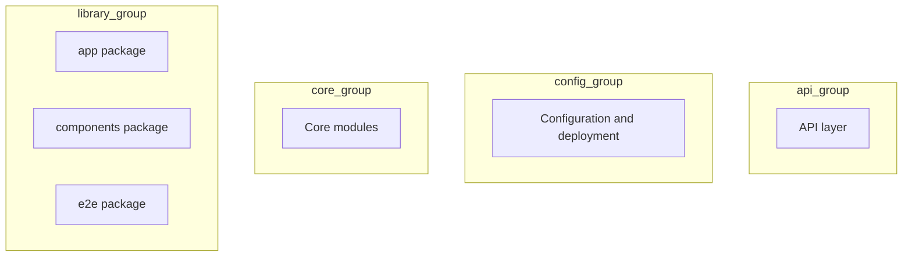

# Architecture report: Blazity/next-enterprise

> Automated static analysis. **Observed** = directly seen in files/imports/AST; **Inferred** = interpretation from that evidence. Repository code was not executed.

## 1. Repository at a glance

| Item | Value |
| --- | --- |
| Repository | Blazity/next-enterprise |
| Description | 💼 An enterprise-grade Next.js boilerplate for high-performance, maintainable apps. Packed with features like Tailwind CSS, TypeScript, ESLint, Prettier, testing tools, and more to accelerate your development. |
| Language | TypeScript |
| Stars | 7472 |
| Licence | MIT |
| Analysed commit / branch | 97c4f3ed6be0a5b255d0e71606c7b355138281a9 / main |
| Framework(s) | Next.js, React |
| Files analysed | 44 |
| Components | 6 |

## 2. Architecture in one minute

Blazity/next-enterprise - 💼 An enterprise-grade Next.js boilerplate for high-performance, maintainable apps. Packed with features like Tailwind CSS, TypeScript, ESLint, Prettier, testing tools, and more to accelerate your dev…. This repository was analysed statically from 44 file(s) (0 Python). Detected technologies (observed from imports/manifests): GitHub Actions, Next.js, React, Tailwind CSS, TypeScript, Vitest. Files are grouped into 6 component(s): API layer, app package, components package, Configuration and deployment, Core modules, e2e package. Findings below distinguish observed facts from inferred interpretation.

## 3. High-level block diagram

## 4. Main components

### API layer (`api_layer`)

- **Kind:** api
- **Status:** Observed
- **Confidence:** 0.85
- **Responsibility:** Groups 1 file(s) under api layer (observed from repository paths and static analysis).
- **Paths:** `app/api/health/route.ts`
- **Evidence:** [app/api/health/route.ts](https://github.com/Blazity/next-enterprise/blob/97c4f3ed6be0a5b255d0e71606c7b355138281a9/app/api/health/route.ts)

### app package (`app`)

- **Kind:** library
- **Status:** Observed
- **Confidence:** 0.85
- **Responsibility:** Groups 2 file(s) under app package (observed from repository paths and static analysis).
- **Paths:** `app/layout.tsx`, `app/page.tsx`
- **Evidence:** [app/layout.tsx](https://github.com/Blazity/next-enterprise/blob/97c4f3ed6be0a5b255d0e71606c7b355138281a9/app/layout.tsx); [app/page.tsx](https://github.com/Blazity/next-enterprise/blob/97c4f3ed6be0a5b255d0e71606c7b355138281a9/app/page.tsx)

### components package (`components`)

- **Kind:** library
- **Status:** Observed
- **Confidence:** 0.85
- **Responsibility:** Groups 4 file(s) under components package (observed from repository paths and static analysis).
- **Paths:** `components/Button/Button.stories.tsx`, `components/Button/Button.test.tsx`, `components/Button/Button.tsx`, `components/Tooltip/Tooltip.tsx`
- **Evidence:** [components/Button/Button.stories.tsx](https://github.com/Blazity/next-enterprise/blob/97c4f3ed6be0a5b255d0e71606c7b355138281a9/components/Button/Button.stories.tsx); [components/Button/Button.test.tsx](https://github.com/Blazity/next-enterprise/blob/97c4f3ed6be0a5b255d0e71606c7b355138281a9/components/Button/Button.test.tsx); [components/Button/Button.tsx](https://github.com/Blazity/next-enterprise/blob/97c4f3ed6be0a5b255d0e71606c7b355138281a9/components/Button/Button.tsx); [components/Tooltip/Tooltip.tsx](https://github.com/Blazity/next-enterprise/blob/97c4f3ed6be0a5b255d0e71606c7b355138281a9/components/Tooltip/Tooltip.tsx)

### Configuration and deployment (`config`)

- **Kind:** config
- **Status:** Observed
- **Confidence:** 0.85
- **Responsibility:** Groups 5 file(s) under configuration and deployment (observed from repository paths and static analysis).
- **Paths:** `git-conventional-commits.yaml`, `package.json`, `renovate.json`, `tsconfig.json`, `vercel.json`
- **Evidence:** [git-conventional-commits.yaml](https://github.com/Blazity/next-enterprise/blob/97c4f3ed6be0a5b255d0e71606c7b355138281a9/git-conventional-commits.yaml); [package.json](https://github.com/Blazity/next-enterprise/blob/97c4f3ed6be0a5b255d0e71606c7b355138281a9/package.json); [renovate.json](https://github.com/Blazity/next-enterprise/blob/97c4f3ed6be0a5b255d0e71606c7b355138281a9/renovate.json); [tsconfig.json](https://github.com/Blazity/next-enterprise/blob/97c4f3ed6be0a5b255d0e71606c7b355138281a9/tsconfig.json); [vercel.json](https://github.com/Blazity/next-enterprise/blob/97c4f3ed6be0a5b255d0e71606c7b355138281a9/vercel.json)

### Core modules (`core`)

- **Kind:** core
- **Status:** Observed
- **Confidence:** 0.85
- **Responsibility:** Groups 13 file(s) under core modules (observed from repository paths and static analysis).
- **Paths:** `env.mjs`, `eslint.config.mjs`, `instrumentation.ts`, `lp-items.tsx`, `next-env.d.ts`, `next.config.ts`, `playwright.config.ts`, `postcss.config.js`, `prettier.config.js`, `report-bundle-size.js`, `reset.d.ts`, `vitest.config.ts`, `vitest.setup.ts`
- **Evidence:** [env.mjs](https://github.com/Blazity/next-enterprise/blob/97c4f3ed6be0a5b255d0e71606c7b355138281a9/env.mjs); [eslint.config.mjs](https://github.com/Blazity/next-enterprise/blob/97c4f3ed6be0a5b255d0e71606c7b355138281a9/eslint.config.mjs); [instrumentation.ts](https://github.com/Blazity/next-enterprise/blob/97c4f3ed6be0a5b255d0e71606c7b355138281a9/instrumentation.ts); [lp-items.tsx](https://github.com/Blazity/next-enterprise/blob/97c4f3ed6be0a5b255d0e71606c7b355138281a9/lp-items.tsx); [next-env.d.ts](https://github.com/Blazity/next-enterprise/blob/97c4f3ed6be0a5b255d0e71606c7b355138281a9/next-env.d.ts); [next.config.ts](https://github.com/Blazity/next-enterprise/blob/97c4f3ed6be0a5b255d0e71606c7b355138281a9/next.config.ts); [playwright.config.ts](https://github.com/Blazity/next-enterprise/blob/97c4f3ed6be0a5b255d0e71606c7b355138281a9/playwright.config.ts); [postcss.config.js](https://github.com/Blazity/next-enterprise/blob/97c4f3ed6be0a5b255d0e71606c7b355138281a9/postcss.config.js)

### e2e package (`e2e`)

- **Kind:** library
- **Status:** Observed
- **Confidence:** 0.85
- **Responsibility:** Groups 1 file(s) under e2e package (observed from repository paths and static analysis).
- **Paths:** `e2e/example.spec.ts`
- **Evidence:** [e2e/example.spec.ts](https://github.com/Blazity/next-enterprise/blob/97c4f3ed6be0a5b255d0e71606c7b355138281a9/e2e/example.spec.ts)

## 5. Execution flow

**Observed** entry point(s):

- [.storybook/main.ts](https://github.com/Blazity/next-enterprise/blob/97c4f3ed6be0a5b255d0e71606c7b355138281a9/.storybook/main.ts)
- [app/page.tsx](https://github.com/Blazity/next-enterprise/blob/97c4f3ed6be0a5b255d0e71606c7b355138281a9/app/page.tsx)

Representative flow (derived from observed entry points and the import graph; steps beyond the entry point are **Inferred**):

1. Execution starts at an observed entry point listed above, if present.
2. No internal import relationships between components were observed.

## 6. Project structure

### `(root)`

- `.all-contributorsrc` - other (1063 bytes)
- `.gitignore` - other (468 bytes)
- `.pre-commit-config.yaml` - config (128 bytes)
- `.prettierignore` - other (18 bytes)
- `.releaserc` - other (306 bytes)
- `LICENSE` - docs (1064 bytes)
- `README.md` - docs (6141 bytes)
- `env.mjs` - source, JavaScript (303 bytes)
- `eslint.config.mjs` - source, JavaScript (2754 bytes)
- `git-conventional-commits.yaml` - config (901 bytes)
- `graph.svg` - other (6603 bytes)
- `instrumentation.ts` - source, TypeScript (103 bytes)
- `lp-items.tsx` - source, TypeScript (15012 bytes)
- `next-env.d.ts` - source, TypeScript (211 bytes)
- `next.config.ts` - source, TypeScript (592 bytes)
- `package.json` - manifest (4904 bytes)
- `playwright.config.ts` - source, TypeScript (2060 bytes)
- `postcss.config.js` - source, JavaScript (97 bytes)
- `prettier.config.js` - source, JavaScript (138 bytes)
- `renovate.json` - config (290 bytes)
- `report-bundle-size.js` - source, JavaScript (4003 bytes)
- `reset.d.ts` - source, TypeScript (73 bytes)
- `tsconfig.json` - config (854 bytes)
- `vercel.json` - config (112 bytes)
- `vitest.config.ts` - source, TypeScript (439 bytes)
- `vitest.setup.ts` - source, TypeScript (35 bytes)

### `.github`

- `.github/nodejs.version` - other (8 bytes)
- `.github/workflows/check.yml` - ci, YAML (1177 bytes)
- `.github/workflows/nextjs_bundle_analysis.yml` - ci, YAML (4253 bytes)
- `.github/workflows/playwright.yml` - ci, YAML (1003 bytes)

### `.storybook`

- `.storybook/main.ts` - source, TypeScript (686 bytes)
- `.storybook/preview.ts` - source, TypeScript (314 bytes)

### `.vscode`

- `.vscode/settings.json` - config (154 bytes)

### `app`

- `app/api/health/route.ts` - source, TypeScript (73 bytes)
- `app/layout.tsx` - source, TypeScript (192 bytes)
- `app/page.tsx` - source, TypeScript (2710 bytes)

### `assets`

- `assets/blazity-logo-dark.svg` - other (1936 bytes)
- `assets/blazity-logo-light.svg` - other (1935 bytes)

### `components`

- `components/Button/Button.stories.tsx` - source, TypeScript (603 bytes)
- `components/Button/Button.test.tsx` - source, TypeScript (921 bytes)
- `components/Button/Button.tsx` - source, TypeScript (1244 bytes)
- `components/Tooltip/Tooltip.tsx` - source, TypeScript (1828 bytes)

### `e2e`

- `e2e/example.spec.ts` - source, TypeScript (184 bytes)

### `styles`

- `styles/tailwind.css` - other (514 bytes)

## 7. Key dependencies and integrations

| Name | Category | Status | Confidence | Evidence |
| --- | --- | --- | --- | --- |
| GitHub Actions | ci | Observed | 0.90 | [.github/workflows/check.yml](https://github.com/Blazity/next-enterprise/blob/97c4f3ed6be0a5b255d0e71606c7b355138281a9/.github/workflows/check.yml); [.github/workflows/nextjs_bundle_analysis.yml](https://github.com/Blazity/next-enterprise/blob/97c4f3ed6be0a5b255d0e71606c7b355138281a9/.github/workflows/nextjs_bundle_analysis.yml); [.github/workflows/playwright.yml](https://github.com/Blazity/next-enterprise/blob/97c4f3ed6be0a5b255d0e71606c7b355138281a9/.github/workflows/playwright.yml) |
| Next.js | framework | Observed | 0.85 | [package.json:2](https://github.com/Blazity/next-enterprise/blob/97c4f3ed6be0a5b255d0e71606c7b355138281a9/package.json#L2) |
| React | framework | Observed | 0.90 | [package.json:29](https://github.com/Blazity/next-enterprise/blob/97c4f3ed6be0a5b255d0e71606c7b355138281a9/package.json#L29); [package.json:56](https://github.com/Blazity/next-enterprise/blob/97c4f3ed6be0a5b255d0e71606c7b355138281a9/package.json#L56) |
| Tailwind CSS | library | Observed | 0.85 | [package.json:82](https://github.com/Blazity/next-enterprise/blob/97c4f3ed6be0a5b255d0e71606c7b355138281a9/package.json#L82) |
| TypeScript | tooling | Observed | 0.85 | [package.json:85](https://github.com/Blazity/next-enterprise/blob/97c4f3ed6be0a5b255d0e71606c7b355138281a9/package.json#L85) |
| Vitest | tooling | Observed | 0.85 | [package.json:17](https://github.com/Blazity/next-enterprise/blob/97c4f3ed6be0a5b255d0e71606c7b355138281a9/package.json#L17) |
| webpack | tooling | Observed | 0.85 | [package.json:119](https://github.com/Blazity/next-enterprise/blob/97c4f3ed6be0a5b255d0e71606c7b355138281a9/package.json#L119) |

## 8. Data and state

No database, cache, queue, or persistent-state usage was observed in the analysed files. State handling, if any, may be in-memory or in files that were not analysed.

## 9. Configuration and deployment clues

- `.github/workflows/check.yml` (ci)
- `.github/workflows/nextjs_bundle_analysis.yml` (ci)
- `.github/workflows/playwright.yml` (ci)
- `.pre-commit-config.yaml` (config)
- `.vscode/settings.json` (config)
- `git-conventional-commits.yaml` (config)
- `package.json` (manifest)
- `renovate.json` (config)
- `tsconfig.json` (config)
- `vercel.json` (config)

## 10. Design observations

- An entry/API layer is separated from other code (Inferred from paths and decorators).

These observations are interpretations (**Inferred**) of the observed structure, not guarantees about runtime design.

## 11. Limitations and unknowns

- Static analysis only: repository code was not executed, installed, or imported at runtime.
- Components and relationships are inferred from file paths, imports, and AST structure; runtime behaviour, dynamic imports, and reflection may not be visible.
- No clear application entry point was observed in the analysed files.
- Repository text was treated as untrusted data; no instructions found in repository files were followed, and likely secret values were redacted/excluded.
- JavaScript and TypeScript files were inventoried from paths and package manifests. They were not parsed with a full language AST, and repository code was not executed.

## 12. Source references

- [.github/workflows/check.yml](https://github.com/Blazity/next-enterprise/blob/97c4f3ed6be0a5b255d0e71606c7b355138281a9/.github/workflows/check.yml)
- [.github/workflows/nextjs_bundle_analysis.yml](https://github.com/Blazity/next-enterprise/blob/97c4f3ed6be0a5b255d0e71606c7b355138281a9/.github/workflows/nextjs_bundle_analysis.yml)
- [.github/workflows/playwright.yml](https://github.com/Blazity/next-enterprise/blob/97c4f3ed6be0a5b255d0e71606c7b355138281a9/.github/workflows/playwright.yml)
- [.storybook/main.ts](https://github.com/Blazity/next-enterprise/blob/97c4f3ed6be0a5b255d0e71606c7b355138281a9/.storybook/main.ts)
- [app/api/health/route.ts](https://github.com/Blazity/next-enterprise/blob/97c4f3ed6be0a5b255d0e71606c7b355138281a9/app/api/health/route.ts)
- [app/layout.tsx](https://github.com/Blazity/next-enterprise/blob/97c4f3ed6be0a5b255d0e71606c7b355138281a9/app/layout.tsx)
- [app/page.tsx](https://github.com/Blazity/next-enterprise/blob/97c4f3ed6be0a5b255d0e71606c7b355138281a9/app/page.tsx)
- [components/Button/Button.stories.tsx](https://github.com/Blazity/next-enterprise/blob/97c4f3ed6be0a5b255d0e71606c7b355138281a9/components/Button/Button.stories.tsx)
- [components/Button/Button.test.tsx](https://github.com/Blazity/next-enterprise/blob/97c4f3ed6be0a5b255d0e71606c7b355138281a9/components/Button/Button.test.tsx)
- [components/Button/Button.tsx](https://github.com/Blazity/next-enterprise/blob/97c4f3ed6be0a5b255d0e71606c7b355138281a9/components/Button/Button.tsx)
- [components/Tooltip/Tooltip.tsx](https://github.com/Blazity/next-enterprise/blob/97c4f3ed6be0a5b255d0e71606c7b355138281a9/components/Tooltip/Tooltip.tsx)
- [e2e/example.spec.ts](https://github.com/Blazity/next-enterprise/blob/97c4f3ed6be0a5b255d0e71606c7b355138281a9/e2e/example.spec.ts)
- [env.mjs](https://github.com/Blazity/next-enterprise/blob/97c4f3ed6be0a5b255d0e71606c7b355138281a9/env.mjs)
- [eslint.config.mjs](https://github.com/Blazity/next-enterprise/blob/97c4f3ed6be0a5b255d0e71606c7b355138281a9/eslint.config.mjs)
- [git-conventional-commits.yaml](https://github.com/Blazity/next-enterprise/blob/97c4f3ed6be0a5b255d0e71606c7b355138281a9/git-conventional-commits.yaml)
- [instrumentation.ts](https://github.com/Blazity/next-enterprise/blob/97c4f3ed6be0a5b255d0e71606c7b355138281a9/instrumentation.ts)
- [lp-items.tsx](https://github.com/Blazity/next-enterprise/blob/97c4f3ed6be0a5b255d0e71606c7b355138281a9/lp-items.tsx)
- [next-env.d.ts](https://github.com/Blazity/next-enterprise/blob/97c4f3ed6be0a5b255d0e71606c7b355138281a9/next-env.d.ts)
- [next.config.ts](https://github.com/Blazity/next-enterprise/blob/97c4f3ed6be0a5b255d0e71606c7b355138281a9/next.config.ts)
- [package.json](https://github.com/Blazity/next-enterprise/blob/97c4f3ed6be0a5b255d0e71606c7b355138281a9/package.json)
- [package.json:2](https://github.com/Blazity/next-enterprise/blob/97c4f3ed6be0a5b255d0e71606c7b355138281a9/package.json#L2)
- [package.json:17](https://github.com/Blazity/next-enterprise/blob/97c4f3ed6be0a5b255d0e71606c7b355138281a9/package.json#L17)
- [package.json:29](https://github.com/Blazity/next-enterprise/blob/97c4f3ed6be0a5b255d0e71606c7b355138281a9/package.json#L29)
- [package.json:56](https://github.com/Blazity/next-enterprise/blob/97c4f3ed6be0a5b255d0e71606c7b355138281a9/package.json#L56)
- [package.json:82](https://github.com/Blazity/next-enterprise/blob/97c4f3ed6be0a5b255d0e71606c7b355138281a9/package.json#L82)
- [package.json:85](https://github.com/Blazity/next-enterprise/blob/97c4f3ed6be0a5b255d0e71606c7b355138281a9/package.json#L85)
- [package.json:119](https://github.com/Blazity/next-enterprise/blob/97c4f3ed6be0a5b255d0e71606c7b355138281a9/package.json#L119)
- [playwright.config.ts](https://github.com/Blazity/next-enterprise/blob/97c4f3ed6be0a5b255d0e71606c7b355138281a9/playwright.config.ts)
- [postcss.config.js](https://github.com/Blazity/next-enterprise/blob/97c4f3ed6be0a5b255d0e71606c7b355138281a9/postcss.config.js)
- [renovate.json](https://github.com/Blazity/next-enterprise/blob/97c4f3ed6be0a5b255d0e71606c7b355138281a9/renovate.json)
- [tsconfig.json](https://github.com/Blazity/next-enterprise/blob/97c4f3ed6be0a5b255d0e71606c7b355138281a9/tsconfig.json)
- [vercel.json](https://github.com/Blazity/next-enterprise/blob/97c4f3ed6be0a5b255d0e71606c7b355138281a9/vercel.json)
