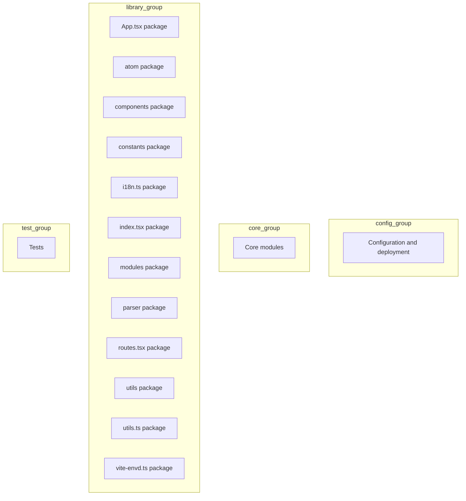

# Architecture report: Bowen7/regex-vis

> Automated static analysis. **Observed** = directly seen in files/imports/AST; **Inferred** = interpretation from that evidence. Repository code was not executed.

## 1. Repository at a glance

| Item | Value |
| --- | --- |
| Repository | Bowen7/regex-vis |
| Description | 🎨 Regex visualizer & editor |
| Language | TypeScript |
| Stars | 4451 |
| Licence | MIT |
| Analysed commit / branch | a6d920601ca44ab2d4e9cd02306510ab6d5e4b38 / main |
| Framework(s) | React |
| Files analysed | 171 |
| Components | 15 |

## 2. Architecture in one minute

Bowen7/regex-vis - 🎨 Regex visualizer & editor. This repository was analysed statically from 171 file(s) (0 Python). Detected technologies (observed from imports/manifests): GitHub Actions, React, React Router, Tailwind CSS, Docker, Docker Compose. Files are grouped into 15 component(s): App.tsx package, atom package, components package, Configuration and deployment, constants package, Core modules, i18n.ts package, index.tsx package. Findings below distinguish observed facts from inferred interpretation.

## 3. High-level block diagram

## 4. Main components

### App.tsx package (`app_tsx`)

- **Kind:** library
- **Status:** Observed
- **Confidence:** 0.85
- **Responsibility:** Groups 1 file(s) under app.tsx package (observed from repository paths and static analysis).
- **Paths:** `src/App.tsx`
- **Evidence:** [src/App.tsx](https://github.com/Bowen7/regex-vis/blob/a6d920601ca44ab2d4e9cd02306510ab6d5e4b38/src/App.tsx)

### atom package (`atom`)

- **Kind:** library
- **Status:** Observed
- **Confidence:** 0.85
- **Responsibility:** Groups 21 file(s) under atom package (observed from repository paths and static analysis).
- **Paths:** `src/atom/__tests__/content.test.tsx`, `src/atom/__tests__/flags.test.tsx`, `src/atom/__tests__/group.test.tsx`, `src/atom/__tests__/insert.test.tsx`, `src/atom/__tests__/look-around.test.tsx`, `src/atom/__tests__/quantifier.test.tsx`, `src/atom/__tests__/remove.test.tsx`, `src/atom/__tests__/select.test.tsx`, `src/atom/__tests__/undo.test.tsx`, `src/atom/atoms.ts`, `src/atom/content.ts`, `src/atom/flags.ts`, `src/atom/group.ts`, `src/atom/index.ts`, `src/atom/insert.ts`, `src/atom/look-around.tsx`, `src/atom/quantifier.ts`, `src/atom/remove.ts`, `src/atom/select.ts`, `src/atom/undo.ts`, `src/atom/utils.ts`
- **Evidence:** [src/atom/__tests__/content.test.tsx](https://github.com/Bowen7/regex-vis/blob/a6d920601ca44ab2d4e9cd02306510ab6d5e4b38/src/atom/__tests__/content.test.tsx); [src/atom/__tests__/flags.test.tsx](https://github.com/Bowen7/regex-vis/blob/a6d920601ca44ab2d4e9cd02306510ab6d5e4b38/src/atom/__tests__/flags.test.tsx); [src/atom/__tests__/group.test.tsx](https://github.com/Bowen7/regex-vis/blob/a6d920601ca44ab2d4e9cd02306510ab6d5e4b38/src/atom/__tests__/group.test.tsx); [src/atom/__tests__/insert.test.tsx](https://github.com/Bowen7/regex-vis/blob/a6d920601ca44ab2d4e9cd02306510ab6d5e4b38/src/atom/__tests__/insert.test.tsx); [src/atom/__tests__/look-around.test.tsx](https://github.com/Bowen7/regex-vis/blob/a6d920601ca44ab2d4e9cd02306510ab6d5e4b38/src/atom/__tests__/look-around.test.tsx); [src/atom/__tests__/quantifier.test.tsx](https://github.com/Bowen7/regex-vis/blob/a6d920601ca44ab2d4e9cd02306510ab6d5e4b38/src/atom/__tests__/quantifier.test.tsx); [src/atom/__tests__/remove.test.tsx](https://github.com/Bowen7/regex-vis/blob/a6d920601ca44ab2d4e9cd02306510ab6d5e4b38/src/atom/__tests__/remove.test.tsx); [src/atom/__tests__/select.test.tsx](https://github.com/Bowen7/regex-vis/blob/a6d920601ca44ab2d4e9cd02306510ab6d5e4b38/src/atom/__tests__/select.test.tsx)

### components package (`components`)

- **Kind:** library
- **Status:** Observed
- **Confidence:** 0.85
- **Responsibility:** Groups 29 file(s) under components package (observed from repository paths and static analysis).
- **Paths:** `src/components/button-dropdown/index.tsx`, `src/components/button-group/index.tsx`, `src/components/cell/index.tsx`, `src/components/header/index.tsx`, `src/components/language-select/index.tsx`, `src/components/legend-item/index.tsx`, `src/components/logo/index.tsx`, `src/components/mode-toggle/index.tsx`, `src/components/range-input/index.tsx`, `src/components/show-more/index.tsx`, `src/components/test-item/index.tsx`, `src/components/theme-provider/index.tsx`, `src/components/ui/alert.tsx`, `src/components/ui/button.tsx`, `src/components/ui/checkbox-group.tsx`, `src/components/ui/checkbox.tsx`, `src/components/ui/dropdown-menu.tsx`, `src/components/ui/input.tsx`, `src/components/ui/label.tsx`, `src/components/ui/scroll-area.tsx`, `src/components/ui/select.tsx`, `src/components/ui/tabs.tsx`, `src/components/ui/textarea.tsx`, `src/components/ui/toast.tsx`, `src/components/ui/toaster.tsx`, `src/components/ui/toggle.tsx`, `src/components/ui/tooltip.tsx`, `src/components/ui/use-toast.ts`, `src/components/validation/index.tsx`
- **Evidence:** [src/components/button-dropdown/index.tsx](https://github.com/Bowen7/regex-vis/blob/a6d920601ca44ab2d4e9cd02306510ab6d5e4b38/src/components/button-dropdown/index.tsx); [src/components/button-group/index.tsx](https://github.com/Bowen7/regex-vis/blob/a6d920601ca44ab2d4e9cd02306510ab6d5e4b38/src/components/button-group/index.tsx); [src/components/cell/index.tsx](https://github.com/Bowen7/regex-vis/blob/a6d920601ca44ab2d4e9cd02306510ab6d5e4b38/src/components/cell/index.tsx); [src/components/header/index.tsx](https://github.com/Bowen7/regex-vis/blob/a6d920601ca44ab2d4e9cd02306510ab6d5e4b38/src/components/header/index.tsx); [src/components/language-select/index.tsx](https://github.com/Bowen7/regex-vis/blob/a6d920601ca44ab2d4e9cd02306510ab6d5e4b38/src/components/language-select/index.tsx); [src/components/legend-item/index.tsx](https://github.com/Bowen7/regex-vis/blob/a6d920601ca44ab2d4e9cd02306510ab6d5e4b38/src/components/legend-item/index.tsx); [src/components/logo/index.tsx](https://github.com/Bowen7/regex-vis/blob/a6d920601ca44ab2d4e9cd02306510ab6d5e4b38/src/components/logo/index.tsx); [src/components/mode-toggle/index.tsx](https://github.com/Bowen7/regex-vis/blob/a6d920601ca44ab2d4e9cd02306510ab6d5e4b38/src/components/mode-toggle/index.tsx)

### Configuration and deployment (`config`)

- **Kind:** config
- **Status:** Observed
- **Confidence:** 0.85
- **Responsibility:** Groups 12 file(s) under configuration and deployment (observed from repository paths and static analysis).
- **Paths:** `Dockerfile`, `components.json`, `docker-compose.yml`, `package.json`, `public/locales/cn/translation.json`, `public/locales/fr/translation.json`, `public/locales/jp/translation.json`, `public/locales/ru/translation.json`, `public/locales/tr/translation.json`, `public/manifest.json`, `tsconfig.json`, `vercel.json`
- **Evidence:** [Dockerfile](https://github.com/Bowen7/regex-vis/blob/a6d920601ca44ab2d4e9cd02306510ab6d5e4b38/Dockerfile); [components.json](https://github.com/Bowen7/regex-vis/blob/a6d920601ca44ab2d4e9cd02306510ab6d5e4b38/components.json); [docker-compose.yml](https://github.com/Bowen7/regex-vis/blob/a6d920601ca44ab2d4e9cd02306510ab6d5e4b38/docker-compose.yml); [package.json](https://github.com/Bowen7/regex-vis/blob/a6d920601ca44ab2d4e9cd02306510ab6d5e4b38/package.json); [public/locales/cn/translation.json](https://github.com/Bowen7/regex-vis/blob/a6d920601ca44ab2d4e9cd02306510ab6d5e4b38/public/locales/cn/translation.json); [public/locales/fr/translation.json](https://github.com/Bowen7/regex-vis/blob/a6d920601ca44ab2d4e9cd02306510ab6d5e4b38/public/locales/fr/translation.json); [public/locales/jp/translation.json](https://github.com/Bowen7/regex-vis/blob/a6d920601ca44ab2d4e9cd02306510ab6d5e4b38/public/locales/jp/translation.json); [public/locales/ru/translation.json](https://github.com/Bowen7/regex-vis/blob/a6d920601ca44ab2d4e9cd02306510ab6d5e4b38/public/locales/ru/translation.json)

### constants package (`constants`)

- **Kind:** library
- **Status:** Observed
- **Confidence:** 0.85
- **Responsibility:** Groups 1 file(s) under constants package (observed from repository paths and static analysis).
- **Paths:** `src/constants/index.ts`
- **Evidence:** [src/constants/index.ts](https://github.com/Bowen7/regex-vis/blob/a6d920601ca44ab2d4e9cd02306510ab6d5e4b38/src/constants/index.ts)

### Core modules (`core`)

- **Kind:** core
- **Status:** Observed
- **Confidence:** 0.85
- **Responsibility:** Groups 4 file(s) under core modules (observed from repository paths and static analysis).
- **Paths:** `eslint.config.mjs`, `postcss.config.js`, `tailwind.config.ts`, `vite.config.ts`
- **Evidence:** [eslint.config.mjs](https://github.com/Bowen7/regex-vis/blob/a6d920601ca44ab2d4e9cd02306510ab6d5e4b38/eslint.config.mjs); [postcss.config.js](https://github.com/Bowen7/regex-vis/blob/a6d920601ca44ab2d4e9cd02306510ab6d5e4b38/postcss.config.js); [tailwind.config.ts](https://github.com/Bowen7/regex-vis/blob/a6d920601ca44ab2d4e9cd02306510ab6d5e4b38/tailwind.config.ts); [vite.config.ts](https://github.com/Bowen7/regex-vis/blob/a6d920601ca44ab2d4e9cd02306510ab6d5e4b38/vite.config.ts)

### i18n.ts package (`i18n_ts`)

- **Kind:** library
- **Status:** Observed
- **Confidence:** 0.85
- **Responsibility:** Groups 1 file(s) under i18n.ts package (observed from repository paths and static analysis).
- **Paths:** `src/i18n.ts`
- **Evidence:** [src/i18n.ts](https://github.com/Bowen7/regex-vis/blob/a6d920601ca44ab2d4e9cd02306510ab6d5e4b38/src/i18n.ts)

### index.tsx package (`index_tsx`)

- **Kind:** library
- **Status:** Observed
- **Confidence:** 0.85
- **Responsibility:** Groups 1 file(s) under index.tsx package (observed from repository paths and static analysis).
- **Paths:** `src/index.tsx`
- **Evidence:** [src/index.tsx](https://github.com/Bowen7/regex-vis/blob/a6d920601ca44ab2d4e9cd02306510ab6d5e4b38/src/index.tsx)

### modules package (`modules`)

- **Kind:** library
- **Status:** Observed
- **Confidence:** 0.85
- **Responsibility:** Groups 39 file(s) under modules package (observed from repository paths and static analysis).
- **Paths:** `src/modules/editor/edit-tab.tsx`, `src/modules/editor/features/content/back-ref.tsx`, `src/modules/editor/features/content/class-character.tsx`, `src/modules/editor/features/content/helper.ts`, `src/modules/editor/features/content/index.tsx`, `src/modules/editor/features/content/ranges.tsx`, `src/modules/editor/features/content/simple-string.tsx`, `src/modules/editor/features/content/word-boundary.tsx`, `src/modules/editor/features/expression/index.tsx`, `src/modules/editor/features/group/index.tsx`, `src/modules/editor/features/insert/index.tsx`, `src/modules/editor/features/look-around/index.tsx`, `src/modules/editor/features/quantifier/index.tsx`, `src/modules/editor/index.tsx`, `src/modules/editor/legend-tab.tsx`, `src/modules/editor/legends.tsx`, `src/modules/editor/test-tab.tsx`, `src/modules/editor/utils.ts`, `src/modules/graph/ast-graph.tsx`, `src/modules/graph/choice.tsx`, `src/modules/graph/content.tsx`, `src/modules/graph/end-connect.tsx`, `src/modules/graph/group-like.tsx`, `src/modules/graph/index.tsx`, `src/modules/graph/measure.ts`, `src/modules/graph/mid-connect.tsx`, `src/modules/graph/name-quantifier.tsx`, `src/modules/graph/nodes.tsx`, `src/modules/graph/quantifier.tsx`, `src/modules/graph/root-nodes.tsx`, `src/modules/graph/simple-graph.tsx`, `src/modules/graph/simple-node.tsx`, `src/modules/graph/start-connect.tsx`, `src/modules/graph/text.tsx`, `src/modules/graph/utils.ts`, `src/modules/home/index.tsx`, `src/modules/home/regex-input.tsx`, `src/modules/playground/index.tsx`, `src/modules/samples/index.tsx`
- **Evidence:** [src/modules/editor/edit-tab.tsx](https://github.com/Bowen7/regex-vis/blob/a6d920601ca44ab2d4e9cd02306510ab6d5e4b38/src/modules/editor/edit-tab.tsx); [src/modules/editor/features/content/back-ref.tsx](https://github.com/Bowen7/regex-vis/blob/a6d920601ca44ab2d4e9cd02306510ab6d5e4b38/src/modules/editor/features/content/back-ref.tsx); [src/modules/editor/features/content/class-character.tsx](https://github.com/Bowen7/regex-vis/blob/a6d920601ca44ab2d4e9cd02306510ab6d5e4b38/src/modules/editor/features/content/class-character.tsx); [src/modules/editor/features/content/helper.ts](https://github.com/Bowen7/regex-vis/blob/a6d920601ca44ab2d4e9cd02306510ab6d5e4b38/src/modules/editor/features/content/helper.ts); [src/modules/editor/features/content/index.tsx](https://github.com/Bowen7/regex-vis/blob/a6d920601ca44ab2d4e9cd02306510ab6d5e4b38/src/modules/editor/features/content/index.tsx); [src/modules/editor/features/content/ranges.tsx](https://github.com/Bowen7/regex-vis/blob/a6d920601ca44ab2d4e9cd02306510ab6d5e4b38/src/modules/editor/features/content/ranges.tsx); [src/modules/editor/features/content/simple-string.tsx](https://github.com/Bowen7/regex-vis/blob/a6d920601ca44ab2d4e9cd02306510ab6d5e4b38/src/modules/editor/features/content/simple-string.tsx); [src/modules/editor/features/content/word-boundary.tsx](https://github.com/Bowen7/regex-vis/blob/a6d920601ca44ab2d4e9cd02306510ab6d5e4b38/src/modules/editor/features/content/word-boundary.tsx)

### parser package (`parser`)

- **Kind:** library
- **Status:** Observed
- **Confidence:** 0.85
- **Responsibility:** Groups 32 file(s) under parser package (observed from repository paths and static analysis).
- **Paths:** `src/parser/__tests__/backslash.test.ts`, `src/parser/__tests__/flag.test.ts`, `src/parser/__tests__/invalid-2015.test.ts`, `src/parser/__tests__/literal-gen.test.ts`, `src/parser/__tests__/lookbehind.test.ts`, `src/parser/__tests__/non-literal-parse.test.ts`, `src/parser/__tests__/valid-2015.test.ts`, `src/parser/__tests__/visit.test.ts`, `src/parser/ast.ts`, `src/parser/backslash.ts`, `src/parser/character-class.ts`, `src/parser/dict.ts`, `src/parser/gen-with-selected.ts`, `src/parser/gen.ts`, `src/parser/index.ts`, `src/parser/lexer.ts`, `src/parser/modifiers/choice.ts`, `src/parser/modifiers/content.ts`, `src/parser/modifiers/flags.ts`, `src/parser/modifiers/group.ts`, `src/parser/modifiers/index.ts`, `src/parser/modifiers/insert.ts`, `src/parser/modifiers/lookaround.ts`, `src/parser/modifiers/quantifier.ts`, `src/parser/modifiers/remove.ts`, `src/parser/modifiers/replace.ts`, `src/parser/parse.ts`, `src/parser/parser.ts`, `src/parser/patterns.ts`, `src/parser/token.ts`, `src/parser/utils.ts`, `src/parser/visit.ts`
- **Evidence:** [src/parser/__tests__/backslash.test.ts](https://github.com/Bowen7/regex-vis/blob/a6d920601ca44ab2d4e9cd02306510ab6d5e4b38/src/parser/__tests__/backslash.test.ts); [src/parser/__tests__/flag.test.ts](https://github.com/Bowen7/regex-vis/blob/a6d920601ca44ab2d4e9cd02306510ab6d5e4b38/src/parser/__tests__/flag.test.ts); [src/parser/__tests__/invalid-2015.test.ts](https://github.com/Bowen7/regex-vis/blob/a6d920601ca44ab2d4e9cd02306510ab6d5e4b38/src/parser/__tests__/invalid-2015.test.ts); [src/parser/__tests__/literal-gen.test.ts](https://github.com/Bowen7/regex-vis/blob/a6d920601ca44ab2d4e9cd02306510ab6d5e4b38/src/parser/__tests__/literal-gen.test.ts); [src/parser/__tests__/lookbehind.test.ts](https://github.com/Bowen7/regex-vis/blob/a6d920601ca44ab2d4e9cd02306510ab6d5e4b38/src/parser/__tests__/lookbehind.test.ts); [src/parser/__tests__/non-literal-parse.test.ts](https://github.com/Bowen7/regex-vis/blob/a6d920601ca44ab2d4e9cd02306510ab6d5e4b38/src/parser/__tests__/non-literal-parse.test.ts); [src/parser/__tests__/valid-2015.test.ts](https://github.com/Bowen7/regex-vis/blob/a6d920601ca44ab2d4e9cd02306510ab6d5e4b38/src/parser/__tests__/valid-2015.test.ts); [src/parser/__tests__/visit.test.ts](https://github.com/Bowen7/regex-vis/blob/a6d920601ca44ab2d4e9cd02306510ab6d5e4b38/src/parser/__tests__/visit.test.ts)

### routes.tsx package (`routes_tsx`)

- **Kind:** library
- **Status:** Observed
- **Confidence:** 0.85
- **Responsibility:** Groups 1 file(s) under routes.tsx package (observed from repository paths and static analysis).
- **Paths:** `src/routes.tsx`
- **Evidence:** [src/routes.tsx](https://github.com/Bowen7/regex-vis/blob/a6d920601ca44ab2d4e9cd02306510ab6d5e4b38/src/routes.tsx)

### Tests (`tests`)

- **Kind:** test
- **Status:** Observed
- **Confidence:** 0.85
- **Responsibility:** Groups 6 file(s) under tests (observed from repository paths and static analysis).
- **Paths:** `tests/__mocks__/analytics.js`, `tests/__mocks__/css.js`, `tests/__mocks__/react-i18next.js`, `tests/__mocks__/svgrMock.js`, `tests/index.test.tsx`, `tests/setup.ts`
- **Evidence:** [tests/__mocks__/analytics.js](https://github.com/Bowen7/regex-vis/blob/a6d920601ca44ab2d4e9cd02306510ab6d5e4b38/tests/__mocks__/analytics.js); [tests/__mocks__/css.js](https://github.com/Bowen7/regex-vis/blob/a6d920601ca44ab2d4e9cd02306510ab6d5e4b38/tests/__mocks__/css.js); [tests/__mocks__/react-i18next.js](https://github.com/Bowen7/regex-vis/blob/a6d920601ca44ab2d4e9cd02306510ab6d5e4b38/tests/__mocks__/react-i18next.js); [tests/__mocks__/svgrMock.js](https://github.com/Bowen7/regex-vis/blob/a6d920601ca44ab2d4e9cd02306510ab6d5e4b38/tests/__mocks__/svgrMock.js); [tests/index.test.tsx](https://github.com/Bowen7/regex-vis/blob/a6d920601ca44ab2d4e9cd02306510ab6d5e4b38/tests/index.test.tsx); [tests/setup.ts](https://github.com/Bowen7/regex-vis/blob/a6d920601ca44ab2d4e9cd02306510ab6d5e4b38/tests/setup.ts)

### utils package (`utils`)

- **Kind:** library
- **Status:** Observed
- **Confidence:** 0.85
- **Responsibility:** Groups 9 file(s) under utils package (observed from repository paths and static analysis).
- **Paths:** `src/utils/helpers/index.ts`, `src/utils/hooks/index.ts`, `src/utils/hooks/use-current-state.ts`, `src/utils/hooks/use-debounce-change.ts`, `src/utils/hooks/use-drag-select.tsx`, `src/utils/hooks/use-focus.ts`, `src/utils/hooks/use-hover.ts`, `src/utils/hooks/use-latest.ts`, `src/utils/links/index.tsx`
- **Evidence:** [src/utils/helpers/index.ts](https://github.com/Bowen7/regex-vis/blob/a6d920601ca44ab2d4e9cd02306510ab6d5e4b38/src/utils/helpers/index.ts); [src/utils/hooks/index.ts](https://github.com/Bowen7/regex-vis/blob/a6d920601ca44ab2d4e9cd02306510ab6d5e4b38/src/utils/hooks/index.ts); [src/utils/hooks/use-current-state.ts](https://github.com/Bowen7/regex-vis/blob/a6d920601ca44ab2d4e9cd02306510ab6d5e4b38/src/utils/hooks/use-current-state.ts); [src/utils/hooks/use-debounce-change.ts](https://github.com/Bowen7/regex-vis/blob/a6d920601ca44ab2d4e9cd02306510ab6d5e4b38/src/utils/hooks/use-debounce-change.ts); [src/utils/hooks/use-drag-select.tsx](https://github.com/Bowen7/regex-vis/blob/a6d920601ca44ab2d4e9cd02306510ab6d5e4b38/src/utils/hooks/use-drag-select.tsx); [src/utils/hooks/use-focus.ts](https://github.com/Bowen7/regex-vis/blob/a6d920601ca44ab2d4e9cd02306510ab6d5e4b38/src/utils/hooks/use-focus.ts); [src/utils/hooks/use-hover.ts](https://github.com/Bowen7/regex-vis/blob/a6d920601ca44ab2d4e9cd02306510ab6d5e4b38/src/utils/hooks/use-hover.ts); [src/utils/hooks/use-latest.ts](https://github.com/Bowen7/regex-vis/blob/a6d920601ca44ab2d4e9cd02306510ab6d5e4b38/src/utils/hooks/use-latest.ts)

### utils.ts package (`utils_ts`)

- **Kind:** library
- **Status:** Observed
- **Confidence:** 0.85
- **Responsibility:** Groups 1 file(s) under utils.ts package (observed from repository paths and static analysis).
- **Paths:** `src/utils.ts`
- **Evidence:** [src/utils.ts](https://github.com/Bowen7/regex-vis/blob/a6d920601ca44ab2d4e9cd02306510ab6d5e4b38/src/utils.ts)

### vite-envd.ts package (`vite_envd_ts`)

- **Kind:** library
- **Status:** Observed
- **Confidence:** 0.85
- **Responsibility:** Groups 1 file(s) under vite-envd.ts package (observed from repository paths and static analysis).
- **Paths:** `src/vite-envd.ts`
- **Evidence:** [src/vite-envd.ts](https://github.com/Bowen7/regex-vis/blob/a6d920601ca44ab2d4e9cd02306510ab6d5e4b38/src/vite-envd.ts)

## 5. Execution flow

**Observed** entry point(s):

- [src/App.tsx](https://github.com/Bowen7/regex-vis/blob/a6d920601ca44ab2d4e9cd02306510ab6d5e4b38/src/App.tsx)
- [src/atom/index.ts](https://github.com/Bowen7/regex-vis/blob/a6d920601ca44ab2d4e9cd02306510ab6d5e4b38/src/atom/index.ts)
- [src/components/button-dropdown/index.tsx](https://github.com/Bowen7/regex-vis/blob/a6d920601ca44ab2d4e9cd02306510ab6d5e4b38/src/components/button-dropdown/index.tsx)
- [src/components/button-group/index.tsx](https://github.com/Bowen7/regex-vis/blob/a6d920601ca44ab2d4e9cd02306510ab6d5e4b38/src/components/button-group/index.tsx)
- [src/components/cell/index.tsx](https://github.com/Bowen7/regex-vis/blob/a6d920601ca44ab2d4e9cd02306510ab6d5e4b38/src/components/cell/index.tsx)
- [src/components/header/index.tsx](https://github.com/Bowen7/regex-vis/blob/a6d920601ca44ab2d4e9cd02306510ab6d5e4b38/src/components/header/index.tsx)
- [src/components/language-select/index.tsx](https://github.com/Bowen7/regex-vis/blob/a6d920601ca44ab2d4e9cd02306510ab6d5e4b38/src/components/language-select/index.tsx)
- [src/components/legend-item/index.tsx](https://github.com/Bowen7/regex-vis/blob/a6d920601ca44ab2d4e9cd02306510ab6d5e4b38/src/components/legend-item/index.tsx)
- [src/components/logo/index.tsx](https://github.com/Bowen7/regex-vis/blob/a6d920601ca44ab2d4e9cd02306510ab6d5e4b38/src/components/logo/index.tsx)
- [src/components/mode-toggle/index.tsx](https://github.com/Bowen7/regex-vis/blob/a6d920601ca44ab2d4e9cd02306510ab6d5e4b38/src/components/mode-toggle/index.tsx)
- [src/components/range-input/index.tsx](https://github.com/Bowen7/regex-vis/blob/a6d920601ca44ab2d4e9cd02306510ab6d5e4b38/src/components/range-input/index.tsx)
- [src/components/show-more/index.tsx](https://github.com/Bowen7/regex-vis/blob/a6d920601ca44ab2d4e9cd02306510ab6d5e4b38/src/components/show-more/index.tsx)

Representative flow (derived from observed entry points and the import graph; steps beyond the entry point are **Inferred**):

1. Execution starts at an observed entry point listed above, if present.
2. No internal import relationships between components were observed.

## 6. Project structure

### `(root)`

- `.gitignore` - other (1943 bytes)
- `.prettierrc` - other (36 bytes)
- `Dockerfile` - container (344 bytes)
- `LICENSE` - docs (1062 bytes)
- `README.md` - docs (1047 bytes)
- `components.json` - config (334 bytes)
- `docker-compose.yml` - container (97 bytes)
- `eslint.config.mjs` - source, JavaScript (290 bytes)
- `index.html` - other (953 bytes)
- `package.json` - manifest (2437 bytes)
- `postcss.config.js` - source, JavaScript (80 bytes)
- `tailwind.config.ts` - source, TypeScript (2413 bytes)
- `tsconfig.json` - config (664 bytes)
- `vercel.json` - config (62 bytes)
- `vite.config.ts` - source, TypeScript (753 bytes)

### `.github`

- `.github/CONTRIBUTING.md` - docs (1207 bytes)
- `.github/FUNDING.yml` - config (632 bytes)
- `.github/workflows/test.yml` - ci, YAML (515 bytes)

### `public`

- `public/locales/cn/translation.json` - config (4725 bytes)
- `public/locales/fr/translation.json` - config (5297 bytes)
- `public/locales/jp/translation.json` - config (5801 bytes)
- `public/locales/ru/translation.json` - config (7449 bytes)
- `public/locales/tr/translation.json` - config (5831 bytes)
- `public/logo.svg` - other (820 bytes)
- `public/manifest.json` - config (163 bytes)
- `public/robots.txt` - docs (67 bytes)

### `src`

- `src/App.tsx` - source, TypeScript (497 bytes)
- `src/atom/__tests__/content.test.tsx` - source, TypeScript (3097 bytes)
- `src/atom/__tests__/flags.test.tsx` - source, TypeScript (1207 bytes)
- `src/atom/__tests__/group.test.tsx` - source, TypeScript (4616 bytes)
- `src/atom/__tests__/insert.test.tsx` - source, TypeScript (4379 bytes)
- `src/atom/__tests__/look-around.test.tsx` - source, TypeScript (4620 bytes)
- `src/atom/__tests__/quantifier.test.tsx` - source, TypeScript (4262 bytes)
- `src/atom/__tests__/remove.test.tsx` - source, TypeScript (2718 bytes)
- `src/atom/__tests__/select.test.tsx` - source, TypeScript (669 bytes)
- `src/atom/__tests__/undo.test.tsx` - source, TypeScript (1984 bytes)
- `src/atom/atoms.ts` - source, TypeScript (744 bytes)
- `src/atom/content.ts` - source, TypeScript (603 bytes)
- `src/atom/flags.ts` - source, TypeScript (305 bytes)
- `src/atom/group.ts` - source, TypeScript (767 bytes)
- `src/atom/index.ts` - source, TypeScript (255 bytes)
- `src/atom/insert.ts` - source, TypeScript (447 bytes)
- `src/atom/look-around.tsx` - source, TypeScript (1153 bytes)
- `src/atom/quantifier.ts` - source, TypeScript (858 bytes)
- `src/atom/remove.ts` - source, TypeScript (452 bytes)
- `src/atom/select.ts` - source, TypeScript (1384 bytes)
- `src/atom/undo.ts` - source, TypeScript (538 bytes)
- `src/atom/utils.ts` - source, TypeScript (1345 bytes)
- `src/components/button-dropdown/index.tsx` - source, TypeScript (871 bytes)
- `src/components/button-group/index.tsx` - source, TypeScript (591 bytes)
- `src/components/cell/index.tsx` - source, TypeScript (1897 bytes)
- `src/components/header/index.tsx` - source, TypeScript (1766 bytes)
- `src/components/language-select/index.tsx` - source, TypeScript (1065 bytes)
- `src/components/legend-item/index.tsx` - source, TypeScript (572 bytes)
- `src/components/logo/index.tsx` - source, TypeScript (1227 bytes)
- `src/components/mode-toggle/index.tsx` - source, TypeScript (534 bytes)
- `src/components/range-input/index.tsx` - source, TypeScript (1810 bytes)
- `src/components/show-more/index.tsx` - source, TypeScript (912 bytes)
- `src/components/test-item/index.tsx` - source, TypeScript (1180 bytes)
- `src/components/theme-provider/index.tsx` - source, TypeScript (2173 bytes)
- `src/components/ui/alert.tsx` - source, TypeScript (1595 bytes)
- `src/components/ui/button.tsx` - source, TypeScript (1832 bytes)
- `src/components/ui/checkbox-group.tsx` - source, TypeScript (1581 bytes)
- `src/components/ui/checkbox.tsx` - source, TypeScript (1026 bytes)
- `src/components/ui/dropdown-menu.tsx` - source, TypeScript (7355 bytes)
- `src/components/ui/input.tsx` - source, TypeScript (2238 bytes)
- `src/components/ui/label.tsx` - source, TypeScript (694 bytes)
- `src/components/ui/scroll-area.tsx` - source, TypeScript (1650 bytes)
- `src/components/ui/select.tsx` - source, TypeScript (5635 bytes)
- `src/components/ui/tabs.tsx` - source, TypeScript (1864 bytes)
- `src/components/ui/textarea.tsx` - source, TypeScript (1391 bytes)
- `src/components/ui/toast.tsx` - source, TypeScript (4843 bytes)
- `src/components/ui/toaster.tsx` - source, TypeScript (774 bytes)
- `src/components/ui/toggle.tsx` - source, TypeScript (1386 bytes)
- `src/components/ui/tooltip.tsx` - source, TypeScript (1125 bytes)
- `src/components/ui/use-toast.ts` - source, TypeScript (3896 bytes)
- `src/components/validation/index.tsx` - source, TypeScript (1720 bytes)
- `src/constants/index.ts` - source, TypeScript (1662 bytes)
- `src/global.css` - other (1893 bytes)
- `src/i18n.ts` - source, TypeScript (442 bytes)
- `src/index.tsx` - source, TypeScript (396 bytes)
- `src/logo.svg` - other (1031 bytes)
- `src/modules/editor/edit-tab.tsx` - source, TypeScript (1805 bytes)
- `src/modules/editor/features/content/back-ref.tsx` - source, TypeScript (1531 bytes)
- `src/modules/editor/features/content/class-character.tsx` - source, TypeScript (3245 bytes)
- `src/modules/editor/features/content/helper.ts` - source, TypeScript (979 bytes)
- `src/modules/editor/features/content/index.tsx` - source, TypeScript (4157 bytes)
- `src/modules/editor/features/content/ranges.tsx` - source, TypeScript (4845 bytes)
- `src/modules/editor/features/content/simple-string.tsx` - source, TypeScript (1347 bytes)
- `src/modules/editor/features/content/word-boundary.tsx` - source, TypeScript (992 bytes)
- `src/modules/editor/features/expression/index.tsx` - source, TypeScript (646 bytes)
- `src/modules/editor/features/group/index.tsx` - source, TypeScript (2671 bytes)
- `src/modules/editor/features/insert/index.tsx` - source, TypeScript (4327 bytes)
- `src/modules/editor/features/look-around/index.tsx` - source, TypeScript (2287 bytes)
- `src/modules/editor/features/quantifier/index.tsx` - source, TypeScript (5618 bytes)
- `src/modules/editor/index.tsx` - source, TypeScript (3797 bytes)
- `src/modules/editor/legend-tab.tsx` - source, TypeScript (854 bytes)
- `src/modules/editor/legends.tsx` - source, TypeScript (2125 bytes)
- `src/modules/editor/test-tab.tsx` - source, TypeScript (2855 bytes)
- `src/modules/editor/utils.ts` - source, TypeScript (3100 bytes)
- `src/modules/graph/ast-graph.tsx` - source, TypeScript (6880 bytes)
- `src/modules/graph/choice.tsx` - source, TypeScript (2419 bytes)
- `src/modules/graph/content.tsx` - source, TypeScript (952 bytes)
- `src/modules/graph/end-connect.tsx` - source, TypeScript (1001 bytes)
- `src/modules/graph/group-like.tsx` - source, TypeScript (2252 bytes)
- `src/modules/graph/index.tsx` - source, TypeScript (1327 bytes)
- `src/modules/graph/measure.ts` - source, TypeScript (6705 bytes)
- `src/modules/graph/mid-connect.tsx` - source, TypeScript (397 bytes)
- `src/modules/graph/name-quantifier.tsx` - source, TypeScript (2004 bytes)
- `src/modules/graph/nodes.tsx` - source, TypeScript (3859 bytes)
- `src/modules/graph/quantifier.tsx` - source, TypeScript (1343 bytes)
- `src/modules/graph/root-nodes.tsx` - source, TypeScript (1111 bytes)
- `src/modules/graph/simple-graph.tsx` - source, TypeScript (947 bytes)
- `src/modules/graph/simple-node.tsx` - source, TypeScript (1915 bytes)
- `src/modules/graph/start-connect.tsx` - source, TypeScript (1023 bytes)
- `src/modules/graph/text.tsx` - source, TypeScript (5068 bytes)
- `src/modules/graph/utils.ts` - source, TypeScript (2320 bytes)
- `src/modules/home/index.tsx` - source, TypeScript (5594 bytes)
- `src/modules/home/regex-input.tsx` - source, TypeScript (3318 bytes)
- `src/modules/playground/index.tsx` - source, TypeScript (269 bytes)
- `src/modules/samples/index.tsx` - source, TypeScript (2058 bytes)
- `src/parser/__tests__/backslash.test.ts` - source, TypeScript (373 bytes)
- `src/parser/__tests__/flag.test.ts` - source, TypeScript (830 bytes)
- `src/parser/__tests__/invalid-2015.test.ts` - source, TypeScript (5897 bytes)
- `src/parser/__tests__/literal-gen.test.ts` - source, TypeScript (4441 bytes)
- `src/parser/__tests__/lookbehind.test.ts` - source, TypeScript (6147 bytes)
- `src/parser/__tests__/non-literal-parse.test.ts` - source, TypeScript (7262 bytes)
- `src/parser/__tests__/valid-2015.test.ts` - source, TypeScript (90503 bytes)
- `src/parser/__tests__/visit.test.ts` - source, TypeScript (4481 bytes)
- `src/parser/ast.ts` - source, TypeScript (3563 bytes)
- `src/parser/backslash.ts` - source, TypeScript (813 bytes)
- `src/parser/character-class.ts` - source, TypeScript (683 bytes)
- `src/parser/dict.ts` - source, TypeScript (532 bytes)
- `src/parser/gen-with-selected.ts` - source, TypeScript (877 bytes)
- `src/parser/gen.ts` - source, TypeScript (5778 bytes)
- `src/parser/index.ts` - source, TypeScript (273 bytes)
- `src/parser/lexer.ts` - source, TypeScript (4351 bytes)
- `src/parser/modifiers/choice.ts` - source, TypeScript (1021 bytes)
- `src/parser/modifiers/content.ts` - source, TypeScript (1972 bytes)
- `src/parser/modifiers/flags.ts` - source, TypeScript (138 bytes)
- `src/parser/modifiers/group.ts` - source, TypeScript (1910 bytes)
- `src/parser/modifiers/index.ts` - source, TypeScript (234 bytes)
- `src/parser/modifiers/insert.ts` - source, TypeScript (1318 bytes)
- `src/parser/modifiers/lookaround.ts` - source, TypeScript (1581 bytes)
- `src/parser/modifiers/quantifier.ts` - source, TypeScript (850 bytes)
- `src/parser/modifiers/remove.ts` - source, TypeScript (2036 bytes)
- `src/parser/modifiers/replace.ts` - source, TypeScript (347 bytes)
- `src/parser/parse.ts` - source, TypeScript (222 bytes)
- `src/parser/parser.ts` - source, TypeScript (9646 bytes)
- `src/parser/patterns.ts` - source, TypeScript (773 bytes)
- `src/parser/token.ts` - source, TypeScript (305 bytes)
- `src/parser/utils.ts` - source, TypeScript (406 bytes)
- `src/parser/visit.ts` - source, TypeScript (4031 bytes)
- `src/routes.tsx` - source, TypeScript (500 bytes)
- `src/utils.ts` - source, TypeScript (166 bytes)
- `src/utils/helpers/index.ts` - source, TypeScript (206 bytes)
- `src/utils/hooks/index.ts` - source, TypeScript (143 bytes)
- `src/utils/hooks/use-current-state.ts` - source, TypeScript (1990 bytes)
- `src/utils/hooks/use-debounce-change.ts` - source, TypeScript (656 bytes)
- `src/utils/hooks/use-drag-select.tsx` - source, TypeScript (2339 bytes)
- `src/utils/hooks/use-focus.ts` - source, TypeScript (524 bytes)
- `src/utils/hooks/use-hover.ts` - source, TypeScript (255 bytes)
- `src/utils/hooks/use-latest.ts` - source, TypeScript (141 bytes)
- `src/utils/links/index.tsx` - source, TypeScript (1188 bytes)
- `src/vite-envd.ts` - source, TypeScript (38 bytes)

### `tests`

- `tests/__mocks__/analytics.js` - test, JavaScript (46 bytes)
- `tests/__mocks__/css.js` - test, JavaScript (20 bytes)
- `tests/__mocks__/react-i18next.js` - test, JavaScript (1702 bytes)
- `tests/__mocks__/svgrMock.js` - test, JavaScript (49 bytes)
- `tests/index.test.tsx` - test, TypeScript (1560 bytes)
- `tests/setup.ts` - test, TypeScript (188 bytes)

## 7. Key dependencies and integrations

| Name | Category | Status | Confidence | Evidence |
| --- | --- | --- | --- | --- |
| GitHub Actions | ci | Observed | 0.85 | [.github/workflows/test.yml](https://github.com/Bowen7/regex-vis/blob/a6d920601ca44ab2d4e9cd02306510ab6d5e4b38/.github/workflows/test.yml) |
| React | framework | Observed | 0.90 | [package.json:14](https://github.com/Bowen7/regex-vis/blob/a6d920601ca44ab2d4e9cd02306510ab6d5e4b38/package.json#L14); [package.json:38](https://github.com/Bowen7/regex-vis/blob/a6d920601ca44ab2d4e9cd02306510ab6d5e4b38/package.json#L38) |
| React Router | library | Observed | 0.85 | [package.json:40](https://github.com/Bowen7/regex-vis/blob/a6d920601ca44ab2d4e9cd02306510ab6d5e4b38/package.json#L40) |
| Tailwind CSS | library | Observed | 0.85 | [package.json:43](https://github.com/Bowen7/regex-vis/blob/a6d920601ca44ab2d4e9cd02306510ab6d5e4b38/package.json#L43) |
| Docker | tooling | Observed | 0.85 | [Dockerfile](https://github.com/Bowen7/regex-vis/blob/a6d920601ca44ab2d4e9cd02306510ab6d5e4b38/Dockerfile) |
| Docker Compose | tooling | Observed | 0.85 | [docker-compose.yml](https://github.com/Bowen7/regex-vis/blob/a6d920601ca44ab2d4e9cd02306510ab6d5e4b38/docker-compose.yml) |
| TypeScript | tooling | Observed | 0.85 | [package.json:45](https://github.com/Bowen7/regex-vis/blob/a6d920601ca44ab2d4e9cd02306510ab6d5e4b38/package.json#L45) |
| Vite | tooling | Observed | 0.85 | [package.json:7](https://github.com/Bowen7/regex-vis/blob/a6d920601ca44ab2d4e9cd02306510ab6d5e4b38/package.json#L7) |
| Vitest | tooling | Observed | 0.85 | [package.json:10](https://github.com/Bowen7/regex-vis/blob/a6d920601ca44ab2d4e9cd02306510ab6d5e4b38/package.json#L10) |

## 8. Data and state

No database, cache, queue, or persistent-state usage was observed in the analysed files. State handling, if any, may be in-memory or in files that were not analysed.

## 9. Configuration and deployment clues

- `.github/FUNDING.yml` (config)
- `.github/workflows/test.yml` (ci)
- `Dockerfile` (container)
- `components.json` (config)
- `docker-compose.yml` (container)
- `package.json` (manifest)
- `public/locales/cn/translation.json` (config)
- `public/locales/fr/translation.json` (config)
- `public/locales/jp/translation.json` (config)
- `public/locales/ru/translation.json` (config)
- `public/locales/tr/translation.json` (config)
- `public/manifest.json` (config)
- `tsconfig.json` (config)
- `vercel.json` (config)

## 10. Design observations

- Tests are present alongside source code (Observed from test file paths).

These observations are interpretations (**Inferred**) of the observed structure, not guarantees about runtime design.

## 11. Limitations and unknowns

- Static analysis only: repository code was not executed, installed, or imported at runtime.
- Components and relationships are inferred from file paths, imports, and AST structure; runtime behaviour, dynamic imports, and reflection may not be visible.
- No clear application entry point was observed in the analysed files.
- Repository text was treated as untrusted data; no instructions found in repository files were followed, and likely secret values were redacted/excluded.
- JavaScript and TypeScript files were inventoried from paths and package manifests. They were not parsed with a full language AST, and repository code was not executed.

## 12. Source references

- [.github/workflows/test.yml](https://github.com/Bowen7/regex-vis/blob/a6d920601ca44ab2d4e9cd02306510ab6d5e4b38/.github/workflows/test.yml)
- [Dockerfile](https://github.com/Bowen7/regex-vis/blob/a6d920601ca44ab2d4e9cd02306510ab6d5e4b38/Dockerfile)
- [components.json](https://github.com/Bowen7/regex-vis/blob/a6d920601ca44ab2d4e9cd02306510ab6d5e4b38/components.json)
- [docker-compose.yml](https://github.com/Bowen7/regex-vis/blob/a6d920601ca44ab2d4e9cd02306510ab6d5e4b38/docker-compose.yml)
- [eslint.config.mjs](https://github.com/Bowen7/regex-vis/blob/a6d920601ca44ab2d4e9cd02306510ab6d5e4b38/eslint.config.mjs)
- [package.json](https://github.com/Bowen7/regex-vis/blob/a6d920601ca44ab2d4e9cd02306510ab6d5e4b38/package.json)
- [package.json:7](https://github.com/Bowen7/regex-vis/blob/a6d920601ca44ab2d4e9cd02306510ab6d5e4b38/package.json#L7)
- [package.json:10](https://github.com/Bowen7/regex-vis/blob/a6d920601ca44ab2d4e9cd02306510ab6d5e4b38/package.json#L10)
- [package.json:14](https://github.com/Bowen7/regex-vis/blob/a6d920601ca44ab2d4e9cd02306510ab6d5e4b38/package.json#L14)
- [package.json:38](https://github.com/Bowen7/regex-vis/blob/a6d920601ca44ab2d4e9cd02306510ab6d5e4b38/package.json#L38)
- [package.json:40](https://github.com/Bowen7/regex-vis/blob/a6d920601ca44ab2d4e9cd02306510ab6d5e4b38/package.json#L40)
- [package.json:43](https://github.com/Bowen7/regex-vis/blob/a6d920601ca44ab2d4e9cd02306510ab6d5e4b38/package.json#L43)
- [package.json:45](https://github.com/Bowen7/regex-vis/blob/a6d920601ca44ab2d4e9cd02306510ab6d5e4b38/package.json#L45)
- [postcss.config.js](https://github.com/Bowen7/regex-vis/blob/a6d920601ca44ab2d4e9cd02306510ab6d5e4b38/postcss.config.js)
- [public/locales/cn/translation.json](https://github.com/Bowen7/regex-vis/blob/a6d920601ca44ab2d4e9cd02306510ab6d5e4b38/public/locales/cn/translation.json)
- [public/locales/fr/translation.json](https://github.com/Bowen7/regex-vis/blob/a6d920601ca44ab2d4e9cd02306510ab6d5e4b38/public/locales/fr/translation.json)
- [public/locales/jp/translation.json](https://github.com/Bowen7/regex-vis/blob/a6d920601ca44ab2d4e9cd02306510ab6d5e4b38/public/locales/jp/translation.json)
- [public/locales/ru/translation.json](https://github.com/Bowen7/regex-vis/blob/a6d920601ca44ab2d4e9cd02306510ab6d5e4b38/public/locales/ru/translation.json)
- [src/App.tsx](https://github.com/Bowen7/regex-vis/blob/a6d920601ca44ab2d4e9cd02306510ab6d5e4b38/src/App.tsx)
- [src/atom/__tests__/content.test.tsx](https://github.com/Bowen7/regex-vis/blob/a6d920601ca44ab2d4e9cd02306510ab6d5e4b38/src/atom/__tests__/content.test.tsx)
- [src/atom/__tests__/flags.test.tsx](https://github.com/Bowen7/regex-vis/blob/a6d920601ca44ab2d4e9cd02306510ab6d5e4b38/src/atom/__tests__/flags.test.tsx)
- [src/atom/__tests__/group.test.tsx](https://github.com/Bowen7/regex-vis/blob/a6d920601ca44ab2d4e9cd02306510ab6d5e4b38/src/atom/__tests__/group.test.tsx)
- [src/atom/__tests__/insert.test.tsx](https://github.com/Bowen7/regex-vis/blob/a6d920601ca44ab2d4e9cd02306510ab6d5e4b38/src/atom/__tests__/insert.test.tsx)
- [src/atom/__tests__/look-around.test.tsx](https://github.com/Bowen7/regex-vis/blob/a6d920601ca44ab2d4e9cd02306510ab6d5e4b38/src/atom/__tests__/look-around.test.tsx)
- [src/atom/__tests__/quantifier.test.tsx](https://github.com/Bowen7/regex-vis/blob/a6d920601ca44ab2d4e9cd02306510ab6d5e4b38/src/atom/__tests__/quantifier.test.tsx)
- [src/atom/__tests__/remove.test.tsx](https://github.com/Bowen7/regex-vis/blob/a6d920601ca44ab2d4e9cd02306510ab6d5e4b38/src/atom/__tests__/remove.test.tsx)
- [src/atom/__tests__/select.test.tsx](https://github.com/Bowen7/regex-vis/blob/a6d920601ca44ab2d4e9cd02306510ab6d5e4b38/src/atom/__tests__/select.test.tsx)
- [src/atom/index.ts](https://github.com/Bowen7/regex-vis/blob/a6d920601ca44ab2d4e9cd02306510ab6d5e4b38/src/atom/index.ts)
- [src/components/button-dropdown/index.tsx](https://github.com/Bowen7/regex-vis/blob/a6d920601ca44ab2d4e9cd02306510ab6d5e4b38/src/components/button-dropdown/index.tsx)
- [src/components/button-group/index.tsx](https://github.com/Bowen7/regex-vis/blob/a6d920601ca44ab2d4e9cd02306510ab6d5e4b38/src/components/button-group/index.tsx)
- [src/components/cell/index.tsx](https://github.com/Bowen7/regex-vis/blob/a6d920601ca44ab2d4e9cd02306510ab6d5e4b38/src/components/cell/index.tsx)
- [src/components/header/index.tsx](https://github.com/Bowen7/regex-vis/blob/a6d920601ca44ab2d4e9cd02306510ab6d5e4b38/src/components/header/index.tsx)
- [src/components/language-select/index.tsx](https://github.com/Bowen7/regex-vis/blob/a6d920601ca44ab2d4e9cd02306510ab6d5e4b38/src/components/language-select/index.tsx)
- [src/components/legend-item/index.tsx](https://github.com/Bowen7/regex-vis/blob/a6d920601ca44ab2d4e9cd02306510ab6d5e4b38/src/components/legend-item/index.tsx)
- [src/components/logo/index.tsx](https://github.com/Bowen7/regex-vis/blob/a6d920601ca44ab2d4e9cd02306510ab6d5e4b38/src/components/logo/index.tsx)
- [src/components/mode-toggle/index.tsx](https://github.com/Bowen7/regex-vis/blob/a6d920601ca44ab2d4e9cd02306510ab6d5e4b38/src/components/mode-toggle/index.tsx)
- [src/components/range-input/index.tsx](https://github.com/Bowen7/regex-vis/blob/a6d920601ca44ab2d4e9cd02306510ab6d5e4b38/src/components/range-input/index.tsx)
- [src/components/show-more/index.tsx](https://github.com/Bowen7/regex-vis/blob/a6d920601ca44ab2d4e9cd02306510ab6d5e4b38/src/components/show-more/index.tsx)
- [src/constants/index.ts](https://github.com/Bowen7/regex-vis/blob/a6d920601ca44ab2d4e9cd02306510ab6d5e4b38/src/constants/index.ts)
- [src/i18n.ts](https://github.com/Bowen7/regex-vis/blob/a6d920601ca44ab2d4e9cd02306510ab6d5e4b38/src/i18n.ts)
- [src/index.tsx](https://github.com/Bowen7/regex-vis/blob/a6d920601ca44ab2d4e9cd02306510ab6d5e4b38/src/index.tsx)
- [src/modules/editor/edit-tab.tsx](https://github.com/Bowen7/regex-vis/blob/a6d920601ca44ab2d4e9cd02306510ab6d5e4b38/src/modules/editor/edit-tab.tsx)
- [src/modules/editor/features/content/back-ref.tsx](https://github.com/Bowen7/regex-vis/blob/a6d920601ca44ab2d4e9cd02306510ab6d5e4b38/src/modules/editor/features/content/back-ref.tsx)
- [src/modules/editor/features/content/class-character.tsx](https://github.com/Bowen7/regex-vis/blob/a6d920601ca44ab2d4e9cd02306510ab6d5e4b38/src/modules/editor/features/content/class-character.tsx)
- [src/modules/editor/features/content/helper.ts](https://github.com/Bowen7/regex-vis/blob/a6d920601ca44ab2d4e9cd02306510ab6d5e4b38/src/modules/editor/features/content/helper.ts)
- [src/modules/editor/features/content/index.tsx](https://github.com/Bowen7/regex-vis/blob/a6d920601ca44ab2d4e9cd02306510ab6d5e4b38/src/modules/editor/features/content/index.tsx)
- [src/modules/editor/features/content/ranges.tsx](https://github.com/Bowen7/regex-vis/blob/a6d920601ca44ab2d4e9cd02306510ab6d5e4b38/src/modules/editor/features/content/ranges.tsx)
- [src/modules/editor/features/content/simple-string.tsx](https://github.com/Bowen7/regex-vis/blob/a6d920601ca44ab2d4e9cd02306510ab6d5e4b38/src/modules/editor/features/content/simple-string.tsx)
- [src/modules/editor/features/content/word-boundary.tsx](https://github.com/Bowen7/regex-vis/blob/a6d920601ca44ab2d4e9cd02306510ab6d5e4b38/src/modules/editor/features/content/word-boundary.tsx)
- [src/parser/__tests__/backslash.test.ts](https://github.com/Bowen7/regex-vis/blob/a6d920601ca44ab2d4e9cd02306510ab6d5e4b38/src/parser/__tests__/backslash.test.ts)
- [src/parser/__tests__/flag.test.ts](https://github.com/Bowen7/regex-vis/blob/a6d920601ca44ab2d4e9cd02306510ab6d5e4b38/src/parser/__tests__/flag.test.ts)
- [src/parser/__tests__/invalid-2015.test.ts](https://github.com/Bowen7/regex-vis/blob/a6d920601ca44ab2d4e9cd02306510ab6d5e4b38/src/parser/__tests__/invalid-2015.test.ts)
- [src/parser/__tests__/literal-gen.test.ts](https://github.com/Bowen7/regex-vis/blob/a6d920601ca44ab2d4e9cd02306510ab6d5e4b38/src/parser/__tests__/literal-gen.test.ts)
- [src/parser/__tests__/lookbehind.test.ts](https://github.com/Bowen7/regex-vis/blob/a6d920601ca44ab2d4e9cd02306510ab6d5e4b38/src/parser/__tests__/lookbehind.test.ts)
- [src/parser/__tests__/non-literal-parse.test.ts](https://github.com/Bowen7/regex-vis/blob/a6d920601ca44ab2d4e9cd02306510ab6d5e4b38/src/parser/__tests__/non-literal-parse.test.ts)
- [src/parser/__tests__/valid-2015.test.ts](https://github.com/Bowen7/regex-vis/blob/a6d920601ca44ab2d4e9cd02306510ab6d5e4b38/src/parser/__tests__/valid-2015.test.ts)
- [src/parser/__tests__/visit.test.ts](https://github.com/Bowen7/regex-vis/blob/a6d920601ca44ab2d4e9cd02306510ab6d5e4b38/src/parser/__tests__/visit.test.ts)
- [src/routes.tsx](https://github.com/Bowen7/regex-vis/blob/a6d920601ca44ab2d4e9cd02306510ab6d5e4b38/src/routes.tsx)
- [src/utils.ts](https://github.com/Bowen7/regex-vis/blob/a6d920601ca44ab2d4e9cd02306510ab6d5e4b38/src/utils.ts)
- [src/utils/helpers/index.ts](https://github.com/Bowen7/regex-vis/blob/a6d920601ca44ab2d4e9cd02306510ab6d5e4b38/src/utils/helpers/index.ts)
- [src/utils/hooks/index.ts](https://github.com/Bowen7/regex-vis/blob/a6d920601ca44ab2d4e9cd02306510ab6d5e4b38/src/utils/hooks/index.ts)
- [src/utils/hooks/use-current-state.ts](https://github.com/Bowen7/regex-vis/blob/a6d920601ca44ab2d4e9cd02306510ab6d5e4b38/src/utils/hooks/use-current-state.ts)
- [src/utils/hooks/use-debounce-change.ts](https://github.com/Bowen7/regex-vis/blob/a6d920601ca44ab2d4e9cd02306510ab6d5e4b38/src/utils/hooks/use-debounce-change.ts)
- [src/utils/hooks/use-drag-select.tsx](https://github.com/Bowen7/regex-vis/blob/a6d920601ca44ab2d4e9cd02306510ab6d5e4b38/src/utils/hooks/use-drag-select.tsx)
- [src/utils/hooks/use-focus.ts](https://github.com/Bowen7/regex-vis/blob/a6d920601ca44ab2d4e9cd02306510ab6d5e4b38/src/utils/hooks/use-focus.ts)
- [src/utils/hooks/use-hover.ts](https://github.com/Bowen7/regex-vis/blob/a6d920601ca44ab2d4e9cd02306510ab6d5e4b38/src/utils/hooks/use-hover.ts)
- [src/utils/hooks/use-latest.ts](https://github.com/Bowen7/regex-vis/blob/a6d920601ca44ab2d4e9cd02306510ab6d5e4b38/src/utils/hooks/use-latest.ts)
- [src/vite-envd.ts](https://github.com/Bowen7/regex-vis/blob/a6d920601ca44ab2d4e9cd02306510ab6d5e4b38/src/vite-envd.ts)
- [tailwind.config.ts](https://github.com/Bowen7/regex-vis/blob/a6d920601ca44ab2d4e9cd02306510ab6d5e4b38/tailwind.config.ts)
- [tests/__mocks__/analytics.js](https://github.com/Bowen7/regex-vis/blob/a6d920601ca44ab2d4e9cd02306510ab6d5e4b38/tests/__mocks__/analytics.js)
- [tests/__mocks__/css.js](https://github.com/Bowen7/regex-vis/blob/a6d920601ca44ab2d4e9cd02306510ab6d5e4b38/tests/__mocks__/css.js)
- [tests/__mocks__/react-i18next.js](https://github.com/Bowen7/regex-vis/blob/a6d920601ca44ab2d4e9cd02306510ab6d5e4b38/tests/__mocks__/react-i18next.js)
- [tests/__mocks__/svgrMock.js](https://github.com/Bowen7/regex-vis/blob/a6d920601ca44ab2d4e9cd02306510ab6d5e4b38/tests/__mocks__/svgrMock.js)
- [tests/index.test.tsx](https://github.com/Bowen7/regex-vis/blob/a6d920601ca44ab2d4e9cd02306510ab6d5e4b38/tests/index.test.tsx)
- [tests/setup.ts](https://github.com/Bowen7/regex-vis/blob/a6d920601ca44ab2d4e9cd02306510ab6d5e4b38/tests/setup.ts)
- [vite.config.ts](https://github.com/Bowen7/regex-vis/blob/a6d920601ca44ab2d4e9cd02306510ab6d5e4b38/vite.config.ts)
