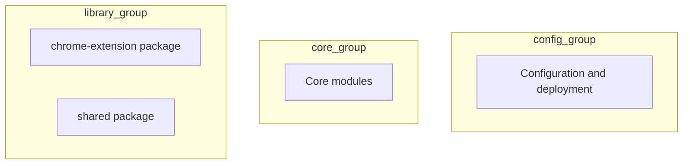

# Architecture report: BuilderIO/figma-html

> Automated static analysis. **Observed** = directly seen in files/imports/AST; **Inferred** = interpretation from that evidence. Repository code was not executed.

## 1. Repository at a glance

| Item | Value |
| --- | --- |
| Repository | BuilderIO/figma-html |
| Description | Convert any website to editable Figma designs |
| Language | TypeScript |
| Stars | 3715 |
| Licence | MIT |
| Analysed commit / branch | 2b244343ba3fcc1a2de50fa652e13833e78e36f9 / master |
| Framework(s) | React |
| Files analysed | 27 |
| Components | 4 |

## 2. Architecture in one minute

BuilderIO/figma-html - Convert any website to editable Figma designs. This repository was analysed statically from 27 file(s) (0 Python). Detected technologies (observed from imports/manifests): React, TypeScript, webpack. Files are grouped into 4 component(s): chrome-extension package, Configuration and deployment, Core modules, shared package. Findings below distinguish observed facts from inferred interpretation.

## 3. High-level block diagram

## 4. Main components

### chrome-extension package (`chrome_extension`)

- **Kind:** library
- **Status:** Observed
- **Confidence:** 0.85
- **Responsibility:** Groups 8 file(s) under chrome-extension package (observed from repository paths and static analysis).
- **Paths:** `chrome-extension/src/background.ts`, `chrome-extension/src/constants/theme.ts`, `chrome-extension/src/inject.ts`, `chrome-extension/src/popup/Popup.tsx`, `chrome-extension/src/popup/index.tsx`, `chrome-extension/webpack.common.js`, `chrome-extension/webpack.dev.js`, `chrome-extension/webpack.prod.js`
- **Evidence:** [chrome-extension/src/background.ts](https://github.com/BuilderIO/figma-html/blob/2b244343ba3fcc1a2de50fa652e13833e78e36f9/chrome-extension/src/background.ts); [chrome-extension/src/constants/theme.ts](https://github.com/BuilderIO/figma-html/blob/2b244343ba3fcc1a2de50fa652e13833e78e36f9/chrome-extension/src/constants/theme.ts); [chrome-extension/src/inject.ts](https://github.com/BuilderIO/figma-html/blob/2b244343ba3fcc1a2de50fa652e13833e78e36f9/chrome-extension/src/inject.ts); [chrome-extension/src/popup/Popup.tsx](https://github.com/BuilderIO/figma-html/blob/2b244343ba3fcc1a2de50fa652e13833e78e36f9/chrome-extension/src/popup/Popup.tsx); [chrome-extension/src/popup/index.tsx](https://github.com/BuilderIO/figma-html/blob/2b244343ba3fcc1a2de50fa652e13833e78e36f9/chrome-extension/src/popup/index.tsx); [chrome-extension/webpack.common.js](https://github.com/BuilderIO/figma-html/blob/2b244343ba3fcc1a2de50fa652e13833e78e36f9/chrome-extension/webpack.common.js); [chrome-extension/webpack.dev.js](https://github.com/BuilderIO/figma-html/blob/2b244343ba3fcc1a2de50fa652e13833e78e36f9/chrome-extension/webpack.dev.js); [chrome-extension/webpack.prod.js](https://github.com/BuilderIO/figma-html/blob/2b244343ba3fcc1a2de50fa652e13833e78e36f9/chrome-extension/webpack.prod.js)

### Configuration and deployment (`config`)

- **Kind:** config
- **Status:** Observed
- **Confidence:** 0.85
- **Responsibility:** Groups 6 file(s) under configuration and deployment (observed from repository paths and static analysis).
- **Paths:** `chrome-extension/info/manifest.json`, `chrome-extension/package.json`, `chrome-extension/tsconfig.json`, `chrome-extension/tslint.json`, `package.json`, `tsconfig.json`
- **Evidence:** [chrome-extension/info/manifest.json](https://github.com/BuilderIO/figma-html/blob/2b244343ba3fcc1a2de50fa652e13833e78e36f9/chrome-extension/info/manifest.json); [chrome-extension/package.json](https://github.com/BuilderIO/figma-html/blob/2b244343ba3fcc1a2de50fa652e13833e78e36f9/chrome-extension/package.json); [chrome-extension/tsconfig.json](https://github.com/BuilderIO/figma-html/blob/2b244343ba3fcc1a2de50fa652e13833e78e36f9/chrome-extension/tsconfig.json); [chrome-extension/tslint.json](https://github.com/BuilderIO/figma-html/blob/2b244343ba3fcc1a2de50fa652e13833e78e36f9/chrome-extension/tslint.json); [package.json](https://github.com/BuilderIO/figma-html/blob/2b244343ba3fcc1a2de50fa652e13833e78e36f9/package.json); [tsconfig.json](https://github.com/BuilderIO/figma-html/blob/2b244343ba3fcc1a2de50fa652e13833e78e36f9/tsconfig.json)

### Core modules (`core`)

- **Kind:** core
- **Status:** Observed
- **Confidence:** 0.85
- **Responsibility:** Groups 1 file(s) under core modules (observed from repository paths and static analysis).
- **Paths:** `webpack.config.js`
- **Evidence:** [webpack.config.js](https://github.com/BuilderIO/figma-html/blob/2b244343ba3fcc1a2de50fa652e13833e78e36f9/webpack.config.js)

### shared package (`shared`)

- **Kind:** library
- **Status:** Observed
- **Confidence:** 0.85
- **Responsibility:** Groups 2 file(s) under shared package (observed from repository paths and static analysis).
- **Paths:** `shared/typings.d.ts`, `shared/typings.ts`
- **Evidence:** [shared/typings.d.ts](https://github.com/BuilderIO/figma-html/blob/2b244343ba3fcc1a2de50fa652e13833e78e36f9/shared/typings.d.ts); [shared/typings.ts](https://github.com/BuilderIO/figma-html/blob/2b244343ba3fcc1a2de50fa652e13833e78e36f9/shared/typings.ts)

## 5. Execution flow

**Observed** entry point(s):

- [chrome-extension/src/popup/index.tsx](https://github.com/BuilderIO/figma-html/blob/2b244343ba3fcc1a2de50fa652e13833e78e36f9/chrome-extension/src/popup/index.tsx)

Representative flow (derived from observed entry points and the import graph; steps beyond the entry point are **Inferred**):

1. Execution starts at an observed entry point listed above, if present.
2. No internal import relationships between components were observed.

## 6. Project structure

### `(root)`

- `.gitignore` - other (46 bytes)
- `.nvmrc` - other (8 bytes)
- `CODEOWNERS` - other (19 bytes)
- `DEVELOP.md` - docs (2619 bytes)
- `LICENSE.md` - docs (1073 bytes)
- `README.md` - docs (370 bytes)
- `package.json` - manifest (2127 bytes)
- `tsconfig.json` - config (452 bytes)
- `webpack.config.js` - source, JavaScript (2056 bytes)

### `.github`

- `.github/ISSUE_TEMPLATE/bug_report.md` - docs (727 bytes)

### `chrome-extension`

- `chrome-extension/.gitignore` - other (29 bytes)
- `chrome-extension/README.md` - docs (1146 bytes)
- `chrome-extension/info/manifest.json` - config (328 bytes)
- `chrome-extension/info/popup.html` - other (2392 bytes)
- `chrome-extension/package.json` - manifest (1224 bytes)
- `chrome-extension/src/background.ts` - source, TypeScript (573 bytes)
- `chrome-extension/src/constants/theme.ts` - source, TypeScript (1012 bytes)
- `chrome-extension/src/inject.ts` - source, TypeScript (466 bytes)
- `chrome-extension/src/popup/Popup.tsx` - source, TypeScript (6279 bytes)
- `chrome-extension/src/popup/index.tsx` - source, TypeScript (871 bytes)
- `chrome-extension/tsconfig.json` - config (391 bytes)
- `chrome-extension/tslint.json` - config (205 bytes)
- `chrome-extension/webpack.common.js` - source, JavaScript (1208 bytes)
- `chrome-extension/webpack.dev.js` - source, JavaScript (148 bytes)
- `chrome-extension/webpack.prod.js` - source, JavaScript (146 bytes)

### `shared`

- `shared/typings.d.ts` - source, TypeScript (142 bytes)
- `shared/typings.ts` - source, TypeScript (170 bytes)

## 7. Key dependencies and integrations

| Name | Category | Status | Confidence | Evidence |
| --- | --- | --- | --- | --- |
| React | framework | Observed | 0.90 | [chrome-extension/package.json:17](https://github.com/BuilderIO/figma-html/blob/2b244343ba3fcc1a2de50fa652e13833e78e36f9/chrome-extension/package.json#L17); [chrome-extension/package.json:18](https://github.com/BuilderIO/figma-html/blob/2b244343ba3fcc1a2de50fa652e13833e78e36f9/chrome-extension/package.json#L18); [package.json:35](https://github.com/BuilderIO/figma-html/blob/2b244343ba3fcc1a2de50fa652e13833e78e36f9/package.json#L35); [package.json:36](https://github.com/BuilderIO/figma-html/blob/2b244343ba3fcc1a2de50fa652e13833e78e36f9/package.json#L36) |
| TypeScript | tooling | Observed | 0.90 | [chrome-extension/package.json:26](https://github.com/BuilderIO/figma-html/blob/2b244343ba3fcc1a2de50fa652e13833e78e36f9/chrome-extension/package.json#L26); [package.json:52](https://github.com/BuilderIO/figma-html/blob/2b244343ba3fcc1a2de50fa652e13833e78e36f9/package.json#L52) |
| webpack | tooling | Observed | 0.90 | [chrome-extension/package.json:6](https://github.com/BuilderIO/figma-html/blob/2b244343ba3fcc1a2de50fa652e13833e78e36f9/chrome-extension/package.json#L6); [package.json:17](https://github.com/BuilderIO/figma-html/blob/2b244343ba3fcc1a2de50fa652e13833e78e36f9/package.json#L17) |

## 8. Data and state

No database, cache, queue, or persistent-state usage was observed in the analysed files. State handling, if any, may be in-memory or in files that were not analysed.

## 9. Configuration and deployment clues

- `chrome-extension/info/manifest.json` (config)
- `chrome-extension/package.json` (manifest)
- `chrome-extension/tsconfig.json` (config)
- `chrome-extension/tslint.json` (config)
- `package.json` (manifest)
- `tsconfig.json` (config)

## 10. Design observations

- No strong design patterns could be established from the available evidence.

These observations are interpretations (**Inferred**) of the observed structure, not guarantees about runtime design.

## 11. Limitations and unknowns

- Static analysis only: repository code was not executed, installed, or imported at runtime.
- Components and relationships are inferred from file paths, imports, and AST structure; runtime behaviour, dynamic imports, and reflection may not be visible.
- No clear application entry point was observed in the analysed files.
- Repository text was treated as untrusted data; no instructions found in repository files were followed, and likely secret values were redacted/excluded.
- JavaScript and TypeScript files were inventoried from paths and package manifests. They were not parsed with a full language AST, and repository code was not executed.

## 12. Source references

- [chrome-extension/info/manifest.json](https://github.com/BuilderIO/figma-html/blob/2b244343ba3fcc1a2de50fa652e13833e78e36f9/chrome-extension/info/manifest.json)
- [chrome-extension/package.json](https://github.com/BuilderIO/figma-html/blob/2b244343ba3fcc1a2de50fa652e13833e78e36f9/chrome-extension/package.json)
- [chrome-extension/package.json:6](https://github.com/BuilderIO/figma-html/blob/2b244343ba3fcc1a2de50fa652e13833e78e36f9/chrome-extension/package.json#L6)
- [chrome-extension/package.json:17](https://github.com/BuilderIO/figma-html/blob/2b244343ba3fcc1a2de50fa652e13833e78e36f9/chrome-extension/package.json#L17)
- [chrome-extension/package.json:18](https://github.com/BuilderIO/figma-html/blob/2b244343ba3fcc1a2de50fa652e13833e78e36f9/chrome-extension/package.json#L18)
- [chrome-extension/package.json:26](https://github.com/BuilderIO/figma-html/blob/2b244343ba3fcc1a2de50fa652e13833e78e36f9/chrome-extension/package.json#L26)
- [chrome-extension/src/background.ts](https://github.com/BuilderIO/figma-html/blob/2b244343ba3fcc1a2de50fa652e13833e78e36f9/chrome-extension/src/background.ts)
- [chrome-extension/src/constants/theme.ts](https://github.com/BuilderIO/figma-html/blob/2b244343ba3fcc1a2de50fa652e13833e78e36f9/chrome-extension/src/constants/theme.ts)
- [chrome-extension/src/inject.ts](https://github.com/BuilderIO/figma-html/blob/2b244343ba3fcc1a2de50fa652e13833e78e36f9/chrome-extension/src/inject.ts)
- [chrome-extension/src/popup/Popup.tsx](https://github.com/BuilderIO/figma-html/blob/2b244343ba3fcc1a2de50fa652e13833e78e36f9/chrome-extension/src/popup/Popup.tsx)
- [chrome-extension/src/popup/index.tsx](https://github.com/BuilderIO/figma-html/blob/2b244343ba3fcc1a2de50fa652e13833e78e36f9/chrome-extension/src/popup/index.tsx)
- [chrome-extension/tsconfig.json](https://github.com/BuilderIO/figma-html/blob/2b244343ba3fcc1a2de50fa652e13833e78e36f9/chrome-extension/tsconfig.json)
- [chrome-extension/tslint.json](https://github.com/BuilderIO/figma-html/blob/2b244343ba3fcc1a2de50fa652e13833e78e36f9/chrome-extension/tslint.json)
- [chrome-extension/webpack.common.js](https://github.com/BuilderIO/figma-html/blob/2b244343ba3fcc1a2de50fa652e13833e78e36f9/chrome-extension/webpack.common.js)
- [chrome-extension/webpack.dev.js](https://github.com/BuilderIO/figma-html/blob/2b244343ba3fcc1a2de50fa652e13833e78e36f9/chrome-extension/webpack.dev.js)
- [chrome-extension/webpack.prod.js](https://github.com/BuilderIO/figma-html/blob/2b244343ba3fcc1a2de50fa652e13833e78e36f9/chrome-extension/webpack.prod.js)
- [package.json](https://github.com/BuilderIO/figma-html/blob/2b244343ba3fcc1a2de50fa652e13833e78e36f9/package.json)
- [package.json:17](https://github.com/BuilderIO/figma-html/blob/2b244343ba3fcc1a2de50fa652e13833e78e36f9/package.json#L17)
- [package.json:35](https://github.com/BuilderIO/figma-html/blob/2b244343ba3fcc1a2de50fa652e13833e78e36f9/package.json#L35)
- [package.json:36](https://github.com/BuilderIO/figma-html/blob/2b244343ba3fcc1a2de50fa652e13833e78e36f9/package.json#L36)
- [package.json:52](https://github.com/BuilderIO/figma-html/blob/2b244343ba3fcc1a2de50fa652e13833e78e36f9/package.json#L52)
- [shared/typings.d.ts](https://github.com/BuilderIO/figma-html/blob/2b244343ba3fcc1a2de50fa652e13833e78e36f9/shared/typings.d.ts)
- [shared/typings.ts](https://github.com/BuilderIO/figma-html/blob/2b244343ba3fcc1a2de50fa652e13833e78e36f9/shared/typings.ts)
- [tsconfig.json](https://github.com/BuilderIO/figma-html/blob/2b244343ba3fcc1a2de50fa652e13833e78e36f9/tsconfig.json)
- [webpack.config.js](https://github.com/BuilderIO/figma-html/blob/2b244343ba3fcc1a2de50fa652e13833e78e36f9/webpack.config.js)
