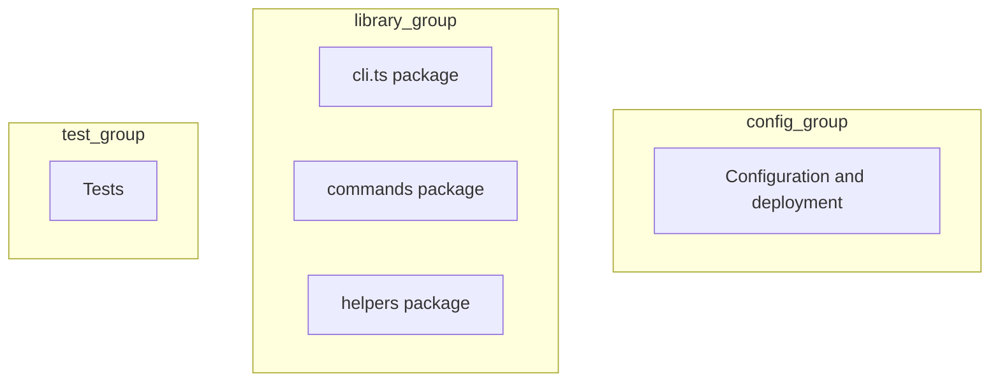

# Architecture report: BuilderIO/micro-agent

> Automated static analysis. **Observed** = directly seen in files/imports/AST; **Inferred** = interpretation from that evidence. Repository code was not executed.

## 1. Repository at a glance

| Item | Value |
| --- | --- |
| Repository | BuilderIO/micro-agent |
| Description | An AI agent that writes (actually useful) code for you |
| Language | TypeScript |
| Stars | 4335 |
| Licence | MIT |
| Analysed commit / branch | f33523ce9f9c52a698d13a2883eb2ba7fb4fb462 / main |
| Framework(s) | Next.js, React |
| Files analysed | 82 |
| Components | 5 |

## 2. Architecture in one minute

BuilderIO/micro-agent - An AI agent that writes (actually useful) code for you. This repository was analysed statically from 82 file(s) (0 Python). Detected technologies (observed from imports/manifests): GitHub Actions, Next.js, React, Tailwind CSS, TypeScript, Vitest. Files are grouped into 5 component(s): cli.ts package, commands package, Configuration and deployment, helpers package, Tests. Findings below distinguish observed facts from inferred interpretation.

## 3. High-level block diagram

## 4. Main components

### cli.ts package (`cli_ts`)

- **Kind:** library
- **Status:** Observed
- **Confidence:** 0.85
- **Responsibility:** Groups 1 file(s) under cli.ts package (observed from repository paths and static analysis).
- **Paths:** `src/cli.ts`
- **Evidence:** [src/cli.ts](https://github.com/BuilderIO/micro-agent/blob/f33523ce9f9c52a698d13a2883eb2ba7fb4fb462/src/cli.ts)

### commands package (`commands`)

- **Kind:** library
- **Status:** Observed
- **Confidence:** 0.85
- **Responsibility:** Groups 2 file(s) under commands package (observed from repository paths and static analysis).
- **Paths:** `src/commands/config.ts`, `src/commands/update.ts`
- **Evidence:** [src/commands/config.ts](https://github.com/BuilderIO/micro-agent/blob/f33523ce9f9c52a698d13a2883eb2ba7fb4fb462/src/commands/config.ts); [src/commands/update.ts](https://github.com/BuilderIO/micro-agent/blob/f33523ce9f9c52a698d13a2883eb2ba7fb4fb462/src/commands/update.ts)

### Configuration and deployment (`config`)

- **Kind:** config
- **Status:** Observed
- **Confidence:** 0.85
- **Responsibility:** Groups 2 file(s) under configuration and deployment (observed from repository paths and static analysis).
- **Paths:** `package.json`, `tsconfig.json`
- **Evidence:** [package.json](https://github.com/BuilderIO/micro-agent/blob/f33523ce9f9c52a698d13a2883eb2ba7fb4fb462/package.json); [tsconfig.json](https://github.com/BuilderIO/micro-agent/blob/f33523ce9f9c52a698d13a2883eb2ba7fb4fb462/tsconfig.json)

### helpers package (`helpers`)

- **Kind:** library
- **Status:** Observed
- **Confidence:** 0.85
- **Responsibility:** Groups 36 file(s) under helpers package (observed from repository paths and static analysis).
- **Paths:** `src/helpers/apply-unified-diff.test.ts`, `src/helpers/apply-unified-diff.ts`, `src/helpers/base64.ts`, `src/helpers/config.test.ts`, `src/helpers/config.ts`, `src/helpers/constants.ts`, `src/helpers/dependency-files.test.ts`, `src/helpers/dependency-files.ts`, `src/helpers/error.ts`, `src/helpers/exit-on-cancel.ts`, `src/helpers/file-exists.ts`, `src/helpers/find-package-json.ts`, `src/helpers/find-visual-file.ts`, `src/helpers/generate-ascii-tree.test.ts`, `src/helpers/generate-ascii-tree.ts`, `src/helpers/generate.ts`, `src/helpers/get-screenshot.ts`, `src/helpers/get-test-command.ts`, `src/helpers/interactive-mode.ts`, `src/helpers/invalid-project-warning.ts`, `src/helpers/iterate-on-test-command.ts`, `src/helpers/iterate-on-test.ts`, `src/helpers/llm.test.ts`, `src/helpers/llm.ts`, `src/helpers/mock-llm.ts`, `src/helpers/output-file.ts`, `src/helpers/remove-backticks.test.ts`, `src/helpers/remove-backticks.ts`, `src/helpers/remove-initial-slash.test.ts`, `src/helpers/remove-initial-slash.ts`, `src/helpers/run.ts`, `src/helpers/systemPrompt.ts`, `src/helpers/test.ts`, `src/helpers/validate-project.ts`, `src/helpers/visual-generate.ts`, `src/helpers/visual-test.ts`
- **Evidence:** [src/helpers/apply-unified-diff.test.ts](https://github.com/BuilderIO/micro-agent/blob/f33523ce9f9c52a698d13a2883eb2ba7fb4fb462/src/helpers/apply-unified-diff.test.ts); [src/helpers/apply-unified-diff.ts](https://github.com/BuilderIO/micro-agent/blob/f33523ce9f9c52a698d13a2883eb2ba7fb4fb462/src/helpers/apply-unified-diff.ts); [src/helpers/base64.ts](https://github.com/BuilderIO/micro-agent/blob/f33523ce9f9c52a698d13a2883eb2ba7fb4fb462/src/helpers/base64.ts); [src/helpers/config.test.ts](https://github.com/BuilderIO/micro-agent/blob/f33523ce9f9c52a698d13a2883eb2ba7fb4fb462/src/helpers/config.test.ts); [src/helpers/config.ts](https://github.com/BuilderIO/micro-agent/blob/f33523ce9f9c52a698d13a2883eb2ba7fb4fb462/src/helpers/config.ts); [src/helpers/constants.ts](https://github.com/BuilderIO/micro-agent/blob/f33523ce9f9c52a698d13a2883eb2ba7fb4fb462/src/helpers/constants.ts); [src/helpers/dependency-files.test.ts](https://github.com/BuilderIO/micro-agent/blob/f33523ce9f9c52a698d13a2883eb2ba7fb4fb462/src/helpers/dependency-files.test.ts); [src/helpers/dependency-files.ts](https://github.com/BuilderIO/micro-agent/blob/f33523ce9f9c52a698d13a2883eb2ba7fb4fb462/src/helpers/dependency-files.ts)

### Tests (`tests`)

- **Kind:** test
- **Status:** Observed
- **Confidence:** 0.85
- **Responsibility:** Groups 25 file(s) under tests (observed from repository paths and static analysis).
- **Paths:** `src/tests/angular-parser/README.md`, `src/tests/angular-parser/parse.prompt.md`, `src/tests/angular-parser/parse.test.ts`, `src/tests/angular-parser/parse.ts`, `src/tests/integration/add.test.ts`, `src/tests/integration/add.ts`, `src/tests/integration/cli.test.ts`, `src/tests/integration/interactive.test.ts`, `src/tests/ternary/README.md`, `src/tests/ternary/simplify.prompt.md`, `src/tests/ternary/simplify.test.ts`, `src/tests/ternary/simplify.ts`, `test/fixtures/add.json`, `test/nextjs-app/.gitignore`, `test/nextjs-app/README.md`, `test/nextjs-app/app/globals.css`, `test/nextjs-app/app/layout.tsx`, `test/nextjs-app/app/page.tsx`, `test/nextjs-app/next.config.mjs`, `test/nextjs-app/package.json`, `test/nextjs-app/postcss.config.mjs`, `test/nextjs-app/public/next.svg`, `test/nextjs-app/public/vercel.svg`, `test/nextjs-app/tailwind.config.ts`, `test/nextjs-app/tsconfig.json`
- **Evidence:** [src/tests/angular-parser/README.md](https://github.com/BuilderIO/micro-agent/blob/f33523ce9f9c52a698d13a2883eb2ba7fb4fb462/src/tests/angular-parser/README.md); [src/tests/angular-parser/parse.prompt.md](https://github.com/BuilderIO/micro-agent/blob/f33523ce9f9c52a698d13a2883eb2ba7fb4fb462/src/tests/angular-parser/parse.prompt.md); [src/tests/angular-parser/parse.test.ts](https://github.com/BuilderIO/micro-agent/blob/f33523ce9f9c52a698d13a2883eb2ba7fb4fb462/src/tests/angular-parser/parse.test.ts); [src/tests/angular-parser/parse.ts](https://github.com/BuilderIO/micro-agent/blob/f33523ce9f9c52a698d13a2883eb2ba7fb4fb462/src/tests/angular-parser/parse.ts); [src/tests/integration/add.test.ts](https://github.com/BuilderIO/micro-agent/blob/f33523ce9f9c52a698d13a2883eb2ba7fb4fb462/src/tests/integration/add.test.ts); [src/tests/integration/add.ts](https://github.com/BuilderIO/micro-agent/blob/f33523ce9f9c52a698d13a2883eb2ba7fb4fb462/src/tests/integration/add.ts); [src/tests/integration/cli.test.ts](https://github.com/BuilderIO/micro-agent/blob/f33523ce9f9c52a698d13a2883eb2ba7fb4fb462/src/tests/integration/cli.test.ts); [src/tests/integration/interactive.test.ts](https://github.com/BuilderIO/micro-agent/blob/f33523ce9f9c52a698d13a2883eb2ba7fb4fb462/src/tests/integration/interactive.test.ts)

## 5. Execution flow

No entry point was observed; the startup flow below is therefore limited.

Representative flow (derived from observed entry points and the import graph; steps beyond the entry point are **Inferred**):

1. Execution starts at an observed entry point listed above, if present.
2. No internal import relationships between components were observed.

## 6. Project structure

### `(root)`

- `.commitlintrc.json` - config (53 bytes)
- `.eslintrc.cjs` - source, JavaScript (836 bytes)
- `.gitignore` - other (33 bytes)
- `.nvmrc` - other (9 bytes)
- `.prettierignore` - other (33 bytes)
- `.prettierrc` - other (63 bytes)
- `.prettierrc.json` - config (26 bytes)
- `.versionrc.json` - config (360 bytes)
- `CHANGELOG.md` - docs (3905 bytes)
- `CONTRIBUTING.md` - docs (1201 bytes)
- `LICENSE` - docs (1067 bytes)
- `README.md` - docs (10212 bytes)
- `package.json` - manifest (2331 bytes)
- `tsconfig.json` - config (304 bytes)

### `.github`

- `.github/workflows/buildOnPR.yml` - ci, YAML (573 bytes)

### `.husky`

- `.husky/commit-msg` - other (82 bytes)
- `.husky/pre-commit` - other (62 bytes)

### `.vscode`

- `.vscode/settings.json` - config (44 bytes)

### `src`

- `src/cli.ts` - source, TypeScript (4167 bytes)
- `src/commands/config.ts` - source, TypeScript (1537 bytes)
- `src/commands/update.ts` - source, TypeScript (604 bytes)
- `src/helpers/apply-unified-diff.test.ts` - source, TypeScript (1554 bytes)
- `src/helpers/apply-unified-diff.ts` - source, TypeScript (464 bytes)
- `src/helpers/base64.ts` - source, TypeScript (533 bytes)
- `src/helpers/config.test.ts` - source, TypeScript (9355 bytes)
- `src/helpers/config.ts` - source, TypeScript (5037 bytes)
- `src/helpers/constants.ts` - source, TypeScript (166 bytes)
- `src/helpers/dependency-files.test.ts` - source, TypeScript (3442 bytes)
- `src/helpers/dependency-files.ts` - source, TypeScript (2067 bytes)
- `src/helpers/error.ts` - source, TypeScript (679 bytes)
- `src/helpers/exit-on-cancel.ts` - source, TypeScript (201 bytes)
- `src/helpers/file-exists.ts` - source, TypeScript (176 bytes)
- `src/helpers/find-package-json.ts` - source, TypeScript (0 bytes)
- `src/helpers/find-visual-file.ts` - source, TypeScript (709 bytes)
- `src/helpers/generate-ascii-tree.test.ts` - source, TypeScript (1769 bytes)
- `src/helpers/generate-ascii-tree.ts` - source, TypeScript (1537 bytes)
- `src/helpers/generate.ts` - source, TypeScript (2199 bytes)
- `src/helpers/get-screenshot.ts` - source, TypeScript (1096 bytes)
- `src/helpers/get-test-command.ts` - source, TypeScript (2620 bytes)
- `src/helpers/interactive-mode.ts` - source, TypeScript (6756 bytes)
- `src/helpers/invalid-project-warning.ts` - source, TypeScript (1108 bytes)
- `src/helpers/iterate-on-test-command.ts` - source, TypeScript (972 bytes)
- `src/helpers/iterate-on-test.ts` - source, TypeScript (2019 bytes)
- `src/helpers/llm.test.ts` - source, TypeScript (5945 bytes)
- `src/helpers/llm.ts` - source, TypeScript (11527 bytes)
- `src/helpers/mock-llm.ts` - source, TypeScript (2172 bytes)
- `src/helpers/output-file.ts` - source, TypeScript (287 bytes)
- `src/helpers/remove-backticks.test.ts` - source, TypeScript (522 bytes)
- `src/helpers/remove-backticks.ts` - source, TypeScript (152 bytes)
- `src/helpers/remove-initial-slash.test.ts` - source, TypeScript (927 bytes)
- `src/helpers/remove-initial-slash.ts` - source, TypeScript (161 bytes)
- `src/helpers/run.ts` - source, TypeScript (5228 bytes)
- `src/helpers/systemPrompt.ts` - source, TypeScript (1130 bytes)
- `src/helpers/test.ts` - source, TypeScript (3762 bytes)
- `src/helpers/validate-project.ts` - source, TypeScript (198 bytes)
- `src/helpers/visual-generate.ts` - source, TypeScript (7073 bytes)
- `src/helpers/visual-test.ts` - source, TypeScript (4191 bytes)
- `src/tests/angular-parser/README.md` - test (270 bytes)
- `src/tests/angular-parser/parse.prompt.md` - test (1487 bytes)
- `src/tests/angular-parser/parse.test.ts` - test, TypeScript (1379 bytes)
- `src/tests/angular-parser/parse.ts` - test, TypeScript (3899 bytes)
- `src/tests/integration/add.test.ts` - test, TypeScript (0 bytes)
- `src/tests/integration/add.ts` - test, TypeScript (0 bytes)
- `src/tests/integration/cli.test.ts` - test, TypeScript (3219 bytes)
- `src/tests/integration/interactive.test.ts` - test, TypeScript (1791 bytes)
- `src/tests/ternary/README.md` - test (153 bytes)
- `src/tests/ternary/simplify.prompt.md` - test (3678 bytes)
- `src/tests/ternary/simplify.test.ts` - test, TypeScript (3155 bytes)
- `src/tests/ternary/simplify.ts` - test, TypeScript (2517 bytes)

### `test`

- `test/fixtures/add.json` - test (16148 bytes)
- `test/nextjs-app/.gitignore` - test (391 bytes)
- `test/nextjs-app/README.md` - test (1383 bytes)
- `test/nextjs-app/app/globals.css` - test (294 bytes)
- `test/nextjs-app/app/layout.tsx` - test, TypeScript (473 bytes)
- `test/nextjs-app/app/page.tsx` - test, TypeScript (4801 bytes)
- `test/nextjs-app/next.config.mjs` - test, JavaScript (92 bytes)
- `test/nextjs-app/package.json` - test (464 bytes)
- `test/nextjs-app/postcss.config.mjs` - test, JavaScript (135 bytes)
- `test/nextjs-app/public/next.svg` - test (1375 bytes)
- `test/nextjs-app/public/vercel.svg` - test (629 bytes)
- `test/nextjs-app/tailwind.config.ts` - test, TypeScript (498 bytes)
- `test/nextjs-app/tsconfig.json` - test (574 bytes)

## 7. Key dependencies and integrations

| Name | Category | Status | Confidence | Evidence |
| --- | --- | --- | --- | --- |
| GitHub Actions | ci | Observed | 0.85 | [.github/workflows/buildOnPR.yml](https://github.com/BuilderIO/micro-agent/blob/f33523ce9f9c52a698d13a2883eb2ba7fb4fb462/.github/workflows/buildOnPR.yml) |
| Next.js | framework | Observed | 0.85 | [test/nextjs-app/package.json:2](https://github.com/BuilderIO/micro-agent/blob/f33523ce9f9c52a698d13a2883eb2ba7fb4fb462/test/nextjs-app/package.json#L2) |
| React | framework | Observed | 0.90 | [test/nextjs-app/package.json:12](https://github.com/BuilderIO/micro-agent/blob/f33523ce9f9c52a698d13a2883eb2ba7fb4fb462/test/nextjs-app/package.json#L12); [test/nextjs-app/package.json:13](https://github.com/BuilderIO/micro-agent/blob/f33523ce9f9c52a698d13a2883eb2ba7fb4fb462/test/nextjs-app/package.json#L13) |
| Tailwind CSS | library | Observed | 0.85 | [test/nextjs-app/package.json:22](https://github.com/BuilderIO/micro-agent/blob/f33523ce9f9c52a698d13a2883eb2ba7fb4fb462/test/nextjs-app/package.json#L22) |
| TypeScript | tooling | Observed | 0.90 | [package.json:60](https://github.com/BuilderIO/micro-agent/blob/f33523ce9f9c52a698d13a2883eb2ba7fb4fb462/package.json#L60); [test/nextjs-app/package.json:17](https://github.com/BuilderIO/micro-agent/blob/f33523ce9f9c52a698d13a2883eb2ba7fb4fb462/test/nextjs-app/package.json#L17) |
| Vitest | tooling | Observed | 0.85 | [package.json:40](https://github.com/BuilderIO/micro-agent/blob/f33523ce9f9c52a698d13a2883eb2ba7fb4fb462/package.json#L40) |

## 8. Data and state

No database, cache, queue, or persistent-state usage was observed in the analysed files. State handling, if any, may be in-memory or in files that were not analysed.

## 9. Configuration and deployment clues

- `.commitlintrc.json` (config)
- `.github/workflows/buildOnPR.yml` (ci)
- `.prettierrc.json` (config)
- `.versionrc.json` (config)
- `.vscode/settings.json` (config)
- `package.json` (manifest)
- `tsconfig.json` (config)

## 10. Design observations

- Tests are present alongside source code (Observed from test file paths).

These observations are interpretations (**Inferred**) of the observed structure, not guarantees about runtime design.

## 11. Limitations and unknowns

- Static analysis only: repository code was not executed, installed, or imported at runtime.
- Components and relationships are inferred from file paths, imports, and AST structure; runtime behaviour, dynamic imports, and reflection may not be visible.
- 1 file(s) were skipped during inventory (1 x lockfile excluded).
- No clear application entry point was observed in the analysed files.
- Repository text was treated as untrusted data; no instructions found in repository files were followed, and likely secret values were redacted/excluded.
- JavaScript and TypeScript files were inventoried from paths and package manifests. They were not parsed with a full language AST, and repository code was not executed.

## 12. Source references

- [.github/workflows/buildOnPR.yml](https://github.com/BuilderIO/micro-agent/blob/f33523ce9f9c52a698d13a2883eb2ba7fb4fb462/.github/workflows/buildOnPR.yml)
- [package.json](https://github.com/BuilderIO/micro-agent/blob/f33523ce9f9c52a698d13a2883eb2ba7fb4fb462/package.json)
- [package.json:40](https://github.com/BuilderIO/micro-agent/blob/f33523ce9f9c52a698d13a2883eb2ba7fb4fb462/package.json#L40)
- [package.json:60](https://github.com/BuilderIO/micro-agent/blob/f33523ce9f9c52a698d13a2883eb2ba7fb4fb462/package.json#L60)
- [src/cli.ts](https://github.com/BuilderIO/micro-agent/blob/f33523ce9f9c52a698d13a2883eb2ba7fb4fb462/src/cli.ts)
- [src/commands/config.ts](https://github.com/BuilderIO/micro-agent/blob/f33523ce9f9c52a698d13a2883eb2ba7fb4fb462/src/commands/config.ts)
- [src/commands/update.ts](https://github.com/BuilderIO/micro-agent/blob/f33523ce9f9c52a698d13a2883eb2ba7fb4fb462/src/commands/update.ts)
- [src/helpers/apply-unified-diff.test.ts](https://github.com/BuilderIO/micro-agent/blob/f33523ce9f9c52a698d13a2883eb2ba7fb4fb462/src/helpers/apply-unified-diff.test.ts)
- [src/helpers/apply-unified-diff.ts](https://github.com/BuilderIO/micro-agent/blob/f33523ce9f9c52a698d13a2883eb2ba7fb4fb462/src/helpers/apply-unified-diff.ts)
- [src/helpers/base64.ts](https://github.com/BuilderIO/micro-agent/blob/f33523ce9f9c52a698d13a2883eb2ba7fb4fb462/src/helpers/base64.ts)
- [src/helpers/config.test.ts](https://github.com/BuilderIO/micro-agent/blob/f33523ce9f9c52a698d13a2883eb2ba7fb4fb462/src/helpers/config.test.ts)
- [src/helpers/config.ts](https://github.com/BuilderIO/micro-agent/blob/f33523ce9f9c52a698d13a2883eb2ba7fb4fb462/src/helpers/config.ts)
- [src/helpers/constants.ts](https://github.com/BuilderIO/micro-agent/blob/f33523ce9f9c52a698d13a2883eb2ba7fb4fb462/src/helpers/constants.ts)
- [src/helpers/dependency-files.test.ts](https://github.com/BuilderIO/micro-agent/blob/f33523ce9f9c52a698d13a2883eb2ba7fb4fb462/src/helpers/dependency-files.test.ts)
- [src/helpers/dependency-files.ts](https://github.com/BuilderIO/micro-agent/blob/f33523ce9f9c52a698d13a2883eb2ba7fb4fb462/src/helpers/dependency-files.ts)
- [src/tests/angular-parser/README.md](https://github.com/BuilderIO/micro-agent/blob/f33523ce9f9c52a698d13a2883eb2ba7fb4fb462/src/tests/angular-parser/README.md)
- [src/tests/angular-parser/parse.prompt.md](https://github.com/BuilderIO/micro-agent/blob/f33523ce9f9c52a698d13a2883eb2ba7fb4fb462/src/tests/angular-parser/parse.prompt.md)
- [src/tests/angular-parser/parse.test.ts](https://github.com/BuilderIO/micro-agent/blob/f33523ce9f9c52a698d13a2883eb2ba7fb4fb462/src/tests/angular-parser/parse.test.ts)
- [src/tests/angular-parser/parse.ts](https://github.com/BuilderIO/micro-agent/blob/f33523ce9f9c52a698d13a2883eb2ba7fb4fb462/src/tests/angular-parser/parse.ts)
- [src/tests/integration/add.test.ts](https://github.com/BuilderIO/micro-agent/blob/f33523ce9f9c52a698d13a2883eb2ba7fb4fb462/src/tests/integration/add.test.ts)
- [src/tests/integration/add.ts](https://github.com/BuilderIO/micro-agent/blob/f33523ce9f9c52a698d13a2883eb2ba7fb4fb462/src/tests/integration/add.ts)
- [src/tests/integration/cli.test.ts](https://github.com/BuilderIO/micro-agent/blob/f33523ce9f9c52a698d13a2883eb2ba7fb4fb462/src/tests/integration/cli.test.ts)
- [src/tests/integration/interactive.test.ts](https://github.com/BuilderIO/micro-agent/blob/f33523ce9f9c52a698d13a2883eb2ba7fb4fb462/src/tests/integration/interactive.test.ts)
- [test/nextjs-app/package.json:2](https://github.com/BuilderIO/micro-agent/blob/f33523ce9f9c52a698d13a2883eb2ba7fb4fb462/test/nextjs-app/package.json#L2)
- [test/nextjs-app/package.json:12](https://github.com/BuilderIO/micro-agent/blob/f33523ce9f9c52a698d13a2883eb2ba7fb4fb462/test/nextjs-app/package.json#L12)
- [test/nextjs-app/package.json:13](https://github.com/BuilderIO/micro-agent/blob/f33523ce9f9c52a698d13a2883eb2ba7fb4fb462/test/nextjs-app/package.json#L13)
- [test/nextjs-app/package.json:17](https://github.com/BuilderIO/micro-agent/blob/f33523ce9f9c52a698d13a2883eb2ba7fb4fb462/test/nextjs-app/package.json#L17)
- [test/nextjs-app/package.json:22](https://github.com/BuilderIO/micro-agent/blob/f33523ce9f9c52a698d13a2883eb2ba7fb4fb462/test/nextjs-app/package.json#L22)
- [tsconfig.json](https://github.com/BuilderIO/micro-agent/blob/f33523ce9f9c52a698d13a2883eb2ba7fb4fb462/tsconfig.json)
