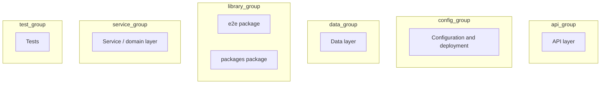

# Architecture report: BuilderIO/mitosis

> Automated static analysis. **Observed** = directly seen in files/imports/AST; **Inferred** = interpretation from that evidence. Repository code was not executed.

## 1. Repository at a glance

| Item | Value |
| --- | --- |
| Repository | BuilderIO/mitosis |
| Description | Write components once, run everywhere. Compiles to React, Vue, Qwik, Solid, Angular, Svelte, and more.  |
| Language | TypeScript |
| Stars | 14464 |
| Licence | MIT |
| Analysed commit / branch | 2de76e9064d9e7916c5309c0a31206383403ae9d / main |
| Framework(s) | React, Svelte, Vue |
| Files analysed | 786 |
| Components | 7 |

## 2. Architecture in one minute

BuilderIO/mitosis - Write components once, run everywhere. Compiles to React, Vue, Qwik, Solid, Angular, Svelte, and more. . This repository was analysed statically from 786 file(s) (0 Python). Detected technologies (observed from imports/manifests): GitHub Actions, React, Svelte, Vue, TypeScript, Vite. Files are grouped into 7 component(s): API layer, Configuration and deployment, Data layer, e2e package, packages package, Service / domain layer, Tests. Findings below distinguish observed facts from inferred interpretation.

## 3. High-level block diagram

## 4. Main components

### API layer (`api_layer`)

- **Kind:** api
- **Status:** Observed
- **Confidence:** 0.85
- **Responsibility:** Groups 3 file(s) under api layer (observed from repository paths and static analysis).
- **Paths:** `e2e/e2e-qwikcity/src/routes/[...index]/index.tsx`, `e2e/e2e-qwikcity/src/routes/layout.tsx`, `e2e/e2e-qwikcity/src/routes/service-worker.ts`
- **Evidence:** [e2e/e2e-qwikcity/src/routes/[...index]/index.tsx](https://github.com/BuilderIO/mitosis/blob/2de76e9064d9e7916c5309c0a31206383403ae9d/e2e/e2e-qwikcity/src/routes/%5B...index%5D/index.tsx); [e2e/e2e-qwikcity/src/routes/layout.tsx](https://github.com/BuilderIO/mitosis/blob/2de76e9064d9e7916c5309c0a31206383403ae9d/e2e/e2e-qwikcity/src/routes/layout.tsx); [e2e/e2e-qwikcity/src/routes/service-worker.ts](https://github.com/BuilderIO/mitosis/blob/2de76e9064d9e7916c5309c0a31206383403ae9d/e2e/e2e-qwikcity/src/routes/service-worker.ts)

### Configuration and deployment (`config`)

- **Kind:** config
- **Status:** Observed
- **Confidence:** 0.85
- **Responsibility:** Groups 76 file(s) under configuration and deployment (observed from repository paths and static analysis).
- **Paths:** `e2e/e2e-alpine/package.json`, `e2e/e2e-angular/angular.json`, `e2e/e2e-angular/package.json`, `e2e/e2e-angular/tsconfig.app.json`, `e2e/e2e-angular/tsconfig.json`, `e2e/e2e-app/allow-failures.json`, `e2e/e2e-app/output/qwik/package.json`, `e2e/e2e-app/output/qwik/project.json`, `e2e/e2e-app/output/qwik/tsconfig.json`, `e2e/e2e-app/output/vue/package.json`, `e2e/e2e-app/output/vue/project.json`, `e2e/e2e-app/output/vue/tsconfig.config.json`, `e2e/e2e-app/output/vue/tsconfig.json`, `e2e/e2e-app/package.json`, `e2e/e2e-app/project.json`, `e2e/e2e-app/results.json`, `e2e/e2e-app/tsconfig.json`, `e2e/e2e-app/tsconfig.node.json`, `e2e/e2e-qwikcity/.vscode/extensions.json`, `e2e/e2e-qwikcity/package.json`, `e2e/e2e-qwikcity/project.json`, `e2e/e2e-qwikcity/public/manifest.json`, `e2e/e2e-qwikcity/tsconfig.json`, `e2e/e2e-react/package.json`, `e2e/e2e-react/project.json`, `e2e/e2e-react/tsconfig.json`, `e2e/e2e-react/tsconfig.node.json`, `e2e/e2e-solid/package.json`, `e2e/e2e-solid/tsconfig.json`, `e2e/e2e-stencil/.editorconfig`, `e2e/e2e-stencil/.prettierrc.json`, `e2e/e2e-stencil/package.json`, `e2e/e2e-stencil/tsconfig.json`, `e2e/e2e-svelte/package.json`, `e2e/e2e-svelte/tsconfig.json`, `e2e/e2e-svelte/tsconfig.node.json`, `e2e/e2e-vue3/package.json`, `e2e/e2e-vue3/tsconfig.json`, `e2e/e2e-vue3/tsconfig.node.json`, `nx.json`, `package.json`, `packages/cli/.yarnrc.yml`, `packages/cli/package.json`, `packages/cli/src/__tests__/compile/data/triptych.builder.json`, `packages/cli/tsconfig.build.json`, `packages/cli/tsconfig.json`, `packages/core/.yarnrc.yml`, `packages/core/package.json`, `packages/core/project.json`, `packages/core/src/__tests__/data/builder/boolean.json`, `packages/core/src/__tests__/data/builder/custom-component-slot-property.json`, `packages/core/src/__tests__/data/builder/custom-component-tags.json`, `packages/core/src/__tests__/data/builder/lazy-load-section.json`, `packages/core/src/__tests__/data/builder/localization.json`, `packages/core/src/__tests__/data/builder/slots.json`, `packages/core/src/__tests__/data/builder/slots2.json`, `packages/core/src/__tests__/data/builder/symbol-basic.json`, `packages/core/src/__tests__/data/builder/symbol-multiple.json`, `packages/core/src/__tests__/data/builder/symbol-with-inputs.json`, `packages/core/src/__tests__/data/builder/symbol-with-named-entry.json`, `packages/core/src/__tests__/data/builder/tag-name.json`, `packages/core/src/__tests__/data/builder/text-bindings.json`, `packages/core/src/__tests__/qwik/specs/qwik.test.accordion.json`, `packages/core/src/__tests__/qwik/specs/qwik.test.bindings.json`, `packages/core/src/__tests__/qwik/specs/qwik.test.button.json`, `packages/core/src/__tests__/qwik/specs/qwik.test.component-binding.json`, `packages/core/src/__tests__/qwik/specs/qwik.test.component-inputs.json`, `packages/core/src/__tests__/qwik/specs/qwik.test.for-loop.binding.json`, `packages/core/src/__tests__/qwik/specs/qwik.test.for-loop.json`, `packages/core/src/__tests__/qwik/specs/qwik.test.hello_world.json`, `packages/core/src/__tests__/qwik/specs/qwik.test.image.json`, `packages/core/src/__tests__/qwik/specs/qwik.test.mount.json`, `packages/core/src/__tests__/qwik/specs/qwik.test.page-with-symbol.json`, `packages/core/src/__tests__/qwik/specs/qwik.test.show-hide.json`, `packages/core/src/__tests__/qwik/specs/qwik.test.svg.json`, `packages/core/src/__tests__/tsconfig.json`
- **Evidence:** [e2e/e2e-alpine/package.json](https://github.com/BuilderIO/mitosis/blob/2de76e9064d9e7916c5309c0a31206383403ae9d/e2e/e2e-alpine/package.json); [e2e/e2e-angular/angular.json](https://github.com/BuilderIO/mitosis/blob/2de76e9064d9e7916c5309c0a31206383403ae9d/e2e/e2e-angular/angular.json); [e2e/e2e-angular/package.json](https://github.com/BuilderIO/mitosis/blob/2de76e9064d9e7916c5309c0a31206383403ae9d/e2e/e2e-angular/package.json); [e2e/e2e-angular/tsconfig.app.json](https://github.com/BuilderIO/mitosis/blob/2de76e9064d9e7916c5309c0a31206383403ae9d/e2e/e2e-angular/tsconfig.app.json); [e2e/e2e-angular/tsconfig.json](https://github.com/BuilderIO/mitosis/blob/2de76e9064d9e7916c5309c0a31206383403ae9d/e2e/e2e-angular/tsconfig.json); [e2e/e2e-app/allow-failures.json](https://github.com/BuilderIO/mitosis/blob/2de76e9064d9e7916c5309c0a31206383403ae9d/e2e/e2e-app/allow-failures.json); [e2e/e2e-app/output/qwik/package.json](https://github.com/BuilderIO/mitosis/blob/2de76e9064d9e7916c5309c0a31206383403ae9d/e2e/e2e-app/output/qwik/package.json); [e2e/e2e-app/output/qwik/project.json](https://github.com/BuilderIO/mitosis/blob/2de76e9064d9e7916c5309c0a31206383403ae9d/e2e/e2e-app/output/qwik/project.json)

### Data layer (`data_layer`)

- **Kind:** data
- **Status:** Observed
- **Confidence:** 0.85
- **Responsibility:** Groups 168 file(s) under data layer (observed from repository paths and static analysis).
- **Paths:** `packages/core/src/__tests__/data/angular/all-spread.raw.tsx`, `packages/core/src/__tests__/data/angular/change-detection.raw.tsx`, `packages/core/src/__tests__/data/angular/custom-selector.raw.tsx`, `packages/core/src/__tests__/data/angular/dynamic-component-with-event-args.raw.tsx`, `packages/core/src/__tests__/data/angular/dynamic-component.raw.tsx`, `packages/core/src/__tests__/data/angular/native-attributes.raw.tsx`, `packages/core/src/__tests__/data/angular/output-event-bindings.raw.tsx`, `packages/core/src/__tests__/data/angular/prettier-inline.raw.tsx`, `packages/core/src/__tests__/data/angular/sanitize-inner-html.raw.tsx`, `packages/core/src/__tests__/data/angular/signals-test.raw.tsx`, `packages/core/src/__tests__/data/angular/state-init-sequence.raw.tsx`, `packages/core/src/__tests__/data/angular/state-init.raw.tsx`, `packages/core/src/__tests__/data/angular/two-fors.raw.tsx`, `packages/core/src/__tests__/data/angular/use-object-wrapper.raw.tsx`, `packages/core/src/__tests__/data/basic-attribute.raw.tsx`, `packages/core/src/__tests__/data/basic-boolean-attribute-component.raw.tsx`, `packages/core/src/__tests__/data/basic-boolean-attribute.raw.tsx`, `packages/core/src/__tests__/data/basic-child-component.raw.tsx`, `packages/core/src/__tests__/data/basic-context.raw.tsx`, `packages/core/src/__tests__/data/basic-custom-mitosis-package.raw.tsx`, `packages/core/src/__tests__/data/basic-onChange.raw.tsx`, `packages/core/src/__tests__/data/basic-onMount-update.raw.tsx`, `packages/core/src/__tests__/data/basic-onUpdate-return.raw.tsx`, `packages/core/src/__tests__/data/basic-outputs-meta.raw.tsx`, `packages/core/src/__tests__/data/basic-outputs.raw.tsx`, `packages/core/src/__tests__/data/basic-preserve-export-or-local-statement.raw.tsx`, `packages/core/src/__tests__/data/basic-web-component.raw.tsx`, `packages/core/src/__tests__/data/basic.raw.tsx`, `packages/core/src/__tests__/data/blocks/builder-render-block.raw.tsx`, `packages/core/src/__tests__/data/blocks/builder-render-content.raw.tsx`, `packages/core/src/__tests__/data/blocks/button-with-metadata.raw.tsx`, `packages/core/src/__tests__/data/blocks/button.raw.lite.tsx`, `packages/core/src/__tests__/data/blocks/button.raw.tsx`, `packages/core/src/__tests__/data/blocks/classname-jsx.raw.tsx`, `packages/core/src/__tests__/data/blocks/columns.raw.tsx`, `packages/core/src/__tests__/data/blocks/content-slot-html.raw.tsx`, `packages/core/src/__tests__/data/blocks/content-slot-jsx.raw.tsx`, `packages/core/src/__tests__/data/blocks/custom-code.raw.tsx`, `packages/core/src/__tests__/data/blocks/embed.raw.tsx`, `packages/core/src/__tests__/data/blocks/form.raw.tsx`, `packages/core/src/__tests__/data/blocks/getter-state.raw.tsx`, `packages/core/src/__tests__/data/blocks/image.raw.tsx`, `packages/core/src/__tests__/data/blocks/img-state.raw.tsx`, `packages/core/src/__tests__/data/blocks/img.raw.tsx`, `packages/core/src/__tests__/data/blocks/index-in-for.raw.tsx`, `packages/core/src/__tests__/data/blocks/input-parent.raw.tsx`, `packages/core/src/__tests__/data/blocks/input.raw.tsx`, `packages/core/src/__tests__/data/blocks/multiple-onUpdate.raw.tsx`, `packages/core/src/__tests__/data/blocks/multiple-onUpdateWithDeps.raw.tsx`, `packages/core/src/__tests__/data/blocks/onEvent.raw.tsx`, `packages/core/src/__tests__/data/blocks/onInit-onMount.raw.tsx`, `packages/core/src/__tests__/data/blocks/onInit-plain.raw.tsx`, `packages/core/src/__tests__/data/blocks/onInit.raw.tsx`, `packages/core/src/__tests__/data/blocks/onMount-multiple.raw.tsx`, `packages/core/src/__tests__/data/blocks/onMount.raw.tsx`, `packages/core/src/__tests__/data/blocks/onUpdate.raw.tsx`, `packages/core/src/__tests__/data/blocks/onUpdateWithDeps.raw.tsx`, `packages/core/src/__tests__/data/blocks/raw-text.raw.tsx`, `packages/core/src/__tests__/data/blocks/referencing-function-inside-hook.raw.tsx`, `packages/core/src/__tests__/data/blocks/render-block.raw.tsx`, `packages/core/src/__tests__/data/blocks/root-fragment-multi-node.raw.tsx`, `packages/core/src/__tests__/data/blocks/rootShow.raw.tsx`, `packages/core/src/__tests__/data/blocks/section-state.raw.tsx`, `packages/core/src/__tests__/data/blocks/section.raw.tsx`, `packages/core/src/__tests__/data/blocks/select.raw.tsx`, `packages/core/src/__tests__/data/blocks/self-referencing-component-with-children.raw.tsx`, `packages/core/src/__tests__/data/blocks/self-referencing-component.raw.tsx`, `packages/core/src/__tests__/data/blocks/shadow-dom.raw.tsx`, `packages/core/src/__tests__/data/blocks/slot-default.raw.tsx`, `packages/core/src/__tests__/data/blocks/slot-html.raw.tsx`, `packages/core/src/__tests__/data/blocks/slot-jsx.raw.tsx`, `packages/core/src/__tests__/data/blocks/slot-named.raw.tsx`, `packages/core/src/__tests__/data/blocks/stamped-io.raw.tsx`, `packages/core/src/__tests__/data/blocks/submit-button.raw.tsx`, `packages/core/src/__tests__/data/blocks/text.raw.tsx`, `packages/core/src/__tests__/data/blocks/textarea.raw.tsx`, `packages/core/src/__tests__/data/blocks/video.raw.tsx`, `packages/core/src/__tests__/data/context/component-with-context-multi-root.raw.tsx`, `packages/core/src/__tests__/data/context/component-with-context.raw.tsx`, `packages/core/src/__tests__/data/context/simple.context.lite.ts`, `packages/core/src/__tests__/data/default-props/default-props-outside-component.raw.tsx`, `packages/core/src/__tests__/data/default-props/default-props.raw.tsx`, `packages/core/src/__tests__/data/events/event-input-and-change.raw.tsx`, `packages/core/src/__tests__/data/for/advanced-for.raw.tsx`, `packages/core/src/__tests__/data/for/basic-for-fragment.raw.tsx`, `packages/core/src/__tests__/data/for/basic-for-no-tag-reference.raw.tsx`, `packages/core/src/__tests__/data/for/basic-for-show.raw.tsx`, `packages/core/src/__tests__/data/for/basic-for.raw.tsx`, `packages/core/src/__tests__/data/function-props.raw.tsx`, `packages/core/src/__tests__/data/import.raw.tsx`, `packages/core/src/__tests__/data/layer-name.raw.tsx`, `packages/core/src/__tests__/data/meta/figma.ts`, `packages/core/src/__tests__/data/meta/figma/data.ts`, `packages/core/src/__tests__/data/meta/figma/figma.raw.tsx`, `packages/core/src/__tests__/data/meta/meta.ts`, `packages/core/src/__tests__/data/meta/sub/complex-meta.raw.tsx`, `packages/core/src/__tests__/data/meta/sub/meta-model.ts`, `packages/core/src/__tests__/data/meta/sub/meta-sub.ts`, `packages/core/src/__tests__/data/nested-styles.raw.tsx`, `packages/core/src/__tests__/data/normalize-layer-names.raw.tsx`, `packages/core/src/__tests__/data/props/basic-props-destructure.raw.tsx`, `packages/core/src/__tests__/data/props/basic-props.raw.tsx`, `packages/core/src/__tests__/data/props/classname-props.raw.tsx`, `packages/core/src/__tests__/data/props/event-props.raw.tsx`, `packages/core/src/__tests__/data/props/event-props.type.ts`, `packages/core/src/__tests__/data/react-native/native-styles.raw.tsx`, `packages/core/src/__tests__/data/react-native/onclick-to-pressable.raw.tsx`, `packages/core/src/__tests__/data/react-native/text-input.raw.tsx`, `packages/core/src/__tests__/data/react-native/twrnc-state-complex-styled-component.raw.tsx`, `packages/core/src/__tests__/data/react-native/twrnc-state-styled-component.raw.tsx`, `packages/core/src/__tests__/data/react-native/twrnc-styled-component.raw.tsx`, `packages/core/src/__tests__/data/ref/advanced-ref.raw.tsx`, `packages/core/src/__tests__/data/ref/basic-forwardRef-metadata.raw.tsx`, `packages/core/src/__tests__/data/ref/basic-forwardRef.raw.tsx`, `packages/core/src/__tests__/data/ref/basic-ref-assignment.raw.tsx`, `packages/core/src/__tests__/data/ref/basic-ref-attribute-passing-custom-ref.raw.tsx`, `packages/core/src/__tests__/data/ref/basic-ref-attribute-passing.raw.tsx`, `packages/core/src/__tests__/data/ref/basic-ref-usePrevious.raw.tsx`, `packages/core/src/__tests__/data/ref/basic-ref.raw.tsx`, `packages/core/src/__tests__/data/render-content.raw.tsx`, `packages/core/src/__tests__/data/show/nested-show.raw.tsx`, `packages/core/src/__tests__/data/show/show-expressions.raw.tsx`, `packages/core/src/__tests__/data/show/show-with-for.raw.tsx`, `packages/core/src/__tests__/data/show/show-with-other-values.raw.tsx`, `packages/core/src/__tests__/data/show/show-with-root-text.raw.tsx`, `packages/core/src/__tests__/data/signals-onUpdate.raw.tsx`, `packages/core/src/__tests__/data/spread/multiple-spreads.raw.tsx`, `packages/core/src/__tests__/data/spread/spread-attrs.raw.tsx`, `packages/core/src/__tests__/data/spread/spread-nested-props.raw.tsx`, `packages/core/src/__tests__/data/spread/spread-props.raw.tsx`, `packages/core/src/__tests__/data/state/context-state.raw.tsx`, `packages/core/src/__tests__/data/state/expression-state.raw.tsx`, `packages/core/src/__tests__/data/state/set-state.raw.tsx`, `packages/core/src/__tests__/data/store-async-function.raw.tsx`, `packages/core/src/__tests__/data/store/arrow-function-in-use-store.raw.tsx`, `packages/core/src/__tests__/data/store/nested-store.raw.tsx`, `packages/core/src/__tests__/data/store/store-comment.raw.tsx`, `packages/core/src/__tests__/data/store/store-shadow-vars.raw.tsx`, `packages/core/src/__tests__/data/store/store-with-state.raw.tsx`, `packages/core/src/__tests__/data/store/string-literal-store-kebab.raw.tsx`, `packages/core/src/__tests__/data/store/string-literal-store.raw.tsx`, `packages/core/src/__tests__/data/store/use-value-and-fn-from-store.raw.tsx`, `packages/core/src/__tests__/data/styles/class-and-className.raw.tsx`, `packages/core/src/__tests__/data/styles/class.raw.tsx`, `packages/core/src/__tests__/data/styles/className.raw.tsx`, `packages/core/src/__tests__/data/styles/classState.raw.tsx`, `packages/core/src/__tests__/data/styles/style-class-and-css.raw.tsx`, `packages/core/src/__tests__/data/styles/style-prop-class-and-css.raw.tsx`, `packages/core/src/__tests__/data/styles/use-style-and-css.raw.tsx`, `packages/core/src/__tests__/data/styles/use-style-outside-component.raw.tsx`, `packages/core/src/__tests__/data/styles/use-style.raw.tsx`, `packages/core/src/__tests__/data/sub-component.raw.tsx`, `packages/core/src/__tests__/data/svg.raw.tsx`, `packages/core/src/__tests__/data/swift/plain-component-export.raw.tsx`, `packages/core/src/__tests__/data/swift/single-quotes-replacement.raw.tsx`, `packages/core/src/__tests__/data/types/component-props-interface.raw.tsx`, `packages/core/src/__tests__/data/types/component-props-type.raw.tsx`, `packages/core/src/__tests__/data/types/component-with-default-values-types.raw.tsx`, `packages/core/src/__tests__/data/types/foo-props.ts`, `packages/core/src/__tests__/data/types/foo-store.ts`, `packages/core/src/__tests__/data/types/foo-type.ts`, `packages/core/src/__tests__/data/types/preserve-typing.raw.tsx`, `packages/core/src/__tests__/data/types/type-dependency.raw.tsx`, `packages/core/src/__tests__/data/types/type-export.lite.tsx`, `packages/core/src/__tests__/data/types/type-external-props.raw.tsx`, `packages/core/src/__tests__/data/types/type-external-store.raw.tsx`, `packages/core/src/__tests__/data/types/type-getter-store.raw.tsx`, `packages/core/src/__tests__/data/use-target.raw.tsx`
- **Evidence:** [packages/core/src/__tests__/data/angular/all-spread.raw.tsx](https://github.com/BuilderIO/mitosis/blob/2de76e9064d9e7916c5309c0a31206383403ae9d/packages/core/src/__tests__/data/angular/all-spread.raw.tsx); [packages/core/src/__tests__/data/angular/change-detection.raw.tsx](https://github.com/BuilderIO/mitosis/blob/2de76e9064d9e7916c5309c0a31206383403ae9d/packages/core/src/__tests__/data/angular/change-detection.raw.tsx); [packages/core/src/__tests__/data/angular/custom-selector.raw.tsx](https://github.com/BuilderIO/mitosis/blob/2de76e9064d9e7916c5309c0a31206383403ae9d/packages/core/src/__tests__/data/angular/custom-selector.raw.tsx); [packages/core/src/__tests__/data/angular/dynamic-component-with-event-args.raw.tsx](https://github.com/BuilderIO/mitosis/blob/2de76e9064d9e7916c5309c0a31206383403ae9d/packages/core/src/__tests__/data/angular/dynamic-component-with-event-args.raw.tsx); [packages/core/src/__tests__/data/angular/dynamic-component.raw.tsx](https://github.com/BuilderIO/mitosis/blob/2de76e9064d9e7916c5309c0a31206383403ae9d/packages/core/src/__tests__/data/angular/dynamic-component.raw.tsx); [packages/core/src/__tests__/data/angular/native-attributes.raw.tsx](https://github.com/BuilderIO/mitosis/blob/2de76e9064d9e7916c5309c0a31206383403ae9d/packages/core/src/__tests__/data/angular/native-attributes.raw.tsx); [packages/core/src/__tests__/data/angular/output-event-bindings.raw.tsx](https://github.com/BuilderIO/mitosis/blob/2de76e9064d9e7916c5309c0a31206383403ae9d/packages/core/src/__tests__/data/angular/output-event-bindings.raw.tsx); [packages/core/src/__tests__/data/angular/prettier-inline.raw.tsx](https://github.com/BuilderIO/mitosis/blob/2de76e9064d9e7916c5309c0a31206383403ae9d/packages/core/src/__tests__/data/angular/prettier-inline.raw.tsx)

### e2e package (`e2e`)

- **Kind:** library
- **Status:** Observed
- **Confidence:** 0.85
- **Responsibility:** Groups 61 file(s) under e2e package (observed from repository paths and static analysis).
- **Paths:** `e2e/e2e-alpine/src/main.ts`, `e2e/e2e-alpine/vite.config.ts`, `e2e/e2e-angular/angular_src/app/app.component.ts`, `e2e/e2e-angular/angular_src/environments/environment.prod.ts`, `e2e/e2e-angular/angular_src/environments/environment.ts`, `e2e/e2e-angular/angular_src/main.ts`, `e2e/e2e-angular/angular_src/polyfills.ts`, `e2e/e2e-app/e2e-output.ts`, `e2e/e2e-app/e2e.ts`, `e2e/e2e-app/mitosis.config.cjs`, `e2e/e2e-app/output/qwik/vite.config.ts`, `e2e/e2e-app/output/stencil/index.ts`, `e2e/e2e-app/output/vue/vite.config.ts`, `e2e/e2e-app/playwright.config.ts`, `e2e/e2e-app/src/component-paths.ts`, `e2e/e2e-app/src/components/component-on-update.lite.tsx`, `e2e/e2e-app/src/components/default-props/use-default-props.lite.tsx`, `e2e/e2e-app/src/components/disabled-input/disabled-input.lite.tsx`, `e2e/e2e-app/src/components/disabled-input/native-input.lite.tsx`, `e2e/e2e-app/src/components/disabled-input/simple-input.lite.tsx`, `e2e/e2e-app/src/components/explicit.docs.lite.tsx`, `e2e/e2e-app/src/components/nested/item-list.lite.tsx`, `e2e/e2e-app/src/components/nested/nested-parent.lite.tsx`, `e2e/e2e-app/src/components/one-component.lite.tsx`, `e2e/e2e-app/src/components/show-for-component.lite.tsx`, `e2e/e2e-app/src/components/signals/signal-item-list.lite.tsx`, `e2e/e2e-app/src/components/signals/signal-parent.lite.tsx`, `e2e/e2e-app/src/components/special-tags.lite.tsx`, `e2e/e2e-app/src/components/types/component-with-inside-types.lite.tsx`, `e2e/e2e-app/src/components/types/component-with-outside-types.lite.tsx`, `e2e/e2e-app/src/components/types/data.ts`, `e2e/e2e-app/src/homepage.lite.tsx`, `e2e/e2e-app/src/index.ts`, `e2e/e2e-app/src/testConfig.ts`, `e2e/e2e-qwikcity/.eslintrc.cjs`, `e2e/e2e-qwikcity/src/components/header/header.tsx`, `e2e/e2e-qwikcity/src/components/icons/qwik.tsx`, `e2e/e2e-qwikcity/src/components/router-head/router-head.tsx`, `e2e/e2e-qwikcity/src/entry.dev.tsx`, `e2e/e2e-qwikcity/src/entry.preview.tsx`, `e2e/e2e-qwikcity/src/entry.ssr.tsx`, `e2e/e2e-qwikcity/src/root.tsx`, `e2e/e2e-qwikcity/vite.config.ts`, `e2e/e2e-react/src/App.tsx`, `e2e/e2e-react/src/main.tsx`, `e2e/e2e-react/src/vite-env.d.ts`, `e2e/e2e-react/vite.config.ts`, `e2e/e2e-solid/src/App.tsx`, `e2e/e2e-solid/src/index.tsx`, `e2e/e2e-solid/vite.config.ts`, `e2e/e2e-stencil/components.d.ts`, `e2e/e2e-stencil/stencil.config.ts`, `e2e/e2e-svelte/src/App.svelte`, `e2e/e2e-svelte/src/main.ts`, `e2e/e2e-svelte/src/vite-env.d.ts`, `e2e/e2e-svelte/svelte.config.mjs`, `e2e/e2e-svelte/vite.config.ts`, `e2e/e2e-vue3/src/App.vue`, `e2e/e2e-vue3/src/env.d.ts`, `e2e/e2e-vue3/src/main.ts`, `e2e/e2e-vue3/vite.config.ts`
- **Evidence:** [e2e/e2e-alpine/src/main.ts](https://github.com/BuilderIO/mitosis/blob/2de76e9064d9e7916c5309c0a31206383403ae9d/e2e/e2e-alpine/src/main.ts); [e2e/e2e-alpine/vite.config.ts](https://github.com/BuilderIO/mitosis/blob/2de76e9064d9e7916c5309c0a31206383403ae9d/e2e/e2e-alpine/vite.config.ts); [e2e/e2e-angular/angular_src/app/app.component.ts](https://github.com/BuilderIO/mitosis/blob/2de76e9064d9e7916c5309c0a31206383403ae9d/e2e/e2e-angular/angular_src/app/app.component.ts); [e2e/e2e-angular/angular_src/environments/environment.prod.ts](https://github.com/BuilderIO/mitosis/blob/2de76e9064d9e7916c5309c0a31206383403ae9d/e2e/e2e-angular/angular_src/environments/environment.prod.ts); [e2e/e2e-angular/angular_src/environments/environment.ts](https://github.com/BuilderIO/mitosis/blob/2de76e9064d9e7916c5309c0a31206383403ae9d/e2e/e2e-angular/angular_src/environments/environment.ts); [e2e/e2e-angular/angular_src/main.ts](https://github.com/BuilderIO/mitosis/blob/2de76e9064d9e7916c5309c0a31206383403ae9d/e2e/e2e-angular/angular_src/main.ts); [e2e/e2e-angular/angular_src/polyfills.ts](https://github.com/BuilderIO/mitosis/blob/2de76e9064d9e7916c5309c0a31206383403ae9d/e2e/e2e-angular/angular_src/polyfills.ts); [e2e/e2e-app/e2e-output.ts](https://github.com/BuilderIO/mitosis/blob/2de76e9064d9e7916c5309c0a31206383403ae9d/e2e/e2e-app/e2e-output.ts)

### packages package (`packages`)

- **Kind:** library
- **Status:** Observed
- **Confidence:** 0.85
- **Responsibility:** Groups 15 file(s) under packages package (observed from repository paths and static analysis).
- **Paths:** `packages/cli/scripts/fix-core-version.sh`, `packages/cli/src/__tests__/compile/compile.test.ts`, `packages/cli/src/__tests__/others/version.test.ts`, `packages/cli/src/__tests__/plugins.test.ts`, `packages/cli/src/__tests__/utils.ts`, `packages/cli/src/cli.ts`, `packages/cli/src/commands/build.ts`, `packages/cli/src/commands/compile.ts`, `packages/cli/src/commands/new.ts`, `packages/cli/src/extensions/cli-extension.ts`, `packages/cli/src/helpers/get-mitosis-config.ts`, `packages/cli/src/helpers/get-toolbox-info.ts`, `packages/cli/src/types.ts`, `packages/cli/src/typings.d.ts`, `packages/cli/vite.config.ts`
- **Evidence:** [packages/cli/scripts/fix-core-version.sh](https://github.com/BuilderIO/mitosis/blob/2de76e9064d9e7916c5309c0a31206383403ae9d/packages/cli/scripts/fix-core-version.sh); [packages/cli/src/__tests__/compile/compile.test.ts](https://github.com/BuilderIO/mitosis/blob/2de76e9064d9e7916c5309c0a31206383403ae9d/packages/cli/src/__tests__/compile/compile.test.ts); [packages/cli/src/__tests__/others/version.test.ts](https://github.com/BuilderIO/mitosis/blob/2de76e9064d9e7916c5309c0a31206383403ae9d/packages/cli/src/__tests__/others/version.test.ts); [packages/cli/src/__tests__/plugins.test.ts](https://github.com/BuilderIO/mitosis/blob/2de76e9064d9e7916c5309c0a31206383403ae9d/packages/cli/src/__tests__/plugins.test.ts); [packages/cli/src/__tests__/utils.ts](https://github.com/BuilderIO/mitosis/blob/2de76e9064d9e7916c5309c0a31206383403ae9d/packages/cli/src/__tests__/utils.ts); [packages/cli/src/cli.ts](https://github.com/BuilderIO/mitosis/blob/2de76e9064d9e7916c5309c0a31206383403ae9d/packages/cli/src/cli.ts); [packages/cli/src/commands/build.ts](https://github.com/BuilderIO/mitosis/blob/2de76e9064d9e7916c5309c0a31206383403ae9d/packages/cli/src/commands/build.ts); [packages/cli/src/commands/compile.ts](https://github.com/BuilderIO/mitosis/blob/2de76e9064d9e7916c5309c0a31206383403ae9d/packages/cli/src/commands/compile.ts)

### Service / domain layer (`service_layer`)

- **Kind:** service
- **Status:** Observed
- **Confidence:** 0.85
- **Responsibility:** Groups 172 file(s) under service / domain layer (observed from repository paths and static analysis).
- **Paths:** `packages/core/jsx-runtime.d.ts`, `packages/core/scripts/remove-stableVersion.sh`, `packages/core/src/__tests__/alpine.test.ts`, `packages/core/src/__tests__/angular.import.test.ts`, `packages/core/src/__tests__/angular.mapper.test.ts`, `packages/core/src/__tests__/angular.selector.test.ts`, `packages/core/src/__tests__/angular.signals.test.ts`, `packages/core/src/__tests__/angular.state.test.ts`, `packages/core/src/__tests__/angular.styles.test.ts`, `packages/core/src/__tests__/angular.tag.test.ts`, `packages/core/src/__tests__/angular.test.ts`, `packages/core/src/__tests__/builder/builder.test.ts`, `packages/core/src/__tests__/builder/deeply-nested.test.ts`, `packages/core/src/__tests__/builder/events.test.ts`, `packages/core/src/__tests__/builder/invalid-jsx-flag.test.ts`, `packages/core/src/__tests__/builder/object-literal-blocks.test.ts`, `packages/core/src/__tests__/builder/personalization-container.test.ts`, `packages/core/src/__tests__/builder/responsive-styles.test.ts`, `packages/core/src/__tests__/builder/symbols.test.ts`, `packages/core/src/__tests__/builder/text.test.ts`, `packages/core/src/__tests__/context.test.ts`, `packages/core/src/__tests__/hash-code.test.ts`, `packages/core/src/__tests__/html.test.ts`, `packages/core/src/__tests__/liquid.test.ts`, `packages/core/src/__tests__/lit.test.ts`, `packages/core/src/__tests__/local.test.ts`, `packages/core/src/__tests__/marko.test.ts`, `packages/core/src/__tests__/mitosis.test.ts`, `packages/core/src/__tests__/parse-jsx.test.ts`, `packages/core/src/__tests__/parse-svelte.test.ts`, `packages/core/src/__tests__/preact.test.ts`, `packages/core/src/__tests__/qwik.directive.test.ts`, `packages/core/src/__tests__/qwik.test.ts`, `packages/core/src/__tests__/qwik/convert-method-to-function.test.ts`, `packages/core/src/__tests__/qwik/src-generator.test.ts`, `packages/core/src/__tests__/qwik/stable-serializer.test.ts`, `packages/core/src/__tests__/react-native.test.ts`, `packages/core/src/__tests__/react-state-builder.test.ts`, `packages/core/src/__tests__/react-state-mobx.test.ts`, `packages/core/src/__tests__/react-state-solid.test.ts`, `packages/core/src/__tests__/react-state-valtio.test.ts`, `packages/core/src/__tests__/react-state-variables.test.ts`, `packages/core/src/__tests__/react.test.ts`, `packages/core/src/__tests__/rsc.test.ts`, `packages/core/src/__tests__/solid.test.ts`, `packages/core/src/__tests__/stencil.test.ts`, `packages/core/src/__tests__/styles.test.ts`, `packages/core/src/__tests__/svelte.memoize-getters.test.ts`, `packages/core/src/__tests__/svelte.test.ts`, `packages/core/src/__tests__/swift.test.ts`, `packages/core/src/__tests__/syntax/svelte/basic.raw.svelte`, `packages/core/src/__tests__/syntax/svelte/bind-group.raw.svelte`, `packages/core/src/__tests__/syntax/svelte/bind-property.raw.svelte`, `packages/core/src/__tests__/syntax/svelte/class-directive.raw.svelte`, `packages/core/src/__tests__/syntax/svelte/context.raw.svelte`, `packages/core/src/__tests__/syntax/svelte/each.raw.svelte`, `packages/core/src/__tests__/syntax/svelte/event-handlers.raw.svelte`, `packages/core/src/__tests__/syntax/svelte/html.raw.svelte`, `packages/core/src/__tests__/syntax/svelte/if-else.raw.svelte`, `packages/core/src/__tests__/syntax/svelte/imports.raw.svelte`, `packages/core/src/__tests__/syntax/svelte/lifecycle-hooks.raw.svelte`, `packages/core/src/__tests__/syntax/svelte/reactive-with-fn.raw.svelte`, `packages/core/src/__tests__/syntax/svelte/reactive.raw.svelte`, `packages/core/src/__tests__/syntax/svelte/slots.raw.svelte`, `packages/core/src/__tests__/syntax/svelte/style.raw.svelte`, `packages/core/src/__tests__/syntax/svelte/text-expressions.raw.svelte`, `packages/core/src/__tests__/taro.test.ts`, `packages/core/src/__tests__/test-generator.ts`, `packages/core/src/__tests__/vue-composition.test.ts`, `packages/core/src/__tests__/vue.test.ts`, `packages/core/src/__tests__/webcomponent.test.ts`, `packages/core/src/constants/hooks.ts`, `packages/core/src/constants/html_tags.ts`, `packages/core/src/constants/media-sizes.ts`, `packages/core/src/constants/method-literal-prefix.ts`, `packages/core/src/flow.ts`, `packages/core/src/generators/alpine/generate.ts`, `packages/core/src/generators/alpine/index.ts`, `packages/core/src/generators/alpine/render-mount-hook.ts`, `packages/core/src/generators/alpine/render-update-hooks.ts`, `packages/core/src/generators/alpine/types.ts`, `packages/core/src/generators/angular/classic/blocks.ts`, `packages/core/src/generators/angular/classic/component.ts`, `packages/core/src/generators/angular/classic/plugins/get-class-properties-plugin.ts`, `packages/core/src/generators/angular/classic/plugins/get-code-processor-plugins.ts`, `packages/core/src/generators/angular/component.ts`, `packages/core/src/generators/angular/helpers/format.ts`, `packages/core/src/generators/angular/helpers/get-inputs.ts`, `packages/core/src/generators/angular/helpers/get-outputs.ts`, `packages/core/src/generators/angular/helpers/get-refs.ts`, `packages/core/src/generators/angular/helpers/get-styles.ts`, `packages/core/src/generators/angular/helpers/hooks.ts`, `packages/core/src/generators/angular/helpers/index.ts`, `packages/core/src/generators/angular/helpers/parse-selector.ts`, `packages/core/src/generators/angular/index.ts`, `packages/core/src/generators/angular/signals/blocks.ts`, `packages/core/src/generators/angular/signals/component.ts`, `packages/core/src/generators/angular/signals/helpers/get-computed.ts`, `packages/core/src/generators/angular/signals/helpers/get-dynamic-template-refs.ts`, `packages/core/src/generators/angular/signals/helpers/get-inputs.ts`, `packages/core/src/generators/angular/signals/helpers/index.ts`, `packages/core/src/generators/angular/signals/plugins/get-code-processor-plugins.ts`, `packages/core/src/generators/angular/types.ts`, `packages/core/src/generators/builder/generator.ts`, `packages/core/src/generators/builder/index.ts`, `packages/core/src/generators/builder/types.ts`, `packages/core/src/generators/context/angular.ts`, `packages/core/src/generators/context/helpers/context-with-symbol-key.ts`, `packages/core/src/generators/context/qwik.ts`, `packages/core/src/generators/context/react.ts`, `packages/core/src/generators/context/rsc.ts`, `packages/core/src/generators/context/solid.ts`, `packages/core/src/generators/context/svelte.ts`, `packages/core/src/generators/context/vue.ts`, `packages/core/src/generators/helpers/context.ts`, `packages/core/src/generators/helpers/functions.ts`, `packages/core/src/generators/helpers/minify.ts`, `packages/core/src/generators/helpers/on-mount.ts`, `packages/core/src/generators/helpers/rsc.ts`, `packages/core/src/generators/html/generator.ts`, `packages/core/src/generators/html/index.ts`, `packages/core/src/generators/html/types.ts`, `packages/core/src/generators/liquid/generator.ts`, `packages/core/src/generators/liquid/index.ts`, `packages/core/src/generators/liquid/types.ts`, `packages/core/src/generators/lit/collect-class-string.ts`, `packages/core/src/generators/lit/generate.ts`, `packages/core/src/generators/lit/index.ts`, `packages/core/src/generators/lit/types.ts`, `packages/core/src/generators/marko/generate.ts`, `packages/core/src/generators/marko/index.ts`, `packages/core/src/generators/marko/types.ts`, `packages/core/src/generators/mitosis/generator.ts`, `packages/core/src/generators/mitosis/index.ts`, `packages/core/src/generators/mitosis/types.ts`, `packages/core/src/generators/qwik/component-generator.ts`, `packages/core/src/generators/qwik/component.ts`, `packages/core/src/generators/qwik/directives.ts`, `packages/core/src/generators/qwik/helpers/add-prevent-default.ts`, `packages/core/src/generators/qwik/helpers/convert-method-to-function.ts`, `packages/core/src/generators/qwik/helpers/handlers.ts`, `packages/core/src/generators/qwik/helpers/stable-inject.ts`, `packages/core/src/generators/qwik/helpers/stable-serialize.ts`, `packages/core/src/generators/qwik/helpers/state.ts`, `packages/core/src/generators/qwik/helpers/styles.ts`, `packages/core/src/generators/qwik/index.ts`, `packages/core/src/generators/qwik/jsx.ts`, `packages/core/src/generators/qwik/src-generator.ts`, `packages/core/src/generators/qwik/types.ts`, `packages/core/src/generators/react-native/extract-css-var-default-value.ts`, `packages/core/src/generators/react-native/helpers.ts`, `packages/core/src/generators/react-native/index.ts`, `packages/core/src/generators/react-native/sanitize-react-native-block-styles.ts`, `packages/core/src/generators/react-native/types.ts`, `packages/core/src/generators/react/blocks.ts`, `packages/core/src/generators/react/generator.ts`, `packages/core/src/generators/react/helpers/default-props.ts`, `packages/core/src/generators/react/helpers/hooks.ts`, `packages/core/src/generators/react/helpers/index.ts`, `packages/core/src/generators/react/helpers/state.ts`, `packages/core/src/generators/react/index.ts`, `packages/core/src/generators/react/types.ts`, `packages/core/src/generators/rsc/generator.ts`, `packages/core/src/generators/rsc/index.ts`, `packages/core/src/generators/rsc/types.ts`, `packages/core/src/generators/solid/blocks.ts`, `packages/core/src/generators/solid/helpers/styles.ts`, `packages/core/src/generators/solid/index.ts`, `packages/core/src/generators/solid/state/helpers.ts`, `packages/core/src/generators/solid/state/index.ts`, `packages/core/src/generators/solid/state/signals.ts`, `packages/core/src/generators/solid/state/state.ts`
- **Evidence:** [packages/core/jsx-runtime.d.ts](https://github.com/BuilderIO/mitosis/blob/2de76e9064d9e7916c5309c0a31206383403ae9d/packages/core/jsx-runtime.d.ts); [packages/core/scripts/remove-stableVersion.sh](https://github.com/BuilderIO/mitosis/blob/2de76e9064d9e7916c5309c0a31206383403ae9d/packages/core/scripts/remove-stableVersion.sh); [packages/core/src/__tests__/alpine.test.ts](https://github.com/BuilderIO/mitosis/blob/2de76e9064d9e7916c5309c0a31206383403ae9d/packages/core/src/__tests__/alpine.test.ts); [packages/core/src/__tests__/angular.import.test.ts](https://github.com/BuilderIO/mitosis/blob/2de76e9064d9e7916c5309c0a31206383403ae9d/packages/core/src/__tests__/angular.import.test.ts); [packages/core/src/__tests__/angular.mapper.test.ts](https://github.com/BuilderIO/mitosis/blob/2de76e9064d9e7916c5309c0a31206383403ae9d/packages/core/src/__tests__/angular.mapper.test.ts); [packages/core/src/__tests__/angular.selector.test.ts](https://github.com/BuilderIO/mitosis/blob/2de76e9064d9e7916c5309c0a31206383403ae9d/packages/core/src/__tests__/angular.selector.test.ts); [packages/core/src/__tests__/angular.signals.test.ts](https://github.com/BuilderIO/mitosis/blob/2de76e9064d9e7916c5309c0a31206383403ae9d/packages/core/src/__tests__/angular.signals.test.ts); [packages/core/src/__tests__/angular.state.test.ts](https://github.com/BuilderIO/mitosis/blob/2de76e9064d9e7916c5309c0a31206383403ae9d/packages/core/src/__tests__/angular.state.test.ts)

### Tests (`tests`)

- **Kind:** test
- **Status:** Observed
- **Confidence:** 0.85
- **Responsibility:** Groups 1 file(s) under tests (observed from repository paths and static analysis).
- **Paths:** `e2e/e2e-app/tests/main.spec.ts`
- **Evidence:** [e2e/e2e-app/tests/main.spec.ts](https://github.com/BuilderIO/mitosis/blob/2de76e9064d9e7916c5309c0a31206383403ae9d/e2e/e2e-app/tests/main.spec.ts)

## 5. Execution flow

**Observed** entry point(s):

- [e2e/e2e-alpine/src/main.ts](https://github.com/BuilderIO/mitosis/blob/2de76e9064d9e7916c5309c0a31206383403ae9d/e2e/e2e-alpine/src/main.ts)
- [e2e/e2e-angular/angular_src/main.ts](https://github.com/BuilderIO/mitosis/blob/2de76e9064d9e7916c5309c0a31206383403ae9d/e2e/e2e-angular/angular_src/main.ts)
- [e2e/e2e-app/src/index.ts](https://github.com/BuilderIO/mitosis/blob/2de76e9064d9e7916c5309c0a31206383403ae9d/e2e/e2e-app/src/index.ts)
- [e2e/e2e-react/src/App.tsx](https://github.com/BuilderIO/mitosis/blob/2de76e9064d9e7916c5309c0a31206383403ae9d/e2e/e2e-react/src/App.tsx)
- [e2e/e2e-react/src/main.tsx](https://github.com/BuilderIO/mitosis/blob/2de76e9064d9e7916c5309c0a31206383403ae9d/e2e/e2e-react/src/main.tsx)
- [e2e/e2e-solid/src/App.tsx](https://github.com/BuilderIO/mitosis/blob/2de76e9064d9e7916c5309c0a31206383403ae9d/e2e/e2e-solid/src/App.tsx)
- [e2e/e2e-solid/src/index.tsx](https://github.com/BuilderIO/mitosis/blob/2de76e9064d9e7916c5309c0a31206383403ae9d/e2e/e2e-solid/src/index.tsx)
- [e2e/e2e-svelte/src/main.ts](https://github.com/BuilderIO/mitosis/blob/2de76e9064d9e7916c5309c0a31206383403ae9d/e2e/e2e-svelte/src/main.ts)
- [e2e/e2e-vue3/src/main.ts](https://github.com/BuilderIO/mitosis/blob/2de76e9064d9e7916c5309c0a31206383403ae9d/e2e/e2e-vue3/src/main.ts)
- [packages/cli/bin/mitosis](https://github.com/BuilderIO/mitosis/blob/2de76e9064d9e7916c5309c0a31206383403ae9d/packages/cli/bin/mitosis)

Representative flow (derived from observed entry points and the import graph; steps beyond the entry point are **Inferred**):

1. Execution starts at an observed entry point listed above, if present.
2. No internal import relationships between components were observed.

## 6. Project structure

### `(root)`

- `.eslintignore` - other (110 bytes)
- `.eslintrc.js` - source, JavaScript (592 bytes)
- `.gitattributes` - other (96 bytes)
- `.gitguardian.yml` - config (90 bytes)
- `.gitignore` - other (554 bytes)
- `.nvmrc` - other (7 bytes)
- `.prettierignore` - other (550 bytes)
- `.prettierrc.js` - source, JavaScript (174 bytes)
- `.tool-versions` - other (15 bytes)
- `.yarnrc.yml` - config (146 bytes)
- `CODEOWNERS` - other (13 bytes)
- `CONTRIBUTING.md` - docs (4857 bytes)
- `LICENSE` - docs (1072 bytes)
- `README.MD` - docs (4105 bytes)
- `nx.json` - config (1128 bytes)
- `package.json` - manifest (2265 bytes)

### `.changeset`

- `.changeset/README.md` - docs (510 bytes)
- `.changeset/config.json` - config (460 bytes)

### `.github`

- `.github/ISSUE_TEMPLATE/bug_report.yaml` - config (2430 bytes)
- `.github/ISSUE_TEMPLATE/feature_request.yaml` - config (2096 bytes)
- `.github/actions/yarn-nm-install/action.yml` - config (6968 bytes)
- `.github/pull_request_template.md` - docs (584 bytes)
- `.github/workflows/checks.yml` - ci, YAML (3708 bytes)
- `.github/workflows/crawl-docs-site.yml` - ci, YAML (427 bytes)
- `.github/workflows/publish.yml` - ci, YAML (1748 bytes)

### `.vscode`

- `.vscode/extensions.json` - config (155 bytes)
- `.vscode/settings.json` - config (233 bytes)

### `.yarn`

- `.yarn/patches/@sveltejs-package-npm-1.0.0-next.1-2fd015530b.patch` - other (809 bytes)
- `.yarn/versions/026177fe.yml` - config (68 bytes)
- `.yarn/versions/028828e2.yml` - config (67 bytes)
- `.yarn/versions/06e5749f.yml` - config (68 bytes)
- `.yarn/versions/0726b528.yml` - config (68 bytes)
- `.yarn/versions/072aebc8.yml` - config (0 bytes)
- `.yarn/versions/07c322cc.yml` - config (68 bytes)
- `.yarn/versions/09d6af27.yml` - config (37 bytes)
- `.yarn/versions/0a9221c4.yml` - config (37 bytes)
- `.yarn/versions/0aafb6de.yml` - config (68 bytes)
- `.yarn/versions/105b2055.yml` - config (98 bytes)
- `.yarn/versions/12875928.yml` - config (68 bytes)
- `.yarn/versions/1366a905.yml` - config (68 bytes)
- `.yarn/versions/13ce8bab.yml` - config (68 bytes)
- `.yarn/versions/144b1230.yml` - config (37 bytes)
- `.yarn/versions/15c76034.yml` - config (67 bytes)
- `.yarn/versions/173dde9b.yml` - config (68 bytes)
- `.yarn/versions/1a44c65b.yml` - config (68 bytes)
- `.yarn/versions/1aa27f56.yml` - config (68 bytes)
- `.yarn/versions/1ccf07c6.yml` - config (67 bytes)
- `.yarn/versions/1df68f61.yml` - config (68 bytes)
- `.yarn/versions/1fad65fc.yml` - config (0 bytes)
- `.yarn/versions/2199c3df.yml` - config (68 bytes)
- `.yarn/versions/22e7ecc3.yml` - config (37 bytes)
- `.yarn/versions/23758213.yml` - config (0 bytes)
- `.yarn/versions/23da8025.yml` - config (68 bytes)
- `.yarn/versions/24584391.yml` - config (0 bytes)
- `.yarn/versions/25f00f22.yml` - config (0 bytes)
- `.yarn/versions/272ca396.yml` - config (68 bytes)
- `.yarn/versions/29fe0987.yml` - config (0 bytes)
- `.yarn/versions/2a247815.yml` - config (68 bytes)
- `.yarn/versions/2a5c447d.yml` - config (0 bytes)
- `.yarn/versions/2a69f5af.yml` - config (68 bytes)
- `.yarn/versions/2ceb5677.yml` - config (72 bytes)
- `.yarn/versions/2e8dddaa.yml` - config (68 bytes)
- `.yarn/versions/329ad4cc.yml` - config (68 bytes)
- `.yarn/versions/33308e54.yml` - config (0 bytes)
- `.yarn/versions/33caf697.yml` - config (68 bytes)
- `.yarn/versions/371922cb.yml` - config (37 bytes)
- `.yarn/versions/3777636b.yml` - config (98 bytes)
- `.yarn/versions/389436a2.yml` - config (37 bytes)
- `.yarn/versions/3a3f723c.yml` - config (0 bytes)
- `.yarn/versions/3b579a11.yml` - config (68 bytes)
- `.yarn/versions/3bb83c60.yml` - config (98 bytes)
- `.yarn/versions/3bff13d2.yml` - config (37 bytes)
- `.yarn/versions/3cb89724.yml` - config (68 bytes)
- `.yarn/versions/3ead9d18.yml` - config (37 bytes)
- `.yarn/versions/4053ebae.yml` - config (68 bytes)
- `.yarn/versions/411f782e.yml` - config (68 bytes)
- `.yarn/versions/42b588ef.yml` - config (68 bytes)
- `.yarn/versions/44068586.yml` - config (68 bytes)
- `.yarn/versions/46f8ffda.yml` - config (74 bytes)
- `.yarn/versions/47346a15.yml` - config (0 bytes)
- `.yarn/versions/4c1ff198.yml` - config (67 bytes)
- `.yarn/versions/4c9680f4.yml` - config (68 bytes)
- `.yarn/versions/4e3bceb6.yml` - config (98 bytes)
- `.yarn/versions/4f99b94c.yml` - config (0 bytes)
- `.yarn/versions/515392f0.yml` - config (67 bytes)
- `.yarn/versions/51d09e1d.yml` - config (68 bytes)
- `.yarn/versions/51fd1e43.yml` - config (68 bytes)
- `.yarn/versions/56419efb.yml` - config (37 bytes)
- `.yarn/versions/57f03ec9.yml` - config (37 bytes)
- `.yarn/versions/5a2242bb.yml` - config (0 bytes)
- `.yarn/versions/5bc0e0a1.yml` - config (68 bytes)
- `.yarn/versions/5d063d27.yml` - config (68 bytes)
- `.yarn/versions/5e0d43a5.yml` - config (67 bytes)
- `.yarn/versions/6157a043.yml` - config (67 bytes)
- `.yarn/versions/61b56588.yml` - config (0 bytes)
- `.yarn/versions/62c5b924.yml` - config (68 bytes)
- `.yarn/versions/63370d4e.yml` - config (0 bytes)
- `.yarn/versions/6629957d.yml` - config (0 bytes)
- `.yarn/versions/66376ce5.yml` - config (68 bytes)
- `.yarn/versions/6bc94a3b.yml` - config (68 bytes)
- `.yarn/versions/6f725cb4.yml` - config (68 bytes)
- `.yarn/versions/6fbd3750.yml` - config (0 bytes)
- `.yarn/versions/6ff24e83.yml` - config (98 bytes)
- `.yarn/versions/72b07268.yml` - config (0 bytes)
- `.yarn/versions/72ea0816.yml` - config (98 bytes)
- `.yarn/versions/735cc783.yml` - config (68 bytes)
- `.yarn/versions/73f711f2.yml` - config (68 bytes)
- `.yarn/versions/760e996e.yml` - config (0 bytes)
- `.yarn/versions/77fd690d.yml` - config (37 bytes)
- `.yarn/versions/7802d627.yml` - config (68 bytes)
- `.yarn/versions/78525628.yml` - config (37 bytes)
- `.yarn/versions/7970dbd4.yml` - config (37 bytes)
- `.yarn/versions/7a76f789.yml` - config (37 bytes)
- `.yarn/versions/7a985e40.yml` - config (141 bytes)
- `.yarn/versions/804757be.yml` - config (42 bytes)
- `.yarn/versions/81d9e719.yml` - config (37 bytes)
- `.yarn/versions/85f914ea.yml` - config (0 bytes)
- `.yarn/versions/88302145.yml` - config (67 bytes)
- `.yarn/versions/89184b6e.yml` - config (98 bytes)
- `.yarn/versions/8afacd42.yml` - config (68 bytes)
- `.yarn/versions/9288f7b9.yml` - config (98 bytes)
- `.yarn/versions/92f5ae87.yml` - config (68 bytes)
- `.yarn/versions/94fb767f.yml` - config (68 bytes)
- `.yarn/versions/9513e6ed.yml` - config (98 bytes)
- `.yarn/versions/9a0abe50.yml` - config (67 bytes)
- `.yarn/versions/a26ef46f.yml` - config (68 bytes)
- `.yarn/versions/a727eb3e.yml` - config (0 bytes)
- `.yarn/versions/a7426113.yml` - config (68 bytes)
- `.yarn/versions/a7d5432d.yml` - config (37 bytes)
- `.yarn/versions/ab01aaa4.yml` - config (68 bytes)
- `.yarn/versions/ac5e5b17.yml` - config (68 bytes)
- `.yarn/versions/aee7c6a5.yml` - config (68 bytes)
- `.yarn/versions/afee0844.yml` - config (68 bytes)
- `.yarn/versions/b2276c4b.yml` - config (67 bytes)
- `.yarn/versions/b2be75f1.yml` - config (68 bytes)
- `.yarn/versions/b918a4e2.yml` - config (0 bytes)
- `.yarn/versions/b9512246.yml` - config (68 bytes)
- `.yarn/versions/bf62388f.yml` - config (0 bytes)
- `.yarn/versions/bf6edf5d.yml` - config (37 bytes)
- `.yarn/versions/c0b2fa52.yml` - config (67 bytes)
- `.yarn/versions/c1093761.yml` - config (0 bytes)
- `.yarn/versions/c143ff23.yml` - config (68 bytes)
- `.yarn/versions/c21adc6a.yml` - config (68 bytes)
- `.yarn/versions/c281843c.yml` - config (68 bytes)
- `.yarn/versions/c2d75ce2.yml` - config (37 bytes)
- `.yarn/versions/c4fd8fbc.yml` - config (0 bytes)
- `.yarn/versions/c62b27f7.yml` - config (68 bytes)
- `.yarn/versions/c6e4f64b.yml` - config (99 bytes)
- `.yarn/versions/c7ca329d.yml` - config (0 bytes)
- `.yarn/versions/c9e3ca8b.yml` - config (98 bytes)
- `.yarn/versions/cb259f51.yml` - config (0 bytes)
- `.yarn/versions/cc461ac8.yml` - config (67 bytes)
- `.yarn/versions/cc9ed5cd.yml` - config (0 bytes)
- `.yarn/versions/cf48d14d.yml` - config (98 bytes)
- `.yarn/versions/cf4b5981.yml` - config (37 bytes)
- `.yarn/versions/cf7ae630.yml` - config (68 bytes)
- `.yarn/versions/d03a50ed.yml` - config (68 bytes)
- `.yarn/versions/db85d6c2.yml` - config (68 bytes)
- `.yarn/versions/e0705211.yml` - config (37 bytes)
- `.yarn/versions/e0755694.yml` - config (68 bytes)
- `.yarn/versions/e11beb4b.yml` - config (67 bytes)
- `.yarn/versions/e3ecba3b.yml` - config (42 bytes)
- `.yarn/versions/e4749842.yml` - config (98 bytes)
- `.yarn/versions/e5d3ce94.yml` - config (67 bytes)
- `.yarn/versions/e89e1791.yml` - config (68 bytes)
- `.yarn/versions/e9ce1193.yml` - config (68 bytes)
- `.yarn/versions/ec777010.yml` - config (0 bytes)
- `.yarn/versions/ed8e0a45.yml` - config (68 bytes)
- `.yarn/versions/edc58eba.yml` - config (68 bytes)
- `.yarn/versions/ef410112.yml` - config (68 bytes)
- `.yarn/versions/f1210054.yml` - config (98 bytes)
- `.yarn/versions/f34f5b8e.yml` - config (68 bytes)
- `.yarn/versions/f52489af.yml` - config (68 bytes)
- `.yarn/versions/f75f1951.yml` - config (68 bytes)
- `.yarn/versions/f8d96db9.yml` - config (68 bytes)
- `.yarn/versions/fb17c565.yml` - config (98 bytes)
- `.yarn/versions/fb202c06.yml` - config (68 bytes)
- `.yarn/versions/fb99b1b3.yml` - config (0 bytes)

### `developer`

- `developer/generators.md` - docs (1920 bytes)

### `docs`

- `docs/README.md` - docs (73 bytes)
- `docs/cli.md` - docs (81 bytes)
- `docs/components.md` - docs (88 bytes)
- `docs/configuration.md` - docs (91 bytes)
- `docs/context.md` - docs (85 bytes)
- `docs/customizability.md` - docs (91 bytes)
- `docs/feature-matrix-draft.md` - docs (257 bytes)
- `docs/gotchas.md` - docs (85 bytes)
- `docs/hooks.md` - docs (83 bytes)
- `docs/project-structure.md` - docs (95 bytes)
- `docs/test-status.md` - docs (656 bytes)

### `e2e`

- `e2e/e2e-alpine/README.md` - docs (13 bytes)
- `e2e/e2e-alpine/index.html` - other (358 bytes)
- `e2e/e2e-alpine/package.json` - manifest (457 bytes)
- `e2e/e2e-alpine/src/main.ts` - source, TypeScript (243 bytes)
- `e2e/e2e-alpine/vite.config.ts` - source, TypeScript (357 bytes)
- `e2e/e2e-angular/.browserslistrc` - other (600 bytes)
- `e2e/e2e-angular/.gitignore` - other (479 bytes)
- `e2e/e2e-angular/README.md` - docs (238 bytes)
- `e2e/e2e-angular/angular.json` - config (2499 bytes)
- `e2e/e2e-angular/angular_src/app/app.component.html` - other (44 bytes)
- `e2e/e2e-angular/angular_src/app/app.component.ts` - source, TypeScript (278 bytes)
- `e2e/e2e-angular/angular_src/assets/.gitkeep` - other (0 bytes)
- `e2e/e2e-angular/angular_src/environments/environment.prod.ts` - source, TypeScript (52 bytes)
- `e2e/e2e-angular/angular_src/environments/environment.ts` - source, TypeScript (659 bytes)
- `e2e/e2e-angular/angular_src/index.html` - other (324 bytes)
- `e2e/e2e-angular/angular_src/main.ts` - source, TypeScript (349 bytes)
- `e2e/e2e-angular/angular_src/polyfills.ts` - source, TypeScript (207 bytes)
- `e2e/e2e-angular/angular_src/styles.css` - other (80 bytes)
- `e2e/e2e-angular/package.json` - manifest (1190 bytes)
- `e2e/e2e-angular/tsconfig.app.json` - config (336 bytes)
- `e2e/e2e-angular/tsconfig.json` - config (947 bytes)
- `e2e/e2e-app/.gitignore` - other (87 bytes)
- `e2e/e2e-app/README.md` - docs (277 bytes)
- `e2e/e2e-app/allow-failures.json` - config (60 bytes)
- `e2e/e2e-app/e2e-output.ts` - source, TypeScript (3066 bytes)
- `e2e/e2e-app/e2e.ts` - source, TypeScript (4697 bytes)
- `e2e/e2e-app/mitosis.config.cjs` - source, JavaScript (1300 bytes)
- `e2e/e2e-app/output/qwik/.gitignore` - other (14 bytes)
- `e2e/e2e-app/output/qwik/package.json` - manifest (954 bytes)
- `e2e/e2e-app/output/qwik/project.json` - config (257 bytes)
- `e2e/e2e-app/output/qwik/tsconfig.json` - config (1905 bytes)
- `e2e/e2e-app/output/qwik/vite.config.ts` - source, TypeScript (438 bytes)
- `e2e/e2e-app/output/stencil/index.html` - other (456 bytes)
- `e2e/e2e-app/output/stencil/index.ts` - source, TypeScript (428 bytes)
- `e2e/e2e-app/output/vue/package.json` - manifest (872 bytes)
- `e2e/e2e-app/output/vue/project.json` - config (80 bytes)
- `e2e/e2e-app/output/vue/tsconfig.config.json` - config (219 bytes)
- `e2e/e2e-app/output/vue/tsconfig.json` - config (252 bytes)
- `e2e/e2e-app/output/vue/vite.config.ts` - source, TypeScript (645 bytes)
- `e2e/e2e-app/package.json` - manifest (1120 bytes)
- `e2e/e2e-app/playwright.config.ts` - source, TypeScript (2999 bytes)
- `e2e/e2e-app/project.json` - config (678 bytes)
- `e2e/e2e-app/results.json` - config (12724 bytes)
- `e2e/e2e-app/src/component-paths.ts` - source, TypeScript (259 bytes)
- `e2e/e2e-app/src/components/component-on-update.lite.tsx` - source, TypeScript (1189 bytes)
- `e2e/e2e-app/src/components/default-props/use-default-props.lite.tsx` - source, TypeScript (436 bytes)
- `e2e/e2e-app/src/components/disabled-input/disabled-input.lite.tsx` - source, TypeScript (452 bytes)
- `e2e/e2e-app/src/components/disabled-input/native-input.lite.tsx` - source, TypeScript (358 bytes)
- `e2e/e2e-app/src/components/disabled-input/simple-input.lite.tsx` - source, TypeScript (310 bytes)
- `e2e/e2e-app/src/components/explicit.docs.lite.tsx` - source, TypeScript (298 bytes)
- `e2e/e2e-app/src/components/nested/item-list.lite.tsx` - source, TypeScript (373 bytes)
- `e2e/e2e-app/src/components/nested/nested-parent.lite.tsx` - source, TypeScript (1219 bytes)
- `e2e/e2e-app/src/components/one-component.lite.tsx` - source, TypeScript (1323 bytes)
- `e2e/e2e-app/src/components/show-for-component.lite.tsx` - source, TypeScript (467 bytes)
- `e2e/e2e-app/src/components/signals/signal-item-list.lite.tsx` - source, TypeScript (731 bytes)
- `e2e/e2e-app/src/components/signals/signal-parent.lite.tsx` - source, TypeScript (582 bytes)
- `e2e/e2e-app/src/components/special-tags.lite.tsx` - source, TypeScript (572 bytes)
- `e2e/e2e-app/src/components/types/component-with-inside-types.lite.tsx` - source, TypeScript (225 bytes)
- `e2e/e2e-app/src/components/types/component-with-outside-types.lite.tsx` - source, TypeScript (536 bytes)
- `e2e/e2e-app/src/components/types/data.ts` - source, TypeScript (260 bytes)
- `e2e/e2e-app/src/homepage.lite.tsx` - source, TypeScript (2713 bytes)
- `e2e/e2e-app/src/index.ts` - source, TypeScript (53 bytes)
- `e2e/e2e-app/src/testConfig.ts` - source, TypeScript (159 bytes)
- `e2e/e2e-app/tests/main.spec.ts` - test, TypeScript (4878 bytes)
- `e2e/e2e-app/tsconfig.json` - config (392 bytes)
- `e2e/e2e-app/tsconfig.node.json` - config (182 bytes)
- `e2e/e2e-qwikcity/.eslintignore` - other (390 bytes)
- `e2e/e2e-qwikcity/.eslintrc.cjs` - source, JavaScript (1202 bytes)
- `e2e/e2e-qwikcity/.gitignore` - other (349 bytes)
- `e2e/e2e-qwikcity/.prettierignore` - other (390 bytes)
- `e2e/e2e-qwikcity/.vscode/extensions.json` - config (109 bytes)
- `e2e/e2e-qwikcity/README.md` - docs (2550 bytes)
- `e2e/e2e-qwikcity/package.json` - manifest (1266 bytes)
- `e2e/e2e-qwikcity/project.json` - config (110 bytes)
- `e2e/e2e-qwikcity/public/favicon.svg` - other (947 bytes)
- `e2e/e2e-qwikcity/public/manifest.json` - config (258 bytes)
- `e2e/e2e-qwikcity/public/robots.txt` - docs (0 bytes)
- `e2e/e2e-qwikcity/src/components/header/header.css` - other (492 bytes)
- `e2e/e2e-qwikcity/src/components/header/header.tsx` - source, TypeScript (1088 bytes)
- `e2e/e2e-qwikcity/src/components/icons/qwik.tsx` - source, TypeScript (2988 bytes)
- `e2e/e2e-qwikcity/src/components/router-head/router-head.tsx` - source, TypeScript (820 bytes)
- `e2e/e2e-qwikcity/src/entry.dev.tsx` - source, TypeScript (588 bytes)
- `e2e/e2e-qwikcity/src/entry.preview.tsx` - source, TypeScript (601 bytes)
- `e2e/e2e-qwikcity/src/entry.ssr.tsx` - source, TypeScript (707 bytes)
- `e2e/e2e-qwikcity/src/global.css` - other (2236 bytes)
- `e2e/e2e-qwikcity/src/root.tsx` - source, TypeScript (787 bytes)
- `e2e/e2e-qwikcity/src/routes/[...index]/index.tsx` - source, TypeScript (315 bytes)
- `e2e/e2e-qwikcity/src/routes/layout.tsx` - source, TypeScript (673 bytes)
- `e2e/e2e-qwikcity/src/routes/service-worker.ts` - source, TypeScript (638 bytes)
- `e2e/e2e-qwikcity/tsconfig.json` - config (643 bytes)
- `e2e/e2e-qwikcity/vite.config.ts` - source, TypeScript (405 bytes)
- `e2e/e2e-react/.gitignore` - other (9 bytes)
- `e2e/e2e-react/README.md` - docs (358 bytes)
- `e2e/e2e-react/index.html` - other (295 bytes)
- `e2e/e2e-react/package.json` - manifest (510 bytes)
- `e2e/e2e-react/project.json` - config (316 bytes)
- `e2e/e2e-react/src/App.tsx` - source, TypeScript (275 bytes)
- `e2e/e2e-react/src/main.tsx` - source, TypeScript (215 bytes)
- `e2e/e2e-react/src/vite-env.d.ts` - source, TypeScript (38 bytes)
- `e2e/e2e-react/tsconfig.json` - config (575 bytes)
- `e2e/e2e-react/tsconfig.node.json` - config (142 bytes)
- `e2e/e2e-react/vite.config.ts` - source, TypeScript (166 bytes)
- `e2e/e2e-solid/.gitignore` - other (50 bytes)
- `e2e/e2e-solid/README.md` - docs (358 bytes)
- `e2e/e2e-solid/index.html` - other (499 bytes)
- `e2e/e2e-solid/package.json` - manifest (449 bytes)
- `e2e/e2e-solid/src/App.tsx` - source, TypeScript (186 bytes)
- `e2e/e2e-solid/src/index.tsx` - source, TypeScript (159 bytes)
- `e2e/e2e-solid/tsconfig.json` - config (401 bytes)
- `e2e/e2e-solid/vite.config.ts` - source, TypeScript (217 bytes)
- `e2e/e2e-stencil/.editorconfig` - config (244 bytes)
- `e2e/e2e-stencil/.gitignore` - other (245 bytes)
- `e2e/e2e-stencil/.prettierrc.json` - config (266 bytes)
- `e2e/e2e-stencil/LICENSE` - docs (1056 bytes)
- `e2e/e2e-stencil/components.d.ts` - source, TypeScript (475 bytes)
- `e2e/e2e-stencil/package.json` - manifest (1213 bytes)
- `e2e/e2e-stencil/stencil.config.ts` - source, TypeScript (587 bytes)
- `e2e/e2e-stencil/tsconfig.json` - config (501 bytes)
- `e2e/e2e-svelte/.gitignore` - other (9 bytes)
- `e2e/e2e-svelte/README.md` - docs (361 bytes)
- `e2e/e2e-svelte/index.html` - other (351 bytes)
- `e2e/e2e-svelte/package.json` - manifest (622 bytes)
- `e2e/e2e-svelte/src/App.svelte` - source, Svelte (108 bytes)
- `e2e/e2e-svelte/src/main.ts` - source, TypeScript (122 bytes)
- `e2e/e2e-svelte/src/vite-env.d.ts` - source, TypeScript (71 bytes)
- `e2e/e2e-svelte/svelte.config.mjs` - source, JavaScript (210 bytes)
- `e2e/e2e-svelte/tsconfig.json` - config (658 bytes)
- `e2e/e2e-svelte/tsconfig.node.json` - config (142 bytes)
- `e2e/e2e-svelte/vite.config.ts` - source, TypeScript (180 bytes)
- `e2e/e2e-vue3/.gitignore` - other (83 bytes)
- `e2e/e2e-vue3/README.md` - docs (689 bytes)
- `e2e/e2e-vue3/index.html` - other (293 bytes)
- `e2e/e2e-vue3/package.json` - manifest (441 bytes)
- `e2e/e2e-vue3/src/App.vue` - source, Vue (113 bytes)
- `e2e/e2e-vue3/src/assets/.gitkeep` - other (0 bytes)
- `e2e/e2e-vue3/src/env.d.ts` - source, TypeScript (284 bytes)
- `e2e/e2e-vue3/src/main.ts` - source, TypeScript (93 bytes)
- `e2e/e2e-vue3/tsconfig.json` - config (512 bytes)
- `e2e/e2e-vue3/tsconfig.node.json` - config (142 bytes)
- `e2e/e2e-vue3/vite.config.ts` - source, TypeScript (315 bytes)

### `examples`

- `examples/basic/.eslintignore` - other (21 bytes)
- `examples/basic/.eslintrc.js` - source, JavaScript (426 bytes)
- `examples/basic/.gitignore` - other (6 bytes)
- `examples/basic/.prettierignore` - other (20 bytes)
- `examples/basic/.prettierrc` - other (42 bytes)
- `examples/basic/README.md` - docs (1010 bytes)
- `examples/basic/mitosis.config.js` - source, JavaScript (344 bytes)
- `examples/basic/overrides/react-native/src/blocks/image.tsx` - source, TypeScript (1081 bytes)
- `examples/basic/overrides/react-native/src/components/error-boundary.tsx` - source, TypeScript (683 bytes)
- `examples/basic/overrides/react-native/src/functions/is-react-native.ts` - source, TypeScript (60 bytes)
- `examples/basic/overrides/react-native/src/index-helpers/top-of-file.ts` - source, TypeScript (199 bytes)
- `examples/basic/overrides/vue/src/components/error-boundary.vue` - source, Vue (337 bytes)
- `examples/basic/package.json` - manifest (688 bytes)
- `examples/basic/src/blocks/button.lite.tsx` - source, TypeScript (537 bytes)
- `examples/basic/src/blocks/image.lite.tsx` - source, TypeScript (1996 bytes)
- `examples/basic/src/components/error-boundary.lite.tsx` - source, TypeScript (135 bytes)
- `examples/basic/src/functions/is-browser.ts` - source, TypeScript (116 bytes)
- `examples/basic/src/functions/is-react-native.ts` - source, TypeScript (61 bytes)
- `examples/basic/src/functions/track.ts` - source, TypeScript (460 bytes)
- `examples/basic/src/index-helpers/blocks-exports.ts` - source, TypeScript (116 bytes)
- `examples/basic/src/index-helpers/top-of-file.ts` - source, TypeScript (139 bytes)
- `examples/basic/src/index.ts` - source, TypeScript (124 bytes)
- `examples/basic/tsconfig.json` - config (263 bytes)
- `examples/metdata/.eslintrc.js` - source, JavaScript (335 bytes)
- `examples/metdata/.gitignore` - other (6 bytes)
- `examples/metdata/README.md` - docs (231 bytes)
- `examples/metdata/mitosis.config.js` - source, JavaScript (629 bytes)
- `examples/metdata/package.json` - manifest (562 bytes)
- `examples/metdata/src/components/data.ts` - source, TypeScript (281 bytes)
- `examples/metdata/src/components/metadata.lite.tsx` - source, TypeScript (194 bytes)
- `examples/metdata/src/shared/data.ts` - source, TypeScript (148 bytes)
- `examples/metdata/src/shared/model.ts` - source, TypeScript (73 bytes)
- `examples/metdata/tsconfig.json` - config (197 bytes)
- `examples/todo/.eslintrc.js` - source, JavaScript (335 bytes)
- `examples/todo/.gitignore` - other (6 bytes)
- `examples/todo/README.md` - docs (26 bytes)
- `examples/todo/mitosis.config.js` - source, JavaScript (276 bytes)
- `examples/todo/package.json` - manifest (558 bytes)
- `examples/todo/src/components/header.svelte` - source, Svelte (106 bytes)
- `examples/todo/src/components/todo.lite.tsx` - source, TypeScript (1402 bytes)
- `examples/todo/src/components/todos.lite.tsx` - source, TypeScript (907 bytes)
- `examples/todo/src/shared/todos-state.ts` - source, TypeScript (406 bytes)
- `examples/todo/src/typings.d.ts` - source, TypeScript (94 bytes)
- `examples/todo/tsconfig.json` - config (197 bytes)

### `packages`

- `packages/cli/.gitignore` - other (71 bytes)
- `packages/cli/.yarnrc.yml` - config (26 bytes)
- `packages/cli/CHANGELOG.md` - docs (16530 bytes)
- `packages/cli/bin/mitosis` - other (741 bytes)
- `packages/cli/docs/commands.md` - docs (71 bytes)
- `packages/cli/docs/plugins.md` - docs (1087 bytes)
- `packages/cli/package.json` - manifest (1688 bytes)
- `packages/cli/readme.md` - docs (1587 bytes)
- `packages/cli/scripts/fix-core-version.sh` - source, Shell (471 bytes)
- `packages/cli/src/__tests__/compile/__snapshots__/compile.test.ts.snap` - other (30386 bytes)
- `packages/cli/src/__tests__/compile/compile.test.ts` - source, TypeScript (1382 bytes)
- `packages/cli/src/__tests__/compile/data/triptych.builder.json` - config (22418 bytes)
- `packages/cli/src/__tests__/others/version.test.ts` - source, TypeScript (484 bytes)
- `packages/cli/src/__tests__/plugins.test.ts` - source, TypeScript (3316 bytes)
- `packages/cli/src/__tests__/utils.ts` - source, TypeScript (380 bytes)
- `packages/cli/src/cli.ts` - source, TypeScript (947 bytes)
- `packages/cli/src/commands/build.ts` - source, TypeScript (1495 bytes)
- `packages/cli/src/commands/compile.ts` - source, TypeScript (5390 bytes)
- `packages/cli/src/commands/new.ts` - source, TypeScript (1653 bytes)
- `packages/cli/src/extensions/cli-extension.ts` - source, TypeScript (542 bytes)
- `packages/cli/src/helpers/get-mitosis-config.ts` - source, TypeScript (1483 bytes)
- `packages/cli/src/helpers/get-toolbox-info.ts` - source, TypeScript (2649 bytes)
- `packages/cli/src/types.ts` - source, TypeScript (393 bytes)
- `packages/cli/src/typings.d.ts` - source, TypeScript (28 bytes)
- `packages/cli/tsconfig.build.json` - config (107 bytes)
- `packages/cli/tsconfig.json` - config (539 bytes)
- `packages/cli/vite.config.ts` - source, TypeScript (146 bytes)
- `packages/core/.yarnrc.yml` - config (26 bytes)
- `packages/core/CHANGELOG.md` - docs (27565 bytes)
- `packages/core/jsx-runtime.d.ts` - source, TypeScript (67387 bytes)
- `packages/core/package.json` - manifest (3032 bytes)
- `packages/core/project.json` - config (335 bytes)
- `packages/core/scripts/remove-stableVersion.sh` - source, Shell (181 bytes)
- `packages/core/src/__tests__/__snapshots__/alpine.test.ts.snap` - other (187651 bytes)
- `packages/core/src/__tests__/__snapshots__/context.test.ts.snap` - other (15669 bytes)
- `packages/core/src/__tests__/__snapshots__/liquid.test.ts.snap` - other (53920 bytes)
- `packages/core/src/__tests__/__snapshots__/marko.test.ts.snap` - other (147827 bytes)
- `packages/core/src/__tests__/__snapshots__/parse-svelte.test.ts.snap` - other (34047 bytes)
- `packages/core/src/__tests__/__snapshots__/qwik.directive.test.ts.snap` - other (2779 bytes)
- `packages/core/src/__tests__/__snapshots__/react-state-variables.test.ts.snap` - other (187520 bytes)
- `packages/core/src/__tests__/__snapshots__/styles.test.ts.snap` - other (4366 bytes)
- `packages/core/src/__tests__/__snapshots__/svelte.test.ts.snap` - other (172426 bytes)
- `packages/core/src/__tests__/__snapshots__/swift.test.ts.snap` - other (23806 bytes)
- `packages/core/src/__tests__/__snapshots__/vue-composition.test.ts.snap` - other (182655 bytes)
- `packages/core/src/__tests__/alpine.test.ts` - source, TypeScript (471 bytes)
- `packages/core/src/__tests__/angular.import.test.ts` - source, TypeScript (361 bytes)
- `packages/core/src/__tests__/angular.mapper.test.ts` - source, TypeScript (1617 bytes)
- `packages/core/src/__tests__/angular.selector.test.ts` - source, TypeScript (830 bytes)
- `packages/core/src/__tests__/angular.signals.test.ts` - source, TypeScript (816 bytes)
- `packages/core/src/__tests__/angular.state.test.ts` - source, TypeScript (366 bytes)
- `packages/core/src/__tests__/angular.styles.test.ts` - source, TypeScript (333 bytes)
- `packages/core/src/__tests__/angular.tag.test.ts` - source, TypeScript (2290 bytes)
- `packages/core/src/__tests__/angular.test.ts` - source, TypeScript (604 bytes)
- `packages/core/src/__tests__/builder/__snapshots__/builder.test.ts.snap` - other (150542 bytes)
- `packages/core/src/__tests__/builder/__snapshots__/personalization-container.test.ts.snap` - other (4233 bytes)
- `packages/core/src/__tests__/builder/builder.test.ts` - source, TypeScript (63428 bytes)
- `packages/core/src/__tests__/builder/deeply-nested.test.ts` - source, TypeScript (27220 bytes)
- `packages/core/src/__tests__/builder/events.test.ts` - source, TypeScript (784 bytes)
- `packages/core/src/__tests__/builder/invalid-jsx-flag.test.ts` - source, TypeScript (8763 bytes)
- `packages/core/src/__tests__/builder/object-literal-blocks.test.ts` - source, TypeScript (1864 bytes)
- `packages/core/src/__tests__/builder/personalization-container.test.ts` - source, TypeScript (5297 bytes)
- `packages/core/src/__tests__/builder/responsive-styles.test.ts` - source, TypeScript (5911 bytes)
- `packages/core/src/__tests__/builder/symbols.test.ts` - source, TypeScript (3095 bytes)
- `packages/core/src/__tests__/builder/text.test.ts` - source, TypeScript (9926 bytes)
- `packages/core/src/__tests__/context.test.ts` - source, TypeScript (1572 bytes)
- `packages/core/src/__tests__/data/angular/all-spread.raw.tsx` - source, TypeScript (664 bytes)
- `packages/core/src/__tests__/data/angular/change-detection.raw.tsx` - source, TypeScript (202 bytes)
- `packages/core/src/__tests__/data/angular/custom-selector.raw.tsx` - source, TypeScript (220 bytes)
- `packages/core/src/__tests__/data/angular/dynamic-component-with-event-args.raw.tsx` - source, TypeScript (418 bytes)
- `packages/core/src/__tests__/data/angular/dynamic-component.raw.tsx` - source, TypeScript (442 bytes)
- `packages/core/src/__tests__/data/angular/native-attributes.raw.tsx` - source, TypeScript (345 bytes)
- `packages/core/src/__tests__/data/angular/output-event-bindings.raw.tsx` - source, TypeScript (617 bytes)
- `packages/core/src/__tests__/data/angular/prettier-inline.raw.tsx` - source, TypeScript (263 bytes)
- `packages/core/src/__tests__/data/angular/sanitize-inner-html.raw.tsx` - source, TypeScript (210 bytes)
- `packages/core/src/__tests__/data/angular/signals-test.raw.tsx` - source, TypeScript (1260 bytes)
- `packages/core/src/__tests__/data/angular/state-init-sequence.raw.tsx` - source, TypeScript (209 bytes)
- `packages/core/src/__tests__/data/angular/state-init.raw.tsx` - source, TypeScript (532 bytes)
- `packages/core/src/__tests__/data/angular/two-fors.raw.tsx` - source, TypeScript (315 bytes)
- `packages/core/src/__tests__/data/angular/use-object-wrapper.raw.tsx` - source, TypeScript (949 bytes)
- `packages/core/src/__tests__/data/basic-attribute.raw.tsx` - source, TypeScript (118 bytes)
- `packages/core/src/__tests__/data/basic-boolean-attribute-component.raw.tsx` - source, TypeScript (214 bytes)
- `packages/core/src/__tests__/data/basic-boolean-attribute.raw.tsx` - source, TypeScript (468 bytes)
- `packages/core/src/__tests__/data/basic-child-component.raw.tsx` - source, TypeScript (759 bytes)
- `packages/core/src/__tests__/data/basic-context.raw.tsx` - source, TypeScript (809 bytes)
- `packages/core/src/__tests__/data/basic-custom-mitosis-package.raw.tsx` - source, TypeScript (245 bytes)
- `packages/core/src/__tests__/data/basic-onChange.raw.tsx` - source, TypeScript (451 bytes)
- `packages/core/src/__tests__/data/basic-onMount-update.raw.tsx` - source, TypeScript (474 bytes)
- `packages/core/src/__tests__/data/basic-onUpdate-return.raw.tsx` - source, TypeScript (607 bytes)
- `packages/core/src/__tests__/data/basic-outputs-meta.raw.tsx` - source, TypeScript (428 bytes)
- `packages/core/src/__tests__/data/basic-outputs.raw.tsx` - source, TypeScript (299 bytes)
- `packages/core/src/__tests__/data/basic-preserve-export-or-local-statement.raw.tsx` - source, TypeScript (279 bytes)
- `packages/core/src/__tests__/data/basic-web-component.raw.tsx` - source, TypeScript (534 bytes)
- `packages/core/src/__tests__/data/basic.raw.tsx` - source, TypeScript (703 bytes)
- `packages/core/src/__tests__/data/blocks/builder-render-block.raw.tsx` - source, TypeScript (3289 bytes)
- `packages/core/src/__tests__/data/blocks/builder-render-content.raw.tsx` - source, TypeScript (656 bytes)
- `packages/core/src/__tests__/data/blocks/button-with-metadata.raw.tsx` - source, TypeScript (721 bytes)
- `packages/core/src/__tests__/data/blocks/button.raw.lite.tsx` - source, TypeScript (622 bytes)
- `packages/core/src/__tests__/data/blocks/button.raw.tsx` - source, TypeScript (622 bytes)
- `packages/core/src/__tests__/data/blocks/classname-jsx.raw.tsx` - source, TypeScript (508 bytes)
- `packages/core/src/__tests__/data/blocks/columns.raw.tsx` - source, TypeScript (1816 bytes)
- `packages/core/src/__tests__/data/blocks/content-slot-html.raw.tsx` - source, TypeScript (400 bytes)
- `packages/core/src/__tests__/data/blocks/content-slot-jsx.raw.tsx` - source, TypeScript (1104 bytes)
- `packages/core/src/__tests__/data/blocks/custom-code.raw.tsx` - source, TypeScript (1871 bytes)
- `packages/core/src/__tests__/data/blocks/embed.raw.tsx` - source, TypeScript (1743 bytes)
- `packages/core/src/__tests__/data/blocks/form.raw.tsx` - source, TypeScript (9150 bytes)
- `packages/core/src/__tests__/data/blocks/getter-state.raw.tsx` - source, TypeScript (422 bytes)
- `packages/core/src/__tests__/data/blocks/image.raw.tsx` - source, TypeScript (2753 bytes)
- `packages/core/src/__tests__/data/blocks/img-state.raw.tsx` - source, TypeScript (421 bytes)
- `packages/core/src/__tests__/data/blocks/img.raw.tsx` - source, TypeScript (745 bytes)
- `packages/core/src/__tests__/data/blocks/index-in-for.raw.tsx` - source, TypeScript (1130 bytes)
- `packages/core/src/__tests__/data/blocks/input-parent.raw.tsx` - source, TypeScript (379 bytes)
- `packages/core/src/__tests__/data/blocks/input.raw.tsx` - source, TypeScript (762 bytes)
- `packages/core/src/__tests__/data/blocks/multiple-onUpdate.raw.tsx` - source, TypeScript (274 bytes)
- `packages/core/src/__tests__/data/blocks/multiple-onUpdateWithDeps.raw.tsx` - source, TypeScript (540 bytes)
- `packages/core/src/__tests__/data/blocks/onEvent.raw.tsx` - source, TypeScript (555 bytes)
- `packages/core/src/__tests__/data/blocks/onInit-onMount.raw.tsx` - source, TypeScript (215 bytes)
- `packages/core/src/__tests__/data/blocks/onInit-plain.raw.tsx` - source, TypeScript (158 bytes)
- `packages/core/src/__tests__/data/blocks/onInit.raw.tsx` - source, TypeScript (500 bytes)
- `packages/core/src/__tests__/data/blocks/onMount-multiple.raw.tsx` - source, TypeScript (328 bytes)
- `packages/core/src/__tests__/data/blocks/onMount.raw.tsx` - source, TypeScript (234 bytes)
- `packages/core/src/__tests__/data/blocks/onUpdate.raw.tsx` - source, TypeScript (182 bytes)
- `packages/core/src/__tests__/data/blocks/onUpdateWithDeps.raw.tsx` - source, TypeScript (368 bytes)
- `packages/core/src/__tests__/data/blocks/raw-text.raw.tsx` - source, TypeScript (291 bytes)
- `packages/core/src/__tests__/data/blocks/referencing-function-inside-hook.raw.tsx` - source, TypeScript (288 bytes)
- `packages/core/src/__tests__/data/blocks/render-block.raw.tsx` - source, TypeScript (9115 bytes)
- `packages/core/src/__tests__/data/blocks/root-fragment-multi-node.raw.tsx` - source, TypeScript (616 bytes)
- `packages/core/src/__tests__/data/blocks/rootShow.raw.tsx` - source, TypeScript (219 bytes)
- `packages/core/src/__tests__/data/blocks/section-state.raw.tsx` - source, TypeScript (551 bytes)
- `packages/core/src/__tests__/data/blocks/section.raw.tsx` - source, TypeScript (438 bytes)
- `packages/core/src/__tests__/data/blocks/select.raw.tsx` - source, TypeScript (784 bytes)
- `packages/core/src/__tests__/data/blocks/self-referencing-component-with-children.raw.tsx` - source, TypeScript (321 bytes)
- `packages/core/src/__tests__/data/blocks/self-referencing-component.raw.tsx` - source, TypeScript (256 bytes)
- `packages/core/src/__tests__/data/blocks/shadow-dom.raw.tsx` - source, TypeScript (2107 bytes)
- `packages/core/src/__tests__/data/blocks/slot-default.raw.tsx` - source, TypeScript (257 bytes)
- `packages/core/src/__tests__/data/blocks/slot-html.raw.tsx` - source, TypeScript (326 bytes)
- `packages/core/src/__tests__/data/blocks/slot-jsx.raw.tsx` - source, TypeScript (241 bytes)
- `packages/core/src/__tests__/data/blocks/slot-named.raw.tsx` - source, TypeScript (313 bytes)
- `packages/core/src/__tests__/data/blocks/stamped-io.raw.tsx` - source, TypeScript (2321 bytes)
- `packages/core/src/__tests__/data/blocks/submit-button.raw.tsx` - source, TypeScript (261 bytes)
- `packages/core/src/__tests__/data/blocks/text.raw.tsx` - source, TypeScript (1053 bytes)
- `packages/core/src/__tests__/data/blocks/textarea.raw.tsx` - source, TypeScript (392 bytes)
- `packages/core/src/__tests__/data/blocks/video.raw.tsx` - source, TypeScript (1099 bytes)
- `packages/core/src/__tests__/data/builder/boolean.json` - config (6860 bytes)
- `packages/core/src/__tests__/data/builder/custom-component-slot-property.json` - config (3228 bytes)
- `packages/core/src/__tests__/data/builder/custom-component-tags.json` - config (794 bytes)
- `packages/core/src/__tests__/data/builder/lazy-load-section.json` - config (3866 bytes)
- `packages/core/src/__tests__/data/builder/localization.json` - config (2961 bytes)
- `packages/core/src/__tests__/data/builder/slots.json` - config (740 bytes)
- `packages/core/src/__tests__/data/builder/slots2.json` - config (2757 bytes)
- `packages/core/src/__tests__/data/builder/symbol-basic.json` - config (526 bytes)
- `packages/core/src/__tests__/data/builder/symbol-multiple.json` - config (1877 bytes)
- `packages/core/src/__tests__/data/builder/symbol-with-inputs.json` - config (841 bytes)
- `packages/core/src/__tests__/data/builder/symbol-with-named-entry.json` - config (920 bytes)
- `packages/core/src/__tests__/data/builder/tag-name.json` - config (998 bytes)
- `packages/core/src/__tests__/data/builder/text-bindings.json` - config (344 bytes)
- `packages/core/src/__tests__/data/context/component-with-context-multi-root.raw.tsx` - source, TypeScript (476 bytes)
- `packages/core/src/__tests__/data/context/component-with-context.raw.tsx` - source, TypeScript (453 bytes)
- `packages/core/src/__tests__/data/context/simple.context.lite.ts` - source, TypeScript (284 bytes)
- `packages/core/src/__tests__/data/default-props/default-props-outside-component.raw.tsx` - source, TypeScript (843 bytes)
- `packages/core/src/__tests__/data/default-props/default-props.raw.tsx` - source, TypeScript (925 bytes)
- `packages/core/src/__tests__/data/events/event-input-and-change.raw.tsx` - source, TypeScript (451 bytes)
- `packages/core/src/__tests__/data/for/advanced-for.raw.tsx` - source, TypeScript (1361 bytes)
- `packages/core/src/__tests__/data/for/basic-for-fragment.raw.tsx` - source, TypeScript (795 bytes)
- `packages/core/src/__tests__/data/for/basic-for-no-tag-reference.raw.tsx` - source, TypeScript (576 bytes)
- `packages/core/src/__tests__/data/for/basic-for-show.raw.tsx` - source, TypeScript (666 bytes)
- `packages/core/src/__tests__/data/for/basic-for.raw.tsx` - source, TypeScript (686 bytes)
- `packages/core/src/__tests__/data/function-props.raw.tsx` - source, TypeScript (393 bytes)
- `packages/core/src/__tests__/data/import.raw.tsx` - source, TypeScript (107 bytes)
- `packages/core/src/__tests__/data/layer-name.raw.tsx` - source, TypeScript (270 bytes)
- `packages/core/src/__tests__/data/meta/figma.ts` - source, TypeScript (325 bytes)
- `packages/core/src/__tests__/data/meta/figma/data.ts` - source, TypeScript (1017 bytes)
- `packages/core/src/__tests__/data/meta/figma/figma.raw.tsx` - source, TypeScript (377 bytes)
- `packages/core/src/__tests__/data/meta/meta.ts` - source, TypeScript (47 bytes)
- `packages/core/src/__tests__/data/meta/sub/complex-meta.raw.tsx` - source, TypeScript (195 bytes)
- `packages/core/src/__tests__/data/meta/sub/meta-model.ts` - source, TypeScript (160 bytes)
- `packages/core/src/__tests__/data/meta/sub/meta-sub.ts` - source, TypeScript (332 bytes)
- `packages/core/src/__tests__/data/nested-styles.raw.tsx` - source, TypeScript (636 bytes)
- `packages/core/src/__tests__/data/normalize-layer-names.raw.tsx` - source, TypeScript (985 bytes)
- `packages/core/src/__tests__/data/props/basic-props-destructure.raw.tsx` - source, TypeScript (343 bytes)
- `packages/core/src/__tests__/data/props/basic-props.raw.tsx` - source, TypeScript (346 bytes)
- `packages/core/src/__tests__/data/props/classname-props.raw.tsx` - source, TypeScript (508 bytes)
- `packages/core/src/__tests__/data/props/event-props.raw.tsx` - source, TypeScript (524 bytes)
- `packages/core/src/__tests__/data/props/event-props.type.ts` - source, TypeScript (170 bytes)
- `packages/core/src/__tests__/data/react-native/native-styles.raw.tsx` - source, TypeScript (1228 bytes)
- `packages/core/src/__tests__/data/react-native/onclick-to-pressable.raw.tsx` - source, TypeScript (151 bytes)
- `packages/core/src/__tests__/data/react-native/text-input.raw.tsx` - source, TypeScript (386 bytes)
- `packages/core/src/__tests__/data/react-native/twrnc-state-complex-styled-component.raw.tsx` - source, TypeScript (676 bytes)
- `packages/core/src/__tests__/data/react-native/twrnc-state-styled-component.raw.tsx` - source, TypeScript (252 bytes)
- `packages/core/src/__tests__/data/react-native/twrnc-styled-component.raw.tsx` - source, TypeScript (228 bytes)
- `packages/core/src/__tests__/data/ref/advanced-ref.raw.tsx` - source, TypeScript (1282 bytes)
- `packages/core/src/__tests__/data/ref/basic-forwardRef-metadata.raw.tsx` - source, TypeScript (541 bytes)
- `packages/core/src/__tests__/data/ref/basic-forwardRef.raw.tsx` - source, TypeScript (484 bytes)
- `packages/core/src/__tests__/data/ref/basic-ref-assignment.raw.tsx` - source, TypeScript (486 bytes)
- `packages/core/src/__tests__/data/ref/basic-ref-attribute-passing-custom-ref.raw.tsx` - source, TypeScript (381 bytes)
- `packages/core/src/__tests__/data/ref/basic-ref-attribute-passing.raw.tsx` - source, TypeScript (373 bytes)
- `packages/core/src/__tests__/data/ref/basic-ref-usePrevious.raw.tsx` - source, TypeScript (1112 bytes)
- `packages/core/src/__tests__/data/ref/basic-ref.raw.tsx` - source, TypeScript (1195 bytes)
- `packages/core/src/__tests__/data/render-content.raw.tsx` - source, TypeScript (965 bytes)
- `packages/core/src/__tests__/data/show/nested-show.raw.tsx` - source, TypeScript (399 bytes)
- `packages/core/src/__tests__/data/show/show-expressions.raw.tsx` - source, TypeScript (1249 bytes)
- `packages/core/src/__tests__/data/show/show-with-for.raw.tsx` - source, TypeScript (344 bytes)
- `packages/core/src/__tests__/data/show/show-with-other-values.raw.tsx` - source, TypeScript (676 bytes)
- `packages/core/src/__tests__/data/show/show-with-root-text.raw.tsx` - source, TypeScript (257 bytes)
- `packages/core/src/__tests__/data/signals-onUpdate.raw.tsx` - source, TypeScript (560 bytes)
- `packages/core/src/__tests__/data/spread/multiple-spreads.raw.tsx` - source, TypeScript (213 bytes)
- `packages/core/src/__tests__/data/spread/spread-attrs.raw.tsx` - source, TypeScript (120 bytes)
- `packages/core/src/__tests__/data/spread/spread-nested-props.raw.tsx` - source, TypeScript (139 bytes)
- `packages/core/src/__tests__/data/spread/spread-props.raw.tsx` - source, TypeScript (120 bytes)
- `packages/core/src/__tests__/data/state/context-state.raw.tsx` - source, TypeScript (303 bytes)
- `packages/core/src/__tests__/data/state/expression-state.raw.tsx` - source, TypeScript (240 bytes)
- `packages/core/src/__tests__/data/state/set-state.raw.tsx` - source, TypeScript (334 bytes)
- `packages/core/src/__tests__/data/store-async-function.raw.tsx` - source, TypeScript (381 bytes)
- `packages/core/src/__tests__/data/store/arrow-function-in-use-store.raw.tsx` - source, TypeScript (316 bytes)
- `packages/core/src/__tests__/data/store/nested-store.raw.tsx` - source, TypeScript (368 bytes)
- `packages/core/src/__tests__/data/store/store-comment.raw.tsx` - source, TypeScript (199 bytes)
- `packages/core/src/__tests__/data/store/store-shadow-vars.raw.tsx` - source, TypeScript (228 bytes)
- `packages/core/src/__tests__/data/store/store-with-state.raw.tsx` - source, TypeScript (237 bytes)
- `packages/core/src/__tests__/data/store/string-literal-store-kebab.raw.tsx` - source, TypeScript (202 bytes)
- `packages/core/src/__tests__/data/store/string-literal-store.raw.tsx` - source, TypeScript (198 bytes)
- `packages/core/src/__tests__/data/store/use-value-and-fn-from-store.raw.tsx` - source, TypeScript (598 bytes)
- `packages/core/src/__tests__/data/styles/class-and-className.raw.tsx` - source, TypeScript (437 bytes)
- `packages/core/src/__tests__/data/styles/class.raw.tsx` - source, TypeScript (211 bytes)
- `packages/core/src/__tests__/data/styles/className.raw.tsx` - source, TypeScript (215 bytes)
- `packages/core/src/__tests__/data/styles/classState.raw.tsx` - source, TypeScript (423 bytes)
- `packages/core/src/__tests__/data/styles/style-class-and-css.raw.tsx` - source, TypeScript (251 bytes)
- `packages/core/src/__tests__/data/styles/style-prop-class-and-css.raw.tsx` - source, TypeScript (447 bytes)
- `packages/core/src/__tests__/data/styles/use-style-and-css.raw.tsx` - source, TypeScript (367 bytes)
- `packages/core/src/__tests__/data/styles/use-style-outside-component.raw.tsx` - source, TypeScript (274 bytes)
- `packages/core/src/__tests__/data/styles/use-style.raw.tsx` - source, TypeScript (316 bytes)
- `packages/core/src/__tests__/data/sub-component.raw.tsx` - source, TypeScript (106 bytes)
- `packages/core/src/__tests__/data/svg.raw.tsx` - source, TypeScript (482 bytes)
- `packages/core/src/__tests__/data/swift/plain-component-export.raw.tsx` - source, TypeScript (7853 bytes)
- `packages/core/src/__tests__/data/swift/single-quotes-replacement.raw.tsx` - source, TypeScript (655 bytes)
- `packages/core/src/__tests__/data/types/component-props-interface.raw.tsx` - source, TypeScript (206 bytes)
- `packages/core/src/__tests__/data/types/component-props-type.raw.tsx` - source, TypeScript (196 bytes)
- `packages/core/src/__tests__/data/types/component-with-default-values-types.raw.tsx` - source, TypeScript (212 bytes)
- `packages/core/src/__tests__/data/types/foo-props.ts` - source, TypeScript (42 bytes)
- `packages/core/src/__tests__/data/types/foo-store.ts` - source, TypeScript (46 bytes)
- `packages/core/src/__tests__/data/types/foo-type.ts` - source, TypeScript (24 bytes)
- `packages/core/src/__tests__/data/types/preserve-typing.raw.tsx` - source, TypeScript (277 bytes)
- `packages/core/src/__tests__/data/types/type-dependency.raw.tsx` - source, TypeScript (265 bytes)
- `packages/core/src/__tests__/data/types/type-export.lite.tsx` - source, TypeScript (89 bytes)
- `packages/core/src/__tests__/data/types/type-external-props.raw.tsx` - source, TypeScript (146 bytes)
- `packages/core/src/__tests__/data/types/type-external-store.raw.tsx` - source, TypeScript (243 bytes)
- `packages/core/src/__tests__/data/types/type-getter-store.raw.tsx` - source, TypeScript (449 bytes)
- `packages/core/src/__tests__/data/use-target.raw.tsx` - source, TypeScript (1242 bytes)
- `packages/core/src/__tests__/hash-code.test.ts` - source, TypeScript (373 bytes)
- `packages/core/src/__tests__/html.test.ts` - source, TypeScript (220 bytes)
- `packages/core/src/__tests__/liquid.test.ts` - source, TypeScript (230 bytes)
- `packages/core/src/__tests__/lit.test.ts` - source, TypeScript (215 bytes)
- `packages/core/src/__tests__/local.test.ts` - source, TypeScript (817 bytes)
- `packages/core/src/__tests__/marko.test.ts` - source, TypeScript (1059 bytes)
- `packages/core/src/__tests__/mitosis.test.ts` - source, TypeScript (2578 bytes)
- `packages/core/src/__tests__/parse-jsx.test.ts` - source, TypeScript (5121 bytes)
- `packages/core/src/__tests__/parse-svelte.test.ts` - source, TypeScript (124 bytes)
- `packages/core/src/__tests__/preact.test.ts` - source, TypeScript (255 bytes)
- `packages/core/src/__tests__/qwik.directive.test.ts` - source, TypeScript (2740 bytes)
- `packages/core/src/__tests__/qwik.test.ts` - source, TypeScript (10844 bytes)
- `packages/core/src/__tests__/qwik/convert-method-to-function.test.ts` - source, TypeScript (1812 bytes)
- `packages/core/src/__tests__/qwik/specs/qwik.test.accordion.json` - config (6822 bytes)
- `packages/core/src/__tests__/qwik/specs/qwik.test.bindings.json` - config (4660 bytes)
- `packages/core/src/__tests__/qwik/specs/qwik.test.button.json` - config (1510 bytes)
- `packages/core/src/__tests__/qwik/specs/qwik.test.component-binding.json` - config (17948 bytes)
- `packages/core/src/__tests__/qwik/specs/qwik.test.component-inputs.json` - config (4580 bytes)
- `packages/core/src/__tests__/qwik/specs/qwik.test.for-loop.binding.json` - config (4033 bytes)
- `packages/core/src/__tests__/qwik/specs/qwik.test.for-loop.json` - config (1811 bytes)
- `packages/core/src/__tests__/qwik/specs/qwik.test.hello_world.json` - config (2272 bytes)
- `packages/core/src/__tests__/qwik/specs/qwik.test.image.json` - config (4540 bytes)
- `packages/core/src/__tests__/qwik/specs/qwik.test.mount.json` - config (4647 bytes)
- `packages/core/src/__tests__/qwik/specs/qwik.test.page-with-symbol.json` - config (6806 bytes)
- `packages/core/src/__tests__/qwik/specs/qwik.test.show-hide.json` - config (6405 bytes)
- `packages/core/src/__tests__/qwik/specs/qwik.test.svg.json` - config (3655 bytes)
- `packages/core/src/__tests__/qwik/src-generator.test.ts` - source, TypeScript (2879 bytes)
- `packages/core/src/__tests__/qwik/stable-serializer.test.ts` - source, TypeScript (355 bytes)
- `packages/core/src/__tests__/react-native.test.ts` - source, TypeScript (1898 bytes)
- `packages/core/src/__tests__/react-state-builder.test.ts` - source, TypeScript (294 bytes)
- `packages/core/src/__tests__/react-state-mobx.test.ts` - source, TypeScript (288 bytes)
- `packages/core/src/__tests__/react-state-solid.test.ts` - source, TypeScript (290 bytes)
- `packages/core/src/__tests__/react-state-valtio.test.ts` - source, TypeScript (292 bytes)
- `packages/core/src/__tests__/react-state-variables.test.ts` - source, TypeScript (298 bytes)
- `packages/core/src/__tests__/react.test.ts` - source, TypeScript (1565 bytes)
- `packages/core/src/__tests__/rsc.test.ts` - source, TypeScript (215 bytes)
- `packages/core/src/__tests__/solid.test.ts` - source, TypeScript (349 bytes)
- `packages/core/src/__tests__/stencil.test.ts` - source, TypeScript (441 bytes)
- `packages/core/src/__tests__/styles.test.ts` - source, TypeScript (808 bytes)
- `packages/core/src/__tests__/svelte.memoize-getters.test.ts` - source, TypeScript (2496 bytes)
- `packages/core/src/__tests__/svelte.test.ts` - source, TypeScript (230 bytes)
- `packages/core/src/__tests__/swift.test.ts` - source, TypeScript (279 bytes)
- `packages/core/src/__tests__/syntax/svelte/basic.raw.svelte` - source, Svelte (137 bytes)
- `packages/core/src/__tests__/syntax/svelte/bind-group.raw.svelte` - source, Svelte (720 bytes)
- `packages/core/src/__tests__/syntax/svelte/bind-property.raw.svelte` - source, Svelte (61 bytes)
- `packages/core/src/__tests__/syntax/svelte/class-directive.raw.svelte` - source, Svelte (127 bytes)
- `packages/core/src/__tests__/syntax/svelte/context.raw.svelte` - source, Svelte (201 bytes)
- `packages/core/src/__tests__/syntax/svelte/each.raw.svelte` - source, Svelte (126 bytes)
- `packages/core/src/__tests__/syntax/svelte/event-handlers.raw.svelte` - source, Svelte (220 bytes)
- `packages/core/src/__tests__/syntax/svelte/html.raw.svelte` - source, Svelte (76 bytes)
- `packages/core/src/__tests__/syntax/svelte/if-else.raw.svelte` - source, Svelte (197 bytes)
- `packages/core/src/__tests__/syntax/svelte/imports.raw.svelte` - source, Svelte (151 bytes)
- `packages/core/src/__tests__/syntax/svelte/lifecycle-hooks.raw.svelte` - source, Svelte (265 bytes)
- `packages/core/src/__tests__/syntax/svelte/reactive-with-fn.raw.svelte` - source, Svelte (263 bytes)
- `packages/core/src/__tests__/syntax/svelte/reactive.raw.svelte` - source, Svelte (151 bytes)
- `packages/core/src/__tests__/syntax/svelte/slots.raw.svelte` - source, Svelte (82 bytes)
- `packages/core/src/__tests__/syntax/svelte/style.raw.svelte` - source, Svelte (174 bytes)
- `packages/core/src/__tests__/syntax/svelte/text-expressions.raw.svelte` - source, Svelte (131 bytes)
- `packages/core/src/__tests__/taro.test.ts` - source, TypeScript (220 bytes)
- `packages/core/src/__tests__/test-generator.ts` - source, TypeScript (27249 bytes)
- `packages/core/src/__tests__/tsconfig.json` - config (653 bytes)
- `packages/core/src/__tests__/vue-composition.test.ts` - source, TypeScript (235 bytes)
- `packages/core/src/__tests__/vue.test.ts` - source, TypeScript (231 bytes)
- `packages/core/src/__tests__/webcomponent.test.ts` - source, TypeScript (529 bytes)
- `packages/core/src/constants/hooks.ts` - source, TypeScript (359 bytes)
- `packages/core/src/constants/html_tags.ts` - source, TypeScript (2422 bytes)
- `packages/core/src/constants/media-sizes.ts` - source, TypeScript (683 bytes)
- `packages/core/src/constants/method-literal-prefix.ts` - source, TypeScript (0 bytes)
- `packages/core/src/flow.ts` - source, TypeScript (865 bytes)
- `packages/core/src/generators/alpine/generate.ts` - source, TypeScript (8656 bytes)
- `packages/core/src/generators/alpine/index.ts` - source, TypeScript (53 bytes)
- `packages/core/src/generators/alpine/render-mount-hook.ts` - source, TypeScript (690 bytes)
- `packages/core/src/generators/alpine/render-update-hooks.ts` - source, TypeScript (1598 bytes)
- `packages/core/src/generators/alpine/types.ts` - source, TypeScript (371 bytes)
- `packages/core/src/generators/angular/README.md` - docs (1068 bytes)
- `packages/core/src/generators/angular/classic/blocks.ts` - source, TypeScript (17116 bytes)
- `packages/core/src/generators/angular/classic/component.ts` - source, TypeScript (15904 bytes)
- `packages/core/src/generators/angular/classic/plugins/get-class-properties-plugin.ts` - source, TypeScript (5846 bytes)
- `packages/core/src/generators/angular/classic/plugins/get-code-processor-plugins.ts` - source, TypeScript (2639 bytes)
- `packages/core/src/generators/angular/component.ts` - source, TypeScript (972 bytes)
- `packages/core/src/generators/angular/helpers/format.ts` - source, TypeScript (611 bytes)
- `packages/core/src/generators/angular/helpers/get-inputs.ts` - source, TypeScript (847 bytes)
- `packages/core/src/generators/angular/helpers/get-outputs.ts` - source, TypeScript (865 bytes)
- `packages/core/src/generators/angular/helpers/get-refs.ts` - source, TypeScript (1903 bytes)
- `packages/core/src/generators/angular/helpers/get-styles.ts` - source, TypeScript (815 bytes)
- `packages/core/src/generators/angular/helpers/hooks.ts` - source, TypeScript (1832 bytes)
- `packages/core/src/generators/angular/helpers/index.ts` - source, TypeScript (7188 bytes)
- `packages/core/src/generators/angular/helpers/parse-selector.ts` - source, TypeScript (404 bytes)
- `packages/core/src/generators/angular/index.ts` - source, TypeScript (54 bytes)
- `packages/core/src/generators/angular/signals/blocks.ts` - source, TypeScript (14490 bytes)
- `packages/core/src/generators/angular/signals/component.ts` - source, TypeScript (16591 bytes)
- `packages/core/src/generators/angular/signals/helpers/get-computed.ts` - source, TypeScript (2873 bytes)
- `packages/core/src/generators/angular/signals/helpers/get-dynamic-template-refs.ts` - source, TypeScript (927 bytes)
- `packages/core/src/generators/angular/signals/helpers/get-inputs.ts` - source, TypeScript (938 bytes)
- `packages/core/src/generators/angular/signals/helpers/index.ts` - source, TypeScript (1139 bytes)
- `packages/core/src/generators/angular/signals/plugins/get-code-processor-plugins.ts` - source, TypeScript (23031 bytes)
- `packages/core/src/generators/angular/types.ts` - source, TypeScript (2724 bytes)
- `packages/core/src/generators/builder/generator.ts` - source, TypeScript (32529 bytes)
- `packages/core/src/generators/builder/index.ts` - source, TypeScript (54 bytes)
- `packages/core/src/generators/builder/types.ts` - source, TypeScript (222 bytes)
- `packages/core/src/generators/context/angular.ts` - source, TypeScript (1182 bytes)
- `packages/core/src/generators/context/helpers/context-with-symbol-key.ts` - source, TypeScript (989 bytes)
- `packages/core/src/generators/context/qwik.ts` - source, TypeScript (851 bytes)
- `packages/core/src/generators/context/react.ts` - source, TypeScript (1091 bytes)
- `packages/core/src/generators/context/rsc.ts` - source, TypeScript (995 bytes)
- `packages/core/src/generators/context/solid.ts` - source, TypeScript (940 bytes)
- `packages/core/src/generators/context/svelte.ts` - source, TypeScript (1275 bytes)
- `packages/core/src/generators/context/vue.ts` - source, TypeScript (131 bytes)
- `packages/core/src/generators/helpers/context.ts` - source, TypeScript (777 bytes)
- `packages/core/src/generators/helpers/functions.ts` - source, TypeScript (810 bytes)
- `packages/core/src/generators/helpers/minify.ts` - source, TypeScript (479 bytes)
- `packages/core/src/generators/helpers/on-mount.ts` - source, TypeScript (559 bytes)
- `packages/core/src/generators/helpers/rsc.ts` - source, TypeScript (1199 bytes)
- `packages/core/src/generators/html/generator.ts` - source, TypeScript (47186 bytes)
- `packages/core/src/generators/html/index.ts` - source, TypeScript (54 bytes)
- `packages/core/src/generators/html/types.ts` - source, TypeScript (208 bytes)
- `packages/core/src/generators/liquid/generator.ts` - source, TypeScript (6040 bytes)
- `packages/core/src/generators/liquid/index.ts` - source, TypeScript (54 bytes)
- `packages/core/src/generators/liquid/types.ts` - source, TypeScript (184 bytes)
- `packages/core/src/generators/lit/collect-class-string.ts` - source, TypeScript (1588 bytes)
- `packages/core/src/generators/lit/generate.ts` - source, TypeScript (9870 bytes)
- `packages/core/src/generators/lit/index.ts` - source, TypeScript (53 bytes)
- `packages/core/src/generators/lit/types.ts` - source, TypeScript (264 bytes)
- `packages/core/src/generators/marko/generate.ts` - source, TypeScript (11546 bytes)
- `packages/core/src/generators/marko/index.ts` - source, TypeScript (53 bytes)
- `packages/core/src/generators/marko/types.ts` - source, TypeScript (159 bytes)
- `packages/core/src/generators/mitosis/generator.ts` - source, TypeScript (13025 bytes)
- `packages/core/src/generators/mitosis/index.ts` - source, TypeScript (54 bytes)
- `packages/core/src/generators/mitosis/types.ts` - source, TypeScript (276 bytes)
- `packages/core/src/generators/qwik/component-generator.ts` - source, TypeScript (13173 bytes)
- `packages/core/src/generators/qwik/component.ts` - source, TypeScript (8460 bytes)
- `packages/core/src/generators/qwik/directives.ts` - source, TypeScript (6417 bytes)
- `packages/core/src/generators/qwik/helpers/add-prevent-default.ts` - source, TypeScript (1043 bytes)
- `packages/core/src/generators/qwik/helpers/convert-method-to-function.ts` - source, TypeScript (5052 bytes)
- `packages/core/src/generators/qwik/helpers/handlers.ts` - source, TypeScript (2093 bytes)
- `packages/core/src/generators/qwik/helpers/stable-inject.ts` - source, TypeScript (1168 bytes)
- `packages/core/src/generators/qwik/helpers/stable-serialize.ts` - source, TypeScript (1119 bytes)
- `packages/core/src/generators/qwik/helpers/state.ts` - source, TypeScript (4664 bytes)
- `packages/core/src/generators/qwik/helpers/styles.ts` - source, TypeScript (2292 bytes)
- `packages/core/src/generators/qwik/index.ts` - source, TypeScript (255 bytes)
- `packages/core/src/generators/qwik/jsx.ts` - source, TypeScript (8759 bytes)
- `packages/core/src/generators/qwik/src-generator.ts` - source, TypeScript (17306 bytes)
- `packages/core/src/generators/qwik/types.ts` - source, TypeScript (399 bytes)
- `packages/core/src/generators/react-native/extract-css-var-default-value.ts` - source, TypeScript (403 bytes)
- `packages/core/src/generators/react-native/helpers.ts` - source, TypeScript (5640 bytes)
- `packages/core/src/generators/react-native/index.ts` - source, TypeScript (9638 bytes)
- `packages/core/src/generators/react-native/sanitize-react-native-block-styles.ts` - source, TypeScript (1961 bytes)
- `packages/core/src/generators/react-native/types.ts` - source, TypeScript (364 bytes)
- `packages/core/src/generators/react/blocks.ts` - source, TypeScript (12572 bytes)
- `packages/core/src/generators/react/generator.ts` - source, TypeScript (16603 bytes)
- `packages/core/src/generators/react/helpers/default-props.ts` - source, TypeScript (527 bytes)
- `packages/core/src/generators/react/helpers/hooks.ts` - source, TypeScript (2370 bytes)
- `packages/core/src/generators/react/helpers/index.ts` - source, TypeScript (3317 bytes)
- `packages/core/src/generators/react/helpers/state.ts` - source, TypeScript (7152 bytes)
- `packages/core/src/generators/react/index.ts` - source, TypeScript (95 bytes)
- `packages/core/src/generators/react/types.ts` - source, TypeScript (832 bytes)
- `packages/core/src/generators/rsc/generator.ts` - source, TypeScript (2690 bytes)
- `packages/core/src/generators/rsc/index.ts` - source, TypeScript (54 bytes)
- `packages/core/src/generators/rsc/types.ts` - source, TypeScript (186 bytes)
- `packages/core/src/generators/solid/blocks.ts` - source, TypeScript (4704 bytes)
- `packages/core/src/generators/solid/helpers/styles.ts` - source, TypeScript (1790 bytes)
- `packages/core/src/generators/solid/index.ts` - source, TypeScript (10346 bytes)
- `packages/core/src/generators/solid/state/helpers.ts` - source, TypeScript (3904 bytes)
- `packages/core/src/generators/solid/state/index.ts` - source, TypeScript (36 bytes)
- `packages/core/src/generators/solid/state/signals.ts` - source, TypeScript (2088 bytes)
- `packages/core/src/generators/solid/state/state.ts` - source, TypeScript (2480 bytes)

## 7. Key dependencies and integrations

| Name | Category | Status | Confidence | Evidence |
| --- | --- | --- | --- | --- |
| GitHub Actions | ci | Observed | 0.90 | [.github/workflows/checks.yml](https://github.com/BuilderIO/mitosis/blob/2de76e9064d9e7916c5309c0a31206383403ae9d/.github/workflows/checks.yml); [.github/workflows/crawl-docs-site.yml](https://github.com/BuilderIO/mitosis/blob/2de76e9064d9e7916c5309c0a31206383403ae9d/.github/workflows/crawl-docs-site.yml); [.github/workflows/publish.yml](https://github.com/BuilderIO/mitosis/blob/2de76e9064d9e7916c5309c0a31206383403ae9d/.github/workflows/publish.yml) |
| React | framework | Observed | 0.90 | [e2e/e2e-app/package.json:25](https://github.com/BuilderIO/mitosis/blob/2de76e9064d9e7916c5309c0a31206383403ae9d/e2e/e2e-app/package.json#L25); [e2e/e2e-app/package.json:26](https://github.com/BuilderIO/mitosis/blob/2de76e9064d9e7916c5309c0a31206383403ae9d/e2e/e2e-app/package.json#L26); [e2e/e2e-react/package.json:2](https://github.com/BuilderIO/mitosis/blob/2de76e9064d9e7916c5309c0a31206383403ae9d/e2e/e2e-react/package.json#L2); [e2e/e2e-react/package.json:13](https://github.com/BuilderIO/mitosis/blob/2de76e9064d9e7916c5309c0a31206383403ae9d/e2e/e2e-react/package.json#L13) |
| Svelte | framework | Observed | 0.90 | [e2e/e2e-svelte/package.json:2](https://github.com/BuilderIO/mitosis/blob/2de76e9064d9e7916c5309c0a31206383403ae9d/e2e/e2e-svelte/package.json#L2); [packages/core/package.json:75](https://github.com/BuilderIO/mitosis/blob/2de76e9064d9e7916c5309c0a31206383403ae9d/packages/core/package.json#L75) |
| Vue | framework | Observed | 0.90 | [e2e/e2e-app/output/vue/package.json:2](https://github.com/BuilderIO/mitosis/blob/2de76e9064d9e7916c5309c0a31206383403ae9d/e2e/e2e-app/output/vue/package.json#L2); [e2e/e2e-app/package.json:32](https://github.com/BuilderIO/mitosis/blob/2de76e9064d9e7916c5309c0a31206383403ae9d/e2e/e2e-app/package.json#L32); [e2e/e2e-vue3/package.json:2](https://github.com/BuilderIO/mitosis/blob/2de76e9064d9e7916c5309c0a31206383403ae9d/e2e/e2e-vue3/package.json#L2) |
| TypeScript | tooling | Observed | 0.90 | [e2e/e2e-angular/package.json:34](https://github.com/BuilderIO/mitosis/blob/2de76e9064d9e7916c5309c0a31206383403ae9d/e2e/e2e-angular/package.json#L34); [e2e/e2e-app/output/qwik/package.json:32](https://github.com/BuilderIO/mitosis/blob/2de76e9064d9e7916c5309c0a31206383403ae9d/e2e/e2e-app/output/qwik/package.json#L32); [e2e/e2e-app/output/vue/package.json:35](https://github.com/BuilderIO/mitosis/blob/2de76e9064d9e7916c5309c0a31206383403ae9d/e2e/e2e-app/output/vue/package.json#L35); [e2e/e2e-app/package.json:31](https://github.com/BuilderIO/mitosis/blob/2de76e9064d9e7916c5309c0a31206383403ae9d/e2e/e2e-app/package.json#L31) |
| Vite | tooling | Observed | 0.90 | [e2e/e2e-alpine/package.json:6](https://github.com/BuilderIO/mitosis/blob/2de76e9064d9e7916c5309c0a31206383403ae9d/e2e/e2e-alpine/package.json#L6); [e2e/e2e-app/output/qwik/package.json:23](https://github.com/BuilderIO/mitosis/blob/2de76e9064d9e7916c5309c0a31206383403ae9d/e2e/e2e-app/output/qwik/package.json#L23); [e2e/e2e-app/output/vue/package.json:24](https://github.com/BuilderIO/mitosis/blob/2de76e9064d9e7916c5309c0a31206383403ae9d/e2e/e2e-app/output/vue/package.json#L24); [e2e/e2e-qwikcity/package.json:6](https://github.com/BuilderIO/mitosis/blob/2de76e9064d9e7916c5309c0a31206383403ae9d/e2e/e2e-qwikcity/package.json#L6) |
| Vitest | tooling | Observed | 0.90 | [packages/cli/package.json:17](https://github.com/BuilderIO/mitosis/blob/2de76e9064d9e7916c5309c0a31206383403ae9d/packages/cli/package.json#L17); [packages/core/package.json:41](https://github.com/BuilderIO/mitosis/blob/2de76e9064d9e7916c5309c0a31206383403ae9d/packages/core/package.json#L41) |

## 8. Data and state

- Data component `data_layer` (Observed): Groups 168 file(s) under data layer (observed from repository paths and static analysis).

## 9. Configuration and deployment clues

- `.changeset/config.json` (config)
- `.gitguardian.yml` (config)
- `.github/ISSUE_TEMPLATE/bug_report.yaml` (config)
- `.github/ISSUE_TEMPLATE/feature_request.yaml` (config)
- `.github/actions/yarn-nm-install/action.yml` (config)
- `.github/workflows/checks.yml` (ci)
- `.github/workflows/crawl-docs-site.yml` (ci)
- `.github/workflows/publish.yml` (ci)
- `.vscode/extensions.json` (config)
- `.vscode/settings.json` (config)
- `.yarn/versions/026177fe.yml` (config)
- `.yarn/versions/028828e2.yml` (config)
- `.yarn/versions/06e5749f.yml` (config)
- `.yarn/versions/0726b528.yml` (config)
- `.yarn/versions/072aebc8.yml` (config)
- `.yarn/versions/07c322cc.yml` (config)
- `.yarn/versions/09d6af27.yml` (config)
- `.yarn/versions/0a9221c4.yml` (config)
- `.yarn/versions/0aafb6de.yml` (config)
- `.yarn/versions/105b2055.yml` (config)
- `.yarn/versions/12875928.yml` (config)
- `.yarn/versions/1366a905.yml` (config)
- `.yarn/versions/13ce8bab.yml` (config)
- `.yarn/versions/144b1230.yml` (config)
- `.yarn/versions/15c76034.yml` (config)
- `.yarn/versions/173dde9b.yml` (config)
- `.yarn/versions/1a44c65b.yml` (config)
- `.yarn/versions/1aa27f56.yml` (config)
- `.yarn/versions/1ccf07c6.yml` (config)
- `.yarn/versions/1df68f61.yml` (config)
- `.yarn/versions/1fad65fc.yml` (config)
- `.yarn/versions/2199c3df.yml` (config)
- `.yarn/versions/22e7ecc3.yml` (config)
- `.yarn/versions/23758213.yml` (config)
- `.yarn/versions/23da8025.yml` (config)
- `.yarn/versions/24584391.yml` (config)
- `.yarn/versions/25f00f22.yml` (config)
- `.yarn/versions/272ca396.yml` (config)
- `.yarn/versions/29fe0987.yml` (config)
- `.yarn/versions/2a247815.yml` (config)
- `.yarn/versions/2a5c447d.yml` (config)
- `.yarn/versions/2a69f5af.yml` (config)
- `.yarn/versions/2ceb5677.yml` (config)
- `.yarn/versions/2e8dddaa.yml` (config)
- `.yarn/versions/329ad4cc.yml` (config)
- `.yarn/versions/33308e54.yml` (config)
- `.yarn/versions/33caf697.yml` (config)
- `.yarn/versions/371922cb.yml` (config)
- `.yarn/versions/3777636b.yml` (config)
- `.yarn/versions/389436a2.yml` (config)
- `.yarn/versions/3a3f723c.yml` (config)
- `.yarn/versions/3b579a11.yml` (config)
- `.yarn/versions/3bb83c60.yml` (config)
- `.yarn/versions/3bff13d2.yml` (config)
- `.yarn/versions/3cb89724.yml` (config)
- `.yarn/versions/3ead9d18.yml` (config)
- `.yarn/versions/4053ebae.yml` (config)
- `.yarn/versions/411f782e.yml` (config)
- `.yarn/versions/42b588ef.yml` (config)
- `.yarn/versions/44068586.yml` (config)
- `.yarn/versions/46f8ffda.yml` (config)
- `.yarn/versions/47346a15.yml` (config)
- `.yarn/versions/4c1ff198.yml` (config)
- `.yarn/versions/4c9680f4.yml` (config)
- `.yarn/versions/4e3bceb6.yml` (config)
- `.yarn/versions/4f99b94c.yml` (config)
- `.yarn/versions/515392f0.yml` (config)
- `.yarn/versions/51d09e1d.yml` (config)
- `.yarn/versions/51fd1e43.yml` (config)
- `.yarn/versions/56419efb.yml` (config)
- `.yarn/versions/57f03ec9.yml` (config)
- `.yarn/versions/5a2242bb.yml` (config)
- `.yarn/versions/5bc0e0a1.yml` (config)
- `.yarn/versions/5d063d27.yml` (config)
- `.yarn/versions/5e0d43a5.yml` (config)
- `.yarn/versions/6157a043.yml` (config)
- `.yarn/versions/61b56588.yml` (config)
- `.yarn/versions/62c5b924.yml` (config)
- `.yarn/versions/63370d4e.yml` (config)
- `.yarn/versions/6629957d.yml` (config)
- `.yarn/versions/66376ce5.yml` (config)
- `.yarn/versions/6bc94a3b.yml` (config)
- `.yarn/versions/6f725cb4.yml` (config)
- `.yarn/versions/6fbd3750.yml` (config)
- `.yarn/versions/6ff24e83.yml` (config)
- `.yarn/versions/72b07268.yml` (config)
- `.yarn/versions/72ea0816.yml` (config)
- `.yarn/versions/735cc783.yml` (config)
- `.yarn/versions/73f711f2.yml` (config)
- `.yarn/versions/760e996e.yml` (config)
- `.yarn/versions/77fd690d.yml` (config)
- `.yarn/versions/7802d627.yml` (config)
- `.yarn/versions/78525628.yml` (config)
- `.yarn/versions/7970dbd4.yml` (config)
- `.yarn/versions/7a76f789.yml` (config)
- `.yarn/versions/7a985e40.yml` (config)
- `.yarn/versions/804757be.yml` (config)
- `.yarn/versions/81d9e719.yml` (config)
- `.yarn/versions/85f914ea.yml` (config)
- `.yarn/versions/88302145.yml` (config)
- `.yarn/versions/89184b6e.yml` (config)
- `.yarn/versions/8afacd42.yml` (config)
- `.yarn/versions/9288f7b9.yml` (config)
- `.yarn/versions/92f5ae87.yml` (config)
- `.yarn/versions/94fb767f.yml` (config)
- `.yarn/versions/9513e6ed.yml` (config)
- `.yarn/versions/9a0abe50.yml` (config)
- `.yarn/versions/a26ef46f.yml` (config)
- `.yarn/versions/a727eb3e.yml` (config)
- `.yarn/versions/a7426113.yml` (config)
- `.yarn/versions/a7d5432d.yml` (config)
- `.yarn/versions/ab01aaa4.yml` (config)
- `.yarn/versions/ac5e5b17.yml` (config)
- `.yarn/versions/aee7c6a5.yml` (config)
- `.yarn/versions/afee0844.yml` (config)
- `.yarn/versions/b2276c4b.yml` (config)
- `.yarn/versions/b2be75f1.yml` (config)
- `.yarn/versions/b918a4e2.yml` (config)
- `.yarn/versions/b9512246.yml` (config)
- `.yarn/versions/bf62388f.yml` (config)
- `.yarn/versions/bf6edf5d.yml` (config)
- `.yarn/versions/c0b2fa52.yml` (config)
- `.yarn/versions/c1093761.yml` (config)
- `.yarn/versions/c143ff23.yml` (config)
- `.yarn/versions/c21adc6a.yml` (config)
- `.yarn/versions/c281843c.yml` (config)
- `.yarn/versions/c2d75ce2.yml` (config)
- `.yarn/versions/c4fd8fbc.yml` (config)
- `.yarn/versions/c62b27f7.yml` (config)
- `.yarn/versions/c6e4f64b.yml` (config)
- `.yarn/versions/c7ca329d.yml` (config)
- `.yarn/versions/c9e3ca8b.yml` (config)
- `.yarn/versions/cb259f51.yml` (config)
- `.yarn/versions/cc461ac8.yml` (config)
- `.yarn/versions/cc9ed5cd.yml` (config)
- `.yarn/versions/cf48d14d.yml` (config)
- `.yarn/versions/cf4b5981.yml` (config)
- `.yarn/versions/cf7ae630.yml` (config)
- `.yarn/versions/d03a50ed.yml` (config)
- `.yarn/versions/db85d6c2.yml` (config)
- `.yarn/versions/e0705211.yml` (config)
- `.yarn/versions/e0755694.yml` (config)
- `.yarn/versions/e11beb4b.yml` (config)
- `.yarn/versions/e3ecba3b.yml` (config)
- `.yarn/versions/e4749842.yml` (config)
- `.yarn/versions/e5d3ce94.yml` (config)
- `.yarn/versions/e89e1791.yml` (config)
- `.yarn/versions/e9ce1193.yml` (config)
- `.yarn/versions/ec777010.yml` (config)
- `.yarn/versions/ed8e0a45.yml` (config)
- `.yarn/versions/edc58eba.yml` (config)
- `.yarn/versions/ef410112.yml` (config)
- `.yarn/versions/f1210054.yml` (config)
- `.yarn/versions/f34f5b8e.yml` (config)
- `.yarn/versions/f52489af.yml` (config)
- `.yarn/versions/f75f1951.yml` (config)
- `.yarn/versions/f8d96db9.yml` (config)
- `.yarn/versions/fb17c565.yml` (config)
- `.yarn/versions/fb202c06.yml` (config)
- `.yarn/versions/fb99b1b3.yml` (config)
- `.yarnrc.yml` (config)
- `e2e/e2e-alpine/package.json` (manifest)
- `e2e/e2e-angular/angular.json` (config)
- `e2e/e2e-angular/package.json` (manifest)
- `e2e/e2e-angular/tsconfig.app.json` (config)
- `e2e/e2e-angular/tsconfig.json` (config)
- `e2e/e2e-app/allow-failures.json` (config)
- `e2e/e2e-app/output/qwik/package.json` (manifest)
- `e2e/e2e-app/output/qwik/project.json` (config)
- `e2e/e2e-app/output/qwik/tsconfig.json` (config)
- `e2e/e2e-app/output/vue/package.json` (manifest)
- `e2e/e2e-app/output/vue/project.json` (config)
- `e2e/e2e-app/output/vue/tsconfig.config.json` (config)
- `e2e/e2e-app/output/vue/tsconfig.json` (config)
- `e2e/e2e-app/package.json` (manifest)
- `e2e/e2e-app/project.json` (config)
- `e2e/e2e-app/results.json` (config)
- `e2e/e2e-app/tsconfig.json` (config)
- `e2e/e2e-app/tsconfig.node.json` (config)
- `e2e/e2e-qwikcity/.vscode/extensions.json` (config)
- `e2e/e2e-qwikcity/package.json` (manifest)
- `e2e/e2e-qwikcity/project.json` (config)
- `e2e/e2e-qwikcity/public/manifest.json` (config)
- `e2e/e2e-qwikcity/tsconfig.json` (config)
- `e2e/e2e-react/package.json` (manifest)
- `e2e/e2e-react/project.json` (config)
- `e2e/e2e-react/tsconfig.json` (config)
- `e2e/e2e-react/tsconfig.node.json` (config)
- `e2e/e2e-solid/package.json` (manifest)
- `e2e/e2e-solid/tsconfig.json` (config)
- `e2e/e2e-stencil/.editorconfig` (config)
- `e2e/e2e-stencil/.prettierrc.json` (config)
- `e2e/e2e-stencil/package.json` (manifest)
- `e2e/e2e-stencil/tsconfig.json` (config)
- `e2e/e2e-svelte/package.json` (manifest)
- `e2e/e2e-svelte/tsconfig.json` (config)
- `e2e/e2e-svelte/tsconfig.node.json` (config)
- `e2e/e2e-vue3/package.json` (manifest)
- `e2e/e2e-vue3/tsconfig.json` (config)
- `e2e/e2e-vue3/tsconfig.node.json` (config)
- `examples/basic/package.json` (manifest)
- `examples/basic/tsconfig.json` (config)
- `examples/metdata/package.json` (manifest)
- `examples/metdata/tsconfig.json` (config)
- `examples/todo/package.json` (manifest)
- `examples/todo/tsconfig.json` (config)
- `nx.json` (config)
- `package.json` (manifest)
- `packages/cli/.yarnrc.yml` (config)
- `packages/cli/package.json` (manifest)
- `packages/cli/src/__tests__/compile/data/triptych.builder.json` (config)
- `packages/cli/tsconfig.build.json` (config)
- `packages/cli/tsconfig.json` (config)
- `packages/core/.yarnrc.yml` (config)
- `packages/core/package.json` (manifest)
- `packages/core/project.json` (config)
- `packages/core/src/__tests__/data/builder/boolean.json` (config)
- `packages/core/src/__tests__/data/builder/custom-component-slot-property.json` (config)
- `packages/core/src/__tests__/data/builder/custom-component-tags.json` (config)
- `packages/core/src/__tests__/data/builder/lazy-load-section.json` (config)
- `packages/core/src/__tests__/data/builder/localization.json` (config)
- `packages/core/src/__tests__/data/builder/slots.json` (config)
- `packages/core/src/__tests__/data/builder/slots2.json` (config)
- `packages/core/src/__tests__/data/builder/symbol-basic.json` (config)
- `packages/core/src/__tests__/data/builder/symbol-multiple.json` (config)
- `packages/core/src/__tests__/data/builder/symbol-with-inputs.json` (config)
- `packages/core/src/__tests__/data/builder/symbol-with-named-entry.json` (config)
- `packages/core/src/__tests__/data/builder/tag-name.json` (config)
- `packages/core/src/__tests__/data/builder/text-bindings.json` (config)
- `packages/core/src/__tests__/qwik/specs/qwik.test.accordion.json` (config)
- `packages/core/src/__tests__/qwik/specs/qwik.test.bindings.json` (config)
- `packages/core/src/__tests__/qwik/specs/qwik.test.button.json` (config)
- `packages/core/src/__tests__/qwik/specs/qwik.test.component-binding.json` (config)
- `packages/core/src/__tests__/qwik/specs/qwik.test.component-inputs.json` (config)
- `packages/core/src/__tests__/qwik/specs/qwik.test.for-loop.binding.json` (config)
- `packages/core/src/__tests__/qwik/specs/qwik.test.for-loop.json` (config)
- `packages/core/src/__tests__/qwik/specs/qwik.test.hello_world.json` (config)
- `packages/core/src/__tests__/qwik/specs/qwik.test.image.json` (config)
- `packages/core/src/__tests__/qwik/specs/qwik.test.mount.json` (config)
- `packages/core/src/__tests__/qwik/specs/qwik.test.page-with-symbol.json` (config)
- `packages/core/src/__tests__/qwik/specs/qwik.test.show-hide.json` (config)
- `packages/core/src/__tests__/qwik/specs/qwik.test.svg.json` (config)
- `packages/core/src/__tests__/tsconfig.json` (config)

## 10. Design observations

- An entry/API layer is separated from other code (Inferred from paths and decorators).
- Data-related code is grouped separately, suggesting a data-layer boundary (Inferred).
- Service/domain code is distinct from entry and data code, suggesting layered separation (Inferred).
- Tests are present alongside source code (Observed from test file paths).

These observations are interpretations (**Inferred**) of the observed structure, not guarantees about runtime design.

## 11. Limitations and unknowns

- Static analysis only: repository code was not executed, installed, or imported at runtime.
- Components and relationships are inferred from file paths, imports, and AST structure; runtime behaviour, dynamic imports, and reflection may not be visible.
- 14 file(s) were skipped during inventory (3 x likely secret file excluded; 11 x vendored/generated directory excluded).
- No clear application entry point was observed in the analysed files.
- Repository text was treated as untrusted data; no instructions found in repository files were followed, and likely secret values were redacted/excluded.
- JavaScript and TypeScript files were inventoried from paths and package manifests. They were not parsed with a full language AST, and repository code was not executed.

## 12. Source references

- [.github/workflows/checks.yml](https://github.com/BuilderIO/mitosis/blob/2de76e9064d9e7916c5309c0a31206383403ae9d/.github/workflows/checks.yml)
- [.github/workflows/crawl-docs-site.yml](https://github.com/BuilderIO/mitosis/blob/2de76e9064d9e7916c5309c0a31206383403ae9d/.github/workflows/crawl-docs-site.yml)
- [.github/workflows/publish.yml](https://github.com/BuilderIO/mitosis/blob/2de76e9064d9e7916c5309c0a31206383403ae9d/.github/workflows/publish.yml)
- [e2e/e2e-alpine/package.json](https://github.com/BuilderIO/mitosis/blob/2de76e9064d9e7916c5309c0a31206383403ae9d/e2e/e2e-alpine/package.json)
- [e2e/e2e-alpine/package.json:6](https://github.com/BuilderIO/mitosis/blob/2de76e9064d9e7916c5309c0a31206383403ae9d/e2e/e2e-alpine/package.json#L6)
- [e2e/e2e-alpine/src/main.ts](https://github.com/BuilderIO/mitosis/blob/2de76e9064d9e7916c5309c0a31206383403ae9d/e2e/e2e-alpine/src/main.ts)
- [e2e/e2e-alpine/vite.config.ts](https://github.com/BuilderIO/mitosis/blob/2de76e9064d9e7916c5309c0a31206383403ae9d/e2e/e2e-alpine/vite.config.ts)
- [e2e/e2e-angular/angular.json](https://github.com/BuilderIO/mitosis/blob/2de76e9064d9e7916c5309c0a31206383403ae9d/e2e/e2e-angular/angular.json)
- [e2e/e2e-angular/angular_src/app/app.component.ts](https://github.com/BuilderIO/mitosis/blob/2de76e9064d9e7916c5309c0a31206383403ae9d/e2e/e2e-angular/angular_src/app/app.component.ts)
- [e2e/e2e-angular/angular_src/environments/environment.prod.ts](https://github.com/BuilderIO/mitosis/blob/2de76e9064d9e7916c5309c0a31206383403ae9d/e2e/e2e-angular/angular_src/environments/environment.prod.ts)
- [e2e/e2e-angular/angular_src/environments/environment.ts](https://github.com/BuilderIO/mitosis/blob/2de76e9064d9e7916c5309c0a31206383403ae9d/e2e/e2e-angular/angular_src/environments/environment.ts)
- [e2e/e2e-angular/angular_src/main.ts](https://github.com/BuilderIO/mitosis/blob/2de76e9064d9e7916c5309c0a31206383403ae9d/e2e/e2e-angular/angular_src/main.ts)
- [e2e/e2e-angular/angular_src/polyfills.ts](https://github.com/BuilderIO/mitosis/blob/2de76e9064d9e7916c5309c0a31206383403ae9d/e2e/e2e-angular/angular_src/polyfills.ts)
- [e2e/e2e-angular/package.json](https://github.com/BuilderIO/mitosis/blob/2de76e9064d9e7916c5309c0a31206383403ae9d/e2e/e2e-angular/package.json)
- [e2e/e2e-angular/package.json:34](https://github.com/BuilderIO/mitosis/blob/2de76e9064d9e7916c5309c0a31206383403ae9d/e2e/e2e-angular/package.json#L34)
- [e2e/e2e-angular/tsconfig.app.json](https://github.com/BuilderIO/mitosis/blob/2de76e9064d9e7916c5309c0a31206383403ae9d/e2e/e2e-angular/tsconfig.app.json)
- [e2e/e2e-angular/tsconfig.json](https://github.com/BuilderIO/mitosis/blob/2de76e9064d9e7916c5309c0a31206383403ae9d/e2e/e2e-angular/tsconfig.json)
- [e2e/e2e-app/allow-failures.json](https://github.com/BuilderIO/mitosis/blob/2de76e9064d9e7916c5309c0a31206383403ae9d/e2e/e2e-app/allow-failures.json)
- [e2e/e2e-app/e2e-output.ts](https://github.com/BuilderIO/mitosis/blob/2de76e9064d9e7916c5309c0a31206383403ae9d/e2e/e2e-app/e2e-output.ts)
- [e2e/e2e-app/output/qwik/package.json](https://github.com/BuilderIO/mitosis/blob/2de76e9064d9e7916c5309c0a31206383403ae9d/e2e/e2e-app/output/qwik/package.json)
- [e2e/e2e-app/output/qwik/package.json:23](https://github.com/BuilderIO/mitosis/blob/2de76e9064d9e7916c5309c0a31206383403ae9d/e2e/e2e-app/output/qwik/package.json#L23)
- [e2e/e2e-app/output/qwik/package.json:32](https://github.com/BuilderIO/mitosis/blob/2de76e9064d9e7916c5309c0a31206383403ae9d/e2e/e2e-app/output/qwik/package.json#L32)
- [e2e/e2e-app/output/qwik/project.json](https://github.com/BuilderIO/mitosis/blob/2de76e9064d9e7916c5309c0a31206383403ae9d/e2e/e2e-app/output/qwik/project.json)
- [e2e/e2e-app/output/vue/package.json:2](https://github.com/BuilderIO/mitosis/blob/2de76e9064d9e7916c5309c0a31206383403ae9d/e2e/e2e-app/output/vue/package.json#L2)
- [e2e/e2e-app/output/vue/package.json:24](https://github.com/BuilderIO/mitosis/blob/2de76e9064d9e7916c5309c0a31206383403ae9d/e2e/e2e-app/output/vue/package.json#L24)
- [e2e/e2e-app/output/vue/package.json:35](https://github.com/BuilderIO/mitosis/blob/2de76e9064d9e7916c5309c0a31206383403ae9d/e2e/e2e-app/output/vue/package.json#L35)
- [e2e/e2e-app/package.json:25](https://github.com/BuilderIO/mitosis/blob/2de76e9064d9e7916c5309c0a31206383403ae9d/e2e/e2e-app/package.json#L25)
- [e2e/e2e-app/package.json:26](https://github.com/BuilderIO/mitosis/blob/2de76e9064d9e7916c5309c0a31206383403ae9d/e2e/e2e-app/package.json#L26)
- [e2e/e2e-app/package.json:31](https://github.com/BuilderIO/mitosis/blob/2de76e9064d9e7916c5309c0a31206383403ae9d/e2e/e2e-app/package.json#L31)
- [e2e/e2e-app/package.json:32](https://github.com/BuilderIO/mitosis/blob/2de76e9064d9e7916c5309c0a31206383403ae9d/e2e/e2e-app/package.json#L32)
- [e2e/e2e-app/src/index.ts](https://github.com/BuilderIO/mitosis/blob/2de76e9064d9e7916c5309c0a31206383403ae9d/e2e/e2e-app/src/index.ts)
- [e2e/e2e-app/tests/main.spec.ts](https://github.com/BuilderIO/mitosis/blob/2de76e9064d9e7916c5309c0a31206383403ae9d/e2e/e2e-app/tests/main.spec.ts)
- [e2e/e2e-qwikcity/package.json:6](https://github.com/BuilderIO/mitosis/blob/2de76e9064d9e7916c5309c0a31206383403ae9d/e2e/e2e-qwikcity/package.json#L6)
- [e2e/e2e-qwikcity/package.json:28](https://github.com/BuilderIO/mitosis/blob/2de76e9064d9e7916c5309c0a31206383403ae9d/e2e/e2e-qwikcity/package.json#L28)
- [e2e/e2e-qwikcity/src/routes/[...index]/index.tsx](https://github.com/BuilderIO/mitosis/blob/2de76e9064d9e7916c5309c0a31206383403ae9d/e2e/e2e-qwikcity/src/routes/%5B...index%5D/index.tsx)
- [e2e/e2e-qwikcity/src/routes/layout.tsx](https://github.com/BuilderIO/mitosis/blob/2de76e9064d9e7916c5309c0a31206383403ae9d/e2e/e2e-qwikcity/src/routes/layout.tsx)
- [e2e/e2e-qwikcity/src/routes/service-worker.ts](https://github.com/BuilderIO/mitosis/blob/2de76e9064d9e7916c5309c0a31206383403ae9d/e2e/e2e-qwikcity/src/routes/service-worker.ts)
- [e2e/e2e-react/package.json:2](https://github.com/BuilderIO/mitosis/blob/2de76e9064d9e7916c5309c0a31206383403ae9d/e2e/e2e-react/package.json#L2)
- [e2e/e2e-react/package.json:6](https://github.com/BuilderIO/mitosis/blob/2de76e9064d9e7916c5309c0a31206383403ae9d/e2e/e2e-react/package.json#L6)
- [e2e/e2e-react/package.json:13](https://github.com/BuilderIO/mitosis/blob/2de76e9064d9e7916c5309c0a31206383403ae9d/e2e/e2e-react/package.json#L13)
- [e2e/e2e-react/package.json:20](https://github.com/BuilderIO/mitosis/blob/2de76e9064d9e7916c5309c0a31206383403ae9d/e2e/e2e-react/package.json#L20)
- [e2e/e2e-react/src/App.tsx](https://github.com/BuilderIO/mitosis/blob/2de76e9064d9e7916c5309c0a31206383403ae9d/e2e/e2e-react/src/App.tsx)
- [e2e/e2e-react/src/main.tsx](https://github.com/BuilderIO/mitosis/blob/2de76e9064d9e7916c5309c0a31206383403ae9d/e2e/e2e-react/src/main.tsx)
- [e2e/e2e-solid/package.json:6](https://github.com/BuilderIO/mitosis/blob/2de76e9064d9e7916c5309c0a31206383403ae9d/e2e/e2e-solid/package.json#L6)
- [e2e/e2e-solid/package.json:17](https://github.com/BuilderIO/mitosis/blob/2de76e9064d9e7916c5309c0a31206383403ae9d/e2e/e2e-solid/package.json#L17)
- [e2e/e2e-solid/src/App.tsx](https://github.com/BuilderIO/mitosis/blob/2de76e9064d9e7916c5309c0a31206383403ae9d/e2e/e2e-solid/src/App.tsx)
- [e2e/e2e-solid/src/index.tsx](https://github.com/BuilderIO/mitosis/blob/2de76e9064d9e7916c5309c0a31206383403ae9d/e2e/e2e-solid/src/index.tsx)
- [e2e/e2e-svelte/package.json:2](https://github.com/BuilderIO/mitosis/blob/2de76e9064d9e7916c5309c0a31206383403ae9d/e2e/e2e-svelte/package.json#L2)
- [e2e/e2e-svelte/package.json:6](https://github.com/BuilderIO/mitosis/blob/2de76e9064d9e7916c5309c0a31206383403ae9d/e2e/e2e-svelte/package.json#L6)
- [e2e/e2e-svelte/package.json:22](https://github.com/BuilderIO/mitosis/blob/2de76e9064d9e7916c5309c0a31206383403ae9d/e2e/e2e-svelte/package.json#L22)
- [e2e/e2e-svelte/src/main.ts](https://github.com/BuilderIO/mitosis/blob/2de76e9064d9e7916c5309c0a31206383403ae9d/e2e/e2e-svelte/src/main.ts)
- [e2e/e2e-vue3/package.json:2](https://github.com/BuilderIO/mitosis/blob/2de76e9064d9e7916c5309c0a31206383403ae9d/e2e/e2e-vue3/package.json#L2)
- [e2e/e2e-vue3/package.json:5](https://github.com/BuilderIO/mitosis/blob/2de76e9064d9e7916c5309c0a31206383403ae9d/e2e/e2e-vue3/package.json#L5)
- [e2e/e2e-vue3/src/main.ts](https://github.com/BuilderIO/mitosis/blob/2de76e9064d9e7916c5309c0a31206383403ae9d/e2e/e2e-vue3/src/main.ts)
- [packages/cli/bin/mitosis](https://github.com/BuilderIO/mitosis/blob/2de76e9064d9e7916c5309c0a31206383403ae9d/packages/cli/bin/mitosis)
- [packages/cli/package.json:17](https://github.com/BuilderIO/mitosis/blob/2de76e9064d9e7916c5309c0a31206383403ae9d/packages/cli/package.json#L17)
- [packages/cli/scripts/fix-core-version.sh](https://github.com/BuilderIO/mitosis/blob/2de76e9064d9e7916c5309c0a31206383403ae9d/packages/cli/scripts/fix-core-version.sh)
- [packages/cli/src/__tests__/compile/compile.test.ts](https://github.com/BuilderIO/mitosis/blob/2de76e9064d9e7916c5309c0a31206383403ae9d/packages/cli/src/__tests__/compile/compile.test.ts)
- [packages/cli/src/__tests__/others/version.test.ts](https://github.com/BuilderIO/mitosis/blob/2de76e9064d9e7916c5309c0a31206383403ae9d/packages/cli/src/__tests__/others/version.test.ts)
- [packages/cli/src/__tests__/plugins.test.ts](https://github.com/BuilderIO/mitosis/blob/2de76e9064d9e7916c5309c0a31206383403ae9d/packages/cli/src/__tests__/plugins.test.ts)
- [packages/cli/src/__tests__/utils.ts](https://github.com/BuilderIO/mitosis/blob/2de76e9064d9e7916c5309c0a31206383403ae9d/packages/cli/src/__tests__/utils.ts)
- [packages/cli/src/cli.ts](https://github.com/BuilderIO/mitosis/blob/2de76e9064d9e7916c5309c0a31206383403ae9d/packages/cli/src/cli.ts)
- [packages/cli/src/commands/build.ts](https://github.com/BuilderIO/mitosis/blob/2de76e9064d9e7916c5309c0a31206383403ae9d/packages/cli/src/commands/build.ts)
- [packages/cli/src/commands/compile.ts](https://github.com/BuilderIO/mitosis/blob/2de76e9064d9e7916c5309c0a31206383403ae9d/packages/cli/src/commands/compile.ts)
- [packages/core/jsx-runtime.d.ts](https://github.com/BuilderIO/mitosis/blob/2de76e9064d9e7916c5309c0a31206383403ae9d/packages/core/jsx-runtime.d.ts)
- [packages/core/package.json:41](https://github.com/BuilderIO/mitosis/blob/2de76e9064d9e7916c5309c0a31206383403ae9d/packages/core/package.json#L41)
- [packages/core/package.json:75](https://github.com/BuilderIO/mitosis/blob/2de76e9064d9e7916c5309c0a31206383403ae9d/packages/core/package.json#L75)
- [packages/core/scripts/remove-stableVersion.sh](https://github.com/BuilderIO/mitosis/blob/2de76e9064d9e7916c5309c0a31206383403ae9d/packages/core/scripts/remove-stableVersion.sh)
- [packages/core/src/__tests__/alpine.test.ts](https://github.com/BuilderIO/mitosis/blob/2de76e9064d9e7916c5309c0a31206383403ae9d/packages/core/src/__tests__/alpine.test.ts)
- [packages/core/src/__tests__/angular.import.test.ts](https://github.com/BuilderIO/mitosis/blob/2de76e9064d9e7916c5309c0a31206383403ae9d/packages/core/src/__tests__/angular.import.test.ts)
- [packages/core/src/__tests__/angular.mapper.test.ts](https://github.com/BuilderIO/mitosis/blob/2de76e9064d9e7916c5309c0a31206383403ae9d/packages/core/src/__tests__/angular.mapper.test.ts)
- [packages/core/src/__tests__/angular.selector.test.ts](https://github.com/BuilderIO/mitosis/blob/2de76e9064d9e7916c5309c0a31206383403ae9d/packages/core/src/__tests__/angular.selector.test.ts)
- [packages/core/src/__tests__/angular.signals.test.ts](https://github.com/BuilderIO/mitosis/blob/2de76e9064d9e7916c5309c0a31206383403ae9d/packages/core/src/__tests__/angular.signals.test.ts)
- [packages/core/src/__tests__/angular.state.test.ts](https://github.com/BuilderIO/mitosis/blob/2de76e9064d9e7916c5309c0a31206383403ae9d/packages/core/src/__tests__/angular.state.test.ts)
- [packages/core/src/__tests__/data/angular/all-spread.raw.tsx](https://github.com/BuilderIO/mitosis/blob/2de76e9064d9e7916c5309c0a31206383403ae9d/packages/core/src/__tests__/data/angular/all-spread.raw.tsx)
- [packages/core/src/__tests__/data/angular/change-detection.raw.tsx](https://github.com/BuilderIO/mitosis/blob/2de76e9064d9e7916c5309c0a31206383403ae9d/packages/core/src/__tests__/data/angular/change-detection.raw.tsx)
- [packages/core/src/__tests__/data/angular/custom-selector.raw.tsx](https://github.com/BuilderIO/mitosis/blob/2de76e9064d9e7916c5309c0a31206383403ae9d/packages/core/src/__tests__/data/angular/custom-selector.raw.tsx)
- [packages/core/src/__tests__/data/angular/dynamic-component-with-event-args.raw.tsx](https://github.com/BuilderIO/mitosis/blob/2de76e9064d9e7916c5309c0a31206383403ae9d/packages/core/src/__tests__/data/angular/dynamic-component-with-event-args.raw.tsx)
- [packages/core/src/__tests__/data/angular/dynamic-component.raw.tsx](https://github.com/BuilderIO/mitosis/blob/2de76e9064d9e7916c5309c0a31206383403ae9d/packages/core/src/__tests__/data/angular/dynamic-component.raw.tsx)
- [packages/core/src/__tests__/data/angular/native-attributes.raw.tsx](https://github.com/BuilderIO/mitosis/blob/2de76e9064d9e7916c5309c0a31206383403ae9d/packages/core/src/__tests__/data/angular/native-attributes.raw.tsx)
- [packages/core/src/__tests__/data/angular/output-event-bindings.raw.tsx](https://github.com/BuilderIO/mitosis/blob/2de76e9064d9e7916c5309c0a31206383403ae9d/packages/core/src/__tests__/data/angular/output-event-bindings.raw.tsx)
- [packages/core/src/__tests__/data/angular/prettier-inline.raw.tsx](https://github.com/BuilderIO/mitosis/blob/2de76e9064d9e7916c5309c0a31206383403ae9d/packages/core/src/__tests__/data/angular/prettier-inline.raw.tsx)
