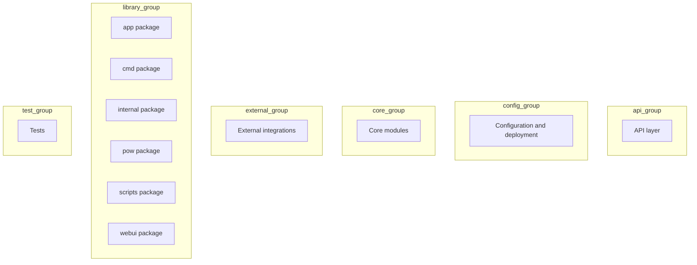

# Architecture report: CJackHwang/ds2api

> Automated static analysis. **Observed** = directly seen in files/imports/AST; **Inferred** = interpretation from that evidence. Repository code was not executed.

## 1. Repository at a glance

| Item | Value |
| --- | --- |
| Repository | CJackHwang/ds2api |
| Description | DeepSeek-Compatible Middleware Interface: A technical exploration project in Go, focusing on high-concurrency protocol adaptation. It serves as a reference implementation for converting diverse web protocols into standardized formats. |
| Language | Go |
| Stars | 4705 |
| Licence | AGPL-3.0 |
| Analysed commit / branch | 8316cf8a0352e900e03ce600b792083f590d80e2 / main |
| Framework(s) | React |
| Files analysed | 544 |
| Components | 11 |

## 2. Architecture in one minute

CJackHwang/ds2api - DeepSeek-Compatible Middleware Interface: A technical exploration project in Go, focusing on high-concurrency protocol adaptation. It serves as a reference implementation for converting diverse web p…. This repository was analysed statically from 544 file(s) (0 Python). Detected technologies (observed from imports/manifests): GitHub Actions, React, React Router, Tailwind CSS, Docker, Docker Compose. Files are grouped into 11 component(s): API layer, app package, cmd package, Configuration and deployment, Core modules, External integrations, internal package, pow package. Findings below distinguish observed facts from inferred interpretation.

## 3. High-level block diagram

## 4. Main components

### API layer (`api_layer`)

- **Kind:** api
- **Status:** Observed
- **Confidence:** 0.85
- **Responsibility:** Groups 2 file(s) under api layer (observed from repository paths and static analysis).
- **Paths:** `api/chat-stream.js`, `api/index.go`
- **Evidence:** [api/chat-stream.js](https://github.com/CJackHwang/ds2api/blob/8316cf8a0352e900e03ce600b792083f590d80e2/api/chat-stream.js); [api/index.go](https://github.com/CJackHwang/ds2api/blob/8316cf8a0352e900e03ce600b792083f590d80e2/api/index.go)

### app package (`app`)

- **Kind:** library
- **Status:** Observed
- **Confidence:** 0.85
- **Responsibility:** Groups 1 file(s) under app package (observed from repository paths and static analysis).
- **Paths:** `app/handler.go`
- **Evidence:** [app/handler.go](https://github.com/CJackHwang/ds2api/blob/8316cf8a0352e900e03ce600b792083f590d80e2/app/handler.go)

### cmd package (`cmd`)

- **Kind:** library
- **Status:** Observed
- **Confidence:** 0.85
- **Responsibility:** Groups 2 file(s) under cmd package (observed from repository paths and static analysis).
- **Paths:** `cmd/ds2api-tests/main.go`, `cmd/ds2api/main.go`
- **Evidence:** [cmd/ds2api-tests/main.go](https://github.com/CJackHwang/ds2api/blob/8316cf8a0352e900e03ce600b792083f590d80e2/cmd/ds2api-tests/main.go); [cmd/ds2api/main.go](https://github.com/CJackHwang/ds2api/blob/8316cf8a0352e900e03ce600b792083f590d80e2/cmd/ds2api/main.go)

### Configuration and deployment (`config`)

- **Kind:** config
- **Status:** Observed
- **Confidence:** 0.85
- **Responsibility:** Groups 49 file(s) under configuration and deployment (observed from repository paths and static analysis).
- **Paths:** `Dockerfile`, `config.example.json`, `docker-compose.dev.yml`, `docker-compose.yml`, `go.mod`, `internal/config/account.go`, `internal/config/codec.go`, `internal/config/config.go`, `internal/config/config_edge_test.go`, `internal/config/config_test.go`, `internal/config/credentials.go`, `internal/config/dotenv.go`, `internal/config/dotenv_test.go`, `internal/config/logger.go`, `internal/config/mobile.go`, `internal/config/mobile_test.go`, `internal/config/model_alias_test.go`, `internal/config/models.go`, `internal/config/paths.go`, `internal/config/paths_test.go`, `internal/config/store.go`, `internal/config/store_accessors.go`, `internal/config/store_accessors_test.go`, `internal/config/store_env_writeback.go`, `internal/config/store_index.go`, `internal/config/validation.go`, `internal/config/validation_test.go`, `internal/deepseek/protocol/constants_shared.json`, `internal/httpapi/admin/settings/deps.go`, `internal/httpapi/admin/settings/handler_settings_parse.go`, `internal/httpapi/admin/settings/handler_settings_read.go`, `internal/httpapi/admin/settings/handler_settings_runtime.go`, `internal/httpapi/admin/settings/handler_settings_write.go`, `internal/httpapi/admin/settings/routes.go`, `vercel.json`, `webui/package.json`, `webui/src/features/settings/AutoDeleteSection.jsx`, `webui/src/features/settings/BackupSection.jsx`, `webui/src/features/settings/BehaviorSection.jsx`, `webui/src/features/settings/CurrentInputFileSection.jsx`, `webui/src/features/settings/ModelSection.jsx`, `webui/src/features/settings/RuntimeSection.jsx`, `webui/src/features/settings/SecuritySection.jsx`, `webui/src/features/settings/SettingsContainer.jsx`, `webui/src/features/settings/settingsApi.js`, `webui/src/features/settings/useSettingsForm.js`, `webui/src/locales/en.json`, `webui/src/locales/zh.json`, `zeabur.yaml`
- **Evidence:** [Dockerfile](https://github.com/CJackHwang/ds2api/blob/8316cf8a0352e900e03ce600b792083f590d80e2/Dockerfile); [config.example.json](https://github.com/CJackHwang/ds2api/blob/8316cf8a0352e900e03ce600b792083f590d80e2/config.example.json); [docker-compose.dev.yml](https://github.com/CJackHwang/ds2api/blob/8316cf8a0352e900e03ce600b792083f590d80e2/docker-compose.dev.yml); [docker-compose.yml](https://github.com/CJackHwang/ds2api/blob/8316cf8a0352e900e03ce600b792083f590d80e2/docker-compose.yml); [go.mod](https://github.com/CJackHwang/ds2api/blob/8316cf8a0352e900e03ce600b792083f590d80e2/go.mod); [internal/config/account.go](https://github.com/CJackHwang/ds2api/blob/8316cf8a0352e900e03ce600b792083f590d80e2/internal/config/account.go); [internal/config/codec.go](https://github.com/CJackHwang/ds2api/blob/8316cf8a0352e900e03ce600b792083f590d80e2/internal/config/codec.go); [internal/config/config.go](https://github.com/CJackHwang/ds2api/blob/8316cf8a0352e900e03ce600b792083f590d80e2/internal/config/config.go)

### Core modules (`core`)

- **Kind:** core
- **Status:** Observed
- **Confidence:** 0.85
- **Responsibility:** Groups 1 file(s) under core modules (observed from repository paths and static analysis).
- **Paths:** `start.mjs`
- **Evidence:** [start.mjs](https://github.com/CJackHwang/ds2api/blob/8316cf8a0352e900e03ce600b792083f590d80e2/start.mjs)

### External integrations (`external_integrations`)

- **Kind:** external
- **Status:** Observed
- **Confidence:** 0.85
- **Responsibility:** Groups 23 file(s) under external integrations (observed from repository paths and static analysis).
- **Paths:** `internal/deepseek/client/client_auth.go`, `internal/deepseek/client/client_auth_mobile_test.go`, `internal/deepseek/client/client_auth_refresh_test.go`, `internal/deepseek/client/client_auth_test.go`, `internal/deepseek/client/client_completion.go`, `internal/deepseek/client/client_completion_test.go`, `internal/deepseek/client/client_continue.go`, `internal/deepseek/client/client_continue_test.go`, `internal/deepseek/client/client_core.go`, `internal/deepseek/client/client_file_status.go`, `internal/deepseek/client/client_http_helpers.go`, `internal/deepseek/client/client_http_json.go`, `internal/deepseek/client/client_http_json_test.go`, `internal/deepseek/client/client_session.go`, `internal/deepseek/client/client_session_delete.go`, `internal/deepseek/client/client_upload.go`, `internal/deepseek/client/client_upload_test.go`, `internal/deepseek/client/deepseek_edge_test.go`, `internal/deepseek/client/errors.go`, `internal/deepseek/client/pow.go`, `internal/deepseek/client/pow_test.go`, `internal/deepseek/client/proxy.go`, `internal/deepseek/client/proxy_test.go`
- **Evidence:** [internal/deepseek/client/client_auth.go](https://github.com/CJackHwang/ds2api/blob/8316cf8a0352e900e03ce600b792083f590d80e2/internal/deepseek/client/client_auth.go); [internal/deepseek/client/client_auth_mobile_test.go](https://github.com/CJackHwang/ds2api/blob/8316cf8a0352e900e03ce600b792083f590d80e2/internal/deepseek/client/client_auth_mobile_test.go); [internal/deepseek/client/client_auth_refresh_test.go](https://github.com/CJackHwang/ds2api/blob/8316cf8a0352e900e03ce600b792083f590d80e2/internal/deepseek/client/client_auth_refresh_test.go); [internal/deepseek/client/client_auth_test.go](https://github.com/CJackHwang/ds2api/blob/8316cf8a0352e900e03ce600b792083f590d80e2/internal/deepseek/client/client_auth_test.go); [internal/deepseek/client/client_completion.go](https://github.com/CJackHwang/ds2api/blob/8316cf8a0352e900e03ce600b792083f590d80e2/internal/deepseek/client/client_completion.go); [internal/deepseek/client/client_completion_test.go](https://github.com/CJackHwang/ds2api/blob/8316cf8a0352e900e03ce600b792083f590d80e2/internal/deepseek/client/client_completion_test.go); [internal/deepseek/client/client_continue.go](https://github.com/CJackHwang/ds2api/blob/8316cf8a0352e900e03ce600b792083f590d80e2/internal/deepseek/client/client_continue.go); [internal/deepseek/client/client_continue_test.go](https://github.com/CJackHwang/ds2api/blob/8316cf8a0352e900e03ce600b792083f590d80e2/internal/deepseek/client/client_continue_test.go)

### internal package (`internal`)

- **Kind:** library
- **Status:** Observed
- **Confidence:** 0.85
- **Responsibility:** Groups 325 file(s) under internal package (observed from repository paths and static analysis).
- **Paths:** `internal/account/pool_acquire.go`, `internal/account/pool_core.go`, `internal/account/pool_edge_test.go`, `internal/account/pool_limits.go`, `internal/account/pool_test.go`, `internal/account/pool_waiters.go`, `internal/assistantturn/stream.go`, `internal/assistantturn/turn.go`, `internal/assistantturn/turn_test.go`, `internal/auth/admin.go`, `internal/auth/admin_test.go`, `internal/auth/auth_edge_test.go`, `internal/auth/request.go`, `internal/auth/request_test.go`, `internal/chathistory/store.go`, `internal/chathistory/store_test.go`, `internal/claudeconv/convert.go`, `internal/compat/go_compat_test.go`, `internal/completionruntime/nonstream.go`, `internal/completionruntime/nonstream_test.go`, `internal/completionruntime/stream_retry.go`, `internal/completionruntime/stream_retry_test.go`, `internal/deepseek/protocol/constants.go`, `internal/deepseek/protocol/constants_test.go`, `internal/deepseek/protocol/sse.go`, `internal/deepseek/protocol/sse_test.go`, `internal/deepseek/transport/transport.go`, `internal/devcapture/store.go`, `internal/devcapture/store_test.go`, `internal/format/claude/render.go`, `internal/format/claude/render_test.go`, `internal/format/openai/render_chat.go`, `internal/format/openai/render_responses.go`, `internal/format/openai/render_stream_events.go`, `internal/format/openai/render_test.go`, `internal/format/openai/render_usage.go`, `internal/httpapi/admin/accounts/deps.go`, `internal/httpapi/admin/accounts/handler_accounts_crud.go`, `internal/httpapi/admin/accounts/handler_accounts_crud_test.go`, `internal/httpapi/admin/accounts/handler_accounts_identifier_test.go`, `internal/httpapi/admin/accounts/handler_accounts_queue.go`, `internal/httpapi/admin/accounts/handler_accounts_testing.go`, `internal/httpapi/admin/accounts/handler_accounts_testing_test.go`, `internal/httpapi/admin/accounts/routes.go`, `internal/httpapi/admin/auth/deps.go`, `internal/httpapi/admin/auth/handler_auth.go`, `internal/httpapi/admin/auth/handler_auth_test.go`, `internal/httpapi/admin/auth/routes.go`, `internal/httpapi/admin/configmgmt/deps.go`, `internal/httpapi/admin/configmgmt/handler_config_import.go`, `internal/httpapi/admin/configmgmt/handler_config_read.go`, `internal/httpapi/admin/configmgmt/handler_config_write.go`, `internal/httpapi/admin/configmgmt/handler_keys_test.go`, `internal/httpapi/admin/configmgmt/routes.go`, `internal/httpapi/admin/devcapture/deps.go`, `internal/httpapi/admin/devcapture/handler_dev_capture.go`, `internal/httpapi/admin/devcapture/handler_dev_capture_test.go`, `internal/httpapi/admin/devcapture/routes.go`, `internal/httpapi/admin/handler.go`, `internal/httpapi/admin/handler_settings_test.go`, `internal/httpapi/admin/handler_test.go`, `internal/httpapi/admin/history/deps.go`, `internal/httpapi/admin/history/handler_chat_history.go`, `internal/httpapi/admin/history/handler_chat_history_test.go`, `internal/httpapi/admin/history/routes.go`, `internal/httpapi/admin/proxies/deps.go`, `internal/httpapi/admin/proxies/handler_proxies.go`, `internal/httpapi/admin/proxies/handler_proxies_test.go`, `internal/httpapi/admin/proxies/routes.go`, `internal/httpapi/admin/rawsamples/deps.go`, `internal/httpapi/admin/rawsamples/handler_raw_samples.go`, `internal/httpapi/admin/rawsamples/handler_raw_samples_test.go`, `internal/httpapi/admin/rawsamples/routes.go`, `internal/httpapi/admin/shared/deps.go`, `internal/httpapi/admin/shared/helpers.go`, `internal/httpapi/admin/shared/helpers_edge_test.go`, `internal/httpapi/admin/shared/request_error.go`, `internal/httpapi/admin/shared/settings_validation.go`, `internal/httpapi/admin/token_runtime_http_test.go`, `internal/httpapi/admin/vercel/deps.go`, `internal/httpapi/admin/vercel/handler_vercel.go`, `internal/httpapi/admin/vercel/handler_vercel_test.go`, `internal/httpapi/admin/vercel/routes.go`, `internal/httpapi/admin/version/deps.go`, `internal/httpapi/admin/version/handler_version.go`, `internal/httpapi/admin/version/routes.go`, `internal/httpapi/claude/convert.go`, `internal/httpapi/claude/current_input_file_test.go`, `internal/httpapi/claude/deps.go`, `internal/httpapi/claude/deps_injection_test.go`, `internal/httpapi/claude/error_shape_test.go`, `internal/httpapi/claude/handler_errors.go`, `internal/httpapi/claude/handler_helpers_misc.go`, `internal/httpapi/claude/handler_messages.go`, `internal/httpapi/claude/handler_routes.go`, `internal/httpapi/claude/handler_stream_test.go`, `internal/httpapi/claude/handler_tokens.go`, `internal/httpapi/claude/handler_util_test.go`, `internal/httpapi/claude/handler_utils.go`, `internal/httpapi/claude/handler_utils_sanitize.go`, `internal/httpapi/claude/output_clean.go`, `internal/httpapi/claude/prompt_token_text.go`, `internal/httpapi/claude/proxy_vercel_test.go`, `internal/httpapi/claude/route_alias_test.go`, `internal/httpapi/claude/standard_request.go`, `internal/httpapi/claude/standard_request_test.go`, `internal/httpapi/claude/stream_runtime_core.go`, `internal/httpapi/claude/stream_runtime_emit.go`, `internal/httpapi/claude/stream_runtime_finalize.go`, `internal/httpapi/claude/stream_status_test.go`, `internal/httpapi/claude/token_count.go`, `internal/httpapi/claude/tool_call_state.go`, `internal/httpapi/gemini/convert_messages.go`, `internal/httpapi/gemini/convert_messages_test.go`, `internal/httpapi/gemini/convert_passthrough.go`, `internal/httpapi/gemini/convert_request.go`, `internal/httpapi/gemini/convert_request_test.go`, `internal/httpapi/gemini/convert_tools.go`, `internal/httpapi/gemini/deps.go`, `internal/httpapi/gemini/handler_errors.go`, `internal/httpapi/gemini/handler_generate.go`, `internal/httpapi/gemini/handler_routes.go`, `internal/httpapi/gemini/handler_stream_runtime.go`, `internal/httpapi/gemini/handler_test.go`, `internal/httpapi/gemini/output_clean.go`, `internal/httpapi/gemini/proxy_vercel_test.go`, `internal/httpapi/ollama/handler_routes.go`, `internal/httpapi/ollama/handler_routes_test.go`, `internal/httpapi/openai/chat/chat_history.go`, `internal/httpapi/openai/chat/chat_history_test.go`, `internal/httpapi/openai/chat/chat_stream_runtime.go`, `internal/httpapi/openai/chat/chat_stream_runtime_test.go`, `internal/httpapi/openai/chat/empty_retry_runtime.go`, `internal/httpapi/openai/chat/empty_retry_runtime_test.go`, `internal/httpapi/openai/chat/handler.go`, `internal/httpapi/openai/chat/handler_chat.go`, `internal/httpapi/openai/chat/handler_chat_auto_delete_test.go`, `internal/httpapi/openai/chat/handler_toolcall_test.go`, `internal/httpapi/openai/chat/vercel_prepare_test.go`, `internal/httpapi/openai/chat/vercel_stream.go`, `internal/httpapi/openai/citation_links_test.go`, `internal/httpapi/openai/deps_injection_test.go`, `internal/httpapi/openai/embeddings/embeddings_handler.go`, `internal/httpapi/openai/embeddings_route_test.go`, `internal/httpapi/openai/error_shape_test.go`, `internal/httpapi/openai/file_inline_upload_test.go`, `internal/httpapi/openai/files/file_inline_upload.go`, `internal/httpapi/openai/files/handler_files.go`, `internal/httpapi/openai/files_route_test.go`, `internal/httpapi/openai/history/current_input_file.go`, `internal/httpapi/openai/history/history_split_error.go`, `internal/httpapi/openai/history_split_test.go`, `internal/httpapi/openai/leaked_output_sanitize_test.go`, `internal/httpapi/openai/models_route_test.go`, `internal/httpapi/openai/responses/empty_retry_runtime.go`, `internal/httpapi/openai/responses/empty_retry_runtime_test.go`, `internal/httpapi/openai/responses/handler.go`, `internal/httpapi/openai/responses/ref_file_tokens.go`, `internal/httpapi/openai/responses/response_store.go`, `internal/httpapi/openai/responses/responses_embeddings_test.go`, `internal/httpapi/openai/responses/responses_handler.go`, `internal/httpapi/openai/responses/responses_history_test.go`, `internal/httpapi/openai/responses/responses_route_test.go`, `internal/httpapi/openai/responses/responses_stream_delta_batch.go`, `internal/httpapi/openai/responses/responses_stream_runtime_core.go`, `internal/httpapi/openai/responses/responses_stream_runtime_events.go`, `internal/httpapi/openai/responses/responses_stream_runtime_toolcalls.go`, `internal/httpapi/openai/responses/responses_stream_runtime_toolcalls_finalize.go`, `internal/httpapi/openai/responses/responses_stream_test.go`, `internal/httpapi/openai/shared/assistant_toolcalls.go`, `internal/httpapi/openai/shared/citation_links.go`, `internal/httpapi/openai/shared/deps.go`, `internal/httpapi/openai/shared/empty_retry.go`, `internal/httpapi/openai/shared/handler_errors.go`, `internal/httpapi/openai/shared/handler_toolcall_format.go`, `internal/httpapi/openai/shared/handler_toolcall_policy.go`, `internal/httpapi/openai/shared/leaked_output_sanitize.go`, `internal/httpapi/openai/shared/models.go`, `internal/httpapi/openai/shared/output_clean.go`, `internal/httpapi/openai/shared/stream_accumulator.go`, `internal/httpapi/openai/shared/stream_accumulator_test.go`, `internal/httpapi/openai/shared/string_helpers.go`, `internal/httpapi/openai/shared/thinking_injection.go`, `internal/httpapi/openai/shared/trace.go`, `internal/httpapi/openai/shared/upstream_empty.go`, `internal/httpapi/openai/stream_status_test.go`, `internal/httpapi/openai/trace_test.go`, `internal/httpapi/requestbody/json_utf8.go`, `internal/httpapi/requestbody/json_utf8_test.go`, `internal/js/chat-stream/cors.js`, `internal/js/chat-stream/dedupe.js`, `internal/js/chat-stream/error_shape.js`, `internal/js/chat-stream/http_internal.js`, `internal/js/chat-stream/index.js`, `internal/js/chat-stream/proxy_go.js`, `internal/js/chat-stream/sse_parse.js`, `internal/js/chat-stream/sse_parse_impl.js`, `internal/js/chat-stream/stream_emitter.js`, `internal/js/chat-stream/token_usage.js`, `internal/js/chat-stream/toolcall_policy.js`, `internal/js/chat-stream/vercel_stream.js`, `internal/js/chat-stream/vercel_stream_impl.js`, `internal/js/helpers/stream-tool-sieve.js`, `internal/js/helpers/stream-tool-sieve/format.js`, `internal/js/helpers/stream-tool-sieve/index.js`, `internal/js/helpers/stream-tool-sieve/jsonscan.js`, `internal/js/helpers/stream-tool-sieve/parse.js`, `internal/js/helpers/stream-tool-sieve/parse_payload.js`, `internal/js/helpers/stream-tool-sieve/sieve-xml.js`, `internal/js/helpers/stream-tool-sieve/sieve.js`, `internal/js/helpers/stream-tool-sieve/state.js`, `internal/js/shared/deepseek-constants.js`, `internal/prompt/messages.go`, `internal/prompt/messages_test.go`, `internal/prompt/tool_calls.go`, `internal/prompt/tool_calls_test.go`, `internal/promptcompat/file_refs.go`, `internal/promptcompat/history_transcript.go`, `internal/promptcompat/message_normalize.go`, `internal/promptcompat/message_normalize_test.go`, `internal/promptcompat/prompt_build.go`, `internal/promptcompat/prompt_build_test.go`, `internal/promptcompat/request_normalize.go`, `internal/promptcompat/responses_input_items.go`, `internal/promptcompat/responses_input_items_test.go`, `internal/promptcompat/responses_input_normalize.go`, `internal/promptcompat/standard_request.go`, `internal/promptcompat/standard_request_test.go`, `internal/promptcompat/thinking_injection.go`, `internal/promptcompat/thinking_injection_test.go`, `internal/promptcompat/tool_prompt.go`, `internal/rawsample/rawsample.go`, `internal/rawsample/rawsample_test.go`, `internal/rawsample/visible_text.go`, `internal/responsehistory/session.go`, `internal/server/router.go`, `internal/server/router_cors_test.go`, `internal/server/router_health_test.go`, `internal/server/router_log_test.go`, `internal/server/router_routes_test.go`, `internal/server/router_utf8_test.go`, `internal/sse/citation_links.go`, `internal/sse/consumer.go`, `internal/sse/consumer_edge_test.go`, `internal/sse/consumer_test.go`, `internal/sse/content_filter_leak.go`, `internal/sse/dedupe.go`, `internal/sse/dedupe_test.go`, `internal/sse/line.go`, `internal/sse/line_edge_test.go`, `internal/sse/line_test.go`, `internal/sse/parser.go`, `internal/sse/parser_edge_test.go`, `internal/sse/parser_test.go`, `internal/sse/stream.go`, `internal/sse/stream_edge_test.go`, `internal/sse/stream_test.go`, `internal/stream/engine.go`, `internal/stream/engine_test.go`, `internal/testsuite/edge_cases.go`, `internal/testsuite/edge_cases_abort.go`, `internal/testsuite/edge_cases_error_contract.go`, `internal/testsuite/runner_cases_admin.go`, `internal/testsuite/runner_cases_claude.go`, `internal/testsuite/runner_cases_openai.go`, `internal/testsuite/runner_cases_openai_advanced.go`, `internal/testsuite/runner_core.go`, `internal/testsuite/runner_defaults.go`, `internal/testsuite/runner_env.go`, `internal/testsuite/runner_env_test.go`, `internal/testsuite/runner_http.go`, `internal/testsuite/runner_registry.go`, `internal/testsuite/runner_registry_test.go`, `internal/testsuite/runner_summary.go`, `internal/testsuite/runner_utils.go`, `internal/textclean/reference_markers.go`, `internal/toolcall/fence_edge_test.go`, `internal/toolcall/regression_test.go`, `internal/toolcall/tool_prompt.go`, `internal/toolcall/tool_prompt_test.go`, `internal/toolcall/toolcall_edge_test.go`, `internal/toolcall/toolcalls_array_parse.go`, `internal/toolcall/toolcalls_candidates.go`, `internal/toolcall/toolcalls_dsml.go`, `internal/toolcall/toolcalls_format.go`, `internal/toolcall/toolcalls_input_parse.go`, `internal/toolcall/toolcalls_json_repair.go`, `internal/toolcall/toolcalls_markup.go`, `internal/toolcall/toolcalls_parse.go`, `internal/toolcall/toolcalls_parse_markup.go`, `internal/toolcall/toolcalls_scan.go`, `internal/toolcall/toolcalls_schema_normalize.go`, `internal/toolcall/toolcalls_schema_normalize_test.go`, `internal/toolcall/toolcalls_test.go`, `internal/toolcall/toolcalls_xml.go`, `internal/toolstream/complex_edge_test.go`, `internal/toolstream/fence_edge_sieve_test.go`, `internal/toolstream/tool_sieve_core.go`, `internal/toolstream/tool_sieve_jsonscan.go`, `internal/toolstream/tool_sieve_state.go`, `internal/toolstream/tool_sieve_xml.go`, `internal/toolstream/tool_sieve_xml_scan.go`, `internal/toolstream/tool_sieve_xml_test.go`, `internal/translatorcliproxy/bridge.go`, `internal/translatorcliproxy/bridge_test.go`, `internal/translatorcliproxy/stream_writer.go`, `internal/translatorcliproxy/stream_writer_test.go`, `internal/util/helpers.go`, `internal/util/messages.go`, `internal/util/messages_test.go`, `internal/util/render.go`, `internal/util/render_test.go`, `internal/util/text.go`, `internal/util/thinking.go`, `internal/util/thinking_test.go`, `internal/util/token_count.go`, `internal/util/token_count_heuristic.go`, `internal/util/token_count_tiktoken.go`, `internal/util/token_count_tiktoken_test.go`, `internal/util/util_edge_test.go`, `internal/version/version.go`, `internal/version/version_test.go`, `internal/webui/build.go`, `internal/webui/handler.go`, `internal/webui/handler_test.go`
- **Evidence:** [internal/account/pool_acquire.go](https://github.com/CJackHwang/ds2api/blob/8316cf8a0352e900e03ce600b792083f590d80e2/internal/account/pool_acquire.go); [internal/account/pool_core.go](https://github.com/CJackHwang/ds2api/blob/8316cf8a0352e900e03ce600b792083f590d80e2/internal/account/pool_core.go); [internal/account/pool_edge_test.go](https://github.com/CJackHwang/ds2api/blob/8316cf8a0352e900e03ce600b792083f590d80e2/internal/account/pool_edge_test.go); [internal/account/pool_limits.go](https://github.com/CJackHwang/ds2api/blob/8316cf8a0352e900e03ce600b792083f590d80e2/internal/account/pool_limits.go); [internal/account/pool_test.go](https://github.com/CJackHwang/ds2api/blob/8316cf8a0352e900e03ce600b792083f590d80e2/internal/account/pool_test.go); [internal/account/pool_waiters.go](https://github.com/CJackHwang/ds2api/blob/8316cf8a0352e900e03ce600b792083f590d80e2/internal/account/pool_waiters.go); [internal/assistantturn/stream.go](https://github.com/CJackHwang/ds2api/blob/8316cf8a0352e900e03ce600b792083f590d80e2/internal/assistantturn/stream.go); [internal/assistantturn/turn.go](https://github.com/CJackHwang/ds2api/blob/8316cf8a0352e900e03ce600b792083f590d80e2/internal/assistantturn/turn.go)

### pow package (`pow`)

- **Kind:** library
- **Status:** Observed
- **Confidence:** 0.85
- **Responsibility:** Groups 3 file(s) under pow package (observed from repository paths and static analysis).
- **Paths:** `pow/deepseek_hash.go`, `pow/deepseek_pow.go`, `pow/deepseek_pow_test.go`
- **Evidence:** [pow/deepseek_hash.go](https://github.com/CJackHwang/ds2api/blob/8316cf8a0352e900e03ce600b792083f590d80e2/pow/deepseek_hash.go); [pow/deepseek_pow.go](https://github.com/CJackHwang/ds2api/blob/8316cf8a0352e900e03ce600b792083f590d80e2/pow/deepseek_pow.go); [pow/deepseek_pow_test.go](https://github.com/CJackHwang/ds2api/blob/8316cf8a0352e900e03ce600b792083f590d80e2/pow/deepseek_pow_test.go)

### scripts package (`scripts`)

- **Kind:** library
- **Status:** Observed
- **Confidence:** 0.85
- **Responsibility:** Groups 4 file(s) under scripts package (observed from repository paths and static analysis).
- **Paths:** `scripts/build-release-archives.sh`, `scripts/build-webui.sh`, `scripts/lint.sh`, `scripts/release-targets.sh`
- **Evidence:** [scripts/build-release-archives.sh](https://github.com/CJackHwang/ds2api/blob/8316cf8a0352e900e03ce600b792083f590d80e2/scripts/build-release-archives.sh); [scripts/build-webui.sh](https://github.com/CJackHwang/ds2api/blob/8316cf8a0352e900e03ce600b792083f590d80e2/scripts/build-webui.sh); [scripts/lint.sh](https://github.com/CJackHwang/ds2api/blob/8316cf8a0352e900e03ce600b792083f590d80e2/scripts/lint.sh); [scripts/release-targets.sh](https://github.com/CJackHwang/ds2api/blob/8316cf8a0352e900e03ce600b792083f590d80e2/scripts/release-targets.sh)

### Tests (`tests`)

- **Kind:** test
- **Status:** Observed
- **Confidence:** 0.85
- **Responsibility:** Groups 52 file(s) under tests (observed from repository paths and static analysis).
- **Paths:** `internal/httpapi/admin/accounts/test_http_helpers_test.go`, `internal/httpapi/admin/configmgmt/test_helpers_test.go`, `internal/httpapi/admin/proxies/test_http_helpers_test.go`, `internal/httpapi/admin/test_bridge_test.go`, `internal/httpapi/openai/chat/test_helpers_test.go`, `internal/httpapi/openai/responses/test_helpers_test.go`, `internal/httpapi/openai/test_bridge_test.go`, `tests/compat/expected/sse_content_filter_status.json`, `tests/compat/expected/sse_fragments_append.json`, `tests/compat/expected/sse_leaked_content_filter.json`, `tests/compat/expected/sse_nested_finished.json`, `tests/compat/expected/sse_split_tool_json.json`, `tests/compat/expected/token_cases.json`, `tests/compat/expected/toolcalls_canonical_nested_param.json`, `tests/compat/expected/toolcalls_canonical_tool_call.json`, `tests/compat/fixtures/sse_chunks/content_filter_status.json`, `tests/compat/fixtures/sse_chunks/fragments_append.json`, `tests/compat/fixtures/sse_chunks/leaked_content_filter.json`, `tests/compat/fixtures/sse_chunks/nested_finished.json`, `tests/compat/fixtures/sse_chunks/split_tool_json.json`, `tests/compat/fixtures/token_cases.json`, `tests/compat/fixtures/toolcalls/canonical_nested_param.json`, `tests/compat/fixtures/toolcalls/canonical_tool_call.json`, `tests/node/chat-history-utils.test.js`, `tests/node/chat-stream.test.js`, `tests/node/js_compat_test.js`, `tests/node/stream-tool-sieve.test.js`, `tests/raw_stream_samples/README.md`, `tests/raw_stream_samples/continue-thinking-snapshot-replay-20260405/meta.json`, `tests/raw_stream_samples/longtext-deepseek-v4-flash-20260429/meta.json`, `tests/raw_stream_samples/longtext-deepseek-v4-flash-20260429/upstream.stream.sse`, `tests/raw_stream_samples/longtext-deepseek-v4-pro-20260429/meta.json`, `tests/raw_stream_samples/longtext-deepseek-v4-pro-20260429/upstream.stream.sse`, `tests/raw_stream_samples/manifest.json`, `tests/raw_stream_samples/markdown-format-example-20260405-spacefix/meta.json`, `tests/raw_stream_samples/markdown-format-example-20260405-spacefix/upstream.stream.sse`, `tests/raw_stream_samples/markdown-format-example-20260405/meta.json`, `tests/raw_stream_samples/markdown-format-example-20260405/upstream.stream.sse`, `tests/repair_json_tool.go`, `tests/scripts/capture-raw-stream-sample.sh`, `tests/scripts/check-cross-build.sh`, `tests/scripts/check-node-split-syntax.sh`, `tests/scripts/check-refactor-line-gate.sh`, `tests/scripts/check-stage6-manual-smoke.sh`, `tests/scripts/compare-raw-stream-sample.sh`, `tests/scripts/run-live.sh`, `tests/scripts/run-raw-stream-sim.sh`, `tests/scripts/run-unit-all.sh`, `tests/scripts/run-unit-go.sh`, `tests/scripts/run-unit-node.sh`, `tests/tools/deepseek-sse-simulator.mjs`, `tests/复杂场合测试.json`
- **Evidence:** [internal/httpapi/admin/accounts/test_http_helpers_test.go](https://github.com/CJackHwang/ds2api/blob/8316cf8a0352e900e03ce600b792083f590d80e2/internal/httpapi/admin/accounts/test_http_helpers_test.go); [internal/httpapi/admin/configmgmt/test_helpers_test.go](https://github.com/CJackHwang/ds2api/blob/8316cf8a0352e900e03ce600b792083f590d80e2/internal/httpapi/admin/configmgmt/test_helpers_test.go); [internal/httpapi/admin/proxies/test_http_helpers_test.go](https://github.com/CJackHwang/ds2api/blob/8316cf8a0352e900e03ce600b792083f590d80e2/internal/httpapi/admin/proxies/test_http_helpers_test.go); [internal/httpapi/admin/test_bridge_test.go](https://github.com/CJackHwang/ds2api/blob/8316cf8a0352e900e03ce600b792083f590d80e2/internal/httpapi/admin/test_bridge_test.go); [internal/httpapi/openai/chat/test_helpers_test.go](https://github.com/CJackHwang/ds2api/blob/8316cf8a0352e900e03ce600b792083f590d80e2/internal/httpapi/openai/chat/test_helpers_test.go); [internal/httpapi/openai/responses/test_helpers_test.go](https://github.com/CJackHwang/ds2api/blob/8316cf8a0352e900e03ce600b792083f590d80e2/internal/httpapi/openai/responses/test_helpers_test.go); [internal/httpapi/openai/test_bridge_test.go](https://github.com/CJackHwang/ds2api/blob/8316cf8a0352e900e03ce600b792083f590d80e2/internal/httpapi/openai/test_bridge_test.go); [tests/compat/expected/sse_content_filter_status.json](https://github.com/CJackHwang/ds2api/blob/8316cf8a0352e900e03ce600b792083f590d80e2/tests/compat/expected/sse_content_filter_status.json)

### webui package (`webui`)

- **Kind:** library
- **Status:** Observed
- **Confidence:** 0.85
- **Responsibility:** Groups 43 file(s) under webui package (observed from repository paths and static analysis).
- **Paths:** `webui/postcss.config.js`, `webui/src/App.jsx`, `webui/src/app/AppRoutes.jsx`, `webui/src/app/useAdminAuth.js`, `webui/src/app/useAdminConfig.js`, `webui/src/components/BatchImport.jsx`, `webui/src/components/LandingPage.jsx`, `webui/src/components/LanguageToggle.jsx`, `webui/src/components/Login.jsx`, `webui/src/features/account/AccountManagerContainer.jsx`, `webui/src/features/account/AccountsTable.jsx`, `webui/src/features/account/AddAccountModal.jsx`, `webui/src/features/account/AddKeyModal.jsx`, `webui/src/features/account/ApiKeysPanel.jsx`, `webui/src/features/account/EditAccountModal.jsx`, `webui/src/features/account/QueueCards.jsx`, `webui/src/features/account/useAccountActions.js`, `webui/src/features/account/useAccountsData.js`, `webui/src/features/apiTester/ApiTesterContainer.jsx`, `webui/src/features/apiTester/ChatPanel.jsx`, `webui/src/features/apiTester/ConfigPanel.jsx`, `webui/src/features/apiTester/fileAccountBinding.js`, `webui/src/features/apiTester/useApiTesterState.js`, `webui/src/features/apiTester/useChatStreamClient.js`, `webui/src/features/chatHistory/ChatHistoryContainer.jsx`, `webui/src/features/chatHistory/ChatHistoryDetail.jsx`, `webui/src/features/chatHistory/ChatHistoryPanels.jsx`, `webui/src/features/chatHistory/HistoryModeIcons.jsx`, `webui/src/features/chatHistory/chatHistoryUtils.js`, `webui/src/features/proxy/ProxyManagerContainer.jsx`, `webui/src/features/vercel/VercelGuide.jsx`, `webui/src/features/vercel/VercelSyncContainer.jsx`, `webui/src/features/vercel/VercelSyncForm.jsx`, `webui/src/features/vercel/VercelSyncStatus.jsx`, `webui/src/features/vercel/useVercelSyncState.js`, `webui/src/i18n.jsx`, `webui/src/layout/DashboardShell.jsx`, `webui/src/main.jsx`, `webui/src/utils/batchImportTemplates.js`, `webui/src/utils/maskSecret.js`, `webui/src/utils/runtimeEnv.js`, `webui/tailwind.config.js`, `webui/vite.config.js`
- **Evidence:** [webui/postcss.config.js](https://github.com/CJackHwang/ds2api/blob/8316cf8a0352e900e03ce600b792083f590d80e2/webui/postcss.config.js); [webui/src/App.jsx](https://github.com/CJackHwang/ds2api/blob/8316cf8a0352e900e03ce600b792083f590d80e2/webui/src/App.jsx); [webui/src/app/AppRoutes.jsx](https://github.com/CJackHwang/ds2api/blob/8316cf8a0352e900e03ce600b792083f590d80e2/webui/src/app/AppRoutes.jsx); [webui/src/app/useAdminAuth.js](https://github.com/CJackHwang/ds2api/blob/8316cf8a0352e900e03ce600b792083f590d80e2/webui/src/app/useAdminAuth.js); [webui/src/app/useAdminConfig.js](https://github.com/CJackHwang/ds2api/blob/8316cf8a0352e900e03ce600b792083f590d80e2/webui/src/app/useAdminConfig.js); [webui/src/components/BatchImport.jsx](https://github.com/CJackHwang/ds2api/blob/8316cf8a0352e900e03ce600b792083f590d80e2/webui/src/components/BatchImport.jsx); [webui/src/components/LandingPage.jsx](https://github.com/CJackHwang/ds2api/blob/8316cf8a0352e900e03ce600b792083f590d80e2/webui/src/components/LandingPage.jsx); [webui/src/components/LanguageToggle.jsx](https://github.com/CJackHwang/ds2api/blob/8316cf8a0352e900e03ce600b792083f590d80e2/webui/src/components/LanguageToggle.jsx)

## 5. Execution flow

**Observed** entry point(s):

- [internal/js/chat-stream/index.js](https://github.com/CJackHwang/ds2api/blob/8316cf8a0352e900e03ce600b792083f590d80e2/internal/js/chat-stream/index.js)
- [webui/src/App.jsx](https://github.com/CJackHwang/ds2api/blob/8316cf8a0352e900e03ce600b792083f590d80e2/webui/src/App.jsx)
- [webui/src/main.jsx](https://github.com/CJackHwang/ds2api/blob/8316cf8a0352e900e03ce600b792083f590d80e2/webui/src/main.jsx)

Representative flow (derived from observed entry points and the import graph; steps beyond the entry point are **Inferred**):

1. Execution starts at an observed entry point listed above, if present.
2. No internal import relationships between components were observed.

## 6. Project structure

### `(root)`

- `.dockerignore` - container (702 bytes)
- `.env.example` - config (510 bytes)
- `.gitignore` - other (659 bytes)
- `.golangci.yml` - config (1259 bytes)
- `.releaserc.json` - config (420 bytes)
- `AGENTS.md` - docs (2107 bytes)
- `API.en.md` - docs (51458 bytes)
- `API.md` - docs (52330 bytes)
- `CODE_OF_CONDUCT.md` - docs (5219 bytes)
- `Dockerfile` - container (2714 bytes)
- `LICENSE` - docs (34523 bytes)
- `README.MD` - docs (25779 bytes)
- `README.en.md` - docs (25092 bytes)
- `SECURITY.md` - docs (2916 bytes)
- `VERSION` - other (6 bytes)
- `config.example.json` - config (1629 bytes)
- `docker-compose.dev.yml` - config (815 bytes)
- `docker-compose.yml` - container (542 bytes)
- `go.mod` - manifest (767 bytes)
- `go.sum` - other (4224 bytes)
- `start.mjs` - source, JavaScript (19126 bytes)
- `vercel.json` - config (2773 bytes)
- `zeabur.yaml` - config (1828 bytes)

### `.github`

- `.github/ISSUE_TEMPLATE/1_bug_report.yml` - config (1600 bytes)
- `.github/ISSUE_TEMPLATE/2_feature_request.yml` - config (677 bytes)
- `.github/PULL_REQUEST_TEMPLATE.md` - docs (476 bytes)
- `.github/workflows/quality-gates.yml` - ci, YAML (3137 bytes)
- `.github/workflows/release-artifacts.yml` - ci, YAML (5382 bytes)
- `.github/workflows/release-dockerhub.yml` - ci, YAML (4035 bytes)
- `.github/workflows/release.yml` - ci, YAML (4223 bytes)

### `api`

- `api/chat-stream.js` - source, JavaScript (80 bytes)
- `api/index.go` - source, Go (229 bytes)

### `app`

- `app/handler.go` - source, Go (366 bytes)

### `cmd`

- `cmd/ds2api-tests/main.go` - source, Go (1278 bytes)
- `cmd/ds2api/main.go` - source, Go (2676 bytes)

### `docs`

- `docs/ARCHITECTURE.en.md` - docs (14687 bytes)
- `docs/ARCHITECTURE.md` - docs (14032 bytes)
- `docs/CONTRIBUTING.en.md` - docs (3037 bytes)
- `docs/CONTRIBUTING.md` - docs (2917 bytes)
- `docs/DEPLOY.en.md` - docs (22890 bytes)
- `docs/DEPLOY.md` - docs (23336 bytes)
- `docs/DEVELOPMENT.md` - docs (3890 bytes)
- `docs/DeepSeekSSE行为结构说明-2026-04-05.md` - docs (15021 bytes)
- `docs/README.md` - docs (3490 bytes)
- `docs/TESTING.md` - docs (10503 bytes)
- `docs/project-value.md` - docs (4927 bytes)
- `docs/prompt-compatibility.md` - docs (36242 bytes)
- `docs/toolcall-semantics.md` - docs (12257 bytes)

### `internal`

- `internal/account/pool_acquire.go` - source, Go (2071 bytes)
- `internal/account/pool_core.go` - source, Go (3249 bytes)
- `internal/account/pool_edge_test.go` - source, Go (6165 bytes)
- `internal/account/pool_limits.go` - source, Go (1815 bytes)
- `internal/account/pool_test.go` - source, Go (8925 bytes)
- `internal/account/pool_waiters.go` - source, Go (791 bytes)
- `internal/assistantturn/stream.go` - source, Go (1553 bytes)
- `internal/assistantturn/turn.go` - source, Go (8687 bytes)
- `internal/assistantturn/turn_test.go` - source, Go (5476 bytes)
- `internal/auth/admin.go` - source, Go (5914 bytes)
- `internal/auth/admin_test.go` - source, Go (2451 bytes)
- `internal/auth/auth_edge_test.go` - source, Go (13883 bytes)
- `internal/auth/request.go` - source, Go (7621 bytes)
- `internal/auth/request_test.go` - source, Go (11741 bytes)
- `internal/chathistory/store.go` - source, Go (20327 bytes)
- `internal/chathistory/store_test.go` - source, Go (18297 bytes)
- `internal/claudeconv/convert.go` - source, Go (1058 bytes)
- `internal/compat/go_compat_test.go` - source, Go (3495 bytes)
- `internal/completionruntime/nonstream.go` - source, Go (12396 bytes)
- `internal/completionruntime/nonstream_test.go` - source, Go (12468 bytes)
- `internal/completionruntime/stream_retry.go` - source, Go (6837 bytes)
- `internal/completionruntime/stream_retry_test.go` - source, Go (5168 bytes)
- `internal/config/account.go` - source, Go (249 bytes)
- `internal/config/codec.go` - source, Go (7672 bytes)
- `internal/config/config.go` - source, Go (5845 bytes)
- `internal/config/config_edge_test.go` - source, Go (23487 bytes)
- `internal/config/config_test.go` - source, Go (14502 bytes)
- `internal/config/credentials.go` - source, Go (3222 bytes)
- `internal/config/dotenv.go` - source, Go (2865 bytes)
- `internal/config/dotenv_test.go` - source, Go (3449 bytes)
- `internal/config/logger.go` - source, Go (527 bytes)
- `internal/config/mobile.go` - source, Go (1777 bytes)
- `internal/config/mobile_test.go` - source, Go (1025 bytes)
- `internal/config/model_alias_test.go` - source, Go (5237 bytes)
- `internal/config/models.go` - source, Go (13537 bytes)
- `internal/config/paths.go` - source, Go (1902 bytes)
- `internal/config/paths_test.go` - source, Go (960 bytes)
- `internal/config/store.go` - source, Go (7619 bytes)
- `internal/config/store_accessors.go` - source, Go (3788 bytes)
- `internal/config/store_accessors_test.go` - source, Go (1430 bytes)
- `internal/config/store_env_writeback.go` - source, Go (1051 bytes)
- `internal/config/store_index.go` - source, Go (1587 bytes)
- `internal/config/validation.go` - source, Go (4382 bytes)
- `internal/config/validation_test.go` - source, Go (1606 bytes)
- `internal/deepseek/client/client_auth.go` - source, Go (9246 bytes)
- `internal/deepseek/client/client_auth_mobile_test.go` - source, Go (895 bytes)
- `internal/deepseek/client/client_auth_refresh_test.go` - source, Go (891 bytes)
- `internal/deepseek/client/client_auth_test.go` - source, Go (776 bytes)
- `internal/deepseek/client/client_completion.go` - source, Go (2437 bytes)
- `internal/deepseek/client/client_completion_test.go` - source, Go (875 bytes)
- `internal/deepseek/client/client_continue.go` - source, Go (9804 bytes)
- `internal/deepseek/client/client_continue_test.go` - source, Go (10853 bytes)
- `internal/deepseek/client/client_core.go` - source, Go (1157 bytes)
- `internal/deepseek/client/client_file_status.go` - source, Go (5254 bytes)
- `internal/deepseek/client/client_http_helpers.go` - source, Go (976 bytes)
- `internal/deepseek/client/client_http_json.go` - source, Go (3196 bytes)
- `internal/deepseek/client/client_http_json_test.go` - source, Go (1225 bytes)
- `internal/deepseek/client/client_session.go` - source, Go (7214 bytes)
- `internal/deepseek/client/client_session_delete.go` - source, Go (4844 bytes)
- `internal/deepseek/client/client_upload.go` - source, Go (8331 bytes)
- `internal/deepseek/client/client_upload_test.go` - source, Go (9810 bytes)
- `internal/deepseek/client/deepseek_edge_test.go` - source, Go (3457 bytes)
- `internal/deepseek/client/errors.go` - source, Go (954 bytes)
- `internal/deepseek/client/pow.go` - source, Go (1722 bytes)
- `internal/deepseek/client/pow_test.go` - source, Go (469 bytes)
- `internal/deepseek/client/proxy.go` - source, Go (6598 bytes)
- `internal/deepseek/client/proxy_test.go` - source, Go (2533 bytes)
- `internal/deepseek/protocol/constants.go` - source, Go (4643 bytes)
- `internal/deepseek/protocol/constants_shared.json` - config (573 bytes)
- `internal/deepseek/protocol/constants_test.go` - source, Go (1931 bytes)
- `internal/deepseek/protocol/sse.go` - source, Go (376 bytes)
- `internal/deepseek/protocol/sse_test.go` - source, Go (646 bytes)
- `internal/deepseek/transport/transport.go` - source, Go (3144 bytes)
- `internal/devcapture/store.go` - source, Go (5108 bytes)
- `internal/devcapture/store_test.go` - source, Go (3192 bytes)
- `internal/format/claude/render.go` - source, Go (3135 bytes)
- `internal/format/claude/render_test.go` - source, Go (945 bytes)
- `internal/format/openai/render_chat.go` - source, Go (2014 bytes)
- `internal/format/openai/render_responses.go` - source, Go (3656 bytes)
- `internal/format/openai/render_stream_events.go` - source, Go (4822 bytes)
- `internal/format/openai/render_test.go` - source, Go (5968 bytes)
- `internal/format/openai/render_usage.go` - source, Go (1507 bytes)
- `internal/httpapi/admin/accounts/deps.go` - source, Go (1510 bytes)
- `internal/httpapi/admin/accounts/handler_accounts_crud.go` - source, Go (5002 bytes)
- `internal/httpapi/admin/accounts/handler_accounts_crud_test.go` - source, Go (3855 bytes)
- `internal/httpapi/admin/accounts/handler_accounts_identifier_test.go` - source, Go (3853 bytes)
- `internal/httpapi/admin/accounts/handler_accounts_queue.go` - source, Go (157 bytes)
- `internal/httpapi/admin/accounts/handler_accounts_testing.go` - source, Go (9967 bytes)
- `internal/httpapi/admin/accounts/handler_accounts_testing_test.go` - source, Go (7011 bytes)
- `internal/httpapi/admin/accounts/routes.go` - source, Go (1437 bytes)
- `internal/httpapi/admin/accounts/test_http_helpers_test.go` - test, Go (787 bytes)
- `internal/httpapi/admin/auth/deps.go` - source, Go (519 bytes)
- `internal/httpapi/admin/auth/handler_auth.go` - source, Go (2886 bytes)
- `internal/httpapi/admin/auth/handler_auth_test.go` - source, Go (1204 bytes)
- `internal/httpapi/admin/auth/routes.go` - source, Go (379 bytes)
- `internal/httpapi/admin/configmgmt/deps.go` - source, Go (1859 bytes)
- `internal/httpapi/admin/configmgmt/handler_config_import.go` - source, Go (4525 bytes)
- `internal/httpapi/admin/configmgmt/handler_config_read.go` - source, Go (2430 bytes)
- `internal/httpapi/admin/configmgmt/handler_config_write.go` - source, Go (6239 bytes)
- `internal/httpapi/admin/configmgmt/handler_keys_test.go` - source, Go (2494 bytes)
- `internal/httpapi/admin/configmgmt/routes.go` - source, Go (1097 bytes)
- `internal/httpapi/admin/configmgmt/test_helpers_test.go` - test, Go (309 bytes)
- `internal/httpapi/admin/devcapture/deps.go` - source, Go (369 bytes)
- `internal/httpapi/admin/devcapture/handler_dev_capture.go` - source, Go (613 bytes)
- `internal/httpapi/admin/devcapture/handler_dev_capture_test.go` - source, Go (1217 bytes)
- `internal/httpapi/admin/devcapture/routes.go` - source, Go (194 bytes)
- `internal/httpapi/admin/handler.go` - source, Go (3496 bytes)
- `internal/httpapi/admin/handler_settings_test.go` - source, Go (28998 bytes)
- `internal/httpapi/admin/handler_test.go` - source, Go (3937 bytes)
- `internal/httpapi/admin/history/deps.go` - source, Go (366 bytes)
- `internal/httpapi/admin/history/handler_chat_history.go` - source, Go (4967 bytes)
- `internal/httpapi/admin/history/handler_chat_history_test.go` - source, Go (6262 bytes)
- `internal/httpapi/admin/history/routes.go` - source, Go (361 bytes)
- `internal/httpapi/admin/proxies/deps.go` - source, Go (1019 bytes)
- `internal/httpapi/admin/proxies/handler_proxies.go` - source, Go (5728 bytes)
- `internal/httpapi/admin/proxies/handler_proxies_test.go` - source, Go (6709 bytes)
- `internal/httpapi/admin/proxies/routes.go` - source, Go (857 bytes)
- `internal/httpapi/admin/proxies/test_http_helpers_test.go` - test, Go (1890 bytes)
- `internal/httpapi/admin/rawsamples/deps.go` - source, Go (750 bytes)
- `internal/httpapi/admin/rawsamples/handler_raw_samples.go` - source, Go (15123 bytes)
- `internal/httpapi/admin/rawsamples/handler_raw_samples_test.go` - source, Go (14038 bytes)
- `internal/httpapi/admin/rawsamples/routes.go` - source, Go (282 bytes)
- `internal/httpapi/admin/settings/deps.go` - source, Go (741 bytes)
- `internal/httpapi/admin/settings/handler_settings_parse.go` - source, Go (5313 bytes)
- `internal/httpapi/admin/settings/handler_settings_read.go` - source, Go (1764 bytes)
- `internal/httpapi/admin/settings/handler_settings_runtime.go` - source, Go (1259 bytes)
- `internal/httpapi/admin/settings/handler_settings_write.go` - source, Go (4601 bytes)
- `internal/httpapi/admin/settings/routes.go` - source, Go (614 bytes)
- `internal/httpapi/admin/shared/deps.go` - source, Go (2115 bytes)
- `internal/httpapi/admin/shared/helpers.go` - source, Go (9751 bytes)
- `internal/httpapi/admin/shared/helpers_edge_test.go` - source, Go (6794 bytes)
- `internal/httpapi/admin/shared/request_error.go` - source, Go (549 bytes)
- `internal/httpapi/admin/shared/settings_validation.go` - source, Go (760 bytes)
- `internal/httpapi/admin/test_bridge_test.go` - test, Go (3809 bytes)
- `internal/httpapi/admin/token_runtime_http_test.go` - source, Go (3406 bytes)
- `internal/httpapi/admin/vercel/deps.go` - source, Go (631 bytes)
- `internal/httpapi/admin/vercel/handler_vercel.go` - source, Go (11324 bytes)
- `internal/httpapi/admin/vercel/handler_vercel_test.go` - source, Go (3058 bytes)
- `internal/httpapi/admin/vercel/routes.go` - source, Go (222 bytes)
- `internal/httpapi/admin/version/deps.go` - source, Go (366 bytes)
- `internal/httpapi/admin/version/handler_version.go` - source, Go (1965 bytes)
- `internal/httpapi/admin/version/routes.go` - source, Go (135 bytes)
- `internal/httpapi/claude/convert.go` - source, Go (281 bytes)
- `internal/httpapi/claude/current_input_file_test.go` - source, Go (7808 bytes)
- `internal/httpapi/claude/deps.go` - source, Go (1109 bytes)
- `internal/httpapi/claude/deps_injection_test.go` - source, Go (3505 bytes)
- `internal/httpapi/claude/error_shape_test.go` - source, Go (883 bytes)
- `internal/httpapi/claude/handler_errors.go` - source, Go (575 bytes)
- `internal/httpapi/claude/handler_helpers_misc.go` - source, Go (1503 bytes)
- `internal/httpapi/claude/handler_messages.go` - source, Go (15557 bytes)
- `internal/httpapi/claude/handler_routes.go` - source, Go (1363 bytes)
- `internal/httpapi/claude/handler_stream_test.go` - source, Go (17460 bytes)
- `internal/httpapi/claude/handler_tokens.go` - source, Go (934 bytes)
- `internal/httpapi/claude/handler_util_test.go` - source, Go (17096 bytes)
- `internal/httpapi/claude/handler_utils.go` - source, Go (7973 bytes)
- `internal/httpapi/claude/handler_utils_sanitize.go` - source, Go (2496 bytes)
- `internal/httpapi/claude/output_clean.go` - source, Go (263 bytes)
- `internal/httpapi/claude/prompt_token_text.go` - source, Go (215 bytes)
- `internal/httpapi/claude/proxy_vercel_test.go` - source, Go (10219 bytes)
- `internal/httpapi/claude/route_alias_test.go` - source, Go (924 bytes)
- `internal/httpapi/claude/standard_request.go` - source, Go (3570 bytes)
- `internal/httpapi/claude/standard_request_test.go` - source, Go (3494 bytes)
- `internal/httpapi/claude/stream_runtime_core.go` - source, Go (6518 bytes)
- `internal/httpapi/claude/stream_runtime_emit.go` - source, Go (1709 bytes)
- `internal/httpapi/claude/stream_runtime_finalize.go` - source, Go (6571 bytes)
- `internal/httpapi/claude/stream_status_test.go` - source, Go (2154 bytes)
- `internal/httpapi/claude/token_count.go` - source, Go (480 bytes)
- `internal/httpapi/claude/tool_call_state.go` - source, Go (412 bytes)
- `internal/httpapi/gemini/convert_messages.go` - source, Go (7260 bytes)
- `internal/httpapi/gemini/convert_messages_test.go` - source, Go (4801 bytes)
- `internal/httpapi/gemini/convert_passthrough.go` - source, Go (968 bytes)
- `internal/httpapi/gemini/convert_request.go` - source, Go (1859 bytes)
- `internal/httpapi/gemini/convert_request_test.go` - source, Go (751 bytes)
- `internal/httpapi/gemini/convert_tools.go` - source, Go (1694 bytes)
- `internal/httpapi/gemini/deps.go` - source, Go (1109 bytes)
- `internal/httpapi/gemini/handler_errors.go` - source, Go (631 bytes)
- `internal/httpapi/gemini/handler_generate.go` - source, Go (13845 bytes)
- `internal/httpapi/gemini/handler_routes.go` - source, Go (1105 bytes)
- `internal/httpapi/gemini/handler_stream_runtime.go` - source, Go (12067 bytes)
- `internal/httpapi/gemini/handler_test.go` - source, Go (21447 bytes)
- `internal/httpapi/gemini/output_clean.go` - source, Go (338 bytes)
- `internal/httpapi/gemini/proxy_vercel_test.go` - source, Go (1182 bytes)
- `internal/httpapi/ollama/handler_routes.go` - source, Go (1456 bytes)
- `internal/httpapi/ollama/handler_routes_test.go` - source, Go (3909 bytes)
- `internal/httpapi/openai/chat/chat_history.go` - source, Go (7155 bytes)
- `internal/httpapi/openai/chat/chat_history_test.go` - source, Go (14133 bytes)
- `internal/httpapi/openai/chat/chat_stream_runtime.go` - source, Go (10602 bytes)
- `internal/httpapi/openai/chat/chat_stream_runtime_test.go` - source, Go (1693 bytes)
- `internal/httpapi/openai/chat/empty_retry_runtime.go` - source, Go (9980 bytes)
- `internal/httpapi/openai/chat/empty_retry_runtime_test.go` - source, Go (2269 bytes)
- `internal/httpapi/openai/chat/handler.go` - source, Go (3617 bytes)
- `internal/httpapi/openai/chat/handler_chat.go` - source, Go (10698 bytes)
- `internal/httpapi/openai/chat/handler_chat_auto_delete_test.go` - source, Go (4190 bytes)
- `internal/httpapi/openai/chat/handler_toolcall_test.go` - source, Go (21427 bytes)
- `internal/httpapi/openai/chat/test_helpers_test.go` - test, Go (6341 bytes)
- `internal/httpapi/openai/chat/vercel_prepare_test.go` - source, Go (18340 bytes)
- `internal/httpapi/openai/chat/vercel_stream.go` - source, Go (12304 bytes)
- `internal/httpapi/openai/citation_links_test.go` - source, Go (2763 bytes)
- `internal/httpapi/openai/deps_injection_test.go` - source, Go (3495 bytes)
- `internal/httpapi/openai/embeddings/embeddings_handler.go` - source, Go (3849 bytes)
- `internal/httpapi/openai/embeddings_route_test.go` - source, Go (3067 bytes)
- `internal/httpapi/openai/error_shape_test.go` - source, Go (881 bytes)
- `internal/httpapi/openai/file_inline_upload_test.go` - source, Go (12010 bytes)
- `internal/httpapi/openai/files/file_inline_upload.go` - source, Go (11627 bytes)
- `internal/httpapi/openai/files/handler_files.go` - source, Go (5466 bytes)
- `internal/httpapi/openai/files_route_test.go` - source, Go (8805 bytes)
- `internal/httpapi/openai/history/current_input_file.go` - source, Go (7854 bytes)
- `internal/httpapi/openai/history/history_split_error.go` - source, Go (512 bytes)
- `internal/httpapi/openai/history_split_test.go` - source, Go (30900 bytes)
- `internal/httpapi/openai/leaked_output_sanitize_test.go` - source, Go (4745 bytes)
- `internal/httpapi/openai/models_route_test.go` - source, Go (2432 bytes)
- `internal/httpapi/openai/responses/empty_retry_runtime.go` - source, Go (5992 bytes)
- `internal/httpapi/openai/responses/empty_retry_runtime_test.go` - source, Go (1819 bytes)
- `internal/httpapi/openai/responses/handler.go` - source, Go (2982 bytes)
- `internal/httpapi/openai/responses/ref_file_tokens.go` - source, Go (772 bytes)
- `internal/httpapi/openai/responses/response_store.go` - source, Go (2056 bytes)
- `internal/httpapi/openai/responses/responses_embeddings_test.go` - source, Go (6657 bytes)
- `internal/httpapi/openai/responses/responses_handler.go` - source, Go (8989 bytes)
- `internal/httpapi/openai/responses/responses_history_test.go` - source, Go (3118 bytes)
- `internal/httpapi/openai/responses/responses_route_test.go` - source, Go (5536 bytes)
- `internal/httpapi/openai/responses/responses_stream_delta_batch.go` - source, Go (738 bytes)
- `internal/httpapi/openai/responses/responses_stream_runtime_core.go` - source, Go (9157 bytes)
- `internal/httpapi/openai/responses/responses_stream_runtime_events.go` - source, Go (1769 bytes)
- `internal/httpapi/openai/responses/responses_stream_runtime_toolcalls.go` - source, Go (6660 bytes)
- `internal/httpapi/openai/responses/responses_stream_runtime_toolcalls_finalize.go` - source, Go (4299 bytes)
- `internal/httpapi/openai/responses/responses_stream_test.go` - source, Go (22802 bytes)
- `internal/httpapi/openai/responses/test_helpers_test.go` - test, Go (570 bytes)
- `internal/httpapi/openai/shared/assistant_toolcalls.go` - source, Go (681 bytes)
- `internal/httpapi/openai/shared/citation_links.go` - source, Go (1228 bytes)
- `internal/httpapi/openai/shared/deps.go` - source, Go (1925 bytes)
- `internal/httpapi/openai/shared/empty_retry.go` - source, Go (1678 bytes)
- `internal/httpapi/openai/shared/handler_errors.go` - source, Go (1458 bytes)
- `internal/httpapi/openai/shared/handler_toolcall_format.go` - source, Go (2262 bytes)
- `internal/httpapi/openai/shared/handler_toolcall_policy.go` - source, Go (163 bytes)
- `internal/httpapi/openai/shared/leaked_output_sanitize.go` - source, Go (6112 bytes)
- `internal/httpapi/openai/shared/models.go` - source, Go (610 bytes)
- `internal/httpapi/openai/shared/output_clean.go` - source, Go (285 bytes)
- `internal/httpapi/openai/shared/stream_accumulator.go` - source, Go (2742 bytes)
- `internal/httpapi/openai/shared/stream_accumulator_test.go` - source, Go (3666 bytes)
- `internal/httpapi/openai/shared/string_helpers.go` - source, Go (103 bytes)
- `internal/httpapi/openai/shared/thinking_injection.go` - source, Go (750 bytes)
- `internal/httpapi/openai/shared/trace.go` - source, Go (400 bytes)
- `internal/httpapi/openai/shared/upstream_empty.go` - source, Go (1037 bytes)
- `internal/httpapi/openai/stream_status_test.go` - source, Go (22502 bytes)
- `internal/httpapi/openai/test_bridge_test.go` - test, Go (4727 bytes)
- `internal/httpapi/openai/trace_test.go` - source, Go (1306 bytes)
- `internal/httpapi/requestbody/json_utf8.go` - source, Go (3391 bytes)
- `internal/httpapi/requestbody/json_utf8_test.go` - source, Go (4809 bytes)
- `internal/js/chat-stream/cors.js` - source, JavaScript (3356 bytes)
- `internal/js/chat-stream/dedupe.js` - source, JavaScript (515 bytes)
- `internal/js/chat-stream/error_shape.js` - source, JavaScript (730 bytes)
- `internal/js/chat-stream/http_internal.js` - source, JavaScript (6692 bytes)
- `internal/js/chat-stream/index.js` - source, JavaScript (2981 bytes)
- `internal/js/chat-stream/proxy_go.js` - source, JavaScript (2439 bytes)
- `internal/js/chat-stream/sse_parse.js` - source, JavaScript (61 bytes)
- `internal/js/chat-stream/sse_parse_impl.js` - source, JavaScript (17255 bytes)
- `internal/js/chat-stream/stream_emitter.js` - source, JavaScript (2085 bytes)
- `internal/js/chat-stream/token_usage.js` - source, JavaScript (1510 bytes)
- `internal/js/chat-stream/toolcall_policy.js` - source, JavaScript (3394 bytes)
- `internal/js/chat-stream/vercel_stream.js` - source, JavaScript (65 bytes)
- `internal/js/chat-stream/vercel_stream_impl.js` - source, JavaScript (23085 bytes)
- `internal/js/helpers/stream-tool-sieve.js` - source, JavaScript (73 bytes)
- `internal/js/helpers/stream-tool-sieve/format.js` - source, JavaScript (6772 bytes)
- `internal/js/helpers/stream-tool-sieve/index.js` - source, JavaScript (619 bytes)
- `internal/js/helpers/stream-tool-sieve/jsonscan.js` - source, JavaScript (3908 bytes)
- `internal/js/helpers/stream-tool-sieve/parse.js` - source, JavaScript (4446 bytes)
- `internal/js/helpers/stream-tool-sieve/parse_payload.js` - source, JavaScript (68362 bytes)
- `internal/js/helpers/stream-tool-sieve/sieve-xml.js` - source, JavaScript (5800 bytes)
- `internal/js/helpers/stream-tool-sieve/sieve.js` - source, JavaScript (9479 bytes)
- `internal/js/helpers/stream-tool-sieve/state.js` - source, JavaScript (6520 bytes)
- `internal/js/shared/deepseek-constants.js` - source, JavaScript (3823 bytes)
- `internal/prompt/messages.go` - source, Go (4502 bytes)
- `internal/prompt/messages_test.go` - source, Go (3091 bytes)
- `internal/prompt/tool_calls.go` - source, Go (10333 bytes)
- `internal/prompt/tool_calls_test.go` - source, Go (2032 bytes)
- `internal/promptcompat/file_refs.go` - source, Go (2678 bytes)
- `internal/promptcompat/history_transcript.go` - source, Go (2766 bytes)
- `internal/promptcompat/message_normalize.go` - source, Go (5322 bytes)
- `internal/promptcompat/message_normalize_test.go` - source, Go (11479 bytes)
- `internal/promptcompat/prompt_build.go` - source, Go (1855 bytes)
- `internal/promptcompat/prompt_build_test.go` - source, Go (8302 bytes)
- `internal/promptcompat/request_normalize.go` - source, Go (10770 bytes)
- `internal/promptcompat/responses_input_items.go` - source, Go (5815 bytes)
- `internal/promptcompat/responses_input_items_test.go` - source, Go (2772 bytes)
- `internal/promptcompat/responses_input_normalize.go` - source, Go (5290 bytes)
- `internal/promptcompat/standard_request.go` - source, Go (2279 bytes)
- `internal/promptcompat/standard_request_test.go` - source, Go (1974 bytes)
- `internal/promptcompat/thinking_injection.go` - source, Go (2427 bytes)
- `internal/promptcompat/thinking_injection_test.go` - source, Go (2473 bytes)
- `internal/promptcompat/tool_prompt.go` - source, Go (4970 bytes)
- `internal/rawsample/rawsample.go` - source, Go (5620 bytes)
- `internal/rawsample/rawsample_test.go` - source, Go (2290 bytes)
- `internal/rawsample/visible_text.go` - source, Go (3120 bytes)
- `internal/responsehistory/session.go` - source, Go (7623 bytes)
- `internal/server/router.go` - source, Go (12066 bytes)
- `internal/server/router_cors_test.go` - source, Go (4049 bytes)
- `internal/server/router_health_test.go` - source, Go (637 bytes)
- `internal/server/router_log_test.go` - source, Go (2905 bytes)
- `internal/server/router_routes_test.go` - source, Go (3019 bytes)
- `internal/server/router_utf8_test.go` - source, Go (3075 bytes)
- `internal/sse/citation_links.go` - source, Go (3410 bytes)
- `internal/sse/consumer.go` - source, Go (3603 bytes)
- `internal/sse/consumer_edge_test.go` - source, Go (10719 bytes)
- `internal/sse/consumer_test.go` - source, Go (940 bytes)
- `internal/sse/content_filter_leak.go` - source, Go (1313 bytes)
- `internal/sse/dedupe.go` - source, Go (1222 bytes)
- `internal/sse/dedupe_test.go` - source, Go (1628 bytes)
- `internal/sse/line.go` - source, Go (1974 bytes)
- `internal/sse/line_edge_test.go` - source, Go (2205 bytes)
- `internal/sse/line_test.go` - source, Go (6133 bytes)
- `internal/sse/parser.go` - source, Go (12759 bytes)
- `internal/sse/parser_edge_test.go` - source, Go (18058 bytes)
- `internal/sse/parser_test.go` - source, Go (8465 bytes)
- `internal/sse/stream.go` - source, Go (8253 bytes)
- `internal/sse/stream_edge_test.go` - source, Go (6572 bytes)
- `internal/sse/stream_test.go` - source, Go (1894 bytes)
- `internal/stream/engine.go` - source, Go (3106 bytes)
- `internal/stream/engine_test.go` - source, Go (1103 bytes)
- `internal/testsuite/edge_cases.go` - source, Go (7257 bytes)
- `internal/testsuite/edge_cases_abort.go` - source, Go (1971 bytes)
- `internal/testsuite/edge_cases_error_contract.go` - source, Go (5153 bytes)
- `internal/testsuite/runner_cases_admin.go` - source, Go (4749 bytes)
- `internal/testsuite/runner_cases_claude.go` - source, Go (3197 bytes)
- `internal/testsuite/runner_cases_openai.go` - source, Go (8438 bytes)
- `internal/testsuite/runner_cases_openai_advanced.go` - source, Go (6450 bytes)
- `internal/testsuite/runner_core.go` - source, Go (6659 bytes)
- `internal/testsuite/runner_defaults.go` - source, Go (353 bytes)
- `internal/testsuite/runner_env.go` - source, Go (6447 bytes)
- `internal/testsuite/runner_env_test.go` - source, Go (529 bytes)
- `internal/testsuite/runner_http.go` - source, Go (5678 bytes)
- `internal/testsuite/runner_registry.go` - source, Go (2004 bytes)
- `internal/testsuite/runner_registry_test.go` - source, Go (1881 bytes)
- `internal/testsuite/runner_summary.go` - source, Go (2840 bytes)
- `internal/testsuite/runner_utils.go` - source, Go (3861 bytes)
- `internal/textclean/reference_markers.go` - source, Go (521 bytes)
- `internal/toolcall/fence_edge_test.go` - source, Go (4446 bytes)
- `internal/toolcall/regression_test.go` - source, Go (2854 bytes)
- `internal/toolcall/tool_prompt.go` - source, Go (10344 bytes)
- `internal/toolcall/tool_prompt_test.go` - source, Go (6454 bytes)
- `internal/toolcall/toolcall_edge_test.go` - source, Go (799 bytes)
- `internal/toolcall/toolcalls_array_parse.go` - source, Go (3204 bytes)
- `internal/toolcall/toolcalls_candidates.go` - source, Go (15258 bytes)
- `internal/toolcall/toolcalls_dsml.go` - source, Go (1378 bytes)
- `internal/toolcall/toolcalls_format.go` - source, Go (1121 bytes)
- `internal/toolcall/toolcalls_input_parse.go` - source, Go (2421 bytes)
- `internal/toolcall/toolcalls_json_repair.go` - source, Go (2138 bytes)
- `internal/toolcall/toolcalls_markup.go` - source, Go (4487 bytes)
- `internal/toolcall/toolcalls_parse.go` - source, Go (7430 bytes)
- `internal/toolcall/toolcalls_parse_markup.go` - source, Go (16213 bytes)
- `internal/toolcall/toolcalls_scan.go` - source, Go (13712 bytes)
- `internal/toolcall/toolcalls_schema_normalize.go` - source, Go (6050 bytes)
- `internal/toolcall/toolcalls_schema_normalize_test.go` - source, Go (4868 bytes)
- `internal/toolcall/toolcalls_test.go` - source, Go (54256 bytes)
- `internal/toolcall/toolcalls_xml.go` - source, Go (3741 bytes)
- `internal/toolstream/complex_edge_test.go` - source, Go (23251 bytes)
- `internal/toolstream/fence_edge_sieve_test.go` - source, Go (6061 bytes)
- `internal/toolstream/tool_sieve_core.go` - source, Go (7954 bytes)
- `internal/toolstream/tool_sieve_jsonscan.go` - source, Go (911 bytes)
- `internal/toolstream/tool_sieve_state.go` - source, Go (5599 bytes)
- `internal/toolstream/tool_sieve_xml.go` - source, Go (5870 bytes)
- `internal/toolstream/tool_sieve_xml_scan.go` - source, Go (713 bytes)
- `internal/toolstream/tool_sieve_xml_test.go` - source, Go (51003 bytes)
- `internal/translatorcliproxy/bridge.go` - source, Go (3791 bytes)
- `internal/translatorcliproxy/bridge_test.go` - source, Go (6974 bytes)
- `internal/translatorcliproxy/stream_writer.go` - source, Go (5528 bytes)
- `internal/translatorcliproxy/stream_writer_test.go` - source, Go (4618 bytes)
- `internal/util/helpers.go` - source, Go (787 bytes)
- `internal/util/messages.go` - source, Go (1238 bytes)
- `internal/util/messages_test.go` - source, Go (4690 bytes)
- `internal/util/render.go` - source, Go (4918 bytes)
- `internal/util/render_test.go` - source, Go (537 bytes)
- `internal/util/text.go` - source, Go (867 bytes)
- `internal/util/thinking.go` - source, Go (2189 bytes)
- `internal/util/thinking_test.go` - source, Go (1778 bytes)
- `internal/util/token_count.go` - source, Go (741 bytes)
- `internal/util/token_count_heuristic.go` - source, Go (118 bytes)
- `internal/util/token_count_tiktoken.go` - source, Go (2313 bytes)
- `internal/util/token_count_tiktoken_test.go` - source, Go (1087 bytes)
- `internal/util/util_edge_test.go` - source, Go (11830 bytes)
- `internal/version/version.go` - source, Go (3493 bytes)
- `internal/version/version_test.go` - source, Go (980 bytes)
- `internal/webui/build.go` - source, Go (2522 bytes)
- `internal/webui/handler.go` - source, Go (5933 bytes)
- `internal/webui/handler_test.go` - source, Go (5530 bytes)

### `pow`

- `pow/README.md` - docs (1153 bytes)
- `pow/deepseek_hash.go` - source, Go (3988 bytes)
- `pow/deepseek_pow.go` - source, Go (4041 bytes)
- `pow/deepseek_pow_test.go` - source, Go (2392 bytes)

### `scripts`

- `scripts/build-release-archives.sh` - source, Shell (2209 bytes)
- `scripts/build-webui.sh` - source, Shell (539 bytes)
- `scripts/lint.sh` - source, Shell (3053 bytes)
- `scripts/release-targets.sh` - source, Shell (302 bytes)

### `tests`

- `tests/compat/expected/sse_content_filter_status.json` - test (131 bytes)
- `tests/compat/expected/sse_fragments_append.json` - test (150 bytes)
- `tests/compat/expected/sse_leaked_content_filter.json` - test (109 bytes)
- `tests/compat/expected/sse_nested_finished.json` - test (60 bytes)
- `tests/compat/expected/sse_split_tool_json.json` - test (209 bytes)
- `tests/compat/expected/token_cases.json` - test (221 bytes)
- `tests/compat/expected/toolcalls_canonical_nested_param.json` - test (219 bytes)
- `tests/compat/expected/toolcalls_canonical_tool_call.json` - test (198 bytes)
- `tests/compat/fixtures/sse_chunks/content_filter_status.json` - test (208 bytes)
- `tests/compat/fixtures/sse_chunks/fragments_append.json` - test (243 bytes)
- `tests/compat/fixtures/sse_chunks/leaked_content_filter.json` - test (185 bytes)
- `tests/compat/fixtures/sse_chunks/nested_finished.json` - test (153 bytes)
- `tests/compat/fixtures/sse_chunks/split_tool_json.json` - test (275 bytes)
- `tests/compat/fixtures/token_cases.json` - test (255 bytes)
- `tests/compat/fixtures/toolcalls/canonical_nested_param.json` - test (227 bytes)
- `tests/compat/fixtures/toolcalls/canonical_tool_call.json` - test (163 bytes)
- `tests/node/chat-history-utils.test.js` - test, JavaScript (3009 bytes)
- `tests/node/chat-stream.test.js` - test, JavaScript (35094 bytes)
- `tests/node/js_compat_test.js` - test, JavaScript (4059 bytes)
- `tests/node/stream-tool-sieve.test.js` - test, JavaScript (62999 bytes)
- `tests/raw_stream_samples/README.md` - test (4399 bytes)
- `tests/raw_stream_samples/continue-thinking-snapshot-replay-20260405/meta.json` - test (11371 bytes)
- `tests/raw_stream_samples/longtext-deepseek-v4-flash-20260429/meta.json` - test (1136 bytes)
- `tests/raw_stream_samples/longtext-deepseek-v4-flash-20260429/upstream.stream.sse` - test (48448 bytes)
- `tests/raw_stream_samples/longtext-deepseek-v4-pro-20260429/meta.json` - test (1132 bytes)
- `tests/raw_stream_samples/longtext-deepseek-v4-pro-20260429/upstream.stream.sse` - test (55361 bytes)
- `tests/raw_stream_samples/manifest.json` - test (217 bytes)
- `tests/raw_stream_samples/markdown-format-example-20260405-spacefix/meta.json` - test (599 bytes)
- `tests/raw_stream_samples/markdown-format-example-20260405-spacefix/upstream.stream.sse` - test (24684 bytes)
- `tests/raw_stream_samples/markdown-format-example-20260405/meta.json` - test (589 bytes)
- `tests/raw_stream_samples/markdown-format-example-20260405/upstream.stream.sse` - test (4702 bytes)
- `tests/repair_json_tool.go` - test, Go (1750 bytes)
- `tests/scripts/capture-raw-stream-sample.sh` - test, Shell (2371 bytes)
- `tests/scripts/check-cross-build.sh` - test, Shell (1407 bytes)
- `tests/scripts/check-node-split-syntax.sh` - test, Shell (756 bytes)
- `tests/scripts/check-refactor-line-gate.sh` - test, Shell (1698 bytes)
- `tests/scripts/check-stage6-manual-smoke.sh` - test, Shell (1325 bytes)
- `tests/scripts/compare-raw-stream-sample.sh` - test, Shell (778 bytes)
- `tests/scripts/run-live.sh` - test, Shell (135 bytes)
- `tests/scripts/run-raw-stream-sim.sh` - test, Shell (493 bytes)
- `tests/scripts/run-unit-all.sh` - test, Shell (167 bytes)
- `tests/scripts/run-unit-go.sh` - test, Shell (204 bytes)
- `tests/scripts/run-unit-node.sh` - test, Shell (877 bytes)
- `tests/tools/deepseek-sse-simulator.mjs` - test, JavaScript (18315 bytes)
- `tests/复杂场合测试.json` - test (18007 bytes)

### `webui`

- `webui/index.html` - other (1669 bytes)
- `webui/package.json` - manifest (661 bytes)
- `webui/postcss.config.js` - source, JavaScript (92 bytes)
- `webui/public/ds2api-favicon.svg` - other (539 bytes)
- `webui/src/App.jsx` - source, JavaScript (66 bytes)
- `webui/src/app/AppRoutes.jsx` - source, JavaScript (3457 bytes)
- `webui/src/app/useAdminAuth.js` - source, JavaScript (2263 bytes)
- `webui/src/app/useAdminConfig.js` - source, JavaScript (1571 bytes)
- `webui/src/components/BatchImport.jsx` - source, JavaScript (8973 bytes)
- `webui/src/components/LandingPage.jsx` - source, JavaScript (6939 bytes)
- `webui/src/components/LanguageToggle.jsx` - source, JavaScript (670 bytes)
- `webui/src/components/Login.jsx` - source, JavaScript (6944 bytes)
- `webui/src/features/account/AccountManagerContainer.jsx` - source, JavaScript (5978 bytes)
- `webui/src/features/account/AccountsTable.jsx` - source, JavaScript (15627 bytes)
- `webui/src/features/account/AddAccountModal.jsx` - source, JavaScript (4453 bytes)
- `webui/src/features/account/AddKeyModal.jsx` - source, JavaScript (4992 bytes)
- `webui/src/features/account/ApiKeysPanel.jsx` - source, JavaScript (6900 bytes)
- `webui/src/features/account/EditAccountModal.jsx` - source, JavaScript (3432 bytes)
- `webui/src/features/account/QueueCards.jsx` - source, JavaScript (2643 bytes)
- `webui/src/features/account/useAccountActions.js` - source, JavaScript (13916 bytes)
- `webui/src/features/account/useAccountsData.js` - source, JavaScript (2771 bytes)
- `webui/src/features/apiTester/ApiTesterContainer.jsx` - source, JavaScript (7209 bytes)
- `webui/src/features/apiTester/ChatPanel.jsx` - source, JavaScript (12407 bytes)
- `webui/src/features/apiTester/ConfigPanel.jsx` - source, JavaScript (10402 bytes)
- `webui/src/features/apiTester/fileAccountBinding.js` - source, JavaScript (578 bytes)
- `webui/src/features/apiTester/useApiTesterState.js` - source, JavaScript (1733 bytes)
- `webui/src/features/apiTester/useChatStreamClient.js` - source, JavaScript (10256 bytes)
- `webui/src/features/chatHistory/ChatHistoryContainer.jsx` - source, JavaScript (17541 bytes)
- `webui/src/features/chatHistory/ChatHistoryDetail.jsx` - source, JavaScript (14929 bytes)
- `webui/src/features/chatHistory/ChatHistoryPanels.jsx` - source, JavaScript (13853 bytes)
- `webui/src/features/chatHistory/HistoryModeIcons.jsx` - source, JavaScript (867 bytes)
- `webui/src/features/chatHistory/chatHistoryUtils.js` - source, JavaScript (11310 bytes)
- `webui/src/features/proxy/ProxyManagerContainer.jsx` - source, JavaScript (20602 bytes)
- `webui/src/features/settings/AutoDeleteSection.jsx` - source, JavaScript (2012 bytes)
- `webui/src/features/settings/BackupSection.jsx` - source, JavaScript (3754 bytes)
- `webui/src/features/settings/BehaviorSection.jsx` - source, JavaScript (3703 bytes)
- `webui/src/features/settings/CurrentInputFileSection.jsx` - source, JavaScript (2504 bytes)
- `webui/src/features/settings/ModelSection.jsx` - source, JavaScript (767 bytes)
- `webui/src/features/settings/RuntimeSection.jsx` - source, JavaScript (3247 bytes)
- `webui/src/features/settings/SecuritySection.jsx` - source, JavaScript (2407 bytes)
- `webui/src/features/settings/SettingsContainer.jsx` - source, JavaScript (4797 bytes)
- `webui/src/features/settings/settingsApi.js` - source, JavaScript (1617 bytes)
- `webui/src/features/settings/useSettingsForm.js` - source, JavaScript (12791 bytes)
- `webui/src/features/vercel/VercelGuide.jsx` - source, JavaScript (1974 bytes)
- `webui/src/features/vercel/VercelSyncContainer.jsx` - source, JavaScript (1870 bytes)
- `webui/src/features/vercel/VercelSyncForm.jsx` - source, JavaScript (8449 bytes)
- `webui/src/features/vercel/VercelSyncStatus.jsx` - source, JavaScript (1851 bytes)
- `webui/src/features/vercel/useVercelSyncState.js` - source, JavaScript (5413 bytes)
- `webui/src/i18n.jsx` - source, JavaScript (1934 bytes)
- `webui/src/layout/DashboardShell.jsx` - source, JavaScript (14693 bytes)
- `webui/src/locales/en.json` - config (23488 bytes)
- `webui/src/locales/zh.json` - config (23027 bytes)
- `webui/src/main.jsx` - source, JavaScript (536 bytes)
- `webui/src/styles.css` - other (3721 bytes)
- `webui/src/utils/batchImportTemplates.js` - source, JavaScript (1594 bytes)
- `webui/src/utils/maskSecret.js` - source, JavaScript (251 bytes)
- `webui/src/utils/runtimeEnv.js` - source, JavaScript (489 bytes)
- `webui/tailwind.config.js` - source, JavaScript (1835 bytes)
- `webui/vite.config.js` - source, JavaScript (1680 bytes)

## 7. Key dependencies and integrations

| Name | Category | Status | Confidence | Evidence |
| --- | --- | --- | --- | --- |
| GitHub Actions | ci | Observed | 0.90 | [.github/workflows/quality-gates.yml](https://github.com/CJackHwang/ds2api/blob/8316cf8a0352e900e03ce600b792083f590d80e2/.github/workflows/quality-gates.yml); [.github/workflows/release-artifacts.yml](https://github.com/CJackHwang/ds2api/blob/8316cf8a0352e900e03ce600b792083f590d80e2/.github/workflows/release-artifacts.yml); [.github/workflows/release-dockerhub.yml](https://github.com/CJackHwang/ds2api/blob/8316cf8a0352e900e03ce600b792083f590d80e2/.github/workflows/release-dockerhub.yml); [.github/workflows/release.yml](https://github.com/CJackHwang/ds2api/blob/8316cf8a0352e900e03ce600b792083f590d80e2/.github/workflows/release.yml) |
| React | framework | Observed | 0.90 | [webui/package.json:13](https://github.com/CJackHwang/ds2api/blob/8316cf8a0352e900e03ce600b792083f590d80e2/webui/package.json#L13); [webui/package.json:15](https://github.com/CJackHwang/ds2api/blob/8316cf8a0352e900e03ce600b792083f590d80e2/webui/package.json#L15) |
| React Router | library | Observed | 0.85 | [webui/package.json:16](https://github.com/CJackHwang/ds2api/blob/8316cf8a0352e900e03ce600b792083f590d80e2/webui/package.json#L16) |
| Tailwind CSS | library | Observed | 0.85 | [webui/package.json:24](https://github.com/CJackHwang/ds2api/blob/8316cf8a0352e900e03ce600b792083f590d80e2/webui/package.json#L24) |
| Docker | tooling | Observed | 0.90 | [.github/workflows/release-artifacts.yml:63](https://github.com/CJackHwang/ds2api/blob/8316cf8a0352e900e03ce600b792083f590d80e2/.github/workflows/release-artifacts.yml#L63); [.github/workflows/release-dockerhub.yml:1](https://github.com/CJackHwang/ds2api/blob/8316cf8a0352e900e03ce600b792083f590d80e2/.github/workflows/release-dockerhub.yml#L1); [.github/workflows/release.yml:99](https://github.com/CJackHwang/ds2api/blob/8316cf8a0352e900e03ce600b792083f590d80e2/.github/workflows/release.yml#L99); [Dockerfile](https://github.com/CJackHwang/ds2api/blob/8316cf8a0352e900e03ce600b792083f590d80e2/Dockerfile) |
| Docker Compose | tooling | Observed | 0.85 | [docker-compose.yml](https://github.com/CJackHwang/ds2api/blob/8316cf8a0352e900e03ce600b792083f590d80e2/docker-compose.yml) |
| Vite | tooling | Observed | 0.85 | [webui/package.json:7](https://github.com/CJackHwang/ds2api/blob/8316cf8a0352e900e03ce600b792083f590d80e2/webui/package.json#L7) |

## 8. Data and state

No database, cache, queue, or persistent-state usage was observed in the analysed files. State handling, if any, may be in-memory or in files that were not analysed.

## 9. Configuration and deployment clues

- `.dockerignore` (container)
- `.env.example` (config)
- `.github/ISSUE_TEMPLATE/1_bug_report.yml` (config)
- `.github/ISSUE_TEMPLATE/2_feature_request.yml` (config)
- `.github/workflows/quality-gates.yml` (ci)
- `.github/workflows/release-artifacts.yml` (ci)
- `.github/workflows/release-dockerhub.yml` (ci)
- `.github/workflows/release.yml` (ci)
- `.golangci.yml` (config)
- `.releaserc.json` (config)
- `Dockerfile` (container)
- `config.example.json` (config)
- `docker-compose.dev.yml` (config)
- `docker-compose.yml` (container)
- `go.mod` (manifest)
- `internal/deepseek/protocol/constants_shared.json` (config)
- `vercel.json` (config)
- `webui/package.json` (manifest)
- `webui/src/locales/en.json` (config)
- `webui/src/locales/zh.json` (config)
- `zeabur.yaml` (config)

Environment variable *names* seen in example env files (values never recorded):

- `.env.example`: `DS2API_ADMIN_KEY`, `DS2API_CONFIG_PATH`, `DS2API_HOST_PORT`, `LOG_LEVEL`, `PORT`

## 10. Design observations

- An entry/API layer is separated from other code (Inferred from paths and decorators).
- Tests are present alongside source code (Observed from test file paths).
- External integrations appear isolated behind a boundary component (Inferred from imports/paths).

These observations are interpretations (**Inferred**) of the observed structure, not guarantees about runtime design.

## 11. Limitations and unknowns

- Static analysis only: repository code was not executed, installed, or imported at runtime.
- Components and relationships are inferred from file paths, imports, and AST structure; runtime behaviour, dynamic imports, and reflection may not be visible.
- 1 file(s) were skipped during inventory (1 x lockfile excluded).
- No clear application entry point was observed in the analysed files.
- Repository text was treated as untrusted data; no instructions found in repository files were followed, and likely secret values were redacted/excluded.
- JavaScript and TypeScript files were inventoried from paths and package manifests. They were not parsed with a full language AST, and repository code was not executed.
- The GitHub repository was marked archived at selection time.

## 12. Source references

- [.github/workflows/quality-gates.yml](https://github.com/CJackHwang/ds2api/blob/8316cf8a0352e900e03ce600b792083f590d80e2/.github/workflows/quality-gates.yml)
- [.github/workflows/release-artifacts.yml](https://github.com/CJackHwang/ds2api/blob/8316cf8a0352e900e03ce600b792083f590d80e2/.github/workflows/release-artifacts.yml)
- [.github/workflows/release-artifacts.yml:63](https://github.com/CJackHwang/ds2api/blob/8316cf8a0352e900e03ce600b792083f590d80e2/.github/workflows/release-artifacts.yml#L63)
- [.github/workflows/release-dockerhub.yml](https://github.com/CJackHwang/ds2api/blob/8316cf8a0352e900e03ce600b792083f590d80e2/.github/workflows/release-dockerhub.yml)
- [.github/workflows/release-dockerhub.yml:1](https://github.com/CJackHwang/ds2api/blob/8316cf8a0352e900e03ce600b792083f590d80e2/.github/workflows/release-dockerhub.yml#L1)
- [.github/workflows/release.yml](https://github.com/CJackHwang/ds2api/blob/8316cf8a0352e900e03ce600b792083f590d80e2/.github/workflows/release.yml)
- [.github/workflows/release.yml:99](https://github.com/CJackHwang/ds2api/blob/8316cf8a0352e900e03ce600b792083f590d80e2/.github/workflows/release.yml#L99)
- [Dockerfile](https://github.com/CJackHwang/ds2api/blob/8316cf8a0352e900e03ce600b792083f590d80e2/Dockerfile)
- [api/chat-stream.js](https://github.com/CJackHwang/ds2api/blob/8316cf8a0352e900e03ce600b792083f590d80e2/api/chat-stream.js)
- [api/index.go](https://github.com/CJackHwang/ds2api/blob/8316cf8a0352e900e03ce600b792083f590d80e2/api/index.go)
- [app/handler.go](https://github.com/CJackHwang/ds2api/blob/8316cf8a0352e900e03ce600b792083f590d80e2/app/handler.go)
- [cmd/ds2api-tests/main.go](https://github.com/CJackHwang/ds2api/blob/8316cf8a0352e900e03ce600b792083f590d80e2/cmd/ds2api-tests/main.go)
- [cmd/ds2api/main.go](https://github.com/CJackHwang/ds2api/blob/8316cf8a0352e900e03ce600b792083f590d80e2/cmd/ds2api/main.go)
- [config.example.json](https://github.com/CJackHwang/ds2api/blob/8316cf8a0352e900e03ce600b792083f590d80e2/config.example.json)
- [docker-compose.dev.yml](https://github.com/CJackHwang/ds2api/blob/8316cf8a0352e900e03ce600b792083f590d80e2/docker-compose.dev.yml)
- [docker-compose.yml](https://github.com/CJackHwang/ds2api/blob/8316cf8a0352e900e03ce600b792083f590d80e2/docker-compose.yml)
- [go.mod](https://github.com/CJackHwang/ds2api/blob/8316cf8a0352e900e03ce600b792083f590d80e2/go.mod)
- [internal/account/pool_acquire.go](https://github.com/CJackHwang/ds2api/blob/8316cf8a0352e900e03ce600b792083f590d80e2/internal/account/pool_acquire.go)
- [internal/account/pool_core.go](https://github.com/CJackHwang/ds2api/blob/8316cf8a0352e900e03ce600b792083f590d80e2/internal/account/pool_core.go)
- [internal/account/pool_edge_test.go](https://github.com/CJackHwang/ds2api/blob/8316cf8a0352e900e03ce600b792083f590d80e2/internal/account/pool_edge_test.go)
- [internal/account/pool_limits.go](https://github.com/CJackHwang/ds2api/blob/8316cf8a0352e900e03ce600b792083f590d80e2/internal/account/pool_limits.go)
- [internal/account/pool_test.go](https://github.com/CJackHwang/ds2api/blob/8316cf8a0352e900e03ce600b792083f590d80e2/internal/account/pool_test.go)
- [internal/account/pool_waiters.go](https://github.com/CJackHwang/ds2api/blob/8316cf8a0352e900e03ce600b792083f590d80e2/internal/account/pool_waiters.go)
- [internal/assistantturn/stream.go](https://github.com/CJackHwang/ds2api/blob/8316cf8a0352e900e03ce600b792083f590d80e2/internal/assistantturn/stream.go)
- [internal/assistantturn/turn.go](https://github.com/CJackHwang/ds2api/blob/8316cf8a0352e900e03ce600b792083f590d80e2/internal/assistantturn/turn.go)
- [internal/config/account.go](https://github.com/CJackHwang/ds2api/blob/8316cf8a0352e900e03ce600b792083f590d80e2/internal/config/account.go)
- [internal/config/codec.go](https://github.com/CJackHwang/ds2api/blob/8316cf8a0352e900e03ce600b792083f590d80e2/internal/config/codec.go)
- [internal/config/config.go](https://github.com/CJackHwang/ds2api/blob/8316cf8a0352e900e03ce600b792083f590d80e2/internal/config/config.go)
- [internal/deepseek/client/client_auth.go](https://github.com/CJackHwang/ds2api/blob/8316cf8a0352e900e03ce600b792083f590d80e2/internal/deepseek/client/client_auth.go)
- [internal/deepseek/client/client_auth_mobile_test.go](https://github.com/CJackHwang/ds2api/blob/8316cf8a0352e900e03ce600b792083f590d80e2/internal/deepseek/client/client_auth_mobile_test.go)
- [internal/deepseek/client/client_auth_refresh_test.go](https://github.com/CJackHwang/ds2api/blob/8316cf8a0352e900e03ce600b792083f590d80e2/internal/deepseek/client/client_auth_refresh_test.go)
- [internal/deepseek/client/client_auth_test.go](https://github.com/CJackHwang/ds2api/blob/8316cf8a0352e900e03ce600b792083f590d80e2/internal/deepseek/client/client_auth_test.go)
- [internal/deepseek/client/client_completion.go](https://github.com/CJackHwang/ds2api/blob/8316cf8a0352e900e03ce600b792083f590d80e2/internal/deepseek/client/client_completion.go)
- [internal/deepseek/client/client_completion_test.go](https://github.com/CJackHwang/ds2api/blob/8316cf8a0352e900e03ce600b792083f590d80e2/internal/deepseek/client/client_completion_test.go)
- [internal/deepseek/client/client_continue.go](https://github.com/CJackHwang/ds2api/blob/8316cf8a0352e900e03ce600b792083f590d80e2/internal/deepseek/client/client_continue.go)
- [internal/deepseek/client/client_continue_test.go](https://github.com/CJackHwang/ds2api/blob/8316cf8a0352e900e03ce600b792083f590d80e2/internal/deepseek/client/client_continue_test.go)
- [internal/httpapi/admin/accounts/test_http_helpers_test.go](https://github.com/CJackHwang/ds2api/blob/8316cf8a0352e900e03ce600b792083f590d80e2/internal/httpapi/admin/accounts/test_http_helpers_test.go)
- [internal/httpapi/admin/configmgmt/test_helpers_test.go](https://github.com/CJackHwang/ds2api/blob/8316cf8a0352e900e03ce600b792083f590d80e2/internal/httpapi/admin/configmgmt/test_helpers_test.go)
- [internal/httpapi/admin/proxies/test_http_helpers_test.go](https://github.com/CJackHwang/ds2api/blob/8316cf8a0352e900e03ce600b792083f590d80e2/internal/httpapi/admin/proxies/test_http_helpers_test.go)
- [internal/httpapi/admin/test_bridge_test.go](https://github.com/CJackHwang/ds2api/blob/8316cf8a0352e900e03ce600b792083f590d80e2/internal/httpapi/admin/test_bridge_test.go)
- [internal/httpapi/openai/chat/test_helpers_test.go](https://github.com/CJackHwang/ds2api/blob/8316cf8a0352e900e03ce600b792083f590d80e2/internal/httpapi/openai/chat/test_helpers_test.go)
- [internal/httpapi/openai/responses/test_helpers_test.go](https://github.com/CJackHwang/ds2api/blob/8316cf8a0352e900e03ce600b792083f590d80e2/internal/httpapi/openai/responses/test_helpers_test.go)
- [internal/httpapi/openai/test_bridge_test.go](https://github.com/CJackHwang/ds2api/blob/8316cf8a0352e900e03ce600b792083f590d80e2/internal/httpapi/openai/test_bridge_test.go)
- [internal/js/chat-stream/index.js](https://github.com/CJackHwang/ds2api/blob/8316cf8a0352e900e03ce600b792083f590d80e2/internal/js/chat-stream/index.js)
- [pow/deepseek_hash.go](https://github.com/CJackHwang/ds2api/blob/8316cf8a0352e900e03ce600b792083f590d80e2/pow/deepseek_hash.go)
- [pow/deepseek_pow.go](https://github.com/CJackHwang/ds2api/blob/8316cf8a0352e900e03ce600b792083f590d80e2/pow/deepseek_pow.go)
- [pow/deepseek_pow_test.go](https://github.com/CJackHwang/ds2api/blob/8316cf8a0352e900e03ce600b792083f590d80e2/pow/deepseek_pow_test.go)
- [scripts/build-release-archives.sh](https://github.com/CJackHwang/ds2api/blob/8316cf8a0352e900e03ce600b792083f590d80e2/scripts/build-release-archives.sh)
- [scripts/build-webui.sh](https://github.com/CJackHwang/ds2api/blob/8316cf8a0352e900e03ce600b792083f590d80e2/scripts/build-webui.sh)
- [scripts/lint.sh](https://github.com/CJackHwang/ds2api/blob/8316cf8a0352e900e03ce600b792083f590d80e2/scripts/lint.sh)
- [scripts/release-targets.sh](https://github.com/CJackHwang/ds2api/blob/8316cf8a0352e900e03ce600b792083f590d80e2/scripts/release-targets.sh)
- [start.mjs](https://github.com/CJackHwang/ds2api/blob/8316cf8a0352e900e03ce600b792083f590d80e2/start.mjs)
- [tests/compat/expected/sse_content_filter_status.json](https://github.com/CJackHwang/ds2api/blob/8316cf8a0352e900e03ce600b792083f590d80e2/tests/compat/expected/sse_content_filter_status.json)
- [webui/package.json:7](https://github.com/CJackHwang/ds2api/blob/8316cf8a0352e900e03ce600b792083f590d80e2/webui/package.json#L7)
- [webui/package.json:13](https://github.com/CJackHwang/ds2api/blob/8316cf8a0352e900e03ce600b792083f590d80e2/webui/package.json#L13)
- [webui/package.json:15](https://github.com/CJackHwang/ds2api/blob/8316cf8a0352e900e03ce600b792083f590d80e2/webui/package.json#L15)
- [webui/package.json:16](https://github.com/CJackHwang/ds2api/blob/8316cf8a0352e900e03ce600b792083f590d80e2/webui/package.json#L16)
- [webui/package.json:24](https://github.com/CJackHwang/ds2api/blob/8316cf8a0352e900e03ce600b792083f590d80e2/webui/package.json#L24)
- [webui/postcss.config.js](https://github.com/CJackHwang/ds2api/blob/8316cf8a0352e900e03ce600b792083f590d80e2/webui/postcss.config.js)
- [webui/src/App.jsx](https://github.com/CJackHwang/ds2api/blob/8316cf8a0352e900e03ce600b792083f590d80e2/webui/src/App.jsx)
- [webui/src/app/AppRoutes.jsx](https://github.com/CJackHwang/ds2api/blob/8316cf8a0352e900e03ce600b792083f590d80e2/webui/src/app/AppRoutes.jsx)
- [webui/src/app/useAdminAuth.js](https://github.com/CJackHwang/ds2api/blob/8316cf8a0352e900e03ce600b792083f590d80e2/webui/src/app/useAdminAuth.js)
- [webui/src/app/useAdminConfig.js](https://github.com/CJackHwang/ds2api/blob/8316cf8a0352e900e03ce600b792083f590d80e2/webui/src/app/useAdminConfig.js)
- [webui/src/components/BatchImport.jsx](https://github.com/CJackHwang/ds2api/blob/8316cf8a0352e900e03ce600b792083f590d80e2/webui/src/components/BatchImport.jsx)
- [webui/src/components/LandingPage.jsx](https://github.com/CJackHwang/ds2api/blob/8316cf8a0352e900e03ce600b792083f590d80e2/webui/src/components/LandingPage.jsx)
- [webui/src/components/LanguageToggle.jsx](https://github.com/CJackHwang/ds2api/blob/8316cf8a0352e900e03ce600b792083f590d80e2/webui/src/components/LanguageToggle.jsx)
- [webui/src/main.jsx](https://github.com/CJackHwang/ds2api/blob/8316cf8a0352e900e03ce600b792083f590d80e2/webui/src/main.jsx)
