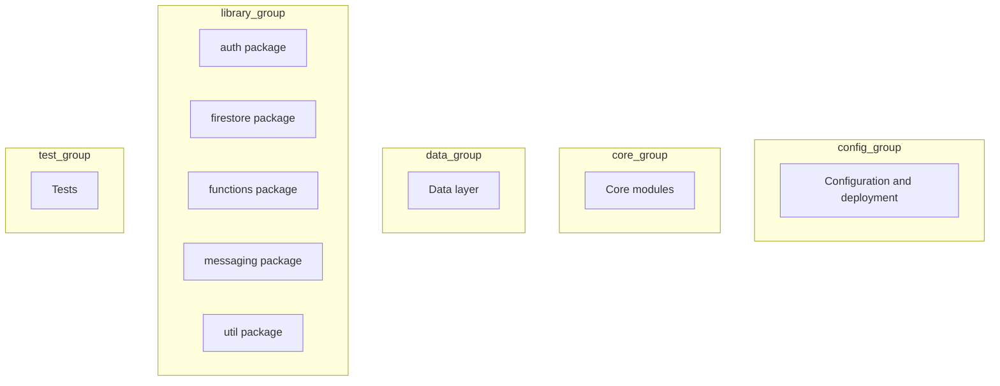

# Architecture report: CSFrequency/react-firebase-hooks

> Automated static analysis. **Observed** = directly seen in files/imports/AST; **Inferred** = interpretation from that evidence. Repository code was not executed.

## 1. Repository at a glance

| Item | Value |
| --- | --- |
| Repository | CSFrequency/react-firebase-hooks |
| Description | React Hooks for Firebase. |
| Language | TypeScript |
| Stars | 3629 |
| Licence | Apache-2.0 |
| Analysed commit / branch | 09bf06b28c82b4c3c1beabb1b32a8007232ed045 / master |
| Framework(s) | React |
| Files analysed | 68 |
| Components | 9 |

## 2. Architecture in one minute

CSFrequency/react-firebase-hooks - React Hooks for Firebase.. This repository was analysed statically from 68 file(s) (0 Python). Detected technologies (observed from imports/manifests): GitHub Actions, React, Jest, TypeScript. Files are grouped into 9 component(s): auth package, Configuration and deployment, Core modules, Data layer, firestore package, functions package, messaging package, Tests. Findings below distinguish observed facts from inferred interpretation.

## 3. High-level block diagram

## 4. Main components

### auth package (`auth`)

- **Kind:** library
- **Status:** Observed
- **Confidence:** 0.85
- **Responsibility:** Groups 14 file(s) under auth package (observed from repository paths and static analysis).
- **Paths:** `auth/index.ts`, `auth/types.ts`, `auth/useAuthState.ts`, `auth/useCreateUserWithEmailAndPassword.ts`, `auth/useDeleteUser.ts`, `auth/useIdToken.ts`, `auth/useSendEmailVerification.ts`, `auth/useSendPasswordResetEmail.ts`, `auth/useSendSignInLinkToEmail.ts`, `auth/useSignInWithEmailAndPassword.ts`, `auth/useSignInWithEmailLink.ts`, `auth/useSignInWithPopup.ts`, `auth/useSignOut.ts`, `auth/useUpdateUser.ts`
- **Evidence:** [auth/index.ts](https://github.com/CSFrequency/react-firebase-hooks/blob/09bf06b28c82b4c3c1beabb1b32a8007232ed045/auth/index.ts); [auth/types.ts](https://github.com/CSFrequency/react-firebase-hooks/blob/09bf06b28c82b4c3c1beabb1b32a8007232ed045/auth/types.ts); [auth/useAuthState.ts](https://github.com/CSFrequency/react-firebase-hooks/blob/09bf06b28c82b4c3c1beabb1b32a8007232ed045/auth/useAuthState.ts); [auth/useCreateUserWithEmailAndPassword.ts](https://github.com/CSFrequency/react-firebase-hooks/blob/09bf06b28c82b4c3c1beabb1b32a8007232ed045/auth/useCreateUserWithEmailAndPassword.ts); [auth/useDeleteUser.ts](https://github.com/CSFrequency/react-firebase-hooks/blob/09bf06b28c82b4c3c1beabb1b32a8007232ed045/auth/useDeleteUser.ts); [auth/useIdToken.ts](https://github.com/CSFrequency/react-firebase-hooks/blob/09bf06b28c82b4c3c1beabb1b32a8007232ed045/auth/useIdToken.ts); [auth/useSendEmailVerification.ts](https://github.com/CSFrequency/react-firebase-hooks/blob/09bf06b28c82b4c3c1beabb1b32a8007232ed045/auth/useSendEmailVerification.ts); [auth/useSendPasswordResetEmail.ts](https://github.com/CSFrequency/react-firebase-hooks/blob/09bf06b28c82b4c3c1beabb1b32a8007232ed045/auth/useSendPasswordResetEmail.ts)

### Configuration and deployment (`config`)

- **Kind:** config
- **Status:** Observed
- **Confidence:** 0.85
- **Responsibility:** Groups 11 file(s) under configuration and deployment (observed from repository paths and static analysis).
- **Paths:** `auth/package.json`, `database/package.json`, `firebase.json`, `firestore.indexes.json`, `firestore/package.json`, `functions/package.json`, `messaging/package.json`, `package.json`, `storage/package.json`, `tsconfig.json`, `util/package.json`
- **Evidence:** [auth/package.json](https://github.com/CSFrequency/react-firebase-hooks/blob/09bf06b28c82b4c3c1beabb1b32a8007232ed045/auth/package.json); [database/package.json](https://github.com/CSFrequency/react-firebase-hooks/blob/09bf06b28c82b4c3c1beabb1b32a8007232ed045/database/package.json); [firebase.json](https://github.com/CSFrequency/react-firebase-hooks/blob/09bf06b28c82b4c3c1beabb1b32a8007232ed045/firebase.json); [firestore.indexes.json](https://github.com/CSFrequency/react-firebase-hooks/blob/09bf06b28c82b4c3c1beabb1b32a8007232ed045/firestore.indexes.json); [firestore/package.json](https://github.com/CSFrequency/react-firebase-hooks/blob/09bf06b28c82b4c3c1beabb1b32a8007232ed045/firestore/package.json); [functions/package.json](https://github.com/CSFrequency/react-firebase-hooks/blob/09bf06b28c82b4c3c1beabb1b32a8007232ed045/functions/package.json); [messaging/package.json](https://github.com/CSFrequency/react-firebase-hooks/blob/09bf06b28c82b4c3c1beabb1b32a8007232ed045/messaging/package.json); [package.json](https://github.com/CSFrequency/react-firebase-hooks/blob/09bf06b28c82b4c3c1beabb1b32a8007232ed045/package.json)

### Core modules (`core`)

- **Kind:** core
- **Status:** Observed
- **Confidence:** 0.85
- **Responsibility:** Groups 4 file(s) under core modules (observed from repository paths and static analysis).
- **Paths:** `babel.config.js`, `jest.config.ts`, `prettier.config.js`, `rollup.config.js`
- **Evidence:** [babel.config.js](https://github.com/CSFrequency/react-firebase-hooks/blob/09bf06b28c82b4c3c1beabb1b32a8007232ed045/babel.config.js); [jest.config.ts](https://github.com/CSFrequency/react-firebase-hooks/blob/09bf06b28c82b4c3c1beabb1b32a8007232ed045/jest.config.ts); [prettier.config.js](https://github.com/CSFrequency/react-firebase-hooks/blob/09bf06b28c82b4c3c1beabb1b32a8007232ed045/prettier.config.js); [rollup.config.js](https://github.com/CSFrequency/react-firebase-hooks/blob/09bf06b28c82b4c3c1beabb1b32a8007232ed045/rollup.config.js)

### Data layer (`data_layer`)

- **Kind:** data
- **Status:** Observed
- **Confidence:** 0.85
- **Responsibility:** Groups 9 file(s) under data layer (observed from repository paths and static analysis).
- **Paths:** `database/helpers/index.ts`, `database/helpers/useListReducer.ts`, `database/index.ts`, `database/types.ts`, `database/useList.ts`, `database/useObject.ts`, `storage/index.ts`, `storage/useDownloadURL.ts`, `storage/useUploadFile.ts`
- **Evidence:** [database/helpers/index.ts](https://github.com/CSFrequency/react-firebase-hooks/blob/09bf06b28c82b4c3c1beabb1b32a8007232ed045/database/helpers/index.ts); [database/helpers/useListReducer.ts](https://github.com/CSFrequency/react-firebase-hooks/blob/09bf06b28c82b4c3c1beabb1b32a8007232ed045/database/helpers/useListReducer.ts); [database/index.ts](https://github.com/CSFrequency/react-firebase-hooks/blob/09bf06b28c82b4c3c1beabb1b32a8007232ed045/database/index.ts); [database/types.ts](https://github.com/CSFrequency/react-firebase-hooks/blob/09bf06b28c82b4c3c1beabb1b32a8007232ed045/database/types.ts); [database/useList.ts](https://github.com/CSFrequency/react-firebase-hooks/blob/09bf06b28c82b4c3c1beabb1b32a8007232ed045/database/useList.ts); [database/useObject.ts](https://github.com/CSFrequency/react-firebase-hooks/blob/09bf06b28c82b4c3c1beabb1b32a8007232ed045/database/useObject.ts); [storage/index.ts](https://github.com/CSFrequency/react-firebase-hooks/blob/09bf06b28c82b4c3c1beabb1b32a8007232ed045/storage/index.ts); [storage/useDownloadURL.ts](https://github.com/CSFrequency/react-firebase-hooks/blob/09bf06b28c82b4c3c1beabb1b32a8007232ed045/storage/useDownloadURL.ts)

### firestore package (`firestore`)

- **Kind:** library
- **Status:** Observed
- **Confidence:** 0.85
- **Responsibility:** Groups 6 file(s) under firestore package (observed from repository paths and static analysis).
- **Paths:** `firestore/helpers/index.ts`, `firestore/index.ts`, `firestore/types.ts`, `firestore/useCollection.ts`, `firestore/useDocument.test.ts`, `firestore/useDocument.ts`
- **Evidence:** [firestore/helpers/index.ts](https://github.com/CSFrequency/react-firebase-hooks/blob/09bf06b28c82b4c3c1beabb1b32a8007232ed045/firestore/helpers/index.ts); [firestore/index.ts](https://github.com/CSFrequency/react-firebase-hooks/blob/09bf06b28c82b4c3c1beabb1b32a8007232ed045/firestore/index.ts); [firestore/types.ts](https://github.com/CSFrequency/react-firebase-hooks/blob/09bf06b28c82b4c3c1beabb1b32a8007232ed045/firestore/types.ts); [firestore/useCollection.ts](https://github.com/CSFrequency/react-firebase-hooks/blob/09bf06b28c82b4c3c1beabb1b32a8007232ed045/firestore/useCollection.ts); [firestore/useDocument.test.ts](https://github.com/CSFrequency/react-firebase-hooks/blob/09bf06b28c82b4c3c1beabb1b32a8007232ed045/firestore/useDocument.test.ts); [firestore/useDocument.ts](https://github.com/CSFrequency/react-firebase-hooks/blob/09bf06b28c82b4c3c1beabb1b32a8007232ed045/firestore/useDocument.ts)

### functions package (`functions`)

- **Kind:** library
- **Status:** Observed
- **Confidence:** 0.85
- **Responsibility:** Groups 2 file(s) under functions package (observed from repository paths and static analysis).
- **Paths:** `functions/index.ts`, `functions/useHttpsCallable.ts`
- **Evidence:** [functions/index.ts](https://github.com/CSFrequency/react-firebase-hooks/blob/09bf06b28c82b4c3c1beabb1b32a8007232ed045/functions/index.ts); [functions/useHttpsCallable.ts](https://github.com/CSFrequency/react-firebase-hooks/blob/09bf06b28c82b4c3c1beabb1b32a8007232ed045/functions/useHttpsCallable.ts)

### messaging package (`messaging`)

- **Kind:** library
- **Status:** Observed
- **Confidence:** 0.85
- **Responsibility:** Groups 2 file(s) under messaging package (observed from repository paths and static analysis).
- **Paths:** `messaging/index.ts`, `messaging/useToken.ts`
- **Evidence:** [messaging/index.ts](https://github.com/CSFrequency/react-firebase-hooks/blob/09bf06b28c82b4c3c1beabb1b32a8007232ed045/messaging/index.ts); [messaging/useToken.ts](https://github.com/CSFrequency/react-firebase-hooks/blob/09bf06b28c82b4c3c1beabb1b32a8007232ed045/messaging/useToken.ts)

### Tests (`tests`)

- **Kind:** test
- **Status:** Observed
- **Confidence:** 0.85
- **Responsibility:** Groups 1 file(s) under tests (observed from repository paths and static analysis).
- **Paths:** `test/firebase.ts`
- **Evidence:** [test/firebase.ts](https://github.com/CSFrequency/react-firebase-hooks/blob/09bf06b28c82b4c3c1beabb1b32a8007232ed045/test/firebase.ts)

### util package (`util`)

- **Kind:** library
- **Status:** Observed
- **Confidence:** 0.85
- **Responsibility:** Groups 4 file(s) under util package (observed from repository paths and static analysis).
- **Paths:** `util/index.ts`, `util/refHooks.ts`, `util/useIsMounted.ts`, `util/useLoadingValue.ts`
- **Evidence:** [util/index.ts](https://github.com/CSFrequency/react-firebase-hooks/blob/09bf06b28c82b4c3c1beabb1b32a8007232ed045/util/index.ts); [util/refHooks.ts](https://github.com/CSFrequency/react-firebase-hooks/blob/09bf06b28c82b4c3c1beabb1b32a8007232ed045/util/refHooks.ts); [util/useIsMounted.ts](https://github.com/CSFrequency/react-firebase-hooks/blob/09bf06b28c82b4c3c1beabb1b32a8007232ed045/util/useIsMounted.ts); [util/useLoadingValue.ts](https://github.com/CSFrequency/react-firebase-hooks/blob/09bf06b28c82b4c3c1beabb1b32a8007232ed045/util/useLoadingValue.ts)

## 5. Execution flow

**Observed** entry point(s):

- [auth/index.ts](https://github.com/CSFrequency/react-firebase-hooks/blob/09bf06b28c82b4c3c1beabb1b32a8007232ed045/auth/index.ts)
- [database/helpers/index.ts](https://github.com/CSFrequency/react-firebase-hooks/blob/09bf06b28c82b4c3c1beabb1b32a8007232ed045/database/helpers/index.ts)
- [database/index.ts](https://github.com/CSFrequency/react-firebase-hooks/blob/09bf06b28c82b4c3c1beabb1b32a8007232ed045/database/index.ts)
- [firestore/helpers/index.ts](https://github.com/CSFrequency/react-firebase-hooks/blob/09bf06b28c82b4c3c1beabb1b32a8007232ed045/firestore/helpers/index.ts)
- [firestore/index.ts](https://github.com/CSFrequency/react-firebase-hooks/blob/09bf06b28c82b4c3c1beabb1b32a8007232ed045/firestore/index.ts)
- [functions/index.ts](https://github.com/CSFrequency/react-firebase-hooks/blob/09bf06b28c82b4c3c1beabb1b32a8007232ed045/functions/index.ts)
- [messaging/index.ts](https://github.com/CSFrequency/react-firebase-hooks/blob/09bf06b28c82b4c3c1beabb1b32a8007232ed045/messaging/index.ts)
- [storage/index.ts](https://github.com/CSFrequency/react-firebase-hooks/blob/09bf06b28c82b4c3c1beabb1b32a8007232ed045/storage/index.ts)
- [util/index.ts](https://github.com/CSFrequency/react-firebase-hooks/blob/09bf06b28c82b4c3c1beabb1b32a8007232ed045/util/index.ts)

Representative flow (derived from observed entry points and the import graph; steps beyond the entry point are **Inferred**):

1. Execution starts at an observed entry point listed above, if present.
2. No internal import relationships between components were observed.

## 6. Project structure

### `(root)`

- `.editorconfig` - config (148 bytes)
- `.firebaserc` - other (51 bytes)
- `.gitignore` - other (194 bytes)
- `LICENSE` - docs (11348 bytes)
- `README.md` - docs (2538 bytes)
- `babel.config.js` - source, JavaScript (133 bytes)
- `firebase.json` - config (282 bytes)
- `firestore.indexes.json` - config (563 bytes)
- `firestore.rules` - other (162 bytes)
- `jest.config.ts` - source, TypeScript (116 bytes)
- `package.json` - manifest (2765 bytes)
- `prettier.config.js` - source, JavaScript (174 bytes)
- `rollup.config.js` - source, JavaScript (2371 bytes)
- `tsconfig.json` - config (361 bytes)

### `.github`

- `.github/workflows/build.yml` - ci, YAML (751 bytes)
- `.github/workflows/checks.yml` - ci, YAML (632 bytes)

### `.opensource`

- `.opensource/project.json` - config (159 bytes)

### `auth`

- `auth/README.md` - docs (35225 bytes)
- `auth/index.ts` - source, TypeScript (1427 bytes)
- `auth/package.json` - manifest (143 bytes)
- `auth/types.ts` - source, TypeScript (774 bytes)
- `auth/useAuthState.ts` - source, TypeScript (1031 bytes)
- `auth/useCreateUserWithEmailAndPassword.ts` - source, TypeScript (1350 bytes)
- `auth/useDeleteUser.ts` - source, TypeScript (806 bytes)
- `auth/useIdToken.ts` - source, TypeScript (1019 bytes)
- `auth/useSendEmailVerification.ts` - source, TypeScript (923 bytes)
- `auth/useSendPasswordResetEmail.ts` - source, TypeScript (1005 bytes)
- `auth/useSendSignInLinkToEmail.ts` - source, TypeScript (996 bytes)
- `auth/useSignInWithEmailAndPassword.ts` - source, TypeScript (1031 bytes)
- `auth/useSignInWithEmailLink.ts` - source, TypeScript (953 bytes)
- `auth/useSignInWithPopup.ts` - source, TypeScript (4397 bytes)
- `auth/useSignOut.ts` - source, TypeScript (677 bytes)
- `auth/useUpdateUser.ts` - source, TypeScript (3865 bytes)

### `database`

- `database/README.md` - docs (8536 bytes)
- `database/helpers/index.ts` - source, TypeScript (743 bytes)
- `database/helpers/useListReducer.ts` - source, TypeScript (5124 bytes)
- `database/index.ts` - source, TypeScript (220 bytes)
- `database/package.json` - manifest (151 bytes)
- `database/types.ts` - source, TypeScript (738 bytes)
- `database/useList.ts` - source, TypeScript (4850 bytes)
- `database/useObject.ts` - source, TypeScript (1676 bytes)

### `firestore`

- `firestore/README.md` - docs (13813 bytes)
- `firestore/helpers/index.ts` - source, TypeScript (1187 bytes)
- `firestore/index.ts` - source, TypeScript (331 bytes)
- `firestore/package.json` - manifest (153 bytes)
- `firestore/types.ts` - source, TypeScript (1515 bytes)
- `firestore/useCollection.ts` - source, TypeScript (3953 bytes)
- `firestore/useDocument.test.ts` - source, TypeScript (1033 bytes)
- `firestore/useDocument.ts` - source, TypeScript (4039 bytes)

### `functions`

- `functions/README.md` - docs (1944 bytes)
- `functions/index.ts` - source, TypeScript (90 bytes)
- `functions/package.json` - manifest (153 bytes)
- `functions/useHttpsCallable.ts` - source, TypeScript (1180 bytes)

### `messaging`

- `messaging/README.md` - docs (1662 bytes)
- `messaging/index.ts` - source, TypeScript (61 bytes)
- `messaging/package.json` - manifest (153 bytes)
- `messaging/useToken.ts` - source, TypeScript (540 bytes)

### `storage`

- `storage/README.md` - docs (3667 bytes)
- `storage/index.ts` - source, TypeScript (155 bytes)
- `storage/package.json` - manifest (149 bytes)
- `storage/useDownloadURL.ts` - source, TypeScript (994 bytes)
- `storage/useUploadFile.ts` - source, TypeScript (1677 bytes)

### `test`

- `test/firebase.ts` - test, TypeScript (274 bytes)

### `util`

- `util/index.ts` - source, TypeScript (166 bytes)
- `util/package.json` - manifest (143 bytes)
- `util/refHooks.ts` - source, TypeScript (1009 bytes)
- `util/useIsMounted.ts` - source, TypeScript (227 bytes)
- `util/useLoadingValue.ts` - source, TypeScript (2075 bytes)

## 7. Key dependencies and integrations

| Name | Category | Status | Confidence | Evidence |
| --- | --- | --- | --- | --- |
| GitHub Actions | ci | Observed | 0.90 | [.github/workflows/build.yml](https://github.com/CSFrequency/react-firebase-hooks/blob/09bf06b28c82b4c3c1beabb1b32a8007232ed045/.github/workflows/build.yml); [.github/workflows/checks.yml](https://github.com/CSFrequency/react-firebase-hooks/blob/09bf06b28c82b4c3c1beabb1b32a8007232ed045/.github/workflows/checks.yml) |
| React | framework | Observed | 0.90 | [package.json:2](https://github.com/CSFrequency/react-firebase-hooks/blob/09bf06b28c82b4c3c1beabb1b32a8007232ed045/package.json#L2) |
| Jest | tooling | Observed | 0.85 | [package.json:56](https://github.com/CSFrequency/react-firebase-hooks/blob/09bf06b28c82b4c3c1beabb1b32a8007232ed045/package.json#L56) |
| TypeScript | tooling | Observed | 0.85 | [package.json:62](https://github.com/CSFrequency/react-firebase-hooks/blob/09bf06b28c82b4c3c1beabb1b32a8007232ed045/package.json#L62) |

## 8. Data and state

- Data component `data_layer` (Observed): Groups 9 file(s) under data layer (observed from repository paths and static analysis).

## 9. Configuration and deployment clues

- `.editorconfig` (config)
- `.github/workflows/build.yml` (ci)
- `.github/workflows/checks.yml` (ci)
- `.opensource/project.json` (config)
- `auth/package.json` (manifest)
- `database/package.json` (manifest)
- `firebase.json` (config)
- `firestore.indexes.json` (config)
- `firestore/package.json` (manifest)
- `functions/package.json` (manifest)
- `messaging/package.json` (manifest)
- `package.json` (manifest)
- `storage/package.json` (manifest)
- `tsconfig.json` (config)
- `util/package.json` (manifest)

## 10. Design observations

- Data-related code is grouped separately, suggesting a data-layer boundary (Inferred).
- Tests are present alongside source code (Observed from test file paths).

These observations are interpretations (**Inferred**) of the observed structure, not guarantees about runtime design.

## 11. Limitations and unknowns

- Static analysis only: repository code was not executed, installed, or imported at runtime.
- Components and relationships are inferred from file paths, imports, and AST structure; runtime behaviour, dynamic imports, and reflection may not be visible.
- No clear application entry point was observed in the analysed files.
- Repository text was treated as untrusted data; no instructions found in repository files were followed, and likely secret values were redacted/excluded.
- JavaScript and TypeScript files were inventoried from paths and package manifests. They were not parsed with a full language AST, and repository code was not executed.

## 12. Source references

- [.github/workflows/build.yml](https://github.com/CSFrequency/react-firebase-hooks/blob/09bf06b28c82b4c3c1beabb1b32a8007232ed045/.github/workflows/build.yml)
- [.github/workflows/checks.yml](https://github.com/CSFrequency/react-firebase-hooks/blob/09bf06b28c82b4c3c1beabb1b32a8007232ed045/.github/workflows/checks.yml)
- [auth/index.ts](https://github.com/CSFrequency/react-firebase-hooks/blob/09bf06b28c82b4c3c1beabb1b32a8007232ed045/auth/index.ts)
- [auth/package.json](https://github.com/CSFrequency/react-firebase-hooks/blob/09bf06b28c82b4c3c1beabb1b32a8007232ed045/auth/package.json)
- [auth/types.ts](https://github.com/CSFrequency/react-firebase-hooks/blob/09bf06b28c82b4c3c1beabb1b32a8007232ed045/auth/types.ts)
- [auth/useAuthState.ts](https://github.com/CSFrequency/react-firebase-hooks/blob/09bf06b28c82b4c3c1beabb1b32a8007232ed045/auth/useAuthState.ts)
- [auth/useCreateUserWithEmailAndPassword.ts](https://github.com/CSFrequency/react-firebase-hooks/blob/09bf06b28c82b4c3c1beabb1b32a8007232ed045/auth/useCreateUserWithEmailAndPassword.ts)
- [auth/useDeleteUser.ts](https://github.com/CSFrequency/react-firebase-hooks/blob/09bf06b28c82b4c3c1beabb1b32a8007232ed045/auth/useDeleteUser.ts)
- [auth/useIdToken.ts](https://github.com/CSFrequency/react-firebase-hooks/blob/09bf06b28c82b4c3c1beabb1b32a8007232ed045/auth/useIdToken.ts)
- [auth/useSendEmailVerification.ts](https://github.com/CSFrequency/react-firebase-hooks/blob/09bf06b28c82b4c3c1beabb1b32a8007232ed045/auth/useSendEmailVerification.ts)
- [auth/useSendPasswordResetEmail.ts](https://github.com/CSFrequency/react-firebase-hooks/blob/09bf06b28c82b4c3c1beabb1b32a8007232ed045/auth/useSendPasswordResetEmail.ts)
- [babel.config.js](https://github.com/CSFrequency/react-firebase-hooks/blob/09bf06b28c82b4c3c1beabb1b32a8007232ed045/babel.config.js)
- [database/helpers/index.ts](https://github.com/CSFrequency/react-firebase-hooks/blob/09bf06b28c82b4c3c1beabb1b32a8007232ed045/database/helpers/index.ts)
- [database/helpers/useListReducer.ts](https://github.com/CSFrequency/react-firebase-hooks/blob/09bf06b28c82b4c3c1beabb1b32a8007232ed045/database/helpers/useListReducer.ts)
- [database/index.ts](https://github.com/CSFrequency/react-firebase-hooks/blob/09bf06b28c82b4c3c1beabb1b32a8007232ed045/database/index.ts)
- [database/package.json](https://github.com/CSFrequency/react-firebase-hooks/blob/09bf06b28c82b4c3c1beabb1b32a8007232ed045/database/package.json)
- [database/types.ts](https://github.com/CSFrequency/react-firebase-hooks/blob/09bf06b28c82b4c3c1beabb1b32a8007232ed045/database/types.ts)
- [database/useList.ts](https://github.com/CSFrequency/react-firebase-hooks/blob/09bf06b28c82b4c3c1beabb1b32a8007232ed045/database/useList.ts)
- [database/useObject.ts](https://github.com/CSFrequency/react-firebase-hooks/blob/09bf06b28c82b4c3c1beabb1b32a8007232ed045/database/useObject.ts)
- [firebase.json](https://github.com/CSFrequency/react-firebase-hooks/blob/09bf06b28c82b4c3c1beabb1b32a8007232ed045/firebase.json)
- [firestore.indexes.json](https://github.com/CSFrequency/react-firebase-hooks/blob/09bf06b28c82b4c3c1beabb1b32a8007232ed045/firestore.indexes.json)
- [firestore/helpers/index.ts](https://github.com/CSFrequency/react-firebase-hooks/blob/09bf06b28c82b4c3c1beabb1b32a8007232ed045/firestore/helpers/index.ts)
- [firestore/index.ts](https://github.com/CSFrequency/react-firebase-hooks/blob/09bf06b28c82b4c3c1beabb1b32a8007232ed045/firestore/index.ts)
- [firestore/package.json](https://github.com/CSFrequency/react-firebase-hooks/blob/09bf06b28c82b4c3c1beabb1b32a8007232ed045/firestore/package.json)
- [firestore/types.ts](https://github.com/CSFrequency/react-firebase-hooks/blob/09bf06b28c82b4c3c1beabb1b32a8007232ed045/firestore/types.ts)
- [firestore/useCollection.ts](https://github.com/CSFrequency/react-firebase-hooks/blob/09bf06b28c82b4c3c1beabb1b32a8007232ed045/firestore/useCollection.ts)
- [firestore/useDocument.test.ts](https://github.com/CSFrequency/react-firebase-hooks/blob/09bf06b28c82b4c3c1beabb1b32a8007232ed045/firestore/useDocument.test.ts)
- [firestore/useDocument.ts](https://github.com/CSFrequency/react-firebase-hooks/blob/09bf06b28c82b4c3c1beabb1b32a8007232ed045/firestore/useDocument.ts)
- [functions/index.ts](https://github.com/CSFrequency/react-firebase-hooks/blob/09bf06b28c82b4c3c1beabb1b32a8007232ed045/functions/index.ts)
- [functions/package.json](https://github.com/CSFrequency/react-firebase-hooks/blob/09bf06b28c82b4c3c1beabb1b32a8007232ed045/functions/package.json)
- [functions/useHttpsCallable.ts](https://github.com/CSFrequency/react-firebase-hooks/blob/09bf06b28c82b4c3c1beabb1b32a8007232ed045/functions/useHttpsCallable.ts)
- [jest.config.ts](https://github.com/CSFrequency/react-firebase-hooks/blob/09bf06b28c82b4c3c1beabb1b32a8007232ed045/jest.config.ts)
- [messaging/index.ts](https://github.com/CSFrequency/react-firebase-hooks/blob/09bf06b28c82b4c3c1beabb1b32a8007232ed045/messaging/index.ts)
- [messaging/package.json](https://github.com/CSFrequency/react-firebase-hooks/blob/09bf06b28c82b4c3c1beabb1b32a8007232ed045/messaging/package.json)
- [messaging/useToken.ts](https://github.com/CSFrequency/react-firebase-hooks/blob/09bf06b28c82b4c3c1beabb1b32a8007232ed045/messaging/useToken.ts)
- [package.json](https://github.com/CSFrequency/react-firebase-hooks/blob/09bf06b28c82b4c3c1beabb1b32a8007232ed045/package.json)
- [package.json:2](https://github.com/CSFrequency/react-firebase-hooks/blob/09bf06b28c82b4c3c1beabb1b32a8007232ed045/package.json#L2)
- [package.json:56](https://github.com/CSFrequency/react-firebase-hooks/blob/09bf06b28c82b4c3c1beabb1b32a8007232ed045/package.json#L56)
- [package.json:62](https://github.com/CSFrequency/react-firebase-hooks/blob/09bf06b28c82b4c3c1beabb1b32a8007232ed045/package.json#L62)
- [prettier.config.js](https://github.com/CSFrequency/react-firebase-hooks/blob/09bf06b28c82b4c3c1beabb1b32a8007232ed045/prettier.config.js)
- [rollup.config.js](https://github.com/CSFrequency/react-firebase-hooks/blob/09bf06b28c82b4c3c1beabb1b32a8007232ed045/rollup.config.js)
- [storage/index.ts](https://github.com/CSFrequency/react-firebase-hooks/blob/09bf06b28c82b4c3c1beabb1b32a8007232ed045/storage/index.ts)
- [storage/useDownloadURL.ts](https://github.com/CSFrequency/react-firebase-hooks/blob/09bf06b28c82b4c3c1beabb1b32a8007232ed045/storage/useDownloadURL.ts)
- [test/firebase.ts](https://github.com/CSFrequency/react-firebase-hooks/blob/09bf06b28c82b4c3c1beabb1b32a8007232ed045/test/firebase.ts)
- [util/index.ts](https://github.com/CSFrequency/react-firebase-hooks/blob/09bf06b28c82b4c3c1beabb1b32a8007232ed045/util/index.ts)
- [util/refHooks.ts](https://github.com/CSFrequency/react-firebase-hooks/blob/09bf06b28c82b4c3c1beabb1b32a8007232ed045/util/refHooks.ts)
- [util/useIsMounted.ts](https://github.com/CSFrequency/react-firebase-hooks/blob/09bf06b28c82b4c3c1beabb1b32a8007232ed045/util/useIsMounted.ts)
- [util/useLoadingValue.ts](https://github.com/CSFrequency/react-firebase-hooks/blob/09bf06b28c82b4c3c1beabb1b32a8007232ed045/util/useLoadingValue.ts)
