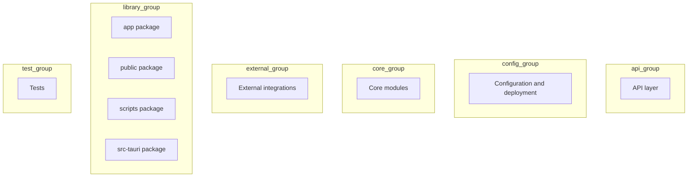

# Architecture report: ChatGPTNextWeb/NextChat

> Automated static analysis. **Observed** = directly seen in files/imports/AST; **Inferred** = interpretation from that evidence. Repository code was not executed.

## 1. Repository at a glance

| Item | Value |
| --- | --- |
| Repository | ChatGPTNextWeb/NextChat |
| Description | ✨ Zero-config AI chat assistant. No API key needed — sign up and instantly chat with GPT-5, Claude 4, Gemini 2.5, DeepSeek & 100+ top models. Pay-as-you-go saves you more. Available on Web, iOS, macOS, Android, Linux, Windows. |
| Language | TypeScript |
| Stars | 88962 |
| Licence | MIT |
| Analysed commit / branch | 1d3dc331512929a4b1d3e82354e72acce33b5c7a / main |
| Framework(s) | Next.js, React |
| Files analysed | 370 |
| Components | 9 |

## 2. Architecture in one minute

ChatGPTNextWeb/NextChat - ✨ Zero-config AI chat assistant. No API key needed — sign up and instantly chat with GPT-5, Claude 4, Gemini 2.5, DeepSeek & 100+ top models. Pay-as-you-go saves you more. Available on Web, iOS, macO…. This repository was analysed statically from 370 file(s) (0 Python). Detected technologies (observed from imports/manifests): GitHub Actions, Next.js, React, axios, React Router, Docker. Files are grouped into 9 component(s): API layer, app package, Configuration and deployment, Core modules, External integrations, public package, scripts package, src-tauri package. Findings below distinguish observed facts from inferred interpretation.

## 3. High-level block diagram

## 4. Main components

### API layer (`api_layer`)

- **Kind:** api
- **Status:** Observed
- **Confidence:** 0.85
- **Responsibility:** Groups 24 file(s) under api layer (observed from repository paths and static analysis).
- **Paths:** `app/api/302ai.ts`, `app/api/[provider]/[...path]/route.ts`, `app/api/alibaba.ts`, `app/api/anthropic.ts`, `app/api/artifacts/route.ts`, `app/api/auth.ts`, `app/api/azure.ts`, `app/api/baidu.ts`, `app/api/bytedance.ts`, `app/api/common.ts`, `app/api/config/route.ts`, `app/api/deepseek.ts`, `app/api/glm.ts`, `app/api/google.ts`, `app/api/iflytek.ts`, `app/api/moonshot.ts`, `app/api/openai.ts`, `app/api/proxy.ts`, `app/api/siliconflow.ts`, `app/api/stability.ts`, `app/api/tencent/route.ts`, `app/api/upstash/[action]/[...key]/route.ts`, `app/api/webdav/[...path]/route.ts`, `app/api/xai.ts`
- **Evidence:** [app/api/302ai.ts](https://github.com/ChatGPTNextWeb/NextChat/blob/1d3dc331512929a4b1d3e82354e72acce33b5c7a/app/api/302ai.ts); [app/api/[provider]/[...path]/route.ts](https://github.com/ChatGPTNextWeb/NextChat/blob/1d3dc331512929a4b1d3e82354e72acce33b5c7a/app/api/%5Bprovider%5D/%5B...path%5D/route.ts); [app/api/alibaba.ts](https://github.com/ChatGPTNextWeb/NextChat/blob/1d3dc331512929a4b1d3e82354e72acce33b5c7a/app/api/alibaba.ts); [app/api/anthropic.ts](https://github.com/ChatGPTNextWeb/NextChat/blob/1d3dc331512929a4b1d3e82354e72acce33b5c7a/app/api/anthropic.ts); [app/api/artifacts/route.ts](https://github.com/ChatGPTNextWeb/NextChat/blob/1d3dc331512929a4b1d3e82354e72acce33b5c7a/app/api/artifacts/route.ts); [app/api/auth.ts](https://github.com/ChatGPTNextWeb/NextChat/blob/1d3dc331512929a4b1d3e82354e72acce33b5c7a/app/api/auth.ts); [app/api/azure.ts](https://github.com/ChatGPTNextWeb/NextChat/blob/1d3dc331512929a4b1d3e82354e72acce33b5c7a/app/api/azure.ts); [app/api/baidu.ts](https://github.com/ChatGPTNextWeb/NextChat/blob/1d3dc331512929a4b1d3e82354e72acce33b5c7a/app/api/baidu.ts)

### app package (`app`)

- **Kind:** library
- **Status:** Observed
- **Confidence:** 0.85
- **Responsibility:** Groups 104 file(s) under app package (observed from repository paths and static analysis).
- **Paths:** `app/command.ts`, `app/components/artifacts.tsx`, `app/components/auth.tsx`, `app/components/button.tsx`, `app/components/chat-list.tsx`, `app/components/chat.tsx`, `app/components/emoji.tsx`, `app/components/error.tsx`, `app/components/exporter.tsx`, `app/components/home.tsx`, `app/components/input-range.tsx`, `app/components/markdown.tsx`, `app/components/mask.tsx`, `app/components/mcp-market.tsx`, `app/components/message-selector.tsx`, `app/components/model-config.tsx`, `app/components/new-chat.tsx`, `app/components/plugin.tsx`, `app/components/realtime-chat/index.ts`, `app/components/realtime-chat/realtime-chat.tsx`, `app/components/realtime-chat/realtime-config.tsx`, `app/components/sd/index.tsx`, `app/components/sd/sd-panel.tsx`, `app/components/sd/sd-sidebar.tsx`, `app/components/sd/sd.tsx`, `app/components/search-chat.tsx`, `app/components/settings.tsx`, `app/components/sidebar.tsx`, `app/components/tts-config.tsx`, `app/components/ui-lib.tsx`, `app/components/voice-print/index.ts`, `app/components/voice-print/voice-print.tsx`, `app/constant.ts`, `app/global.d.ts`, `app/layout.tsx`, `app/lib/audio.ts`, `app/locales/ar.ts`, `app/locales/bn.ts`, `app/locales/cn.ts`, `app/locales/cs.ts`, `app/locales/da.ts`, `app/locales/de.ts`, `app/locales/en.ts`, `app/locales/es.ts`, `app/locales/fr.ts`, `app/locales/id.ts`, `app/locales/index.ts`, `app/locales/it.ts`, `app/locales/jp.ts`, `app/locales/ko.ts`, `app/locales/no.ts`, `app/locales/pt.ts`, `app/locales/ru.ts`, `app/locales/sk.ts`, `app/locales/tr.ts`, `app/locales/tw.ts`, `app/locales/vi.ts`, `app/masks/build.ts`, `app/masks/cn.ts`, `app/masks/en.ts`, `app/masks/index.ts`, `app/masks/tw.ts`, `app/masks/typing.ts`, `app/mcp/actions.ts`, `app/mcp/client.ts`, `app/mcp/logger.ts`, `app/mcp/types.ts`, `app/mcp/utils.ts`, `app/page.tsx`, `app/polyfill.ts`, `app/store/access.ts`, `app/store/chat.ts`, `app/store/config.ts`, `app/store/index.ts`, `app/store/mask.ts`, `app/store/plugin.ts`, `app/store/prompt.ts`, `app/store/sd.ts`, `app/store/sync.ts`, `app/store/update.ts`, `app/typing.ts`, `app/utils.ts`, `app/utils/audio.ts`, `app/utils/auth-settings-events.ts`, `app/utils/baidu.ts`, `app/utils/chat.ts`, `app/utils/clone.ts`, `app/utils/cloud/index.ts`, `app/utils/cloud/upstash.ts`, `app/utils/cloud/webdav.ts`, `app/utils/cloudflare.ts`, `app/utils/format.ts`, `app/utils/hmac.ts`, `app/utils/hooks.ts`, `app/utils/indexedDB-storage.ts`, `app/utils/merge.ts`, `app/utils/model.ts`, `app/utils/ms_edge_tts.ts`, `app/utils/object.ts`, `app/utils/store.ts`, `app/utils/stream.ts`, `app/utils/sync.ts`, `app/utils/tencent.ts`, `app/utils/token.ts`
- **Evidence:** [app/command.ts](https://github.com/ChatGPTNextWeb/NextChat/blob/1d3dc331512929a4b1d3e82354e72acce33b5c7a/app/command.ts); [app/components/artifacts.tsx](https://github.com/ChatGPTNextWeb/NextChat/blob/1d3dc331512929a4b1d3e82354e72acce33b5c7a/app/components/artifacts.tsx); [app/components/auth.tsx](https://github.com/ChatGPTNextWeb/NextChat/blob/1d3dc331512929a4b1d3e82354e72acce33b5c7a/app/components/auth.tsx); [app/components/button.tsx](https://github.com/ChatGPTNextWeb/NextChat/blob/1d3dc331512929a4b1d3e82354e72acce33b5c7a/app/components/button.tsx); [app/components/chat-list.tsx](https://github.com/ChatGPTNextWeb/NextChat/blob/1d3dc331512929a4b1d3e82354e72acce33b5c7a/app/components/chat-list.tsx); [app/components/chat.tsx](https://github.com/ChatGPTNextWeb/NextChat/blob/1d3dc331512929a4b1d3e82354e72acce33b5c7a/app/components/chat.tsx); [app/components/emoji.tsx](https://github.com/ChatGPTNextWeb/NextChat/blob/1d3dc331512929a4b1d3e82354e72acce33b5c7a/app/components/emoji.tsx); [app/components/error.tsx](https://github.com/ChatGPTNextWeb/NextChat/blob/1d3dc331512929a4b1d3e82354e72acce33b5c7a/app/components/error.tsx)

### Configuration and deployment (`config`)

- **Kind:** config
- **Status:** Observed
- **Confidence:** 0.85
- **Responsibility:** Groups 12 file(s) under configuration and deployment (observed from repository paths and static analysis).
- **Paths:** `Dockerfile`, `app/config/build.ts`, `app/config/client.ts`, `app/config/server.ts`, `app/mcp/mcp_config.default.json`, `docker-compose.yml`, `package.json`, `public/plugins.json`, `src-tauri/Cargo.toml`, `src-tauri/tauri.conf.json`, `tsconfig.json`, `vercel.json`
- **Evidence:** [Dockerfile](https://github.com/ChatGPTNextWeb/NextChat/blob/1d3dc331512929a4b1d3e82354e72acce33b5c7a/Dockerfile); [app/config/build.ts](https://github.com/ChatGPTNextWeb/NextChat/blob/1d3dc331512929a4b1d3e82354e72acce33b5c7a/app/config/build.ts); [app/config/client.ts](https://github.com/ChatGPTNextWeb/NextChat/blob/1d3dc331512929a4b1d3e82354e72acce33b5c7a/app/config/client.ts); [app/config/server.ts](https://github.com/ChatGPTNextWeb/NextChat/blob/1d3dc331512929a4b1d3e82354e72acce33b5c7a/app/config/server.ts); [app/mcp/mcp_config.default.json](https://github.com/ChatGPTNextWeb/NextChat/blob/1d3dc331512929a4b1d3e82354e72acce33b5c7a/app/mcp/mcp_config.default.json); [docker-compose.yml](https://github.com/ChatGPTNextWeb/NextChat/blob/1d3dc331512929a4b1d3e82354e72acce33b5c7a/docker-compose.yml); [package.json](https://github.com/ChatGPTNextWeb/NextChat/blob/1d3dc331512929a4b1d3e82354e72acce33b5c7a/package.json); [public/plugins.json](https://github.com/ChatGPTNextWeb/NextChat/blob/1d3dc331512929a4b1d3e82354e72acce33b5c7a/public/plugins.json)

### Core modules (`core`)

- **Kind:** core
- **Status:** Observed
- **Confidence:** 0.85
- **Responsibility:** Groups 3 file(s) under core modules (observed from repository paths and static analysis).
- **Paths:** `jest.config.ts`, `jest.setup.ts`, `next.config.mjs`
- **Evidence:** [jest.config.ts](https://github.com/ChatGPTNextWeb/NextChat/blob/1d3dc331512929a4b1d3e82354e72acce33b5c7a/jest.config.ts); [jest.setup.ts](https://github.com/ChatGPTNextWeb/NextChat/blob/1d3dc331512929a4b1d3e82354e72acce33b5c7a/jest.setup.ts); [next.config.mjs](https://github.com/ChatGPTNextWeb/NextChat/blob/1d3dc331512929a4b1d3e82354e72acce33b5c7a/next.config.mjs)

### External integrations (`external_integrations`)

- **Kind:** external
- **Status:** Observed
- **Confidence:** 0.85
- **Responsibility:** Groups 16 file(s) under external integrations (observed from repository paths and static analysis).
- **Paths:** `app/client/api.ts`, `app/client/controller.ts`, `app/client/platforms/ai302.ts`, `app/client/platforms/alibaba.ts`, `app/client/platforms/anthropic.ts`, `app/client/platforms/baidu.ts`, `app/client/platforms/bytedance.ts`, `app/client/platforms/deepseek.ts`, `app/client/platforms/glm.ts`, `app/client/platforms/google.ts`, `app/client/platforms/iflytek.ts`, `app/client/platforms/moonshot.ts`, `app/client/platforms/openai.ts`, `app/client/platforms/siliconflow.ts`, `app/client/platforms/tencent.ts`, `app/client/platforms/xai.ts`
- **Evidence:** [app/client/api.ts](https://github.com/ChatGPTNextWeb/NextChat/blob/1d3dc331512929a4b1d3e82354e72acce33b5c7a/app/client/api.ts); [app/client/controller.ts](https://github.com/ChatGPTNextWeb/NextChat/blob/1d3dc331512929a4b1d3e82354e72acce33b5c7a/app/client/controller.ts); [app/client/platforms/ai302.ts](https://github.com/ChatGPTNextWeb/NextChat/blob/1d3dc331512929a4b1d3e82354e72acce33b5c7a/app/client/platforms/ai302.ts); [app/client/platforms/alibaba.ts](https://github.com/ChatGPTNextWeb/NextChat/blob/1d3dc331512929a4b1d3e82354e72acce33b5c7a/app/client/platforms/alibaba.ts); [app/client/platforms/anthropic.ts](https://github.com/ChatGPTNextWeb/NextChat/blob/1d3dc331512929a4b1d3e82354e72acce33b5c7a/app/client/platforms/anthropic.ts); [app/client/platforms/baidu.ts](https://github.com/ChatGPTNextWeb/NextChat/blob/1d3dc331512929a4b1d3e82354e72acce33b5c7a/app/client/platforms/baidu.ts); [app/client/platforms/bytedance.ts](https://github.com/ChatGPTNextWeb/NextChat/blob/1d3dc331512929a4b1d3e82354e72acce33b5c7a/app/client/platforms/bytedance.ts); [app/client/platforms/deepseek.ts](https://github.com/ChatGPTNextWeb/NextChat/blob/1d3dc331512929a4b1d3e82354e72acce33b5c7a/app/client/platforms/deepseek.ts)

### public package (`public`)

- **Kind:** library
- **Status:** Observed
- **Confidence:** 0.85
- **Responsibility:** Groups 3 file(s) under public package (observed from repository paths and static analysis).
- **Paths:** `public/audio-processor.js`, `public/serviceWorker.js`, `public/serviceWorkerRegister.js`
- **Evidence:** [public/audio-processor.js](https://github.com/ChatGPTNextWeb/NextChat/blob/1d3dc331512929a4b1d3e82354e72acce33b5c7a/public/audio-processor.js); [public/serviceWorker.js](https://github.com/ChatGPTNextWeb/NextChat/blob/1d3dc331512929a4b1d3e82354e72acce33b5c7a/public/serviceWorker.js); [public/serviceWorkerRegister.js](https://github.com/ChatGPTNextWeb/NextChat/blob/1d3dc331512929a4b1d3e82354e72acce33b5c7a/public/serviceWorkerRegister.js)

### scripts package (`scripts`)

- **Kind:** library
- **Status:** Observed
- **Confidence:** 0.85
- **Responsibility:** Groups 4 file(s) under scripts package (observed from repository paths and static analysis).
- **Paths:** `scripts/delete-deployment-preview.sh`, `scripts/fetch-prompts.mjs`, `scripts/init-proxy.sh`, `scripts/setup.sh`
- **Evidence:** [scripts/delete-deployment-preview.sh](https://github.com/ChatGPTNextWeb/NextChat/blob/1d3dc331512929a4b1d3e82354e72acce33b5c7a/scripts/delete-deployment-preview.sh); [scripts/fetch-prompts.mjs](https://github.com/ChatGPTNextWeb/NextChat/blob/1d3dc331512929a4b1d3e82354e72acce33b5c7a/scripts/fetch-prompts.mjs); [scripts/init-proxy.sh](https://github.com/ChatGPTNextWeb/NextChat/blob/1d3dc331512929a4b1d3e82354e72acce33b5c7a/scripts/init-proxy.sh); [scripts/setup.sh](https://github.com/ChatGPTNextWeb/NextChat/blob/1d3dc331512929a4b1d3e82354e72acce33b5c7a/scripts/setup.sh)

### src-tauri package (`src_tauri`)

- **Kind:** library
- **Status:** Observed
- **Confidence:** 0.85
- **Responsibility:** Groups 3 file(s) under src-tauri package (observed from repository paths and static analysis).
- **Paths:** `src-tauri/build.rs`, `src-tauri/src/main.rs`, `src-tauri/src/stream.rs`
- **Evidence:** [src-tauri/build.rs](https://github.com/ChatGPTNextWeb/NextChat/blob/1d3dc331512929a4b1d3e82354e72acce33b5c7a/src-tauri/build.rs); [src-tauri/src/main.rs](https://github.com/ChatGPTNextWeb/NextChat/blob/1d3dc331512929a4b1d3e82354e72acce33b5c7a/src-tauri/src/main.rs); [src-tauri/src/stream.rs](https://github.com/ChatGPTNextWeb/NextChat/blob/1d3dc331512929a4b1d3e82354e72acce33b5c7a/src-tauri/src/stream.rs)

### Tests (`tests`)

- **Kind:** test
- **Status:** Observed
- **Confidence:** 0.85
- **Responsibility:** Groups 36 file(s) under tests (observed from repository paths and static analysis).
- **Paths:** `test/adapter.test.ts`, `test/chat-command-prefix.test.ts`, `test/cloudflare.test.ts`, `test/collect-model-table.test.ts`, `test/collect-model-with-default.test.ts`, `test/create-message.test.ts`, `test/estimate-token-length.test.ts`, `test/extract-mcp-json.test.ts`, `test/format-chunks.test.ts`, `test/format.test.ts`, `test/get-bearer-token.test.ts`, `test/get-client-config.test.ts`, `test/get-operation-id.test.ts`, `test/hmac-hash.test.ts`, `test/hmac-hex.test.ts`, `test/hmac-sign.test.ts`, `test/is-gpt4-model.test.ts`, `test/is-mcp-json.test.ts`, `test/limit-number.test.ts`, `test/mcp-actions-require-enabled.test.ts`, `test/mcp-client-environment.test.ts`, `test/merge.test.ts`, `test/modal-config-validator.test.ts`, `test/model-available-in-server.test.ts`, `test/model-available.test.ts`, `test/model-helpers.test.ts`, `test/model-provider.test.ts`, `test/object-utils.test.ts`, `test/platform-detection.test.ts`, `test/prosody-options.test.ts`, `test/safe-local-storage.test.ts`, `test/sum-module.test.ts`, `test/tts-config-validator.test.ts`, `test/utils.test.ts`, `test/valid-string.test.ts`, `test/vision-model-checker.test.ts`
- **Evidence:** [test/adapter.test.ts](https://github.com/ChatGPTNextWeb/NextChat/blob/1d3dc331512929a4b1d3e82354e72acce33b5c7a/test/adapter.test.ts); [test/chat-command-prefix.test.ts](https://github.com/ChatGPTNextWeb/NextChat/blob/1d3dc331512929a4b1d3e82354e72acce33b5c7a/test/chat-command-prefix.test.ts); [test/cloudflare.test.ts](https://github.com/ChatGPTNextWeb/NextChat/blob/1d3dc331512929a4b1d3e82354e72acce33b5c7a/test/cloudflare.test.ts); [test/collect-model-table.test.ts](https://github.com/ChatGPTNextWeb/NextChat/blob/1d3dc331512929a4b1d3e82354e72acce33b5c7a/test/collect-model-table.test.ts); [test/collect-model-with-default.test.ts](https://github.com/ChatGPTNextWeb/NextChat/blob/1d3dc331512929a4b1d3e82354e72acce33b5c7a/test/collect-model-with-default.test.ts); [test/create-message.test.ts](https://github.com/ChatGPTNextWeb/NextChat/blob/1d3dc331512929a4b1d3e82354e72acce33b5c7a/test/create-message.test.ts); [test/estimate-token-length.test.ts](https://github.com/ChatGPTNextWeb/NextChat/blob/1d3dc331512929a4b1d3e82354e72acce33b5c7a/test/estimate-token-length.test.ts); [test/extract-mcp-json.test.ts](https://github.com/ChatGPTNextWeb/NextChat/blob/1d3dc331512929a4b1d3e82354e72acce33b5c7a/test/extract-mcp-json.test.ts)

## 5. Execution flow

**Observed** entry point(s):

- [app/components/realtime-chat/index.ts](https://github.com/ChatGPTNextWeb/NextChat/blob/1d3dc331512929a4b1d3e82354e72acce33b5c7a/app/components/realtime-chat/index.ts)
- [app/components/sd/index.tsx](https://github.com/ChatGPTNextWeb/NextChat/blob/1d3dc331512929a4b1d3e82354e72acce33b5c7a/app/components/sd/index.tsx)
- [app/components/voice-print/index.ts](https://github.com/ChatGPTNextWeb/NextChat/blob/1d3dc331512929a4b1d3e82354e72acce33b5c7a/app/components/voice-print/index.ts)
- [app/config/server.ts](https://github.com/ChatGPTNextWeb/NextChat/blob/1d3dc331512929a4b1d3e82354e72acce33b5c7a/app/config/server.ts)
- [app/locales/index.ts](https://github.com/ChatGPTNextWeb/NextChat/blob/1d3dc331512929a4b1d3e82354e72acce33b5c7a/app/locales/index.ts)
- [app/masks/index.ts](https://github.com/ChatGPTNextWeb/NextChat/blob/1d3dc331512929a4b1d3e82354e72acce33b5c7a/app/masks/index.ts)
- [app/page.tsx](https://github.com/ChatGPTNextWeb/NextChat/blob/1d3dc331512929a4b1d3e82354e72acce33b5c7a/app/page.tsx)
- [app/store/index.ts](https://github.com/ChatGPTNextWeb/NextChat/blob/1d3dc331512929a4b1d3e82354e72acce33b5c7a/app/store/index.ts)
- [app/utils/cloud/index.ts](https://github.com/ChatGPTNextWeb/NextChat/blob/1d3dc331512929a4b1d3e82354e72acce33b5c7a/app/utils/cloud/index.ts)

Representative flow (derived from observed entry points and the import graph; steps beyond the entry point are **Inferred**):

1. Execution starts at an observed entry point listed above, if present.
2. No internal import relationships between components were observed.

## 6. Project structure

### `(root)`

- `.babelrc` - other (186 bytes)
- `.dockerignore` - container (1141 bytes)
- `.env.template` - config (3378 bytes)
- `.eslintignore` - other (79 bytes)
- `.eslintrc.json` - config (150 bytes)
- `.gitignore` - other (504 bytes)
- `.gitpod.yml` - config (439 bytes)
- `.lintstagedrc.json` - config (102 bytes)
- `.prettierrc.js` - source, JavaScript (182 bytes)
- `CODE_OF_CONDUCT.md` - docs (5225 bytes)
- `Dockerfile` - container (1673 bytes)
- `LICENSE` - docs (1070 bytes)
- `README.md` - docs (17667 bytes)
- `README_CN.md` - docs (13207 bytes)
- `README_JA.md` - docs (15875 bytes)
- `README_KO.md` - docs (18088 bytes)
- `docker-compose.yml` - container (1132 bytes)
- `jest.config.ts` - source, TypeScript (769 bytes)
- `jest.setup.ts` - source, TypeScript (609 bytes)
- `next.config.mjs` - source, JavaScript (2692 bytes)
- `package.json` - manifest (3375 bytes)
- `tsconfig.json` - config (641 bytes)
- `vercel.json` - config (49 bytes)

### `.github`

- `.github/ISSUE_TEMPLATE/1_bug_report.yml` - config (2008 bytes)
- `.github/ISSUE_TEMPLATE/1_bug_report_cn.yml` - config (1999 bytes)
- `.github/ISSUE_TEMPLATE/2_feature_request.yml` - config (696 bytes)
- `.github/ISSUE_TEMPLATE/2_feature_request_cn.yml` - config (676 bytes)
- `.github/PULL_REQUEST_TEMPLATE.md` - docs (1435 bytes)
- `.github/dependabot.yml` - config (502 bytes)
- `.github/workflows/app.yml` - ci, YAML (3550 bytes)
- `.github/workflows/deploy_preview.yml` - ci, YAML (2731 bytes)
- `.github/workflows/docker.yml` - ci, YAML (1289 bytes)
- `.github/workflows/issue-translator.yml` - ci, YAML (358 bytes)
- `.github/workflows/remove_deploy_preview.yml` - ci, YAML (982 bytes)
- `.github/workflows/sync.yml` - ci, YAML (1647 bytes)
- `.github/workflows/test.yml` - ci, YAML (757 bytes)

### `.husky`

- `.husky/pre-commit` - other (68 bytes)

### `app`

- `app/api/302ai.ts` - source, TypeScript (3195 bytes)
- `app/api/[provider]/[...path]/route.ts` - source, TypeScript (2735 bytes)
- `app/api/alibaba.ts` - source, TypeScript (3269 bytes)
- `app/api/anthropic.ts` - source, TypeScript (4380 bytes)
- `app/api/artifacts/route.ts` - source, TypeScript (2083 bytes)
- `app/api/auth.ts` - source, TypeScript (3941 bytes)
- `app/api/azure.ts` - source, TypeScript (823 bytes)
- `app/api/baidu.ts` - source, TypeScript (3554 bytes)
- `app/api/bytedance.ts` - source, TypeScript (3165 bytes)
- `app/api/common.ts` - source, TypeScript (5974 bytes)
- `app/api/config/route.ts` - source, TypeScript (859 bytes)
- `app/api/deepseek.ts` - source, TypeScript (3207 bytes)
- `app/api/glm.ts` - source, TypeScript (3227 bytes)
- `app/api/google.ts` - source, TypeScript (3316 bytes)
- `app/api/iflytek.ts` - source, TypeScript (3203 bytes)
- `app/api/moonshot.ts` - source, TypeScript (3207 bytes)
- `app/api/openai.ts` - source, TypeScript (2096 bytes)
- `app/api/proxy.ts` - source, TypeScript (2766 bytes)
- `app/api/siliconflow.ts` - source, TypeScript (3234 bytes)
- `app/api/stability.ts` - source, TypeScript (2641 bytes)
- `app/api/tencent/route.ts` - source, TypeScript (2531 bytes)
- `app/api/upstash/[action]/[...key]/route.ts` - source, TypeScript (1865 bytes)
- `app/api/webdav/[...path]/route.ts` - source, TypeScript (3897 bytes)
- `app/api/xai.ts` - source, TypeScript (3162 bytes)
- `app/client/api.ts` - source, TypeScript (10962 bytes)
- `app/client/controller.ts` - source, TypeScript (914 bytes)
- `app/client/platforms/ai302.ts` - source, TypeScript (7949 bytes)
- `app/client/platforms/alibaba.ts` - source, TypeScript (7592 bytes)
- `app/client/platforms/anthropic.ts` - source, TypeScript (12707 bytes)
- `app/client/platforms/baidu.ts` - source, TypeScript (8105 bytes)
- `app/client/platforms/bytedance.ts` - source, TypeScript (6893 bytes)
- `app/client/platforms/deepseek.ts` - source, TypeScript (7624 bytes)
- `app/client/platforms/glm.ts` - source, TypeScript (8134 bytes)
- `app/client/platforms/google.ts` - source, TypeScript (9657 bytes)
- `app/client/platforms/iflytek.ts` - source, TypeScript (7247 bytes)
- `app/client/platforms/moonshot.ts` - source, TypeScript (5700 bytes)
- `app/client/platforms/openai.ts` - source, TypeScript (15970 bytes)
- `app/client/platforms/siliconflow.ts` - source, TypeScript (8085 bytes)
- `app/client/platforms/tencent.ts` - source, TypeScript (7674 bytes)
- `app/client/platforms/xai.ts` - source, TypeScript (5539 bytes)
- `app/command.ts` - source, TypeScript (1981 bytes)
- `app/components/artifacts.module.scss` - other (546 bytes)
- `app/components/artifacts.tsx` - source, TypeScript (7588 bytes)
- `app/components/auth.module.scss` - other (1792 bytes)
- `app/components/auth.tsx` - source, TypeScript (5772 bytes)
- `app/components/button.module.scss` - other (1331 bytes)
- `app/components/button.tsx` - source, TypeScript (1492 bytes)
- `app/components/chat-list.tsx` - source, TypeScript (4974 bytes)
- `app/components/chat.module.scss` - other (13381 bytes)
- `app/components/chat.tsx` - source, TypeScript (72105 bytes)
- `app/components/emoji.tsx` - source, TypeScript (3477 bytes)
- `app/components/error.tsx` - source, TypeScript (2051 bytes)
- `app/components/exporter.module.scss` - other (5295 bytes)
- `app/components/exporter.tsx` - source, TypeScript (18724 bytes)
- `app/components/home.module.scss` - other (5933 bytes)
- `app/components/home.tsx` - source, TypeScript (7229 bytes)
- `app/components/input-range.module.scss` - other (255 bytes)
- `app/components/input-range.tsx` - source, TypeScript (762 bytes)
- `app/components/markdown.tsx` - source, TypeScript (9739 bytes)
- `app/components/mask.module.scss` - other (2128 bytes)
- `app/components/mask.tsx` - source, TypeScript (21123 bytes)
- `app/components/mcp-market.module.scss` - other (13573 bytes)
- `app/components/mcp-market.tsx` - source, TypeScript (24927 bytes)
- `app/components/message-selector.module.scss` - other (1300 bytes)
- `app/components/message-selector.tsx` - source, TypeScript (7075 bytes)
- `app/components/model-config.module.scss` - other (102 bytes)
- `app/components/model-config.tsx` - source, TypeScript (9018 bytes)
- `app/components/new-chat.module.scss` - other (2429 bytes)
- `app/components/new-chat.tsx` - source, TypeScript (5354 bytes)
- `app/components/plugin.module.scss` - other (588 bytes)
- `app/components/plugin.tsx` - source, TypeScript (12810 bytes)
- `app/components/realtime-chat/index.ts` - source, TypeScript (33 bytes)
- `app/components/realtime-chat/realtime-chat.module.scss` - other (1251 bytes)
- `app/components/realtime-chat/realtime-chat.tsx` - source, TypeScript (10960 bytes)
- `app/components/realtime-chat/realtime-config.tsx` - source, TypeScript (5560 bytes)
- `app/components/sd/index.tsx` - source, TypeScript (50 bytes)
- `app/components/sd/sd-panel.module.scss` - other (826 bytes)
- `app/components/sd/sd-panel.tsx` - source, TypeScript (9445 bytes)
- `app/components/sd/sd-sidebar.tsx` - source, TypeScript (3967 bytes)
- `app/components/sd/sd.module.scss` - other (960 bytes)
- `app/components/sd/sd.tsx` - source, TypeScript (13877 bytes)
- `app/components/search-chat.tsx` - source, TypeScript (5238 bytes)
- `app/components/settings.module.scss` - other (1317 bytes)
- `app/components/settings.tsx` - source, TypeScript (61997 bytes)
- `app/components/sidebar.tsx` - source, TypeScript (11025 bytes)
- `app/components/tts-config.tsx` - source, TypeScript (3870 bytes)
- `app/components/tts.module.scss` - other (2421 bytes)
- `app/components/ui-lib.module.scss` - other (5892 bytes)
- `app/components/ui-lib.tsx` - source, TypeScript (14272 bytes)
- `app/components/voice-print/index.ts` - source, TypeScript (31 bytes)
- `app/components/voice-print/voice-print.module.scss` - other (168 bytes)
- `app/components/voice-print/voice-print.tsx` - source, TypeScript (5379 bytes)
- `app/config/build.ts` - source, TypeScript (1278 bytes)
- `app/config/client.ts` - source, TypeScript (615 bytes)
- `app/config/server.ts` - source, TypeScript (8197 bytes)
- `app/constant.ts` - source, TypeScript (23237 bytes)
- `app/global.d.ts` - source, TypeScript (1179 bytes)
- `app/icons/add.svg` - other (1117 bytes)
- `app/icons/arrow.svg` - other (426 bytes)
- `app/icons/auto.svg` - other (1287 bytes)
- `app/icons/bottom.svg` - other (706 bytes)
- `app/icons/brain.svg` - other (1682 bytes)
- `app/icons/break.svg` - other (4582 bytes)
- `app/icons/cancel.svg` - other (3588 bytes)
- `app/icons/chat-settings.svg` - other (9170 bytes)
- `app/icons/chat.svg` - other (1343 bytes)
- `app/icons/clear.svg` - other (1216 bytes)
- `app/icons/close.svg` - other (846 bytes)
- `app/icons/cloud-fail.svg` - other (6350 bytes)
- `app/icons/cloud-success.svg` - other (4767 bytes)
- `app/icons/config.svg` - other (15168 bytes)
- `app/icons/confirm.svg` - other (2273 bytes)
- `app/icons/connection.svg` - other (8248 bytes)
- `app/icons/copy.svg` - other (981 bytes)
- `app/icons/dark.svg` - other (832 bytes)
- `app/icons/delete.svg` - other (23550 bytes)
- `app/icons/discovery.svg` - other (371 bytes)
- `app/icons/down.svg` - other (555 bytes)
- `app/icons/download.svg` - other (1675 bytes)
- `app/icons/drag.svg` - other (1360 bytes)
- `app/icons/edit.svg` - other (1588 bytes)
- `app/icons/export.svg` - other (1190 bytes)
- `app/icons/eye-off.svg` - other (1756 bytes)
- `app/icons/eye.svg` - other (1199 bytes)
- `app/icons/fire.svg` - other (648 bytes)
- `app/icons/github.svg` - other (1799 bytes)
- `app/icons/hd.svg` - other (514 bytes)
- `app/icons/headphone.svg` - other (808 bytes)
- `app/icons/history.svg` - other (660 bytes)
- `app/icons/image.svg` - other (2244 bytes)
- `app/icons/left.svg` - other (553 bytes)
- `app/icons/light.svg` - other (2984 bytes)
- `app/icons/lightning.svg` - other (3551 bytes)
- `app/icons/llm-icons/chatglm.svg` - other (2690 bytes)
- `app/icons/llm-icons/claude.svg` - other (1827 bytes)
- `app/icons/llm-icons/deepseek.svg` - other (2295 bytes)
- `app/icons/llm-icons/doubao.svg` - other (1353 bytes)
- `app/icons/llm-icons/gemini.svg` - other (807 bytes)
- `app/icons/llm-icons/gemma.svg` - other (2592 bytes)
- `app/icons/llm-icons/grok.svg` - other (486 bytes)
- `app/icons/llm-icons/hunyuan.svg` - other (1417 bytes)
- `app/icons/llm-icons/meta.svg` - other (7441 bytes)
- `app/icons/llm-icons/mistral.svg` - other (834 bytes)
- `app/icons/llm-icons/moonshot.svg` - other (4142 bytes)
- `app/icons/llm-icons/qwen.svg` - other (2251 bytes)
- `app/icons/llm-icons/wenxin.svg` - other (1812 bytes)
- `app/icons/loading.svg` - other (1300 bytes)
- `app/icons/logo.svg` - other (1559 bytes)
- `app/icons/mask.svg` - other (2108 bytes)
- `app/icons/max.svg` - other (1946 bytes)
- `app/icons/mcp.svg` - other (1080 bytes)
- `app/icons/menu.svg` - other (1020 bytes)
- `app/icons/min.svg` - other (2092 bytes)
- `app/icons/nextchat-bot.svg` - other (6475 bytes)
- `app/icons/palette.svg` - other (781 bytes)
- `app/icons/pause.svg` - other (253 bytes)
- `app/icons/pin.svg` - other (5888 bytes)
- `app/icons/play.svg` - other (239 bytes)
- `app/icons/plugin.svg` - other (3567 bytes)
- `app/icons/power.svg` - other (675 bytes)
- `app/icons/prompt.svg` - other (1229 bytes)
- `app/icons/reload.svg` - other (1083 bytes)
- `app/icons/rename.svg` - other (881 bytes)
- `app/icons/return.svg` - other (878 bytes)
- `app/icons/robot.svg` - other (11895 bytes)
- `app/icons/sd.svg` - other (1084 bytes)
- `app/icons/send-white.svg` - other (841 bytes)
- `app/icons/settings.svg` - other (988 bytes)
- `app/icons/share.svg` - other (645 bytes)
- `app/icons/shortcutkey.svg` - other (734 bytes)
- `app/icons/size.svg` - other (681 bytes)
- `app/icons/speak-stop.svg` - other (495 bytes)
- `app/icons/speak.svg` - other (485 bytes)
- `app/icons/three-dots.svg` - other (1113 bytes)
- `app/icons/tool.svg` - other (1904 bytes)
- `app/icons/upload.svg` - other (10877 bytes)
- `app/icons/voice-off.svg` - other (811 bytes)
- `app/icons/voice-white.svg` - other (708 bytes)
- `app/icons/voice.svg` - other (549 bytes)
- `app/icons/zoom.svg` - other (285 bytes)
- `app/layout.tsx` - source, TypeScript (1925 bytes)
- `app/lib/audio.ts` - source, TypeScript (6833 bytes)
- `app/locales/ar.ts` - source, TypeScript (22903 bytes)
- `app/locales/bn.ts` - source, TypeScript (33107 bytes)
- `app/locales/cn.ts` - source, TypeScript (24774 bytes)
- `app/locales/cs.ts` - source, TypeScript (19415 bytes)
- `app/locales/da.ts` - source, TypeScript (23386 bytes)
- `app/locales/de.ts` - source, TypeScript (20796 bytes)
- `app/locales/en.ts` - source, TypeScript (24449 bytes)
- `app/locales/es.ts` - source, TypeScript (20443 bytes)
- `app/locales/fr.ts` - source, TypeScript (20930 bytes)
- `app/locales/id.ts` - source, TypeScript (18877 bytes)
- `app/locales/index.ts` - source, TypeScript (3309 bytes)
- `app/locales/it.ts` - source, TypeScript (20320 bytes)
- `app/locales/jp.ts` - source, TypeScript (21614 bytes)
- `app/locales/ko.ts` - source, TypeScript (27484 bytes)
- `app/locales/no.ts` - source, TypeScript (19141 bytes)
- `app/locales/pt.ts` - source, TypeScript (16756 bytes)
- `app/locales/ru.ts` - source, TypeScript (26731 bytes)
- `app/locales/sk.ts` - source, TypeScript (17371 bytes)
- `app/locales/tr.ts` - source, TypeScript (19884 bytes)
- `app/locales/tw.ts` - source, TypeScript (17313 bytes)
- `app/locales/vi.ts` - source, TypeScript (21729 bytes)
- `app/masks/build.ts` - source, TypeScript (551 bytes)
- `app/masks/cn.ts` - source, TypeScript (21404 bytes)
- `app/masks/en.ts` - source, TypeScript (12849 bytes)
- `app/masks/index.ts` - source, TypeScript (1039 bytes)
- `app/masks/tw.ts` - source, TypeScript (21458 bytes)
- `app/masks/typing.ts` - source, TypeScript (207 bytes)
- `app/mcp/actions.ts` - source, TypeScript (11851 bytes)
- `app/mcp/client.ts` - source, TypeScript (1408 bytes)
- `app/mcp/logger.ts` - source, TypeScript (1446 bytes)
- `app/mcp/mcp_config.default.json` - config (23 bytes)
- `app/mcp/types.ts` - source, TypeScript (3568 bytes)
- `app/mcp/utils.ts` - source, TypeScript (349 bytes)
- `app/page.tsx` - source, TypeScript (373 bytes)
- `app/polyfill.ts` - source, TypeScript (623 bytes)
- `app/store/access.ts` - source, TypeScript (7291 bytes)
- `app/store/chat.ts` - source, TypeScript (28351 bytes)
- `app/store/config.ts` - source, TypeScript (6563 bytes)
- `app/store/index.ts` - source, TypeScript (128 bytes)
- `app/store/mask.ts` - source, TypeScript (3420 bytes)
- `app/store/plugin.ts` - source, TypeScript (7837 bytes)
- `app/store/prompt.ts` - source, TypeScript (4720 bytes)
- `app/store/sd.ts` - source, TypeScript (4677 bytes)
- `app/store/sync.ts` - source, TypeScript (3834 bytes)
- `app/store/update.ts` - source, TypeScript (4809 bytes)
- `app/styles/animation.scss` - other (303 bytes)
- `app/styles/globals.scss` - other (6993 bytes)
- `app/styles/highlight.scss` - other (1720 bytes)
- `app/styles/markdown.scss` - other (25937 bytes)
- `app/styles/window.scss` - other (628 bytes)
- `app/typing.ts` - source, TypeScript (577 bytes)
- `app/utils.ts` - source, TypeScript (12594 bytes)
- `app/utils/audio.ts` - source, TypeScript (1314 bytes)
- `app/utils/auth-settings-events.ts` - source, TypeScript (629 bytes)
- `app/utils/baidu.ts` - source, TypeScript (555 bytes)
- `app/utils/chat.ts` - source, TypeScript (19233 bytes)
- `app/utils/clone.ts` - source, TypeScript (271 bytes)
- `app/utils/cloud/index.ts` - source, TypeScript (787 bytes)
- `app/utils/cloud/upstash.ts` - source, TypeScript (3218 bytes)
- `app/utils/cloud/webdav.ts` - source, TypeScript (2574 bytes)
- `app/utils/cloudflare.ts` - source, TypeScript (1240 bytes)
- `app/utils/format.ts` - source, TypeScript (843 bytes)
- `app/utils/hmac.ts` - source, TypeScript (7661 bytes)
- `app/utils/hooks.ts` - source, TypeScript (616 bytes)
- `app/utils/indexedDB-storage.ts` - source, TypeScript (1161 bytes)
- `app/utils/merge.ts` - source, TypeScript (419 bytes)
- `app/utils/model.ts` - source, TypeScript (7806 bytes)
- `app/utils/ms_edge_tts.ts` - source, TypeScript (15323 bytes)
- `app/utils/object.ts` - source, TypeScript (397 bytes)
- `app/utils/store.ts` - source, TypeScript (2050 bytes)
- `app/utils/stream.ts` - source, TypeScript (3078 bytes)
- `app/utils/sync.ts` - source, TypeScript (4781 bytes)
- `app/utils/tencent.ts` - source, TypeScript (2815 bytes)
- `app/utils/token.ts` - source, TypeScript (465 bytes)

### `docs`

- `docs/bt-cn.md` - docs (1565 bytes)
- `docs/cloudflare-pages-cn.md` - docs (1904 bytes)
- `docs/cloudflare-pages-en.md` - docs (1979 bytes)
- `docs/cloudflare-pages-es.md` - docs (2133 bytes)
- `docs/cloudflare-pages-ja.md` - docs (2240 bytes)
- `docs/cloudflare-pages-ko.md` - docs (2230 bytes)
- `docs/faq-cn.md` - docs (11833 bytes)
- `docs/faq-en.md` - docs (11171 bytes)
- `docs/faq-es.md` - docs (13945 bytes)
- `docs/faq-ja.md` - docs (15212 bytes)
- `docs/faq-ko.md` - docs (16089 bytes)
- `docs/images/icon.svg` - docs (3985 bytes)
- `docs/synchronise-chat-logs-cn.md` - docs (813 bytes)
- `docs/synchronise-chat-logs-en.md` - docs (909 bytes)
- `docs/synchronise-chat-logs-es.md` - docs (998 bytes)
- `docs/synchronise-chat-logs-ja.md` - docs (1109 bytes)
- `docs/synchronise-chat-logs-ko.md` - docs (963 bytes)
- `docs/translation.md` - docs (491 bytes)
- `docs/user-manual-cn.md` - docs (5730 bytes)
- `docs/vercel-cn.md` - docs (1872 bytes)
- `docs/vercel-es.md` - docs (2148 bytes)
- `docs/vercel-ja.md` - docs (2234 bytes)
- `docs/vercel-ko.md` - docs (2298 bytes)

### `public`

- `public/audio-processor.js` - source, JavaScript (1170 bytes)
- `public/plugins.json` - config (614 bytes)
- `public/robots.txt` - docs (73 bytes)
- `public/serviceWorker.js` - source, JavaScript (2048 bytes)
- `public/serviceWorkerRegister.js` - source, JavaScript (1082 bytes)
- `public/site.webmanifest` - other (395 bytes)

### `scripts`

- `scripts/.gitignore` - other (17 bytes)
- `scripts/delete-deployment-preview.sh` - source, Shell (1410 bytes)
- `scripts/fetch-prompts.mjs` - source, JavaScript (2815 bytes)
- `scripts/init-proxy.sh` - source, Shell (234 bytes)
- `scripts/proxychains.template.conf` - other (164 bytes)
- `scripts/setup.sh` - source, Shell (2170 bytes)

### `src-tauri`

- `src-tauri/.gitignore` - other (73 bytes)
- `src-tauri/Cargo.toml` - manifest (1441 bytes)
- `src-tauri/build.rs` - source, Rust (37 bytes)
- `src-tauri/src/main.rs` - source, Rust (426 bytes)
- `src-tauri/src/stream.rs` - source, Rust (4169 bytes)
- `src-tauri/tauri.conf.json` - config (2966 bytes)

### `test`

- `test/adapter.test.ts` - test, TypeScript (1574 bytes)
- `test/chat-command-prefix.test.ts` - test, TypeScript (961 bytes)
- `test/cloudflare.test.ts` - test, TypeScript (1055 bytes)
- `test/collect-model-table.test.ts` - test, TypeScript (2013 bytes)
- `test/collect-model-with-default.test.ts` - test, TypeScript (1620 bytes)
- `test/create-message.test.ts` - test, TypeScript (706 bytes)
- `test/estimate-token-length.test.ts` - test, TypeScript (847 bytes)
- `test/extract-mcp-json.test.ts` - test, TypeScript (451 bytes)
- `test/format-chunks.test.ts` - test, TypeScript (1885 bytes)
- `test/format.test.ts` - test, TypeScript (650 bytes)
- `test/get-bearer-token.test.ts` - test, TypeScript (620 bytes)
- `test/get-client-config.test.ts` - test, TypeScript (717 bytes)
- `test/get-operation-id.test.ts` - test, TypeScript (940 bytes)
- `test/hmac-hash.test.ts` - test, TypeScript (2125 bytes)
- `test/hmac-hex.test.ts` - test, TypeScript (1437 bytes)
- `test/hmac-sign.test.ts` - test, TypeScript (1800 bytes)
- `test/is-gpt4-model.test.ts` - test, TypeScript (717 bytes)
- `test/is-mcp-json.test.ts` - test, TypeScript (517 bytes)
- `test/limit-number.test.ts` - test, TypeScript (1121 bytes)
- `test/mcp-actions-require-enabled.test.ts` - test, TypeScript (3325 bytes)
- `test/mcp-client-environment.test.ts` - test, TypeScript (707 bytes)
- `test/merge.test.ts` - test, TypeScript (814 bytes)
- `test/modal-config-validator.test.ts` - test, TypeScript (1900 bytes)
- `test/model-available-in-server.test.ts` - test, TypeScript (1179 bytes)
- `test/model-available.test.ts` - test, TypeScript (2571 bytes)
- `test/model-helpers.test.ts` - test, TypeScript (2176 bytes)
- `test/model-provider.test.ts` - test, TypeScript (1058 bytes)
- `test/object-utils.test.ts` - test, TypeScript (1663 bytes)
- `test/platform-detection.test.ts` - test, TypeScript (1195 bytes)
- `test/prosody-options.test.ts` - test, TypeScript (789 bytes)
- `test/safe-local-storage.test.ts` - test, TypeScript (1127 bytes)
- `test/sum-module.test.ts` - test, TypeScript (168 bytes)
- `test/tts-config-validator.test.ts` - test, TypeScript (1246 bytes)
- `test/utils.test.ts` - test, TypeScript (4405 bytes)
- `test/valid-string.test.ts` - test, TypeScript (508 bytes)
- `test/vision-model-checker.test.ts` - test, TypeScript (1796 bytes)

## 7. Key dependencies and integrations

| Name | Category | Status | Confidence | Evidence |
| --- | --- | --- | --- | --- |
| GitHub Actions | ci | Observed | 0.90 | [.github/workflows/app.yml](https://github.com/ChatGPTNextWeb/NextChat/blob/1d3dc331512929a4b1d3e82354e72acce33b5c7a/.github/workflows/app.yml); [.github/workflows/deploy_preview.yml](https://github.com/ChatGPTNextWeb/NextChat/blob/1d3dc331512929a4b1d3e82354e72acce33b5c7a/.github/workflows/deploy_preview.yml); [.github/workflows/docker.yml](https://github.com/ChatGPTNextWeb/NextChat/blob/1d3dc331512929a4b1d3e82354e72acce33b5c7a/.github/workflows/docker.yml); [.github/workflows/issue-translator.yml](https://github.com/ChatGPTNextWeb/NextChat/blob/1d3dc331512929a4b1d3e82354e72acce33b5c7a/.github/workflows/issue-translator.yml) |
| Next.js | framework | Observed | 0.85 | [package.json:2](https://github.com/ChatGPTNextWeb/NextChat/blob/1d3dc331512929a4b1d3e82354e72acce33b5c7a/package.json#L2) |
| React | framework | Observed | 0.90 | [package.json:33](https://github.com/ChatGPTNextWeb/NextChat/blob/1d3dc331512929a4b1d3e82354e72acce33b5c7a/package.json#L33); [package.json:46](https://github.com/ChatGPTNextWeb/NextChat/blob/1d3dc331512929a4b1d3e82354e72acce33b5c7a/package.json#L46) |
| axios | library | Observed | 0.85 | [package.json:31](https://github.com/ChatGPTNextWeb/NextChat/blob/1d3dc331512929a4b1d3e82354e72acce33b5c7a/package.json#L31) |
| React Router | library | Observed | 0.85 | [package.json:48](https://github.com/ChatGPTNextWeb/NextChat/blob/1d3dc331512929a4b1d3e82354e72acce33b5c7a/package.json#L48) |
| Docker | tooling | Observed | 0.90 | [.github/workflows/docker.yml:1](https://github.com/ChatGPTNextWeb/NextChat/blob/1d3dc331512929a4b1d3e82354e72acce33b5c7a/.github/workflows/docker.yml#L1); [Dockerfile](https://github.com/ChatGPTNextWeb/NextChat/blob/1d3dc331512929a4b1d3e82354e72acce33b5c7a/Dockerfile) |
| Docker Compose | tooling | Observed | 0.85 | [docker-compose.yml](https://github.com/ChatGPTNextWeb/NextChat/blob/1d3dc331512929a4b1d3e82354e72acce33b5c7a/docker-compose.yml) |
| Jest | tooling | Observed | 0.85 | [package.json:20](https://github.com/ChatGPTNextWeb/NextChat/blob/1d3dc331512929a4b1d3e82354e72acce33b5c7a/package.json#L20) |
| TypeScript | tooling | Observed | 0.85 | [package.json:89](https://github.com/ChatGPTNextWeb/NextChat/blob/1d3dc331512929a4b1d3e82354e72acce33b5c7a/package.json#L89) |
| webpack | tooling | Observed | 0.85 | [package.json:28](https://github.com/ChatGPTNextWeb/NextChat/blob/1d3dc331512929a4b1d3e82354e72acce33b5c7a/package.json#L28) |

## 8. Data and state

No database, cache, queue, or persistent-state usage was observed in the analysed files. State handling, if any, may be in-memory or in files that were not analysed.

## 9. Configuration and deployment clues

- `.dockerignore` (container)
- `.env.template` (config)
- `.eslintrc.json` (config)
- `.github/ISSUE_TEMPLATE/1_bug_report.yml` (config)
- `.github/ISSUE_TEMPLATE/1_bug_report_cn.yml` (config)
- `.github/ISSUE_TEMPLATE/2_feature_request.yml` (config)
- `.github/ISSUE_TEMPLATE/2_feature_request_cn.yml` (config)
- `.github/dependabot.yml` (config)
- `.github/workflows/app.yml` (ci)
- `.github/workflows/deploy_preview.yml` (ci)
- `.github/workflows/docker.yml` (ci)
- `.github/workflows/issue-translator.yml` (ci)
- `.github/workflows/remove_deploy_preview.yml` (ci)
- `.github/workflows/sync.yml` (ci)
- `.github/workflows/test.yml` (ci)
- `.gitpod.yml` (config)
- `.lintstagedrc.json` (config)
- `Dockerfile` (container)
- `app/mcp/mcp_config.default.json` (config)
- `docker-compose.yml` (container)
- `package.json` (manifest)
- `public/plugins.json` (config)
- `src-tauri/Cargo.toml` (manifest)
- `src-tauri/tauri.conf.json` (config)
- `tsconfig.json` (config)
- `vercel.json` (config)

Environment variable *names* seen in example env files (values never recorded):

- `.env.template`: `AI302_API_KEY`, `AI302_URL`, `ALIBABA_API_KEY`, `ALIBABA_URL`, `ANTHROPIC_API_KEY`, `ANTHROPIC_API_VERSION`, `ANTHROPIC_URL`, `AZURE_API_KEY`, `AZURE_API_VERSION`, `AZURE_URL`, `BAIDU_API_KEY`, `BAIDU_URL`, `BASE_URL`, `BYTEDANCE_API_KEY`, `BYTEDANCE_URL`, `CHATGLM_API_KEY`, `CHATGLM_URL`, `CODE`, `CUSTOM_MODELS`, `DEEPSEEK_API_KEY`, `DEEPSEEK_URL`, `DEFAULT_MODEL`, `DISABLE_FAST_LINK`, `DISABLE_GPT4`, `ENABLE_BALANCE_QUERY`, `ENABLE_MCP`, `GOOGLE_API_KEY`, `GOOGLE_URL`, `HIDE_USER_API_KEY`, `IFLYTEK_API_KEY`, `IFLYTEK_URL`, `MOONSHOT_API_KEY`, `MOONSHOT_URL`, `OPENAI_API_KEY`, `OPENAI_ORG_ID`, `PROXY_URL`, `SILICONFLOW_API_KEY`, `SILICONFLOW_URL`, `STABILITY_API_KEY`, `STABILITY_URL`, `TENCENT_API_KEY`, `TENCENT_URL`, `WHITE_WEBDAV_ENDPOINTS`, `XAI_API_KEY`, `XAI_URL`

## 10. Design observations

- An entry/API layer is separated from other code (Inferred from paths and decorators).
- Tests are present alongside source code (Observed from test file paths).
- External integrations appear isolated behind a boundary component (Inferred from imports/paths).

These observations are interpretations (**Inferred**) of the observed structure, not guarantees about runtime design.

## 11. Limitations and unknowns

- Static analysis only: repository code was not executed, installed, or imported at runtime.
- Components and relationships are inferred from file paths, imports, and AST structure; runtime behaviour, dynamic imports, and reflection may not be visible.
- 1 file(s) were skipped during inventory (1 x lockfile excluded).
- No clear application entry point was observed in the analysed files.
- Repository text was treated as untrusted data; no instructions found in repository files were followed, and likely secret values were redacted/excluded.
- JavaScript and TypeScript files were inventoried from paths and package manifests. They were not parsed with a full language AST, and repository code was not executed.

## 12. Source references

- [.github/workflows/app.yml](https://github.com/ChatGPTNextWeb/NextChat/blob/1d3dc331512929a4b1d3e82354e72acce33b5c7a/.github/workflows/app.yml)
- [.github/workflows/deploy_preview.yml](https://github.com/ChatGPTNextWeb/NextChat/blob/1d3dc331512929a4b1d3e82354e72acce33b5c7a/.github/workflows/deploy_preview.yml)
- [.github/workflows/docker.yml](https://github.com/ChatGPTNextWeb/NextChat/blob/1d3dc331512929a4b1d3e82354e72acce33b5c7a/.github/workflows/docker.yml)
- [.github/workflows/docker.yml:1](https://github.com/ChatGPTNextWeb/NextChat/blob/1d3dc331512929a4b1d3e82354e72acce33b5c7a/.github/workflows/docker.yml#L1)
- [.github/workflows/issue-translator.yml](https://github.com/ChatGPTNextWeb/NextChat/blob/1d3dc331512929a4b1d3e82354e72acce33b5c7a/.github/workflows/issue-translator.yml)
- [.github/workflows/remove_deploy_preview.yml](https://github.com/ChatGPTNextWeb/NextChat/blob/1d3dc331512929a4b1d3e82354e72acce33b5c7a/.github/workflows/remove_deploy_preview.yml)
- [.github/workflows/sync.yml](https://github.com/ChatGPTNextWeb/NextChat/blob/1d3dc331512929a4b1d3e82354e72acce33b5c7a/.github/workflows/sync.yml)
- [.github/workflows/test.yml](https://github.com/ChatGPTNextWeb/NextChat/blob/1d3dc331512929a4b1d3e82354e72acce33b5c7a/.github/workflows/test.yml)
- [Dockerfile](https://github.com/ChatGPTNextWeb/NextChat/blob/1d3dc331512929a4b1d3e82354e72acce33b5c7a/Dockerfile)
- [app/api/302ai.ts](https://github.com/ChatGPTNextWeb/NextChat/blob/1d3dc331512929a4b1d3e82354e72acce33b5c7a/app/api/302ai.ts)
- [app/api/[provider]/[...path]/route.ts](https://github.com/ChatGPTNextWeb/NextChat/blob/1d3dc331512929a4b1d3e82354e72acce33b5c7a/app/api/%5Bprovider%5D/%5B...path%5D/route.ts)
- [app/api/alibaba.ts](https://github.com/ChatGPTNextWeb/NextChat/blob/1d3dc331512929a4b1d3e82354e72acce33b5c7a/app/api/alibaba.ts)
- [app/api/anthropic.ts](https://github.com/ChatGPTNextWeb/NextChat/blob/1d3dc331512929a4b1d3e82354e72acce33b5c7a/app/api/anthropic.ts)
- [app/api/artifacts/route.ts](https://github.com/ChatGPTNextWeb/NextChat/blob/1d3dc331512929a4b1d3e82354e72acce33b5c7a/app/api/artifacts/route.ts)
- [app/api/auth.ts](https://github.com/ChatGPTNextWeb/NextChat/blob/1d3dc331512929a4b1d3e82354e72acce33b5c7a/app/api/auth.ts)
- [app/api/azure.ts](https://github.com/ChatGPTNextWeb/NextChat/blob/1d3dc331512929a4b1d3e82354e72acce33b5c7a/app/api/azure.ts)
- [app/api/baidu.ts](https://github.com/ChatGPTNextWeb/NextChat/blob/1d3dc331512929a4b1d3e82354e72acce33b5c7a/app/api/baidu.ts)
- [app/client/api.ts](https://github.com/ChatGPTNextWeb/NextChat/blob/1d3dc331512929a4b1d3e82354e72acce33b5c7a/app/client/api.ts)
- [app/client/controller.ts](https://github.com/ChatGPTNextWeb/NextChat/blob/1d3dc331512929a4b1d3e82354e72acce33b5c7a/app/client/controller.ts)
- [app/client/platforms/ai302.ts](https://github.com/ChatGPTNextWeb/NextChat/blob/1d3dc331512929a4b1d3e82354e72acce33b5c7a/app/client/platforms/ai302.ts)
- [app/client/platforms/alibaba.ts](https://github.com/ChatGPTNextWeb/NextChat/blob/1d3dc331512929a4b1d3e82354e72acce33b5c7a/app/client/platforms/alibaba.ts)
- [app/client/platforms/anthropic.ts](https://github.com/ChatGPTNextWeb/NextChat/blob/1d3dc331512929a4b1d3e82354e72acce33b5c7a/app/client/platforms/anthropic.ts)
- [app/client/platforms/baidu.ts](https://github.com/ChatGPTNextWeb/NextChat/blob/1d3dc331512929a4b1d3e82354e72acce33b5c7a/app/client/platforms/baidu.ts)
- [app/client/platforms/bytedance.ts](https://github.com/ChatGPTNextWeb/NextChat/blob/1d3dc331512929a4b1d3e82354e72acce33b5c7a/app/client/platforms/bytedance.ts)
- [app/client/platforms/deepseek.ts](https://github.com/ChatGPTNextWeb/NextChat/blob/1d3dc331512929a4b1d3e82354e72acce33b5c7a/app/client/platforms/deepseek.ts)
- [app/command.ts](https://github.com/ChatGPTNextWeb/NextChat/blob/1d3dc331512929a4b1d3e82354e72acce33b5c7a/app/command.ts)
- [app/components/artifacts.tsx](https://github.com/ChatGPTNextWeb/NextChat/blob/1d3dc331512929a4b1d3e82354e72acce33b5c7a/app/components/artifacts.tsx)
- [app/components/auth.tsx](https://github.com/ChatGPTNextWeb/NextChat/blob/1d3dc331512929a4b1d3e82354e72acce33b5c7a/app/components/auth.tsx)
- [app/components/button.tsx](https://github.com/ChatGPTNextWeb/NextChat/blob/1d3dc331512929a4b1d3e82354e72acce33b5c7a/app/components/button.tsx)
- [app/components/chat-list.tsx](https://github.com/ChatGPTNextWeb/NextChat/blob/1d3dc331512929a4b1d3e82354e72acce33b5c7a/app/components/chat-list.tsx)
- [app/components/chat.tsx](https://github.com/ChatGPTNextWeb/NextChat/blob/1d3dc331512929a4b1d3e82354e72acce33b5c7a/app/components/chat.tsx)
- [app/components/emoji.tsx](https://github.com/ChatGPTNextWeb/NextChat/blob/1d3dc331512929a4b1d3e82354e72acce33b5c7a/app/components/emoji.tsx)
- [app/components/error.tsx](https://github.com/ChatGPTNextWeb/NextChat/blob/1d3dc331512929a4b1d3e82354e72acce33b5c7a/app/components/error.tsx)
- [app/components/realtime-chat/index.ts](https://github.com/ChatGPTNextWeb/NextChat/blob/1d3dc331512929a4b1d3e82354e72acce33b5c7a/app/components/realtime-chat/index.ts)
- [app/components/sd/index.tsx](https://github.com/ChatGPTNextWeb/NextChat/blob/1d3dc331512929a4b1d3e82354e72acce33b5c7a/app/components/sd/index.tsx)
- [app/components/voice-print/index.ts](https://github.com/ChatGPTNextWeb/NextChat/blob/1d3dc331512929a4b1d3e82354e72acce33b5c7a/app/components/voice-print/index.ts)
- [app/config/build.ts](https://github.com/ChatGPTNextWeb/NextChat/blob/1d3dc331512929a4b1d3e82354e72acce33b5c7a/app/config/build.ts)
- [app/config/client.ts](https://github.com/ChatGPTNextWeb/NextChat/blob/1d3dc331512929a4b1d3e82354e72acce33b5c7a/app/config/client.ts)
- [app/config/server.ts](https://github.com/ChatGPTNextWeb/NextChat/blob/1d3dc331512929a4b1d3e82354e72acce33b5c7a/app/config/server.ts)
- [app/locales/index.ts](https://github.com/ChatGPTNextWeb/NextChat/blob/1d3dc331512929a4b1d3e82354e72acce33b5c7a/app/locales/index.ts)
- [app/masks/index.ts](https://github.com/ChatGPTNextWeb/NextChat/blob/1d3dc331512929a4b1d3e82354e72acce33b5c7a/app/masks/index.ts)
- [app/mcp/mcp_config.default.json](https://github.com/ChatGPTNextWeb/NextChat/blob/1d3dc331512929a4b1d3e82354e72acce33b5c7a/app/mcp/mcp_config.default.json)
- [app/page.tsx](https://github.com/ChatGPTNextWeb/NextChat/blob/1d3dc331512929a4b1d3e82354e72acce33b5c7a/app/page.tsx)
- [app/store/index.ts](https://github.com/ChatGPTNextWeb/NextChat/blob/1d3dc331512929a4b1d3e82354e72acce33b5c7a/app/store/index.ts)
- [app/utils/cloud/index.ts](https://github.com/ChatGPTNextWeb/NextChat/blob/1d3dc331512929a4b1d3e82354e72acce33b5c7a/app/utils/cloud/index.ts)
- [docker-compose.yml](https://github.com/ChatGPTNextWeb/NextChat/blob/1d3dc331512929a4b1d3e82354e72acce33b5c7a/docker-compose.yml)
- [jest.config.ts](https://github.com/ChatGPTNextWeb/NextChat/blob/1d3dc331512929a4b1d3e82354e72acce33b5c7a/jest.config.ts)
- [jest.setup.ts](https://github.com/ChatGPTNextWeb/NextChat/blob/1d3dc331512929a4b1d3e82354e72acce33b5c7a/jest.setup.ts)
- [next.config.mjs](https://github.com/ChatGPTNextWeb/NextChat/blob/1d3dc331512929a4b1d3e82354e72acce33b5c7a/next.config.mjs)
- [package.json](https://github.com/ChatGPTNextWeb/NextChat/blob/1d3dc331512929a4b1d3e82354e72acce33b5c7a/package.json)
- [package.json:2](https://github.com/ChatGPTNextWeb/NextChat/blob/1d3dc331512929a4b1d3e82354e72acce33b5c7a/package.json#L2)
- [package.json:20](https://github.com/ChatGPTNextWeb/NextChat/blob/1d3dc331512929a4b1d3e82354e72acce33b5c7a/package.json#L20)
- [package.json:28](https://github.com/ChatGPTNextWeb/NextChat/blob/1d3dc331512929a4b1d3e82354e72acce33b5c7a/package.json#L28)
- [package.json:31](https://github.com/ChatGPTNextWeb/NextChat/blob/1d3dc331512929a4b1d3e82354e72acce33b5c7a/package.json#L31)
- [package.json:33](https://github.com/ChatGPTNextWeb/NextChat/blob/1d3dc331512929a4b1d3e82354e72acce33b5c7a/package.json#L33)
- [package.json:46](https://github.com/ChatGPTNextWeb/NextChat/blob/1d3dc331512929a4b1d3e82354e72acce33b5c7a/package.json#L46)
- [package.json:48](https://github.com/ChatGPTNextWeb/NextChat/blob/1d3dc331512929a4b1d3e82354e72acce33b5c7a/package.json#L48)
- [package.json:89](https://github.com/ChatGPTNextWeb/NextChat/blob/1d3dc331512929a4b1d3e82354e72acce33b5c7a/package.json#L89)
- [public/audio-processor.js](https://github.com/ChatGPTNextWeb/NextChat/blob/1d3dc331512929a4b1d3e82354e72acce33b5c7a/public/audio-processor.js)
- [public/plugins.json](https://github.com/ChatGPTNextWeb/NextChat/blob/1d3dc331512929a4b1d3e82354e72acce33b5c7a/public/plugins.json)
- [public/serviceWorker.js](https://github.com/ChatGPTNextWeb/NextChat/blob/1d3dc331512929a4b1d3e82354e72acce33b5c7a/public/serviceWorker.js)
- [public/serviceWorkerRegister.js](https://github.com/ChatGPTNextWeb/NextChat/blob/1d3dc331512929a4b1d3e82354e72acce33b5c7a/public/serviceWorkerRegister.js)
- [scripts/delete-deployment-preview.sh](https://github.com/ChatGPTNextWeb/NextChat/blob/1d3dc331512929a4b1d3e82354e72acce33b5c7a/scripts/delete-deployment-preview.sh)
- [scripts/fetch-prompts.mjs](https://github.com/ChatGPTNextWeb/NextChat/blob/1d3dc331512929a4b1d3e82354e72acce33b5c7a/scripts/fetch-prompts.mjs)
- [scripts/init-proxy.sh](https://github.com/ChatGPTNextWeb/NextChat/blob/1d3dc331512929a4b1d3e82354e72acce33b5c7a/scripts/init-proxy.sh)
- [scripts/setup.sh](https://github.com/ChatGPTNextWeb/NextChat/blob/1d3dc331512929a4b1d3e82354e72acce33b5c7a/scripts/setup.sh)
- [src-tauri/build.rs](https://github.com/ChatGPTNextWeb/NextChat/blob/1d3dc331512929a4b1d3e82354e72acce33b5c7a/src-tauri/build.rs)
- [src-tauri/src/main.rs](https://github.com/ChatGPTNextWeb/NextChat/blob/1d3dc331512929a4b1d3e82354e72acce33b5c7a/src-tauri/src/main.rs)
- [src-tauri/src/stream.rs](https://github.com/ChatGPTNextWeb/NextChat/blob/1d3dc331512929a4b1d3e82354e72acce33b5c7a/src-tauri/src/stream.rs)
- [test/adapter.test.ts](https://github.com/ChatGPTNextWeb/NextChat/blob/1d3dc331512929a4b1d3e82354e72acce33b5c7a/test/adapter.test.ts)
- [test/chat-command-prefix.test.ts](https://github.com/ChatGPTNextWeb/NextChat/blob/1d3dc331512929a4b1d3e82354e72acce33b5c7a/test/chat-command-prefix.test.ts)
- [test/cloudflare.test.ts](https://github.com/ChatGPTNextWeb/NextChat/blob/1d3dc331512929a4b1d3e82354e72acce33b5c7a/test/cloudflare.test.ts)
- [test/collect-model-table.test.ts](https://github.com/ChatGPTNextWeb/NextChat/blob/1d3dc331512929a4b1d3e82354e72acce33b5c7a/test/collect-model-table.test.ts)
- [test/collect-model-with-default.test.ts](https://github.com/ChatGPTNextWeb/NextChat/blob/1d3dc331512929a4b1d3e82354e72acce33b5c7a/test/collect-model-with-default.test.ts)
- [test/create-message.test.ts](https://github.com/ChatGPTNextWeb/NextChat/blob/1d3dc331512929a4b1d3e82354e72acce33b5c7a/test/create-message.test.ts)
- [test/estimate-token-length.test.ts](https://github.com/ChatGPTNextWeb/NextChat/blob/1d3dc331512929a4b1d3e82354e72acce33b5c7a/test/estimate-token-length.test.ts)
- [test/extract-mcp-json.test.ts](https://github.com/ChatGPTNextWeb/NextChat/blob/1d3dc331512929a4b1d3e82354e72acce33b5c7a/test/extract-mcp-json.test.ts)
