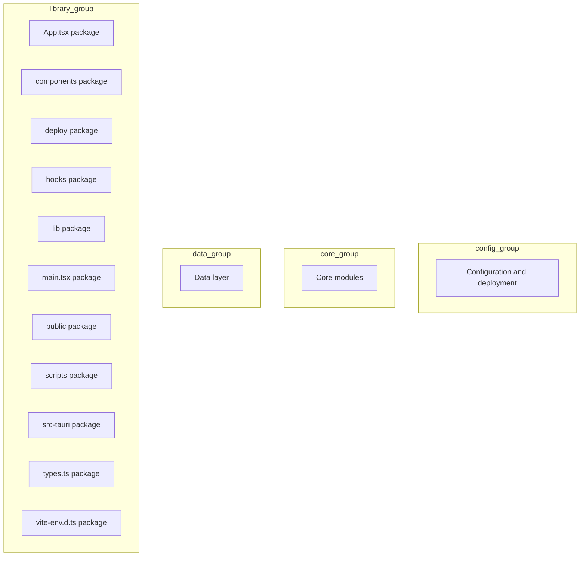

# Architecture report: CookSleep/gpt_image_playground

> Automated static analysis. **Observed** = directly seen in files/imports/AST; **Inferred** = interpretation from that evidence. Repository code was not executed.

## 1. Repository at a glance

| Item | Value |
| --- | --- |
| Repository | CookSleep/gpt_image_playground |
| Description | 支持 GPT Image、Gemini（Nano Banana）、Grok 和 Seedream 5.5 的图片生成与编辑工具 |
| Language | TypeScript |
| Stars | 4090 |
| Licence | MIT |
| Analysed commit / branch | b7f168b512dc6b2854f8a68f457ca5ecf9b646f4 / main |
| Framework(s) | React |
| Files analysed | 351 |
| Components | 14 |

## 2. Architecture in one minute

CookSleep/gpt_image_playground - 支持 GPT Image、Gemini（Nano Banana）、Grok 和 Seedream 5.5 的图片生成与编辑工具. This repository was analysed statically from 351 file(s) (0 Python). Detected technologies (observed from imports/manifests): GitHub Actions, React, Tailwind CSS, Docker, TypeScript, Vite. Files are grouped into 14 component(s): App.tsx package, components package, Configuration and deployment, Core modules, Data layer, deploy package, hooks package, lib package. Findings below distinguish observed facts from inferred interpretation.

## 3. High-level block diagram

## 4. Main components

### App.tsx package (`app_tsx`)

- **Kind:** library
- **Status:** Observed
- **Confidence:** 0.85
- **Responsibility:** Groups 1 file(s) under app.tsx package (observed from repository paths and static analysis).
- **Paths:** `src/App.tsx`
- **Evidence:** [src/App.tsx](https://github.com/CookSleep/gpt_image_playground/blob/b7f168b512dc6b2854f8a68f457ca5ecf9b646f4/src/App.tsx)

### components package (`components`)

- **Kind:** library
- **Status:** Observed
- **Confidence:** 0.85
- **Responsibility:** Groups 55 file(s) under components package (observed from repository paths and static analysis).
- **Paths:** `src/components/AgentWorkspace.tsx`, `src/components/AnnouncementModal.tsx`, `src/components/Checkbox.tsx`, `src/components/CommentMarks.tsx`, `src/components/ConfirmDialog.tsx`, `src/components/DataProgressDialog.tsx`, `src/components/DbBlockedNotice.tsx`, `src/components/DetailModal.test.tsx`, `src/components/DetailModal.tsx`, `src/components/FavoriteCollections.tsx`, `src/components/Header.tsx`, `src/components/HelpModal.tsx`, `src/components/HistoryModal.tsx`, `src/components/ImageContextMenu.tsx`, `src/components/ImageSearchSources.tsx`, `src/components/ImportLinkDiff.tsx`, `src/components/InputBar.test.tsx`, `src/components/InputBar.tsx`, `src/components/Lightbox.tsx`, `src/components/MarkdownRenderer.test.tsx`, `src/components/MarkdownRenderer.tsx`, `src/components/MaskEditorModal.tsx`, `src/components/SearchBar.tsx`, `src/components/Select.tsx`, `src/components/SettingsModal.tsx`, `src/components/SizePickerModal.tsx`, `src/components/SketchBoardModal.test.tsx`, `src/components/SketchBoardModal.tsx`, `src/components/SketchCommentLayer.tsx`, `src/components/SupportPromptModal.tsx`, `src/components/TaskCard.tsx`, `src/components/TaskGrid.tsx`, `src/components/TitleBar.tsx`, `src/components/Toast.tsx`, `src/components/TooltipButton.tsx`, `src/components/UpdateModal.tsx`, `src/components/ViewportTooltip.tsx`, `src/components/editor/EditorControls.tsx`, `src/components/favorites/FavoriteCollectionOverviewCard.tsx`, `src/components/favorites/FavoriteCollectionPickerModal.tsx`, `src/components/favorites/FavoriteCollectionsView.tsx`, `src/components/favorites/ManageCollectionsModal.tsx`, `src/components/favorites/favoriteUtils.ts`, `src/components/favorites/useFavoriteCollectionTitle.ts`, `src/components/icons.tsx`, `src/components/input/ModelPicker.test.tsx`, `src/components/input/ModelPicker.tsx`, `src/components/input/addImageUrlsModal.tsx`, `src/components/input/buttonTooltip.tsx`, `src/components/input/dragUploadOverlay.tsx`, `src/components/input/inputBatchBars.tsx`, `src/components/input/inputParamsPanel.tsx`, `src/components/input/markupOverlay.tsx`, `src/components/input/paramPopoverChip.tsx`, `src/components/startupNotice.tsx`
- **Evidence:** [src/components/AgentWorkspace.tsx](https://github.com/CookSleep/gpt_image_playground/blob/b7f168b512dc6b2854f8a68f457ca5ecf9b646f4/src/components/AgentWorkspace.tsx); [src/components/AnnouncementModal.tsx](https://github.com/CookSleep/gpt_image_playground/blob/b7f168b512dc6b2854f8a68f457ca5ecf9b646f4/src/components/AnnouncementModal.tsx); [src/components/Checkbox.tsx](https://github.com/CookSleep/gpt_image_playground/blob/b7f168b512dc6b2854f8a68f457ca5ecf9b646f4/src/components/Checkbox.tsx); [src/components/CommentMarks.tsx](https://github.com/CookSleep/gpt_image_playground/blob/b7f168b512dc6b2854f8a68f457ca5ecf9b646f4/src/components/CommentMarks.tsx); [src/components/ConfirmDialog.tsx](https://github.com/CookSleep/gpt_image_playground/blob/b7f168b512dc6b2854f8a68f457ca5ecf9b646f4/src/components/ConfirmDialog.tsx); [src/components/DataProgressDialog.tsx](https://github.com/CookSleep/gpt_image_playground/blob/b7f168b512dc6b2854f8a68f457ca5ecf9b646f4/src/components/DataProgressDialog.tsx); [src/components/DbBlockedNotice.tsx](https://github.com/CookSleep/gpt_image_playground/blob/b7f168b512dc6b2854f8a68f457ca5ecf9b646f4/src/components/DbBlockedNotice.tsx); [src/components/DetailModal.test.tsx](https://github.com/CookSleep/gpt_image_playground/blob/b7f168b512dc6b2854f8a68f457ca5ecf9b646f4/src/components/DetailModal.test.tsx)

### Configuration and deployment (`config`)

- **Kind:** config
- **Status:** Observed
- **Confidence:** 0.85
- **Responsibility:** Groups 36 file(s) under configuration and deployment (observed from repository paths and static analysis).
- **Paths:** `deploy/Dockerfile`, `dev-proxy.config.example.json`, `gpt-image-config.agent.example.json`, `gpt-image-config.example.json`, `package.json`, `public/announcements.json`, `sponsor-presets.json`, `src-tauri/Cargo.toml`, `src-tauri/about.toml`, `src-tauri/capabilities/default.json`, `src-tauri/permissions/cli.toml`, `src-tauri/permissions/close.toml`, `src-tauri/permissions/diagnostics.toml`, `src-tauri/permissions/files.toml`, `src-tauri/permissions/http.toml`, `src-tauri/permissions/proxy.toml`, `src-tauri/permissions/storage.toml`, `src-tauri/permissions/update.toml`, `src-tauri/tauri.conf.json`, `src/components/settings/AboutSettingsTab.tsx`, `src/components/settings/AgentSettingsTab.tsx`, `src/components/settings/AppearanceSettingsTab.tsx`, `src/components/settings/CustomProviderModal.tsx`, `src/components/settings/FontLicensesModal.tsx`, `src/components/settings/FontSettingField.tsx`, `src/components/settings/GeneralSettingsTab.tsx`, `src/components/settings/ModelIdInput.tsx`, `src/components/settings/ProfileImportUrlModal.tsx`, `src/components/settings/ProxySettingsSection.tsx`, `src/components/settings/ShortcutRecorder.tsx`, `src/components/settings/SkillSettingsSection.tsx`, `src/components/settings/StorageInfoSection.tsx`, `src/components/settings/ZipDownloadRouteModal.tsx`, `src/components/settings/saveDirMigration.tsx`, `tsconfig.json`, `vercel.json`
- **Evidence:** [deploy/Dockerfile](https://github.com/CookSleep/gpt_image_playground/blob/b7f168b512dc6b2854f8a68f457ca5ecf9b646f4/deploy/Dockerfile); [dev-proxy.config.example.json](https://github.com/CookSleep/gpt_image_playground/blob/b7f168b512dc6b2854f8a68f457ca5ecf9b646f4/dev-proxy.config.example.json); [gpt-image-config.agent.example.json](https://github.com/CookSleep/gpt_image_playground/blob/b7f168b512dc6b2854f8a68f457ca5ecf9b646f4/gpt-image-config.agent.example.json); [gpt-image-config.example.json](https://github.com/CookSleep/gpt_image_playground/blob/b7f168b512dc6b2854f8a68f457ca5ecf9b646f4/gpt-image-config.example.json); [package.json](https://github.com/CookSleep/gpt_image_playground/blob/b7f168b512dc6b2854f8a68f457ca5ecf9b646f4/package.json); [public/announcements.json](https://github.com/CookSleep/gpt_image_playground/blob/b7f168b512dc6b2854f8a68f457ca5ecf9b646f4/public/announcements.json); [sponsor-presets.json](https://github.com/CookSleep/gpt_image_playground/blob/b7f168b512dc6b2854f8a68f457ca5ecf9b646f4/sponsor-presets.json); [src-tauri/Cargo.toml](https://github.com/CookSleep/gpt_image_playground/blob/b7f168b512dc6b2854f8a68f457ca5ecf9b646f4/src-tauri/Cargo.toml)

### Core modules (`core`)

- **Kind:** core
- **Status:** Observed
- **Confidence:** 0.85
- **Responsibility:** Groups 3 file(s) under core modules (observed from repository paths and static analysis).
- **Paths:** `postcss.config.js`, `tailwind.config.js`, `vite.config.ts`
- **Evidence:** [postcss.config.js](https://github.com/CookSleep/gpt_image_playground/blob/b7f168b512dc6b2854f8a68f457ca5ecf9b646f4/postcss.config.js); [tailwind.config.js](https://github.com/CookSleep/gpt_image_playground/blob/b7f168b512dc6b2854f8a68f457ca5ecf9b646f4/tailwind.config.js); [vite.config.ts](https://github.com/CookSleep/gpt_image_playground/blob/b7f168b512dc6b2854f8a68f457ca5ecf9b646f4/vite.config.ts)

### Data layer (`data_layer`)

- **Kind:** data
- **Status:** Observed
- **Confidence:** 0.85
- **Responsibility:** Groups 3 file(s) under data layer (observed from repository paths and static analysis).
- **Paths:** `src-tauri/src/storage/commands.rs`, `src-tauri/src/storage/images.rs`, `src-tauri/src/storage/mod.rs`
- **Evidence:** [src-tauri/src/storage/commands.rs](https://github.com/CookSleep/gpt_image_playground/blob/b7f168b512dc6b2854f8a68f457ca5ecf9b646f4/src-tauri/src/storage/commands.rs); [src-tauri/src/storage/images.rs](https://github.com/CookSleep/gpt_image_playground/blob/b7f168b512dc6b2854f8a68f457ca5ecf9b646f4/src-tauri/src/storage/images.rs); [src-tauri/src/storage/mod.rs](https://github.com/CookSleep/gpt_image_playground/blob/b7f168b512dc6b2854f8a68f457ca5ecf9b646f4/src-tauri/src/storage/mod.rs)

### deploy package (`deploy`)

- **Kind:** library
- **Status:** Observed
- **Confidence:** 0.85
- **Responsibility:** Groups 1 file(s) under deploy package (observed from repository paths and static analysis).
- **Paths:** `deploy/inject-api-url.sh`
- **Evidence:** [deploy/inject-api-url.sh](https://github.com/CookSleep/gpt_image_playground/blob/b7f168b512dc6b2854f8a68f457ca5ecf9b646f4/deploy/inject-api-url.sh)

### hooks package (`hooks`)

- **Kind:** library
- **Status:** Observed
- **Confidence:** 0.85
- **Responsibility:** Groups 25 file(s) under hooks package (observed from repository paths and static analysis).
- **Paths:** `src/hooks/useAnnouncements.ts`, `src/hooks/useAppFonts.ts`, `src/hooks/useClientUpdate.test.ts`, `src/hooks/useClientUpdate.ts`, `src/hooks/useCloseConfirm.ts`, `src/hooks/useCloseOnEscape.ts`, `src/hooks/useColorMode.ts`, `src/hooks/useDockerApiUrlMigrationNotice.ts`, `src/hooks/useDragSelect.ts`, `src/hooks/useEditorViewport.ts`, `src/hooks/useHintTooltip.ts`, `src/hooks/useImportLinks.test.ts`, `src/hooks/useImportLinks.ts`, `src/hooks/useNearViewport.test.tsx`, `src/hooks/useNearViewport.ts`, `src/hooks/usePopoverDismiss.ts`, `src/hooks/usePreventBackgroundScroll.ts`, `src/hooks/usePrivacyMode.ts`, `src/hooks/usePullUpToLoad.test.tsx`, `src/hooks/usePullUpToLoad.ts`, `src/hooks/useReleaseUpdates.ts`, `src/hooks/useSaveLocationPrompt.tsx`, `src/hooks/useSketchComments.ts`, `src/hooks/useTooltip.ts`, `src/hooks/useVirtualGrid.ts`
- **Evidence:** [src/hooks/useAnnouncements.ts](https://github.com/CookSleep/gpt_image_playground/blob/b7f168b512dc6b2854f8a68f457ca5ecf9b646f4/src/hooks/useAnnouncements.ts); [src/hooks/useAppFonts.ts](https://github.com/CookSleep/gpt_image_playground/blob/b7f168b512dc6b2854f8a68f457ca5ecf9b646f4/src/hooks/useAppFonts.ts); [src/hooks/useClientUpdate.test.ts](https://github.com/CookSleep/gpt_image_playground/blob/b7f168b512dc6b2854f8a68f457ca5ecf9b646f4/src/hooks/useClientUpdate.test.ts); [src/hooks/useClientUpdate.ts](https://github.com/CookSleep/gpt_image_playground/blob/b7f168b512dc6b2854f8a68f457ca5ecf9b646f4/src/hooks/useClientUpdate.ts); [src/hooks/useCloseConfirm.ts](https://github.com/CookSleep/gpt_image_playground/blob/b7f168b512dc6b2854f8a68f457ca5ecf9b646f4/src/hooks/useCloseConfirm.ts); [src/hooks/useCloseOnEscape.ts](https://github.com/CookSleep/gpt_image_playground/blob/b7f168b512dc6b2854f8a68f457ca5ecf9b646f4/src/hooks/useCloseOnEscape.ts); [src/hooks/useColorMode.ts](https://github.com/CookSleep/gpt_image_playground/blob/b7f168b512dc6b2854f8a68f457ca5ecf9b646f4/src/hooks/useColorMode.ts); [src/hooks/useDockerApiUrlMigrationNotice.ts](https://github.com/CookSleep/gpt_image_playground/blob/b7f168b512dc6b2854f8a68f457ca5ecf9b646f4/src/hooks/useDockerApiUrlMigrationNotice.ts)

### lib package (`lib`)

- **Kind:** library
- **Status:** Observed
- **Confidence:** 0.85
- **Responsibility:** Groups 154 file(s) under lib package (observed from repository paths and static analysis).
- **Paths:** `src/lib/agentApi.test.ts`, `src/lib/agentApi.ts`, `src/lib/agentAssistantBlocks.test.ts`, `src/lib/agentAssistantBlocks.ts`, `src/lib/agentConversationState.test.ts`, `src/lib/agentConversationState.ts`, `src/lib/agentImageReferences.test.ts`, `src/lib/agentImageReferences.ts`, `src/lib/agentInputBuilder.test.ts`, `src/lib/agentInputBuilder.ts`, `src/lib/agentResponseState.test.ts`, `src/lib/agentResponseState.ts`, `src/lib/agentWebSearch.ts`, `src/lib/announcements.test.ts`, `src/lib/announcements.ts`, `src/lib/api.test.ts`, `src/lib/api.ts`, `src/lib/apiProfiles.test.ts`, `src/lib/apiProfiles.ts`, `src/lib/batchPrompts.test.ts`, `src/lib/batchPrompts.ts`, `src/lib/browserNotification.ts`, `src/lib/canvasImage.ts`, `src/lib/cliBridge.test.ts`, `src/lib/cliBridge.ts`, `src/lib/clickSuppression.ts`, `src/lib/clientUpdate.test.ts`, `src/lib/clientUpdate.ts`, `src/lib/clipboard.test.ts`, `src/lib/clipboard.ts`, `src/lib/colorMode.test.ts`, `src/lib/colorMode.ts`, `src/lib/contentEditableMentions.test.ts`, `src/lib/contentEditableMentions.ts`, `src/lib/customProviderCapabilities.ts`, `src/lib/customProviderConfigUrl.test.ts`, `src/lib/customProviderConfigUrl.ts`, `src/lib/dataOperations.ts`, `src/lib/dataProgress.test.ts`, `src/lib/dataProgress.ts`, `src/lib/dataUrl.test.ts`, `src/lib/dataUrl.ts`, `src/lib/db.test.ts`, `src/lib/db.ts`, `src/lib/dbIndexedDb.ts`, `src/lib/dbTauri.test.ts`, `src/lib/dbTauri.ts`, `src/lib/defaultApiUrl.test.ts`, `src/lib/defaultApiUrl.ts`, `src/lib/devProxy.test.ts`, `src/lib/devProxy.ts`, `src/lib/domRect.ts`, `src/lib/downloadImages.ts`, `src/lib/dropdown.test.ts`, `src/lib/dropdown.ts`, `src/lib/exportFileName.ts`, `src/lib/exportImages.test.ts`, `src/lib/exportImages.ts`, `src/lib/exportImages.web.test.ts`, `src/lib/exportZip.test.ts`, `src/lib/exportZip.ts`, `src/lib/falAiImageApi.test.ts`, `src/lib/falAiImageApi.ts`, `src/lib/favoriteState.test.ts`, `src/lib/favoriteState.ts`, `src/lib/fonts.test.ts`, `src/lib/fonts.ts`, `src/lib/formatBytes.ts`, `src/lib/googleImageApi.ts`, `src/lib/gptImage26.test.ts`, `src/lib/idb.test.ts`, `src/lib/idb.ts`, `src/lib/imageApiShared.ts`, `src/lib/imageBlob.migration.test.ts`, `src/lib/imageBlob.test.ts`, `src/lib/imageBlob.ts`, `src/lib/imageCache.tauri.test.ts`, `src/lib/imageCache.test.ts`, `src/lib/imageCache.ts`, `src/lib/imageMarkup.test.ts`, `src/lib/imageModelParams.ts`, `src/lib/imageModels.ts`, `src/lib/imageProviderMappings.ts`, `src/lib/imageSearch.test.ts`, `src/lib/imageSearch.ts`, `src/lib/importLink.test.ts`, `src/lib/importLink.ts`, `src/lib/importableConfigUrl.ts`, `src/lib/inputDraftState.test.ts`, `src/lib/inputDraftState.ts`, `src/lib/inputImageLimits.test.ts`, `src/lib/inputImageLimits.ts`, `src/lib/inputImages.ts`, `src/lib/keyboardShortcut.test.ts`, `src/lib/keyboardShortcut.ts`, `src/lib/localRecord.ts`, `src/lib/mask.test.ts`, `src/lib/mask.ts`, `src/lib/maskPreprocess.test.ts`, `src/lib/maskPreprocess.ts`, `src/lib/nativeImageApi.test.ts`, `src/lib/networkProxy.test.ts`, `src/lib/networkProxy.ts`, `src/lib/openaiCompatibleImageApi.ts`, `src/lib/pageScroll.ts`, `src/lib/paramCompatibility.test.ts`, `src/lib/paramCompatibility.ts`, `src/lib/paramDisplay.tsx`, `src/lib/persistedState.test.ts`, `src/lib/persistedState.ts`, `src/lib/platform.test.ts`, `src/lib/platform.ts`, `src/lib/presetAgent.test.ts`, `src/lib/presetConfig.test.ts`, `src/lib/presetConfig.ts`, `src/lib/privacyMode.test.ts`, `src/lib/privacyMode.ts`, `src/lib/profileImportUrl.test.ts`, `src/lib/profileImportUrl.ts`, `src/lib/promptImageMentions.test.ts`, `src/lib/promptImageMentions.ts`, `src/lib/releaseUpdates.test.ts`, `src/lib/releaseUpdates.ts`, `src/lib/responsesOutputState.test.ts`, `src/lib/responsesOutputState.ts`, `src/lib/runtimeEnv.ts`, `src/lib/saveFile.test.ts`, `src/lib/saveFile.ts`, `src/lib/seedream.test.ts`, `src/lib/serverSentEvents.test.ts`, `src/lib/serverSentEvents.ts`, `src/lib/settingsActions.ts`, `src/lib/settingsCustomProvider.ts`, `src/lib/size.test.ts`, `src/lib/size.ts`, `src/lib/sketch.test.ts`, `src/lib/sketch.ts`, `src/lib/skillDocs.test.ts`, `src/lib/taskPromptDisplay.ts`, `src/lib/taskState.test.ts`, `src/lib/taskState.ts`, `src/lib/tauriLog.ts`, `src/lib/tauriStorage.test.ts`, `src/lib/tauriStorage.ts`, `src/lib/tooltipDismiss.ts`, `src/lib/transparentImage.test.ts`, `src/lib/transparentImage.ts`, `src/lib/urlSettings.test.ts`, `src/lib/urlSettings.ts`, `src/lib/viewport.ts`, `src/lib/viewportTransform.test.ts`, `src/lib/viewportTransform.ts`, `src/lib/virtualGrid.test.ts`, `src/lib/virtualGrid.ts`
- **Evidence:** [src/lib/agentApi.test.ts](https://github.com/CookSleep/gpt_image_playground/blob/b7f168b512dc6b2854f8a68f457ca5ecf9b646f4/src/lib/agentApi.test.ts); [src/lib/agentApi.ts](https://github.com/CookSleep/gpt_image_playground/blob/b7f168b512dc6b2854f8a68f457ca5ecf9b646f4/src/lib/agentApi.ts); [src/lib/agentAssistantBlocks.test.ts](https://github.com/CookSleep/gpt_image_playground/blob/b7f168b512dc6b2854f8a68f457ca5ecf9b646f4/src/lib/agentAssistantBlocks.test.ts); [src/lib/agentAssistantBlocks.ts](https://github.com/CookSleep/gpt_image_playground/blob/b7f168b512dc6b2854f8a68f457ca5ecf9b646f4/src/lib/agentAssistantBlocks.ts); [src/lib/agentConversationState.test.ts](https://github.com/CookSleep/gpt_image_playground/blob/b7f168b512dc6b2854f8a68f457ca5ecf9b646f4/src/lib/agentConversationState.test.ts); [src/lib/agentConversationState.ts](https://github.com/CookSleep/gpt_image_playground/blob/b7f168b512dc6b2854f8a68f457ca5ecf9b646f4/src/lib/agentConversationState.ts); [src/lib/agentImageReferences.test.ts](https://github.com/CookSleep/gpt_image_playground/blob/b7f168b512dc6b2854f8a68f457ca5ecf9b646f4/src/lib/agentImageReferences.test.ts); [src/lib/agentImageReferences.ts](https://github.com/CookSleep/gpt_image_playground/blob/b7f168b512dc6b2854f8a68f457ca5ecf9b646f4/src/lib/agentImageReferences.ts)

### main.tsx package (`main_tsx`)

- **Kind:** library
- **Status:** Observed
- **Confidence:** 0.85
- **Responsibility:** Groups 1 file(s) under main.tsx package (observed from repository paths and static analysis).
- **Paths:** `src/main.tsx`
- **Evidence:** [src/main.tsx](https://github.com/CookSleep/gpt_image_playground/blob/b7f168b512dc6b2854f8a68f457ca5ecf9b646f4/src/main.tsx)

### public package (`public`)

- **Kind:** library
- **Status:** Observed
- **Confidence:** 0.85
- **Responsibility:** Groups 4 file(s) under public package (observed from repository paths and static analysis).
- **Paths:** `public/announcements/client-intro.js`, `public/announcements/models-intro-3.js`, `public/color-mode.js`, `public/sw.js`
- **Evidence:** [public/announcements/client-intro.js](https://github.com/CookSleep/gpt_image_playground/blob/b7f168b512dc6b2854f8a68f457ca5ecf9b646f4/public/announcements/client-intro.js); [public/announcements/models-intro-3.js](https://github.com/CookSleep/gpt_image_playground/blob/b7f168b512dc6b2854f8a68f457ca5ecf9b646f4/public/announcements/models-intro-3.js); [public/color-mode.js](https://github.com/CookSleep/gpt_image_playground/blob/b7f168b512dc6b2854f8a68f457ca5ecf9b646f4/public/color-mode.js); [public/sw.js](https://github.com/CookSleep/gpt_image_playground/blob/b7f168b512dc6b2854f8a68f457ca5ecf9b646f4/public/sw.js)

### scripts package (`scripts`)

- **Kind:** library
- **Status:** Observed
- **Confidence:** 0.85
- **Responsibility:** Groups 2 file(s) under scripts package (observed from repository paths and static analysis).
- **Paths:** `scripts/build-notices.mjs`, `scripts/mock-image-api.mjs`
- **Evidence:** [scripts/build-notices.mjs](https://github.com/CookSleep/gpt_image_playground/blob/b7f168b512dc6b2854f8a68f457ca5ecf9b646f4/scripts/build-notices.mjs); [scripts/mock-image-api.mjs](https://github.com/CookSleep/gpt_image_playground/blob/b7f168b512dc6b2854f8a68f457ca5ecf9b646f4/scripts/mock-image-api.mjs)

### src-tauri package (`src_tauri`)

- **Kind:** library
- **Status:** Observed
- **Confidence:** 0.85
- **Responsibility:** Groups 18 file(s) under src-tauri package (observed from repository paths and static analysis).
- **Paths:** `src-tauri/build.rs`, `src-tauri/src/bin/cli.rs`, `src-tauri/src/cli.rs`, `src-tauri/src/cli/command.rs`, `src-tauri/src/cli/command/tests.rs`, `src-tauri/src/cli/pipe.rs`, `src-tauri/src/cli/skill.rs`, `src-tauri/src/cli/skill/tests.rs`, `src-tauri/src/close_watch.rs`, `src-tauri/src/data_dir.rs`, `src-tauri/src/diagnostics.rs`, `src-tauri/src/files.rs`, `src-tauri/src/http.rs`, `src-tauri/src/lib.rs`, `src-tauri/src/main.rs`, `src-tauri/src/migrate.rs`, `src-tauri/src/proxy.rs`, `src-tauri/src/update.rs`
- **Evidence:** [src-tauri/build.rs](https://github.com/CookSleep/gpt_image_playground/blob/b7f168b512dc6b2854f8a68f457ca5ecf9b646f4/src-tauri/build.rs); [src-tauri/src/bin/cli.rs](https://github.com/CookSleep/gpt_image_playground/blob/b7f168b512dc6b2854f8a68f457ca5ecf9b646f4/src-tauri/src/bin/cli.rs); [src-tauri/src/cli.rs](https://github.com/CookSleep/gpt_image_playground/blob/b7f168b512dc6b2854f8a68f457ca5ecf9b646f4/src-tauri/src/cli.rs); [src-tauri/src/cli/command.rs](https://github.com/CookSleep/gpt_image_playground/blob/b7f168b512dc6b2854f8a68f457ca5ecf9b646f4/src-tauri/src/cli/command.rs); [src-tauri/src/cli/command/tests.rs](https://github.com/CookSleep/gpt_image_playground/blob/b7f168b512dc6b2854f8a68f457ca5ecf9b646f4/src-tauri/src/cli/command/tests.rs); [src-tauri/src/cli/pipe.rs](https://github.com/CookSleep/gpt_image_playground/blob/b7f168b512dc6b2854f8a68f457ca5ecf9b646f4/src-tauri/src/cli/pipe.rs); [src-tauri/src/cli/skill.rs](https://github.com/CookSleep/gpt_image_playground/blob/b7f168b512dc6b2854f8a68f457ca5ecf9b646f4/src-tauri/src/cli/skill.rs); [src-tauri/src/cli/skill/tests.rs](https://github.com/CookSleep/gpt_image_playground/blob/b7f168b512dc6b2854f8a68f457ca5ecf9b646f4/src-tauri/src/cli/skill/tests.rs)

### types.ts package (`types_ts`)

- **Kind:** library
- **Status:** Observed
- **Confidence:** 0.85
- **Responsibility:** Groups 1 file(s) under types.ts package (observed from repository paths and static analysis).
- **Paths:** `src/types.ts`
- **Evidence:** [src/types.ts](https://github.com/CookSleep/gpt_image_playground/blob/b7f168b512dc6b2854f8a68f457ca5ecf9b646f4/src/types.ts)

### vite-env.d.ts package (`vite_env_d_ts`)

- **Kind:** library
- **Status:** Observed
- **Confidence:** 0.85
- **Responsibility:** Groups 1 file(s) under vite-env.d.ts package (observed from repository paths and static analysis).
- **Paths:** `src/vite-env.d.ts`
- **Evidence:** [src/vite-env.d.ts](https://github.com/CookSleep/gpt_image_playground/blob/b7f168b512dc6b2854f8a68f457ca5ecf9b646f4/src/vite-env.d.ts)

## 5. Execution flow

**Observed** entry point(s):

- [src/App.tsx](https://github.com/CookSleep/gpt_image_playground/blob/b7f168b512dc6b2854f8a68f457ca5ecf9b646f4/src/App.tsx)
- [src/main.tsx](https://github.com/CookSleep/gpt_image_playground/blob/b7f168b512dc6b2854f8a68f457ca5ecf9b646f4/src/main.tsx)

Representative flow (derived from observed entry points and the import graph; steps beyond the entry point are **Inferred**):

1. Execution starts at an observed entry point listed above, if present.
2. No internal import relationships between components were observed.

## 6. Project structure

### `(root)`

- `.dockerignore` - container (64 bytes)
- `.gitattributes` - other (39 bytes)
- `.gitignore` - other (261 bytes)
- `AGENTS.md` - docs (13026 bytes)
- `LICENSE` - docs (1065 bytes)
- `README.md` - docs (47160 bytes)
- `RELEASE.md` - docs (2280 bytes)
- `dev-proxy.config.example.json` - config (128 bytes)
- `gpt-image-config.agent.example.json` - config (619 bytes)
- `gpt-image-config.example.json` - config (263 bytes)
- `index.html` - other (942 bytes)
- `package.json` - manifest (1668 bytes)
- `postcss.config.js` - source, JavaScript (80 bytes)
- `sponsor-presets.json` - config (4399 bytes)
- `tailwind.config.js` - source, JavaScript (1136 bytes)
- `tsconfig.json` - config (615 bytes)
- `vercel.json` - config (103 bytes)
- `vite.config.ts` - source, TypeScript (3311 bytes)
- `wrangler.jsonc` - other (230 bytes)

### `.github`

- `.github/ISSUE_TEMPLATE/bug_report.yml` - config (5650 bytes)
- `.github/ISSUE_TEMPLATE/config.yml` - config (28 bytes)
- `.github/ISSUE_TEMPLATE/feature_request.yml` - config (2572 bytes)
- `.github/workflows/deploy.yml` - ci, YAML (3999 bytes)
- `.github/workflows/docker.yml` - ci, YAML (2541 bytes)
- `.github/workflows/tauri-release.yml` - ci, YAML (4150 bytes)
- `.github/workflows/vercel-tag-deploy.yml` - ci, YAML (2810 bytes)

### `deploy`

- `deploy/Dockerfile` - container (1776 bytes)
- `deploy/inject-api-url.sh` - source, Shell (5388 bytes)
- `deploy/migrate-api-env.envsh` - other (455 bytes)
- `deploy/nginx.conf` - other (1976 bytes)

### `docs`

- `docs/custom-provider-llm-prompt.md` - docs (12090 bytes)
- `docs/mock-image-api.md` - docs (6727 bytes)

### `fonts`

- `fonts/harmonyos-sans-sc.css` - other (656 bytes)
- `fonts/maple-mono-nf-cn.css` - other (277 bytes)

### `public`

- `public/announcements.json` - config (1047 bytes)
- `public/announcements/client-intro.css` - other (2893 bytes)
- `public/announcements/client-intro.html` - other (1916 bytes)
- `public/announcements/client-intro.js` - source, JavaScript (1127 bytes)
- `public/announcements/models-intro-3.css` - other (2622 bytes)
- `public/announcements/models-intro-3.html` - other (3941 bytes)
- `public/announcements/models-intro-3.js` - source, JavaScript (165 bytes)
- `public/color-mode.js` - source, JavaScript (581 bytes)
- `public/manifest.webmanifest` - other (526 bytes)
- `public/pwa-icon.svg` - other (4663 bytes)
- `public/pwa-maskable-icon.svg` - other (4718 bytes)
- `public/sw.js` - source, JavaScript (1879 bytes)

### `scripts`

- `scripts/build-notices.mjs` - source, JavaScript (5971 bytes)
- `scripts/mock-image-api.mjs` - source, JavaScript (16523 bytes)

### `skills`

- `skills/gpt-image-playground/SKILL.md` - docs (4602 bytes)
- `skills/gpt-image-playground/references/cli.md` - docs (6048 bytes)
- `skills/gpt-image-playground/references/custom-provider.md` - docs (9371 bytes)
- `skills/gpt-image-playground/references/settings.md` - docs (8225 bytes)

### `src`

- `src/App.tsx` - source, TypeScript (13542 bytes)
- `src/components/AgentWorkspace.tsx` - source, TypeScript (58473 bytes)
- `src/components/AnnouncementModal.tsx` - source, TypeScript (5758 bytes)
- `src/components/Checkbox.tsx` - source, TypeScript (2072 bytes)
- `src/components/CommentMarks.tsx` - source, TypeScript (1590 bytes)
- `src/components/ConfirmDialog.tsx` - source, TypeScript (8429 bytes)
- `src/components/DataProgressDialog.tsx` - source, TypeScript (3743 bytes)
- `src/components/DbBlockedNotice.tsx` - source, TypeScript (1402 bytes)
- `src/components/DetailModal.test.tsx` - source, TypeScript (7816 bytes)
- `src/components/DetailModal.tsx` - source, TypeScript (72396 bytes)
- `src/components/FavoriteCollections.tsx` - source, TypeScript (328 bytes)
- `src/components/Header.tsx` - source, TypeScript (19395 bytes)
- `src/components/HelpModal.tsx` - source, TypeScript (14380 bytes)
- `src/components/HistoryModal.tsx` - source, TypeScript (13277 bytes)
- `src/components/ImageContextMenu.tsx` - source, TypeScript (9654 bytes)
- `src/components/ImageSearchSources.tsx` - source, TypeScript (8192 bytes)
- `src/components/ImportLinkDiff.tsx` - source, TypeScript (3791 bytes)
- `src/components/InputBar.test.tsx` - source, TypeScript (13932 bytes)
- `src/components/InputBar.tsx` - source, TypeScript (93271 bytes)
- `src/components/Lightbox.tsx` - source, TypeScript (34022 bytes)
- `src/components/MarkdownRenderer.test.tsx` - source, TypeScript (6404 bytes)
- `src/components/MarkdownRenderer.tsx` - source, TypeScript (7896 bytes)
- `src/components/MaskEditorModal.tsx` - source, TypeScript (22502 bytes)
- `src/components/SearchBar.tsx` - source, TypeScript (9419 bytes)
- `src/components/Select.tsx` - source, TypeScript (22143 bytes)
- `src/components/SettingsModal.tsx` - source, TypeScript (116175 bytes)
- `src/components/SizePickerModal.tsx` - source, TypeScript (21237 bytes)
- `src/components/SketchBoardModal.test.tsx` - source, TypeScript (5369 bytes)
- `src/components/SketchBoardModal.tsx` - source, TypeScript (51596 bytes)
- `src/components/SketchCommentLayer.tsx` - source, TypeScript (7856 bytes)
- `src/components/SupportPromptModal.tsx` - source, TypeScript (5139 bytes)
- `src/components/TaskCard.tsx` - source, TypeScript (35560 bytes)
- `src/components/TaskGrid.tsx` - source, TypeScript (14078 bytes)
- `src/components/TitleBar.tsx` - source, TypeScript (2949 bytes)
- `src/components/Toast.tsx` - source, TypeScript (2262 bytes)
- `src/components/TooltipButton.tsx` - source, TypeScript (1507 bytes)
- `src/components/UpdateModal.tsx` - source, TypeScript (14264 bytes)
- `src/components/ViewportTooltip.tsx` - source, TypeScript (4719 bytes)
- `src/components/editor/EditorControls.tsx` - source, TypeScript (9281 bytes)
- `src/components/favorites/FavoriteCollectionOverviewCard.tsx` - source, TypeScript (13196 bytes)
- `src/components/favorites/FavoriteCollectionPickerModal.tsx` - source, TypeScript (22021 bytes)
- `src/components/favorites/FavoriteCollectionsView.tsx` - source, TypeScript (7492 bytes)
- `src/components/favorites/ManageCollectionsModal.tsx` - source, TypeScript (19069 bytes)
- `src/components/favorites/favoriteUtils.ts` - source, TypeScript (1575 bytes)
- `src/components/favorites/useFavoriteCollectionTitle.ts` - source, TypeScript (594 bytes)
- `src/components/icons.tsx` - source, TypeScript (14559 bytes)
- `src/components/input/ModelPicker.test.tsx` - source, TypeScript (3416 bytes)
- `src/components/input/ModelPicker.tsx` - source, TypeScript (11409 bytes)
- `src/components/input/addImageUrlsModal.tsx` - source, TypeScript (9326 bytes)
- `src/components/input/buttonTooltip.tsx` - source, TypeScript (367 bytes)
- `src/components/input/dragUploadOverlay.tsx` - source, TypeScript (1234 bytes)
- `src/components/input/inputBatchBars.tsx` - source, TypeScript (10157 bytes)
- `src/components/input/inputParamsPanel.tsx` - source, TypeScript (38606 bytes)
- `src/components/input/markupOverlay.tsx` - source, TypeScript (801 bytes)
- `src/components/input/paramPopoverChip.tsx` - source, TypeScript (2837 bytes)
- `src/components/settings/AboutSettingsTab.tsx` - source, TypeScript (12279 bytes)
- `src/components/settings/AgentSettingsTab.tsx` - source, TypeScript (8707 bytes)
- `src/components/settings/AppearanceSettingsTab.tsx` - source, TypeScript (2547 bytes)
- `src/components/settings/CustomProviderModal.tsx` - source, TypeScript (8026 bytes)
- `src/components/settings/FontLicensesModal.tsx` - source, TypeScript (2785 bytes)
- `src/components/settings/FontSettingField.tsx` - source, TypeScript (7924 bytes)
- `src/components/settings/GeneralSettingsTab.tsx` - source, TypeScript (30186 bytes)
- `src/components/settings/ModelIdInput.tsx` - source, TypeScript (2144 bytes)
- `src/components/settings/ProfileImportUrlModal.tsx` - source, TypeScript (4224 bytes)
- `src/components/settings/ProxySettingsSection.tsx` - source, TypeScript (6061 bytes)
- `src/components/settings/ShortcutRecorder.tsx` - source, TypeScript (3060 bytes)
- `src/components/settings/SkillSettingsSection.tsx` - source, TypeScript (6692 bytes)
- `src/components/settings/StorageInfoSection.tsx` - source, TypeScript (5740 bytes)
- `src/components/settings/ZipDownloadRouteModal.tsx` - source, TypeScript (5259 bytes)
- `src/components/settings/saveDirMigration.tsx` - source, TypeScript (5721 bytes)
- `src/components/startupNotice.tsx` - source, TypeScript (2089 bytes)
- `src/hooks/useAnnouncements.ts` - source, TypeScript (2807 bytes)
- `src/hooks/useAppFonts.ts` - source, TypeScript (788 bytes)
- `src/hooks/useClientUpdate.test.ts` - source, TypeScript (4674 bytes)
- `src/hooks/useClientUpdate.ts` - source, TypeScript (4701 bytes)
- `src/hooks/useCloseConfirm.ts` - source, TypeScript (1898 bytes)
- `src/hooks/useCloseOnEscape.ts` - source, TypeScript (1467 bytes)
- `src/hooks/useColorMode.ts` - source, TypeScript (1316 bytes)
- `src/hooks/useDockerApiUrlMigrationNotice.ts` - source, TypeScript (1336 bytes)
- `src/hooks/useDragSelect.ts` - source, TypeScript (9282 bytes)
- `src/hooks/useEditorViewport.ts` - source, TypeScript (7371 bytes)
- `src/hooks/useHintTooltip.ts` - source, TypeScript (2208 bytes)
- `src/hooks/useImportLinks.test.ts` - source, TypeScript (5602 bytes)
- `src/hooks/useImportLinks.ts` - source, TypeScript (6356 bytes)
- `src/hooks/useNearViewport.test.tsx` - source, TypeScript (1699 bytes)
- `src/hooks/useNearViewport.ts` - source, TypeScript (1080 bytes)
- `src/hooks/usePopoverDismiss.ts` - source, TypeScript (1250 bytes)
- `src/hooks/usePreventBackgroundScroll.ts` - source, TypeScript (4519 bytes)
- `src/hooks/usePrivacyMode.ts` - source, TypeScript (1913 bytes)
- `src/hooks/usePullUpToLoad.test.tsx` - source, TypeScript (2104 bytes)
- `src/hooks/usePullUpToLoad.ts` - source, TypeScript (3701 bytes)
- `src/hooks/useReleaseUpdates.ts` - source, TypeScript (4417 bytes)
- `src/hooks/useSaveLocationPrompt.tsx` - source, TypeScript (3111 bytes)
- `src/hooks/useSketchComments.ts` - source, TypeScript (5215 bytes)
- `src/hooks/useTooltip.ts` - source, TypeScript (2721 bytes)
- `src/hooks/useVirtualGrid.ts` - source, TypeScript (3785 bytes)
- `src/index.css` - other (13985 bytes)
- `src/lib/agentApi.test.ts` - source, TypeScript (17734 bytes)
- `src/lib/agentApi.ts` - source, TypeScript (37882 bytes)
- `src/lib/agentAssistantBlocks.test.ts` - source, TypeScript (13453 bytes)
- `src/lib/agentAssistantBlocks.ts` - source, TypeScript (9936 bytes)
- `src/lib/agentConversationState.test.ts` - source, TypeScript (6131 bytes)
- `src/lib/agentConversationState.ts` - source, TypeScript (12486 bytes)
- `src/lib/agentImageReferences.test.ts` - source, TypeScript (4783 bytes)
- `src/lib/agentImageReferences.ts` - source, TypeScript (3203 bytes)
- `src/lib/agentInputBuilder.test.ts` - source, TypeScript (17049 bytes)
- `src/lib/agentInputBuilder.ts` - source, TypeScript (8125 bytes)
- `src/lib/agentResponseState.test.ts` - source, TypeScript (19480 bytes)
- `src/lib/agentResponseState.ts` - source, TypeScript (17635 bytes)
- `src/lib/agentWebSearch.ts` - source, TypeScript (2585 bytes)
- `src/lib/announcements.test.ts` - source, TypeScript (10136 bytes)
- `src/lib/announcements.ts` - source, TypeScript (9251 bytes)
- `src/lib/api.test.ts` - source, TypeScript (65007 bytes)
- `src/lib/api.ts` - source, TypeScript (2772 bytes)
- `src/lib/apiProfiles.test.ts` - source, TypeScript (79884 bytes)
- `src/lib/apiProfiles.ts` - source, TypeScript (71177 bytes)
- `src/lib/batchPrompts.test.ts` - source, TypeScript (1888 bytes)
- `src/lib/batchPrompts.ts` - source, TypeScript (1086 bytes)
- `src/lib/browserNotification.ts` - source, TypeScript (2238 bytes)
- `src/lib/canvasImage.ts` - source, TypeScript (6299 bytes)
- `src/lib/cliBridge.test.ts` - source, TypeScript (5524 bytes)
- `src/lib/cliBridge.ts` - source, TypeScript (24079 bytes)
- `src/lib/clickSuppression.ts` - source, TypeScript (720 bytes)
- `src/lib/clientUpdate.test.ts` - source, TypeScript (512 bytes)
- `src/lib/clientUpdate.ts` - source, TypeScript (1386 bytes)
- `src/lib/clipboard.test.ts` - source, TypeScript (2359 bytes)
- `src/lib/clipboard.ts` - source, TypeScript (4357 bytes)
- `src/lib/colorMode.test.ts` - source, TypeScript (1469 bytes)
- `src/lib/colorMode.ts` - source, TypeScript (363 bytes)
- `src/lib/contentEditableMentions.test.ts` - source, TypeScript (3542 bytes)
- `src/lib/contentEditableMentions.ts` - source, TypeScript (10216 bytes)
- `src/lib/customProviderCapabilities.ts` - source, TypeScript (1331 bytes)
- `src/lib/customProviderConfigUrl.test.ts` - source, TypeScript (4464 bytes)
- `src/lib/customProviderConfigUrl.ts` - source, TypeScript (2098 bytes)
- `src/lib/dataOperations.ts` - source, TypeScript (1968 bytes)
- `src/lib/dataProgress.test.ts` - source, TypeScript (1920 bytes)
- `src/lib/dataProgress.ts` - source, TypeScript (2573 bytes)
- `src/lib/dataUrl.test.ts` - source, TypeScript (777 bytes)
- `src/lib/dataUrl.ts` - source, TypeScript (1525 bytes)
- `src/lib/db.test.ts` - source, TypeScript (1151 bytes)
- `src/lib/db.ts` - source, TypeScript (7625 bytes)
- `src/lib/dbIndexedDb.ts` - source, TypeScript (5874 bytes)
- `src/lib/dbTauri.test.ts` - source, TypeScript (8693 bytes)
- `src/lib/dbTauri.ts` - source, TypeScript (10248 bytes)
- `src/lib/defaultApiUrl.test.ts` - source, TypeScript (2058 bytes)
- `src/lib/defaultApiUrl.ts` - source, TypeScript (4725 bytes)
- `src/lib/devProxy.test.ts` - source, TypeScript (3598 bytes)
- `src/lib/devProxy.ts` - source, TypeScript (3790 bytes)
- `src/lib/domRect.ts` - source, TypeScript (289 bytes)
- `src/lib/downloadImages.ts` - source, TypeScript (7049 bytes)
- `src/lib/dropdown.test.ts` - source, TypeScript (1720 bytes)
- `src/lib/dropdown.ts` - source, TypeScript (1864 bytes)
- `src/lib/exportFileName.ts` - source, TypeScript (636 bytes)
- `src/lib/exportImages.test.ts` - source, TypeScript (8818 bytes)
- `src/lib/exportImages.ts` - source, TypeScript (6169 bytes)
- `src/lib/exportImages.web.test.ts` - source, TypeScript (5874 bytes)
- `src/lib/exportZip.test.ts` - source, TypeScript (9410 bytes)
- `src/lib/exportZip.ts` - source, TypeScript (14002 bytes)
- `src/lib/falAiImageApi.test.ts` - source, TypeScript (14474 bytes)
- `src/lib/falAiImageApi.ts` - source, TypeScript (13064 bytes)
- `src/lib/favoriteState.test.ts` - source, TypeScript (11088 bytes)
- `src/lib/favoriteState.ts` - source, TypeScript (9710 bytes)
- `src/lib/fonts.test.ts` - source, TypeScript (4955 bytes)
- `src/lib/fonts.ts` - source, TypeScript (4165 bytes)
- `src/lib/formatBytes.ts` - source, TypeScript (318 bytes)
- `src/lib/googleImageApi.ts` - source, TypeScript (5164 bytes)
- `src/lib/gptImage26.test.ts` - source, TypeScript (18526 bytes)
- `src/lib/idb.test.ts` - source, TypeScript (986 bytes)
- `src/lib/idb.ts` - source, TypeScript (3526 bytes)
- `src/lib/imageApiShared.ts` - source, TypeScript (14658 bytes)
- `src/lib/imageBlob.migration.test.ts` - source, TypeScript (10097 bytes)
- `src/lib/imageBlob.test.ts` - source, TypeScript (4467 bytes)
- `src/lib/imageBlob.ts` - source, TypeScript (10889 bytes)
- `src/lib/imageCache.tauri.test.ts` - source, TypeScript (4976 bytes)
- `src/lib/imageCache.test.ts` - source, TypeScript (9088 bytes)
- `src/lib/imageCache.ts` - source, TypeScript (10634 bytes)
- `src/lib/imageMarkup.test.ts` - source, TypeScript (2021 bytes)
- `src/lib/imageModelParams.ts` - source, TypeScript (3769 bytes)
- `src/lib/imageModels.ts` - source, TypeScript (3896 bytes)
- `src/lib/imageProviderMappings.ts` - source, TypeScript (1133 bytes)
- `src/lib/imageSearch.test.ts` - source, TypeScript (11652 bytes)
- `src/lib/imageSearch.ts` - source, TypeScript (5189 bytes)
- `src/lib/importLink.test.ts` - source, TypeScript (22086 bytes)
- `src/lib/importLink.ts` - source, TypeScript (14796 bytes)
- `src/lib/importableConfigUrl.ts` - source, TypeScript (406 bytes)
- `src/lib/inputDraftState.test.ts` - source, TypeScript (9813 bytes)
- `src/lib/inputDraftState.ts` - source, TypeScript (8992 bytes)
- `src/lib/inputImageLimits.test.ts` - source, TypeScript (2895 bytes)
- `src/lib/inputImageLimits.ts` - source, TypeScript (1943 bytes)
- `src/lib/inputImages.ts` - source, TypeScript (1589 bytes)
- `src/lib/keyboardShortcut.test.ts` - source, TypeScript (3456 bytes)
- `src/lib/keyboardShortcut.ts` - source, TypeScript (3386 bytes)
- `src/lib/localRecord.ts` - source, TypeScript (665 bytes)
- `src/lib/mask.test.ts` - source, TypeScript (2559 bytes)
- `src/lib/mask.ts` - source, TypeScript (1224 bytes)
- `src/lib/maskPreprocess.test.ts` - source, TypeScript (1583 bytes)
- `src/lib/maskPreprocess.ts` - source, TypeScript (2833 bytes)
- `src/lib/nativeImageApi.test.ts` - source, TypeScript (27426 bytes)
- `src/lib/networkProxy.test.ts` - source, TypeScript (2075 bytes)
- `src/lib/networkProxy.ts` - source, TypeScript (1115 bytes)
- `src/lib/openaiCompatibleImageApi.ts` - source, TypeScript (48671 bytes)
- `src/lib/pageScroll.ts` - source, TypeScript (764 bytes)
- `src/lib/paramCompatibility.test.ts` - source, TypeScript (10045 bytes)
- `src/lib/paramCompatibility.ts` - source, TypeScript (7828 bytes)
- `src/lib/paramDisplay.tsx` - source, TypeScript (3825 bytes)
- `src/lib/persistedState.test.ts` - source, TypeScript (17102 bytes)
- `src/lib/persistedState.ts` - source, TypeScript (14370 bytes)
- `src/lib/platform.test.ts` - source, TypeScript (9630 bytes)
- `src/lib/platform.ts` - source, TypeScript (9627 bytes)
- `src/lib/presetAgent.test.ts` - source, TypeScript (7530 bytes)
- `src/lib/presetConfig.test.ts` - source, TypeScript (13993 bytes)
- `src/lib/presetConfig.ts` - source, TypeScript (7042 bytes)
- `src/lib/privacyMode.test.ts` - source, TypeScript (4497 bytes)
- `src/lib/privacyMode.ts` - source, TypeScript (4553 bytes)
- `src/lib/profileImportUrl.test.ts` - source, TypeScript (10348 bytes)
- `src/lib/profileImportUrl.ts` - source, TypeScript (3662 bytes)
- `src/lib/promptImageMentions.test.ts` - source, TypeScript (10002 bytes)
- `src/lib/promptImageMentions.ts` - source, TypeScript (11159 bytes)
- `src/lib/releaseUpdates.test.ts` - source, TypeScript (6347 bytes)
- `src/lib/releaseUpdates.ts` - source, TypeScript (5198 bytes)
- `src/lib/responsesOutputState.test.ts` - source, TypeScript (3464 bytes)
- `src/lib/responsesOutputState.ts` - source, TypeScript (6893 bytes)
- `src/lib/runtimeEnv.ts` - source, TypeScript (119 bytes)
- `src/lib/saveFile.test.ts` - source, TypeScript (5150 bytes)
- `src/lib/saveFile.ts` - source, TypeScript (5953 bytes)
- `src/lib/seedream.test.ts` - source, TypeScript (12543 bytes)
- `src/lib/serverSentEvents.test.ts` - source, TypeScript (4591 bytes)
- `src/lib/serverSentEvents.ts` - source, TypeScript (3430 bytes)
- `src/lib/settingsActions.ts` - source, TypeScript (7171 bytes)
- `src/lib/settingsCustomProvider.ts` - source, TypeScript (13615 bytes)
- `src/lib/size.test.ts` - source, TypeScript (2797 bytes)
- `src/lib/size.ts` - source, TypeScript (11022 bytes)
- `src/lib/sketch.test.ts` - source, TypeScript (6490 bytes)
- `src/lib/sketch.ts` - source, TypeScript (16513 bytes)
- `src/lib/skillDocs.test.ts` - source, TypeScript (862 bytes)
- `src/lib/taskPromptDisplay.ts` - source, TypeScript (297 bytes)
- `src/lib/taskState.test.ts` - source, TypeScript (5897 bytes)
- `src/lib/taskState.ts` - source, TypeScript (3660 bytes)
- `src/lib/tauriLog.ts` - source, TypeScript (3274 bytes)
- `src/lib/tauriStorage.test.ts` - source, TypeScript (8918 bytes)
- `src/lib/tauriStorage.ts` - source, TypeScript (4706 bytes)
- `src/lib/tooltipDismiss.ts` - source, TypeScript (818 bytes)
- `src/lib/transparentImage.test.ts` - source, TypeScript (4702 bytes)
- `src/lib/transparentImage.ts` - source, TypeScript (13606 bytes)
- `src/lib/urlSettings.test.ts` - source, TypeScript (42407 bytes)
- `src/lib/urlSettings.ts` - source, TypeScript (21452 bytes)
- `src/lib/viewport.ts` - source, TypeScript (988 bytes)
- `src/lib/viewportTransform.test.ts` - source, TypeScript (2960 bytes)
- `src/lib/viewportTransform.ts` - source, TypeScript (3663 bytes)
- `src/lib/virtualGrid.test.ts` - source, TypeScript (2409 bytes)
- `src/lib/virtualGrid.ts` - source, TypeScript (2190 bytes)
- `src/main.tsx` - source, TypeScript (2885 bytes)
- `src/types.ts` - source, TypeScript (19297 bytes)
- `src/vite-env.d.ts` - source, TypeScript (852 bytes)

### `src-tauri`

- `src-tauri/.taurignore` - other (137 bytes)
- `src-tauri/Cargo.toml` - manifest (2868 bytes)
- `src-tauri/about.toml` - config (544 bytes)
- `src-tauri/build.rs` - source, Rust (39 bytes)
- `src-tauri/capabilities/default.json` - config (1097 bytes)
- `src-tauri/permissions/cli.toml` - config (420 bytes)
- `src-tauri/permissions/close.toml` - config (176 bytes)
- `src-tauri/permissions/diagnostics.toml` - config (173 bytes)
- `src-tauri/permissions/files.toml` - config (524 bytes)
- `src-tauri/permissions/http.toml` - config (259 bytes)
- `src-tauri/permissions/proxy.toml` - config (172 bytes)
- `src-tauri/permissions/storage.toml` - config (673 bytes)
- `src-tauri/permissions/update.toml` - config (222 bytes)
- `src-tauri/src/bin/cli.rs` - source, Rust (179 bytes)
- `src-tauri/src/cli.rs` - source, Rust (6302 bytes)
- `src-tauri/src/cli/command.rs` - source, Rust (17743 bytes)
- `src-tauri/src/cli/command/tests.rs` - source, Rust (4765 bytes)
- `src-tauri/src/cli/pipe.rs` - source, Rust (8186 bytes)
- `src-tauri/src/cli/skill.rs` - source, Rust (10215 bytes)
- `src-tauri/src/cli/skill/tests.rs` - source, Rust (3448 bytes)
- `src-tauri/src/close_watch.rs` - source, Rust (1651 bytes)
- `src-tauri/src/data_dir.rs` - source, Rust (77788 bytes)
- `src-tauri/src/diagnostics.rs` - source, Rust (3222 bytes)
- `src-tauri/src/files.rs` - source, Rust (37670 bytes)
- `src-tauri/src/http.rs` - source, Rust (17525 bytes)
- `src-tauri/src/lib.rs` - source, Rust (9543 bytes)
- `src-tauri/src/main.rs` - source, Rust (167 bytes)
- `src-tauri/src/migrate.rs` - source, Rust (27810 bytes)
- `src-tauri/src/proxy.rs` - source, Rust (9488 bytes)
- `src-tauri/src/storage/commands.rs` - source, Rust (7295 bytes)
- `src-tauri/src/storage/images.rs` - source, Rust (32521 bytes)
- `src-tauri/src/storage/mod.rs` - source, Rust (21743 bytes)
- `src-tauri/src/update.rs` - source, Rust (15456 bytes)
- `src-tauri/tauri.conf.json` - config (2843 bytes)
- `src-tauri/windows/installer.nsi` - other (49870 bytes)

### `third-party-licenses`

- `third-party-licenses/HarmonyOS-Sans-LICENSE.txt` - docs (3323 bytes)
- `third-party-licenses/LobeIcons-LICENSE.txt` - docs (1064 bytes)
- `third-party-licenses/MapleMono-LICENSE.txt` - docs (4394 bytes)
- `third-party-licenses/npm/rehype-katex.txt` - docs (1211 bytes)
- `third-party-licenses/npm/remark-math.txt` - docs (1197 bytes)
- `third-party-licenses/npm/robot3.txt` - docs (1421 bytes)
- `third-party-licenses/npm/tauri-apps__plugin-clipboard-manager.txt` - docs (11603 bytes)
- `third-party-licenses/npm/tauri-apps__plugin-deep-link.txt` - docs (11587 bytes)
- `third-party-licenses/npm/tauri-apps__plugin-log.txt` - docs (11577 bytes)
- `third-party-licenses/npm/tauri-apps__plugin-opener.txt` - docs (11581 bytes)

## 7. Key dependencies and integrations

| Name | Category | Status | Confidence | Evidence |
| --- | --- | --- | --- | --- |
| GitHub Actions | ci | Observed | 0.90 | [.github/workflows/deploy.yml](https://github.com/CookSleep/gpt_image_playground/blob/b7f168b512dc6b2854f8a68f457ca5ecf9b646f4/.github/workflows/deploy.yml); [.github/workflows/docker.yml](https://github.com/CookSleep/gpt_image_playground/blob/b7f168b512dc6b2854f8a68f457ca5ecf9b646f4/.github/workflows/docker.yml); [.github/workflows/tauri-release.yml](https://github.com/CookSleep/gpt_image_playground/blob/b7f168b512dc6b2854f8a68f457ca5ecf9b646f4/.github/workflows/tauri-release.yml); [.github/workflows/vercel-tag-deploy.yml](https://github.com/CookSleep/gpt_image_playground/blob/b7f168b512dc6b2854f8a68f457ca5ecf9b646f4/.github/workflows/vercel-tag-deploy.yml) |
| React | framework | Observed | 0.90 | [package.json:29](https://github.com/CookSleep/gpt_image_playground/blob/b7f168b512dc6b2854f8a68f457ca5ecf9b646f4/package.json#L29); [package.json:30](https://github.com/CookSleep/gpt_image_playground/blob/b7f168b512dc6b2854f8a68f457ca5ecf9b646f4/package.json#L30) |
| Tailwind CSS | library | Observed | 0.85 | [package.json:48](https://github.com/CookSleep/gpt_image_playground/blob/b7f168b512dc6b2854f8a68f457ca5ecf9b646f4/package.json#L48) |
| Docker | tooling | Observed | 0.90 | [.github/workflows/docker.yml:1](https://github.com/CookSleep/gpt_image_playground/blob/b7f168b512dc6b2854f8a68f457ca5ecf9b646f4/.github/workflows/docker.yml#L1); [.github/workflows/tauri-release.yml:16](https://github.com/CookSleep/gpt_image_playground/blob/b7f168b512dc6b2854f8a68f457ca5ecf9b646f4/.github/workflows/tauri-release.yml#L16); [deploy/Dockerfile](https://github.com/CookSleep/gpt_image_playground/blob/b7f168b512dc6b2854f8a68f457ca5ecf9b646f4/deploy/Dockerfile) |
| TypeScript | tooling | Observed | 0.85 | [package.json:49](https://github.com/CookSleep/gpt_image_playground/blob/b7f168b512dc6b2854f8a68f457ca5ecf9b646f4/package.json#L49) |
| Vite | tooling | Observed | 0.85 | [package.json:7](https://github.com/CookSleep/gpt_image_playground/blob/b7f168b512dc6b2854f8a68f457ca5ecf9b646f4/package.json#L7) |
| Vitest | tooling | Observed | 0.85 | [package.json:12](https://github.com/CookSleep/gpt_image_playground/blob/b7f168b512dc6b2854f8a68f457ca5ecf9b646f4/package.json#L12) |

## 8. Data and state

- Data component `data_layer` (Observed): Groups 3 file(s) under data layer (observed from repository paths and static analysis).

## 9. Configuration and deployment clues

- `.dockerignore` (container)
- `.github/ISSUE_TEMPLATE/bug_report.yml` (config)
- `.github/ISSUE_TEMPLATE/config.yml` (config)
- `.github/ISSUE_TEMPLATE/feature_request.yml` (config)
- `.github/workflows/deploy.yml` (ci)
- `.github/workflows/docker.yml` (ci)
- `.github/workflows/tauri-release.yml` (ci)
- `.github/workflows/vercel-tag-deploy.yml` (ci)
- `deploy/Dockerfile` (container)
- `dev-proxy.config.example.json` (config)
- `gpt-image-config.agent.example.json` (config)
- `gpt-image-config.example.json` (config)
- `package.json` (manifest)
- `public/announcements.json` (config)
- `sponsor-presets.json` (config)
- `src-tauri/Cargo.toml` (manifest)
- `src-tauri/about.toml` (config)
- `src-tauri/capabilities/default.json` (config)
- `src-tauri/permissions/cli.toml` (config)
- `src-tauri/permissions/close.toml` (config)
- `src-tauri/permissions/diagnostics.toml` (config)
- `src-tauri/permissions/files.toml` (config)
- `src-tauri/permissions/http.toml` (config)
- `src-tauri/permissions/proxy.toml` (config)
- `src-tauri/permissions/storage.toml` (config)
- `src-tauri/permissions/update.toml` (config)
- `src-tauri/tauri.conf.json` (config)
- `tsconfig.json` (config)
- `vercel.json` (config)

## 10. Design observations

- Data-related code is grouped separately, suggesting a data-layer boundary (Inferred).

These observations are interpretations (**Inferred**) of the observed structure, not guarantees about runtime design.

## 11. Limitations and unknowns

- Static analysis only: repository code was not executed, installed, or imported at runtime.
- Components and relationships are inferred from file paths, imports, and AST structure; runtime behaviour, dynamic imports, and reflection may not be visible.
- 3 file(s) were skipped during inventory (2 x likely secret file excluded; 1 x lockfile excluded).
- No clear application entry point was observed in the analysed files.
- Repository text was treated as untrusted data; no instructions found in repository files were followed, and likely secret values were redacted/excluded.
- JavaScript and TypeScript files were inventoried from paths and package manifests. They were not parsed with a full language AST, and repository code was not executed.

## 12. Source references

- [.github/workflows/deploy.yml](https://github.com/CookSleep/gpt_image_playground/blob/b7f168b512dc6b2854f8a68f457ca5ecf9b646f4/.github/workflows/deploy.yml)
- [.github/workflows/docker.yml](https://github.com/CookSleep/gpt_image_playground/blob/b7f168b512dc6b2854f8a68f457ca5ecf9b646f4/.github/workflows/docker.yml)
- [.github/workflows/docker.yml:1](https://github.com/CookSleep/gpt_image_playground/blob/b7f168b512dc6b2854f8a68f457ca5ecf9b646f4/.github/workflows/docker.yml#L1)
- [.github/workflows/tauri-release.yml](https://github.com/CookSleep/gpt_image_playground/blob/b7f168b512dc6b2854f8a68f457ca5ecf9b646f4/.github/workflows/tauri-release.yml)
- [.github/workflows/tauri-release.yml:16](https://github.com/CookSleep/gpt_image_playground/blob/b7f168b512dc6b2854f8a68f457ca5ecf9b646f4/.github/workflows/tauri-release.yml#L16)
- [.github/workflows/vercel-tag-deploy.yml](https://github.com/CookSleep/gpt_image_playground/blob/b7f168b512dc6b2854f8a68f457ca5ecf9b646f4/.github/workflows/vercel-tag-deploy.yml)
- [deploy/Dockerfile](https://github.com/CookSleep/gpt_image_playground/blob/b7f168b512dc6b2854f8a68f457ca5ecf9b646f4/deploy/Dockerfile)
- [deploy/inject-api-url.sh](https://github.com/CookSleep/gpt_image_playground/blob/b7f168b512dc6b2854f8a68f457ca5ecf9b646f4/deploy/inject-api-url.sh)
- [dev-proxy.config.example.json](https://github.com/CookSleep/gpt_image_playground/blob/b7f168b512dc6b2854f8a68f457ca5ecf9b646f4/dev-proxy.config.example.json)
- [gpt-image-config.agent.example.json](https://github.com/CookSleep/gpt_image_playground/blob/b7f168b512dc6b2854f8a68f457ca5ecf9b646f4/gpt-image-config.agent.example.json)
- [gpt-image-config.example.json](https://github.com/CookSleep/gpt_image_playground/blob/b7f168b512dc6b2854f8a68f457ca5ecf9b646f4/gpt-image-config.example.json)
- [package.json](https://github.com/CookSleep/gpt_image_playground/blob/b7f168b512dc6b2854f8a68f457ca5ecf9b646f4/package.json)
- [package.json:7](https://github.com/CookSleep/gpt_image_playground/blob/b7f168b512dc6b2854f8a68f457ca5ecf9b646f4/package.json#L7)
- [package.json:12](https://github.com/CookSleep/gpt_image_playground/blob/b7f168b512dc6b2854f8a68f457ca5ecf9b646f4/package.json#L12)
- [package.json:29](https://github.com/CookSleep/gpt_image_playground/blob/b7f168b512dc6b2854f8a68f457ca5ecf9b646f4/package.json#L29)
- [package.json:30](https://github.com/CookSleep/gpt_image_playground/blob/b7f168b512dc6b2854f8a68f457ca5ecf9b646f4/package.json#L30)
- [package.json:48](https://github.com/CookSleep/gpt_image_playground/blob/b7f168b512dc6b2854f8a68f457ca5ecf9b646f4/package.json#L48)
- [package.json:49](https://github.com/CookSleep/gpt_image_playground/blob/b7f168b512dc6b2854f8a68f457ca5ecf9b646f4/package.json#L49)
- [postcss.config.js](https://github.com/CookSleep/gpt_image_playground/blob/b7f168b512dc6b2854f8a68f457ca5ecf9b646f4/postcss.config.js)
- [public/announcements.json](https://github.com/CookSleep/gpt_image_playground/blob/b7f168b512dc6b2854f8a68f457ca5ecf9b646f4/public/announcements.json)
- [public/announcements/client-intro.js](https://github.com/CookSleep/gpt_image_playground/blob/b7f168b512dc6b2854f8a68f457ca5ecf9b646f4/public/announcements/client-intro.js)
- [public/announcements/models-intro-3.js](https://github.com/CookSleep/gpt_image_playground/blob/b7f168b512dc6b2854f8a68f457ca5ecf9b646f4/public/announcements/models-intro-3.js)
- [public/color-mode.js](https://github.com/CookSleep/gpt_image_playground/blob/b7f168b512dc6b2854f8a68f457ca5ecf9b646f4/public/color-mode.js)
- [public/sw.js](https://github.com/CookSleep/gpt_image_playground/blob/b7f168b512dc6b2854f8a68f457ca5ecf9b646f4/public/sw.js)
- [scripts/build-notices.mjs](https://github.com/CookSleep/gpt_image_playground/blob/b7f168b512dc6b2854f8a68f457ca5ecf9b646f4/scripts/build-notices.mjs)
- [scripts/mock-image-api.mjs](https://github.com/CookSleep/gpt_image_playground/blob/b7f168b512dc6b2854f8a68f457ca5ecf9b646f4/scripts/mock-image-api.mjs)
- [sponsor-presets.json](https://github.com/CookSleep/gpt_image_playground/blob/b7f168b512dc6b2854f8a68f457ca5ecf9b646f4/sponsor-presets.json)
- [src-tauri/Cargo.toml](https://github.com/CookSleep/gpt_image_playground/blob/b7f168b512dc6b2854f8a68f457ca5ecf9b646f4/src-tauri/Cargo.toml)
- [src-tauri/build.rs](https://github.com/CookSleep/gpt_image_playground/blob/b7f168b512dc6b2854f8a68f457ca5ecf9b646f4/src-tauri/build.rs)
- [src-tauri/src/bin/cli.rs](https://github.com/CookSleep/gpt_image_playground/blob/b7f168b512dc6b2854f8a68f457ca5ecf9b646f4/src-tauri/src/bin/cli.rs)
- [src-tauri/src/cli.rs](https://github.com/CookSleep/gpt_image_playground/blob/b7f168b512dc6b2854f8a68f457ca5ecf9b646f4/src-tauri/src/cli.rs)
- [src-tauri/src/cli/command.rs](https://github.com/CookSleep/gpt_image_playground/blob/b7f168b512dc6b2854f8a68f457ca5ecf9b646f4/src-tauri/src/cli/command.rs)
- [src-tauri/src/cli/command/tests.rs](https://github.com/CookSleep/gpt_image_playground/blob/b7f168b512dc6b2854f8a68f457ca5ecf9b646f4/src-tauri/src/cli/command/tests.rs)
- [src-tauri/src/cli/pipe.rs](https://github.com/CookSleep/gpt_image_playground/blob/b7f168b512dc6b2854f8a68f457ca5ecf9b646f4/src-tauri/src/cli/pipe.rs)
- [src-tauri/src/cli/skill.rs](https://github.com/CookSleep/gpt_image_playground/blob/b7f168b512dc6b2854f8a68f457ca5ecf9b646f4/src-tauri/src/cli/skill.rs)
- [src-tauri/src/cli/skill/tests.rs](https://github.com/CookSleep/gpt_image_playground/blob/b7f168b512dc6b2854f8a68f457ca5ecf9b646f4/src-tauri/src/cli/skill/tests.rs)
- [src-tauri/src/storage/commands.rs](https://github.com/CookSleep/gpt_image_playground/blob/b7f168b512dc6b2854f8a68f457ca5ecf9b646f4/src-tauri/src/storage/commands.rs)
- [src-tauri/src/storage/images.rs](https://github.com/CookSleep/gpt_image_playground/blob/b7f168b512dc6b2854f8a68f457ca5ecf9b646f4/src-tauri/src/storage/images.rs)
- [src-tauri/src/storage/mod.rs](https://github.com/CookSleep/gpt_image_playground/blob/b7f168b512dc6b2854f8a68f457ca5ecf9b646f4/src-tauri/src/storage/mod.rs)
- [src/App.tsx](https://github.com/CookSleep/gpt_image_playground/blob/b7f168b512dc6b2854f8a68f457ca5ecf9b646f4/src/App.tsx)
- [src/components/AgentWorkspace.tsx](https://github.com/CookSleep/gpt_image_playground/blob/b7f168b512dc6b2854f8a68f457ca5ecf9b646f4/src/components/AgentWorkspace.tsx)
- [src/components/AnnouncementModal.tsx](https://github.com/CookSleep/gpt_image_playground/blob/b7f168b512dc6b2854f8a68f457ca5ecf9b646f4/src/components/AnnouncementModal.tsx)
- [src/components/Checkbox.tsx](https://github.com/CookSleep/gpt_image_playground/blob/b7f168b512dc6b2854f8a68f457ca5ecf9b646f4/src/components/Checkbox.tsx)
- [src/components/CommentMarks.tsx](https://github.com/CookSleep/gpt_image_playground/blob/b7f168b512dc6b2854f8a68f457ca5ecf9b646f4/src/components/CommentMarks.tsx)
- [src/components/ConfirmDialog.tsx](https://github.com/CookSleep/gpt_image_playground/blob/b7f168b512dc6b2854f8a68f457ca5ecf9b646f4/src/components/ConfirmDialog.tsx)
- [src/components/DataProgressDialog.tsx](https://github.com/CookSleep/gpt_image_playground/blob/b7f168b512dc6b2854f8a68f457ca5ecf9b646f4/src/components/DataProgressDialog.tsx)
- [src/components/DbBlockedNotice.tsx](https://github.com/CookSleep/gpt_image_playground/blob/b7f168b512dc6b2854f8a68f457ca5ecf9b646f4/src/components/DbBlockedNotice.tsx)
- [src/components/DetailModal.test.tsx](https://github.com/CookSleep/gpt_image_playground/blob/b7f168b512dc6b2854f8a68f457ca5ecf9b646f4/src/components/DetailModal.test.tsx)
- [src/hooks/useAnnouncements.ts](https://github.com/CookSleep/gpt_image_playground/blob/b7f168b512dc6b2854f8a68f457ca5ecf9b646f4/src/hooks/useAnnouncements.ts)
- [src/hooks/useAppFonts.ts](https://github.com/CookSleep/gpt_image_playground/blob/b7f168b512dc6b2854f8a68f457ca5ecf9b646f4/src/hooks/useAppFonts.ts)
- [src/hooks/useClientUpdate.test.ts](https://github.com/CookSleep/gpt_image_playground/blob/b7f168b512dc6b2854f8a68f457ca5ecf9b646f4/src/hooks/useClientUpdate.test.ts)
- [src/hooks/useClientUpdate.ts](https://github.com/CookSleep/gpt_image_playground/blob/b7f168b512dc6b2854f8a68f457ca5ecf9b646f4/src/hooks/useClientUpdate.ts)
- [src/hooks/useCloseConfirm.ts](https://github.com/CookSleep/gpt_image_playground/blob/b7f168b512dc6b2854f8a68f457ca5ecf9b646f4/src/hooks/useCloseConfirm.ts)
- [src/hooks/useCloseOnEscape.ts](https://github.com/CookSleep/gpt_image_playground/blob/b7f168b512dc6b2854f8a68f457ca5ecf9b646f4/src/hooks/useCloseOnEscape.ts)
- [src/hooks/useColorMode.ts](https://github.com/CookSleep/gpt_image_playground/blob/b7f168b512dc6b2854f8a68f457ca5ecf9b646f4/src/hooks/useColorMode.ts)
- [src/hooks/useDockerApiUrlMigrationNotice.ts](https://github.com/CookSleep/gpt_image_playground/blob/b7f168b512dc6b2854f8a68f457ca5ecf9b646f4/src/hooks/useDockerApiUrlMigrationNotice.ts)
- [src/lib/agentApi.test.ts](https://github.com/CookSleep/gpt_image_playground/blob/b7f168b512dc6b2854f8a68f457ca5ecf9b646f4/src/lib/agentApi.test.ts)
- [src/lib/agentApi.ts](https://github.com/CookSleep/gpt_image_playground/blob/b7f168b512dc6b2854f8a68f457ca5ecf9b646f4/src/lib/agentApi.ts)
- [src/lib/agentAssistantBlocks.test.ts](https://github.com/CookSleep/gpt_image_playground/blob/b7f168b512dc6b2854f8a68f457ca5ecf9b646f4/src/lib/agentAssistantBlocks.test.ts)
- [src/lib/agentAssistantBlocks.ts](https://github.com/CookSleep/gpt_image_playground/blob/b7f168b512dc6b2854f8a68f457ca5ecf9b646f4/src/lib/agentAssistantBlocks.ts)
- [src/lib/agentConversationState.test.ts](https://github.com/CookSleep/gpt_image_playground/blob/b7f168b512dc6b2854f8a68f457ca5ecf9b646f4/src/lib/agentConversationState.test.ts)
- [src/lib/agentConversationState.ts](https://github.com/CookSleep/gpt_image_playground/blob/b7f168b512dc6b2854f8a68f457ca5ecf9b646f4/src/lib/agentConversationState.ts)
- [src/lib/agentImageReferences.test.ts](https://github.com/CookSleep/gpt_image_playground/blob/b7f168b512dc6b2854f8a68f457ca5ecf9b646f4/src/lib/agentImageReferences.test.ts)
- [src/lib/agentImageReferences.ts](https://github.com/CookSleep/gpt_image_playground/blob/b7f168b512dc6b2854f8a68f457ca5ecf9b646f4/src/lib/agentImageReferences.ts)
- [src/main.tsx](https://github.com/CookSleep/gpt_image_playground/blob/b7f168b512dc6b2854f8a68f457ca5ecf9b646f4/src/main.tsx)
- [src/types.ts](https://github.com/CookSleep/gpt_image_playground/blob/b7f168b512dc6b2854f8a68f457ca5ecf9b646f4/src/types.ts)
- [src/vite-env.d.ts](https://github.com/CookSleep/gpt_image_playground/blob/b7f168b512dc6b2854f8a68f457ca5ecf9b646f4/src/vite-env.d.ts)
- [tailwind.config.js](https://github.com/CookSleep/gpt_image_playground/blob/b7f168b512dc6b2854f8a68f457ca5ecf9b646f4/tailwind.config.js)
- [vite.config.ts](https://github.com/CookSleep/gpt_image_playground/blob/b7f168b512dc6b2854f8a68f457ca5ecf9b646f4/vite.config.ts)
