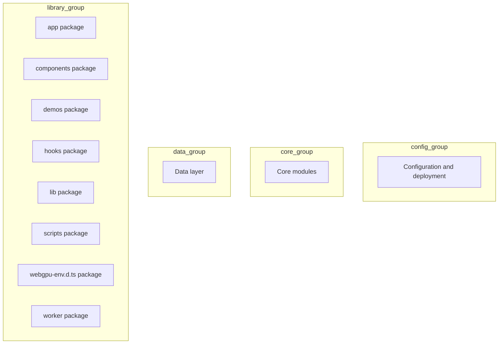

# Architecture report: DavidHDev/canvas-ui

> Automated static analysis. **Observed** = directly seen in files/imports/AST; **Inferred** = interpretation from that evidence. Repository code was not executed.

## 1. Repository at a glance

| Item | Value |
| --- | --- |
| Repository | DavidHDev/canvas-ui |
| Description | A library of creative canvas components. Real HTML with WebGL effects running over it. React, Vue, Svelte, vanilla. |
| Language | TypeScript |
| Stars | 5417 |
| Licence | Other |
| Analysed commit / branch | a0be3b7e1f42d0d1bafde470b6794b39f6729502 / main |
| Framework(s) | Next.js, React |
| Files analysed | 508 |
| Components | 11 |

## 2. Architecture in one minute

DavidHDev/canvas-ui - A library of creative canvas components. Real HTML with WebGL effects running over it. React, Vue, Svelte, vanilla.. This repository was analysed statically from 508 file(s) (0 Python). Detected technologies (observed from imports/manifests): GitHub Actions, Next.js, React, Tailwind CSS, TypeScript. Files are grouped into 11 component(s): app package, components package, Configuration and deployment, Core modules, Data layer, demos package, hooks package, lib package. Findings below distinguish observed facts from inferred interpretation.

## 3. High-level block diagram

## 4. Main components

### app package (`app`)

- **Kind:** library
- **Status:** Observed
- **Confidence:** 0.85
- **Responsibility:** Groups 10 file(s) under app package (observed from repository paths and static analysis).
- **Paths:** `src/app/(shell)/components/page.tsx`, `src/app/(shell)/layout.tsx`, `src/app/celebrate/page.tsx`, `src/app/layout.tsx`, `src/app/not-found.tsx`, `src/app/page.tsx`, `src/app/playground/page.tsx`, `src/app/privacy/page.tsx`, `src/app/robots.ts`, `src/app/sitemap.ts`
- **Evidence:** [src/app/(shell)/components/page.tsx](https://github.com/DavidHDev/canvas-ui/blob/a0be3b7e1f42d0d1bafde470b6794b39f6729502/src/app/%28shell%29/components/page.tsx); [src/app/(shell)/layout.tsx](https://github.com/DavidHDev/canvas-ui/blob/a0be3b7e1f42d0d1bafde470b6794b39f6729502/src/app/%28shell%29/layout.tsx); [src/app/celebrate/page.tsx](https://github.com/DavidHDev/canvas-ui/blob/a0be3b7e1f42d0d1bafde470b6794b39f6729502/src/app/celebrate/page.tsx); [src/app/layout.tsx](https://github.com/DavidHDev/canvas-ui/blob/a0be3b7e1f42d0d1bafde470b6794b39f6729502/src/app/layout.tsx); [src/app/not-found.tsx](https://github.com/DavidHDev/canvas-ui/blob/a0be3b7e1f42d0d1bafde470b6794b39f6729502/src/app/not-found.tsx); [src/app/page.tsx](https://github.com/DavidHDev/canvas-ui/blob/a0be3b7e1f42d0d1bafde470b6794b39f6729502/src/app/page.tsx); [src/app/playground/page.tsx](https://github.com/DavidHDev/canvas-ui/blob/a0be3b7e1f42d0d1bafde470b6794b39f6729502/src/app/playground/page.tsx); [src/app/privacy/page.tsx](https://github.com/DavidHDev/canvas-ui/blob/a0be3b7e1f42d0d1bafde470b6794b39f6729502/src/app/privacy/page.tsx)

### components package (`components`)

- **Kind:** library
- **Status:** Observed
- **Confidence:** 0.85
- **Responsibility:** Groups 70 file(s) under components package (observed from repository paths and static analysis).
- **Paths:** `src/components/celebrate/celebrate-client.tsx`, `src/components/celebrate/record.ts`, `src/components/celebrate/star-stage.tsx`, `src/components/common/effect-portal.ts`, `src/components/common/github-stars.tsx`, `src/components/common/html-in-canvas-banner.tsx`, `src/components/common/newsletter-gate.tsx`, `src/components/common/newsletter-nav-button.tsx`, `src/components/common/newsletter-panel.tsx`, `src/components/common/newsletter-signup.tsx`, `src/components/common/preview-video.tsx`, `src/components/common/site-logo.tsx`, `src/components/common/site-search.tsx`, `src/components/common/theme-favicon.tsx`, `src/components/common/theme-hotkey.tsx`, `src/components/common/theme-provider.tsx`, `src/components/common/theme-toggle.tsx`, `src/components/common/url-state-provider.tsx`, `src/components/common/use-subscribed.ts`, `src/components/demos/color-picker.tsx`, `src/components/demos/control-schema.ts`, `src/components/demos/demo-controls.tsx`, `src/components/demos/snippet-store.ts`, `src/components/landing/agents.tsx`, `src/components/landing/community-quotes.tsx`, `src/components/landing/cta.tsx`, `src/components/landing/faq.tsx`, `src/components/landing/featured-videos.tsx`, `src/components/landing/footer.tsx`, `src/components/landing/framework-tabs.tsx`, `src/components/landing/frameworks.tsx`, `src/components/landing/gallery-marquee.tsx`, `src/components/landing/gallery.tsx`, `src/components/landing/hero-reel.tsx`, `src/components/landing/hero-reveal.tsx`, `src/components/landing/hero.tsx`, `src/components/landing/how-it-works.tsx`, `src/components/landing/mobile-menu.tsx`, `src/components/landing/navbar.tsx`, `src/components/landing/newsletter.tsx`, `src/components/landing/reveal.tsx`, `src/components/landing/stitches.tsx`, `src/components/playground/demos.tsx`, `src/components/playground/entries/ascii-object-entry.tsx`, `src/components/playground/entries/ascii-sweep-entry.tsx`, `src/components/playground/entries/decrypt-reveal-entry.tsx`, `src/components/playground/entries/dithered-object-entry.tsx`, `src/components/playground/entries/flame-wrap-entry.tsx`, `src/components/playground/entries/glass-object-entry.tsx`, `src/components/playground/entries/ink-object-entry.tsx`, `src/components/playground/entries/liquid-object-entry.tsx`, `src/components/playground/entries/particle-object-entry.tsx`, `src/components/playground/entries/particle-reveal-entry.tsx`, `src/components/playground/entries/peel-entry.tsx`, `src/components/playground/entries/shared.tsx`, `src/components/playground/mock-site.tsx`, `src/components/playground/playground-actions.tsx`, `src/components/playground/playground-client.tsx`, `src/components/playground/playground-sidebar.tsx`, `src/components/ui/accordion.tsx`, `src/components/ui/badge.tsx`, `src/components/ui/button.tsx`, `src/components/ui/card.tsx`, `src/components/ui/input.tsx`, `src/components/ui/label.tsx`, `src/components/ui/select.tsx`, `src/components/ui/separator.tsx`, `src/components/ui/tabs.tsx`, `src/components/ui/textarea.tsx`, `src/components/ui/tooltip.tsx`
- **Evidence:** [src/components/celebrate/celebrate-client.tsx](https://github.com/DavidHDev/canvas-ui/blob/a0be3b7e1f42d0d1bafde470b6794b39f6729502/src/components/celebrate/celebrate-client.tsx); [src/components/celebrate/record.ts](https://github.com/DavidHDev/canvas-ui/blob/a0be3b7e1f42d0d1bafde470b6794b39f6729502/src/components/celebrate/record.ts); [src/components/celebrate/star-stage.tsx](https://github.com/DavidHDev/canvas-ui/blob/a0be3b7e1f42d0d1bafde470b6794b39f6729502/src/components/celebrate/star-stage.tsx); [src/components/common/effect-portal.ts](https://github.com/DavidHDev/canvas-ui/blob/a0be3b7e1f42d0d1bafde470b6794b39f6729502/src/components/common/effect-portal.ts); [src/components/common/github-stars.tsx](https://github.com/DavidHDev/canvas-ui/blob/a0be3b7e1f42d0d1bafde470b6794b39f6729502/src/components/common/github-stars.tsx); [src/components/common/html-in-canvas-banner.tsx](https://github.com/DavidHDev/canvas-ui/blob/a0be3b7e1f42d0d1bafde470b6794b39f6729502/src/components/common/html-in-canvas-banner.tsx); [src/components/common/newsletter-gate.tsx](https://github.com/DavidHDev/canvas-ui/blob/a0be3b7e1f42d0d1bafde470b6794b39f6729502/src/components/common/newsletter-gate.tsx); [src/components/common/newsletter-nav-button.tsx](https://github.com/DavidHDev/canvas-ui/blob/a0be3b7e1f42d0d1bafde470b6794b39f6729502/src/components/common/newsletter-nav-button.tsx)

### Configuration and deployment (`config`)

- **Kind:** config
- **Status:** Observed
- **Confidence:** 0.85
- **Responsibility:** Groups 3 file(s) under configuration and deployment (observed from repository paths and static analysis).
- **Paths:** `components.json`, `package.json`, `tsconfig.json`
- **Evidence:** [components.json](https://github.com/DavidHDev/canvas-ui/blob/a0be3b7e1f42d0d1bafde470b6794b39f6729502/components.json); [package.json](https://github.com/DavidHDev/canvas-ui/blob/a0be3b7e1f42d0d1bafde470b6794b39f6729502/package.json); [tsconfig.json](https://github.com/DavidHDev/canvas-ui/blob/a0be3b7e1f42d0d1bafde470b6794b39f6729502/tsconfig.json)

### Core modules (`core`)

- **Kind:** core
- **Status:** Observed
- **Confidence:** 0.85
- **Responsibility:** Groups 3 file(s) under core modules (observed from repository paths and static analysis).
- **Paths:** `eslint.config.mjs`, `next.config.ts`, `postcss.config.mjs`
- **Evidence:** [eslint.config.mjs](https://github.com/DavidHDev/canvas-ui/blob/a0be3b7e1f42d0d1bafde470b6794b39f6729502/eslint.config.mjs); [next.config.ts](https://github.com/DavidHDev/canvas-ui/blob/a0be3b7e1f42d0d1bafde470b6794b39f6729502/next.config.ts); [postcss.config.mjs](https://github.com/DavidHDev/canvas-ui/blob/a0be3b7e1f42d0d1bafde470b6794b39f6729502/postcss.config.mjs)

### Data layer (`data_layer`)

- **Kind:** data
- **Status:** Observed
- **Confidence:** 0.85
- **Responsibility:** Groups 1 file(s) under data layer (observed from repository paths and static analysis).
- **Paths:** `src/data/components.ts`
- **Evidence:** [src/data/components.ts](https://github.com/DavidHDev/canvas-ui/blob/a0be3b7e1f42d0d1bafde470b6794b39f6729502/src/data/components.ts)

### demos package (`demos`)

- **Kind:** library
- **Status:** Observed
- **Confidence:** 0.85
- **Responsibility:** Groups 36 file(s) under demos package (observed from repository paths and static analysis).
- **Paths:** `src/demos/ascii-object-demo.tsx`, `src/demos/ascii-sweep-demo.tsx`, `src/demos/asciify-demo.tsx`, `src/demos/bend-demo.tsx`, `src/demos/blaze-demo.tsx`, `src/demos/bubble-demo.tsx`, `src/demos/canvas-demo.tsx`, `src/demos/cloth-demo.tsx`, `src/demos/clouds-demo.tsx`, `src/demos/decrypt-reveal-demo.tsx`, `src/demos/demo-image-cycler.tsx`, `src/demos/displacement-demo.tsx`, `src/demos/dithered-object-demo.tsx`, `src/demos/droplets-demo.tsx`, `src/demos/flame-wrap-demo.tsx`, `src/demos/force-field-demo.tsx`, `src/demos/frost-demo.tsx`, `src/demos/glass-demo.tsx`, `src/demos/glass-object-demo.tsx`, `src/demos/glitch-demo.tsx`, `src/demos/glyph-rain-demo.tsx`, `src/demos/grid-demo.tsx`, `src/demos/hex-float-demo.tsx`, `src/demos/ink-object-demo.tsx`, `src/demos/laser-demo.tsx`, `src/demos/liquid-demo.tsx`, `src/demos/liquid-object-demo.tsx`, `src/demos/magnify-demo.tsx`, `src/demos/particle-object-demo.tsx`, `src/demos/particle-reveal-demo.tsx`, `src/demos/particle-scroll-demo.tsx`, `src/demos/peel-demo.tsx`, `src/demos/retro-dither-demo.tsx`, `src/demos/ripple-demo.tsx`, `src/demos/shatter-demo.tsx`, `src/demos/vhs-demo.tsx`
- **Evidence:** [src/demos/ascii-object-demo.tsx](https://github.com/DavidHDev/canvas-ui/blob/a0be3b7e1f42d0d1bafde470b6794b39f6729502/src/demos/ascii-object-demo.tsx); [src/demos/ascii-sweep-demo.tsx](https://github.com/DavidHDev/canvas-ui/blob/a0be3b7e1f42d0d1bafde470b6794b39f6729502/src/demos/ascii-sweep-demo.tsx); [src/demos/asciify-demo.tsx](https://github.com/DavidHDev/canvas-ui/blob/a0be3b7e1f42d0d1bafde470b6794b39f6729502/src/demos/asciify-demo.tsx); [src/demos/bend-demo.tsx](https://github.com/DavidHDev/canvas-ui/blob/a0be3b7e1f42d0d1bafde470b6794b39f6729502/src/demos/bend-demo.tsx); [src/demos/blaze-demo.tsx](https://github.com/DavidHDev/canvas-ui/blob/a0be3b7e1f42d0d1bafde470b6794b39f6729502/src/demos/blaze-demo.tsx); [src/demos/bubble-demo.tsx](https://github.com/DavidHDev/canvas-ui/blob/a0be3b7e1f42d0d1bafde470b6794b39f6729502/src/demos/bubble-demo.tsx); [src/demos/canvas-demo.tsx](https://github.com/DavidHDev/canvas-ui/blob/a0be3b7e1f42d0d1bafde470b6794b39f6729502/src/demos/canvas-demo.tsx); [src/demos/cloth-demo.tsx](https://github.com/DavidHDev/canvas-ui/blob/a0be3b7e1f42d0d1bafde470b6794b39f6729502/src/demos/cloth-demo.tsx)

### hooks package (`hooks`)

- **Kind:** library
- **Status:** Observed
- **Confidence:** 0.85
- **Responsibility:** Groups 4 file(s) under hooks package (observed from repository paths and static analysis).
- **Paths:** `src/hooks/use-demo-controls.ts`, `src/hooks/use-preference.ts`, `src/hooks/use-theme-toggle.ts`, `src/hooks/use-turnstile.ts`
- **Evidence:** [src/hooks/use-demo-controls.ts](https://github.com/DavidHDev/canvas-ui/blob/a0be3b7e1f42d0d1bafde470b6794b39f6729502/src/hooks/use-demo-controls.ts); [src/hooks/use-preference.ts](https://github.com/DavidHDev/canvas-ui/blob/a0be3b7e1f42d0d1bafde470b6794b39f6729502/src/hooks/use-preference.ts); [src/hooks/use-theme-toggle.ts](https://github.com/DavidHDev/canvas-ui/blob/a0be3b7e1f42d0d1bafde470b6794b39f6729502/src/hooks/use-theme-toggle.ts); [src/hooks/use-turnstile.ts](https://github.com/DavidHDev/canvas-ui/blob/a0be3b7e1f42d0d1bafde470b6794b39f6729502/src/hooks/use-turnstile.ts)

### lib package (`lib`)

- **Kind:** library
- **Status:** Observed
- **Confidence:** 0.85
- **Responsibility:** Groups 252 file(s) under lib package (observed from repository paths and static analysis).
- **Paths:** `src/lib/AsciiObject/AsciiObject.preact.tsx`, `src/lib/AsciiObject/AsciiObject.solid.tsx`, `src/lib/AsciiObject/AsciiObject.svelte`, `src/lib/AsciiObject/AsciiObject.tsx`, `src/lib/AsciiObject/AsciiObject.vue`, `src/lib/AsciiObject/AsciiObjectVanilla.ts`, `src/lib/AsciiObject/AsciiObjectWebGPU.ts`, `src/lib/AsciiSweep/AsciiSweep.preact.tsx`, `src/lib/AsciiSweep/AsciiSweep.solid.tsx`, `src/lib/AsciiSweep/AsciiSweep.svelte`, `src/lib/AsciiSweep/AsciiSweep.tsx`, `src/lib/AsciiSweep/AsciiSweep.vue`, `src/lib/AsciiSweep/AsciiSweepVanilla.ts`, `src/lib/AsciiSweep/AsciiSweepWebGPU.ts`, `src/lib/Asciify/Asciify.preact.tsx`, `src/lib/Asciify/Asciify.solid.tsx`, `src/lib/Asciify/Asciify.svelte`, `src/lib/Asciify/Asciify.tsx`, `src/lib/Asciify/Asciify.vue`, `src/lib/Asciify/AsciifyVanilla.ts`, `src/lib/Asciify/AsciifyWebGPU.ts`, `src/lib/Bend/Bend.preact.tsx`, `src/lib/Bend/Bend.solid.tsx`, `src/lib/Bend/Bend.svelte`, `src/lib/Bend/Bend.tsx`, `src/lib/Bend/Bend.vue`, `src/lib/Bend/BendVanilla.ts`, `src/lib/Bend/BendWebGPU.ts`, `src/lib/Blaze/Blaze.preact.tsx`, `src/lib/Blaze/Blaze.solid.tsx`, `src/lib/Blaze/Blaze.svelte`, `src/lib/Blaze/Blaze.tsx`, `src/lib/Blaze/Blaze.vue`, `src/lib/Blaze/BlazeVanilla.ts`, `src/lib/Blaze/BlazeWebGPU.ts`, `src/lib/Bubble/Bubble.preact.tsx`, `src/lib/Bubble/Bubble.solid.tsx`, `src/lib/Bubble/Bubble.svelte`, `src/lib/Bubble/Bubble.tsx`, `src/lib/Bubble/Bubble.vue`, `src/lib/Bubble/BubbleVanilla.ts`, `src/lib/Bubble/BubbleWebGPU.ts`, `src/lib/Canvas/Canvas.preact.tsx`, `src/lib/Canvas/Canvas.solid.tsx`, `src/lib/Canvas/Canvas.svelte`, `src/lib/Canvas/Canvas.tsx`, `src/lib/Canvas/Canvas.vue`, `src/lib/Canvas/CanvasVanilla.ts`, `src/lib/Canvas/CanvasWebGPU.ts`, `src/lib/Cloth/Cloth.preact.tsx`, `src/lib/Cloth/Cloth.solid.tsx`, `src/lib/Cloth/Cloth.svelte`, `src/lib/Cloth/Cloth.tsx`, `src/lib/Cloth/Cloth.vue`, `src/lib/Cloth/ClothVanilla.ts`, `src/lib/Cloth/ClothWebGPU.ts`, `src/lib/Clouds/Clouds.preact.tsx`, `src/lib/Clouds/Clouds.solid.tsx`, `src/lib/Clouds/Clouds.svelte`, `src/lib/Clouds/Clouds.tsx`, `src/lib/Clouds/Clouds.vue`, `src/lib/Clouds/CloudsVanilla.ts`, `src/lib/Clouds/CloudsWebGPU.ts`, `src/lib/DecryptReveal/DecryptReveal.preact.tsx`, `src/lib/DecryptReveal/DecryptReveal.solid.tsx`, `src/lib/DecryptReveal/DecryptReveal.svelte`, `src/lib/DecryptReveal/DecryptReveal.tsx`, `src/lib/DecryptReveal/DecryptReveal.vue`, `src/lib/DecryptReveal/DecryptRevealVanilla.ts`, `src/lib/DecryptReveal/DecryptRevealWebGPU.ts`, `src/lib/Displacement/Displacement.preact.tsx`, `src/lib/Displacement/Displacement.solid.tsx`, `src/lib/Displacement/Displacement.svelte`, `src/lib/Displacement/Displacement.tsx`, `src/lib/Displacement/Displacement.vue`, `src/lib/Displacement/DisplacementVanilla.ts`, `src/lib/Displacement/DisplacementWebGPU.ts`, `src/lib/DitheredObject/DitheredObject.preact.tsx`, `src/lib/DitheredObject/DitheredObject.solid.tsx`, `src/lib/DitheredObject/DitheredObject.svelte`, `src/lib/DitheredObject/DitheredObject.tsx`, `src/lib/DitheredObject/DitheredObject.vue`, `src/lib/DitheredObject/DitheredObjectVanilla.ts`, `src/lib/DitheredObject/DitheredObjectWebGPU.ts`, `src/lib/Droplets/Droplets.preact.tsx`, `src/lib/Droplets/Droplets.solid.tsx`, `src/lib/Droplets/Droplets.svelte`, `src/lib/Droplets/Droplets.tsx`, `src/lib/Droplets/Droplets.vue`, `src/lib/Droplets/DropletsVanilla.ts`, `src/lib/Droplets/DropletsWebGPU.ts`, `src/lib/FlameWrap/FlameWrap.preact.tsx`, `src/lib/FlameWrap/FlameWrap.solid.tsx`, `src/lib/FlameWrap/FlameWrap.svelte`, `src/lib/FlameWrap/FlameWrap.tsx`, `src/lib/FlameWrap/FlameWrap.vue`, `src/lib/FlameWrap/FlameWrapVanilla.ts`, `src/lib/FlameWrap/FlameWrapWebGPU.ts`, `src/lib/ForceField/ForceField.preact.tsx`, `src/lib/ForceField/ForceField.solid.tsx`, `src/lib/ForceField/ForceField.svelte`, `src/lib/ForceField/ForceField.tsx`, `src/lib/ForceField/ForceField.vue`, `src/lib/ForceField/ForceFieldVanilla.ts`, `src/lib/ForceField/ForceFieldWebGPU.ts`, `src/lib/Frost/Frost.preact.tsx`, `src/lib/Frost/Frost.solid.tsx`, `src/lib/Frost/Frost.svelte`, `src/lib/Frost/Frost.tsx`, `src/lib/Frost/Frost.vue`, `src/lib/Frost/FrostVanilla.ts`, `src/lib/Frost/FrostWebGPU.ts`, `src/lib/Glass/Glass.preact.tsx`, `src/lib/Glass/Glass.solid.tsx`, `src/lib/Glass/Glass.svelte`, `src/lib/Glass/Glass.tsx`, `src/lib/Glass/Glass.vue`, `src/lib/Glass/GlassVanilla.ts`, `src/lib/Glass/GlassWebGPU.ts`, `src/lib/GlassObject/GlassObject.preact.tsx`, `src/lib/GlassObject/GlassObject.solid.tsx`, `src/lib/GlassObject/GlassObject.svelte`, `src/lib/GlassObject/GlassObject.tsx`, `src/lib/GlassObject/GlassObject.vue`, `src/lib/GlassObject/GlassObjectVanilla.ts`, `src/lib/GlassObject/GlassObjectWebGPU.ts`, `src/lib/Glitch/Glitch.preact.tsx`, `src/lib/Glitch/Glitch.solid.tsx`, `src/lib/Glitch/Glitch.svelte`, `src/lib/Glitch/Glitch.tsx`, `src/lib/Glitch/Glitch.vue`, `src/lib/Glitch/GlitchVanilla.ts`, `src/lib/Glitch/GlitchWebGPU.ts`, `src/lib/GlyphRain/GlyphRain.preact.tsx`, `src/lib/GlyphRain/GlyphRain.solid.tsx`, `src/lib/GlyphRain/GlyphRain.svelte`, `src/lib/GlyphRain/GlyphRain.tsx`, `src/lib/GlyphRain/GlyphRain.vue`, `src/lib/GlyphRain/GlyphRainVanilla.ts`, `src/lib/GlyphRain/GlyphRainWebGPU.ts`, `src/lib/Grid/Grid.preact.tsx`, `src/lib/Grid/Grid.solid.tsx`, `src/lib/Grid/Grid.svelte`, `src/lib/Grid/Grid.tsx`, `src/lib/Grid/Grid.vue`, `src/lib/Grid/GridVanilla.ts`, `src/lib/Grid/GridWebGPU.ts`, `src/lib/HexFloat/HexFloat.preact.tsx`, `src/lib/HexFloat/HexFloat.solid.tsx`, `src/lib/HexFloat/HexFloat.svelte`, `src/lib/HexFloat/HexFloat.tsx`, `src/lib/HexFloat/HexFloat.vue`, `src/lib/HexFloat/HexFloatVanilla.ts`, `src/lib/HexFloat/HexFloatWebGPU.ts`, `src/lib/InkObject/InkObject.preact.tsx`, `src/lib/InkObject/InkObject.solid.tsx`, `src/lib/InkObject/InkObject.svelte`, `src/lib/InkObject/InkObject.tsx`, `src/lib/InkObject/InkObject.vue`, `src/lib/InkObject/InkObjectVanilla.ts`, `src/lib/InkObject/InkObjectWebGPU.ts`, `src/lib/Laser/Laser.preact.tsx`, `src/lib/Laser/Laser.solid.tsx`, `src/lib/Laser/Laser.svelte`, `src/lib/Laser/Laser.tsx`, `src/lib/Laser/Laser.vue`, `src/lib/Laser/LaserVanilla.ts`, `src/lib/Laser/LaserWebGPU.ts`, `src/lib/Liquid/Liquid.preact.tsx`, `src/lib/Liquid/Liquid.solid.tsx`, `src/lib/Liquid/Liquid.svelte`, `src/lib/Liquid/Liquid.tsx`, `src/lib/Liquid/Liquid.vue`, `src/lib/Liquid/LiquidVanilla.ts`, `src/lib/Liquid/LiquidWebGPU.ts`, `src/lib/LiquidObject/LiquidObject.preact.tsx`, `src/lib/LiquidObject/LiquidObject.solid.tsx`, `src/lib/LiquidObject/LiquidObject.svelte`, `src/lib/LiquidObject/LiquidObject.tsx`, `src/lib/LiquidObject/LiquidObject.vue`, `src/lib/LiquidObject/LiquidObjectVanilla.ts`, `src/lib/LiquidObject/LiquidObjectWebGPU.ts`, `src/lib/Magnify/Magnify.preact.tsx`, `src/lib/Magnify/Magnify.solid.tsx`, `src/lib/Magnify/Magnify.svelte`, `src/lib/Magnify/Magnify.tsx`, `src/lib/Magnify/Magnify.vue`, `src/lib/Magnify/MagnifyVanilla.ts`, `src/lib/Magnify/MagnifyWebGPU.ts`, `src/lib/ParticleObject/ParticleObject.preact.tsx`, `src/lib/ParticleObject/ParticleObject.solid.tsx`, `src/lib/ParticleObject/ParticleObject.svelte`, `src/lib/ParticleObject/ParticleObject.tsx`, `src/lib/ParticleObject/ParticleObject.vue`, `src/lib/ParticleObject/ParticleObjectVanilla.ts`, `src/lib/ParticleObject/ParticleObjectWebGPU.ts`, `src/lib/ParticleReveal/ParticleReveal.preact.tsx`, `src/lib/ParticleReveal/ParticleReveal.solid.tsx`, `src/lib/ParticleReveal/ParticleReveal.svelte`, `src/lib/ParticleReveal/ParticleReveal.tsx`, `src/lib/ParticleReveal/ParticleReveal.vue`, `src/lib/ParticleReveal/ParticleRevealVanilla.ts`, `src/lib/ParticleReveal/ParticleRevealWebGPU.ts`, `src/lib/ParticleScroll/ParticleScroll.preact.tsx`, `src/lib/ParticleScroll/ParticleScroll.solid.tsx`, `src/lib/ParticleScroll/ParticleScroll.svelte`, `src/lib/ParticleScroll/ParticleScroll.tsx`, `src/lib/ParticleScroll/ParticleScroll.vue`, `src/lib/ParticleScroll/ParticleScrollVanilla.ts`, `src/lib/ParticleScroll/ParticleScrollWebGPU.ts`, `src/lib/Peel/Peel.preact.tsx`, `src/lib/Peel/Peel.solid.tsx`, `src/lib/Peel/Peel.svelte`, `src/lib/Peel/Peel.tsx`, `src/lib/Peel/Peel.vue`, `src/lib/Peel/PeelVanilla.ts`, `src/lib/Peel/PeelWebGPU.ts`, `src/lib/RetroDither/RetroDither.preact.tsx`, `src/lib/RetroDither/RetroDither.solid.tsx`, `src/lib/RetroDither/RetroDither.svelte`, `src/lib/RetroDither/RetroDither.tsx`, `src/lib/RetroDither/RetroDither.vue`, `src/lib/RetroDither/RetroDitherVanilla.ts`, `src/lib/RetroDither/RetroDitherWebGPU.ts`, `src/lib/Ripple/Ripple.preact.tsx`, `src/lib/Ripple/Ripple.solid.tsx`, `src/lib/Ripple/Ripple.svelte`, `src/lib/Ripple/Ripple.tsx`, `src/lib/Ripple/Ripple.vue`, `src/lib/Ripple/RippleVanilla.ts`, `src/lib/Ripple/RippleWebGPU.ts`, `src/lib/Shatter/Shatter.preact.tsx`, `src/lib/Shatter/Shatter.solid.tsx`, `src/lib/Shatter/Shatter.svelte`, `src/lib/Shatter/Shatter.tsx`, `src/lib/Shatter/Shatter.vue`, `src/lib/Shatter/ShatterVanilla.ts`, `src/lib/Shatter/ShatterWebGPU.ts`, `src/lib/VHS/VHS.preact.tsx`, `src/lib/VHS/VHS.solid.tsx`, `src/lib/VHS/VHS.svelte`, `src/lib/VHS/VHS.tsx`, `src/lib/VHS/VHS.vue`, `src/lib/VHS/VHSVanilla.ts`, `src/lib/VHS/VHSWebGPU.ts`, `src/lib/canvas-viewport.ts`, `src/lib/celebrate.ts`, `src/lib/github.ts`, `src/lib/html-in-canvas.ts`, `src/lib/rect-cache.ts`, `src/lib/registry.ts`, `src/lib/utils.ts`
- **Evidence:** [src/lib/AsciiObject/AsciiObject.preact.tsx](https://github.com/DavidHDev/canvas-ui/blob/a0be3b7e1f42d0d1bafde470b6794b39f6729502/src/lib/AsciiObject/AsciiObject.preact.tsx); [src/lib/AsciiObject/AsciiObject.solid.tsx](https://github.com/DavidHDev/canvas-ui/blob/a0be3b7e1f42d0d1bafde470b6794b39f6729502/src/lib/AsciiObject/AsciiObject.solid.tsx); [src/lib/AsciiObject/AsciiObject.svelte](https://github.com/DavidHDev/canvas-ui/blob/a0be3b7e1f42d0d1bafde470b6794b39f6729502/src/lib/AsciiObject/AsciiObject.svelte); [src/lib/AsciiObject/AsciiObject.tsx](https://github.com/DavidHDev/canvas-ui/blob/a0be3b7e1f42d0d1bafde470b6794b39f6729502/src/lib/AsciiObject/AsciiObject.tsx); [src/lib/AsciiObject/AsciiObject.vue](https://github.com/DavidHDev/canvas-ui/blob/a0be3b7e1f42d0d1bafde470b6794b39f6729502/src/lib/AsciiObject/AsciiObject.vue); [src/lib/AsciiObject/AsciiObjectVanilla.ts](https://github.com/DavidHDev/canvas-ui/blob/a0be3b7e1f42d0d1bafde470b6794b39f6729502/src/lib/AsciiObject/AsciiObjectVanilla.ts); [src/lib/AsciiObject/AsciiObjectWebGPU.ts](https://github.com/DavidHDev/canvas-ui/blob/a0be3b7e1f42d0d1bafde470b6794b39f6729502/src/lib/AsciiObject/AsciiObjectWebGPU.ts); [src/lib/AsciiSweep/AsciiSweep.preact.tsx](https://github.com/DavidHDev/canvas-ui/blob/a0be3b7e1f42d0d1bafde470b6794b39f6729502/src/lib/AsciiSweep/AsciiSweep.preact.tsx)

### scripts package (`scripts`)

- **Kind:** library
- **Status:** Observed
- **Confidence:** 0.85
- **Responsibility:** Groups 9 file(s) under scripts package (observed from repository paths and static analysis).
- **Paths:** `scripts/test-android-fallback.mjs`, `scripts/test-bounded-inputs.mjs`, `scripts/test-canvas-viewport.mjs`, `scripts/test-flame-wrap-vanilla.mjs`, `scripts/test-html-in-canvas.mjs`, `scripts/test-particle-scroll-fallback.mjs`, `scripts/test-playground-controls.mjs`, `scripts/test-subscribe-rate-limits.mjs`, `scripts/test-webgpu-resize.mjs`
- **Evidence:** [scripts/test-android-fallback.mjs](https://github.com/DavidHDev/canvas-ui/blob/a0be3b7e1f42d0d1bafde470b6794b39f6729502/scripts/test-android-fallback.mjs); [scripts/test-bounded-inputs.mjs](https://github.com/DavidHDev/canvas-ui/blob/a0be3b7e1f42d0d1bafde470b6794b39f6729502/scripts/test-bounded-inputs.mjs); [scripts/test-canvas-viewport.mjs](https://github.com/DavidHDev/canvas-ui/blob/a0be3b7e1f42d0d1bafde470b6794b39f6729502/scripts/test-canvas-viewport.mjs); [scripts/test-flame-wrap-vanilla.mjs](https://github.com/DavidHDev/canvas-ui/blob/a0be3b7e1f42d0d1bafde470b6794b39f6729502/scripts/test-flame-wrap-vanilla.mjs); [scripts/test-html-in-canvas.mjs](https://github.com/DavidHDev/canvas-ui/blob/a0be3b7e1f42d0d1bafde470b6794b39f6729502/scripts/test-html-in-canvas.mjs); [scripts/test-particle-scroll-fallback.mjs](https://github.com/DavidHDev/canvas-ui/blob/a0be3b7e1f42d0d1bafde470b6794b39f6729502/scripts/test-particle-scroll-fallback.mjs); [scripts/test-playground-controls.mjs](https://github.com/DavidHDev/canvas-ui/blob/a0be3b7e1f42d0d1bafde470b6794b39f6729502/scripts/test-playground-controls.mjs); [scripts/test-subscribe-rate-limits.mjs](https://github.com/DavidHDev/canvas-ui/blob/a0be3b7e1f42d0d1bafde470b6794b39f6729502/scripts/test-subscribe-rate-limits.mjs)

### webgpu-env.d.ts package (`webgpu_env_d_ts`)

- **Kind:** library
- **Status:** Observed
- **Confidence:** 0.85
- **Responsibility:** Groups 1 file(s) under webgpu-env.d.ts package (observed from repository paths and static analysis).
- **Paths:** `src/webgpu-env.d.ts`
- **Evidence:** [src/webgpu-env.d.ts](https://github.com/DavidHDev/canvas-ui/blob/a0be3b7e1f42d0d1bafde470b6794b39f6729502/src/webgpu-env.d.ts)

### worker package (`worker`)

- **Kind:** library
- **Status:** Observed
- **Confidence:** 0.85
- **Responsibility:** Groups 2 file(s) under worker package (observed from repository paths and static analysis).
- **Paths:** `worker/domains.ts`, `worker/index.ts`
- **Evidence:** [worker/domains.ts](https://github.com/DavidHDev/canvas-ui/blob/a0be3b7e1f42d0d1bafde470b6794b39f6729502/worker/domains.ts); [worker/index.ts](https://github.com/DavidHDev/canvas-ui/blob/a0be3b7e1f42d0d1bafde470b6794b39f6729502/worker/index.ts)

## 5. Execution flow

**Observed** entry point(s):

- [src/app/celebrate/page.tsx](https://github.com/DavidHDev/canvas-ui/blob/a0be3b7e1f42d0d1bafde470b6794b39f6729502/src/app/celebrate/page.tsx)
- [src/app/page.tsx](https://github.com/DavidHDev/canvas-ui/blob/a0be3b7e1f42d0d1bafde470b6794b39f6729502/src/app/page.tsx)
- [src/app/playground/page.tsx](https://github.com/DavidHDev/canvas-ui/blob/a0be3b7e1f42d0d1bafde470b6794b39f6729502/src/app/playground/page.tsx)
- [src/app/privacy/page.tsx](https://github.com/DavidHDev/canvas-ui/blob/a0be3b7e1f42d0d1bafde470b6794b39f6729502/src/app/privacy/page.tsx)
- [worker/index.ts](https://github.com/DavidHDev/canvas-ui/blob/a0be3b7e1f42d0d1bafde470b6794b39f6729502/worker/index.ts)

Representative flow (derived from observed entry points and the import graph; steps beyond the entry point are **Inferred**):

1. Execution starts at an observed entry point listed above, if present.
2. No internal import relationships between components were observed.

## 6. Project structure

### `(root)`

- `.env.example` - config (1230 bytes)
- `.gitignore` - other (850 bytes)
- `LICENSE.md` - docs (1307 bytes)
- `README.md` - docs (18003 bytes)
- `components.json` - config (520 bytes)
- `eslint.config.mjs` - source, JavaScript (788 bytes)
- `next.config.ts` - source, TypeScript (348 bytes)
- `package.json` - manifest (2117 bytes)
- `postcss.config.mjs` - source, JavaScript (94 bytes)
- `tsconfig.json` - config (692 bytes)
- `wrangler.jsonc` - other (917 bytes)

### `.github`

- `.github/CONTRIBUTING.md` - docs (1899 bytes)
- `.github/ISSUE_TEMPLATE/bug_report.yml` - config (1418 bytes)
- `.github/ISSUE_TEMPLATE/config.yml` - config (162 bytes)
- `.github/ISSUE_TEMPLATE/feature_request.yml` - config (550 bytes)
- `.github/PULL_REQUEST_TEMPLATE.md` - docs (468 bytes)
- `.github/workflows/ci.yml` - ci, YAML (389 bytes)

### `public`

- `public/_headers` - other (218 bytes)
- `public/assets/bolt-mark.svg` - other (143 bytes)
- `public/assets/models/LICENSE.md` - docs (691 bytes)
- `public/assets/models/SCEA.txt` - docs (6727 bytes)
- `public/favicon.svg` - other (2783 bytes)
- `public/llms.txt` - docs (5790 bytes)
- `public/logo-icon.svg` - other (2674 bytes)
- `public/logo.svg` - other (8941 bytes)
- `public/site.webmanifest` - other (567 bytes)

### `scripts`

- `scripts/build-live-wrappers.mts` - other (11224 bytes)
- `scripts/build-registry.mts` - other (1253 bytes)
- `scripts/preflight-deploy.mts` - other (5105 bytes)
- `scripts/test-android-fallback.mjs` - source, JavaScript (10764 bytes)
- `scripts/test-bounded-inputs.mjs` - source, JavaScript (11061 bytes)
- `scripts/test-canvas-viewport.mjs` - source, JavaScript (13479 bytes)
- `scripts/test-flame-wrap-vanilla.mjs` - source, JavaScript (5524 bytes)
- `scripts/test-html-in-canvas.mjs` - source, JavaScript (9416 bytes)
- `scripts/test-particle-scroll-fallback.mjs` - source, JavaScript (6241 bytes)
- `scripts/test-playground-controls.mjs` - source, JavaScript (11786 bytes)
- `scripts/test-subscribe-rate-limits.mjs` - source, JavaScript (4196 bytes)
- `scripts/test-webgpu-resize.mjs` - source, JavaScript (6115 bytes)

### `src`

- `src/app/(shell)/components/page.tsx` - source, TypeScript (2212 bytes)
- `src/app/(shell)/docs/components/ascii-object/page.tsx` - docs (7397 bytes)
- `src/app/(shell)/docs/components/ascii-sweep/page.tsx` - docs (7345 bytes)
- `src/app/(shell)/docs/components/asciify/page.tsx` - docs (4591 bytes)
- `src/app/(shell)/docs/components/bend/page.tsx` - docs (4002 bytes)
- `src/app/(shell)/docs/components/blaze/page.tsx` - docs (3766 bytes)
- `src/app/(shell)/docs/components/bubble/page.tsx` - docs (5329 bytes)
- `src/app/(shell)/docs/components/canvas/page.tsx` - docs (4663 bytes)
- `src/app/(shell)/docs/components/cloth/page.tsx` - docs (4535 bytes)
- `src/app/(shell)/docs/components/clouds/page.tsx` - docs (5045 bytes)
- `src/app/(shell)/docs/components/decrypt-reveal/page.tsx` - docs (5778 bytes)
- `src/app/(shell)/docs/components/displacement/page.tsx` - docs (3986 bytes)
- `src/app/(shell)/docs/components/dithered-object/page.tsx` - docs (6476 bytes)
- `src/app/(shell)/docs/components/droplets/page.tsx` - docs (4469 bytes)
- `src/app/(shell)/docs/components/flame-wrap/page.tsx` - docs (8179 bytes)
- `src/app/(shell)/docs/components/force-field/page.tsx` - docs (9006 bytes)
- `src/app/(shell)/docs/components/frost/page.tsx` - docs (6481 bytes)
- `src/app/(shell)/docs/components/glass-object/page.tsx` - docs (7077 bytes)
- `src/app/(shell)/docs/components/glass/page.tsx` - docs (4646 bytes)
- `src/app/(shell)/docs/components/glitch/page.tsx` - docs (3328 bytes)
- `src/app/(shell)/docs/components/glyph-rain/page.tsx` - docs (5332 bytes)
- `src/app/(shell)/docs/components/grid/page.tsx` - docs (4598 bytes)
- `src/app/(shell)/docs/components/hex-float/page.tsx` - docs (5146 bytes)
- `src/app/(shell)/docs/components/ink-object/page.tsx` - docs (8292 bytes)
- `src/app/(shell)/docs/components/laser/page.tsx` - docs (4144 bytes)
- `src/app/(shell)/docs/components/liquid-object/page.tsx` - docs (8213 bytes)
- `src/app/(shell)/docs/components/liquid/page.tsx` - docs (4043 bytes)
- `src/app/(shell)/docs/components/magnify/page.tsx` - docs (5662 bytes)
- `src/app/(shell)/docs/components/particle-object/page.tsx` - docs (6523 bytes)
- `src/app/(shell)/docs/components/particle-reveal/page.tsx` - docs (3832 bytes)
- `src/app/(shell)/docs/components/particle-scroll/page.tsx` - docs (4305 bytes)
- `src/app/(shell)/docs/components/peel/page.tsx` - docs (4731 bytes)
- `src/app/(shell)/docs/components/retro-dither/page.tsx` - docs (4745 bytes)
- `src/app/(shell)/docs/components/ripple/page.tsx` - docs (3556 bytes)
- `src/app/(shell)/docs/components/shatter/page.tsx` - docs (4929 bytes)
- `src/app/(shell)/docs/components/vhs/page.tsx` - docs (4334 bytes)
- `src/app/(shell)/docs/installation/page.tsx` - docs (14683 bytes)
- `src/app/(shell)/docs/mcp/page.tsx` - docs (6622 bytes)
- `src/app/(shell)/docs/page.tsx` - docs (6294 bytes)
- `src/app/(shell)/docs/rendering/page.tsx` - docs (13992 bytes)
- `src/app/(shell)/layout.tsx` - source, TypeScript (2535 bytes)
- `src/app/celebrate/page.tsx` - source, TypeScript (1212 bytes)
- `src/app/globals.css` - other (21177 bytes)
- `src/app/layout.tsx` - source, TypeScript (2907 bytes)
- `src/app/not-found.tsx` - source, TypeScript (1138 bytes)
- `src/app/page.tsx` - source, TypeScript (2174 bytes)
- `src/app/playground/page.tsx` - source, TypeScript (1284 bytes)
- `src/app/privacy/page.tsx` - source, TypeScript (8568 bytes)
- `src/app/robots.ts` - source, TypeScript (268 bytes)
- `src/app/sitemap.ts` - source, TypeScript (2772 bytes)
- `src/app/typeset.css` - other (11200 bytes)
- `src/components/celebrate/celebrate-client.tsx` - source, TypeScript (8105 bytes)
- `src/components/celebrate/record.ts` - source, TypeScript (1986 bytes)
- `src/components/celebrate/star-stage.tsx` - source, TypeScript (7147 bytes)
- `src/components/common/effect-portal.ts` - source, TypeScript (824 bytes)
- `src/components/common/github-stars.tsx` - source, TypeScript (3125 bytes)
- `src/components/common/html-in-canvas-banner.tsx` - source, TypeScript (8385 bytes)
- `src/components/common/newsletter-gate.tsx` - source, TypeScript (308 bytes)
- `src/components/common/newsletter-nav-button.tsx` - source, TypeScript (2981 bytes)
- `src/components/common/newsletter-panel.tsx` - source, TypeScript (2216 bytes)
- `src/components/common/newsletter-signup.tsx` - source, TypeScript (8577 bytes)
- `src/components/common/preview-video.tsx` - source, TypeScript (2365 bytes)
- `src/components/common/site-logo.tsx` - source, TypeScript (1545 bytes)
- `src/components/common/site-search.tsx` - source, TypeScript (14537 bytes)
- `src/components/common/theme-favicon.tsx` - source, TypeScript (657 bytes)
- `src/components/common/theme-hotkey.tsx` - source, TypeScript (906 bytes)
- `src/components/common/theme-provider.tsx` - source, TypeScript (454 bytes)
- `src/components/common/theme-toggle.tsx` - source, TypeScript (1330 bytes)
- `src/components/common/url-state-provider.tsx` - source, TypeScript (1412 bytes)
- `src/components/common/use-subscribed.ts` - source, TypeScript (341 bytes)
- `src/components/demos/color-picker.tsx` - source, TypeScript (26000 bytes)
- `src/components/demos/control-schema.ts` - source, TypeScript (3116 bytes)
- `src/components/demos/demo-controls.tsx` - source, TypeScript (15452 bytes)
- `src/components/demos/snippet-store.ts` - source, TypeScript (1505 bytes)
- `src/components/docs/api-reference.tsx` - docs (3370 bytes)
- `src/components/docs/choice-select.tsx` - docs (1870 bytes)
- `src/components/docs/code-block.tsx` - docs (1499 bytes)
- `src/components/docs/code-tabs.tsx` - docs (2747 bytes)
- `src/components/docs/component-doc.tsx` - docs (8936 bytes)
- `src/components/docs/copy-button.tsx` - docs (1873 bytes)
- `src/components/docs/copy-menu.tsx` - docs (16372 bytes)
- `src/components/docs/dependency-tabs.tsx` - docs (2512 bytes)
- `src/components/docs/docs-mobile-nav.tsx` - docs (3291 bytes)
- `src/components/docs/docs-sidebar.tsx` - docs (11179 bytes)
- `src/components/docs/flame-wrap-vanilla-usage.ts` - docs (3085 bytes)
- `src/components/docs/highlight.ts` - docs (2430 bytes)
- `src/components/docs/install-tabs.tsx` - docs (4333 bytes)
- `src/components/docs/link-cards.tsx` - docs (1484 bytes)
- `src/components/docs/live-renderer.ts` - docs (325 bytes)
- `src/components/docs/live/AsciiObject.tsx` - docs (1804 bytes)
- `src/components/docs/live/AsciiSweep.tsx` - docs (5749 bytes)
- `src/components/docs/live/Asciify.tsx` - docs (3532 bytes)
- `src/components/docs/live/Bend.tsx` - docs (3401 bytes)
- `src/components/docs/live/Blaze.tsx` - docs (3422 bytes)
- `src/components/docs/live/Bubble.tsx` - docs (3451 bytes)
- `src/components/docs/live/Canvas.tsx` - docs (3451 bytes)
- `src/components/docs/live/Cloth.tsx` - docs (3426 bytes)
- `src/components/docs/live/Clouds.tsx` - docs (3451 bytes)
- `src/components/docs/live/DecryptReveal.tsx` - docs (3598 bytes)
- `src/components/docs/live/Displacement.tsx` - docs (3577 bytes)
- `src/components/docs/live/DitheredObject.tsx` - docs (1867 bytes)
- `src/components/docs/live/Droplets.tsx` - docs (3493 bytes)
- `src/components/docs/live/FlameWrap.tsx` - docs (3784 bytes)
- `src/components/docs/live/ForceField.tsx` - docs (3535 bytes)
- `src/components/docs/live/Frost.tsx` - docs (3555 bytes)
- `src/components/docs/live/Glass.tsx` - docs (3422 bytes)
- `src/components/docs/live/GlassObject.tsx` - docs (1804 bytes)
- `src/components/docs/live/Glitch.tsx` - docs (3443 bytes)
- `src/components/docs/live/GlyphRain.tsx` - docs (3514 bytes)
- `src/components/docs/live/Grid.tsx` - docs (3401 bytes)
- `src/components/docs/live/HexFloat.tsx` - docs (3493 bytes)
- `src/components/docs/live/InkObject.tsx` - docs (1762 bytes)
- `src/components/docs/live/Laser.tsx` - docs (3422 bytes)
- `src/components/docs/live/Liquid.tsx` - docs (3451 bytes)
- `src/components/docs/live/LiquidObject.tsx` - docs (1825 bytes)
- `src/components/docs/live/Magnify.tsx` - docs (3526 bytes)
- `src/components/docs/live/ParticleObject.tsx` - docs (1867 bytes)
- `src/components/docs/live/ParticleReveal.tsx` - docs (3619 bytes)
- `src/components/docs/live/ParticleScroll.tsx` - docs (3665 bytes)
- `src/components/docs/live/Peel.tsx` - docs (4043 bytes)
- `src/components/docs/live/RetroDither.tsx` - docs (3556 bytes)
- `src/components/docs/live/Ripple.tsx` - docs (3443 bytes)
- `src/components/docs/live/Shatter.tsx` - docs (3472 bytes)
- `src/components/docs/live/VHS.tsx` - docs (3380 bytes)
- `src/components/docs/renderer.ts` - docs (1248 bytes)
- `src/components/docs/scrubber.tsx` - docs (6951 bytes)
- `src/components/docs/snippet-tabs.tsx` - docs (2773 bytes)
- `src/components/landing/agents.tsx` - source, TypeScript (7287 bytes)
- `src/components/landing/community-quotes.tsx` - source, TypeScript (9634 bytes)
- `src/components/landing/cta.tsx` - source, TypeScript (2988 bytes)
- `src/components/landing/faq.tsx` - source, TypeScript (4589 bytes)
- `src/components/landing/featured-videos.tsx` - source, TypeScript (6371 bytes)
- `src/components/landing/footer.tsx` - source, TypeScript (5523 bytes)
- `src/components/landing/framework-tabs.tsx` - source, TypeScript (1473 bytes)
- `src/components/landing/frameworks.tsx` - source, TypeScript (3335 bytes)
- `src/components/landing/gallery-marquee.tsx` - source, TypeScript (3728 bytes)
- `src/components/landing/gallery.tsx` - source, TypeScript (1380 bytes)
- `src/components/landing/hero-reel.tsx` - source, TypeScript (12139 bytes)
- `src/components/landing/hero-reveal.tsx` - source, TypeScript (4967 bytes)
- `src/components/landing/hero.tsx` - source, TypeScript (6068 bytes)
- `src/components/landing/how-it-works.tsx` - source, TypeScript (9016 bytes)
- `src/components/landing/mobile-menu.tsx` - source, TypeScript (2786 bytes)
- `src/components/landing/navbar.tsx` - source, TypeScript (1770 bytes)
- `src/components/landing/newsletter.tsx` - source, TypeScript (1633 bytes)
- `src/components/landing/reveal.tsx` - source, TypeScript (1383 bytes)
- `src/components/landing/stitches.tsx` - source, TypeScript (568 bytes)
- `src/components/playground/demos.tsx` - source, TypeScript (9941 bytes)
- `src/components/playground/entries/ascii-object-entry.tsx` - source, TypeScript (4470 bytes)
- `src/components/playground/entries/ascii-sweep-entry.tsx` - source, TypeScript (4790 bytes)
- `src/components/playground/entries/decrypt-reveal-entry.tsx` - source, TypeScript (3065 bytes)
- `src/components/playground/entries/dithered-object-entry.tsx` - source, TypeScript (3585 bytes)
- `src/components/playground/entries/flame-wrap-entry.tsx` - source, TypeScript (1232 bytes)
- `src/components/playground/entries/glass-object-entry.tsx` - source, TypeScript (3146 bytes)
- `src/components/playground/entries/ink-object-entry.tsx` - source, TypeScript (4887 bytes)
- `src/components/playground/entries/liquid-object-entry.tsx` - source, TypeScript (3152 bytes)
- `src/components/playground/entries/particle-object-entry.tsx` - source, TypeScript (3391 bytes)
- `src/components/playground/entries/particle-reveal-entry.tsx` - source, TypeScript (2363 bytes)
- `src/components/playground/entries/peel-entry.tsx` - source, TypeScript (4455 bytes)
- `src/components/playground/entries/shared.tsx` - source, TypeScript (958 bytes)
- `src/components/playground/mock-site.tsx` - source, TypeScript (26832 bytes)
- `src/components/playground/playground-actions.tsx` - source, TypeScript (9766 bytes)
- `src/components/playground/playground-client.tsx` - source, TypeScript (2996 bytes)
- `src/components/playground/playground-sidebar.tsx` - source, TypeScript (10245 bytes)
- `src/components/ui/accordion.tsx` - source, TypeScript (2239 bytes)
- `src/components/ui/badge.tsx` - source, TypeScript (1934 bytes)
- `src/components/ui/button.tsx` - source, TypeScript (3247 bytes)
- `src/components/ui/card.tsx` - source, TypeScript (2645 bytes)
- `src/components/ui/input.tsx` - source, TypeScript (1046 bytes)
- `src/components/ui/label.tsx` - source, TypeScript (524 bytes)
- `src/components/ui/select.tsx` - source, TypeScript (3379 bytes)
- `src/components/ui/separator.tsx` - source, TypeScript (551 bytes)
- `src/components/ui/tabs.tsx` - source, TypeScript (3510 bytes)
- `src/components/ui/textarea.tsx` - source, TypeScript (847 bytes)
- `src/components/ui/tooltip.tsx` - source, TypeScript (1798 bytes)
- `src/data/components.ts` - source, TypeScript (9087 bytes)
- `src/demos/ascii-object-demo.tsx` - source, TypeScript (8333 bytes)
- `src/demos/ascii-sweep-demo.tsx` - source, TypeScript (6674 bytes)
- `src/demos/asciify-demo.tsx` - source, TypeScript (2627 bytes)
- `src/demos/bend-demo.tsx` - source, TypeScript (2123 bytes)
- `src/demos/blaze-demo.tsx` - source, TypeScript (2337 bytes)
- `src/demos/bubble-demo.tsx` - source, TypeScript (2643 bytes)
- `src/demos/canvas-demo.tsx` - source, TypeScript (2483 bytes)
- `src/demos/cloth-demo.tsx` - source, TypeScript (4005 bytes)
- `src/demos/clouds-demo.tsx` - source, TypeScript (2714 bytes)
- `src/demos/decrypt-reveal-demo.tsx` - source, TypeScript (6102 bytes)
- `src/demos/demo-image-cycler.tsx` - source, TypeScript (3696 bytes)
- `src/demos/displacement-demo.tsx` - source, TypeScript (1992 bytes)
- `src/demos/dithered-object-demo.tsx` - source, TypeScript (7486 bytes)
- `src/demos/droplets-demo.tsx` - source, TypeScript (2670 bytes)
- `src/demos/flame-wrap-demo.tsx` - source, TypeScript (9245 bytes)
- `src/demos/force-field-demo.tsx` - source, TypeScript (4012 bytes)
- `src/demos/frost-demo.tsx` - source, TypeScript (2902 bytes)
- `src/demos/glass-demo.tsx` - source, TypeScript (2272 bytes)
- `src/demos/glass-object-demo.tsx` - source, TypeScript (8576 bytes)
- `src/demos/glitch-demo.tsx` - source, TypeScript (1641 bytes)
- `src/demos/glyph-rain-demo.tsx` - source, TypeScript (2885 bytes)
- `src/demos/grid-demo.tsx` - source, TypeScript (2741 bytes)
- `src/demos/hex-float-demo.tsx` - source, TypeScript (2800 bytes)
- `src/demos/ink-object-demo.tsx` - source, TypeScript (8747 bytes)
- `src/demos/laser-demo.tsx` - source, TypeScript (2438 bytes)
- `src/demos/liquid-demo.tsx` - source, TypeScript (3451 bytes)
- `src/demos/liquid-object-demo.tsx` - source, TypeScript (8246 bytes)
- `src/demos/magnify-demo.tsx` - source, TypeScript (3228 bytes)
- `src/demos/particle-object-demo.tsx` - source, TypeScript (7516 bytes)
- `src/demos/particle-reveal-demo.tsx` - source, TypeScript (4975 bytes)
- `src/demos/particle-scroll-demo.tsx` - source, TypeScript (1932 bytes)
- `src/demos/peel-demo.tsx` - source, TypeScript (9770 bytes)
- `src/demos/retro-dither-demo.tsx` - source, TypeScript (2833 bytes)
- `src/demos/ripple-demo.tsx` - source, TypeScript (1983 bytes)
- `src/demos/shatter-demo.tsx` - source, TypeScript (3456 bytes)
- `src/demos/vhs-demo.tsx` - source, TypeScript (2115 bytes)
- `src/hooks/use-demo-controls.ts` - source, TypeScript (4749 bytes)
- `src/hooks/use-preference.ts` - source, TypeScript (1201 bytes)
- `src/hooks/use-theme-toggle.ts` - source, TypeScript (574 bytes)
- `src/hooks/use-turnstile.ts` - source, TypeScript (3123 bytes)
- `src/lib/AsciiObject/AsciiObject.preact.tsx` - source, TypeScript (1394 bytes)
- `src/lib/AsciiObject/AsciiObject.solid.tsx` - source, TypeScript (1246 bytes)
- `src/lib/AsciiObject/AsciiObject.svelte` - source, Svelte (873 bytes)
- `src/lib/AsciiObject/AsciiObject.tsx` - source, TypeScript (1337 bytes)
- `src/lib/AsciiObject/AsciiObject.vue` - source, Vue (924 bytes)
- `src/lib/AsciiObject/AsciiObjectVanilla.ts` - source, TypeScript (43982 bytes)
- `src/lib/AsciiObject/AsciiObjectWebGPU.ts` - source, TypeScript (70667 bytes)
- `src/lib/AsciiSweep/AsciiSweep.preact.tsx` - source, TypeScript (5661 bytes)
- `src/lib/AsciiSweep/AsciiSweep.solid.tsx` - source, TypeScript (5377 bytes)
- `src/lib/AsciiSweep/AsciiSweep.svelte` - source, Svelte (4281 bytes)
- `src/lib/AsciiSweep/AsciiSweep.tsx` - source, TypeScript (5053 bytes)
- `src/lib/AsciiSweep/AsciiSweep.vue` - source, Vue (4023 bytes)
- `src/lib/AsciiSweep/AsciiSweepVanilla.ts` - source, TypeScript (54879 bytes)
- `src/lib/AsciiSweep/AsciiSweepWebGPU.ts` - source, TypeScript (56463 bytes)
- `src/lib/Asciify/Asciify.preact.tsx` - source, TypeScript (3298 bytes)
- `src/lib/Asciify/Asciify.solid.tsx` - source, TypeScript (3156 bytes)
- `src/lib/Asciify/Asciify.svelte` - source, Svelte (2373 bytes)
- `src/lib/Asciify/Asciify.tsx` - source, TypeScript (2885 bytes)
- `src/lib/Asciify/Asciify.vue` - source, Vue (2277 bytes)
- `src/lib/Asciify/AsciifyVanilla.ts` - source, TypeScript (42759 bytes)
- `src/lib/Asciify/AsciifyWebGPU.ts` - source, TypeScript (48799 bytes)
- `src/lib/Bend/Bend.preact.tsx` - source, TypeScript (3212 bytes)
- `src/lib/Bend/Bend.solid.tsx` - source, TypeScript (3078 bytes)
- `src/lib/Bend/Bend.svelte` - source, Svelte (2349 bytes)
- `src/lib/Bend/Bend.tsx` - source, TypeScript (2799 bytes)
- `src/lib/Bend/Bend.vue` - source, Vue (2253 bytes)
- `src/lib/Bend/BendVanilla.ts` - source, TypeScript (31676 bytes)
- `src/lib/Bend/BendWebGPU.ts` - source, TypeScript (36501 bytes)
- `src/lib/Blaze/Blaze.preact.tsx` - source, TypeScript (3225 bytes)
- `src/lib/Blaze/Blaze.solid.tsx` - source, TypeScript (3091 bytes)
- `src/lib/Blaze/Blaze.svelte` - source, Svelte (2357 bytes)
- `src/lib/Blaze/Blaze.tsx` - source, TypeScript (2812 bytes)
- `src/lib/Blaze/Blaze.vue` - source, Vue (2261 bytes)
- `src/lib/Blaze/BlazeVanilla.ts` - source, TypeScript (20231 bytes)
- `src/lib/Blaze/BlazeWebGPU.ts` - source, TypeScript (20859 bytes)
- `src/lib/Bubble/Bubble.preact.tsx` - source, TypeScript (3246 bytes)
- `src/lib/Bubble/Bubble.solid.tsx` - source, TypeScript (3104 bytes)
- `src/lib/Bubble/Bubble.svelte` - source, Svelte (2365 bytes)
- `src/lib/Bubble/Bubble.tsx` - source, TypeScript (2833 bytes)
- `src/lib/Bubble/Bubble.vue` - source, Vue (2269 bytes)
- `src/lib/Bubble/BubbleVanilla.ts` - source, TypeScript (19173 bytes)
- `src/lib/Bubble/BubbleWebGPU.ts` - source, TypeScript (23466 bytes)
- `src/lib/Canvas/Canvas.preact.tsx` - source, TypeScript (3233 bytes)
- `src/lib/Canvas/Canvas.solid.tsx` - source, TypeScript (3104 bytes)
- `src/lib/Canvas/Canvas.svelte` - source, Svelte (2365 bytes)
- `src/lib/Canvas/Canvas.tsx` - source, TypeScript (2833 bytes)
- `src/lib/Canvas/Canvas.vue` - source, Vue (2269 bytes)
- `src/lib/Canvas/CanvasVanilla.ts` - source, TypeScript (29291 bytes)
- `src/lib/Canvas/CanvasWebGPU.ts` - source, TypeScript (28777 bytes)
- `src/lib/Cloth/Cloth.preact.tsx` - source, TypeScript (3229 bytes)
- `src/lib/Cloth/Cloth.solid.tsx` - source, TypeScript (3095 bytes)
- `src/lib/Cloth/Cloth.svelte` - source, Svelte (2361 bytes)
- `src/lib/Cloth/Cloth.tsx` - source, TypeScript (2816 bytes)
- `src/lib/Cloth/Cloth.vue` - source, Vue (2265 bytes)
- `src/lib/Cloth/ClothVanilla.ts` - source, TypeScript (27998 bytes)
- `src/lib/Cloth/ClothWebGPU.ts` - source, TypeScript (28151 bytes)
- `src/lib/Clouds/Clouds.preact.tsx` - source, TypeScript (3246 bytes)
- `src/lib/Clouds/Clouds.solid.tsx` - source, TypeScript (3104 bytes)
- `src/lib/Clouds/Clouds.svelte` - source, Svelte (2365 bytes)
- `src/lib/Clouds/Clouds.tsx` - source, TypeScript (2833 bytes)
- `src/lib/Clouds/Clouds.vue` - source, Vue (2269 bytes)
- `src/lib/Clouds/CloudsVanilla.ts` - source, TypeScript (22925 bytes)
- `src/lib/Clouds/CloudsWebGPU.ts` - source, TypeScript (27088 bytes)
- `src/lib/DecryptReveal/DecryptReveal.preact.tsx` - source, TypeScript (3324 bytes)
- `src/lib/DecryptReveal/DecryptReveal.solid.tsx` - source, TypeScript (3195 bytes)
- `src/lib/DecryptReveal/DecryptReveal.svelte` - source, Svelte (2421 bytes)
- `src/lib/DecryptReveal/DecryptReveal.tsx` - source, TypeScript (2924 bytes)
- `src/lib/DecryptReveal/DecryptReveal.vue` - source, Vue (2325 bytes)
- `src/lib/DecryptReveal/DecryptRevealVanilla.ts` - source, TypeScript (32681 bytes)
- `src/lib/DecryptReveal/DecryptRevealWebGPU.ts` - source, TypeScript (37858 bytes)
- `src/lib/Displacement/Displacement.preact.tsx` - source, TypeScript (3311 bytes)
- `src/lib/Displacement/Displacement.solid.tsx` - source, TypeScript (3182 bytes)
- `src/lib/Displacement/Displacement.svelte` - source, Svelte (2413 bytes)
- `src/lib/Displacement/Displacement.tsx` - source, TypeScript (2911 bytes)
- `src/lib/Displacement/Displacement.vue` - source, Vue (2317 bytes)
- `src/lib/Displacement/DisplacementVanilla.ts` - source, TypeScript (17489 bytes)
- `src/lib/Displacement/DisplacementWebGPU.ts` - source, TypeScript (19071 bytes)
- `src/lib/DitheredObject/DitheredObject.preact.tsx` - source, TypeScript (1433 bytes)
- `src/lib/DitheredObject/DitheredObject.solid.tsx` - source, TypeScript (1285 bytes)
- `src/lib/DitheredObject/DitheredObject.svelte` - source, Svelte (894 bytes)
- `src/lib/DitheredObject/DitheredObject.tsx` - source, TypeScript (1376 bytes)
- `src/lib/DitheredObject/DitheredObject.vue` - source, Vue (945 bytes)
- `src/lib/DitheredObject/DitheredObjectVanilla.ts` - source, TypeScript (39041 bytes)
- `src/lib/DitheredObject/DitheredObjectWebGPU.ts` - source, TypeScript (64101 bytes)
- `src/lib/Droplets/Droplets.preact.tsx` - source, TypeScript (3272 bytes)
- `src/lib/Droplets/Droplets.solid.tsx` - source, TypeScript (3130 bytes)
- `src/lib/Droplets/Droplets.svelte` - source, Svelte (2381 bytes)
- `src/lib/Droplets/Droplets.tsx` - source, TypeScript (2859 bytes)
- `src/lib/Droplets/Droplets.vue` - source, Vue (2285 bytes)
- `src/lib/Droplets/DropletsVanilla.ts` - source, TypeScript (23120 bytes)
- `src/lib/Droplets/DropletsWebGPU.ts` - source, TypeScript (26910 bytes)
- `src/lib/FlameWrap/FlameWrap.preact.tsx` - source, TypeScript (3570 bytes)
- `src/lib/FlameWrap/FlameWrap.solid.tsx` - source, TypeScript (3465 bytes)
- `src/lib/FlameWrap/FlameWrap.svelte` - source, Svelte (2669 bytes)
- `src/lib/FlameWrap/FlameWrap.tsx` - source, TypeScript (3142 bytes)
- `src/lib/FlameWrap/FlameWrap.vue` - source, Vue (2637 bytes)
- `src/lib/FlameWrap/FlameWrapVanilla.ts` - source, TypeScript (22902 bytes)
- `src/lib/FlameWrap/FlameWrapWebGPU.ts` - source, TypeScript (23978 bytes)
- `src/lib/ForceField/ForceField.preact.tsx` - source, TypeScript (3285 bytes)
- `src/lib/ForceField/ForceField.solid.tsx` - source, TypeScript (3156 bytes)
- `src/lib/ForceField/ForceField.svelte` - source, Svelte (2397 bytes)
- `src/lib/ForceField/ForceField.tsx` - source, TypeScript (2885 bytes)
- `src/lib/ForceField/ForceField.vue` - source, Vue (2301 bytes)
- `src/lib/ForceField/ForceFieldVanilla.ts` - source, TypeScript (40929 bytes)
- `src/lib/ForceField/ForceFieldWebGPU.ts` - source, TypeScript (40523 bytes)
- `src/lib/Frost/Frost.preact.tsx` - source, TypeScript (3259 bytes)
- `src/lib/Frost/Frost.solid.tsx` - source, TypeScript (3091 bytes)
- `src/lib/Frost/Frost.svelte` - source, Svelte (2357 bytes)
- `src/lib/Frost/Frost.tsx` - source, TypeScript (2945 bytes)
- `src/lib/Frost/Frost.vue` - source, Vue (2261 bytes)
- `src/lib/Frost/FrostVanilla.ts` - source, TypeScript (38083 bytes)
- `src/lib/Frost/FrostWebGPU.ts` - source, TypeScript (37631 bytes)
- `src/lib/Glass/Glass.preact.tsx` - source, TypeScript (3225 bytes)
- `src/lib/Glass/Glass.solid.tsx` - source, TypeScript (3091 bytes)
- `src/lib/Glass/Glass.svelte` - source, Svelte (2357 bytes)
- `src/lib/Glass/Glass.tsx` - source, TypeScript (2812 bytes)
- `src/lib/Glass/Glass.vue` - source, Vue (2261 bytes)
- `src/lib/Glass/GlassVanilla.ts` - source, TypeScript (19543 bytes)
- `src/lib/Glass/GlassWebGPU.ts` - source, TypeScript (20845 bytes)
- `src/lib/GlassObject/GlassObject.preact.tsx` - source, TypeScript (1394 bytes)
- `src/lib/GlassObject/GlassObject.solid.tsx` - source, TypeScript (1246 bytes)
- `src/lib/GlassObject/GlassObject.svelte` - source, Svelte (873 bytes)
- `src/lib/GlassObject/GlassObject.tsx` - source, TypeScript (1337 bytes)
- `src/lib/GlassObject/GlassObject.vue` - source, Vue (924 bytes)
- `src/lib/GlassObject/GlassObjectVanilla.ts` - source, TypeScript (36517 bytes)
- `src/lib/GlassObject/GlassObjectWebGPU.ts` - source, TypeScript (79401 bytes)
- `src/lib/Glitch/Glitch.preact.tsx` - source, TypeScript (3238 bytes)
- `src/lib/Glitch/Glitch.solid.tsx` - source, TypeScript (3104 bytes)
- `src/lib/Glitch/Glitch.svelte` - source, Svelte (2365 bytes)
- `src/lib/Glitch/Glitch.tsx` - source, TypeScript (2825 bytes)
- `src/lib/Glitch/Glitch.vue` - source, Vue (2269 bytes)
- `src/lib/Glitch/GlitchVanilla.ts` - source, TypeScript (12833 bytes)
- `src/lib/Glitch/GlitchWebGPU.ts` - source, TypeScript (13492 bytes)
- `src/lib/GlyphRain/GlyphRain.preact.tsx` - source, TypeScript (3272 bytes)
- `src/lib/GlyphRain/GlyphRain.solid.tsx` - source, TypeScript (3143 bytes)
- `src/lib/GlyphRain/GlyphRain.svelte` - source, Svelte (2389 bytes)
- `src/lib/GlyphRain/GlyphRain.tsx` - source, TypeScript (2872 bytes)
- `src/lib/GlyphRain/GlyphRain.vue` - source, Vue (2293 bytes)
- `src/lib/GlyphRain/GlyphRainVanilla.ts` - source, TypeScript (26665 bytes)
- `src/lib/GlyphRain/GlyphRainWebGPU.ts` - source, TypeScript (31721 bytes)
- `src/lib/Grid/Grid.preact.tsx` - source, TypeScript (3182 bytes)
- `src/lib/Grid/Grid.solid.tsx` - source, TypeScript (3078 bytes)
- `src/lib/Grid/Grid.svelte` - source, Svelte (2349 bytes)
- `src/lib/Grid/Grid.tsx` - source, TypeScript (2799 bytes)
- `src/lib/Grid/Grid.vue` - source, Vue (2253 bytes)
- `src/lib/Grid/GridVanilla.ts` - source, TypeScript (24192 bytes)
- `src/lib/Grid/GridWebGPU.ts` - source, TypeScript (23524 bytes)
- `src/lib/HexFloat/HexFloat.preact.tsx` - source, TypeScript (3242 bytes)
- `src/lib/HexFloat/HexFloat.solid.tsx` - source, TypeScript (3130 bytes)
- `src/lib/HexFloat/HexFloat.svelte` - source, Svelte (2381 bytes)
- `src/lib/HexFloat/HexFloat.tsx` - source, TypeScript (2859 bytes)
- `src/lib/HexFloat/HexFloat.vue` - source, Vue (2285 bytes)
- `src/lib/HexFloat/HexFloatVanilla.ts` - source, TypeScript (48679 bytes)
- `src/lib/HexFloat/HexFloatWebGPU.ts` - source, TypeScript (49463 bytes)
- `src/lib/InkObject/InkObject.preact.tsx` - source, TypeScript (1368 bytes)
- `src/lib/InkObject/InkObject.solid.tsx` - source, TypeScript (1220 bytes)
- `src/lib/InkObject/InkObject.svelte` - source, Svelte (859 bytes)
- `src/lib/InkObject/InkObject.tsx` - source, TypeScript (1311 bytes)
- `src/lib/InkObject/InkObject.vue` - source, Vue (910 bytes)
- `src/lib/InkObject/InkObjectVanilla.ts` - source, TypeScript (43954 bytes)
- `src/lib/InkObject/InkObjectWebGPU.ts` - source, TypeScript (51390 bytes)
- `src/lib/Laser/Laser.preact.tsx` - source, TypeScript (3195 bytes)
- `src/lib/Laser/Laser.solid.tsx` - source, TypeScript (3091 bytes)
- `src/lib/Laser/Laser.svelte` - source, Svelte (2357 bytes)
- `src/lib/Laser/Laser.tsx` - source, TypeScript (2812 bytes)
- `src/lib/Laser/Laser.vue` - source, Vue (2261 bytes)
- `src/lib/Laser/LaserVanilla.ts` - source, TypeScript (19354 bytes)
- `src/lib/Laser/LaserWebGPU.ts` - source, TypeScript (20096 bytes)
- `src/lib/Liquid/Liquid.preact.tsx` - source, TypeScript (3216 bytes)
- `src/lib/Liquid/Liquid.solid.tsx` - source, TypeScript (3104 bytes)
- `src/lib/Liquid/Liquid.svelte` - source, Svelte (2365 bytes)
- `src/lib/Liquid/Liquid.tsx` - source, TypeScript (2833 bytes)
- `src/lib/Liquid/Liquid.vue` - source, Vue (2269 bytes)
- `src/lib/Liquid/LiquidVanilla.ts` - source, TypeScript (30812 bytes)
- `src/lib/Liquid/LiquidWebGPU.ts` - source, TypeScript (34885 bytes)
- `src/lib/LiquidObject/LiquidObject.preact.tsx` - source, TypeScript (1407 bytes)
- `src/lib/LiquidObject/LiquidObject.solid.tsx` - source, TypeScript (1259 bytes)
- `src/lib/LiquidObject/LiquidObject.svelte` - source, Svelte (880 bytes)
- `src/lib/LiquidObject/LiquidObject.tsx` - source, TypeScript (1350 bytes)
- `src/lib/LiquidObject/LiquidObject.vue` - source, Vue (931 bytes)
- `src/lib/LiquidObject/LiquidObjectVanilla.ts` - source, TypeScript (61269 bytes)
- `src/lib/LiquidObject/LiquidObjectWebGPU.ts` - source, TypeScript (89774 bytes)
- `src/lib/Magnify/Magnify.preact.tsx` - source, TypeScript (3251 bytes)
- `src/lib/Magnify/Magnify.solid.tsx` - source, TypeScript (3152 bytes)
- `src/lib/Magnify/Magnify.svelte` - source, Svelte (2373 bytes)
- `src/lib/Magnify/Magnify.tsx` - source, TypeScript (2881 bytes)
- `src/lib/Magnify/Magnify.vue` - source, Vue (2277 bytes)
- `src/lib/Magnify/MagnifyVanilla.ts` - source, TypeScript (24567 bytes)
- `src/lib/Magnify/MagnifyWebGPU.ts` - source, TypeScript (28588 bytes)
- `src/lib/ParticleObject/ParticleObject.preact.tsx` - source, TypeScript (1433 bytes)
- `src/lib/ParticleObject/ParticleObject.solid.tsx` - source, TypeScript (1285 bytes)
- `src/lib/ParticleObject/ParticleObject.svelte` - source, Svelte (894 bytes)
- `src/lib/ParticleObject/ParticleObject.tsx` - source, TypeScript (1376 bytes)
- `src/lib/ParticleObject/ParticleObject.vue` - source, Vue (945 bytes)
- `src/lib/ParticleObject/ParticleObjectVanilla.ts` - source, TypeScript (32761 bytes)
- `src/lib/ParticleObject/ParticleObjectWebGPU.ts` - source, TypeScript (37780 bytes)
- `src/lib/ParticleReveal/ParticleReveal.preact.tsx` - source, TypeScript (3350 bytes)
- `src/lib/ParticleReveal/ParticleReveal.solid.tsx` - source, TypeScript (3208 bytes)
- `src/lib/ParticleReveal/ParticleReveal.svelte` - source, Svelte (2429 bytes)
- `src/lib/ParticleReveal/ParticleReveal.tsx` - source, TypeScript (2937 bytes)
- `src/lib/ParticleReveal/ParticleReveal.vue` - source, Vue (2333 bytes)
- `src/lib/ParticleReveal/ParticleRevealVanilla.ts` - source, TypeScript (16178 bytes)
- `src/lib/ParticleReveal/ParticleRevealWebGPU.ts` - source, TypeScript (17578 bytes)
- `src/lib/ParticleScroll/ParticleScroll.preact.tsx` - source, TypeScript (3396 bytes)
- `src/lib/ParticleScroll/ParticleScroll.solid.tsx` - source, TypeScript (3256 bytes)
- `src/lib/ParticleScroll/ParticleScroll.svelte` - source, Svelte (2475 bytes)
- `src/lib/ParticleScroll/ParticleScroll.tsx` - source, TypeScript (2983 bytes)
- `src/lib/ParticleScroll/ParticleScroll.vue` - source, Vue (2387 bytes)
- `src/lib/ParticleScroll/ParticleScrollVanilla.ts` - source, TypeScript (22064 bytes)
- `src/lib/ParticleScroll/ParticleScrollWebGPU.ts` - source, TypeScript (26674 bytes)
- `src/lib/Peel/Peel.preact.tsx` - source, TypeScript (3862 bytes)
- `src/lib/Peel/Peel.solid.tsx` - source, TypeScript (3723 bytes)
- `src/lib/Peel/Peel.svelte` - source, Svelte (2699 bytes)
- `src/lib/Peel/Peel.tsx` - source, TypeScript (3441 bytes)
- `src/lib/Peel/Peel.vue` - source, Vue (2677 bytes)
- `src/lib/Peel/PeelVanilla.ts` - source, TypeScript (20091 bytes)
- `src/lib/Peel/PeelWebGPU.ts` - source, TypeScript (22521 bytes)
- `src/lib/RetroDither/RetroDither.preact.tsx` - source, TypeScript (3311 bytes)
- `src/lib/RetroDither/RetroDither.solid.tsx` - source, TypeScript (3169 bytes)
- `src/lib/RetroDither/RetroDither.svelte` - source, Svelte (2405 bytes)
- `src/lib/RetroDither/RetroDither.tsx` - source, TypeScript (2898 bytes)
- `src/lib/RetroDither/RetroDither.vue` - source, Vue (2309 bytes)
- `src/lib/RetroDither/RetroDitherVanilla.ts` - source, TypeScript (23588 bytes)
- `src/lib/RetroDither/RetroDitherWebGPU.ts` - source, TypeScript (25252 bytes)
- `src/lib/Ripple/Ripple.preact.tsx` - source, TypeScript (3238 bytes)
- `src/lib/Ripple/Ripple.solid.tsx` - source, TypeScript (3104 bytes)
- `src/lib/Ripple/Ripple.svelte` - source, Svelte (2365 bytes)
- `src/lib/Ripple/Ripple.tsx` - source, TypeScript (2825 bytes)
- `src/lib/Ripple/Ripple.vue` - source, Vue (2269 bytes)
- `src/lib/Ripple/RippleVanilla.ts` - source, TypeScript (15339 bytes)
- `src/lib/Ripple/RippleWebGPU.ts` - source, TypeScript (16267 bytes)
- `src/lib/Shatter/Shatter.preact.tsx` - source, TypeScript (3259 bytes)
- `src/lib/Shatter/Shatter.solid.tsx` - source, TypeScript (3117 bytes)
- `src/lib/Shatter/Shatter.svelte` - source, Svelte (2373 bytes)
- `src/lib/Shatter/Shatter.tsx` - source, TypeScript (2846 bytes)
- `src/lib/Shatter/Shatter.vue` - source, Vue (2277 bytes)
- `src/lib/Shatter/ShatterVanilla.ts` - source, TypeScript (22341 bytes)
- `src/lib/Shatter/ShatterWebGPU.ts` - source, TypeScript (24428 bytes)
- `src/lib/VHS/VHS.preact.tsx` - source, TypeScript (3199 bytes)
- `src/lib/VHS/VHS.solid.tsx` - source, TypeScript (3065 bytes)
- `src/lib/VHS/VHS.svelte` - source, Svelte (2341 bytes)
- `src/lib/VHS/VHS.tsx` - source, TypeScript (2786 bytes)
- `src/lib/VHS/VHS.vue` - source, Vue (2245 bytes)
- `src/lib/VHS/VHSVanilla.ts` - source, TypeScript (16539 bytes)
- `src/lib/VHS/VHSWebGPU.ts` - source, TypeScript (16995 bytes)
- `src/lib/canvas-viewport.ts` - source, TypeScript (2212 bytes)
- `src/lib/celebrate.ts` - source, TypeScript (2807 bytes)
- `src/lib/github.ts` - source, TypeScript (43 bytes)
- `src/lib/html-in-canvas.ts` - source, TypeScript (2076 bytes)
- `src/lib/rect-cache.ts` - source, TypeScript (646 bytes)
- `src/lib/registry.ts` - source, TypeScript (16432 bytes)
- `src/lib/utils.ts` - source, TypeScript (169 bytes)
- `src/webgpu-env.d.ts` - source, TypeScript (40 bytes)

### `worker`

- `worker/domains.ts` - source, TypeScript (1867 bytes)
- `worker/index.ts` - source, TypeScript (7582 bytes)

## 7. Key dependencies and integrations

| Name | Category | Status | Confidence | Evidence |
| --- | --- | --- | --- | --- |
| GitHub Actions | ci | Observed | 0.85 | [.github/workflows/ci.yml](https://github.com/DavidHDev/canvas-ui/blob/a0be3b7e1f42d0d1bafde470b6794b39f6729502/.github/workflows/ci.yml) |
| Next.js | framework | Observed | 0.85 | [package.json:6](https://github.com/DavidHDev/canvas-ui/blob/a0be3b7e1f42d0d1bafde470b6794b39f6729502/package.json#L6) |
| React | framework | Observed | 0.90 | [package.json:21](https://github.com/DavidHDev/canvas-ui/blob/a0be3b7e1f42d0d1bafde470b6794b39f6729502/package.json#L21); [package.json:33](https://github.com/DavidHDev/canvas-ui/blob/a0be3b7e1f42d0d1bafde470b6794b39f6729502/package.json#L33) |
| Tailwind CSS | library | Observed | 0.85 | [package.json:42](https://github.com/DavidHDev/canvas-ui/blob/a0be3b7e1f42d0d1bafde470b6794b39f6729502/package.json#L42) |
| TypeScript | tooling | Observed | 0.85 | [package.json:52](https://github.com/DavidHDev/canvas-ui/blob/a0be3b7e1f42d0d1bafde470b6794b39f6729502/package.json#L52) |

## 8. Data and state

- Data component `data_layer` (Observed): Groups 1 file(s) under data layer (observed from repository paths and static analysis).

## 9. Configuration and deployment clues

- `.env.example` (config)
- `.github/ISSUE_TEMPLATE/bug_report.yml` (config)
- `.github/ISSUE_TEMPLATE/config.yml` (config)
- `.github/ISSUE_TEMPLATE/feature_request.yml` (config)
- `.github/workflows/ci.yml` (ci)
- `components.json` (config)
- `package.json` (manifest)
- `tsconfig.json` (config)

Environment variable *names* seen in example env files (values never recorded):

- `.env.example`: `NEXT_PUBLIC_HTML_IN_CANVAS_OT_TOKEN`, `NEXT_PUBLIC_TURNSTILE_SITE_KEY`

## 10. Design observations

- Data-related code is grouped separately, suggesting a data-layer boundary (Inferred).

These observations are interpretations (**Inferred**) of the observed structure, not guarantees about runtime design.

## 11. Limitations and unknowns

- Static analysis only: repository code was not executed, installed, or imported at runtime.
- Components and relationships are inferred from file paths, imports, and AST structure; runtime behaviour, dynamic imports, and reflection may not be visible.
- No clear application entry point was observed in the analysed files.
- Repository text was treated as untrusted data; no instructions found in repository files were followed, and likely secret values were redacted/excluded.
- JavaScript and TypeScript files were inventoried from paths and package manifests. They were not parsed with a full language AST, and repository code was not executed.

## 12. Source references

- [.github/workflows/ci.yml](https://github.com/DavidHDev/canvas-ui/blob/a0be3b7e1f42d0d1bafde470b6794b39f6729502/.github/workflows/ci.yml)
- [components.json](https://github.com/DavidHDev/canvas-ui/blob/a0be3b7e1f42d0d1bafde470b6794b39f6729502/components.json)
- [eslint.config.mjs](https://github.com/DavidHDev/canvas-ui/blob/a0be3b7e1f42d0d1bafde470b6794b39f6729502/eslint.config.mjs)
- [next.config.ts](https://github.com/DavidHDev/canvas-ui/blob/a0be3b7e1f42d0d1bafde470b6794b39f6729502/next.config.ts)
- [package.json](https://github.com/DavidHDev/canvas-ui/blob/a0be3b7e1f42d0d1bafde470b6794b39f6729502/package.json)
- [package.json:6](https://github.com/DavidHDev/canvas-ui/blob/a0be3b7e1f42d0d1bafde470b6794b39f6729502/package.json#L6)
- [package.json:21](https://github.com/DavidHDev/canvas-ui/blob/a0be3b7e1f42d0d1bafde470b6794b39f6729502/package.json#L21)
- [package.json:33](https://github.com/DavidHDev/canvas-ui/blob/a0be3b7e1f42d0d1bafde470b6794b39f6729502/package.json#L33)
- [package.json:42](https://github.com/DavidHDev/canvas-ui/blob/a0be3b7e1f42d0d1bafde470b6794b39f6729502/package.json#L42)
- [package.json:52](https://github.com/DavidHDev/canvas-ui/blob/a0be3b7e1f42d0d1bafde470b6794b39f6729502/package.json#L52)
- [postcss.config.mjs](https://github.com/DavidHDev/canvas-ui/blob/a0be3b7e1f42d0d1bafde470b6794b39f6729502/postcss.config.mjs)
- [scripts/test-android-fallback.mjs](https://github.com/DavidHDev/canvas-ui/blob/a0be3b7e1f42d0d1bafde470b6794b39f6729502/scripts/test-android-fallback.mjs)
- [scripts/test-bounded-inputs.mjs](https://github.com/DavidHDev/canvas-ui/blob/a0be3b7e1f42d0d1bafde470b6794b39f6729502/scripts/test-bounded-inputs.mjs)
- [scripts/test-canvas-viewport.mjs](https://github.com/DavidHDev/canvas-ui/blob/a0be3b7e1f42d0d1bafde470b6794b39f6729502/scripts/test-canvas-viewport.mjs)
- [scripts/test-flame-wrap-vanilla.mjs](https://github.com/DavidHDev/canvas-ui/blob/a0be3b7e1f42d0d1bafde470b6794b39f6729502/scripts/test-flame-wrap-vanilla.mjs)
- [scripts/test-html-in-canvas.mjs](https://github.com/DavidHDev/canvas-ui/blob/a0be3b7e1f42d0d1bafde470b6794b39f6729502/scripts/test-html-in-canvas.mjs)
- [scripts/test-particle-scroll-fallback.mjs](https://github.com/DavidHDev/canvas-ui/blob/a0be3b7e1f42d0d1bafde470b6794b39f6729502/scripts/test-particle-scroll-fallback.mjs)
- [scripts/test-playground-controls.mjs](https://github.com/DavidHDev/canvas-ui/blob/a0be3b7e1f42d0d1bafde470b6794b39f6729502/scripts/test-playground-controls.mjs)
- [scripts/test-subscribe-rate-limits.mjs](https://github.com/DavidHDev/canvas-ui/blob/a0be3b7e1f42d0d1bafde470b6794b39f6729502/scripts/test-subscribe-rate-limits.mjs)
- [src/app/(shell)/components/page.tsx](https://github.com/DavidHDev/canvas-ui/blob/a0be3b7e1f42d0d1bafde470b6794b39f6729502/src/app/%28shell%29/components/page.tsx)
- [src/app/(shell)/layout.tsx](https://github.com/DavidHDev/canvas-ui/blob/a0be3b7e1f42d0d1bafde470b6794b39f6729502/src/app/%28shell%29/layout.tsx)
- [src/app/celebrate/page.tsx](https://github.com/DavidHDev/canvas-ui/blob/a0be3b7e1f42d0d1bafde470b6794b39f6729502/src/app/celebrate/page.tsx)
- [src/app/layout.tsx](https://github.com/DavidHDev/canvas-ui/blob/a0be3b7e1f42d0d1bafde470b6794b39f6729502/src/app/layout.tsx)
- [src/app/not-found.tsx](https://github.com/DavidHDev/canvas-ui/blob/a0be3b7e1f42d0d1bafde470b6794b39f6729502/src/app/not-found.tsx)
- [src/app/page.tsx](https://github.com/DavidHDev/canvas-ui/blob/a0be3b7e1f42d0d1bafde470b6794b39f6729502/src/app/page.tsx)
- [src/app/playground/page.tsx](https://github.com/DavidHDev/canvas-ui/blob/a0be3b7e1f42d0d1bafde470b6794b39f6729502/src/app/playground/page.tsx)
- [src/app/privacy/page.tsx](https://github.com/DavidHDev/canvas-ui/blob/a0be3b7e1f42d0d1bafde470b6794b39f6729502/src/app/privacy/page.tsx)
- [src/components/celebrate/celebrate-client.tsx](https://github.com/DavidHDev/canvas-ui/blob/a0be3b7e1f42d0d1bafde470b6794b39f6729502/src/components/celebrate/celebrate-client.tsx)
- [src/components/celebrate/record.ts](https://github.com/DavidHDev/canvas-ui/blob/a0be3b7e1f42d0d1bafde470b6794b39f6729502/src/components/celebrate/record.ts)
- [src/components/celebrate/star-stage.tsx](https://github.com/DavidHDev/canvas-ui/blob/a0be3b7e1f42d0d1bafde470b6794b39f6729502/src/components/celebrate/star-stage.tsx)
- [src/components/common/effect-portal.ts](https://github.com/DavidHDev/canvas-ui/blob/a0be3b7e1f42d0d1bafde470b6794b39f6729502/src/components/common/effect-portal.ts)
- [src/components/common/github-stars.tsx](https://github.com/DavidHDev/canvas-ui/blob/a0be3b7e1f42d0d1bafde470b6794b39f6729502/src/components/common/github-stars.tsx)
- [src/components/common/html-in-canvas-banner.tsx](https://github.com/DavidHDev/canvas-ui/blob/a0be3b7e1f42d0d1bafde470b6794b39f6729502/src/components/common/html-in-canvas-banner.tsx)
- [src/components/common/newsletter-gate.tsx](https://github.com/DavidHDev/canvas-ui/blob/a0be3b7e1f42d0d1bafde470b6794b39f6729502/src/components/common/newsletter-gate.tsx)
- [src/components/common/newsletter-nav-button.tsx](https://github.com/DavidHDev/canvas-ui/blob/a0be3b7e1f42d0d1bafde470b6794b39f6729502/src/components/common/newsletter-nav-button.tsx)
- [src/data/components.ts](https://github.com/DavidHDev/canvas-ui/blob/a0be3b7e1f42d0d1bafde470b6794b39f6729502/src/data/components.ts)
- [src/demos/ascii-object-demo.tsx](https://github.com/DavidHDev/canvas-ui/blob/a0be3b7e1f42d0d1bafde470b6794b39f6729502/src/demos/ascii-object-demo.tsx)
- [src/demos/ascii-sweep-demo.tsx](https://github.com/DavidHDev/canvas-ui/blob/a0be3b7e1f42d0d1bafde470b6794b39f6729502/src/demos/ascii-sweep-demo.tsx)
- [src/demos/asciify-demo.tsx](https://github.com/DavidHDev/canvas-ui/blob/a0be3b7e1f42d0d1bafde470b6794b39f6729502/src/demos/asciify-demo.tsx)
- [src/demos/bend-demo.tsx](https://github.com/DavidHDev/canvas-ui/blob/a0be3b7e1f42d0d1bafde470b6794b39f6729502/src/demos/bend-demo.tsx)
- [src/demos/blaze-demo.tsx](https://github.com/DavidHDev/canvas-ui/blob/a0be3b7e1f42d0d1bafde470b6794b39f6729502/src/demos/blaze-demo.tsx)
- [src/demos/bubble-demo.tsx](https://github.com/DavidHDev/canvas-ui/blob/a0be3b7e1f42d0d1bafde470b6794b39f6729502/src/demos/bubble-demo.tsx)
- [src/demos/canvas-demo.tsx](https://github.com/DavidHDev/canvas-ui/blob/a0be3b7e1f42d0d1bafde470b6794b39f6729502/src/demos/canvas-demo.tsx)
- [src/demos/cloth-demo.tsx](https://github.com/DavidHDev/canvas-ui/blob/a0be3b7e1f42d0d1bafde470b6794b39f6729502/src/demos/cloth-demo.tsx)
- [src/hooks/use-demo-controls.ts](https://github.com/DavidHDev/canvas-ui/blob/a0be3b7e1f42d0d1bafde470b6794b39f6729502/src/hooks/use-demo-controls.ts)
- [src/hooks/use-preference.ts](https://github.com/DavidHDev/canvas-ui/blob/a0be3b7e1f42d0d1bafde470b6794b39f6729502/src/hooks/use-preference.ts)
- [src/hooks/use-theme-toggle.ts](https://github.com/DavidHDev/canvas-ui/blob/a0be3b7e1f42d0d1bafde470b6794b39f6729502/src/hooks/use-theme-toggle.ts)
- [src/hooks/use-turnstile.ts](https://github.com/DavidHDev/canvas-ui/blob/a0be3b7e1f42d0d1bafde470b6794b39f6729502/src/hooks/use-turnstile.ts)
- [src/lib/AsciiObject/AsciiObject.preact.tsx](https://github.com/DavidHDev/canvas-ui/blob/a0be3b7e1f42d0d1bafde470b6794b39f6729502/src/lib/AsciiObject/AsciiObject.preact.tsx)
- [src/lib/AsciiObject/AsciiObject.solid.tsx](https://github.com/DavidHDev/canvas-ui/blob/a0be3b7e1f42d0d1bafde470b6794b39f6729502/src/lib/AsciiObject/AsciiObject.solid.tsx)
- [src/lib/AsciiObject/AsciiObject.svelte](https://github.com/DavidHDev/canvas-ui/blob/a0be3b7e1f42d0d1bafde470b6794b39f6729502/src/lib/AsciiObject/AsciiObject.svelte)
- [src/lib/AsciiObject/AsciiObject.tsx](https://github.com/DavidHDev/canvas-ui/blob/a0be3b7e1f42d0d1bafde470b6794b39f6729502/src/lib/AsciiObject/AsciiObject.tsx)
- [src/lib/AsciiObject/AsciiObject.vue](https://github.com/DavidHDev/canvas-ui/blob/a0be3b7e1f42d0d1bafde470b6794b39f6729502/src/lib/AsciiObject/AsciiObject.vue)
- [src/lib/AsciiObject/AsciiObjectVanilla.ts](https://github.com/DavidHDev/canvas-ui/blob/a0be3b7e1f42d0d1bafde470b6794b39f6729502/src/lib/AsciiObject/AsciiObjectVanilla.ts)
- [src/lib/AsciiObject/AsciiObjectWebGPU.ts](https://github.com/DavidHDev/canvas-ui/blob/a0be3b7e1f42d0d1bafde470b6794b39f6729502/src/lib/AsciiObject/AsciiObjectWebGPU.ts)
- [src/lib/AsciiSweep/AsciiSweep.preact.tsx](https://github.com/DavidHDev/canvas-ui/blob/a0be3b7e1f42d0d1bafde470b6794b39f6729502/src/lib/AsciiSweep/AsciiSweep.preact.tsx)
- [src/webgpu-env.d.ts](https://github.com/DavidHDev/canvas-ui/blob/a0be3b7e1f42d0d1bafde470b6794b39f6729502/src/webgpu-env.d.ts)
- [tsconfig.json](https://github.com/DavidHDev/canvas-ui/blob/a0be3b7e1f42d0d1bafde470b6794b39f6729502/tsconfig.json)
- [worker/domains.ts](https://github.com/DavidHDev/canvas-ui/blob/a0be3b7e1f42d0d1bafde470b6794b39f6729502/worker/domains.ts)
- [worker/index.ts](https://github.com/DavidHDev/canvas-ui/blob/a0be3b7e1f42d0d1bafde470b6794b39f6729502/worker/index.ts)
