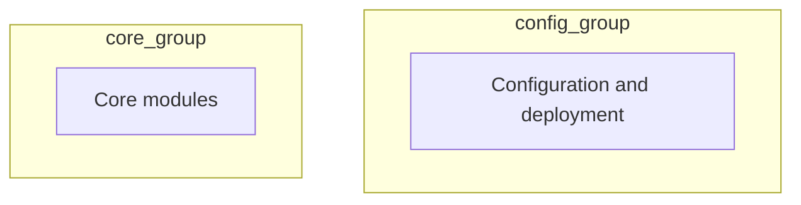

# Architecture report: Evavic44/portfolio-ideas

> Automated static analysis. **Observed** = directly seen in files/imports/AST; **Inferred** = interpretation from that evidence. Repository code was not executed.

## 1. Repository at a glance

| Item | Value |
| --- | --- |
| Repository | Evavic44/portfolio-ideas |
| Description | A curation of awesome portfolio website ideas for developers and designers to draw inspiration from. Raise a pull request to add more. 💜  |
| Language | Markdown |
| Stars | 6415 |
| Licence | MIT |
| Analysed commit / branch | 80abea017c94d16bab03c73d7aa790ccf1a7e70f / main |
| Framework(s) | Vue |
| Files analysed | 23 |
| Components | 2 |

## 2. Architecture in one minute

Evavic44/portfolio-ideas - A curation of awesome portfolio website ideas for developers and designers to draw inspiration from. Raise a pull request to add more. 💜 . This repository was analysed statically from 23 file(s) (0 Python). Detected technologies (observed from imports/manifests): GitHub Actions, Vue. Files are grouped into 2 component(s): Configuration and deployment, Core modules. Findings below distinguish observed facts from inferred interpretation.

## 3. High-level block diagram

## 4. Main components

### Configuration and deployment (`config`)

- **Kind:** config
- **Status:** Observed
- **Confidence:** 0.85
- **Responsibility:** Groups 2 file(s) under configuration and deployment (observed from repository paths and static analysis).
- **Paths:** `package.json`, `renovate.json`
- **Evidence:** [package.json](https://github.com/Evavic44/portfolio-ideas/blob/80abea017c94d16bab03c73d7aa790ccf1a7e70f/package.json); [renovate.json](https://github.com/Evavic44/portfolio-ideas/blob/80abea017c94d16bab03c73d7aa790ccf1a7e70f/renovate.json)

### Core modules (`core`)

- **Kind:** core
- **Status:** Observed
- **Confidence:** 0.85
- **Responsibility:** Groups 1 file(s) under core modules (observed from repository paths and static analysis).
- **Paths:** `extract.sh`
- **Evidence:** [extract.sh](https://github.com/Evavic44/portfolio-ideas/blob/80abea017c94d16bab03c73d7aa790ccf1a7e70f/extract.sh)

## 5. Execution flow

No entry point was observed; the startup flow below is therefore limited.

Representative flow (derived from observed entry points and the import graph; steps beyond the entry point are **Inferred**):

1. Execution starts at an observed entry point listed above, if present.
2. No internal import relationships between components were observed.

## 6. Project structure

### `(root)`

- `.all-contributorsrc` - other (1649 bytes)
- `.gitattributes` - other (64 bytes)
- `.gitignore` - other (1621 bytes)
- `.prettierignore` - other (18 bytes)
- `CODE_OF_CONDUCT.md` - docs (5201 bytes)
- `CONTRIBUTING.md` - docs (3941 bytes)
- `LICENSE` - docs (1068 bytes)
- `extract.sh` - source, Shell (339 bytes)
- `package.json` - manifest (1239 bytes)
- `renovate.json` - config (99 bytes)

### `.github`

- `.github/ISSUE_TEMPLATE/feature.md` - docs (622 bytes)
- `.github/Pull_request_template.md` - docs (260 bytes)
- `.github/stale.yml` - config (671 bytes)
- `.github/workflows/appreciation.yml` - ci, YAML (598 bytes)
- `.github/workflows/autodeploy.yml` - ci, YAML (974 bytes)

### `.husky`

- `.husky/pre-commit` - other (141 bytes)

### `docs`

- `docs/.vitepress/config.js` - docs (683 bytes)
- `docs/.vitepress/theme/custom.css` - docs (1494 bytes)
- `docs/.vitepress/theme/index.js` - docs (97 bytes)
- `docs/contributors.md` - docs (3172 bytes)
- `docs/guide.md` - docs (3941 bytes)
- `docs/index.md` - docs (1573 bytes)
- `docs/public/logo.svg` - docs (1022 bytes)

## 7. Key dependencies and integrations

| Name | Category | Status | Confidence | Evidence |
| --- | --- | --- | --- | --- |
| GitHub Actions | ci | Observed | 0.90 | [.github/workflows/appreciation.yml](https://github.com/Evavic44/portfolio-ideas/blob/80abea017c94d16bab03c73d7aa790ccf1a7e70f/.github/workflows/appreciation.yml); [.github/workflows/autodeploy.yml](https://github.com/Evavic44/portfolio-ideas/blob/80abea017c94d16bab03c73d7aa790ccf1a7e70f/.github/workflows/autodeploy.yml) |
| Vue | framework | Observed | 0.85 | [package.json:46](https://github.com/Evavic44/portfolio-ideas/blob/80abea017c94d16bab03c73d7aa790ccf1a7e70f/package.json#L46) |

## 8. Data and state

No database, cache, queue, or persistent-state usage was observed in the analysed files. State handling, if any, may be in-memory or in files that were not analysed.

## 9. Configuration and deployment clues

- `.github/stale.yml` (config)
- `.github/workflows/appreciation.yml` (ci)
- `.github/workflows/autodeploy.yml` (ci)
- `package.json` (manifest)
- `renovate.json` (config)

## 10. Design observations

- No strong design patterns could be established from the available evidence.

These observations are interpretations (**Inferred**) of the observed structure, not guarantees about runtime design.

## 11. Limitations and unknowns

- Static analysis only: repository code was not executed, installed, or imported at runtime.
- Components and relationships are inferred from file paths, imports, and AST structure; runtime behaviour, dynamic imports, and reflection may not be visible.
- 1 file(s) were skipped during inventory (1 x lockfile excluded).
- No clear application entry point was observed in the analysed files.
- Repository text was treated as untrusted data; no instructions found in repository files were followed, and likely secret values were redacted/excluded.
- JavaScript and TypeScript files were inventoried from paths and package manifests. They were not parsed with a full language AST, and repository code was not executed.

## 12. Source references

- [.github/workflows/appreciation.yml](https://github.com/Evavic44/portfolio-ideas/blob/80abea017c94d16bab03c73d7aa790ccf1a7e70f/.github/workflows/appreciation.yml)
- [.github/workflows/autodeploy.yml](https://github.com/Evavic44/portfolio-ideas/blob/80abea017c94d16bab03c73d7aa790ccf1a7e70f/.github/workflows/autodeploy.yml)
- [extract.sh](https://github.com/Evavic44/portfolio-ideas/blob/80abea017c94d16bab03c73d7aa790ccf1a7e70f/extract.sh)
- [package.json](https://github.com/Evavic44/portfolio-ideas/blob/80abea017c94d16bab03c73d7aa790ccf1a7e70f/package.json)
- [package.json:46](https://github.com/Evavic44/portfolio-ideas/blob/80abea017c94d16bab03c73d7aa790ccf1a7e70f/package.json#L46)
- [renovate.json](https://github.com/Evavic44/portfolio-ideas/blob/80abea017c94d16bab03c73d7aa790ccf1a7e70f/renovate.json)
