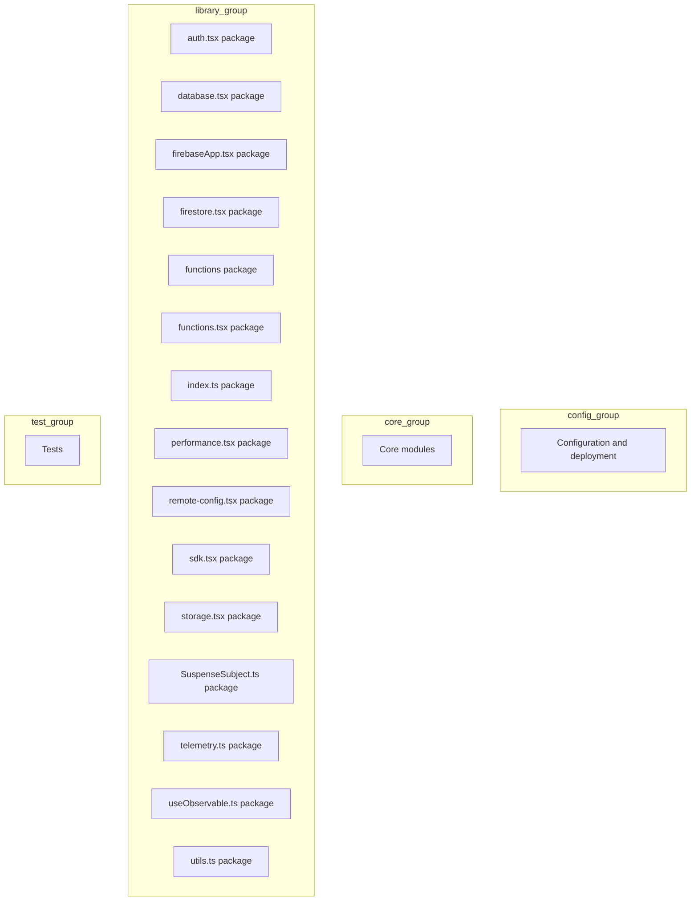

# Architecture report: FirebaseExtended/reactfire

> Automated static analysis. **Observed** = directly seen in files/imports/AST; **Inferred** = interpretation from that evidence. Repository code was not executed.

## 1. Repository at a glance

| Item | Value |
| --- | --- |
| Repository | FirebaseExtended/reactfire |
| Description | Hooks, Context Providers, and Components that make it easy to interact with Firebase. |
| Language | TypeScript |
| Stars | 3567 |
| Licence | MIT |
| Analysed commit / branch | 9b2bb79824d69ffc6368658a9569643c7013b4a1 / main |
| Framework(s) | React |
| Files analysed | 174 |
| Components | 18 |

## 2. Architecture in one minute

FirebaseExtended/reactfire - Hooks, Context Providers, and Components that make it easy to interact with Firebase.. This repository was analysed statically from 174 file(s) (0 Python). Detected technologies (observed from imports/manifests): GitHub Actions, React, Tailwind CSS, TypeScript, Vite, Vitest. Files are grouped into 18 component(s): auth.tsx package, Configuration and deployment, Core modules, database.tsx package, firebaseApp.tsx package, firestore.tsx package, functions package, functions.tsx package. Findings below distinguish observed facts from inferred interpretation.

## 3. High-level block diagram

## 4. Main components

### auth.tsx package (`auth_tsx`)

- **Kind:** library
- **Status:** Observed
- **Confidence:** 0.85
- **Responsibility:** Groups 1 file(s) under auth.tsx package (observed from repository paths and static analysis).
- **Paths:** `src/auth.tsx`
- **Evidence:** [src/auth.tsx](https://github.com/FirebaseExtended/reactfire/blob/9b2bb79824d69ffc6368658a9569643c7013b4a1/src/auth.tsx)

### Configuration and deployment (`config`)

- **Kind:** config
- **Status:** Observed
- **Confidence:** 0.85
- **Responsibility:** Groups 8 file(s) under configuration and deployment (observed from repository paths and static analysis).
- **Paths:** `database.rules.json`, `firebase.json`, `firestore.indexes.json`, `functions/package.json`, `package.json`, `tsconfig.json`, `tsconfig.test.json`, `typedoc.json`
- **Evidence:** [database.rules.json](https://github.com/FirebaseExtended/reactfire/blob/9b2bb79824d69ffc6368658a9569643c7013b4a1/database.rules.json); [firebase.json](https://github.com/FirebaseExtended/reactfire/blob/9b2bb79824d69ffc6368658a9569643c7013b4a1/firebase.json); [firestore.indexes.json](https://github.com/FirebaseExtended/reactfire/blob/9b2bb79824d69ffc6368658a9569643c7013b4a1/firestore.indexes.json); [functions/package.json](https://github.com/FirebaseExtended/reactfire/blob/9b2bb79824d69ffc6368658a9569643c7013b4a1/functions/package.json); [package.json](https://github.com/FirebaseExtended/reactfire/blob/9b2bb79824d69ffc6368658a9569643c7013b4a1/package.json); [tsconfig.json](https://github.com/FirebaseExtended/reactfire/blob/9b2bb79824d69ffc6368658a9569643c7013b4a1/tsconfig.json); [tsconfig.test.json](https://github.com/FirebaseExtended/reactfire/blob/9b2bb79824d69ffc6368658a9569643c7013b4a1/tsconfig.test.json); [typedoc.json](https://github.com/FirebaseExtended/reactfire/blob/9b2bb79824d69ffc6368658a9569643c7013b4a1/typedoc.json)

### Core modules (`core`)

- **Kind:** core
- **Status:** Observed
- **Confidence:** 0.85
- **Responsibility:** Groups 2 file(s) under core modules (observed from repository paths and static analysis).
- **Paths:** `build.sh`, `vite.config.ts`
- **Evidence:** [build.sh](https://github.com/FirebaseExtended/reactfire/blob/9b2bb79824d69ffc6368658a9569643c7013b4a1/build.sh); [vite.config.ts](https://github.com/FirebaseExtended/reactfire/blob/9b2bb79824d69ffc6368658a9569643c7013b4a1/vite.config.ts)

### database.tsx package (`database_tsx`)

- **Kind:** library
- **Status:** Observed
- **Confidence:** 0.85
- **Responsibility:** Groups 1 file(s) under database.tsx package (observed from repository paths and static analysis).
- **Paths:** `src/database.tsx`
- **Evidence:** [src/database.tsx](https://github.com/FirebaseExtended/reactfire/blob/9b2bb79824d69ffc6368658a9569643c7013b4a1/src/database.tsx)

### firebaseApp.tsx package (`firebaseapp_tsx`)

- **Kind:** library
- **Status:** Observed
- **Confidence:** 0.85
- **Responsibility:** Groups 1 file(s) under firebaseapp.tsx package (observed from repository paths and static analysis).
- **Paths:** `src/firebaseApp.tsx`
- **Evidence:** [src/firebaseApp.tsx](https://github.com/FirebaseExtended/reactfire/blob/9b2bb79824d69ffc6368658a9569643c7013b4a1/src/firebaseApp.tsx)

### firestore.tsx package (`firestore_tsx`)

- **Kind:** library
- **Status:** Observed
- **Confidence:** 0.85
- **Responsibility:** Groups 1 file(s) under firestore.tsx package (observed from repository paths and static analysis).
- **Paths:** `src/firestore.tsx`
- **Evidence:** [src/firestore.tsx](https://github.com/FirebaseExtended/reactfire/blob/9b2bb79824d69ffc6368658a9569643c7013b4a1/src/firestore.tsx)

### functions package (`functions`)

- **Kind:** library
- **Status:** Observed
- **Confidence:** 0.85
- **Responsibility:** Groups 1 file(s) under functions package (observed from repository paths and static analysis).
- **Paths:** `functions/index.js`
- **Evidence:** [functions/index.js](https://github.com/FirebaseExtended/reactfire/blob/9b2bb79824d69ffc6368658a9569643c7013b4a1/functions/index.js)

### functions.tsx package (`functions_tsx`)

- **Kind:** library
- **Status:** Observed
- **Confidence:** 0.85
- **Responsibility:** Groups 1 file(s) under functions.tsx package (observed from repository paths and static analysis).
- **Paths:** `src/functions.tsx`
- **Evidence:** [src/functions.tsx](https://github.com/FirebaseExtended/reactfire/blob/9b2bb79824d69ffc6368658a9569643c7013b4a1/src/functions.tsx)

### index.ts package (`index_ts`)

- **Kind:** library
- **Status:** Observed
- **Confidence:** 0.85
- **Responsibility:** Groups 1 file(s) under index.ts package (observed from repository paths and static analysis).
- **Paths:** `src/index.ts`
- **Evidence:** [src/index.ts](https://github.com/FirebaseExtended/reactfire/blob/9b2bb79824d69ffc6368658a9569643c7013b4a1/src/index.ts)

### performance.tsx package (`performance_tsx`)

- **Kind:** library
- **Status:** Observed
- **Confidence:** 0.85
- **Responsibility:** Groups 1 file(s) under performance.tsx package (observed from repository paths and static analysis).
- **Paths:** `src/performance.tsx`
- **Evidence:** [src/performance.tsx](https://github.com/FirebaseExtended/reactfire/blob/9b2bb79824d69ffc6368658a9569643c7013b4a1/src/performance.tsx)

### remote-config.tsx package (`remote_config_tsx`)

- **Kind:** library
- **Status:** Observed
- **Confidence:** 0.85
- **Responsibility:** Groups 1 file(s) under remote-config.tsx package (observed from repository paths and static analysis).
- **Paths:** `src/remote-config.tsx`
- **Evidence:** [src/remote-config.tsx](https://github.com/FirebaseExtended/reactfire/blob/9b2bb79824d69ffc6368658a9569643c7013b4a1/src/remote-config.tsx)

### sdk.tsx package (`sdk_tsx`)

- **Kind:** library
- **Status:** Observed
- **Confidence:** 0.85
- **Responsibility:** Groups 1 file(s) under sdk.tsx package (observed from repository paths and static analysis).
- **Paths:** `src/sdk.tsx`
- **Evidence:** [src/sdk.tsx](https://github.com/FirebaseExtended/reactfire/blob/9b2bb79824d69ffc6368658a9569643c7013b4a1/src/sdk.tsx)

### storage.tsx package (`storage_tsx`)

- **Kind:** library
- **Status:** Observed
- **Confidence:** 0.85
- **Responsibility:** Groups 1 file(s) under storage.tsx package (observed from repository paths and static analysis).
- **Paths:** `src/storage.tsx`
- **Evidence:** [src/storage.tsx](https://github.com/FirebaseExtended/reactfire/blob/9b2bb79824d69ffc6368658a9569643c7013b4a1/src/storage.tsx)

### SuspenseSubject.ts package (`suspensesubject_ts`)

- **Kind:** library
- **Status:** Observed
- **Confidence:** 0.85
- **Responsibility:** Groups 1 file(s) under suspensesubject.ts package (observed from repository paths and static analysis).
- **Paths:** `src/SuspenseSubject.ts`
- **Evidence:** [src/SuspenseSubject.ts](https://github.com/FirebaseExtended/reactfire/blob/9b2bb79824d69ffc6368658a9569643c7013b4a1/src/SuspenseSubject.ts)

### telemetry.ts package (`telemetry_ts`)

- **Kind:** library
- **Status:** Observed
- **Confidence:** 0.85
- **Responsibility:** Groups 1 file(s) under telemetry.ts package (observed from repository paths and static analysis).
- **Paths:** `src/telemetry.ts`
- **Evidence:** [src/telemetry.ts](https://github.com/FirebaseExtended/reactfire/blob/9b2bb79824d69ffc6368658a9569643c7013b4a1/src/telemetry.ts)

### Tests (`tests`)

- **Kind:** test
- **Status:** Observed
- **Confidence:** 0.85
- **Responsibility:** Groups 16 file(s) under tests (observed from repository paths and static analysis).
- **Paths:** `test/appConfig.ts`, `test/auth.test.tsx`, `test/database.test.tsx`, `test/firebaseApp.test.tsx`, `test/firestore.test.tsx`, `test/functions.test.tsx`, `test/performance.test.tsx`, `test/preload-suspense-policy.test.tsx`, `test/sdk-init-cache.test.tsx`, `test/sdk.test.tsx`, `test/setupTests.ts`, `test/storage.test.tsx`, `test/suspenseSubject-error-branch.test.tsx`, `test/test-utils.ts`, `test/tsconfig.json`, `test/useObservable.test.tsx`
- **Evidence:** [test/appConfig.ts](https://github.com/FirebaseExtended/reactfire/blob/9b2bb79824d69ffc6368658a9569643c7013b4a1/test/appConfig.ts); [test/auth.test.tsx](https://github.com/FirebaseExtended/reactfire/blob/9b2bb79824d69ffc6368658a9569643c7013b4a1/test/auth.test.tsx); [test/database.test.tsx](https://github.com/FirebaseExtended/reactfire/blob/9b2bb79824d69ffc6368658a9569643c7013b4a1/test/database.test.tsx); [test/firebaseApp.test.tsx](https://github.com/FirebaseExtended/reactfire/blob/9b2bb79824d69ffc6368658a9569643c7013b4a1/test/firebaseApp.test.tsx); [test/firestore.test.tsx](https://github.com/FirebaseExtended/reactfire/blob/9b2bb79824d69ffc6368658a9569643c7013b4a1/test/firestore.test.tsx); [test/functions.test.tsx](https://github.com/FirebaseExtended/reactfire/blob/9b2bb79824d69ffc6368658a9569643c7013b4a1/test/functions.test.tsx); [test/performance.test.tsx](https://github.com/FirebaseExtended/reactfire/blob/9b2bb79824d69ffc6368658a9569643c7013b4a1/test/performance.test.tsx); [test/preload-suspense-policy.test.tsx](https://github.com/FirebaseExtended/reactfire/blob/9b2bb79824d69ffc6368658a9569643c7013b4a1/test/preload-suspense-policy.test.tsx)

### useObservable.ts package (`useobservable_ts`)

- **Kind:** library
- **Status:** Observed
- **Confidence:** 0.85
- **Responsibility:** Groups 1 file(s) under useobservable.ts package (observed from repository paths and static analysis).
- **Paths:** `src/useObservable.ts`
- **Evidence:** [src/useObservable.ts](https://github.com/FirebaseExtended/reactfire/blob/9b2bb79824d69ffc6368658a9569643c7013b4a1/src/useObservable.ts)

### utils.ts package (`utils_ts`)

- **Kind:** library
- **Status:** Observed
- **Confidence:** 0.85
- **Responsibility:** Groups 1 file(s) under utils.ts package (observed from repository paths and static analysis).
- **Paths:** `src/utils.ts`
- **Evidence:** [src/utils.ts](https://github.com/FirebaseExtended/reactfire/blob/9b2bb79824d69ffc6368658a9569643c7013b4a1/src/utils.ts)

## 5. Execution flow

**Observed** entry point(s):

- [functions/index.js](https://github.com/FirebaseExtended/reactfire/blob/9b2bb79824d69ffc6368658a9569643c7013b4a1/functions/index.js)
- [src/index.ts](https://github.com/FirebaseExtended/reactfire/blob/9b2bb79824d69ffc6368658a9569643c7013b4a1/src/index.ts)

Representative flow (derived from observed entry points and the import graph; steps beyond the entry point are **Inferred**):

1. Execution starts at an observed entry point listed above, if present.
2. No internal import relationships between components were observed.

## 6. Project structure

### `(root)`

- `.gitattributes` - other (93 bytes)
- `.gitignore` - other (334 bytes)
- `.nvmrc` - other (7 bytes)
- `.oxlintrc.json` - config (6194 bytes)
- `LICENSE` - docs (1075 bytes)
- `README.md` - docs (4077 bytes)
- `build.sh` - source, Shell (841 bytes)
- `database.rules.json` - config (106 bytes)
- `firebase.json` - config (529 bytes)
- `firestore.indexes.json` - config (44 bytes)
- `firestore.rules` - other (161 bytes)
- `package.json` - manifest (4080 bytes)
- `storage.rules` - other (145 bytes)
- `tsconfig.json` - config (1554 bytes)
- `tsconfig.test.json` - config (505 bytes)
- `typedoc.json` - config (206 bytes)
- `vite.config.ts` - source, TypeScript (2851 bytes)

### `.github`

- `.github/CONTRIBUTING.md` - docs (7313 bytes)
- `.github/ISSUE_TEMPLATE.md` - docs (2109 bytes)
- `.github/PULL_REQUEST_TEMPLATE.md` - docs (1118 bytes)
- `.github/workflows/docs.yaml` - ci, YAML (793 bytes)
- `.github/workflows/test.yaml` - ci, YAML (7655 bytes)

### `docs`

- `docs/quickstart.md` - docs (5617 bytes)
- `docs/reference/README.md` - docs (4899 bytes)
- `docs/reference/classes/ReactFireError.md` - docs (2000 bytes)
- `docs/reference/functions/AuthCheck.md` - docs (768 bytes)
- `docs/reference/functions/ClaimsCheck.md` - docs (747 bytes)
- `docs/reference/functions/FirebaseAppProvider.md` - docs (460 bytes)
- `docs/reference/functions/StorageImage.md` - docs (482 bytes)
- `docs/reference/functions/SuspenseWithPerf.md` - docs (448 bytes)
- `docs/reference/functions/checkIdField.md` - docs (382 bytes)
- `docs/reference/functions/checkOptions.md` - docs (412 bytes)
- `docs/reference/functions/checkinitialData.md` - docs (394 bytes)
- `docs/reference/functions/preloadFirestoreDoc.md` - docs (722 bytes)
- `docs/reference/functions/preloadObservable.md` - docs (539 bytes)
- `docs/reference/functions/preloadUser.md` - docs (437 bytes)
- `docs/reference/functions/useAnalytics.md` - docs (300 bytes)
- `docs/reference/functions/useAppCheck.md` - docs (295 bytes)
- `docs/reference/functions/useAuth.md` - docs (275 bytes)
- `docs/reference/functions/useCallableFunctionResponse.md` - docs (829 bytes)
- `docs/reference/functions/useDatabase.md` - docs (295 bytes)
- `docs/reference/functions/useDatabaseList.md` - docs (779 bytes)
- `docs/reference/functions/useDatabaseListData.md` - docs (686 bytes)
- `docs/reference/functions/useDatabaseObject.md` - docs (741 bytes)
- `docs/reference/functions/useDatabaseObjectData.md` - docs (616 bytes)
- `docs/reference/functions/useFirebaseApp.md` - docs (324 bytes)
- `docs/reference/functions/useFirestore.md` - docs (300 bytes)
- `docs/reference/functions/useFirestoreCollection.md` - docs (746 bytes)
- `docs/reference/functions/useFirestoreCollectionData.md` - docs (731 bytes)
- `docs/reference/functions/useFirestoreDoc.md` - docs (810 bytes)
- `docs/reference/functions/useFirestoreDocData.md` - docs (746 bytes)
- `docs/reference/functions/useFirestoreDocDataOnce.md` - docs (772 bytes)
- `docs/reference/functions/useFirestoreDocOnce.md` - docs (769 bytes)
- `docs/reference/functions/useFunctions.md` - docs (300 bytes)
- `docs/reference/functions/useIdTokenResult.md` - docs (636 bytes)
- `docs/reference/functions/useIsSuspenseEnabled.md` - docs (334 bytes)
- `docs/reference/functions/useObservable.md` - docs (660 bytes)
- `docs/reference/functions/usePerformance.md` - docs (326 bytes)
- `docs/reference/functions/useRemoteConfig.md` - docs (315 bytes)
- `docs/reference/functions/useRemoteConfigAll.md` - docs (625 bytes)
- `docs/reference/functions/useRemoteConfigBoolean.md` - docs (640 bytes)
- `docs/reference/functions/useRemoteConfigNumber.md` - docs (634 bytes)
- `docs/reference/functions/useRemoteConfigString.md` - docs (634 bytes)
- `docs/reference/functions/useRemoteConfigValue.md` - docs (614 bytes)
- `docs/reference/functions/useSigninCheck.md` - docs (1742 bytes)
- `docs/reference/functions/useStorage.md` - docs (306 bytes)
- `docs/reference/functions/useStorageDownloadURL.md` - docs (735 bytes)
- `docs/reference/functions/useStorageTask.md` - docs (806 bytes)
- `docs/reference/functions/useSuspenseEnabledFromConfigAndContext.md` - docs (460 bytes)
- `docs/reference/functions/useUser.md` - docs (634 bytes)
- `docs/reference/interfaces/AuthCheckProps.md` - docs (734 bytes)
- `docs/reference/interfaces/ClaimCheckErrors.md` - docs (293 bytes)
- `docs/reference/interfaces/ClaimsCheckProps.md` - docs (915 bytes)
- `docs/reference/interfaces/ClaimsValidator.md` - docs (596 bytes)
- `docs/reference/interfaces/FirebaseAppProviderProps.md` - docs (1026 bytes)
- `docs/reference/interfaces/ObservableStatus.md` - docs (2184 bytes)
- `docs/reference/interfaces/ReactFireOptions.md` - docs (1090 bytes)
- `docs/reference/interfaces/SignInCheckOptionsBasic.md` - docs (1883 bytes)
- `docs/reference/interfaces/SignInCheckOptionsClaimsObject.md` - docs (2068 bytes)
- `docs/reference/interfaces/SignInCheckOptionsClaimsValidator.md` - docs (2116 bytes)
- `docs/reference/interfaces/SuspensePerfProps.md` - docs (761 bytes)
- `docs/reference/type-aliases/ReactFireGlobals.md` - docs (1175 bytes)
- `docs/reference/type-aliases/SigninCheckResult.md` - docs (511 bytes)
- `docs/reference/type-aliases/StorageImageProps.md` - docs (994 bytes)
- `docs/reference/variables/AnalyticsProvider.md` - docs (414 bytes)
- `docs/reference/variables/AnalyticsSdkContext.md` - docs (326 bytes)
- `docs/reference/variables/AppCheckProvider.md` - docs (408 bytes)
- `docs/reference/variables/AppCheckSdkContext.md` - docs (322 bytes)
- `docs/reference/variables/AuthProvider.md` - docs (392 bytes)
- `docs/reference/variables/AuthSdkContext.md` - docs (306 bytes)
- `docs/reference/variables/DatabaseProvider.md` - docs (410 bytes)
- `docs/reference/variables/DatabaseSdkContext.md` - docs (322 bytes)
- `docs/reference/variables/FirestoreProvider.md` - docs (414 bytes)
- `docs/reference/variables/FirestoreSdkContext.md` - docs (326 bytes)
- `docs/reference/variables/FunctionsProvider.md` - docs (414 bytes)
- `docs/reference/variables/FunctionsSdkContext.md` - docs (326 bytes)
- `docs/reference/variables/PerformanceProvider.md` - docs (430 bytes)
- `docs/reference/variables/PerformanceSdkContext.md` - docs (342 bytes)
- `docs/reference/variables/RemoteConfigProvider.md` - docs (426 bytes)
- `docs/reference/variables/RemoteConfigSdkContext.md` - docs (338 bytes)
- `docs/reference/variables/StorageProvider.md` - docs (414 bytes)
- `docs/reference/variables/StorageSdkContext.md` - docs (326 bytes)
- `docs/reference/variables/useInitAnalytics.md` - docs (308 bytes)
- `docs/reference/variables/useInitAppCheck.md` - docs (304 bytes)
- `docs/reference/variables/useInitAuth.md` - docs (288 bytes)
- `docs/reference/variables/useInitDatabase.md` - docs (304 bytes)
- `docs/reference/variables/useInitFirestore.md` - docs (308 bytes)
- `docs/reference/variables/useInitFunctions.md` - docs (308 bytes)
- `docs/reference/variables/useInitPerformance.md` - docs (324 bytes)
- `docs/reference/variables/useInitRemoteConfig.md` - docs (320 bytes)
- `docs/reference/variables/useInitStorage.md` - docs (308 bytes)
- `docs/reference/variables/version.md` - docs (267 bytes)
- `docs/upgrade-guide.md` - docs (2459 bytes)
- `docs/use.md` - docs (18845 bytes)

### `example`

- `example/.npmignore` - other (24 bytes)
- `example/display/Button.tsx` - source, TypeScript (345 bytes)
- `example/display/Card.tsx` - source, TypeScript (641 bytes)
- `example/display/LoadingSpinner.tsx` - source, TypeScript (167 bytes)
- `example/index.css` - other (58 bytes)
- `example/index.html` - other (356 bytes)
- `example/index.tsx` - source, TypeScript (1665 bytes)
- `example/package.json` - manifest (722 bytes)
- `example/postcss.config.cjs` - source, JavaScript (82 bytes)
- `example/tailwind.config.cjs` - source, JavaScript (267 bytes)
- `example/tsconfig.json` - config (638 bytes)
- `example/tsconfig.node.json` - config (199 bytes)
- `example/vite.config.js` - source, JavaScript (371 bytes)
- `example/withSuspense/App.tsx` - source, TypeScript (1449 bytes)
- `example/withSuspense/Auth.tsx` - source, TypeScript (1930 bytes)
- `example/withSuspense/Firestore.tsx` - source, TypeScript (4916 bytes)
- `example/withSuspense/RealtimeDatabase.tsx` - source, TypeScript (3197 bytes)
- `example/withSuspense/RemoteConfig.tsx` - source, TypeScript (1304 bytes)
- `example/withSuspense/Storage.tsx` - source, TypeScript (2715 bytes)
- `example/withoutSuspense/Analytics.tsx` - source, TypeScript (564 bytes)
- `example/withoutSuspense/App.tsx` - source, TypeScript (1481 bytes)
- `example/withoutSuspense/Auth.tsx` - source, TypeScript (1980 bytes)
- `example/withoutSuspense/Firestore.tsx` - source, TypeScript (3999 bytes)
- `example/withoutSuspense/Functions.tsx` - source, TypeScript (2126 bytes)
- `example/withoutSuspense/RealtimeDatabase.tsx` - source, TypeScript (3215 bytes)
- `example/withoutSuspense/RemoteConfig.tsx` - source, TypeScript (1245 bytes)
- `example/withoutSuspense/Storage.tsx` - source, TypeScript (2704 bytes)

### `functions`

- `functions/.gitignore` - other (13 bytes)
- `functions/index.js` - source, JavaScript (153 bytes)
- `functions/package.json` - manifest (483 bytes)

### `src`

- `src/SuspenseSubject.ts` - source, TypeScript (7025 bytes)
- `src/auth.tsx` - source, TypeScript (10198 bytes)
- `src/database.tsx` - source, TypeScript (2719 bytes)
- `src/firebaseApp.tsx` - source, TypeScript (2740 bytes)
- `src/firestore.tsx` - source, TypeScript (5394 bytes)
- `src/functions.tsx` - source, TypeScript (1264 bytes)
- `src/index.ts` - source, TypeScript (1278 bytes)
- `src/performance.tsx` - source, TypeScript (1181 bytes)
- `src/remote-config.tsx` - source, TypeScript (2601 bytes)
- `src/sdk.tsx` - source, TypeScript (7531 bytes)
- `src/storage.tsx` - source, TypeScript (3365 bytes)
- `src/telemetry.ts` - source, TypeScript (1704 bytes)
- `src/useObservable.ts` - source, TypeScript (6640 bytes)
- `src/utils.ts` - source, TypeScript (1161 bytes)

### `test`

- `test/appConfig.ts` - test, TypeScript (343 bytes)
- `test/auth.test.tsx` - test, TypeScript (13954 bytes)
- `test/database.test.tsx` - test, TypeScript (6384 bytes)
- `test/firebaseApp.test.tsx` - test, TypeScript (7551 bytes)
- `test/firestore.test.tsx` - test, TypeScript (21333 bytes)
- `test/functions.test.tsx` - test, TypeScript (3968 bytes)
- `test/performance.test.tsx` - test, TypeScript (4022 bytes)
- `test/preload-suspense-policy.test.tsx` - test, TypeScript (2880 bytes)
- `test/sdk-init-cache.test.tsx` - test, TypeScript (4490 bytes)
- `test/sdk.test.tsx` - test, TypeScript (2008 bytes)
- `test/setupTests.ts` - test, TypeScript (367 bytes)
- `test/storage.test.tsx` - test, TypeScript (2879 bytes)
- `test/suspenseSubject-error-branch.test.tsx` - test, TypeScript (2333 bytes)
- `test/test-utils.ts` - test, TypeScript (93 bytes)
- `test/tsconfig.json` - test (221 bytes)
- `test/useObservable.test.tsx` - test, TypeScript (35918 bytes)

## 7. Key dependencies and integrations

| Name | Category | Status | Confidence | Evidence |
| --- | --- | --- | --- | --- |
| GitHub Actions | ci | Observed | 0.90 | [.github/workflows/docs.yaml](https://github.com/FirebaseExtended/reactfire/blob/9b2bb79824d69ffc6368658a9569643c7013b4a1/.github/workflows/docs.yaml); [.github/workflows/test.yaml](https://github.com/FirebaseExtended/reactfire/blob/9b2bb79824d69ffc6368658a9569643c7013b4a1/.github/workflows/test.yaml) |
| React | framework | Observed | 0.90 | [example/package.json:2](https://github.com/FirebaseExtended/reactfire/blob/9b2bb79824d69ffc6368658a9569643c7013b4a1/example/package.json#L2); [example/package.json:13](https://github.com/FirebaseExtended/reactfire/blob/9b2bb79824d69ffc6368658a9569643c7013b4a1/example/package.json#L13); [package.json:49](https://github.com/FirebaseExtended/reactfire/blob/9b2bb79824d69ffc6368658a9569643c7013b4a1/package.json#L49); [package.json:91](https://github.com/FirebaseExtended/reactfire/blob/9b2bb79824d69ffc6368658a9569643c7013b4a1/package.json#L91) |
| Tailwind CSS | library | Observed | 0.85 | [example/package.json:27](https://github.com/FirebaseExtended/reactfire/blob/9b2bb79824d69ffc6368658a9569643c7013b4a1/example/package.json#L27) |
| TypeScript | tooling | Observed | 0.90 | [example/package.json:28](https://github.com/FirebaseExtended/reactfire/blob/9b2bb79824d69ffc6368658a9569643c7013b4a1/example/package.json#L28); [package.json:85](https://github.com/FirebaseExtended/reactfire/blob/9b2bb79824d69ffc6368658a9569643c7013b4a1/package.json#L85) |
| Vite | tooling | Observed | 0.90 | [example/package.json:7](https://github.com/FirebaseExtended/reactfire/blob/9b2bb79824d69ffc6368658a9569643c7013b4a1/example/package.json#L7); [package.json:27](https://github.com/FirebaseExtended/reactfire/blob/9b2bb79824d69ffc6368658a9569643c7013b4a1/package.json#L27) |
| Vitest | tooling | Observed | 0.85 | [package.json:27](https://github.com/FirebaseExtended/reactfire/blob/9b2bb79824d69ffc6368658a9569643c7013b4a1/package.json#L27) |

## 8. Data and state

No database, cache, queue, or persistent-state usage was observed in the analysed files. State handling, if any, may be in-memory or in files that were not analysed.

## 9. Configuration and deployment clues

- `.github/workflows/docs.yaml` (ci)
- `.github/workflows/test.yaml` (ci)
- `.oxlintrc.json` (config)
- `database.rules.json` (config)
- `example/package.json` (manifest)
- `example/tsconfig.json` (config)
- `example/tsconfig.node.json` (config)
- `firebase.json` (config)
- `firestore.indexes.json` (config)
- `functions/package.json` (manifest)
- `package.json` (manifest)
- `tsconfig.json` (config)
- `tsconfig.test.json` (config)
- `typedoc.json` (config)

## 10. Design observations

- Tests are present alongside source code (Observed from test file paths).

These observations are interpretations (**Inferred**) of the observed structure, not guarantees about runtime design.

## 11. Limitations and unknowns

- Static analysis only: repository code was not executed, installed, or imported at runtime.
- Components and relationships are inferred from file paths, imports, and AST structure; runtime behaviour, dynamic imports, and reflection may not be visible.
- 1 file(s) were skipped during inventory (1 x lockfile excluded).
- No clear application entry point was observed in the analysed files.
- Repository text was treated as untrusted data; no instructions found in repository files were followed, and likely secret values were redacted/excluded.
- JavaScript and TypeScript files were inventoried from paths and package manifests. They were not parsed with a full language AST, and repository code was not executed.

## 12. Source references

- [.github/workflows/docs.yaml](https://github.com/FirebaseExtended/reactfire/blob/9b2bb79824d69ffc6368658a9569643c7013b4a1/.github/workflows/docs.yaml)
- [.github/workflows/test.yaml](https://github.com/FirebaseExtended/reactfire/blob/9b2bb79824d69ffc6368658a9569643c7013b4a1/.github/workflows/test.yaml)
- [build.sh](https://github.com/FirebaseExtended/reactfire/blob/9b2bb79824d69ffc6368658a9569643c7013b4a1/build.sh)
- [database.rules.json](https://github.com/FirebaseExtended/reactfire/blob/9b2bb79824d69ffc6368658a9569643c7013b4a1/database.rules.json)
- [example/package.json:2](https://github.com/FirebaseExtended/reactfire/blob/9b2bb79824d69ffc6368658a9569643c7013b4a1/example/package.json#L2)
- [example/package.json:7](https://github.com/FirebaseExtended/reactfire/blob/9b2bb79824d69ffc6368658a9569643c7013b4a1/example/package.json#L7)
- [example/package.json:13](https://github.com/FirebaseExtended/reactfire/blob/9b2bb79824d69ffc6368658a9569643c7013b4a1/example/package.json#L13)
- [example/package.json:27](https://github.com/FirebaseExtended/reactfire/blob/9b2bb79824d69ffc6368658a9569643c7013b4a1/example/package.json#L27)
- [example/package.json:28](https://github.com/FirebaseExtended/reactfire/blob/9b2bb79824d69ffc6368658a9569643c7013b4a1/example/package.json#L28)
- [firebase.json](https://github.com/FirebaseExtended/reactfire/blob/9b2bb79824d69ffc6368658a9569643c7013b4a1/firebase.json)
- [firestore.indexes.json](https://github.com/FirebaseExtended/reactfire/blob/9b2bb79824d69ffc6368658a9569643c7013b4a1/firestore.indexes.json)
- [functions/index.js](https://github.com/FirebaseExtended/reactfire/blob/9b2bb79824d69ffc6368658a9569643c7013b4a1/functions/index.js)
- [functions/package.json](https://github.com/FirebaseExtended/reactfire/blob/9b2bb79824d69ffc6368658a9569643c7013b4a1/functions/package.json)
- [package.json](https://github.com/FirebaseExtended/reactfire/blob/9b2bb79824d69ffc6368658a9569643c7013b4a1/package.json)
- [package.json:27](https://github.com/FirebaseExtended/reactfire/blob/9b2bb79824d69ffc6368658a9569643c7013b4a1/package.json#L27)
- [package.json:49](https://github.com/FirebaseExtended/reactfire/blob/9b2bb79824d69ffc6368658a9569643c7013b4a1/package.json#L49)
- [package.json:85](https://github.com/FirebaseExtended/reactfire/blob/9b2bb79824d69ffc6368658a9569643c7013b4a1/package.json#L85)
- [package.json:91](https://github.com/FirebaseExtended/reactfire/blob/9b2bb79824d69ffc6368658a9569643c7013b4a1/package.json#L91)
- [src/SuspenseSubject.ts](https://github.com/FirebaseExtended/reactfire/blob/9b2bb79824d69ffc6368658a9569643c7013b4a1/src/SuspenseSubject.ts)
- [src/auth.tsx](https://github.com/FirebaseExtended/reactfire/blob/9b2bb79824d69ffc6368658a9569643c7013b4a1/src/auth.tsx)
- [src/database.tsx](https://github.com/FirebaseExtended/reactfire/blob/9b2bb79824d69ffc6368658a9569643c7013b4a1/src/database.tsx)
- [src/firebaseApp.tsx](https://github.com/FirebaseExtended/reactfire/blob/9b2bb79824d69ffc6368658a9569643c7013b4a1/src/firebaseApp.tsx)
- [src/firestore.tsx](https://github.com/FirebaseExtended/reactfire/blob/9b2bb79824d69ffc6368658a9569643c7013b4a1/src/firestore.tsx)
- [src/functions.tsx](https://github.com/FirebaseExtended/reactfire/blob/9b2bb79824d69ffc6368658a9569643c7013b4a1/src/functions.tsx)
- [src/index.ts](https://github.com/FirebaseExtended/reactfire/blob/9b2bb79824d69ffc6368658a9569643c7013b4a1/src/index.ts)
- [src/performance.tsx](https://github.com/FirebaseExtended/reactfire/blob/9b2bb79824d69ffc6368658a9569643c7013b4a1/src/performance.tsx)
- [src/remote-config.tsx](https://github.com/FirebaseExtended/reactfire/blob/9b2bb79824d69ffc6368658a9569643c7013b4a1/src/remote-config.tsx)
- [src/sdk.tsx](https://github.com/FirebaseExtended/reactfire/blob/9b2bb79824d69ffc6368658a9569643c7013b4a1/src/sdk.tsx)
- [src/storage.tsx](https://github.com/FirebaseExtended/reactfire/blob/9b2bb79824d69ffc6368658a9569643c7013b4a1/src/storage.tsx)
- [src/telemetry.ts](https://github.com/FirebaseExtended/reactfire/blob/9b2bb79824d69ffc6368658a9569643c7013b4a1/src/telemetry.ts)
- [src/useObservable.ts](https://github.com/FirebaseExtended/reactfire/blob/9b2bb79824d69ffc6368658a9569643c7013b4a1/src/useObservable.ts)
- [src/utils.ts](https://github.com/FirebaseExtended/reactfire/blob/9b2bb79824d69ffc6368658a9569643c7013b4a1/src/utils.ts)
- [test/appConfig.ts](https://github.com/FirebaseExtended/reactfire/blob/9b2bb79824d69ffc6368658a9569643c7013b4a1/test/appConfig.ts)
- [test/auth.test.tsx](https://github.com/FirebaseExtended/reactfire/blob/9b2bb79824d69ffc6368658a9569643c7013b4a1/test/auth.test.tsx)
- [test/database.test.tsx](https://github.com/FirebaseExtended/reactfire/blob/9b2bb79824d69ffc6368658a9569643c7013b4a1/test/database.test.tsx)
- [test/firebaseApp.test.tsx](https://github.com/FirebaseExtended/reactfire/blob/9b2bb79824d69ffc6368658a9569643c7013b4a1/test/firebaseApp.test.tsx)
- [test/firestore.test.tsx](https://github.com/FirebaseExtended/reactfire/blob/9b2bb79824d69ffc6368658a9569643c7013b4a1/test/firestore.test.tsx)
- [test/functions.test.tsx](https://github.com/FirebaseExtended/reactfire/blob/9b2bb79824d69ffc6368658a9569643c7013b4a1/test/functions.test.tsx)
- [test/performance.test.tsx](https://github.com/FirebaseExtended/reactfire/blob/9b2bb79824d69ffc6368658a9569643c7013b4a1/test/performance.test.tsx)
- [test/preload-suspense-policy.test.tsx](https://github.com/FirebaseExtended/reactfire/blob/9b2bb79824d69ffc6368658a9569643c7013b4a1/test/preload-suspense-policy.test.tsx)
- [tsconfig.json](https://github.com/FirebaseExtended/reactfire/blob/9b2bb79824d69ffc6368658a9569643c7013b4a1/tsconfig.json)
- [tsconfig.test.json](https://github.com/FirebaseExtended/reactfire/blob/9b2bb79824d69ffc6368658a9569643c7013b4a1/tsconfig.test.json)
- [typedoc.json](https://github.com/FirebaseExtended/reactfire/blob/9b2bb79824d69ffc6368658a9569643c7013b4a1/typedoc.json)
- [vite.config.ts](https://github.com/FirebaseExtended/reactfire/blob/9b2bb79824d69ffc6368658a9569643c7013b4a1/vite.config.ts)
