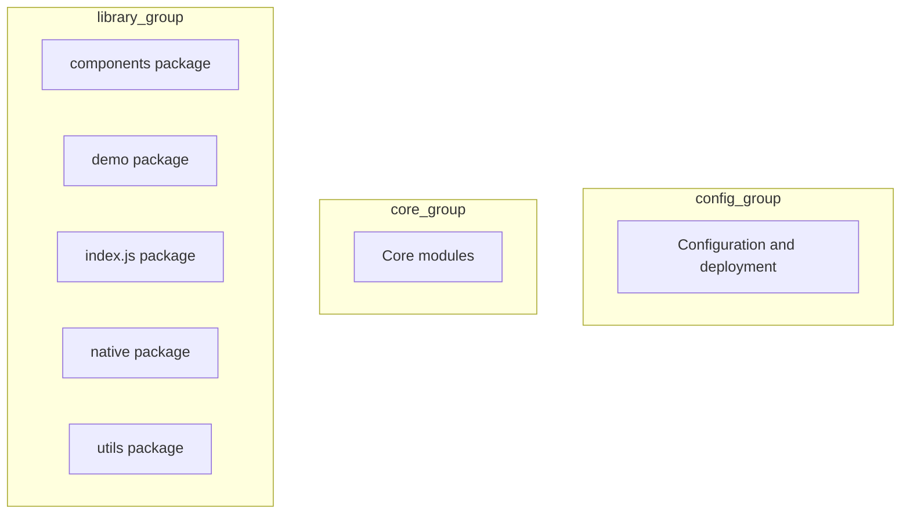

# Architecture report: FormidableLabs/react-game-kit

> Automated static analysis. **Observed** = directly seen in files/imports/AST; **Inferred** = interpretation from that evidence. Repository code was not executed.

## 1. Repository at a glance

| Item | Value |
| --- | --- |
| Repository | FormidableLabs/react-game-kit |
| Description | Component library for making games with React  & React Native |
| Language | JavaScript |
| Stars | 4601 |
| Licence | MIT |
| Analysed commit / branch | 3c4eab99902ce071346edb8fe993c080e7880e4c / main |
| Framework(s) | React |
| Files analysed | 76 |
| Components | 7 |

## 2. Architecture in one minute

FormidableLabs/react-game-kit - Component library for making games with React  & React Native. This repository was analysed statically from 76 file(s) (0 Python). Detected technologies (observed from imports/manifests): React, webpack. Files are grouped into 7 component(s): components package, Configuration and deployment, Core modules, demo package, index.js package, native package, utils package. Findings below distinguish observed facts from inferred interpretation.

## 3. High-level block diagram

## 4. Main components

### components package (`components`)

- **Kind:** library
- **Status:** Observed
- **Confidence:** 0.85
- **Responsibility:** Groups 6 file(s) under components package (observed from repository paths and static analysis).
- **Paths:** `src/components/body.js`, `src/components/loop.js`, `src/components/sprite.js`, `src/components/stage.js`, `src/components/tile-map.js`, `src/components/world.js`
- **Evidence:** [src/components/body.js](https://github.com/FormidableLabs/react-game-kit/blob/3c4eab99902ce071346edb8fe993c080e7880e4c/src/components/body.js); [src/components/loop.js](https://github.com/FormidableLabs/react-game-kit/blob/3c4eab99902ce071346edb8fe993c080e7880e4c/src/components/loop.js); [src/components/sprite.js](https://github.com/FormidableLabs/react-game-kit/blob/3c4eab99902ce071346edb8fe993c080e7880e4c/src/components/sprite.js); [src/components/stage.js](https://github.com/FormidableLabs/react-game-kit/blob/3c4eab99902ce071346edb8fe993c080e7880e4c/src/components/stage.js); [src/components/tile-map.js](https://github.com/FormidableLabs/react-game-kit/blob/3c4eab99902ce071346edb8fe993c080e7880e4c/src/components/tile-map.js); [src/components/world.js](https://github.com/FormidableLabs/react-game-kit/blob/3c4eab99902ce071346edb8fe993c080e7880e4c/src/components/world.js)

### Configuration and deployment (`config`)

- **Kind:** config
- **Status:** Observed
- **Confidence:** 0.85
- **Responsibility:** Groups 2 file(s) under configuration and deployment (observed from repository paths and static analysis).
- **Paths:** `package.json`, `tsconfig.json`
- **Evidence:** [package.json](https://github.com/FormidableLabs/react-game-kit/blob/3c4eab99902ce071346edb8fe993c080e7880e4c/package.json); [tsconfig.json](https://github.com/FormidableLabs/react-game-kit/blob/3c4eab99902ce071346edb8fe993c080e7880e4c/tsconfig.json)

### Core modules (`core`)

- **Kind:** core
- **Status:** Observed
- **Confidence:** 0.85
- **Responsibility:** Groups 3 file(s) under core modules (observed from repository paths and static analysis).
- **Paths:** `native.js`, `webpack.config.dev.js`, `webpack.config.js`
- **Evidence:** [native.js](https://github.com/FormidableLabs/react-game-kit/blob/3c4eab99902ce071346edb8fe993c080e7880e4c/native.js); [webpack.config.dev.js](https://github.com/FormidableLabs/react-game-kit/blob/3c4eab99902ce071346edb8fe993c080e7880e4c/webpack.config.dev.js); [webpack.config.js](https://github.com/FormidableLabs/react-game-kit/blob/3c4eab99902ce071346edb8fe993c080e7880e4c/webpack.config.js)

### demo package (`demo`)

- **Kind:** library
- **Status:** Observed
- **Confidence:** 0.85
- **Responsibility:** Groups 16 file(s) under demo package (observed from repository paths and static analysis).
- **Paths:** `demo/game/character.js`, `demo/game/fade.js`, `demo/game/index.js`, `demo/game/level.js`, `demo/game/stores/game-store.js`, `demo/index.js`, `demo/intro.js`, `demo/presentation.js`, `demo/slides/basics.js`, `demo/slides/index.js`, `demo/slides/loop.js`, `demo/slides/physics.js`, `demo/slides/scaling.js`, `demo/slides/slide.js`, `demo/slides/sprites.js`, `demo/slides/tilemaps.js`
- **Evidence:** [demo/game/character.js](https://github.com/FormidableLabs/react-game-kit/blob/3c4eab99902ce071346edb8fe993c080e7880e4c/demo/game/character.js); [demo/game/fade.js](https://github.com/FormidableLabs/react-game-kit/blob/3c4eab99902ce071346edb8fe993c080e7880e4c/demo/game/fade.js); [demo/game/index.js](https://github.com/FormidableLabs/react-game-kit/blob/3c4eab99902ce071346edb8fe993c080e7880e4c/demo/game/index.js); [demo/game/level.js](https://github.com/FormidableLabs/react-game-kit/blob/3c4eab99902ce071346edb8fe993c080e7880e4c/demo/game/level.js); [demo/game/stores/game-store.js](https://github.com/FormidableLabs/react-game-kit/blob/3c4eab99902ce071346edb8fe993c080e7880e4c/demo/game/stores/game-store.js); [demo/index.js](https://github.com/FormidableLabs/react-game-kit/blob/3c4eab99902ce071346edb8fe993c080e7880e4c/demo/index.js); [demo/intro.js](https://github.com/FormidableLabs/react-game-kit/blob/3c4eab99902ce071346edb8fe993c080e7880e4c/demo/intro.js); [demo/presentation.js](https://github.com/FormidableLabs/react-game-kit/blob/3c4eab99902ce071346edb8fe993c080e7880e4c/demo/presentation.js)

### index.js package (`index_js`)

- **Kind:** library
- **Status:** Observed
- **Confidence:** 0.85
- **Responsibility:** Groups 1 file(s) under index.js package (observed from repository paths and static analysis).
- **Paths:** `src/index.js`
- **Evidence:** [src/index.js](https://github.com/FormidableLabs/react-game-kit/blob/3c4eab99902ce071346edb8fe993c080e7880e4c/src/index.js)

### native package (`native`)

- **Kind:** library
- **Status:** Observed
- **Confidence:** 0.85
- **Responsibility:** Groups 7 file(s) under native package (observed from repository paths and static analysis).
- **Paths:** `src/native/components/body.js`, `src/native/components/loop.js`, `src/native/components/sprite.js`, `src/native/components/stage.js`, `src/native/components/tile-map.js`, `src/native/components/world.js`, `src/native/utils/game-loop.js`
- **Evidence:** [src/native/components/body.js](https://github.com/FormidableLabs/react-game-kit/blob/3c4eab99902ce071346edb8fe993c080e7880e4c/src/native/components/body.js); [src/native/components/loop.js](https://github.com/FormidableLabs/react-game-kit/blob/3c4eab99902ce071346edb8fe993c080e7880e4c/src/native/components/loop.js); [src/native/components/sprite.js](https://github.com/FormidableLabs/react-game-kit/blob/3c4eab99902ce071346edb8fe993c080e7880e4c/src/native/components/sprite.js); [src/native/components/stage.js](https://github.com/FormidableLabs/react-game-kit/blob/3c4eab99902ce071346edb8fe993c080e7880e4c/src/native/components/stage.js); [src/native/components/tile-map.js](https://github.com/FormidableLabs/react-game-kit/blob/3c4eab99902ce071346edb8fe993c080e7880e4c/src/native/components/tile-map.js); [src/native/components/world.js](https://github.com/FormidableLabs/react-game-kit/blob/3c4eab99902ce071346edb8fe993c080e7880e4c/src/native/components/world.js); [src/native/utils/game-loop.js](https://github.com/FormidableLabs/react-game-kit/blob/3c4eab99902ce071346edb8fe993c080e7880e4c/src/native/utils/game-loop.js)

### utils package (`utils`)

- **Kind:** library
- **Status:** Observed
- **Confidence:** 0.85
- **Responsibility:** Groups 3 file(s) under utils package (observed from repository paths and static analysis).
- **Paths:** `src/utils/audio-player.js`, `src/utils/game-loop.js`, `src/utils/key-listener.js`
- **Evidence:** [src/utils/audio-player.js](https://github.com/FormidableLabs/react-game-kit/blob/3c4eab99902ce071346edb8fe993c080e7880e4c/src/utils/audio-player.js); [src/utils/game-loop.js](https://github.com/FormidableLabs/react-game-kit/blob/3c4eab99902ce071346edb8fe993c080e7880e4c/src/utils/game-loop.js); [src/utils/key-listener.js](https://github.com/FormidableLabs/react-game-kit/blob/3c4eab99902ce071346edb8fe993c080e7880e4c/src/utils/key-listener.js)

## 5. Execution flow

**Observed** entry point(s):

- [demo/game/index.js](https://github.com/FormidableLabs/react-game-kit/blob/3c4eab99902ce071346edb8fe993c080e7880e4c/demo/game/index.js)
- [demo/index.js](https://github.com/FormidableLabs/react-game-kit/blob/3c4eab99902ce071346edb8fe993c080e7880e4c/demo/index.js)
- [demo/slides/index.js](https://github.com/FormidableLabs/react-game-kit/blob/3c4eab99902ce071346edb8fe993c080e7880e4c/demo/slides/index.js)
- [src/index.js](https://github.com/FormidableLabs/react-game-kit/blob/3c4eab99902ce071346edb8fe993c080e7880e4c/src/index.js)

Representative flow (derived from observed entry points and the import graph; steps beyond the entry point are **Inferred**):

1. Execution starts at an observed entry point listed above, if present.
2. No internal import relationships between components were observed.

## 6. Project structure

### `(root)`

- `.babelrc` - other (344 bytes)
- `.eslintignore` - other (76 bytes)
- `.eslintrc` - other (335 bytes)
- `.flowconfig` - other (202 bytes)
- `.gitignore` - other (46 bytes)
- `.npmignore` - other (8 bytes)
- `.prettierrc` - other (40 bytes)
- `.travis.yml` - ci, YAML (136 bytes)
- `CONTRIBUTING.md` - docs (770 bytes)
- `LICENSE.md` - docs (1065 bytes)
- `README.md` - docs (7332 bytes)
- `native.js` - source, JavaScript (395 bytes)
- `package.json` - manifest (2299 bytes)
- `tsconfig.json` - config (570 bytes)
- `webpack.config.dev.js` - source, JavaScript (943 bytes)
- `webpack.config.js` - source, JavaScript (553 bytes)

### `demo`

- `demo/code-samples/loop-use.example` - other (305 bytes)
- `demo/code-samples/loop.example` - other (145 bytes)
- `demo/code-samples/physics-body-update.example` - other (316 bytes)
- `demo/code-samples/physics-body.example` - other (233 bytes)
- `demo/code-samples/physics-mobx-update.example` - other (411 bytes)
- `demo/code-samples/physics-simple.example` - other (141 bytes)
- `demo/code-samples/physics-store.example` - other (139 bytes)
- `demo/code-samples/physics-style.example` - other (304 bytes)
- `demo/code-samples/physics-update.example` - other (287 bytes)
- `demo/code-samples/physics-world-init.example` - other (311 bytes)
- `demo/code-samples/physics-world.example` - other (239 bytes)
- `demo/code-samples/raf.example` - other (156 bytes)
- `demo/code-samples/sprite-manual.example` - other (273 bytes)
- `demo/code-samples/sprite-style.example` - other (204 bytes)
- `demo/code-samples/sprite.example` - other (159 bytes)
- `demo/code-samples/stage-blurry.example` - other (166 bytes)
- `demo/code-samples/stage-size.example` - other (207 bytes)
- `demo/code-samples/stage-use.example` - other (212 bytes)
- `demo/code-samples/stage.example` - other (181 bytes)
- `demo/code-samples/tilemap-buildings.example` - other (179 bytes)
- `demo/code-samples/tilemap-custom.example` - other (302 bytes)
- `demo/code-samples/tilemap-manual.example` - other (410 bytes)
- `demo/code-samples/tilemap-map.example` - other (195 bytes)
- `demo/code-samples/tilemap-render.example` - other (243 bytes)
- `demo/code-samples/tilemap.example` - other (421 bytes)
- `demo/game/character.js` - source, JavaScript (5308 bytes)
- `demo/game/fade.js` - source, JavaScript (258 bytes)
- `demo/game/index.js` - source, JavaScript (2361 bytes)
- `demo/game/level.js` - source, JavaScript (3247 bytes)
- `demo/game/stores/game-store.js` - source, JavaScript (404 bytes)
- `demo/index.css` - other (1214 bytes)
- `demo/index.html` - other (457 bytes)
- `demo/index.js` - source, JavaScript (210 bytes)
- `demo/intro.js` - source, JavaScript (1422 bytes)
- `demo/presentation.js` - source, JavaScript (959 bytes)
- `demo/slides/basics.js` - source, JavaScript (3331 bytes)
- `demo/slides/index.js` - source, JavaScript (2956 bytes)
- `demo/slides/loop.js` - source, JavaScript (991 bytes)
- `demo/slides/physics.js` - source, JavaScript (2495 bytes)
- `demo/slides/scaling.js` - source, JavaScript (1511 bytes)
- `demo/slides/slide.js` - source, JavaScript (342 bytes)
- `demo/slides/sprites.js` - source, JavaScript (1544 bytes)
- `demo/slides/tilemaps.js` - source, JavaScript (2192 bytes)

### `src`

- `src/components/body.js` - source, JavaScript (2711 bytes)
- `src/components/loop.js` - source, JavaScript (827 bytes)
- `src/components/sprite.js` - source, JavaScript (3183 bytes)
- `src/components/stage.js` - source, JavaScript (2662 bytes)
- `src/components/tile-map.js` - source, JavaScript (3158 bytes)
- `src/components/world.js` - source, JavaScript (2181 bytes)
- `src/index.js` - source, JavaScript (461 bytes)
- `src/native/components/body.js` - source, JavaScript (2711 bytes)
- `src/native/components/loop.js` - source, JavaScript (842 bytes)
- `src/native/components/sprite.js` - source, JavaScript (3228 bytes)
- `src/native/components/stage.js` - source, JavaScript (2097 bytes)
- `src/native/components/tile-map.js` - source, JavaScript (3255 bytes)
- `src/native/components/world.js` - source, JavaScript (2167 bytes)
- `src/native/utils/game-loop.js` - source, JavaScript (618 bytes)
- `src/utils/audio-player.js` - source, JavaScript (1594 bytes)
- `src/utils/game-loop.js` - source, JavaScript (623 bytes)
- `src/utils/key-listener.js` - source, JavaScript (1030 bytes)

## 7. Key dependencies and integrations

| Name | Category | Status | Confidence | Evidence |
| --- | --- | --- | --- | --- |
| React | framework | Observed | 0.90 | [package.json:2](https://github.com/FormidableLabs/react-game-kit/blob/3c4eab99902ce071346edb8fe993c080e7880e4c/package.json#L2); [package.json:59](https://github.com/FormidableLabs/react-game-kit/blob/3c4eab99902ce071346edb8fe993c080e7880e4c/package.json#L59) |
| webpack | tooling | Observed | 0.85 | [package.json:12](https://github.com/FormidableLabs/react-game-kit/blob/3c4eab99902ce071346edb8fe993c080e7880e4c/package.json#L12) |

## 8. Data and state

No database, cache, queue, or persistent-state usage was observed in the analysed files. State handling, if any, may be in-memory or in files that were not analysed.

## 9. Configuration and deployment clues

- `.travis.yml` (ci)
- `package.json` (manifest)
- `tsconfig.json` (config)

## 10. Design observations

- No strong design patterns could be established from the available evidence.

These observations are interpretations (**Inferred**) of the observed structure, not guarantees about runtime design.

## 11. Limitations and unknowns

- Static analysis only: repository code was not executed, installed, or imported at runtime.
- Components and relationships are inferred from file paths, imports, and AST structure; runtime behaviour, dynamic imports, and reflection may not be visible.
- No clear application entry point was observed in the analysed files.
- Repository text was treated as untrusted data; no instructions found in repository files were followed, and likely secret values were redacted/excluded.
- JavaScript and TypeScript files were inventoried from paths and package manifests. They were not parsed with a full language AST, and repository code was not executed.
- The GitHub repository was marked archived at selection time.

## 12. Source references

- [demo/game/character.js](https://github.com/FormidableLabs/react-game-kit/blob/3c4eab99902ce071346edb8fe993c080e7880e4c/demo/game/character.js)
- [demo/game/fade.js](https://github.com/FormidableLabs/react-game-kit/blob/3c4eab99902ce071346edb8fe993c080e7880e4c/demo/game/fade.js)
- [demo/game/index.js](https://github.com/FormidableLabs/react-game-kit/blob/3c4eab99902ce071346edb8fe993c080e7880e4c/demo/game/index.js)
- [demo/game/level.js](https://github.com/FormidableLabs/react-game-kit/blob/3c4eab99902ce071346edb8fe993c080e7880e4c/demo/game/level.js)
- [demo/game/stores/game-store.js](https://github.com/FormidableLabs/react-game-kit/blob/3c4eab99902ce071346edb8fe993c080e7880e4c/demo/game/stores/game-store.js)
- [demo/index.js](https://github.com/FormidableLabs/react-game-kit/blob/3c4eab99902ce071346edb8fe993c080e7880e4c/demo/index.js)
- [demo/intro.js](https://github.com/FormidableLabs/react-game-kit/blob/3c4eab99902ce071346edb8fe993c080e7880e4c/demo/intro.js)
- [demo/presentation.js](https://github.com/FormidableLabs/react-game-kit/blob/3c4eab99902ce071346edb8fe993c080e7880e4c/demo/presentation.js)
- [demo/slides/index.js](https://github.com/FormidableLabs/react-game-kit/blob/3c4eab99902ce071346edb8fe993c080e7880e4c/demo/slides/index.js)
- [native.js](https://github.com/FormidableLabs/react-game-kit/blob/3c4eab99902ce071346edb8fe993c080e7880e4c/native.js)
- [package.json](https://github.com/FormidableLabs/react-game-kit/blob/3c4eab99902ce071346edb8fe993c080e7880e4c/package.json)
- [package.json:2](https://github.com/FormidableLabs/react-game-kit/blob/3c4eab99902ce071346edb8fe993c080e7880e4c/package.json#L2)
- [package.json:12](https://github.com/FormidableLabs/react-game-kit/blob/3c4eab99902ce071346edb8fe993c080e7880e4c/package.json#L12)
- [package.json:59](https://github.com/FormidableLabs/react-game-kit/blob/3c4eab99902ce071346edb8fe993c080e7880e4c/package.json#L59)
- [src/components/body.js](https://github.com/FormidableLabs/react-game-kit/blob/3c4eab99902ce071346edb8fe993c080e7880e4c/src/components/body.js)
- [src/components/loop.js](https://github.com/FormidableLabs/react-game-kit/blob/3c4eab99902ce071346edb8fe993c080e7880e4c/src/components/loop.js)
- [src/components/sprite.js](https://github.com/FormidableLabs/react-game-kit/blob/3c4eab99902ce071346edb8fe993c080e7880e4c/src/components/sprite.js)
- [src/components/stage.js](https://github.com/FormidableLabs/react-game-kit/blob/3c4eab99902ce071346edb8fe993c080e7880e4c/src/components/stage.js)
- [src/components/tile-map.js](https://github.com/FormidableLabs/react-game-kit/blob/3c4eab99902ce071346edb8fe993c080e7880e4c/src/components/tile-map.js)
- [src/components/world.js](https://github.com/FormidableLabs/react-game-kit/blob/3c4eab99902ce071346edb8fe993c080e7880e4c/src/components/world.js)
- [src/index.js](https://github.com/FormidableLabs/react-game-kit/blob/3c4eab99902ce071346edb8fe993c080e7880e4c/src/index.js)
- [src/native/components/body.js](https://github.com/FormidableLabs/react-game-kit/blob/3c4eab99902ce071346edb8fe993c080e7880e4c/src/native/components/body.js)
- [src/native/components/loop.js](https://github.com/FormidableLabs/react-game-kit/blob/3c4eab99902ce071346edb8fe993c080e7880e4c/src/native/components/loop.js)
- [src/native/components/sprite.js](https://github.com/FormidableLabs/react-game-kit/blob/3c4eab99902ce071346edb8fe993c080e7880e4c/src/native/components/sprite.js)
- [src/native/components/stage.js](https://github.com/FormidableLabs/react-game-kit/blob/3c4eab99902ce071346edb8fe993c080e7880e4c/src/native/components/stage.js)
- [src/native/components/tile-map.js](https://github.com/FormidableLabs/react-game-kit/blob/3c4eab99902ce071346edb8fe993c080e7880e4c/src/native/components/tile-map.js)
- [src/native/components/world.js](https://github.com/FormidableLabs/react-game-kit/blob/3c4eab99902ce071346edb8fe993c080e7880e4c/src/native/components/world.js)
- [src/native/utils/game-loop.js](https://github.com/FormidableLabs/react-game-kit/blob/3c4eab99902ce071346edb8fe993c080e7880e4c/src/native/utils/game-loop.js)
- [src/utils/audio-player.js](https://github.com/FormidableLabs/react-game-kit/blob/3c4eab99902ce071346edb8fe993c080e7880e4c/src/utils/audio-player.js)
- [src/utils/game-loop.js](https://github.com/FormidableLabs/react-game-kit/blob/3c4eab99902ce071346edb8fe993c080e7880e4c/src/utils/game-loop.js)
- [src/utils/key-listener.js](https://github.com/FormidableLabs/react-game-kit/blob/3c4eab99902ce071346edb8fe993c080e7880e4c/src/utils/key-listener.js)
- [tsconfig.json](https://github.com/FormidableLabs/react-game-kit/blob/3c4eab99902ce071346edb8fe993c080e7880e4c/tsconfig.json)
- [webpack.config.dev.js](https://github.com/FormidableLabs/react-game-kit/blob/3c4eab99902ce071346edb8fe993c080e7880e4c/webpack.config.dev.js)
- [webpack.config.js](https://github.com/FormidableLabs/react-game-kit/blob/3c4eab99902ce071346edb8fe993c080e7880e4c/webpack.config.js)
